# Overview

How to read the diagrams, the whole site map, and one request from referral to decision.

Shapes and colours: see `00-overview.md`. Source: `workflows/src/00-overview/`.

## How to read these diagrams

One example flow that uses every shape once. The shape tells you what kind of step it is; the colour tells you who does it.

Route: `Every diagram uses the same sixteen shapes and colours`

```mermaid
%%{init: {"theme":"base","themeVariables":{"fontFamily":"'DM Sans', 'Segoe UI', system-ui, sans-serif","fontSize":"15px","lineColor":"#5B6B63","primaryTextColor":"#1C2B25","clusterBkg":"#FBF8F3","clusterBorder":"#D9CDBB","edgeLabelBackground":"#FFFFFF"},"flowchart":{"curve":"basis","nodeSpacing":36,"rankSpacing":48,"padding":12,"htmlLabels":true,"useMaxWidth":false,"wrappingWidth":230}} }%%
flowchart TD
  classDef k_start fill:#1F5C4B,stroke:#174638,color:#FFFFFF,stroke-width:1.5px,font-weight:600
  classDef k_end fill:#DDEFE3,stroke:#2E7D4F,color:#14502F,stroke-width:1.5px,font-weight:600
  classDef k_endx fill:#FBE3E0,stroke:#C0392B,color:#7A1F16,stroke-width:1.5px,font-weight:600
  classDef k_screen fill:#FFFDF8,stroke:#1F5C4B,color:#1C2B25,stroke-width:2px
  classDef k_overlay fill:#F1F7F3,stroke:#1F5C4B,color:#1C2B25,stroke-width:2px,stroke-dasharray:5 3
  classDef k_click fill:#DCEBFA,stroke:#2F6DB5,color:#12365F,stroke-width:1.5px
  classDef k_input fill:#E4E7FF,stroke:#4C5FD5,color:#1D2670,stroke-width:1.5px
  classDef k_process fill:#EEF0EE,stroke:#7A857F,color:#26302B,stroke-width:1.5px
  classDef k_agent fill:#EEE5FA,stroke:#7A4FC2,color:#341A63,stroke-width:1.5px
  classDef k_decision fill:#FFF0CC,stroke:#D9962B,color:#5C3B00,stroke-width:1.5px
  classDef k_store fill:#D5F0EA,stroke:#1C8E7B,color:#0B4A3F,stroke-width:1.5px
  classDef k_doc fill:#F6E9DC,stroke:#B07A4C,color:#4A2E14,stroke-width:1.5px
  classDef k_ext fill:#FFE6D2,stroke:#E07B39,color:#6B2F06,stroke-width:1.5px
  classDef k_wait fill:#E4E8EE,stroke:#6B7C93,color:#26303D,stroke-width:1.5px
  classDef k_toast fill:#FFF9DB,stroke:#C9A400,color:#5A4A00,stroke-width:1.5px
  classDef k_goto fill:#FFFFFF,stroke:#1F5C4B,color:#1F5C4B,stroke-width:1.5px,stroke-dasharray:5 3
  s1@{ shape: stadium, label: "<b>Start</b><br/>A sidebar click or a link" }
  sc1@{ shape: curv-trap, label: "<b>Screen</b><br/>A page the person sees" }
  c1@{ shape: trap-t, label: "<b>Person clicks</b><br/>A button, row or key" }
  i1@{ shape: lean-r, label: "<b>Person enters</b><br/>Types, picks, drops a file" }
  o1@{ shape: win-pane, label: "<b>Pop-up</b><br/>Drawer, modal or menu" }
  p1@{ shape: rect, label: "<b>System step</b><br/>The app validates or updates" }
  a1@{ shape: hex, label: "<b>FLO / agent</b><br/>Automated work (Reader, Scribe...)" }
  d1@{ shape: diam, label: "<b>Decision</b><br/>Every exit is labelled" }
  st1@{ shape: cyl, label: "<b>Data saved</b><br/>A record is created or changed" }
  dc1@{ shape: doc, label: "<b>Document</b><br/>Letter, brief, report" }
  t1@{ shape: odd, label: "<b>Message</b><br/>A toast or banner" }
  x1@{ shape: st-rect, label: "<b>Outside party</b><br/>Payer, referrer, EMR" }
  w1@{ shape: delay, label: "<b>Wait</b><br/>Time passes" }
  g1@{ shape: subproc, label: "Continues in: Site map › Every menu tab and sub tab" }
  e1@{ shape: stadium, label: "End (done)" }
  e2@{ shape: stadium, label: "End (stopped)" }
  s1 --> sc1 --> c1 --> i1 --> o1 --> p1 --> a1 --> d1
  d1 -->|"Yes"| st1 --> dc1 --> t1 --> x1 --> w1 --> g1
  d1 -->|"No"| e2
  g1 --> e1
  class s1 k_start
  class sc1 k_screen
  class c1 k_click
  class i1 k_input
  class o1 k_overlay
  class p1 k_process
  class a1 k_agent
  class d1 k_decision
  class st1 k_store
  class dc1 k_doc
  class t1 k_toast
  class x1 k_ext
  class w1 k_wait
  class g1 k_goto
  class e1 k_end
  class e2 k_endx
```

## Site map › Every menu tab and sub tab

The whole product on one page. Each green screen is a sidebar destination; dashed boxes jump to the diagrams for that tab. Authorizations is the only item with sub tabs; Case Manager has two tabs inside its page.

Route: `/ (opens the Dashboard)`

```mermaid
%%{init: {"theme":"base","themeVariables":{"fontFamily":"'DM Sans', 'Segoe UI', system-ui, sans-serif","fontSize":"15px","lineColor":"#5B6B63","primaryTextColor":"#1C2B25","clusterBkg":"#FBF8F3","clusterBorder":"#D9CDBB","edgeLabelBackground":"#FFFFFF"},"flowchart":{"curve":"basis","nodeSpacing":36,"rankSpacing":48,"padding":12,"htmlLabels":true,"useMaxWidth":false,"wrappingWidth":230}} }%%
flowchart LR
  classDef k_start fill:#1F5C4B,stroke:#174638,color:#FFFFFF,stroke-width:1.5px,font-weight:600
  classDef k_end fill:#DDEFE3,stroke:#2E7D4F,color:#14502F,stroke-width:1.5px,font-weight:600
  classDef k_endx fill:#FBE3E0,stroke:#C0392B,color:#7A1F16,stroke-width:1.5px,font-weight:600
  classDef k_screen fill:#FFFDF8,stroke:#1F5C4B,color:#1C2B25,stroke-width:2px
  classDef k_overlay fill:#F1F7F3,stroke:#1F5C4B,color:#1C2B25,stroke-width:2px,stroke-dasharray:5 3
  classDef k_click fill:#DCEBFA,stroke:#2F6DB5,color:#12365F,stroke-width:1.5px
  classDef k_input fill:#E4E7FF,stroke:#4C5FD5,color:#1D2670,stroke-width:1.5px
  classDef k_process fill:#EEF0EE,stroke:#7A857F,color:#26302B,stroke-width:1.5px
  classDef k_agent fill:#EEE5FA,stroke:#7A4FC2,color:#341A63,stroke-width:1.5px
  classDef k_decision fill:#FFF0CC,stroke:#D9962B,color:#5C3B00,stroke-width:1.5px
  classDef k_store fill:#D5F0EA,stroke:#1C8E7B,color:#0B4A3F,stroke-width:1.5px
  classDef k_doc fill:#F6E9DC,stroke:#B07A4C,color:#4A2E14,stroke-width:1.5px
  classDef k_ext fill:#FFE6D2,stroke:#E07B39,color:#6B2F06,stroke-width:1.5px
  classDef k_wait fill:#E4E8EE,stroke:#6B7C93,color:#26303D,stroke-width:1.5px
  classDef k_toast fill:#FFF9DB,stroke:#C9A400,color:#5A4A00,stroke-width:1.5px
  classDef k_goto fill:#FFFFFF,stroke:#1F5C4B,color:#1F5C4B,stroke-width:1.5px,stroke-dasharray:5 3
  s0@{ shape: stadium, label: "<b>Open Psyflo</b><br/>The address / goes to the Dashboard" }
  shell@{ shape: curv-trap, label: "<b>App frame</b><br/>Sidebar on the left, top bar on top, page in the middle" }
  subgraph gTop ["Top bar (on every page)"]
  ask@{ shape: win-pane, label: "<b>Ask FLO</b><br/>Drawer: ask a question, answers from your data" }
  notif@{ shape: win-pane, label: "<b>Notifications</b><br/>List of what needs you" }
  demo@{ shape: win-pane, label: "<b>Demo menu</b><br/>Reset data, move the clock, suggested path" }
  end
  subgraph gMain ["Sidebar › Main"]
  dash@{ shape: curv-trap, label: "<b>Dashboard</b><br/>Filters, calendar, stage strip, requests, payers" }
  auth@{ shape: curv-trap, label: "<b>Authorizations › Queue</b><br/>Requests ranked by money and time" }
  newc@{ shape: curv-trap, label: "<b>Authorizations › New case</b><br/>Referral, Medical records, Agents work, Review and sign" }
  elig@{ shape: curv-trap, label: "<b>Authorizations › Eligibility & Benefits</b><br/>List, verify a patient, result" }
  den@{ shape: curv-trap, label: "<b>Denial Intelligence</b><br/>Open denials, options, brief" }
  mgr@{ shape: curv-trap, label: "<b>Case Manager</b><br/>Tabs: Active cases and Reviews this week" }
  ana@{ shape: curv-trap, label: "<b>Analytics</b><br/>Performance and the monthly report" }
  end
  subgraph gConn ["Sidebar › Connections"]
  emr@{ shape: curv-trap, label: "<b>EMR Connect</b><br/>Systems, sync, mappings" }
  pay@{ shape: curv-trap, label: "<b>Payers</b><br/>Process, Rules, Documents, Changes" }
  end
  subgraph gBot ["Sidebar › Bottom"]
  set@{ shape: curv-trap, label: "<b>Settings</b><br/>The sixteen agents and Pause all" }
  help@{ shape: odd, label: "<b>Help</b><br/>A toast points to Ask FLO and the Demo menu" }
  out@{ shape: odd, label: "<b>Sign out</b><br/>A toast: there is nothing to sign out of" }
  end
  subgraph gSub ["Pages reached from inside a tab"]
  case@{ shape: curv-trap, label: "<b>Authorizations › Case page</b><br/>Five tabs: actions, picture, criteria, risk, draft" }
  ref@{ shape: curv-trap, label: "<b>New case › Full referral page</b><br/>Extracted, Validation, Coverage, Fit, Activity" }
  ver@{ shape: curv-trap, label: "Eligibility › Verify a patient and Result" }
  brief@{ shape: curv-trap, label: "Denial Intelligence › Peer-to-peer brief" }
  payer@{ shape: curv-trap, label: "<b>Payers › One payer</b><br/>Process, Rules, Documents, Changes tabs" }
  end
  g1@{ shape: subproc, label: "Continues in: Global shell" }
  g2@{ shape: subproc, label: "Continues in: Dashboard" }
  g3@{ shape: subproc, label: "Continues in: Authorizations › Queue and case page" }
  g4@{ shape: subproc, label: "Continues in: Authorizations › New case" }
  g5@{ shape: subproc, label: "Continues in: Authorizations › Eligibility & Benefits" }
  g6@{ shape: subproc, label: "Continues in: Denial Intelligence" }
  g7@{ shape: subproc, label: "Continues in: Case Manager" }
  g8@{ shape: subproc, label: "Continues in: Analytics" }
  g9@{ shape: subproc, label: "Continues in: EMR Connect" }
  g10@{ shape: subproc, label: "Continues in: Payers" }
  g11@{ shape: subproc, label: "Continues in: Settings" }
  s0 --> shell
  shell --> ask & notif & demo
  shell --> dash & auth & newc & elig & den & mgr & ana
  shell --> emr & pay
  shell --> set & help & out
  auth --> case
  newc --> ref
  elig --> ver
  den --> brief
  pay --> payer
  ask --> g1
  dash --> g2
  auth --> g3
  newc --> g4
  elig --> g5
  den --> g6
  mgr --> g7
  ana --> g8
  emr --> g9
  pay --> g10
  set --> g11
  class s0 k_start
  class shell,dash,auth,newc,elig,den,mgr,ana,emr,pay,set,case,ref,ver,brief,payer k_screen
  class ask,notif,demo k_overlay
  class help,out k_toast
  class g1,g2,g3,g4,g5,g6,g7,g8,g9,g10,g11 k_goto
  style gTop fill:#FBF8F3,stroke:#D9CDBB,stroke-width:1.5px,color:#5B6B63
  style gMain fill:#FBF8F3,stroke:#D9CDBB,stroke-width:1.5px,color:#5B6B63
  style gConn fill:#FBF8F3,stroke:#D9CDBB,stroke-width:1.5px,color:#5B6B63
  style gBot fill:#FBF8F3,stroke:#D9CDBB,stroke-width:1.5px,color:#5B6B63
  style gSub fill:#FBF8F3,stroke:#D9CDBB,stroke-width:1.5px,color:#5B6B63
```

## End to end › A request from referral to decision, denial and appeal

How one patient's request moves through the tabs. Follow the main path down the middle; the branches to the sides are what happens when the payer asks for more, denies, or approves.

Route: `Across the whole product`

```mermaid
%%{init: {"theme":"base","themeVariables":{"fontFamily":"'DM Sans', 'Segoe UI', system-ui, sans-serif","fontSize":"15px","lineColor":"#5B6B63","primaryTextColor":"#1C2B25","clusterBkg":"#FBF8F3","clusterBorder":"#D9CDBB","edgeLabelBackground":"#FFFFFF"},"flowchart":{"curve":"basis","nodeSpacing":36,"rankSpacing":48,"padding":12,"htmlLabels":true,"useMaxWidth":false,"wrappingWidth":230}} }%%
flowchart TD
  classDef k_start fill:#1F5C4B,stroke:#174638,color:#FFFFFF,stroke-width:1.5px,font-weight:600
  classDef k_end fill:#DDEFE3,stroke:#2E7D4F,color:#14502F,stroke-width:1.5px,font-weight:600
  classDef k_endx fill:#FBE3E0,stroke:#C0392B,color:#7A1F16,stroke-width:1.5px,font-weight:600
  classDef k_screen fill:#FFFDF8,stroke:#1F5C4B,color:#1C2B25,stroke-width:2px
  classDef k_overlay fill:#F1F7F3,stroke:#1F5C4B,color:#1C2B25,stroke-width:2px,stroke-dasharray:5 3
  classDef k_click fill:#DCEBFA,stroke:#2F6DB5,color:#12365F,stroke-width:1.5px
  classDef k_input fill:#E4E7FF,stroke:#4C5FD5,color:#1D2670,stroke-width:1.5px
  classDef k_process fill:#EEF0EE,stroke:#7A857F,color:#26302B,stroke-width:1.5px
  classDef k_agent fill:#EEE5FA,stroke:#7A4FC2,color:#341A63,stroke-width:1.5px
  classDef k_decision fill:#FFF0CC,stroke:#D9962B,color:#5C3B00,stroke-width:1.5px
  classDef k_store fill:#D5F0EA,stroke:#1C8E7B,color:#0B4A3F,stroke-width:1.5px
  classDef k_doc fill:#F6E9DC,stroke:#B07A4C,color:#4A2E14,stroke-width:1.5px
  classDef k_ext fill:#FFE6D2,stroke:#E07B39,color:#6B2F06,stroke-width:1.5px
  classDef k_wait fill:#E4E8EE,stroke:#6B7C93,color:#26303D,stroke-width:1.5px
  classDef k_toast fill:#FFF9DB,stroke:#C9A400,color:#5A4A00,stroke-width:1.5px
  classDef k_goto fill:#FFFFFF,stroke:#1F5C4B,color:#1F5C4B,stroke-width:1.5px,stroke-dasharray:5 3
  s1@{ shape: stadium, label: "<b>A referral arrives</b><br/>A clinic sends documents, or someone drops them in" }
  ref1@{ shape: st-rect, label: "Referrer sends documents" }
  nc1@{ shape: curv-trap, label: "<b>New case › Referral</b><br/>Checklist of what is ready and what is missing" }
  rd@{ shape: hex, label: "Reader reads the documents and fills the checklist" }
  d1@{ shape: diam, label: "Is the referral complete and acceptable?" }
  askref@{ shape: trap-t, label: "<b>Ask the referrer</b><br/>or Decline or Override" }
  nc2@{ shape: curv-trap, label: "<b>New case › Medical records</b><br/>One checklist for patient, insurance, request, documents" }
  emr@{ shape: st-rect, label: "<b>EMR Connect supplies the chart</b><br/>Pull from EMR" }
  ver@{ shape: hex, label: "<b>Verify checks coverage and benefits</b><br/>Eligibility & Benefits" }
  nc3@{ shape: curv-trap, label: "<b>New case › Agents work</b><br/>Scribe, Criteria, Placement, Integrity, Forecaster ..." }
  d2@{ shape: diam, label: "Does an agent need an answer from you?" }
  ans@{ shape: lean-r, label: "Answer Scribe's question" }
  chance@{ shape: hex, label: "Forecaster shows the approval chance" }
  nc4@{ shape: curv-trap, label: "<b>New case › Review and sign</b><br/>Nothing goes to the payer until a clinician signs" }
  sign@{ shape: trap-t, label: "<b>Clinician signs</b><br/>Sign and send" }
  req@{ shape: cyl, label: "<b>Request created</b><br/>Stage: Received" }
  payer@{ shape: st-rect, label: "<b>Payer receives the request</b><br/>(demo: simulated)" }
  dash@{ shape: curv-trap, label: "<b>Dashboard</b><br/>Stage strip: Preparing, Received, Under review, Info requested, Decided today, Appeal or call" }
  w1@{ shape: delay, label: "<b>Payer decides</b><br/>Time passes (the Demo menu moves the clock)" }
  d3@{ shape: diam, label: "What does the payer decide?" }
  info@{ shape: trap-t, label: "<b>Answer on the Dashboard</b><br/>Send the information requested" }
  ok@{ shape: stadium, label: "<b>Approved</b><br/>In Case Manager: reviews are scheduled before the authorization ends" }
  den@{ shape: curv-trap, label: "<b>Denial Intelligence</b><br/>Where the denial is weak, options with chances" }
  d4@{ shape: diam, label: "Which route?" }
  p2p@{ shape: doc, label: "Peer-to-peer brief and call" }
  app@{ shape: doc, label: "Written appeal, signed and sent" }
  acc@{ shape: trap-t, label: "Accept the denial" }
  d5@{ shape: diam, label: "Overturned?" }
  lost@{ shape: stadium, label: "<b>Denial stands</b><br/>Recorded and counted in Analytics" }
  ana@{ shape: curv-trap, label: "<b>Analytics</b><br/>Approval by payer, denial reasons, what helps most" }
  mgr@{ shape: curv-trap, label: "<b>Case Manager</b><br/>Active cases and Reviews this week" }
  s1 --> ref1 --> nc1 --> rd --> d1
  d1 -->|"Missing items"| askref --> nc1
  d1 -->|"Ready"| nc2
  emr -.-> nc2
  nc2 --> ver --> nc3
  nc3 --> d2
  d2 -->|"Yes"| ans --> chance
  d2 -->|"No"| chance
  chance --> nc4 --> sign --> req --> payer --> dash --> w1 --> d3
  d3 -->|"Needs information"| info --> w1
  d3 -->|"Approved"| ok
  d3 -->|"Denied"| den --> d4
  d4 -->|"Call"| p2p --> d5
  d4 -->|"Appeal"| app --> d5
  d4 -->|"Accept"| acc --> lost
  d5 -->|"Yes"| ok
  d5 -->|"No"| lost
  ok --> mgr
  lost --> ana
  ok --> ana
  class s1 k_start
  class ref1,emr,payer k_ext
  class nc1,nc2,nc3,nc4,dash,den,ana,mgr k_screen
  class rd,ver,chance k_agent
  class d1,d2,d3,d4,d5 k_decision
  class askref,sign,info,acc k_click
  class ans k_input
  class req k_store
  class w1 k_wait
  class ok k_end
  class p2p,app k_doc
  class lost k_endx
```

