# Global shell

The sidebar, the top bar (site switcher, Ask FLO, Notifications, Demo menu with Viewing as), Help, Sign out, redirects and toasts.

Shapes and colours: see `00-overview.md`. Source: `workflows/src/01-global-shell/`.

## Global shell › Sidebar › Where every item goes

The sidebar is on every page. Each row below is one click and the page it opens. Number bubbles, the Authorizations group and the green highlight have their own diagrams.

Route: `Every page (sidebar on the left)`

The logo 'psyflo.', the caption 'Prior auth & UR', the captions 'Main' and 'Connections' and the 'Demo data' tile are labels only. Nothing happens when they are clicked.

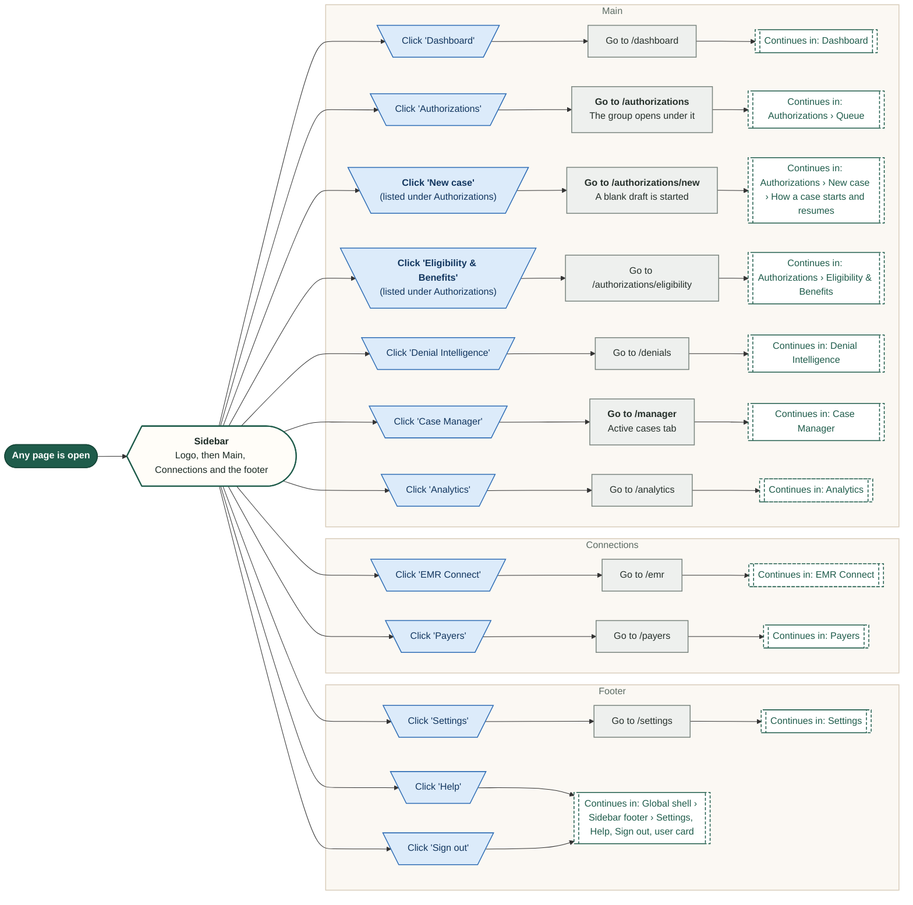

## Global shell › Sidebar › Badges and what they count

Seven sidebar rows carry a number bubble. Each number is counted live from the demo data, so it changes the moment something happens on any page, and every one except Payers follows the site view. Analytics and EMR Connect never have a bubble.

Route: `Every page (sidebar on the left)`

Numbers shown are the values when the demo starts or after 'Reset demo data', for Jordan Perez on Both sites. For one site they are that site's share, and Site A plus Site B always equals Both sites. Payers is the one badge that stays the same for every viewer.

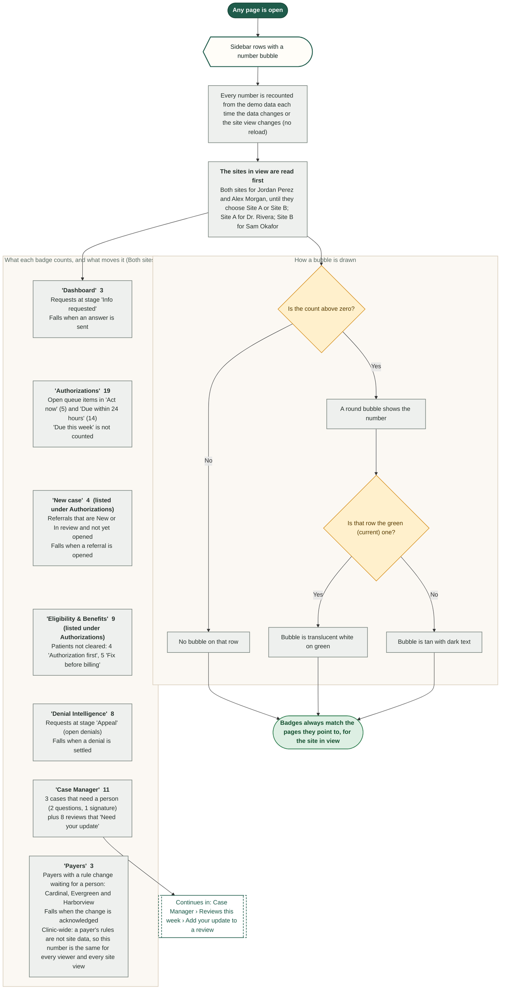

## Global shell › Sidebar › Authorizations group and green highlight

Two rules decide what the sidebar looks like. First, whether the Authorizations group shows its two sub rows. Second, which single row turns green. There is no collapse button: the group follows the address.

Route: `Any address (the sidebar reads the address after every change)`

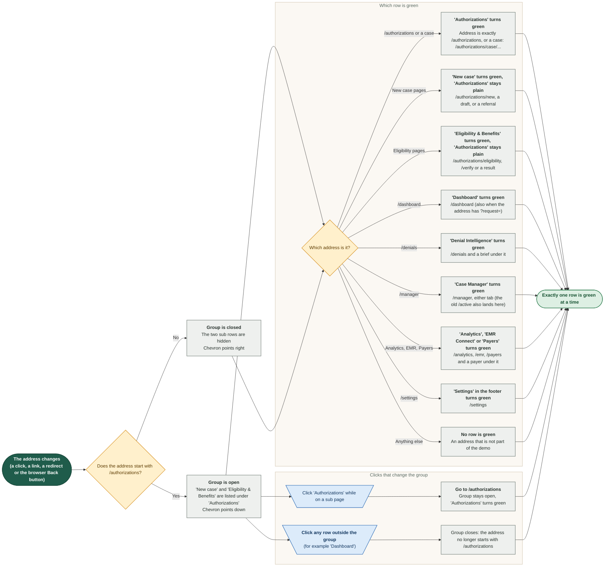

## Global shell › Top bar › Controls and how drawers close

The top bar holds the site view on the left and three controls on the right: the Demo menu, the 'Ask FLO' button and the 'Notifications' bell. The two drawers close the same three ways. There is no search box and no page title in the bar.

Route: `Every page (top bar, right side)`

Privacy mode is not a control. It is always on and is explained on the Settings page. The Demo menu is for the demo only and is not part of the product.

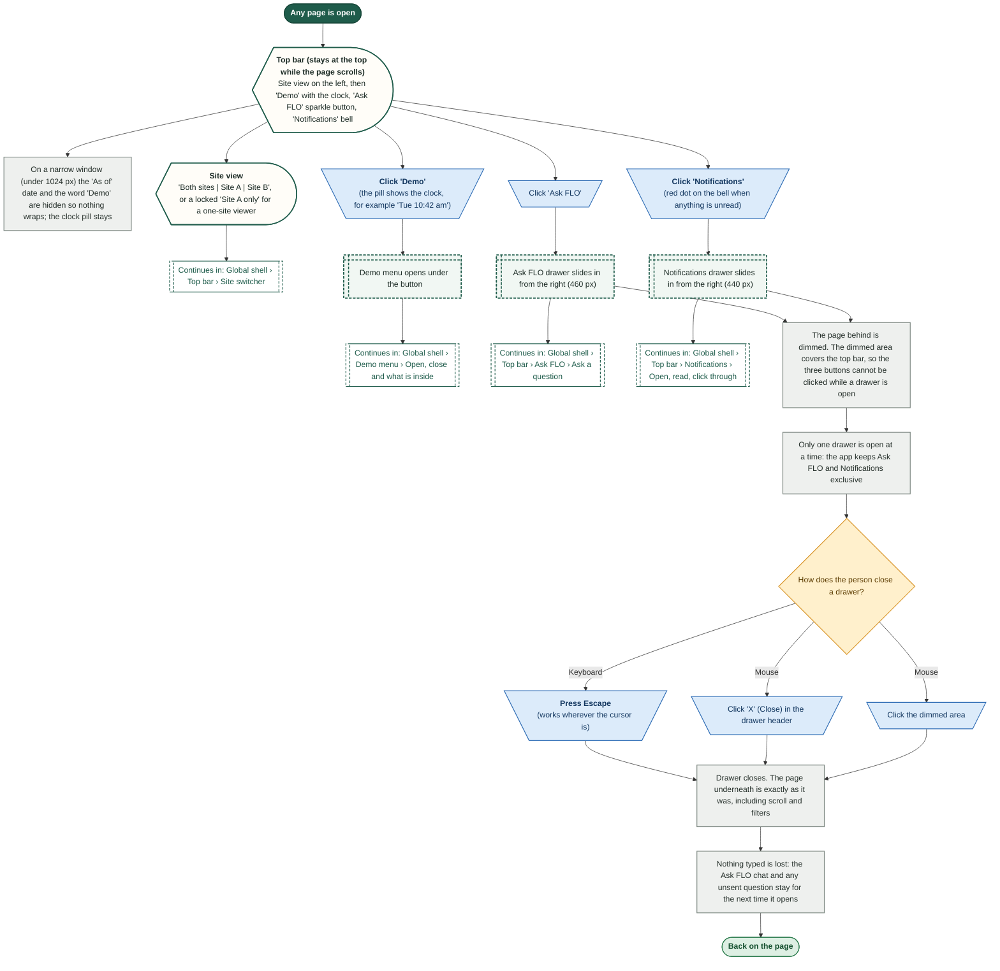

## Global shell › Top bar › Ask FLO › Ask a question

Open the drawer, pick a suggested question or type one, and read FLO's answer. The suggestions follow the screen the person is on. FLO answers from the demo data after a short pause, and only from the cases the viewer may see at the sites in view. What it says for each kind of question is in the next two diagrams.

Route: `Every page (Ask FLO drawer)`

The chat lives in the page, not in the demo data. It survives closing the drawer and changing pages, and 'Reset demo data' does not clear it. Reloading the browser does, and so does a change of viewer or of site (see the last row). The suggestions are worked out when the drawer opens, so a case page names its own case and payer.

```mermaid
%%{init: {"theme":"base","themeVariables":{"fontFamily":"'DM Sans', 'Segoe UI', system-ui, sans-serif","fontSize":"15px","lineColor":"#5B6B63","primaryTextColor":"#1C2B25","clusterBkg":"#FBF8F3","clusterBorder":"#D9CDBB","edgeLabelBackground":"#FFFFFF"},"flowchart":{"curve":"basis","nodeSpacing":36,"rankSpacing":48,"padding":12,"htmlLabels":true,"useMaxWidth":false,"wrappingWidth":230}} }%%
flowchart TD
  classDef k_start fill:#1F5C4B,stroke:#174638,color:#FFFFFF,stroke-width:1.5px,font-weight:600
  classDef k_end fill:#DDEFE3,stroke:#2E7D4F,color:#14502F,stroke-width:1.5px,font-weight:600
  classDef k_endx fill:#FBE3E0,stroke:#C0392B,color:#7A1F16,stroke-width:1.5px,font-weight:600
  classDef k_screen fill:#FFFDF8,stroke:#1F5C4B,color:#1C2B25,stroke-width:2px
  classDef k_overlay fill:#F1F7F3,stroke:#1F5C4B,color:#1C2B25,stroke-width:2px,stroke-dasharray:5 3
  classDef k_click fill:#DCEBFA,stroke:#2F6DB5,color:#12365F,stroke-width:1.5px
  classDef k_input fill:#E4E7FF,stroke:#4C5FD5,color:#1D2670,stroke-width:1.5px
  classDef k_process fill:#EEF0EE,stroke:#7A857F,color:#26302B,stroke-width:1.5px
  classDef k_agent fill:#EEE5FA,stroke:#7A4FC2,color:#341A63,stroke-width:1.5px
  classDef k_decision fill:#FFF0CC,stroke:#D9962B,color:#5C3B00,stroke-width:1.5px
  classDef k_store fill:#D5F0EA,stroke:#1C8E7B,color:#0B4A3F,stroke-width:1.5px
  classDef k_doc fill:#F6E9DC,stroke:#B07A4C,color:#4A2E14,stroke-width:1.5px
  classDef k_ext fill:#FFE6D2,stroke:#E07B39,color:#6B2F06,stroke-width:1.5px
  classDef k_wait fill:#E4E8EE,stroke:#6B7C93,color:#26303D,stroke-width:1.5px
  classDef k_toast fill:#FFF9DB,stroke:#C9A400,color:#5A4A00,stroke-width:1.5px
  classDef k_goto fill:#FFFFFF,stroke:#1F5C4B,color:#1F5C4B,stroke-width:1.5px,stroke-dasharray:5 3
  s1@{ shape: stadium, label: "Click 'Ask FLO' in the top bar" }
  o1@{ shape: win-pane, label: "<b>Ask FLO drawer opens</b><br/>Title 'Ask FLO', subtitle 'Your assistant, answering from your data'" }
  a1@{ shape: hex, label: "<b>FLO greets the person by name and says which sites it reads:</b><br/>'Hi Jordan, I am FLO. Ask me about your requests, a payer, or your denials. I answer from the data you can see: Both sites.'<br/>For Dr. Rivera: 'Hi Dr. Rivera, ... I answer from the data you can see: Site A.'" }
  dr@{ shape: diam, label: "Which screen is open?" }
  o2@{ shape: win-pane, label: "<b>Four suggestion chips under the chat:</b><br/>'What needs me today?'<br/>'What is due soonest?'<br/>'Which payers are slowest right now?'<br/>'Why is Cardinal's approval rate down?'<br/>Any other screen, or a case page that cannot be found" }
  oc@{ shape: win-pane, label: "<b>Three chips on a case page (/authorizations/case/R-1042):</b><br/>'What is missing for R-1042?'<br/>'When does this authorization run out?'<br/>'What does Summit require?'<br/>A line above them: 'Suggested for R-1042'" }
  om@{ shape: win-pane, label: "<b>One chip on Case Manager:</b><br/>'Which reviews are due?'<br/>'Suggested for Case Manager'" }
  od@{ shape: win-pane, label: "<b>One chip on Denial Intelligence:</b><br/>'Which denial is due first?'<br/>'Suggested for Denial Intelligence'" }
  oe@{ shape: win-pane, label: "<b>One chip on Eligibility & Benefits (the list and its pages):</b><br/>'Which patients need a fix before billing?'<br/>'Suggested for Eligibility & Benefits'" }
  d1@{ shape: diam, label: "How does the person ask?" }
  c1@{ shape: trap-t, label: "Click a suggestion chip" }
  i1@{ shape: lean-r, label: "Type in the box 'Ask a question'" }
  d2@{ shape: diam, label: "Is there text, and is FLO idle?" }
  x1@{ shape: rect, label: "<b>'Send' stays disabled</b><br/>Enter does nothing<br/>(blank or spaces only, or FLO is still working)" }
  c2@{ shape: trap-t, label: "Click 'Send' or press Enter" }
  p1@{ shape: rect, label: "<b>The question appears on the right in a green bubble</b><br/>The box is emptied" }
  p2@{ shape: rect, label: "<b>'FLO is working…' pulses under the chat</b><br/>'Send' is disabled until FLO answers" }
  w1@{ shape: delay, label: "About 0.7 seconds" }
  a2@{ shape: hex, label: "<b>FLO answers from the live demo data</b><br/>(picks the answer by key words)" }
  g1@{ shape: subproc, label: "Continues in: Global shell › Top bar › Ask FLO › What FLO answers" }
  d3@{ shape: diam, label: "Does the answer carry a link?" }
  c3@{ shape: trap-t, label: "Click the underlined link under the answer" }
  p3@{ shape: rect, label: "Drawer closes and the app opens that page" }
  g2@{ shape: subproc, label: "Continues in: Global shell › Top bar › Ask FLO › What FLO answers" }
  d4@{ shape: diam, label: "<b>Was the answer the fallback?</b><br/>('I did not find an answer...')" }
  p4@{ shape: rect, label: "<b>The chips are gone</b><br/>They show only while the chat has fewer than three messages, and while FLO is not working<br/>They come back, for the new screen, when the person has moved to another screen since the last message" }
  p7@{ shape: rect, label: "<b>The chips for this screen stay under the fallback answer</b><br/>A second miss keeps them. Any real answer takes them away" }
  c4@{ shape: trap-t, label: "Press Escape, click 'X' or click the dimmed area" }
  p5@{ shape: rect, label: "<b>Drawer closes</b><br/>The chat and any unsent text are kept" }
  p6@{ shape: rect, label: "<b>Open it again, on any page: the same chat is there</b><br/>Typed questions still work; the chips come back under a fallback answer, or when the screen has changed" }
  e1@{ shape: stadium, label: "Back on the page" }
  e2@{ shape: stadium, label: "No question sent" }
  s2@{ shape: stadium, label: "Change the viewer (Demo menu, 'Viewing as') or the site (top bar: Both sites, Site A, Site B)" }
  pv@{ shape: rect, label: "<b>The conversation starts again with a new greeting</b><br/>Whatever FLO said about the other view, including case IDs, does not stay on screen<br/>The chips are worked out again for the view" }
  s1 --> o1 --> a1 --> dr
  s2 --> pv --> a1
  dr -->|"Case page"| oc --> d1
  dr -->|"Case Manager"| om --> d1
  dr -->|"Denial Intelligence"| od --> d1
  dr -->|"Eligibility & Benefits"| oe --> d1
  dr -->|"Anywhere else"| o2 --> d1
  d1 -->|"Suggestion"| c1 --> p1
  d1 -->|"Typed"| i1 --> d2
  d2 -->|"No"| x1 --> e2
  d2 -->|"Yes"| c2 --> p1
  p1 --> p2 --> w1 --> a2 --> g1
  a2 --> d4
  d4 -->|"No"| p4 --> d3
  d4 -->|"Yes"| p7 --> c1
  d3 -->|"Yes"| c3 --> p3 --> g2
  d3 -->|"No"| c4
  c4 --> p5 --> p6 --> e1
  x1 -.-> i1
  class s1,s2 k_start
  class o1,o2,oc,om,od,oe k_overlay
  class a1,a2 k_agent
  class dr,d1,d2,d3,d4 k_decision
  class c1,c2,c3,c4 k_click
  class i1 k_input
  class x1,p1,p2,p3,p4,p7,p5,p6,pv k_process
  class w1 k_wait
  class g1,g2 k_goto
  class e1 k_end
  class e2 k_endx
```

## Global shell › Top bar › Ask FLO › What FLO answers

FLO lowercases the question and tries its rules in order. The first rule that matches answers, so a question with two key words gets the earlier answer. Counts, names and the request or denial it points to come from the live demo data. Only the Cardinal answer is fixed text, and even that counts only the unsent drafts at the sites in view. Five rules read the screen the person is on and are drawn in the next diagram. Every rule reads only the cases at the sites in view.

Route: `Every page (Ask FLO drawer)`

Typed questions use the same rules as the suggestion chips. Most rules ignore the page; the five on the next diagram use the open case page when the question does not name a case. Every link opens a view that matches the answer. PRD 08 describes row-level citations, thumbs and an escalate action on each answer; the demo gives one paragraph and one link instead.

```mermaid
%%{init: {"theme":"base","themeVariables":{"fontFamily":"'DM Sans', 'Segoe UI', system-ui, sans-serif","fontSize":"15px","lineColor":"#5B6B63","primaryTextColor":"#1C2B25","clusterBkg":"#FBF8F3","clusterBorder":"#D9CDBB","edgeLabelBackground":"#FFFFFF"},"flowchart":{"curve":"basis","nodeSpacing":36,"rankSpacing":48,"padding":12,"htmlLabels":true,"useMaxWidth":false,"wrappingWidth":230}} }%%
flowchart LR
  classDef k_start fill:#1F5C4B,stroke:#174638,color:#FFFFFF,stroke-width:1.5px,font-weight:600
  classDef k_end fill:#DDEFE3,stroke:#2E7D4F,color:#14502F,stroke-width:1.5px,font-weight:600
  classDef k_endx fill:#FBE3E0,stroke:#C0392B,color:#7A1F16,stroke-width:1.5px,font-weight:600
  classDef k_screen fill:#FFFDF8,stroke:#1F5C4B,color:#1C2B25,stroke-width:2px
  classDef k_overlay fill:#F1F7F3,stroke:#1F5C4B,color:#1C2B25,stroke-width:2px,stroke-dasharray:5 3
  classDef k_click fill:#DCEBFA,stroke:#2F6DB5,color:#12365F,stroke-width:1.5px
  classDef k_input fill:#E4E7FF,stroke:#4C5FD5,color:#1D2670,stroke-width:1.5px
  classDef k_process fill:#EEF0EE,stroke:#7A857F,color:#26302B,stroke-width:1.5px
  classDef k_agent fill:#EEE5FA,stroke:#7A4FC2,color:#341A63,stroke-width:1.5px
  classDef k_decision fill:#FFF0CC,stroke:#D9962B,color:#5C3B00,stroke-width:1.5px
  classDef k_store fill:#D5F0EA,stroke:#1C8E7B,color:#0B4A3F,stroke-width:1.5px
  classDef k_doc fill:#F6E9DC,stroke:#B07A4C,color:#4A2E14,stroke-width:1.5px
  classDef k_ext fill:#FFE6D2,stroke:#E07B39,color:#6B2F06,stroke-width:1.5px
  classDef k_wait fill:#E4E8EE,stroke:#6B7C93,color:#26303D,stroke-width:1.5px
  classDef k_toast fill:#FFF9DB,stroke:#C9A400,color:#5A4A00,stroke-width:1.5px
  classDef k_goto fill:#FFFFFF,stroke:#1F5C4B,color:#1F5C4B,stroke-width:1.5px,stroke-dasharray:5 3
  s1@{ shape: stadium, label: "<b>A question is sent</b><br/>(a chip or typed text)" }
  sx@{ shape: rect, label: "<b>FLO first narrows the data to the cases the viewer may see</b><br/>Both sites, Site A or Site B; a viewer limited to one site gets that site only<br/>Counts and names are for those cases, and a count says 'at Site A' when one site is in view<br/>A case at the other site is never named, counted or linked: 'I did not find I-2207 among the cases you can see.'" }
  d1@{ shape: diam, label: "Contains 'slow', or both 'payer' and 'late'?" }
  a1@{ shape: hex, label: "<b>FLO lists every payer slower than its typical time, worst first:</b><br/>'Evergreen is averaging 3.4 days against 2 typical. Cardinal is averaging 2.8 days against 2 typical. Beacon ... Lakeshore ... Harborview ...<br/>Caller phones when a payer passes twice its typical time.'<br/>If none is slower: 'Every payer is deciding within its typical time right now.'" }
  l1@{ shape: trap-t, label: "Click 'Open Analytics, turnaround'" }
  r1@{ shape: rect, label: "<b>Opens /analytics</b><br/>The Analytics page opens; Turnaround is one of its four figures" }
  g1@{ shape: subproc, label: "Continues in: Analytics › Headline figures" }
  dn@{ shape: diam, label: "<b>Contains 'billing', 'eligib' or 'fix before'?</b><br/>Or 'missing' or 'incomplete'?<br/>Or 'expir', 'run out', 'units' or 'end' (not with 'denial')?<br/>Or 'require'?<br/>Or 'review' (not 'under review')?" }
  an@{ shape: hex, label: "<b>FLO answers from the screen you are on or the case you name:</b><br/>what is missing for a case, when an authorization ends, what a payer requires, which reviews are due, which patients need a fix before billing<br/>Each names the case, quotes live data, says once that it is FLO's reading, and ends with a link to the exact place" }
  gn@{ shape: subproc, label: "Continues in: Global shell › Top bar › Ask FLO › Answers that read the screen" }
  d2@{ shape: diam, label: "Contains 'denial'?" }
  a2@{ shape: hex, label: "<b>'8 denials are open. The nearest deadline is D-3318 (Cardinal), peer-to-peer window, 36 h left. Call booked Wed 9 to 11 am. The brief is ready. The chance of winning is 64%. 3 more deadlines fall this week.'</b><br/>The count, the nearest open denial and the time left are live, so the sentence follows the data and the clock<br/>One muted line: 'This is FLO's reading of the demo data, not a payer confirmation.'<br/>FLO gives no dollar figure: a question that only asks about money gets the fallback answer" }
  l2@{ shape: trap-t, label: "Click 'Open Denial Intelligence'" }
  r2@{ shape: rect, label: "<b>Opens /denials?id=D-3318, the nearest denial</b><br/>With no deadline left to name, it opens the list" }
  g2@{ shape: subproc, label: "Continues in: Denial Intelligence › A denial opened" }
  d2b@{ shape: diam, label: "Contains 'due', 'soon' or 'deadline'?" }
  a2b@{ shape: hex, label: "<b>'R-0988 (Beacon) is due soonest: review due in 3 h. Its approval chance is 79%. After it: R-1042 (Summit), notice due in 5 h; I-2207 (Cardinal), recert due in 5 h. 56 requests are open in Authorizations.'</b><br/>For one site: 'is due soonest at Site A: ...' and only that site's open requests are counted<br/>Read from the open queue, soonest due first. Two due at the same time: the lower approval chance first<br/>Nothing open: 'Nothing is due. Every open request has been sent or handled.' with 'Open Authorizations'" }
  l2b@{ shape: trap-t, label: "Click 'Open R-0988'" }
  r2b@{ shape: rect, label: "<b>Opens /authorizations/case/R-0988</b><br/>The case page of the request due soonest" }
  g2b@{ shape: subproc, label: "Continues in: Authorizations › Case page › Ways in" }
  d3@{ shape: diam, label: "Contains 'cardinal' or 'approval rate'?" }
  a3@{ shape: hex, label: "<b>'Cardinal approved 63% as asked over the last 90 days, down 11 points. Historian links most of the drop to continued-stay evidence. Cardinal also published criteria version 2026.3, which affects 4 drafts you have not sent.'</b><br/>Fixed text" }
  l3@{ shape: trap-t, label: "Click 'Open Payers, Cardinal, Changes'" }
  g3@{ shape: subproc, label: "Continues in: Payers › History & Changes › Read what changed" }
  d4@{ shape: diam, label: "Contains 'need', 'today' or 'first'?" }
  a4@{ shape: hex, label: "<b>'3 requests need you: R-1042, I-2207, P-1499. Start with this: Review and sign R-0988, review due in 3 h.' then one line each for the next four, e.g. 'Answer Scribe's question on R-1042, notice due in 5 h.'</b><br/>It is the same list as Do next on the Dashboard, so the two never disagree; counts and IDs are live, and a Site A viewer gets 'need you at Site A' and only Site A cases<br/>One muted line: 'This is the Do next list on the Dashboard, worked out from today's demo data.'<br/>Nothing waiting: 'Nothing needs you right now.' with 'Open Dashboard'" }
  l4@{ shape: trap-t, label: "Click 'Open Do next on the Dashboard'" }
  r4@{ shape: rect, label: "<b>Opens /dashboard</b><br/>The Do next card is the first card under the Lifecycle" }
  g4@{ shape: subproc, label: "Continues in: Dashboard › Do next › What to do now and where each button leads" }
  d5@{ shape: diam, label: "Contains 'referral'?" }
  a5@{ shape: hex, label: "'New referrals are waiting for review. Reader has already checked each document, and Verify has run coverage for the ones with an insurance card.'" }
  l5@{ shape: trap-t, label: "Click 'Start a case from a referral'" }
  g5@{ shape: subproc, label: "Continues in: Authorizations › New case › Intake › Start with a referral or patient" }
  a6@{ shape: hex, label: "<b>'I did not find an answer to that in the demo data. Try one of the suggestions below.'</b><br/>No link. The four suggestion chips stay right under this answer, so the sentence is true" }
  e1@{ shape: stadium, label: "Answer stays in the chat" }
  s1 --> sx --> d1
  d1 -->|"Yes"| a1 --> l1 --> r1 --> g1
  d1 -->|"No"| dn
  dn -->|"Yes"| an --> gn
  dn -->|"No"| d2
  d2 -->|"Yes"| a2 --> l2 --> r2 --> g2
  d2 -->|"No"| d2b
  d2b -->|"Yes"| a2b --> l2b --> r2b --> g2b
  d2b -->|"No"| d3
  d3 -->|"Yes"| a3 --> l3 --> g3
  d3 -->|"No"| d4
  d4 -->|"Yes"| a4 --> l4 --> r4 --> g4
  d4 -->|"No"| d5
  d5 -->|"Yes"| a5 --> l5 --> g5
  d5 -->|"No"| a6 --> e1
  class s1 k_start
  class sx,r1,r2,r2b,r4 k_process
  class d1,dn,d2,d2b,d3,d4,d5 k_decision
  class a1,an,a2,a2b,a3,a4,a5,a6 k_agent
  class l1,l2,l2b,l3,l4,l5 k_click
  class g1,gn,g2,g2b,g3,g4,g5 k_goto
  class e1 k_end
```

## Global shell › Top bar › Ask FLO › Answers that read the screen

Five of FLO's rules read the demo data for one case, one payer or one screen: what is missing, when an authorization ends, what a payer requires, which reviews are due, which patients need a fix before billing. When the question names a case ('R-1042') FLO uses it; otherwise it uses the case page that is open; otherwise the request that needs you first. Each answer names the case, quotes live data and ends with a link to the exact place. They are recommendations, never payer facts. They read only the cases at the sites in view: a case at the other site is 'not found' for a viewer limited to one site, and the review, coverage and denial counts are for the sites in view.

Route: `Every page (Ask FLO drawer)`

The short line 'This is FLO's reading of the demo data, not a payer confirmation.' appears once, under the answers that read payer rules, coverage or an authorization. The numbers and the wording are computed when the question is asked.

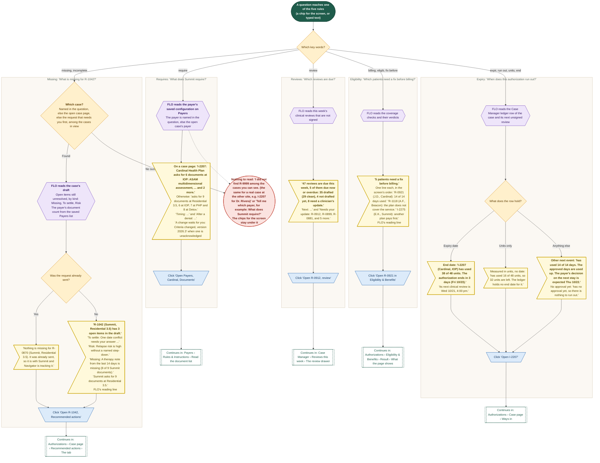

## Global shell › Top bar › Site switcher

The left of the top bar shows the date the page is as of and the site view. A viewer who may see both sites gets a three-way switch; a viewer limited to one site gets a locked label and a note on why. Every screen follows the choice.

Route: `Every page (top bar, left side)`

The page title can show a small tag such as 'Site A' beside it when a viewer who may see both sites has narrowed the view to one. It is never shown with Both sites, and never for a one-site viewer, whose top bar already says so.

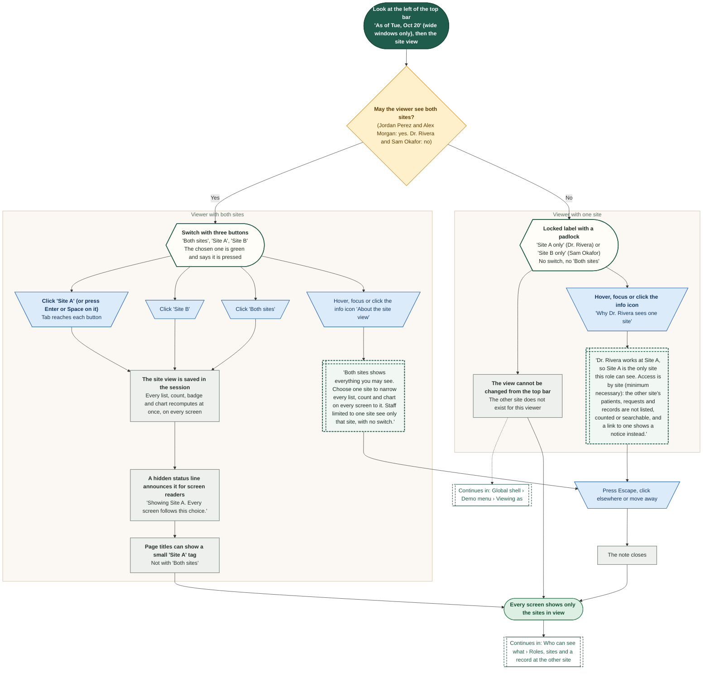

## Global shell › Top bar › Notifications › Open, read, click through

The bell opens a drawer with the notifications about the cases the viewer may see, newest first, and those that belong to no case (a payer rule change). A click on a row marks it read, closes the drawer and opens the page it points to. 'Mark all read' clears the ones in the list in one click. A viewer limited to one site never sees, counts or marks the other site's notifications.

Route: `Every page (Notifications drawer)`

Read and unread marks live in the demo data, so 'Reset demo data' brings back the four unread ones from the start. A notification belongs to the site of the case in its link (or named in its words); the bell's dot, the subtitle count and 'Mark all read' use only the notifications in view.

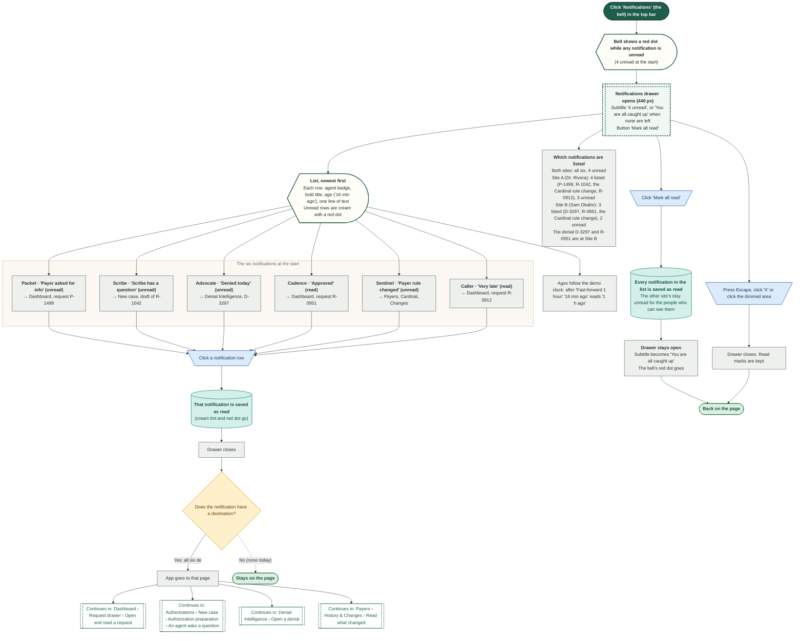

## Global shell › Top bar › Notifications › What creates a notification

A notification is created only when a person or a demo control does something. Nothing arrives on a timer. The one exception is the demo clock: moving it past a patient's re-check time makes Verify re-check them. Each row below is one action, the notification it adds and the page that notification opens.

Route: `Every page (the bell)`

Each notification is added at the top, unread, stamped with the demo clock ('just now'). Most also raise a toast, shown in 'Toasts'.

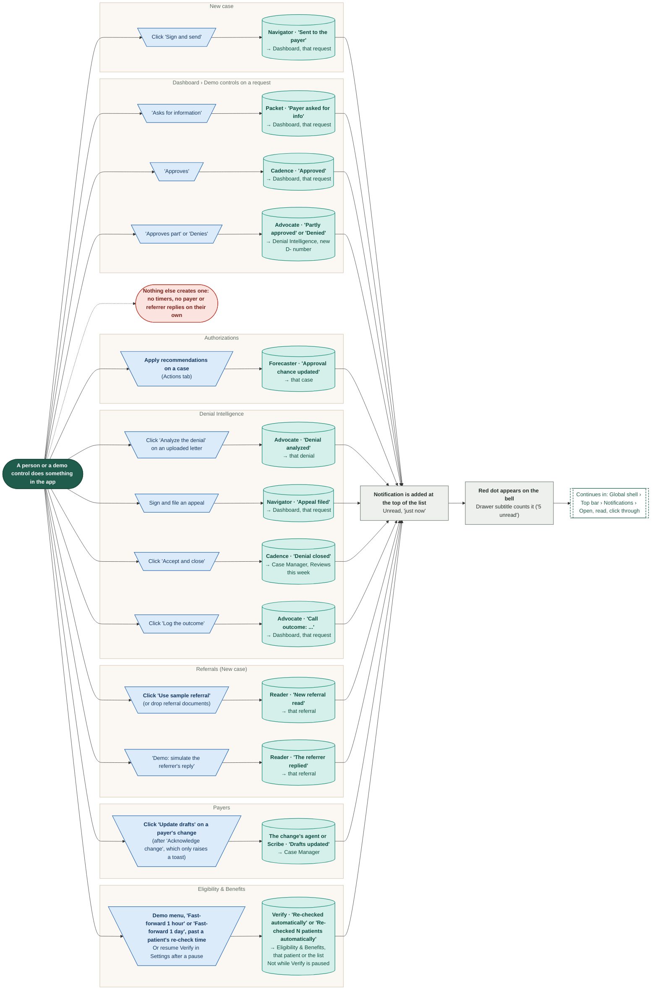

## Global shell › Demo menu › Open, close and what is inside

The Demo menu is the presenter's control panel. It is not part of the product. It moves the demo clock, jumps along a suggested path and resets the data. This diagram shows what is in it and how it closes.

Route: `Every page (top bar, 'Demo' button)`

There is no privacy-mode switch here: privacy mode is always on (see Settings). Escape closes this menu, like the two drawers, one layer at a time.

```mermaid
%%{init: {"theme":"base","themeVariables":{"fontFamily":"'DM Sans', 'Segoe UI', system-ui, sans-serif","fontSize":"15px","lineColor":"#5B6B63","primaryTextColor":"#1C2B25","clusterBkg":"#FBF8F3","clusterBorder":"#D9CDBB","edgeLabelBackground":"#FFFFFF"},"flowchart":{"curve":"basis","nodeSpacing":36,"rankSpacing":48,"padding":12,"htmlLabels":true,"useMaxWidth":false,"wrappingWidth":230}} }%%
flowchart TD
  classDef k_start fill:#1F5C4B,stroke:#174638,color:#FFFFFF,stroke-width:1.5px,font-weight:600
  classDef k_end fill:#DDEFE3,stroke:#2E7D4F,color:#14502F,stroke-width:1.5px,font-weight:600
  classDef k_endx fill:#FBE3E0,stroke:#C0392B,color:#7A1F16,stroke-width:1.5px,font-weight:600
  classDef k_screen fill:#FFFDF8,stroke:#1F5C4B,color:#1C2B25,stroke-width:2px
  classDef k_overlay fill:#F1F7F3,stroke:#1F5C4B,color:#1C2B25,stroke-width:2px,stroke-dasharray:5 3
  classDef k_click fill:#DCEBFA,stroke:#2F6DB5,color:#12365F,stroke-width:1.5px
  classDef k_input fill:#E4E7FF,stroke:#4C5FD5,color:#1D2670,stroke-width:1.5px
  classDef k_process fill:#EEF0EE,stroke:#7A857F,color:#26302B,stroke-width:1.5px
  classDef k_agent fill:#EEE5FA,stroke:#7A4FC2,color:#341A63,stroke-width:1.5px
  classDef k_decision fill:#FFF0CC,stroke:#D9962B,color:#5C3B00,stroke-width:1.5px
  classDef k_store fill:#D5F0EA,stroke:#1C8E7B,color:#0B4A3F,stroke-width:1.5px
  classDef k_doc fill:#F6E9DC,stroke:#B07A4C,color:#4A2E14,stroke-width:1.5px
  classDef k_ext fill:#FFE6D2,stroke:#E07B39,color:#6B2F06,stroke-width:1.5px
  classDef k_wait fill:#E4E8EE,stroke:#6B7C93,color:#26303D,stroke-width:1.5px
  classDef k_toast fill:#FFF9DB,stroke:#C9A400,color:#5A4A00,stroke-width:1.5px
  classDef k_goto fill:#FFFFFF,stroke:#1F5C4B,color:#1F5C4B,stroke-width:1.5px,stroke-dasharray:5 3
  s1@{ shape: stadium, label: "<b>Click 'Demo' in the top bar</b><br/>(pill shows the clock, 'Tue 10:42 am')" }
  o1@{ shape: win-pane, label: "<b>Demo menu opens under the button (340 px, or the window width minus a margin)</b><br/>It scrolls inside itself when the window is short" }
  subgraph gT ["Section 'Time'"]
  t1@{ shape: rect, label: "<b>Text: 'The demo clock is Tue Oct 20 2026, 10:42 am. It only moves when you move it.'</b><br/>(the date and time follow the clock)" }
  f1@{ shape: trap-t, label: "Click 'Fast-forward 1 hour'" }
  f2@{ shape: trap-t, label: "Click 'Fast-forward 1 day'" }
  g1@{ shape: subproc, label: "Continues in: Global shell › Demo menu › Fast-forward the demo clock" }
  end
  subgraph gV ["Section 'Viewing as'"]
  vt@{ shape: rect, label: "Text: 'Access is by site (minimum necessary). Try Dr. Rivera, who sees Site A only.'" }
  fv@{ shape: trap-t, label: "Click a person, for example 'Dr. Rivera'" }
  g4@{ shape: subproc, label: "Continues in: Global shell › Demo menu › Viewing as" }
  end
  subgraph gP ["Section 'Suggested path'"]
  sp@{ shape: rect, label: "Seven numbered steps, 1 to 7" }
  f3@{ shape: trap-t, label: "Click a step, for example '7 Case Manager: reviews this week'" }
  g2@{ shape: subproc, label: "Continues in: Global shell › Demo menu › Suggested path" }
  end
  subgraph gR ["Below a divider (red text)"]
  f4@{ shape: trap-t, label: "Click 'Reset demo data'" }
  g3@{ shape: subproc, label: "Continues in: Global shell › Demo menu › Reset demo data" }
  end
  d1@{ shape: diam, label: "What happens to the open menu?" }
  k1@{ shape: rect, label: "<b>Menu stays open after a Fast-forward or a choice in 'Viewing as'</b><br/>(the pill or the tick changes, so more clicks are possible)" }
  k2@{ shape: rect, label: "Menu closes, then the app opens the step's page" }
  k3@{ shape: rect, label: "Menu closes, the app goes to /dashboard" }
  x1@{ shape: trap-t, label: "Click anywhere outside the menu" }
  x2@{ shape: trap-t, label: "Click 'Demo' again" }
  x3@{ shape: trap-t, label: "Press Escape" }
  k4@{ shape: rect, label: "Menu closes (an outside click still reaches whatever was clicked)" }
  k5@{ shape: rect, label: "<b>Menu closes</b><br/>The page underneath is as it was" }
  e1@{ shape: stadium, label: "Menu is closed" }
  s1 --> o1
  o1 --> t1 & f1 & f2 & vt & sp & f4
  vt --> fv --> g4
  f1 --> g1
  f2 --> g1
  sp --> f3 --> g2
  f4 --> g3
  o1 --> d1
  d1 -->|"After Fast-forward or Viewing as"| k1
  d1 -->|"After a path step"| k2
  d1 -->|"After Reset"| k3
  d1 -->|"Mouse"| x1
  d1 -->|"Mouse"| x2
  d1 -->|"Keyboard"| x3
  x1 --> k4
  x2 --> k4
  x3 --> k5 --> e1
  k2 --> e1
  k3 --> e1
  k4 --> e1
  k1 -.-> o1
  class s1 k_start
  class o1 k_overlay
  class t1,vt,sp,k1,k2,k3,k4,k5 k_process
  class f1,f2,fv,f3,f4,x1,x2,x3 k_click
  class g1,g4,g2,g3 k_goto
  class d1 k_decision
  class e1 k_end
  style gT fill:#FBF8F3,stroke:#D9CDBB,stroke-width:1.5px,color:#5B6B63
  style gV fill:#FBF8F3,stroke:#D9CDBB,stroke-width:1.5px,color:#5B6B63
  style gP fill:#FBF8F3,stroke:#D9CDBB,stroke-width:1.5px,color:#5B6B63
  style gR fill:#FBF8F3,stroke:#D9CDBB,stroke-width:1.5px,color:#5B6B63
```

## Global shell › Demo menu › Fast-forward the demo clock

Fast-forward moves the demo clock by an hour or a day. It changes what is worked out from the clock: ages, countdowns and 'overdue' wording. The one thing it can start is Verify's automatic re-check of a patient whose re-check came due.

Route: `Every page (Demo menu › Time)`

The clock starts at Tue 20 Oct 2026, 10:42 am. It has no 'back' button: only 'Reset demo data' returns it.

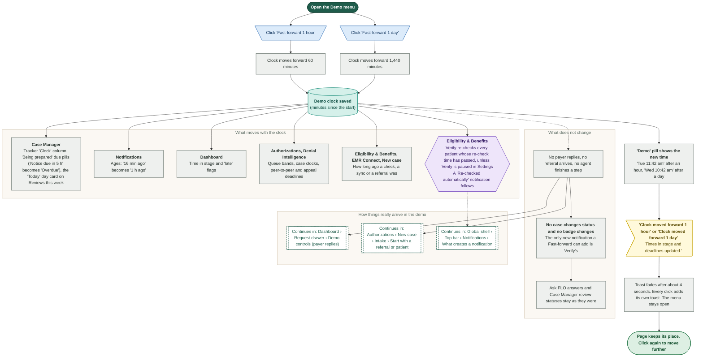

## Global shell › Demo menu › Suggested path

Seven numbered shortcuts for a guided walk through the demo. Each one closes the menu and opens a page. The numbers are only labels: the steps can be used in any order and as often as wanted. None of them changes any data or the clock.

Route: `Every page (Demo menu › Suggested path)`

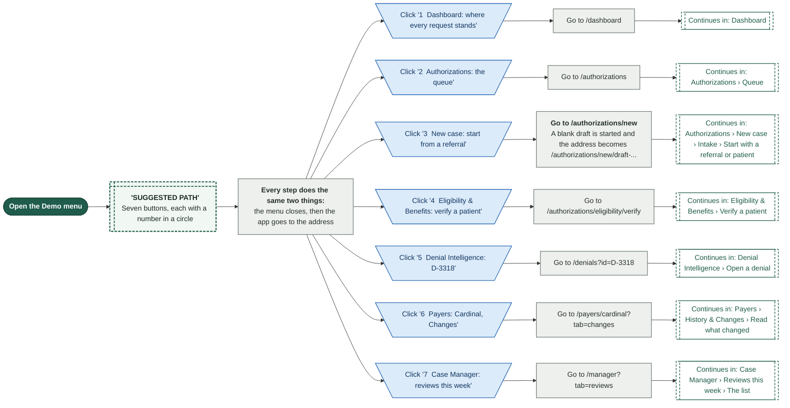

## Global shell › Demo menu › Reset demo data

One click puts every part of the demo back to its starting point and lands on the Dashboard. Use it between run-throughs. There is no confirmation step.

Route: `Every page (Demo menu › Reset demo data)`

Not reset: the Ask FLO chat (it lives in the page). Anything done before a browser reload is gone anyway, because the demo keeps nothing between reloads.

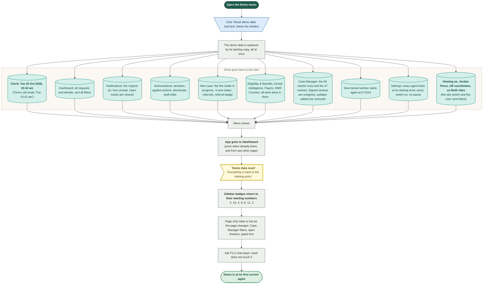

## Global shell › Demo menu › Viewing as

The Demo menu lists the four demo people. Choosing one changes who is viewing, and with it the sites that can be seen on every screen. The menu stays open, so people can be compared one after another.

Route: `Every page (Demo menu › Viewing as)`

Demo only. The default viewer is Jordan Perez on Both sites. 'Reset demo data' puts the viewer back to Jordan Perez on Both sites. The same switch is in Settings › Sites and access › 'View as'.

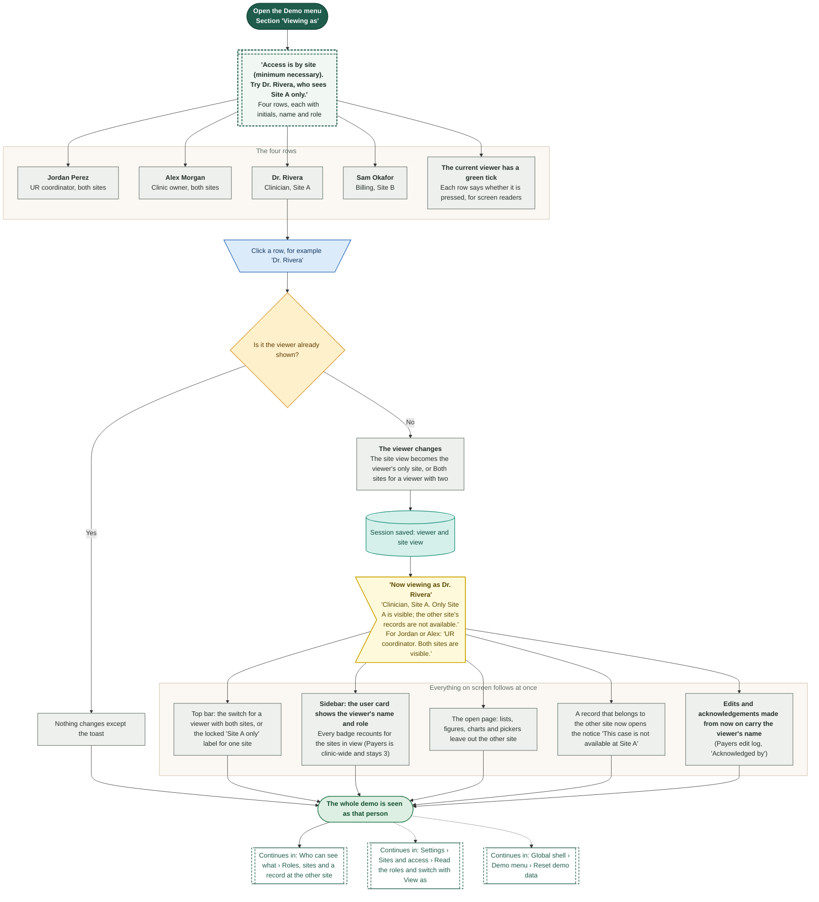

## Global shell › Sidebar footer › Settings, Help, Sign out, user card

The footer has a 'Demo data' tile, three rows (Settings, Help, Sign out) and the user card. Only Settings leaves the page. Help and Sign out answer with a short message, and the tile and the user card are plain labels.

Route: `Every page (bottom of the sidebar)`

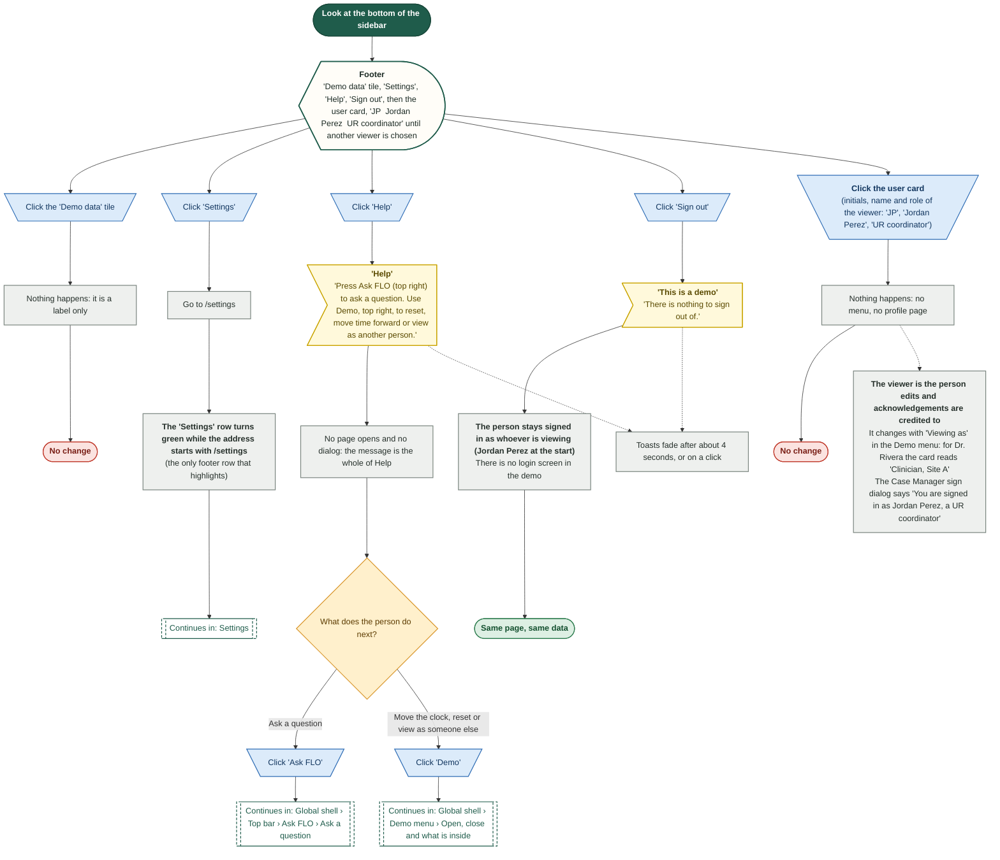

## Global shell › Addresses › Old links, redirects and pages that do not exist

A few old or short addresses are sent on to the page that replaced them, and anything the demo does not know opens a 'Page not found' screen inside the normal sidebar and top bar. Redirects replace the address, so the Back button skips over the old one.

Route: `/  /active  /referrals  /referrals/:id  and any unknown address`

In the single-file build the address lives after a '#'. The hosted preview has no address bar, so it keeps the route in memory and the same rules apply.

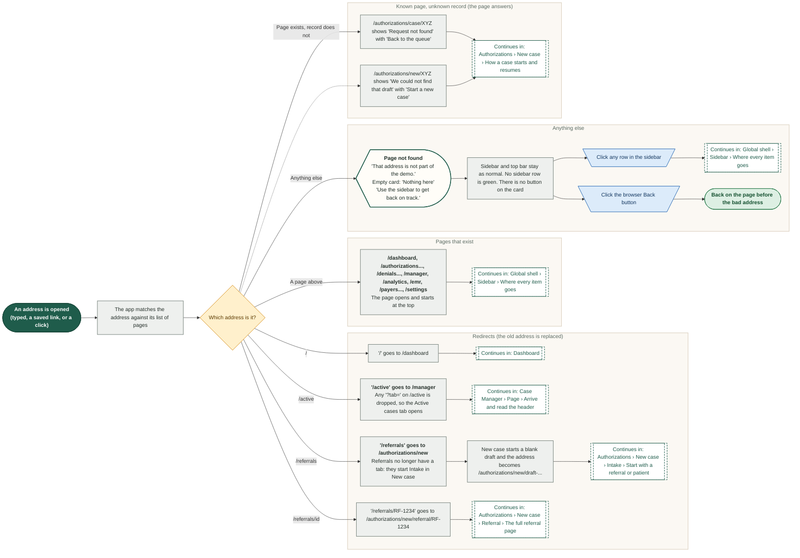

## Global shell › Toasts › How they appear and go

A toast is a small message card that confirms something happened. Any page can raise one. It stacks in the bottom right corner, fades after about four seconds, and goes at once when clicked. Toasts are never a place to act: they have no buttons.

Route: `Every page (bottom right corner)`

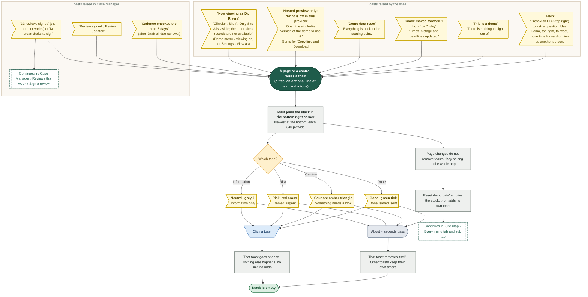
