# Dashboard

The cockpit: lifecycle chips, what to do next, one table of authorizations with days in state, units, window and owner, and the request drawer.

Shapes and colours: see `00-overview.md`. Source: `workflows/src/02-dashboard/`.

## Dashboard › Arrive › What the page shows

Four ways to land on the Dashboard, how the address and the viewer's sites are read, and the page from the top down: a small title, the Lifecycle, Do next and one table of authorizations. Each part continues in its own diagram.

Route: `/dashboard`

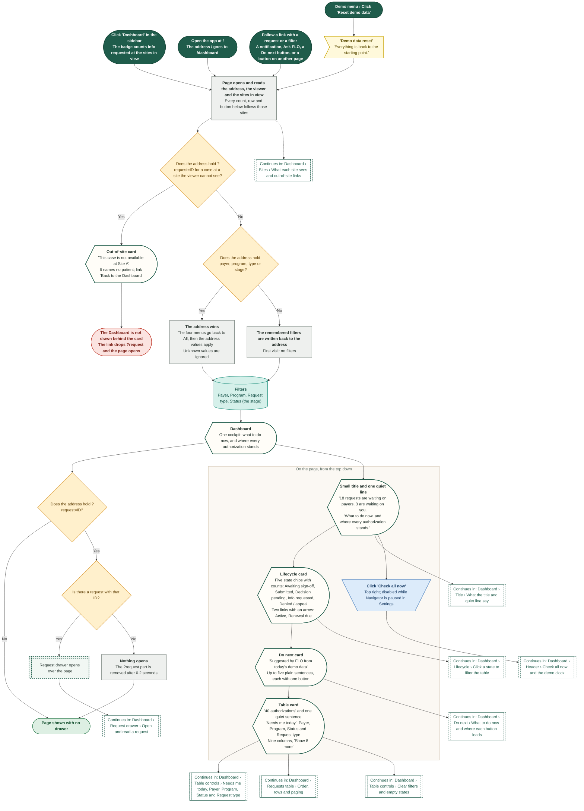

## Dashboard › Title › What the title and quiet line say

The small title counts what waits on payers and what waits on you, over every authorization the viewer can see. The table's menus and the Lifecycle chips do not change it, and neither does the demo clock. The quiet line under it never changes.

Route: `/dashboard`

```mermaid
%%{init: {"theme":"base","themeVariables":{"fontFamily":"'DM Sans', 'Segoe UI', system-ui, sans-serif","fontSize":"15px","lineColor":"#5B6B63","primaryTextColor":"#1C2B25","clusterBkg":"#FBF8F3","clusterBorder":"#D9CDBB","edgeLabelBackground":"#FFFFFF"},"flowchart":{"curve":"basis","nodeSpacing":36,"rankSpacing":48,"padding":12,"htmlLabels":true,"useMaxWidth":false,"wrappingWidth":230}} }%%
flowchart TD
  classDef k_start fill:#1F5C4B,stroke:#174638,color:#FFFFFF,stroke-width:1.5px,font-weight:600
  classDef k_end fill:#DDEFE3,stroke:#2E7D4F,color:#14502F,stroke-width:1.5px,font-weight:600
  classDef k_endx fill:#FBE3E0,stroke:#C0392B,color:#7A1F16,stroke-width:1.5px,font-weight:600
  classDef k_screen fill:#FFFDF8,stroke:#1F5C4B,color:#1C2B25,stroke-width:2px
  classDef k_overlay fill:#F1F7F3,stroke:#1F5C4B,color:#1C2B25,stroke-width:2px,stroke-dasharray:5 3
  classDef k_click fill:#DCEBFA,stroke:#2F6DB5,color:#12365F,stroke-width:1.5px
  classDef k_input fill:#E4E7FF,stroke:#4C5FD5,color:#1D2670,stroke-width:1.5px
  classDef k_process fill:#EEF0EE,stroke:#7A857F,color:#26302B,stroke-width:1.5px
  classDef k_agent fill:#EEE5FA,stroke:#7A4FC2,color:#341A63,stroke-width:1.5px
  classDef k_decision fill:#FFF0CC,stroke:#D9962B,color:#5C3B00,stroke-width:1.5px
  classDef k_store fill:#D5F0EA,stroke:#1C8E7B,color:#0B4A3F,stroke-width:1.5px
  classDef k_doc fill:#F6E9DC,stroke:#B07A4C,color:#4A2E14,stroke-width:1.5px
  classDef k_ext fill:#FFE6D2,stroke:#E07B39,color:#6B2F06,stroke-width:1.5px
  classDef k_wait fill:#E4E8EE,stroke:#6B7C93,color:#26303D,stroke-width:1.5px
  classDef k_toast fill:#FFF9DB,stroke:#C9A400,color:#5A4A00,stroke-width:1.5px
  classDef k_goto fill:#FFFFFF,stroke:#1F5C4B,color:#1F5C4B,stroke-width:1.5px,stroke-dasharray:5 3
  s1@{ shape: stadium, label: "Dashboard is open" }
  p1@{ shape: rect, label: "<b>Take the requests at the sites in view</b><br/>Both sites, Site A or Site B, from the top bar and the viewer<br/>Payer, Program, Request type and Status menus are ignored here" }
  p2@{ shape: rect, label: "<b>Waiting on payers = Submitted + Decision pending</b><br/>Waiting on you = requests with a question for a person (a payer's question, an agent's question)<br/>plus cases saved in New case that wait for a person" }
  d1@{ shape: diam, label: "How many wait on payers?" }
  a0@{ shape: curv-trap, label: "'Nothing is waiting on a payer.'" }
  a1@{ shape: curv-trap, label: "'1 request is waiting on a payer.'" }
  a2@{ shape: curv-trap, label: "'18 requests are waiting on payers.'" }
  d2@{ shape: diam, label: "How many wait on you?" }
  b0@{ shape: curv-trap, label: "'Nothing is waiting on you.'" }
  b1@{ shape: curv-trap, label: "'1 is waiting on you.'" }
  b2@{ shape: curv-trap, label: "'3 are waiting on you.'" }
  h@{ shape: curv-trap, label: "<b>Title</b><br/>The two sentences together, e.g. '18 requests are waiting on payers. 3 are waiting on you.'<br/>Small serif type, no card around it" }
  q@{ shape: curv-trap, label: "<b>One quiet line under it</b><br/>'What to do now, and where every authorization stands.'" }
  p3@{ shape: rect, label: "<b>Recomputed after a payer reply, an answer sent, a case signed and sent, a case saved in New case, or a change of site or viewer</b><br/>Site A and Site B add up to Both sites" }
  d3@{ shape: diam, label: "Does the number match the table?" }
  n1@{ shape: curv-trap, label: "<b>Not the same count as 'Needs me today'</b><br/>The title counts questions waiting on a person; 'Needs me today' also counts a request ready to sign, a write-back to approve, a late payer to chase and a denial deadline inside 2 days" }
  g1@{ shape: subproc, label: "Continues in: Dashboard › Table controls › Needs me today, Payer, Program, Status and Request type" }
  g2@{ shape: subproc, label: "Continues in: Dashboard › Sites › What each site sees and out-of-site links" }
  s1 --> p1 --> p2 --> d1
  d1 -->|"None"| a0 --> d2
  d1 -->|"One"| a1 --> d2
  d1 -->|"Many"| a2 --> d2
  d2 -->|"None"| b0 --> h
  d2 -->|"One"| b1 --> h
  d2 -->|"Many"| b2 --> h
  h --> q --> p3 --> d3
  d3 -->|"No, by design"| n1 --> g1
  p1 -.-> g2
  class s1 k_start
  class p1,p2,p3 k_process
  class d1,d2,d3 k_decision
  class a0,a1,a2,b0,b1,b2,h,q,n1 k_screen
  class g1,g2 k_goto
```

## Dashboard › Header › Check all now and the demo clock

The one button beside the title, which Settings can switch off by pausing Navigator, and what the Demo menu's clock does to the page. Time in the demo only moves when someone moves it.

Route: `/dashboard`

Real world: Navigator checks every open request at least daily, and a request past the payer's time gets a call-the-payer task. Demo only: the button and the clock are simulated.

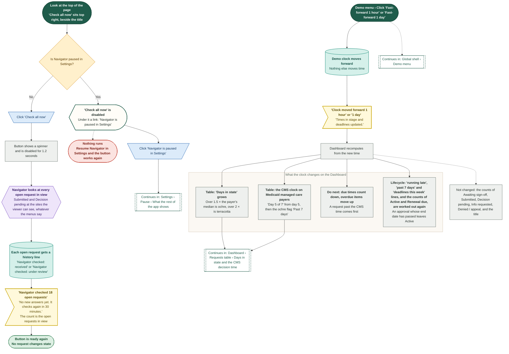

## Dashboard › Do next › What to do now and where each button leads

The Do next card lists the few things a person should do now, each as one plain sentence with one button. FLO works the list out from the live data each time the requests, the queue, the ledger or the clock change. Each button goes to a real place; nothing is sent from the card itself.

Route: `/dashboard`

A recommendation for a person to check, never a payer fact. Real world: the same list is what a coordinator would build by hand from the queue.

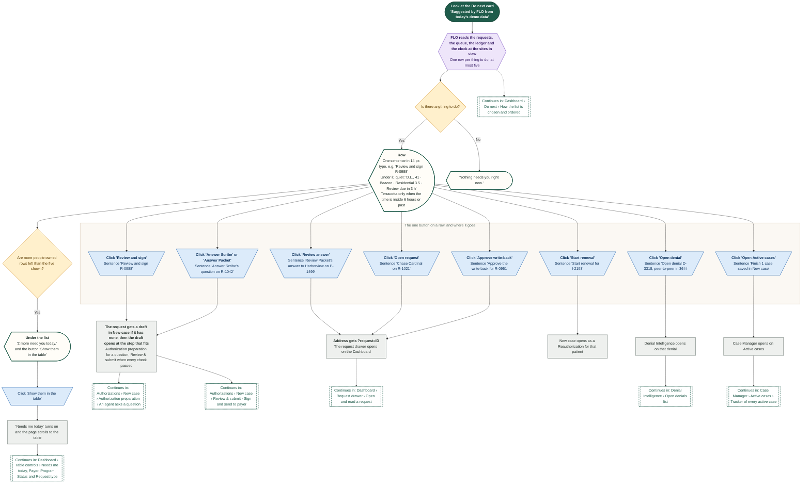

## Dashboard › Do next › How the list is chosen and ordered

What FLO puts on the Do next list, in what order, and what changes it. The rules are computed from the data in view, so a viewer limited to one site gets a list that names no case at the other site.

Route: `/dashboard`

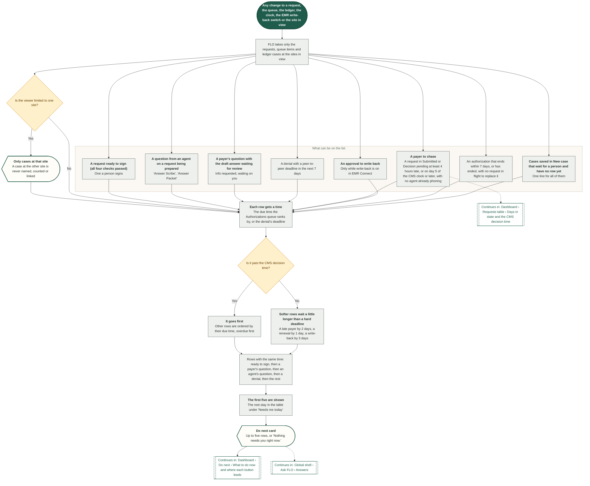

## Dashboard › Table controls › Needs me today, Payer, Program, Status and Request type

The controls on the right of the table card's header. 'Needs me today' is a toggle; Payer, Program, Status and Request type are menus. The four menus apply at once, write to the address and keep to the Dashboard's one set of filters. Payer, Program and Request type also narrow the Lifecycle counts; Status and the toggle only narrow the table.

Route: `/dashboard`

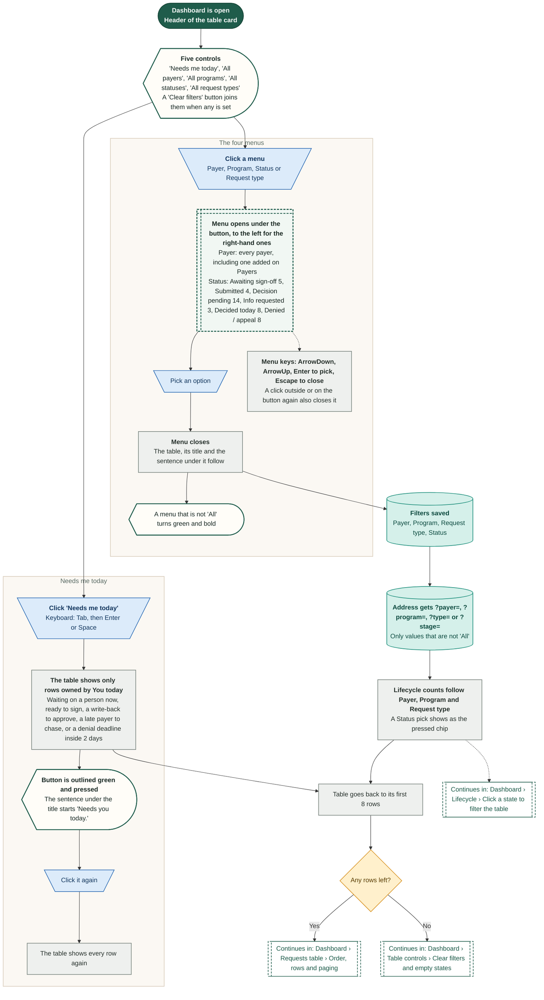

## Dashboard › Table controls › Clear filters and empty states

When 'Clear filters' appears, what it resets, and what the table shows when the controls match nothing.

Route: `/dashboard?payer=cardinal&program=iop&type=recertification&stage=appeal`

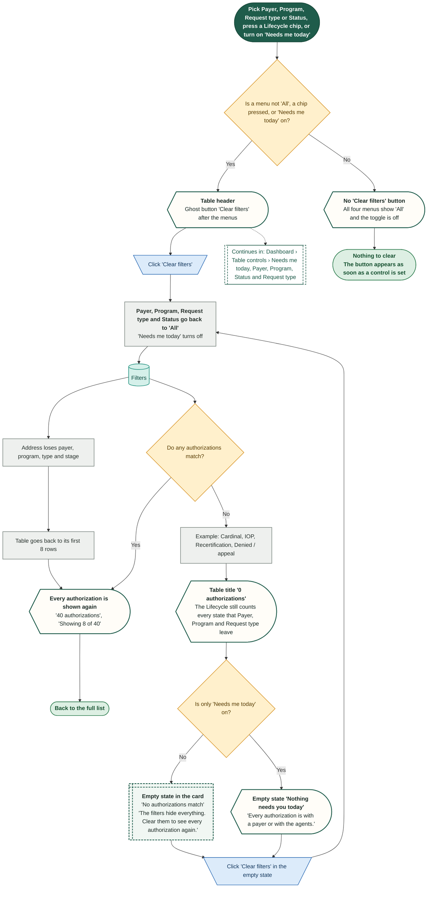

## Dashboard › Lifecycle › Click a state to filter the table

The Lifecycle card holds five state chips. Each shows a count and one quiet line, and each is a button that filters the table below it. The counts follow the sites in view and the Payer, Program and Request type menus, never the Status menu. The two chips with an arrow open Case Manager and are in the next diagram.

Route: `/dashboard`

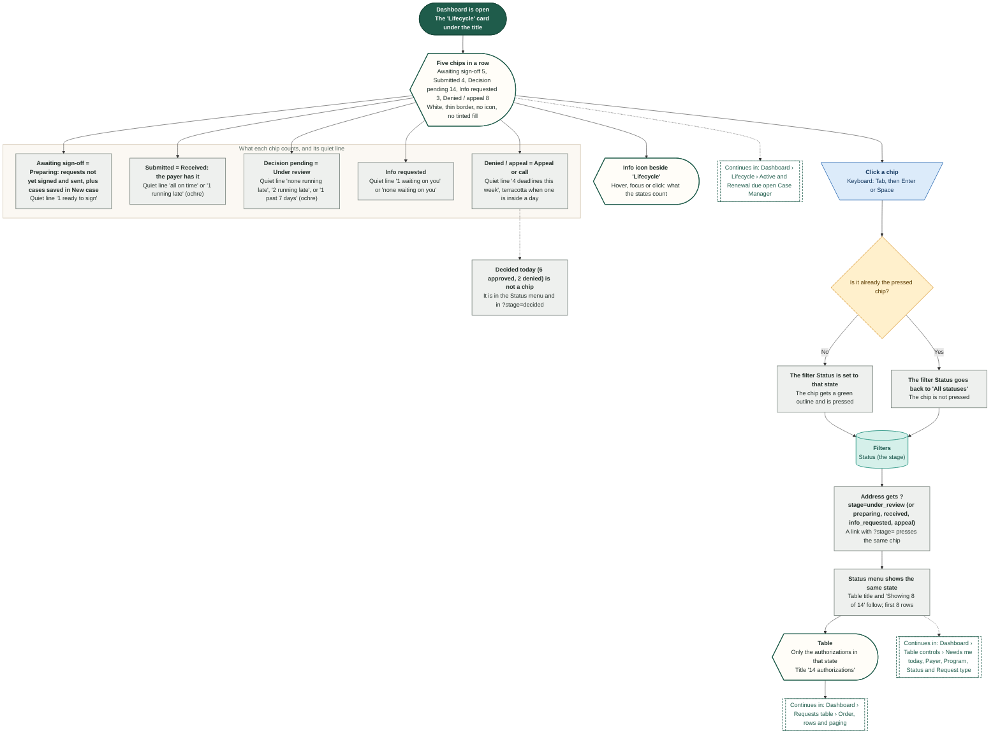

## Dashboard › Lifecycle › Active and Renewal due open Case Manager

Active and Renewal due describe approved authorizations on the Case Manager ledger, not rows of the Dashboard table, so they are links with a small arrow and not filters. A click opens Case Manager on Active cases with the matching filter, and the number of rows there is the number on the chip.

Route: `/dashboard`

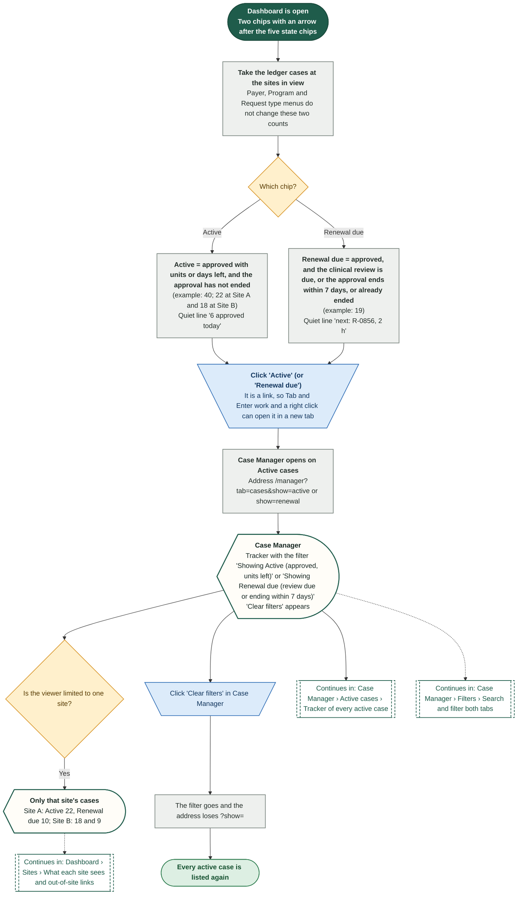

## Dashboard › Requests table › Order, rows and paging

The table card, the one list on the page. Rows come in the page's own order (the ones that need you today first, then the longest in their state) until a heading is clicked. A click on a row or its case ID opens the request drawer and adds one history entry. Eight rows show at a time.

Route: `/dashboard`

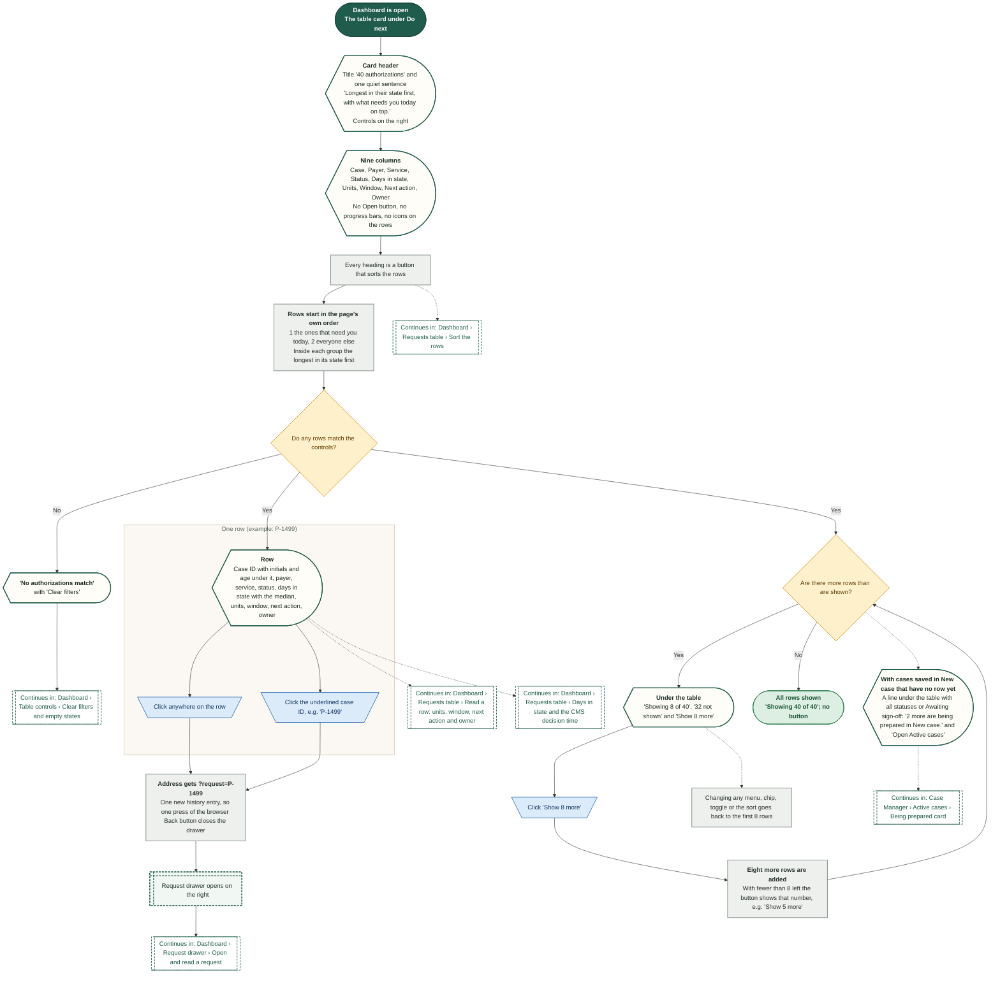

## Dashboard › Requests table › Read a row: units, window, next action and owner

What each cell of a row means. Nothing in a row is a button except the case ID, and a click on the row itself opens the request drawer. Units and Window come from the Case Manager ledger and show a dash when the case has no approval. Next action and Owner come from where the request is. No dollar figures, no progress bars.

Route: `/dashboard`

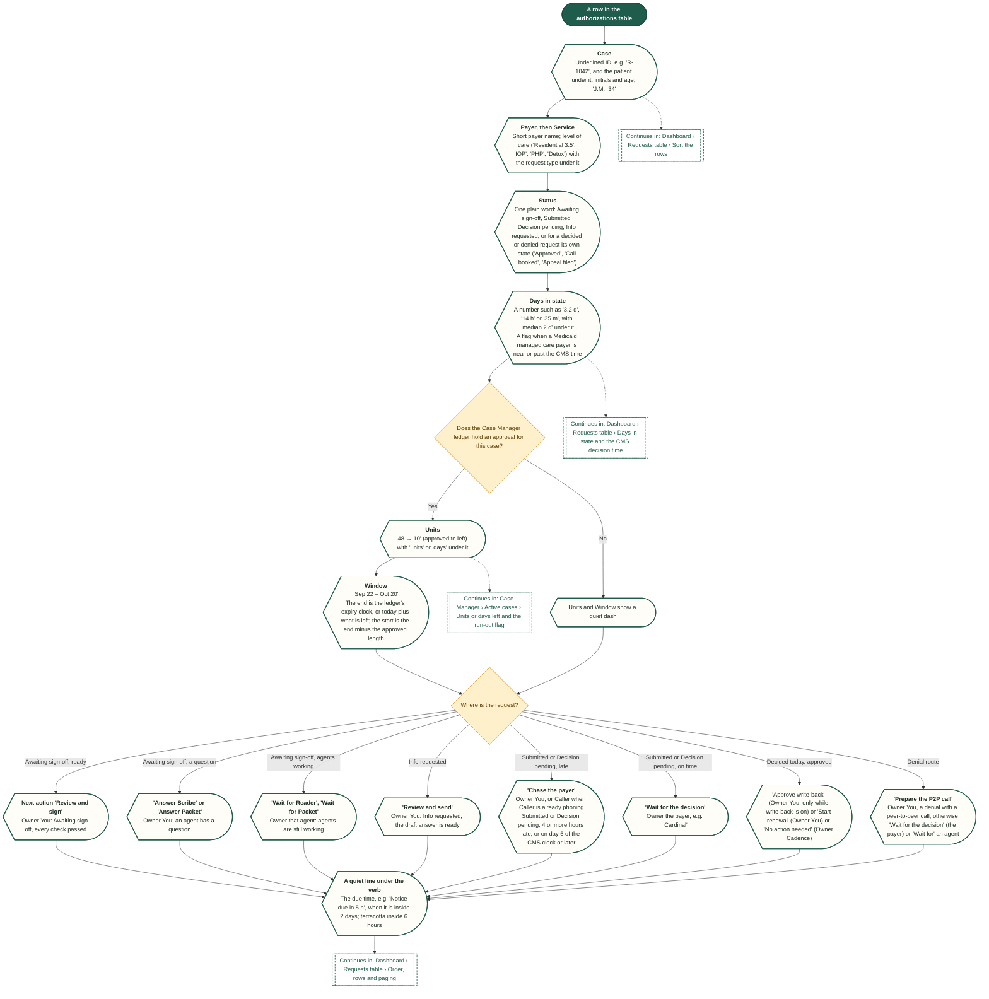

## Dashboard › Requests table › Sort the rows

Every heading of the table sorts the rows. Each is a button, so the keyboard works too. A heading goes ascending, then descending, then back to the page's own order (the ones that need you today first, then the longest in their state). The sort is not saved in the address.

Route: `/dashboard`

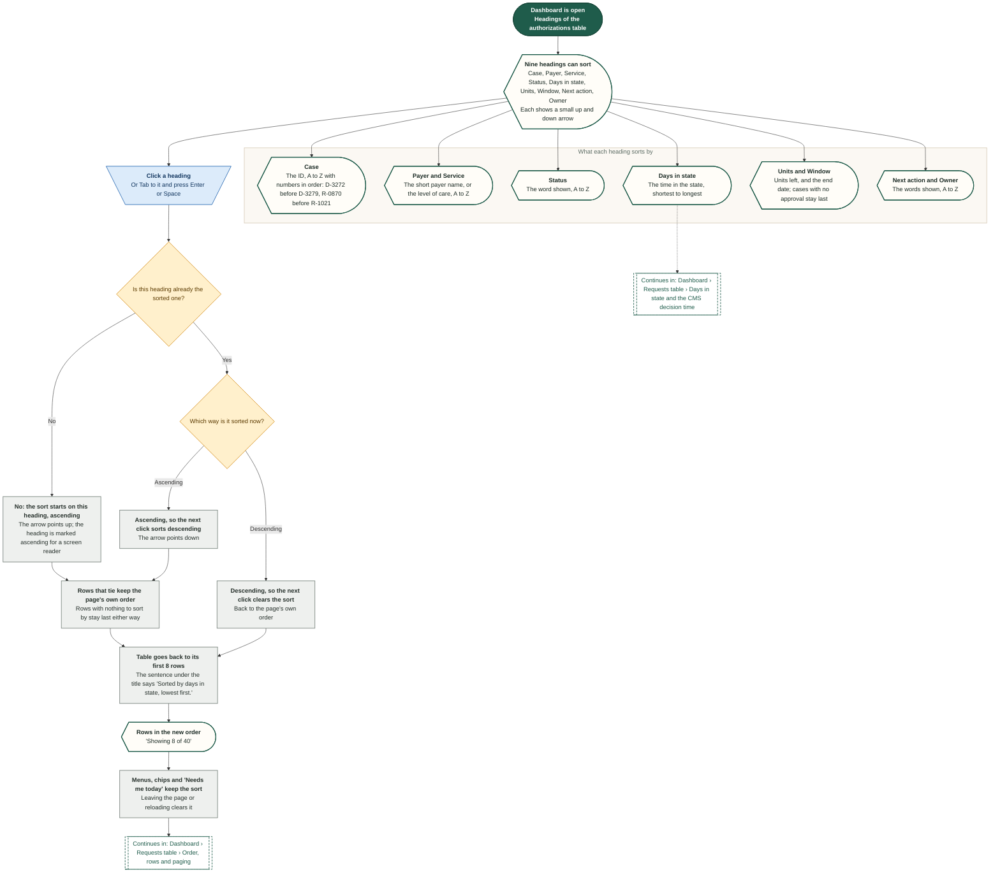

## Dashboard › Requests table › Days in state and the CMS decision time

The Days in state cell shows how long a request has been where it is, the payer's median under it, and, for Medicaid managed care payers (Summit, Cardinal, Evergreen), the CMS decision time. Under the CMS prior authorization rule from 2026 a standard decision is due in 7 calendar days. The demo shows it; it never blocks anything.

Route: `/dashboard`

Real world: CMS-0057-F, from 1 January 2026, asks impacted payers to decide standard requests within 7 calendar days and expedited requests within 72 hours. State rules differ, so the note says 'Check your state.' Demo only: the days are counted on the demo clock.

```mermaid
%%{init: {"theme":"base","themeVariables":{"fontFamily":"'DM Sans', 'Segoe UI', system-ui, sans-serif","fontSize":"15px","lineColor":"#5B6B63","primaryTextColor":"#1C2B25","clusterBkg":"#FBF8F3","clusterBorder":"#D9CDBB","edgeLabelBackground":"#FFFFFF"},"flowchart":{"curve":"basis","nodeSpacing":36,"rankSpacing":48,"padding":12,"htmlLabels":true,"useMaxWidth":false,"wrappingWidth":230}} }%%
flowchart TD
  classDef k_start fill:#1F5C4B,stroke:#174638,color:#FFFFFF,stroke-width:1.5px,font-weight:600
  classDef k_end fill:#DDEFE3,stroke:#2E7D4F,color:#14502F,stroke-width:1.5px,font-weight:600
  classDef k_endx fill:#FBE3E0,stroke:#C0392B,color:#7A1F16,stroke-width:1.5px,font-weight:600
  classDef k_screen fill:#FFFDF8,stroke:#1F5C4B,color:#1C2B25,stroke-width:2px
  classDef k_overlay fill:#F1F7F3,stroke:#1F5C4B,color:#1C2B25,stroke-width:2px,stroke-dasharray:5 3
  classDef k_click fill:#DCEBFA,stroke:#2F6DB5,color:#12365F,stroke-width:1.5px
  classDef k_input fill:#E4E7FF,stroke:#4C5FD5,color:#1D2670,stroke-width:1.5px
  classDef k_process fill:#EEF0EE,stroke:#7A857F,color:#26302B,stroke-width:1.5px
  classDef k_agent fill:#EEE5FA,stroke:#7A4FC2,color:#341A63,stroke-width:1.5px
  classDef k_decision fill:#FFF0CC,stroke:#D9962B,color:#5C3B00,stroke-width:1.5px
  classDef k_store fill:#D5F0EA,stroke:#1C8E7B,color:#0B4A3F,stroke-width:1.5px
  classDef k_doc fill:#F6E9DC,stroke:#B07A4C,color:#4A2E14,stroke-width:1.5px
  classDef k_ext fill:#FFE6D2,stroke:#E07B39,color:#6B2F06,stroke-width:1.5px
  classDef k_wait fill:#E4E8EE,stroke:#6B7C93,color:#26303D,stroke-width:1.5px
  classDef k_toast fill:#FFF9DB,stroke:#C9A400,color:#5A4A00,stroke-width:1.5px
  classDef k_goto fill:#FFFFFF,stroke:#1F5C4B,color:#1F5C4B,stroke-width:1.5px,stroke-dasharray:5 3
  s1@{ shape: stadium, label: "<b>A row in the table</b><br/>The Days in state cell" }
  a1@{ shape: curv-trap, label: "<b>The number</b><br/>'35 m', '14 h' or '3.2 d' since the request entered its state" }
  d1@{ shape: diam, label: "Is there a median for this state?" }
  a2@{ shape: curv-trap, label: "<b>'median 2 d' under the number</b><br/>The payer's usual time in this state, from the demo data" }
  d2@{ shape: diam, label: "How long compared with the median?" }
  a3@{ shape: curv-trap, label: "Plain number" }
  a4@{ shape: curv-trap, label: "<b>Ochre number</b><br/>Over 1.5 × the median" }
  a5@{ shape: curv-trap, label: "<b>Terracotta number</b><br/>Over 2 × the median; Caller phones the payer" }
  d3@{ shape: diam, label: "Is the request Submitted or Decision pending, at a Medicaid managed care payer?" }
  b0@{ shape: curv-trap, label: "<b>No CMS clock</b><br/>Commercial, Medicare Advantage and carve-out payers, and every other state" }
  b1@{ shape: rect, label: "Count the days since the request went to the payer" }
  d4@{ shape: diam, label: "How many days?" }
  b2@{ shape: curv-trap, label: "<b>Nothing extra</b><br/>Before day 5" }
  b3@{ shape: curv-trap, label: "Ochre hint 'Day 5 of 7' (or 'Day 6 of 7', 'Day 7 of 7') and an info icon" }
  b4@{ shape: curv-trap, label: "<b>Ochre flag 'Past 7 days' and an info icon</b><br/>On the 8th day" }
  b5@{ shape: win-pane, label: "<b>Info icon: hover, focus or click</b><br/>'CMS rule for Medicaid managed care: decide within 7 calendar days (72 hours if expedited). Check your state.'<br/>Escape closes it" }
  b6@{ shape: rect, label: "The Lifecycle chip 'Decision pending' says 'N past 7 days' in ochre" }
  b7@{ shape: rect, label: "<b>Next action becomes 'Chase the payer' from day 5</b><br/>A request past the CMS time goes first on Do next" }
  s2@{ shape: stadium, label: "<b>Demo menu › Fast-forward 1 day, several times</b><br/>For example 4 days for R-1021 (Cardinal, Decision pending)" }
  p1@{ shape: rect, label: "The clock moves; days in state and the CMS days grow together" }
  g1@{ shape: subproc, label: "Continues in: Dashboard › Do next › How the list is chosen and ordered" }
  g2@{ shape: subproc, label: "Continues in: Dashboard › Header › Check all now and the demo clock" }
  s1 --> a1 --> d1
  d1 -->|"Yes"| a2 --> d2
  d1 -->|"No"| d3
  d2 -->|"Within 1.5 ×"| a3 --> d3
  d2 -->|"Over 1.5 ×"| a4 --> d3
  d2 -->|"Over 2 ×"| a5 --> d3
  d3 -->|"No"| b0
  d3 -->|"Yes"| b1 --> d4
  d4 -->|"Under 4 days"| b2
  d4 -->|"4 to 7 days"| b3 --> b5
  d4 -->|"7 days or more"| b4 --> b5
  b4 --> b6
  b3 --> b7
  b4 --> b7
  b7 --> g1
  s2 --> p1 --> d4
  p1 -.-> g2
  class s1,s2 k_start
  class a1,a2,a3,a4,a5,b0,b2,b3,b4 k_screen
  class d1,d2,d3,d4 k_decision
  class b1,b6,b7,p1 k_process
  class b5 k_overlay
  class g1,g2 k_goto
```

## Dashboard › Sites › What each site sees and out-of-site links

Every request belongs to one site, the same site on every screen. The title, the Lifecycle counts, Do next, the table, Check all now, and the notifications and Ask FLO answers about these cases follow the site view. A viewer limited to one site never sees, counts, lists or is told about the other site's cases. A direct link to one shows an out-of-site card.

Route: `/dashboard`

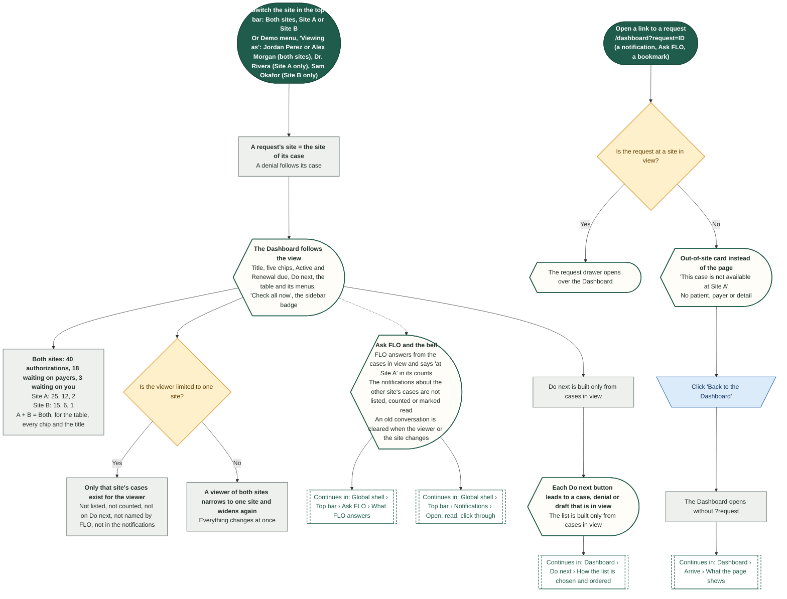

## Dashboard › Request drawer › Open and read a request

The drawer is one scroll, with no tabs. It opens from a row, a case ID, a Do next button, or a link with ?request=ID, and shows who holds the request, its history and what is next. The sections change with the request's stage. The long lines are folded under 'Details'.

Route: `/dashboard?request=P-1499`

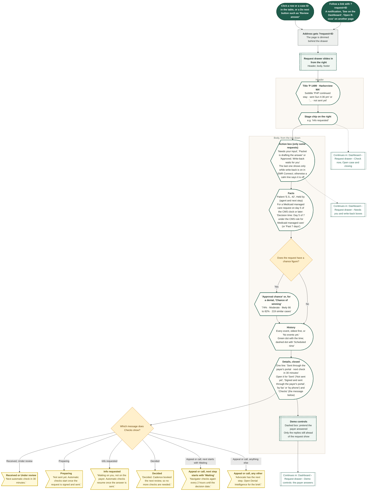

## Dashboard › Request drawer › Check now, Open case and closing

The footer of the drawer holds up to three buttons, and the drawer can be closed four ways. 'Check now' only fakes a payer check in the demo; it never moves a request to another stage.

Route: `/dashboard?request=R-1021`


## Dashboard › Request drawer › Needs you and write-back boxes

The coloured box at the top of the drawer appears only when a person has something to do. There are three kinds: review a drafted answer, wait for the draft, and approve a write-back. The write-back box shows only while write-back is on in EMR Connect; when it is off, one calm line takes its place. Any other request shows no box.

Route: `/dashboard?request=I-2218`

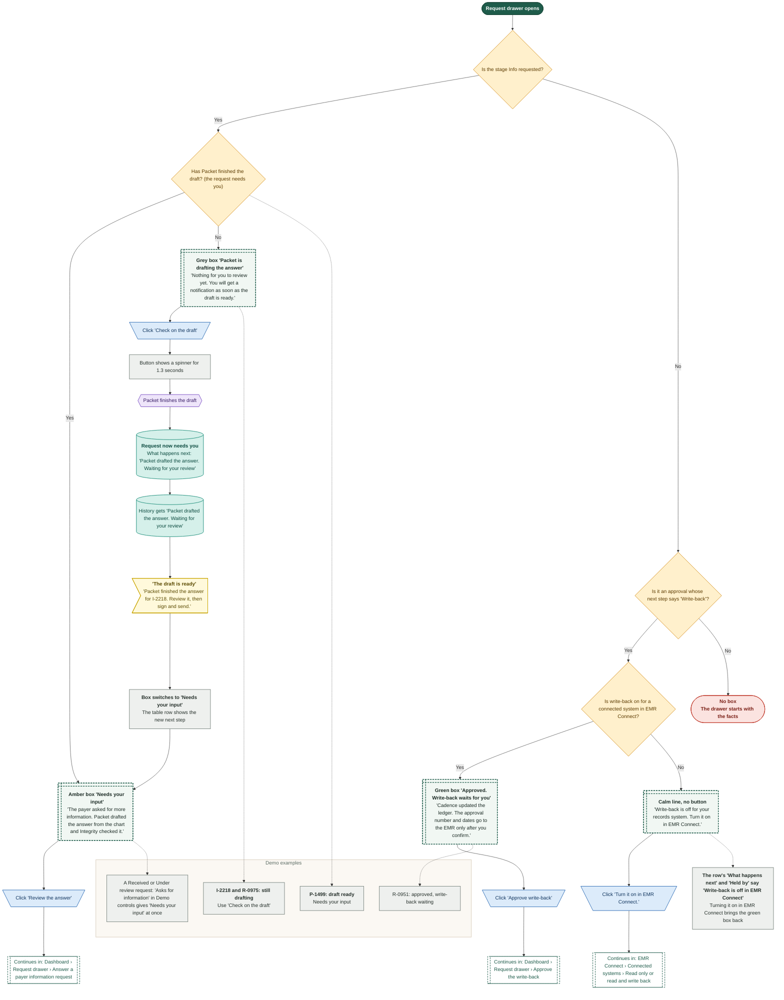

## Dashboard › Request drawer › Approve the write-back

After a payer approves, the approval number and dates go to the EMR only when a person confirms, and only while write-back is on in EMR Connect. The pop-up shows exactly three things. In the demo the EMR write is simulated and changes only the request's history.

Route: `/dashboard?request=R-0951`

Real world: writing the reference number, units and dates back to the EMR is a confirmed step. Demo only: the EMR write is simulated.


## Dashboard › Request drawer › Answer a payer information request

When a payer asks for more information, Packet drafts the answer from the chart, Integrity checks it, and a person reads it and signs. Nothing leaves before the signature. In the demo the payer's ask is seeded or triggered by a Demo control, and the send is simulated.

Route: `/dashboard?request=P-1499`

Real world: an information request is tracked, and a clinical supplement passes the clinician sign-off gate before it goes out. Demo only: one click on 'Sign and send answer' stands in for that, and the send is simulated.

```mermaid
%%{init: {"theme":"base","themeVariables":{"fontFamily":"'DM Sans', 'Segoe UI', system-ui, sans-serif","fontSize":"15px","lineColor":"#5B6B63","primaryTextColor":"#1C2B25","clusterBkg":"#FBF8F3","clusterBorder":"#D9CDBB","edgeLabelBackground":"#FFFFFF"},"flowchart":{"curve":"basis","nodeSpacing":36,"rankSpacing":48,"padding":12,"htmlLabels":true,"useMaxWidth":false,"wrappingWidth":230}} }%%
flowchart TD
  classDef k_start fill:#1F5C4B,stroke:#174638,color:#FFFFFF,stroke-width:1.5px,font-weight:600
  classDef k_end fill:#DDEFE3,stroke:#2E7D4F,color:#14502F,stroke-width:1.5px,font-weight:600
  classDef k_endx fill:#FBE3E0,stroke:#C0392B,color:#7A1F16,stroke-width:1.5px,font-weight:600
  classDef k_screen fill:#FFFDF8,stroke:#1F5C4B,color:#1C2B25,stroke-width:2px
  classDef k_overlay fill:#F1F7F3,stroke:#1F5C4B,color:#1C2B25,stroke-width:2px,stroke-dasharray:5 3
  classDef k_click fill:#DCEBFA,stroke:#2F6DB5,color:#12365F,stroke-width:1.5px
  classDef k_input fill:#E4E7FF,stroke:#4C5FD5,color:#1D2670,stroke-width:1.5px
  classDef k_process fill:#EEF0EE,stroke:#7A857F,color:#26302B,stroke-width:1.5px
  classDef k_agent fill:#EEE5FA,stroke:#7A4FC2,color:#341A63,stroke-width:1.5px
  classDef k_decision fill:#FFF0CC,stroke:#D9962B,color:#5C3B00,stroke-width:1.5px
  classDef k_store fill:#D5F0EA,stroke:#1C8E7B,color:#0B4A3F,stroke-width:1.5px
  classDef k_doc fill:#F6E9DC,stroke:#B07A4C,color:#4A2E14,stroke-width:1.5px
  classDef k_ext fill:#FFE6D2,stroke:#E07B39,color:#6B2F06,stroke-width:1.5px
  classDef k_wait fill:#E4E8EE,stroke:#6B7C93,color:#26303D,stroke-width:1.5px
  classDef k_toast fill:#FFF9DB,stroke:#C9A400,color:#5A4A00,stroke-width:1.5px
  classDef k_goto fill:#FFFFFF,stroke:#1F5C4B,color:#1F5C4B,stroke-width:1.5px,stroke-dasharray:5 3
  s0@{ shape: stadium, label: "A payer wants more information on a request" }
  x1@{ shape: st-rect, label: "<b>Payer asks for more information</b><br/>through its portal, fax or phone (demo: seeded for P-1499, or the Demo control 'Asks for information')" }
  a1@{ shape: hex, label: "<b>Packet drafts the answer from the chart</b><br/>Integrity checks every sentence against it" }
  w1@{ shape: cyl, label: "<b>Request becomes Info requested (amber)</b><br/>Needs you; next step 'Packet drafted the answer. Waiting for your review'" }
  t1@{ shape: odd, label: "<b>Notification 'Payer asked for info'</b><br/>'Harborview MA wants more on P-1499. Packet drafted the answer.'" }
  sc@{ shape: curv-trap, label: "<b>Dashboard</b><br/>The title counts one more waiting on you, the 'Info requested' chip and the Status menu count one more, and the sidebar Dashboard badge counts it<br/>A Do next row 'Review Packet's answer to ...' appears; the table row is pinned to the top: it needs you today" }
  s1@{ shape: stadium, label: "Click the row, or the notification, then the amber box 'Needs your input'" }
  c1@{ shape: trap-t, label: "Click 'Review the answer'" }
  o1@{ shape: win-pane, label: "<b>Pop-up 'Packet's answer for P-1499'</b><br/>'Harborview MA asked for more information · PHP'<br/>Drafted by Packet and checked by Integrity" }
  subgraph gModal ["Inside the pop-up, from the top down"]
  m1@{ shape: curv-trap, label: "<b>'What the payer asked for'</b><br/>Numbered list of the items asked" }
  d1@{ shape: diam, label: "Which program is the request for?" }
  r1@{ shape: doc, label: "<b>Residential 3.5</b><br/>Last 14 days of therapy notes, ASAM ratings, medication changes, step-down plan" }
  r2@{ shape: doc, label: "<b>PHP</b><br/>Daily attendance for 10 program days, latest psychiatric note, depression and anxiety scores, step-down plan to IOP" }
  r3@{ shape: doc, label: "<b>IOP</b><br/>Attendance for 4 weeks, urine screens, scale scores, work or school schedule" }
  r4@{ shape: doc, label: "<b>Detox</b><br/>Withdrawal scores for 72 hours, vital signs and medication, plan for the next level of care" }
  m2@{ shape: doc, label: "<b>'The drafted answer'</b><br/>One paragraph per item, each pointing to an entry in the chart, then a closing line" }
  m3@{ shape: doc, label: "<b>'Attached from the chart'</b><br/>File names with page counts" }
  m4@{ shape: odd, label: "<b>'Integrity checked every sentence against the chart'</b><br/>'4 of 4 checks passed. Navigator sends the answer through the payer's portal as soon as you sign. Nothing leaves before then.'" }
  end
  d2@{ shape: diam, label: "Does the person send it?" }
  c2@{ shape: trap-t, label: "Click 'Not yet'" }
  c3@{ shape: trap-t, label: "Click the X, click the dimmed area, or press Escape" }
  p0@{ shape: rect, label: "<b>Pop-up closes</b><br/>The request is unchanged and still needs you" }
  p1@{ shape: rect, label: "<b>Escape closes only the pop-up</b><br/>The drawer stays; a second Escape closes it" }
  e1@{ shape: stadium, label: "<b>Back to the drawer or the table</b><br/>Still 'Needs your input'" }
  c4@{ shape: trap-t, label: "Click 'Sign and send answer'" }
  p2@{ shape: rect, label: "Pop-up closes" }
  w2@{ shape: cyl, label: "<b>Request becomes Under review</b><br/>No longer needs you; Navigator holds it; next step 'Navigator checks again in 30 minutes'" }
  w3@{ shape: cyl, label: "<b>History gets 'You reviewed the answer and sent it' and 'Navigator sent the answer through the payer's portal'</b><br/>and a dashed 'Navigator checks again'" }
  t2@{ shape: odd, label: "<b>'Answer sent'</b><br/>'P-1499 is back under review.'" }
  x2@{ shape: st-rect, label: "Payer receives the answer (demo: simulated)" }
  wt@{ shape: delay, label: "Payer reviews again" }
  e2@{ shape: stadium, label: "<b>Drawer shows Under review</b><br/>Under 'Details': 'Next automatic check in 30 minutes.'" }
  g1@{ shape: subproc, label: "Continues in: Dashboard › Request drawer › Demo controls: the payer answers" }
  s0 --> x1 --> a1 --> w1 --> t1 --> sc
  s1 --> c1 --> o1 --> m1 --> d1
  d1 -->|"Residential 3.5"| r1 --> m2
  d1 -->|"PHP"| r2 --> m2
  d1 -->|"IOP"| r3 --> m2
  d1 -->|"Detox"| r4 --> m2
  m2 --> m3 --> m4 --> d2
  d2 -->|"No, not yet"| c2 --> p0
  d2 -->|"No, close it"| c3 --> p0
  c3 -.-> p1
  p0 --> e1
  d2 -->|"Yes"| c4 --> p2 --> w2 --> w3 --> t2 --> x2 --> wt --> e2
  wt -.-> g1
  sc -.-> s1
  class s0,s1 k_start
  class x1,x2 k_ext
  class a1 k_agent
  class w1,w2,w3 k_store
  class t1,m4,t2 k_toast
  class sc,m1 k_screen
  class c1,c2,c3,c4 k_click
  class o1 k_overlay
  class d1,d2 k_decision
  class r1,r2,r3,r4,m2,m3 k_doc
  class p0,p1,p2 k_process
  class e1,e2 k_end
  class wt k_wait
  class g1 k_goto
  style gModal fill:#FBF8F3,stroke:#D9CDBB,stroke-width:1.5px,color:#5B6B63
```

## Dashboard › Request drawer › Demo controls: the payer answers

A dashed 'Demo controls' box at the end of every drawer lets the presenter pretend the payer replied. Nothing is sent anywhere. A request only moves forward, so the box offers only the replies still ahead of it. This diagram covers when buttons show and the replies that keep a request alive; approve, approve part and deny are in the next diagram.

Route: `/dashboard?request=R-1021`

Demo only: in real life the payer answers through its portal, fax or phone and Navigator finds out by checking. These buttons fake that answer; nothing is sent.

```mermaid
%%{init: {"theme":"base","themeVariables":{"fontFamily":"'DM Sans', 'Segoe UI', system-ui, sans-serif","fontSize":"15px","lineColor":"#5B6B63","primaryTextColor":"#1C2B25","clusterBkg":"#FBF8F3","clusterBorder":"#D9CDBB","edgeLabelBackground":"#FFFFFF"},"flowchart":{"curve":"basis","nodeSpacing":36,"rankSpacing":48,"padding":12,"htmlLabels":true,"useMaxWidth":false,"wrappingWidth":230}} }%%
flowchart TD
  classDef k_start fill:#1F5C4B,stroke:#174638,color:#FFFFFF,stroke-width:1.5px,font-weight:600
  classDef k_end fill:#DDEFE3,stroke:#2E7D4F,color:#14502F,stroke-width:1.5px,font-weight:600
  classDef k_endx fill:#FBE3E0,stroke:#C0392B,color:#7A1F16,stroke-width:1.5px,font-weight:600
  classDef k_screen fill:#FFFDF8,stroke:#1F5C4B,color:#1C2B25,stroke-width:2px
  classDef k_overlay fill:#F1F7F3,stroke:#1F5C4B,color:#1C2B25,stroke-width:2px,stroke-dasharray:5 3
  classDef k_click fill:#DCEBFA,stroke:#2F6DB5,color:#12365F,stroke-width:1.5px
  classDef k_input fill:#E4E7FF,stroke:#4C5FD5,color:#1D2670,stroke-width:1.5px
  classDef k_process fill:#EEF0EE,stroke:#7A857F,color:#26302B,stroke-width:1.5px
  classDef k_agent fill:#EEE5FA,stroke:#7A4FC2,color:#341A63,stroke-width:1.5px
  classDef k_decision fill:#FFF0CC,stroke:#D9962B,color:#5C3B00,stroke-width:1.5px
  classDef k_store fill:#D5F0EA,stroke:#1C8E7B,color:#0B4A3F,stroke-width:1.5px
  classDef k_doc fill:#F6E9DC,stroke:#B07A4C,color:#4A2E14,stroke-width:1.5px
  classDef k_ext fill:#FFE6D2,stroke:#E07B39,color:#6B2F06,stroke-width:1.5px
  classDef k_wait fill:#E4E8EE,stroke:#6B7C93,color:#26303D,stroke-width:1.5px
  classDef k_toast fill:#FFF9DB,stroke:#C9A400,color:#5A4A00,stroke-width:1.5px
  classDef k_goto fill:#FFFFFF,stroke:#1F5C4B,color:#1F5C4B,stroke-width:1.5px,stroke-dasharray:5 3
  s1@{ shape: stadium, label: "<b>Scroll to 'Demo controls' at the end of the drawer</b><br/>A dashed box" }
  d1@{ shape: diam, label: "Is the stage Preparing? (not sent yet)" }
  d2@{ shape: diam, label: "Is it a denial? (ID starts with D-)" }
  d3@{ shape: diam, label: "Which stage is the request in?" }
  m1@{ shape: odd, label: "'It has not been sent yet. Sign and send it from Case Manager first.'" }
  m2@{ shape: odd, label: "'A denial follows its own route in Denial Intelligence.'" }
  m3@{ shape: odd, label: "'The payer has already decided this request.'" }
  m4@{ shape: odd, label: "'Pretend the payer answered this request. Nothing is sent anywhere.'" }
  x1@{ shape: stadium, label: "All six buttons are shown but disabled" }
  x3@{ shape: stadium, label: "No buttons are shown" }
  p1@{ shape: rect, label: "<b>Received</b><br/>'Under review', 'Asks for information', 'Approves', 'Approves part', 'Denies'" }
  p2@{ shape: rect, label: "<b>Under review</b><br/>'Asks for information', 'Approves', 'Approves part', 'Denies'" }
  p3@{ shape: rect, label: "<b>Info requested</b><br/>'Approves', 'Approves part', 'Denies'" }
  p0@{ shape: rect, label: "<b>'Payer received it' is never shown</b><br/>Every sent request is already Received, and a reply never moves a request backward" }
  x2@{ shape: st-rect, label: "<b>Payer replies through its portal, fax or phone</b><br/>(demo: simulated by these buttons)" }
  c2@{ shape: trap-t, label: "Click 'Under review'" }
  w2@{ shape: cyl, label: "<b>Status Decision pending</b><br/>Days in state restart<br/>History 'Navigator checked: under review' and a dashed 'Caller will phone the payer if it is still pending'" }
  t2@{ shape: odd, label: "<b>'Demo: Cardinal has it under review'</b><br/>'The stage counts and the table updated.'<br/>The payer's short name, here Cardinal" }
  c3@{ shape: trap-t, label: "Click 'Asks for information'" }
  w3@{ shape: cyl, label: "<b>Stage Info requested (amber), needs you</b><br/>Packet holds it; next step 'Packet drafted the answer. Waiting for your review'<br/>History 'The payer asked for more information'" }
  n1@{ shape: odd, label: "<b>Notification 'Payer asked for info'</b><br/>'The payer wants more on R-1021. Packet drafted the answer.'" }
  t3@{ shape: odd, label: "<b>'Demo: Cardinal asks for information'</b><br/>'The stage counts, the table and the notifications updated.'" }
  sc@{ shape: curv-trap, label: "<b>Dashboard behind the drawer</b><br/>The title, the Lifecycle chips, Do next and the row (status, days in state, next action, owner) update at once<br/>In a filtered list the row may drop out; the drawer stays open" }
  sd@{ shape: curv-trap, label: "<b>Drawer updates in place</b><br/>Chip, action box, history, the 'Details' lines and the offered buttons follow the new stage" }
  c4@{ shape: trap-t, label: "Click 'Approves', 'Approves part' or 'Denies'" }
  g1@{ shape: subproc, label: "Continues in: Dashboard › Request drawer › Demo controls: approve, approve part or deny" }
  g2@{ shape: subproc, label: "Continues in: Dashboard › Request drawer › Answer a payer information request" }
  g3@{ shape: subproc, label: "Continues in: Dashboard › Request drawer › Needs you and write-back boxes" }
  s1 --> d1
  d1 -->|"Yes"| m1 --> x1
  d1 -->|"No"| d2
  d2 -->|"Yes"| m2 --> x1
  d2 -->|"No"| d3
  d3 -->|"Decided"| m3 --> x3
  d3 -->|"Received"| m4
  d3 -->|"Under review"| m4
  d3 -->|"Info requested"| m4
  m4 --> x2
  x2 --> p1 & p2 & p3
  p1 -.-> p0
  p1 --> c2 --> w2 --> t2 --> sc
  p1 & p2 --> c3 --> w3 --> n1 --> t3 --> sc
  p1 & p2 & p3 --> c4 --> g1
  sc --> sd
  w3 -.-> g2
  sd -.-> g3
  class s1 k_start
  class d1,d2,d3 k_decision
  class m1,m2,m3,m4,t2,n1,t3 k_toast
  class x1,x3 k_endx
  class p1,p2,p3,p0 k_process
  class x2 k_ext
  class c2,c3,c4 k_click
  class w2,w3 k_store
  class sc,sd k_screen
  class g1,g2,g3 k_goto
```

## Dashboard › Request drawer › Demo controls: approve, approve part or deny

The three final payer answers and what the Dashboard shows afterwards. They are offered on a Received, Under review or Info requested request, and after one of them no more replies are offered. An approval stays on the Dashboard with a write-back waiting. A partial approval or a denial turns the request into a new D- number and hands it to Denial Intelligence.

Route: `/dashboard?request=R-1021`

Demo only: the payer's decision is simulated. Real rules: a decision is due in 7 days (72 hours when expedited), and a partial approval or denial goes to the denial route, starting with a peer-to-peer call.

```mermaid
%%{init: {"theme":"base","themeVariables":{"fontFamily":"'DM Sans', 'Segoe UI', system-ui, sans-serif","fontSize":"15px","lineColor":"#5B6B63","primaryTextColor":"#1C2B25","clusterBkg":"#FBF8F3","clusterBorder":"#D9CDBB","edgeLabelBackground":"#FFFFFF"},"flowchart":{"curve":"basis","nodeSpacing":36,"rankSpacing":48,"padding":12,"htmlLabels":true,"useMaxWidth":false,"wrappingWidth":230}} }%%
flowchart TD
  classDef k_start fill:#1F5C4B,stroke:#174638,color:#FFFFFF,stroke-width:1.5px,font-weight:600
  classDef k_end fill:#DDEFE3,stroke:#2E7D4F,color:#14502F,stroke-width:1.5px,font-weight:600
  classDef k_endx fill:#FBE3E0,stroke:#C0392B,color:#7A1F16,stroke-width:1.5px,font-weight:600
  classDef k_screen fill:#FFFDF8,stroke:#1F5C4B,color:#1C2B25,stroke-width:2px
  classDef k_overlay fill:#F1F7F3,stroke:#1F5C4B,color:#1C2B25,stroke-width:2px,stroke-dasharray:5 3
  classDef k_click fill:#DCEBFA,stroke:#2F6DB5,color:#12365F,stroke-width:1.5px
  classDef k_input fill:#E4E7FF,stroke:#4C5FD5,color:#1D2670,stroke-width:1.5px
  classDef k_process fill:#EEF0EE,stroke:#7A857F,color:#26302B,stroke-width:1.5px
  classDef k_agent fill:#EEE5FA,stroke:#7A4FC2,color:#341A63,stroke-width:1.5px
  classDef k_decision fill:#FFF0CC,stroke:#D9962B,color:#5C3B00,stroke-width:1.5px
  classDef k_store fill:#D5F0EA,stroke:#1C8E7B,color:#0B4A3F,stroke-width:1.5px
  classDef k_doc fill:#F6E9DC,stroke:#B07A4C,color:#4A2E14,stroke-width:1.5px
  classDef k_ext fill:#FFE6D2,stroke:#E07B39,color:#6B2F06,stroke-width:1.5px
  classDef k_wait fill:#E4E8EE,stroke:#6B7C93,color:#26303D,stroke-width:1.5px
  classDef k_toast fill:#FFF9DB,stroke:#C9A400,color:#5A4A00,stroke-width:1.5px
  classDef k_goto fill:#FFFFFF,stroke:#1F5C4B,color:#1F5C4B,stroke-width:1.5px,stroke-dasharray:5 3
  s1@{ shape: stadium, label: "Payer decides (demo: the presenter clicks a Demo control)" }
  x1@{ shape: st-rect, label: "<b>Payer decides through its portal, fax or phone</b><br/>(demo: simulated)" }
  c1@{ shape: trap-t, label: "Click 'Approves'" }
  c2@{ shape: trap-t, label: "Click 'Approves part'" }
  c3@{ shape: trap-t, label: "Click 'Denies'" }
  subgraph gA ["Approved"]
  a1@{ shape: cyl, label: "<b>Stage Decided today, status 'Approved'</b><br/>Cadence holds it; next step 'Next review booked. Write-back waits for you'<br/>History 'The payer approved the request' and 'Cadence updated the ledger and booked the next review'" }
  an@{ shape: odd, label: "<b>Notification 'Approved': 'R-1021 was approved. Write-back waits for you.'</b><br/>Toast 'Demo: Cardinal approved it'<br/>'The stage counts, the table and the notifications updated.'" }
  as@{ shape: curv-trap, label: "<b>Dashboard after an approval</b><br/>'Decided today' in the Status menu goes up by one, the 'Decision pending' chip goes down<br/>Its Window and Units read from the ledger once Cadence has booked it; Next action 'Approve write-back'" }
  ab@{ shape: win-pane, label: "<b>Drawer shows the green box 'Approved. Write-back waits for you'</b><br/>With write-back off in EMR Connect, a calm line instead" }
  qk@{ shape: rect, label: "<b>No reply is offered any more</b><br/>Demo controls say 'The payer has already decided this request.'<br/>So the request cannot be pushed back and stay counted in Decided today" }
  end
  g1@{ shape: subproc, label: "Continues in: Dashboard › Request drawer › Approve the write-back" }
  subgraph gD ["Denied or partly approved"]
  d1@{ shape: rect, label: "<b>Request gets a new number: D-3319, then D-3320 and so on</b><br/>The old number R-1021 is gone; the case stays the same" }
  d2@{ shape: cyl, label: "<b>Stage Appeal or call, type 'Peer-to-peer', chip 'Call booked'</b><br/>Advocate holds it; chance 61%; 3 days to the call window<br/>Next step 'Denied today. Advocate booked a peer-to-peer call'" }
  d3@{ shape: cyl, label: "<b>History 'The payer denied the request' or 'The payer approved only part of the request'</b><br/>then 'Advocate opened the denial and booked a peer-to-peer call'" }
  dn@{ shape: odd, label: "<b>Notification 'Denied' or 'Partly approved'</b><br/>'R-1021 became D-3319. Advocate booked a call.'" }
  dt@{ shape: odd, label: "<b>Toast 'The payer denied it' or 'The payer approved part of it'</b><br/>'It is now D-3319 in Denial Intelligence.'" }
  d4@{ shape: rect, label: "<b>Drawer switches to D-3319 in place (the address is replaced)</b><br/>Opening R-1021 again closes quietly: that number no longer exists" }
  ds@{ shape: curv-trap, label: "<b>Dashboard after a denial</b><br/>'Denied / appeal' chip and 'Decided today' each go up by one; 'Decision pending' goes down<br/>Sidebar badge on Denial Intelligence goes up<br/>Its row shows 'Call booked', next action 'Prepare the P2P call', owner You<br/>A row hidden by the old stage filter leaves the table; the drawer stays open" }
  dd@{ shape: curv-trap, label: "<b>Drawer for D-3319</b><br/>Chip 'Call booked', 'Chance of winning 61%'<br/>Demo controls disabled: 'A denial follows its own route in Denial Intelligence.'<br/>Footer gains 'Open in Denial Intelligence'" }
  end
  g2@{ shape: subproc, label: "<b>Continues in: Denial Intelligence › Open denials</b><br/>/denials?id=D-3319" }
  g3@{ shape: subproc, label: "<b>Continues in: Authorizations › Case page</b><br/>The case number is unchanged" }
  s1 --> x1 --> c1 & c2 & c3
  c1 --> a1 --> an --> as --> ab --> g1
  ab --> qk
  c2 --> d1
  c3 --> d1
  d1 --> d2 --> d3 --> dn --> dt --> d4
  d4 --> ds
  d4 --> dd
  dd --> g2
  dd --> g3
  class s1 k_start
  class x1 k_ext
  class c1,c2,c3 k_click
  class a1,d2,d3 k_store
  class an,dn,dt k_toast
  class as,ds,dd k_screen
  class ab k_overlay
  class qk,d1,d4 k_process
  class g1,g2,g3 k_goto
  style gA fill:#FBF8F3,stroke:#D9CDBB,stroke-width:1.5px,color:#5B6B63
  style gD fill:#FBF8F3,stroke:#D9CDBB,stroke-width:1.5px,color:#5B6B63
```
