# Dashboard

One page with filters and a calendar: the six-stage strip, requests, payers, the request drawer and the payer's answers.

Shapes and colours: see `00-overview.md`. Source: `workflows/src/02-dashboard/`.

## Dashboard › Arrive › What the page shows

Five ways to land on the Dashboard, how filters in the address are read, and the parts of the page from the top down: one daily work list. Each part continues in its own diagram.

Route: `/dashboard`

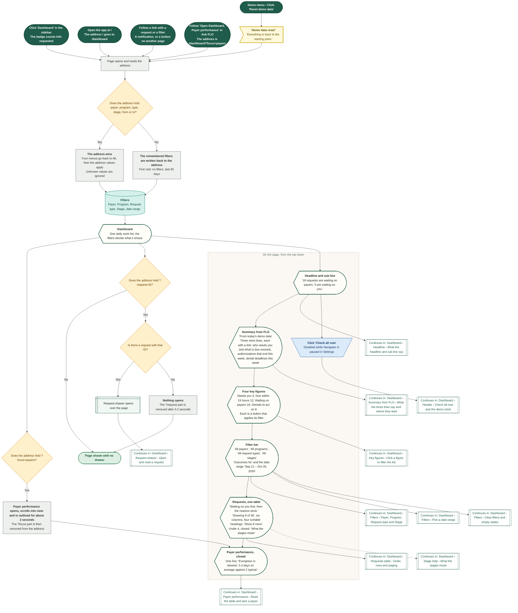

## Dashboard › Headline › What the headline and sub line say

The big sentence at the top and the muted line under it are rebuilt whenever a filter, a key figure or a payer reply changes the list. A grouping from the key figures wins over Stage, Stage wins over Payer, and Payer wins over the plain count. The numbers below are the demo's opening data.

Route: `/dashboard`

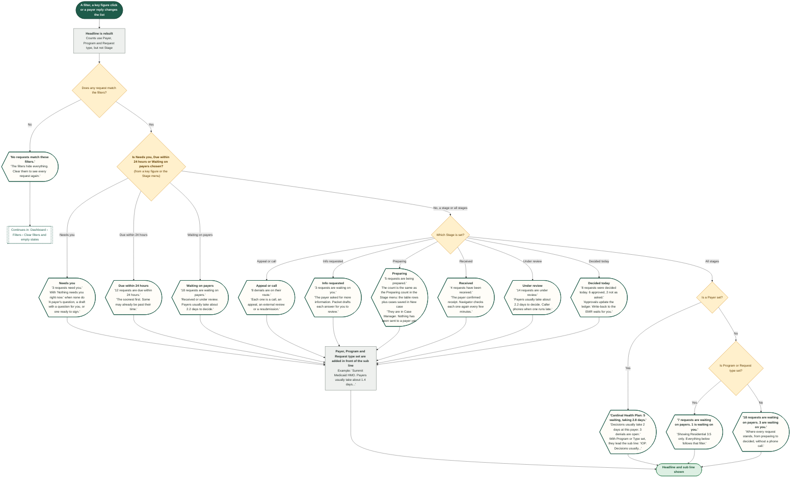

## Dashboard › Header › Check all now and the demo clock

The one button in the page header, which Settings can switch off by pausing Navigator, and what the Demo menu's clock does to the numbers on this page. Time in the demo only moves when someone moves it.

Route: `/dashboard`

Real world: Navigator checks every open request at least daily, and a request past the payer's time gets a call-the-payer task. Demo only: the button and the clock are simulated.

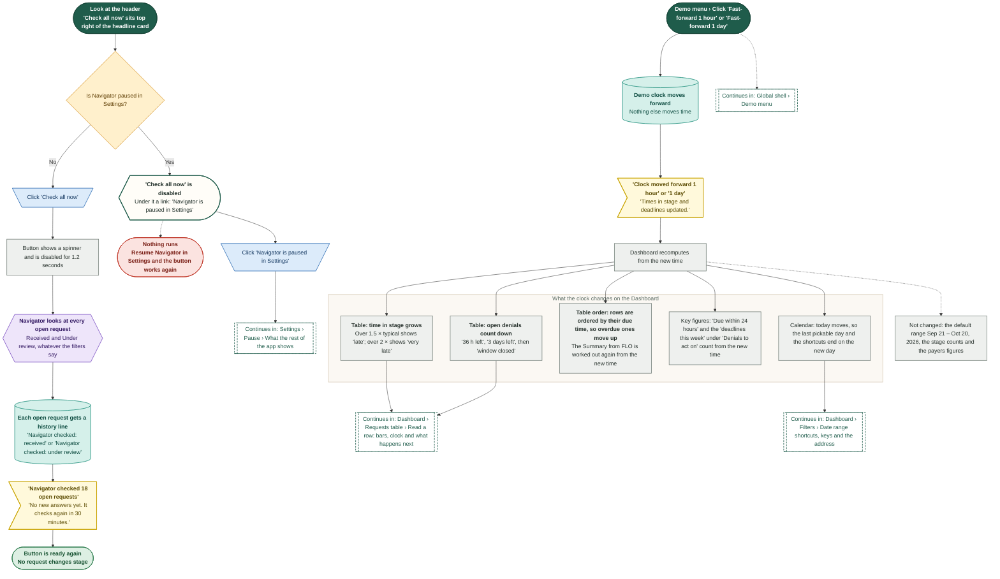

## Dashboard › Summary from FLO › What the three lines say and where they lead

A compact card under the headline. FLO works three short lines out from the live demo data: who needs you and what is due soonest, which authorizations end within 7 days, and which denial deadlines fall this week. Each line has a link to the screen it is about. It is a recommendation for a person to check, not a payer fact, and it ignores the filters below it.

Route: `/dashboard`

The wording and the numbers are computed each time. Nothing in the card is typed by hand.

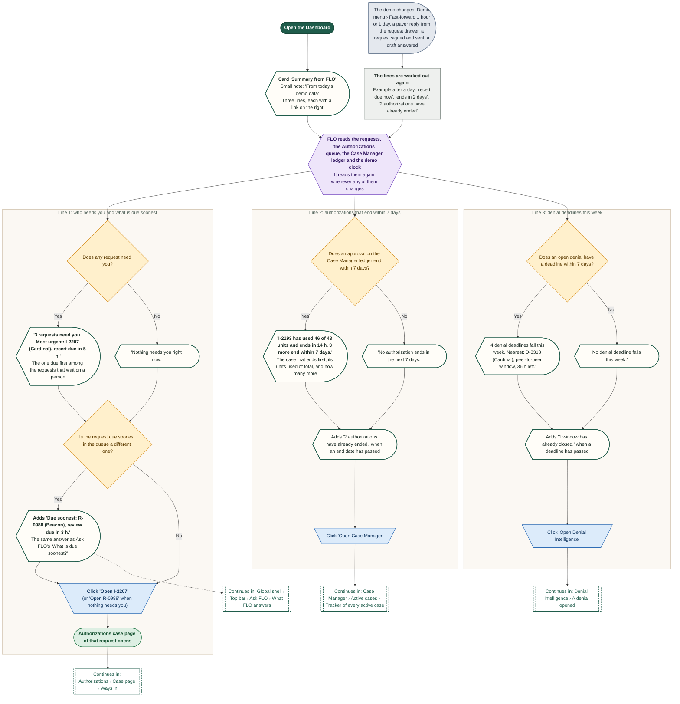

## Dashboard › Filters › Payer, Program, Request type and Stage

Four menus on the filter bar. Each one applies as soon as an option is picked; there is no Apply button. The date range is a separate control (see Pick a date range).

Route: `/dashboard?payer=cardinal&program=iop&type=recertification&stage=appeal`

```mermaid
%%{init: {"theme":"base","themeVariables":{"fontFamily":"'DM Sans', 'Segoe UI', system-ui, sans-serif","fontSize":"15px","lineColor":"#5B6B63","primaryTextColor":"#1C2B25","clusterBkg":"#FBF8F3","clusterBorder":"#D9CDBB","edgeLabelBackground":"#FFFFFF"},"flowchart":{"curve":"basis","nodeSpacing":36,"rankSpacing":48,"padding":12,"htmlLabels":true,"useMaxWidth":false,"wrappingWidth":230}} }%%
flowchart TD
  classDef k_start fill:#1F5C4B,stroke:#174638,color:#FFFFFF,stroke-width:1.5px,font-weight:600
  classDef k_end fill:#DDEFE3,stroke:#2E7D4F,color:#14502F,stroke-width:1.5px,font-weight:600
  classDef k_endx fill:#FBE3E0,stroke:#C0392B,color:#7A1F16,stroke-width:1.5px,font-weight:600
  classDef k_screen fill:#FFFDF8,stroke:#1F5C4B,color:#1C2B25,stroke-width:2px
  classDef k_overlay fill:#F1F7F3,stroke:#1F5C4B,color:#1C2B25,stroke-width:2px,stroke-dasharray:5 3
  classDef k_click fill:#DCEBFA,stroke:#2F6DB5,color:#12365F,stroke-width:1.5px
  classDef k_input fill:#E4E7FF,stroke:#4C5FD5,color:#1D2670,stroke-width:1.5px
  classDef k_process fill:#EEF0EE,stroke:#7A857F,color:#26302B,stroke-width:1.5px
  classDef k_agent fill:#EEE5FA,stroke:#7A4FC2,color:#341A63,stroke-width:1.5px
  classDef k_decision fill:#FFF0CC,stroke:#D9962B,color:#5C3B00,stroke-width:1.5px
  classDef k_store fill:#D5F0EA,stroke:#1C8E7B,color:#0B4A3F,stroke-width:1.5px
  classDef k_doc fill:#F6E9DC,stroke:#B07A4C,color:#4A2E14,stroke-width:1.5px
  classDef k_ext fill:#FFE6D2,stroke:#E07B39,color:#6B2F06,stroke-width:1.5px
  classDef k_wait fill:#E4E8EE,stroke:#6B7C93,color:#26303D,stroke-width:1.5px
  classDef k_toast fill:#FFF9DB,stroke:#C9A400,color:#5A4A00,stroke-width:1.5px
  classDef k_goto fill:#FFFFFF,stroke:#1F5C4B,color:#1F5C4B,stroke-width:1.5px,stroke-dasharray:5 3
  s1@{ shape: stadium, label: "<b>Dashboard is open</b><br/>Filter bar, under the four key figures: four menus, then 'Outcomes for' and the dates" }
  c1@{ shape: trap-t, label: "Click 'All payers'" }
  c2@{ shape: trap-t, label: "Click 'All programs'" }
  c3@{ shape: trap-t, label: "Click 'All request types'" }
  c4@{ shape: trap-t, label: "Click 'All stages'" }
  o1@{ shape: win-pane, label: "<b>Payer menu</b><br/>All payers, Cardinal Health Plan, Summit Medicaid HMO, Beacon PPO, Harborview MA, Lakeshore Behavioral, Evergreen" }
  o2@{ shape: win-pane, label: "<b>Program menu</b><br/>All programs, Residential 3.5, IOP, PHP, Detox" }
  o3@{ shape: win-pane, label: "<b>Request type menu</b><br/>All request types, Initial request, Admission, Continued stay, Recertification, Retro-authorization, Peer-to-peer call, Appeal, Resubmission" }
  o4@{ shape: win-pane, label: "<b>Stage menu</b><br/>All stages<br/>The three groupings from the key figures: Needs you, Due within 24 hours, Waiting on payers<br/>The six stages: Preparing, Received, Under review, Info requested, Decided today, Appeal or call<br/>Each option shows how many requests it holds" }
  m1@{ shape: rect, label: "<b>Menu is open: the options list, current pick ticked</b><br/>Same behaviour in all four menus" }
  i1@{ shape: lean-r, label: "<b>Pick an option</b><br/>Click it, or ArrowDown or ArrowUp then Enter" }
  k1@{ shape: trap-t, label: "Press Escape, click outside, or click the menu button again" }
  e0@{ shape: stadium, label: "Menu closes, nothing changes" }
  dg@{ shape: diam, label: "Is the pick a grouping (Needs you, Due within 24 hours, Waiting on payers)?" }
  pg@{ shape: rect, label: "<b>The grouping applies and Stage goes back to 'All stages' in the address</b><br/>A grouping and a stage never apply together; the key figure of the same name is outlined" }
  p1@{ shape: rect, label: "Menu closes and the pick is saved to Payer, Program, Request type or Stage" }
  w1@{ shape: cyl, label: "<b>Filters</b><br/>A menu that is not 'All' turns green and bold" }
  p2@{ shape: rect, label: "<b>Address updated in place, no new history entry</b><br/>Only non-default values appear" }
  p3@{ shape: rect, label: "Table goes back to its first 8 rows" }
  subgraph gFollow ["What follows each filter"]
  f1@{ shape: rect, label: "<b>Payer, Program, Request type</b><br/>Headline, the four key figures, the Stage menu counts and the table follow them" }
  f2@{ shape: rect, label: "<b>Stage or a grouping</b><br/>Table and headline follow it; the key figures still count every stage and the matching figure is outlined" }
  f3@{ shape: rect, label: "<b>Payer performance (when open)</b><br/>Waiting follows Program and Request type; the Payer pick highlights its row" }
  end
  d1@{ shape: diam, label: "Is any request left?" }
  sc@{ shape: curv-trap, label: "Dashboard shows the matching rows" }
  g1@{ shape: subproc, label: "Continues in: Dashboard › Filters › Clear filters and empty states" }
  g2@{ shape: subproc, label: "Continues in: Dashboard › Headline › What the headline and sub line say" }
  g3@{ shape: subproc, label: "Continues in: Dashboard › Key figures › Click a figure to filter the list" }
  g4@{ shape: subproc, label: "Continues in: Dashboard › Payer performance › Read the table and pick a payer" }
  s1 --> c1 --> o1
  s1 --> c2 --> o2
  s1 --> c3 --> o3
  s1 --> c4 --> o4
  o1 & o2 & o3 & o4 --> m1
  m1 --> i1
  m1 -.-> k1 --> e0
  i1 --> p1 --> w1 --> p2 --> p3
  i1 -.-> dg
  dg -->|"Yes"| pg --> w1
  p3 --> f1 & f2 & f3
  f1 --> g2
  f2 --> g3
  f3 --> g4
  f1 & f2 --> d1
  d1 -->|"Yes"| sc
  d1 -->|"No"| g1
  class s1 k_start
  class c1,c2,c3,c4,k1 k_click
  class o1,o2,o3,o4 k_overlay
  class m1,pg,p1,p2,p3,f1,f2,f3 k_process
  class i1 k_input
  class e0 k_end
  class dg,d1 k_decision
  class w1 k_store
  class sc k_screen
  class g1,g2,g3,g4 k_goto
  style gFollow fill:#FBF8F3,stroke:#D9CDBB,stroke-width:1.5px,color:#5B6B63
```

## Dashboard › Filters › Pick a date range

The calendar at the right end of the filter bar, after 'Outcomes for'. Pick a first day, then a last day, then Apply. The range only changes the figures in Payer performance (the section under the requests, closed until opened).

Route: `/dashboard?from=2026-10-05&to=2026-10-12`

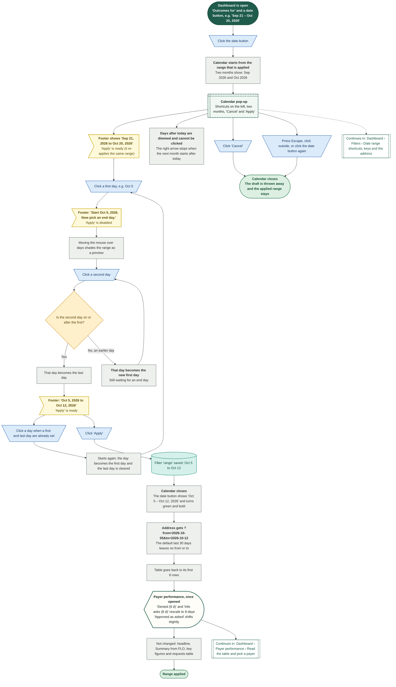

## Dashboard › Filters › Date range shortcuts, keys and the address

The faster ways through the calendar: four shortcuts that apply at once, the month arrows, the keyboard, and how the range is written to and read from the address. Today in the demo is Tue 20 Oct 2026.

Route: `/dashboard?from=2026-10-14&to=2026-10-20`

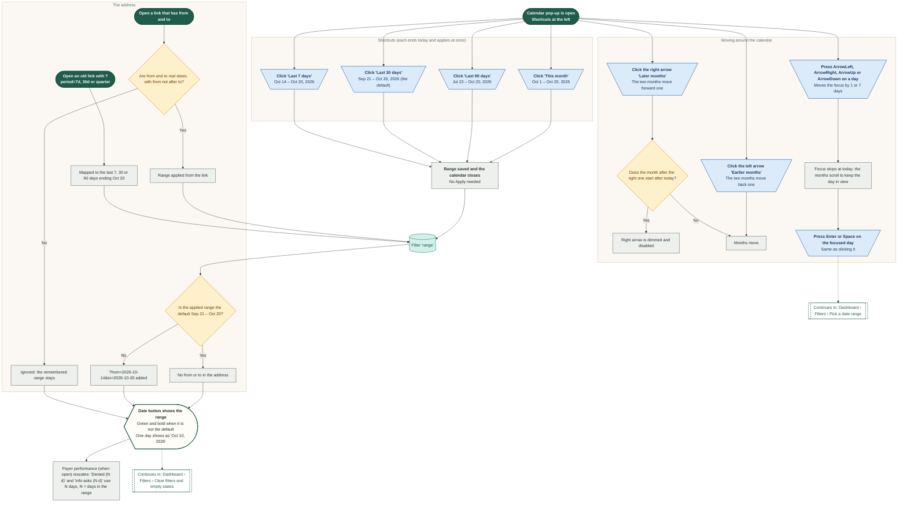

## Dashboard › Filters › Clear filters and empty states

When 'Clear filters' appears, what it resets, and what the page shows when the filters match nothing. The date range never empties the table and Clear filters never resets it.

Route: `/dashboard?payer=cardinal&program=iop&type=recertification&stage=appeal`

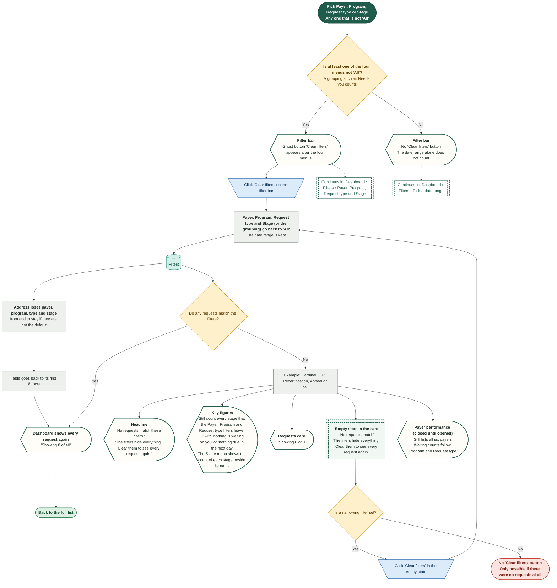

## Dashboard › Key figures › Click a figure to filter the list

Four figures sit under the Summary from FLO: Needs you, Due within 24 hours, Waiting on payers, Denials to act on. Each is a button, so the keyboard works too. A click applies the matching filter to the list; a second click clears it. The figures follow Payer, Program and Request type but ignore Stage. The six stage names are still in the Stage menu and in 'What the stages mean'.

Route: `/dashboard?stage=appeal`

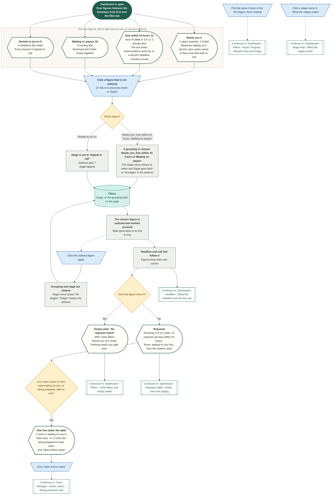

## Dashboard › Stage help › What the stages mean

The six stage names stay as they are. A closed section at the foot of the Requests card, 'What the stages mean', puts each stage next to the status the rest of Psyflo uses, shows how many requests are in it, and holds the longer note on the progress bars. A stage name in it is also a shortcut to that filter.

Route: `/dashboard`

```mermaid
%%{init: {"theme":"base","themeVariables":{"fontFamily":"'DM Sans', 'Segoe UI', system-ui, sans-serif","fontSize":"15px","lineColor":"#5B6B63","primaryTextColor":"#1C2B25","clusterBkg":"#FBF8F3","clusterBorder":"#D9CDBB","edgeLabelBackground":"#FFFFFF"},"flowchart":{"curve":"basis","nodeSpacing":36,"rankSpacing":48,"padding":12,"htmlLabels":true,"useMaxWidth":false,"wrappingWidth":230}} }%%
flowchart TD
  classDef k_start fill:#1F5C4B,stroke:#174638,color:#FFFFFF,stroke-width:1.5px,font-weight:600
  classDef k_end fill:#DDEFE3,stroke:#2E7D4F,color:#14502F,stroke-width:1.5px,font-weight:600
  classDef k_endx fill:#FBE3E0,stroke:#C0392B,color:#7A1F16,stroke-width:1.5px,font-weight:600
  classDef k_screen fill:#FFFDF8,stroke:#1F5C4B,color:#1C2B25,stroke-width:2px
  classDef k_overlay fill:#F1F7F3,stroke:#1F5C4B,color:#1C2B25,stroke-width:2px,stroke-dasharray:5 3
  classDef k_click fill:#DCEBFA,stroke:#2F6DB5,color:#12365F,stroke-width:1.5px
  classDef k_input fill:#E4E7FF,stroke:#4C5FD5,color:#1D2670,stroke-width:1.5px
  classDef k_process fill:#EEF0EE,stroke:#7A857F,color:#26302B,stroke-width:1.5px
  classDef k_agent fill:#EEE5FA,stroke:#7A4FC2,color:#341A63,stroke-width:1.5px
  classDef k_decision fill:#FFF0CC,stroke:#D9962B,color:#5C3B00,stroke-width:1.5px
  classDef k_store fill:#D5F0EA,stroke:#1C8E7B,color:#0B4A3F,stroke-width:1.5px
  classDef k_doc fill:#F6E9DC,stroke:#B07A4C,color:#4A2E14,stroke-width:1.5px
  classDef k_ext fill:#FFE6D2,stroke:#E07B39,color:#6B2F06,stroke-width:1.5px
  classDef k_wait fill:#E4E8EE,stroke:#6B7C93,color:#26303D,stroke-width:1.5px
  classDef k_toast fill:#FFF9DB,stroke:#C9A400,color:#5A4A00,stroke-width:1.5px
  classDef k_goto fill:#FFFFFF,stroke:#1F5C4B,color:#1F5C4B,stroke-width:1.5px,stroke-dasharray:5 3
  s1@{ shape: stadium, label: "<b>Scroll to the foot of the Requests card</b><br/>A closed row 'What the stages mean'" }
  sc@{ shape: curv-trap, label: "<b>Row</b><br/>Title 'What the stages mean'<br/>One line: 'Each stage name next to the status Psyflo uses for it, and how many requests are there'" }
  c1@{ shape: trap-t, label: "Click the row, or Tab to it and press Enter or Space" }
  d1@{ shape: diam, label: "Is it open?" }
  p1@{ shape: rect, label: "<b>Section opens</b><br/>The chevron turns; the row says it is expanded" }
  p2@{ shape: rect, label: "Section closes" }
  subgraph gList ["Six lines: stage name, status, count"]
  l1@{ shape: curv-trap, label: "<b>Preparing 5</b><br/>Draft while it is being prepared, Ready for review once a person can sign it" }
  l2@{ shape: curv-trap, label: "<b>Received 4</b><br/>Submitted once it is signed and sent, Acknowledged when the payer has it" }
  l3@{ shape: curv-trap, label: "<b>Under review 14</b><br/>Under review" }
  l4@{ shape: curv-trap, label: "<b>Info requested 3</b><br/>Info requested. The payer asked for more information" }
  l5@{ shape: curv-trap, label: "<b>Decided today 8</b><br/>Approved or Denied today. Completed once nothing is left to do" }
  l6@{ shape: curv-trap, label: "<b>Appeal or call 8</b><br/>Denied, with its route: a call, an appeal, an external review or a resubmission" }
  end
  n1@{ shape: curv-trap, label: "<b>Note under the list</b><br/>The bars show progress: Prepared, Received, In review, Decided. A denial shows Call, Appeal 1, Appeal 2, External. Over 1.5 × the payer's typical time is late; over 2 × is very late." }
  p3@{ shape: rect, label: "<b>Counts follow Payer, Program and Request type</b><br/>Preparing also counts cases saved in New case that have no row yet" }
  c2@{ shape: trap-t, label: "Click a stage name, e.g. 'Under review'" }
  p4@{ shape: rect, label: "<b>Stage is set to that stage</b><br/>Address gets ?stage=under_review<br/>The name is marked pressed" }
  sc2@{ shape: curv-trap, label: "<b>Requests</b><br/>'Showing 8 of 14' under '14 requests are under review.'" }
  c3@{ shape: trap-t, label: "Click the same row again" }
  e1@{ shape: stadium, label: "Section closed again; the filter stays" }
  g1@{ shape: subproc, label: "Continues in: Dashboard › Key figures › Click a figure to filter the list" }
  g2@{ shape: subproc, label: "Continues in: Dashboard › Requests table › Read a row: bars, clock and what happens next" }
  s1 --> sc --> c1 --> d1
  d1 -->|"No"| p1
  d1 -->|"Yes"| p2 --> e1
  p1 --> l1 --> l2 --> l3 --> l4 --> l5 --> l6 --> n1
  p1 -.-> p3
  l1 -.-> c2
  c2 --> p4 --> sc2 --> g1
  n1 --> c3 --> p2
  n1 -.-> g2
  class s1 k_start
  class sc,l1,l2,l3,l4,l5,l6,n1,sc2 k_screen
  class c1,c2,c3 k_click
  class d1 k_decision
  class p1,p2,p3,p4 k_process
  class e1 k_end
  class g1,g2 k_goto
  style gList fill:#FBF8F3,stroke:#D9CDBB,stroke-width:1.5px,color:#5B6B63
```

## Dashboard › Requests table › Order, rows and paging

The 'Requests' card, the one list on the page. Rows come in the list's own order (waiting on you first, then the nearest clock) until a heading is clicked. A click on a row, a case ID or 'Open' opens the request drawer and adds one history entry. Eight rows show at a time.

Route: `/dashboard`

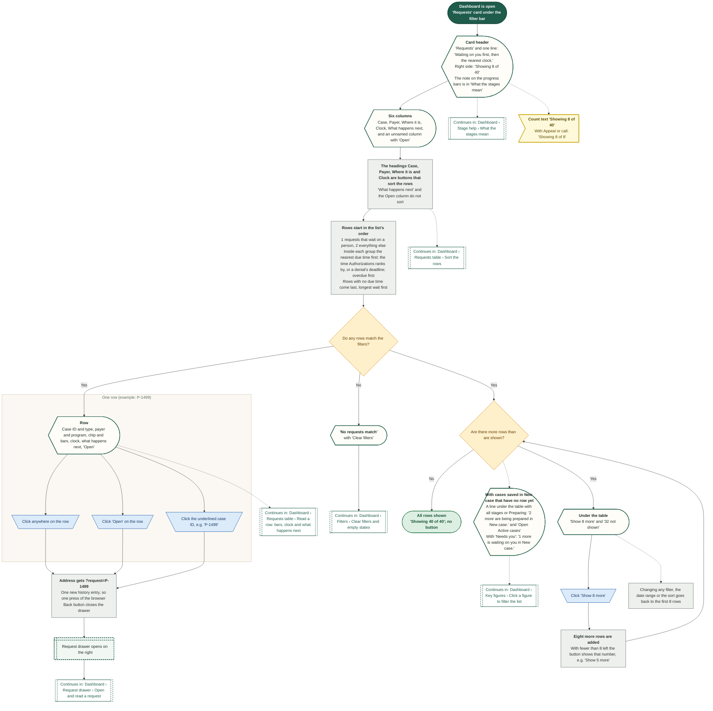

## Dashboard › Requests table › Read a row: bars, clock and what happens next

What each cell of a row means. The bars and the clock follow different rules for a normal request and for a denial (an ID that starts with D-). Nothing in these cells is a button except the case ID and Open. Case, Payer, Where it is and Clock can be sorted from their headings.

Route: `/dashboard`

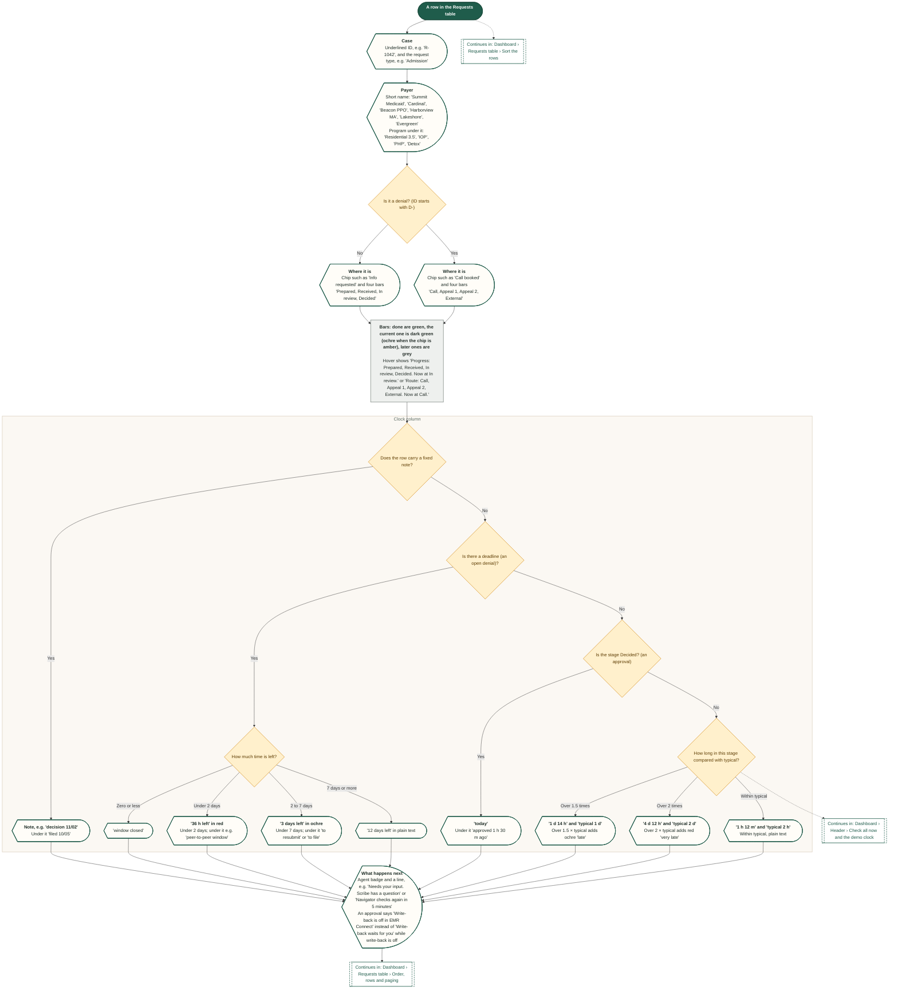

## Dashboard › Requests table › Sort the rows

Four headings of the Requests table sort the rows. Each is a button, so the keyboard works too. A heading goes ascending, then descending, then back to the list's own order. The sort is not saved in the address.

Route: `/dashboard`

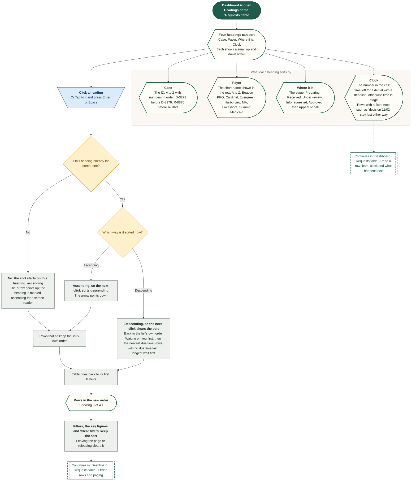

## Dashboard › Request drawer › Open and read a request

The drawer is one scroll, with no tabs. It opens from a row, a case ID, 'Open', or a link with ?request=ID, and shows who holds the request, its history and what is next. The sections change with the request's stage. The long lines are folded under 'Details'.

Route: `/dashboard?request=P-1499`

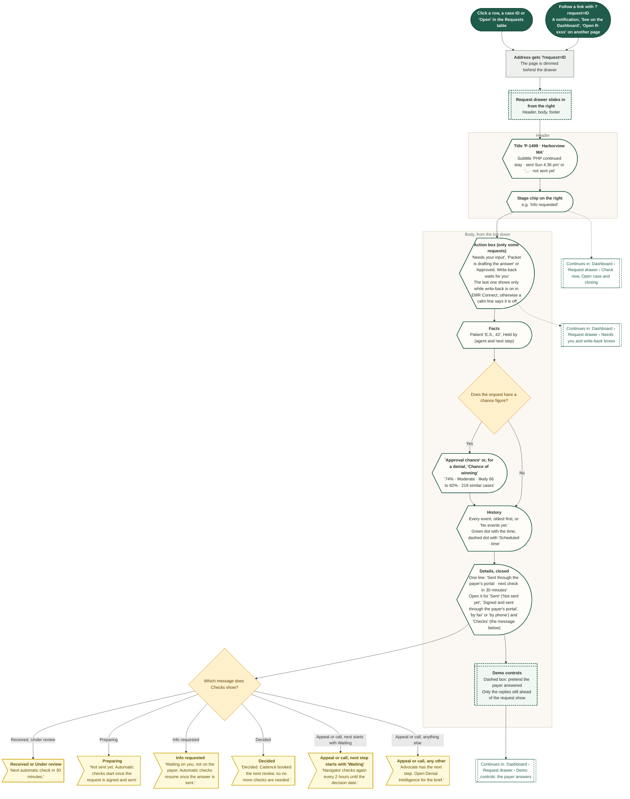

## Dashboard › Request drawer › Check now, Open case and closing

The footer of the drawer holds up to three buttons, and the drawer can be closed four ways. 'Check now' only fakes a payer check in the demo; it never moves a request to another stage.

Route: `/dashboard?request=R-1021`

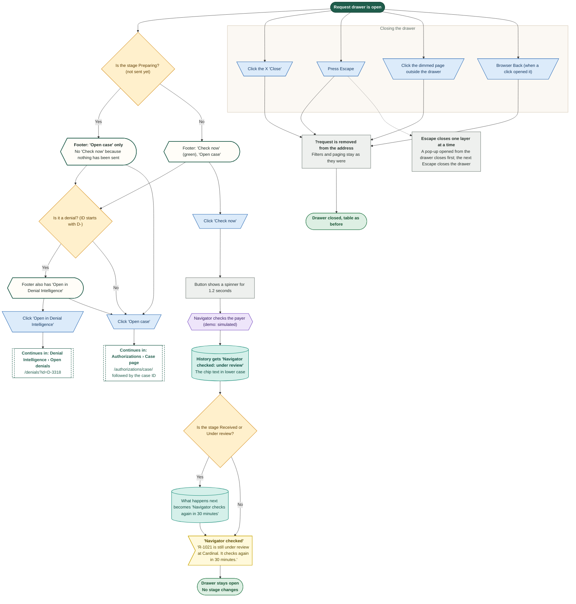

## Dashboard › Request drawer › Needs you and write-back boxes

The coloured box at the top of the drawer appears only when a person has something to do. There are three kinds: review a drafted answer, wait for the draft, and approve a write-back. The write-back box shows only while write-back is on in EMR Connect; when it is off, one calm line takes its place. Any other request shows no box.

Route: `/dashboard?request=I-2218`


## Dashboard › Request drawer › Approve the write-back

After a payer approves, the approval number and dates go to the EMR only when a person confirms, and only while write-back is on in EMR Connect. The pop-up shows exactly three things. In the demo the EMR write is simulated and changes only the request's history.

Route: `/dashboard?request=R-0951`

Real world: writing the reference number, units and dates back to the EMR is a confirmed step. Demo only: the EMR write is simulated.

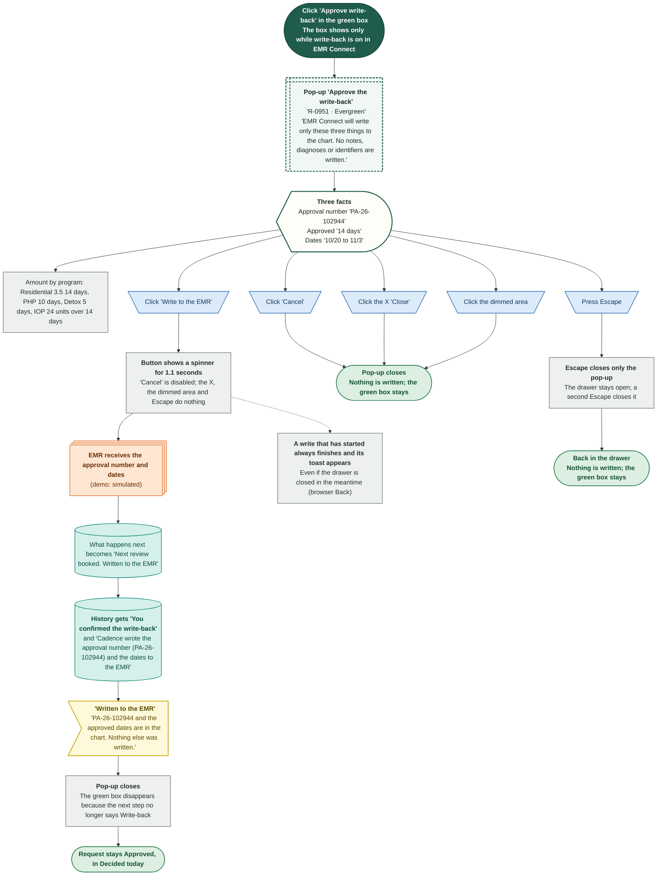

## Dashboard › Request drawer › Answer a payer information request

When a payer asks for more information, Packet drafts the answer from the chart, Integrity checks it, and a person reads it and signs. Nothing leaves before the signature. In the demo the payer's ask is seeded or triggered by a Demo control, and the send is simulated.

Route: `/dashboard?request=P-1499`

Real world: an information request is tracked, and a clinical supplement passes the clinician sign-off gate before it goes out. Demo only: one click on 'Sign and send answer' stands in for that, and the send is simulated.

```mermaid
%%{init: {"theme":"base","themeVariables":{"fontFamily":"'DM Sans', 'Segoe UI', system-ui, sans-serif","fontSize":"15px","lineColor":"#5B6B63","primaryTextColor":"#1C2B25","clusterBkg":"#FBF8F3","clusterBorder":"#D9CDBB","edgeLabelBackground":"#FFFFFF"},"flowchart":{"curve":"basis","nodeSpacing":36,"rankSpacing":48,"padding":12,"htmlLabels":true,"useMaxWidth":false,"wrappingWidth":230}} }%%
flowchart TD
  classDef k_start fill:#1F5C4B,stroke:#174638,color:#FFFFFF,stroke-width:1.5px,font-weight:600
  classDef k_end fill:#DDEFE3,stroke:#2E7D4F,color:#14502F,stroke-width:1.5px,font-weight:600
  classDef k_endx fill:#FBE3E0,stroke:#C0392B,color:#7A1F16,stroke-width:1.5px,font-weight:600
  classDef k_screen fill:#FFFDF8,stroke:#1F5C4B,color:#1C2B25,stroke-width:2px
  classDef k_overlay fill:#F1F7F3,stroke:#1F5C4B,color:#1C2B25,stroke-width:2px,stroke-dasharray:5 3
  classDef k_click fill:#DCEBFA,stroke:#2F6DB5,color:#12365F,stroke-width:1.5px
  classDef k_input fill:#E4E7FF,stroke:#4C5FD5,color:#1D2670,stroke-width:1.5px
  classDef k_process fill:#EEF0EE,stroke:#7A857F,color:#26302B,stroke-width:1.5px
  classDef k_agent fill:#EEE5FA,stroke:#7A4FC2,color:#341A63,stroke-width:1.5px
  classDef k_decision fill:#FFF0CC,stroke:#D9962B,color:#5C3B00,stroke-width:1.5px
  classDef k_store fill:#D5F0EA,stroke:#1C8E7B,color:#0B4A3F,stroke-width:1.5px
  classDef k_doc fill:#F6E9DC,stroke:#B07A4C,color:#4A2E14,stroke-width:1.5px
  classDef k_ext fill:#FFE6D2,stroke:#E07B39,color:#6B2F06,stroke-width:1.5px
  classDef k_wait fill:#E4E8EE,stroke:#6B7C93,color:#26303D,stroke-width:1.5px
  classDef k_toast fill:#FFF9DB,stroke:#C9A400,color:#5A4A00,stroke-width:1.5px
  classDef k_goto fill:#FFFFFF,stroke:#1F5C4B,color:#1F5C4B,stroke-width:1.5px,stroke-dasharray:5 3
  s0@{ shape: stadium, label: "A payer wants more information on a request" }
  x1@{ shape: st-rect, label: "<b>Payer asks for more information</b><br/>through its portal, fax or phone (demo: seeded for P-1499, or the Demo control 'Asks for information')" }
  a1@{ shape: hex, label: "<b>Packet drafts the answer from the chart</b><br/>Integrity checks every sentence against it" }
  w1@{ shape: cyl, label: "<b>Request becomes Info requested (amber)</b><br/>Needs you; next step 'Packet drafted the answer. Waiting for your review'" }
  t1@{ shape: odd, label: "<b>Notification 'Payer asked for info'</b><br/>'Harborview MA wants more on P-1499. Packet drafted the answer.'" }
  sc@{ shape: curv-trap, label: "<b>Dashboard</b><br/>'Needs you' goes up by one, the 'Info requested' count in the Stage menu too, and the sidebar Dashboard badge counts it<br/>The row floats to the top: it needs you" }
  s1@{ shape: stadium, label: "Click the row, or the notification, then the amber box 'Needs your input'" }
  c1@{ shape: trap-t, label: "Click 'Review the answer'" }
  o1@{ shape: win-pane, label: "<b>Pop-up 'Packet's answer for P-1499'</b><br/>'Harborview MA asked for more information · PHP'<br/>Drafted by Packet and checked by Integrity" }
  subgraph gModal ["Inside the pop-up, from the top down"]
  m1@{ shape: curv-trap, label: "<b>'What the payer asked for'</b><br/>Numbered list of the items asked" }
  d1@{ shape: diam, label: "Which program is the request for?" }
  r1@{ shape: doc, label: "<b>Residential 3.5</b><br/>Last 14 days of therapy notes, ASAM ratings, medication changes, step-down plan" }
  r2@{ shape: doc, label: "<b>PHP</b><br/>Daily attendance for 10 program days, latest psychiatric note, depression and anxiety scores, step-down plan to IOP" }
  r3@{ shape: doc, label: "<b>IOP</b><br/>Attendance for 4 weeks, urine screens, scale scores, work or school schedule" }
  r4@{ shape: doc, label: "<b>Detox</b><br/>Withdrawal scores for 72 hours, vital signs and medication, plan for the next level of care" }
  m2@{ shape: doc, label: "<b>'The drafted answer'</b><br/>One paragraph per item, each pointing to an entry in the chart, then a closing line" }
  m3@{ shape: doc, label: "<b>'Attached from the chart'</b><br/>File names with page counts" }
  m4@{ shape: odd, label: "<b>'Integrity checked every sentence against the chart'</b><br/>'4 of 4 checks passed. Navigator sends the answer through the payer's portal as soon as you sign. Nothing leaves before then.'" }
  end
  d2@{ shape: diam, label: "Does the person send it?" }
  c2@{ shape: trap-t, label: "Click 'Not yet'" }
  c3@{ shape: trap-t, label: "Click the X, click the dimmed area, or press Escape" }
  p0@{ shape: rect, label: "<b>Pop-up closes</b><br/>The request is unchanged and still needs you" }
  p1@{ shape: rect, label: "<b>Escape closes only the pop-up</b><br/>The drawer stays; a second Escape closes it" }
  e1@{ shape: stadium, label: "<b>Back to the drawer or the table</b><br/>Still 'Needs your input'" }
  c4@{ shape: trap-t, label: "Click 'Sign and send answer'" }
  p2@{ shape: rect, label: "Pop-up closes" }
  w2@{ shape: cyl, label: "<b>Request becomes Under review</b><br/>No longer needs you; Navigator holds it; next step 'Navigator checks again in 30 minutes'" }
  w3@{ shape: cyl, label: "<b>History gets 'You reviewed the answer and sent it' and 'Navigator sent the answer through the payer's portal'</b><br/>and a dashed 'Navigator checks again'" }
  t2@{ shape: odd, label: "<b>'Answer sent'</b><br/>'P-1499 is back under review.'" }
  x2@{ shape: st-rect, label: "Payer receives the answer (demo: simulated)" }
  wt@{ shape: delay, label: "Payer reviews again" }
  e2@{ shape: stadium, label: "<b>Drawer shows Under review</b><br/>Under 'Details': 'Next automatic check in 30 minutes.'" }
  g1@{ shape: subproc, label: "Continues in: Dashboard › Request drawer › Demo controls: the payer answers" }
  s0 --> x1 --> a1 --> w1 --> t1 --> sc
  s1 --> c1 --> o1 --> m1 --> d1
  d1 -->|"Residential 3.5"| r1 --> m2
  d1 -->|"PHP"| r2 --> m2
  d1 -->|"IOP"| r3 --> m2
  d1 -->|"Detox"| r4 --> m2
  m2 --> m3 --> m4 --> d2
  d2 -->|"No, not yet"| c2 --> p0
  d2 -->|"No, close it"| c3 --> p0
  c3 -.-> p1
  p0 --> e1
  d2 -->|"Yes"| c4 --> p2 --> w2 --> w3 --> t2 --> x2 --> wt --> e2
  wt -.-> g1
  sc -.-> s1
  class s0,s1 k_start
  class x1,x2 k_ext
  class a1 k_agent
  class w1,w2,w3 k_store
  class t1,m4,t2 k_toast
  class sc,m1 k_screen
  class c1,c2,c3,c4 k_click
  class o1 k_overlay
  class d1,d2 k_decision
  class r1,r2,r3,r4,m2,m3 k_doc
  class p0,p1,p2 k_process
  class e1,e2 k_end
  class wt k_wait
  class g1 k_goto
  style gModal fill:#FBF8F3,stroke:#D9CDBB,stroke-width:1.5px,color:#5B6B63
```

## Dashboard › Request drawer › Demo controls: the payer answers

A dashed 'Demo controls' box at the end of every drawer lets the presenter pretend the payer replied. Nothing is sent anywhere. A request only moves forward, so the box offers only the replies still ahead of it. This diagram covers when buttons show and the replies that keep a request alive; approve, approve part and deny are in the next diagram.

Route: `/dashboard?request=R-1021`

Demo only: in real life the payer answers through its portal, fax or phone and Navigator finds out by checking. These buttons fake that answer; nothing is sent.


## Dashboard › Request drawer › Demo controls: approve, approve part or deny

The three final payer answers and what the Dashboard shows afterwards. They are offered on a Received, Under review or Info requested request, and after one of them no more replies are offered. An approval stays on the Dashboard with a write-back waiting. A partial approval or a denial turns the request into a new D- number and hands it to Denial Intelligence.

Route: `/dashboard?request=R-1021`

Demo only: the payer's decision is simulated. Real rules: a decision is due in 7 days (72 hours when expedited), and a partial approval or denial goes to the denial route, starting with a peer-to-peer call.

```mermaid
%%{init: {"theme":"base","themeVariables":{"fontFamily":"'DM Sans', 'Segoe UI', system-ui, sans-serif","fontSize":"15px","lineColor":"#5B6B63","primaryTextColor":"#1C2B25","clusterBkg":"#FBF8F3","clusterBorder":"#D9CDBB","edgeLabelBackground":"#FFFFFF"},"flowchart":{"curve":"basis","nodeSpacing":36,"rankSpacing":48,"padding":12,"htmlLabels":true,"useMaxWidth":false,"wrappingWidth":230}} }%%
flowchart TD
  classDef k_start fill:#1F5C4B,stroke:#174638,color:#FFFFFF,stroke-width:1.5px,font-weight:600
  classDef k_end fill:#DDEFE3,stroke:#2E7D4F,color:#14502F,stroke-width:1.5px,font-weight:600
  classDef k_endx fill:#FBE3E0,stroke:#C0392B,color:#7A1F16,stroke-width:1.5px,font-weight:600
  classDef k_screen fill:#FFFDF8,stroke:#1F5C4B,color:#1C2B25,stroke-width:2px
  classDef k_overlay fill:#F1F7F3,stroke:#1F5C4B,color:#1C2B25,stroke-width:2px,stroke-dasharray:5 3
  classDef k_click fill:#DCEBFA,stroke:#2F6DB5,color:#12365F,stroke-width:1.5px
  classDef k_input fill:#E4E7FF,stroke:#4C5FD5,color:#1D2670,stroke-width:1.5px
  classDef k_process fill:#EEF0EE,stroke:#7A857F,color:#26302B,stroke-width:1.5px
  classDef k_agent fill:#EEE5FA,stroke:#7A4FC2,color:#341A63,stroke-width:1.5px
  classDef k_decision fill:#FFF0CC,stroke:#D9962B,color:#5C3B00,stroke-width:1.5px
  classDef k_store fill:#D5F0EA,stroke:#1C8E7B,color:#0B4A3F,stroke-width:1.5px
  classDef k_doc fill:#F6E9DC,stroke:#B07A4C,color:#4A2E14,stroke-width:1.5px
  classDef k_ext fill:#FFE6D2,stroke:#E07B39,color:#6B2F06,stroke-width:1.5px
  classDef k_wait fill:#E4E8EE,stroke:#6B7C93,color:#26303D,stroke-width:1.5px
  classDef k_toast fill:#FFF9DB,stroke:#C9A400,color:#5A4A00,stroke-width:1.5px
  classDef k_goto fill:#FFFFFF,stroke:#1F5C4B,color:#1F5C4B,stroke-width:1.5px,stroke-dasharray:5 3
  s1@{ shape: stadium, label: "Payer decides (demo: the presenter clicks a Demo control)" }
  x1@{ shape: st-rect, label: "<b>Payer decides through its portal, fax or phone</b><br/>(demo: simulated)" }
  c1@{ shape: trap-t, label: "Click 'Approves'" }
  c2@{ shape: trap-t, label: "Click 'Approves part'" }
  c3@{ shape: trap-t, label: "Click 'Denies'" }
  subgraph gA ["Approved"]
  a1@{ shape: cyl, label: "<b>Stage Decided today, chip 'Approved' (green), bars full</b><br/>Cadence holds it; next step 'Next review booked. Write-back waits for you'<br/>History 'The payer approved the request' and 'Cadence updated the ledger and booked the next review'" }
  an@{ shape: odd, label: "<b>Notification 'Approved': 'R-1021 was approved. Write-back waits for you.'</b><br/>Toast 'Demo: Cardinal approved it'<br/>'The stage counts, the table and the notifications updated.'" }
  as@{ shape: curv-trap, label: "<b>Dashboard after an approval</b><br/>'Decided today' goes up by one, 'Under review' goes down<br/>The Decided today headline counts it as approved" }
  ab@{ shape: win-pane, label: "<b>Drawer shows the green box 'Approved. Write-back waits for you'</b><br/>With write-back off in EMR Connect, a calm line instead" }
  qk@{ shape: rect, label: "<b>No reply is offered any more</b><br/>Demo controls say 'The payer has already decided this request.'<br/>So the request cannot be pushed back and stay counted in Decided today" }
  end
  g1@{ shape: subproc, label: "Continues in: Dashboard › Request drawer › Approve the write-back" }
  subgraph gD ["Denied or partly approved"]
  d1@{ shape: rect, label: "<b>Request gets a new number: D-3319, then D-3320 and so on</b><br/>The old number R-1021 is gone; the case stays the same" }
  d2@{ shape: cyl, label: "<b>Stage Appeal or call, type 'Peer-to-peer', chip 'Call booked'</b><br/>Advocate holds it; chance 61%; 3 days to the call window<br/>Next step 'Denied today. Advocate booked a peer-to-peer call'" }
  d3@{ shape: cyl, label: "<b>History 'The payer denied the request' or 'The payer approved only part of the request'</b><br/>then 'Advocate opened the denial and booked a peer-to-peer call'" }
  dn@{ shape: odd, label: "<b>Notification 'Denied' or 'Partly approved'</b><br/>'R-1021 became D-3319. Advocate booked a call.'" }
  dt@{ shape: odd, label: "<b>Toast 'The payer denied it' or 'The payer approved part of it'</b><br/>'It is now D-3319 in Denial Intelligence.'" }
  d4@{ shape: rect, label: "<b>Drawer switches to D-3319 in place (the address is replaced)</b><br/>Opening R-1021 again closes quietly: that number no longer exists" }
  ds@{ shape: curv-trap, label: "<b>Dashboard after a denial</b><br/>'Appeal or call' and 'Decided today' each go up by one; 'Under review' goes down<br/>Sidebar badge on Denial Intelligence goes up<br/>Its row shows 'Call booked' and '3 days left'<br/>A row hidden by the old stage filter leaves the table; the drawer stays open" }
  dd@{ shape: curv-trap, label: "<b>Drawer for D-3319</b><br/>Chip 'Call booked', 'Chance of winning 61%'<br/>Demo controls disabled: 'A denial follows its own route in Denial Intelligence.'<br/>Footer gains 'Open in Denial Intelligence'" }
  end
  g2@{ shape: subproc, label: "<b>Continues in: Denial Intelligence › Open denials</b><br/>/denials?id=D-3319" }
  g3@{ shape: subproc, label: "<b>Continues in: Authorizations › Case page</b><br/>The case number is unchanged" }
  s1 --> x1 --> c1 & c2 & c3
  c1 --> a1 --> an --> as --> ab --> g1
  ab --> qk
  c2 --> d1
  c3 --> d1
  d1 --> d2 --> d3 --> dn --> dt --> d4
  d4 --> ds
  d4 --> dd
  dd --> g2
  dd --> g3
  class s1 k_start
  class x1 k_ext
  class c1,c2,c3 k_click
  class a1,d2,d3 k_store
  class an,dn,dt k_toast
  class as,ds,dd k_screen
  class ab k_overlay
  class qk,d1,d4 k_process
  class g1,g2,g3 k_goto
  style gA fill:#FBF8F3,stroke:#D9CDBB,stroke-width:1.5px,color:#5B6B63
  style gD fill:#FBF8F3,stroke:#D9CDBB,stroke-width:1.5px,color:#5B6B63
```

## Dashboard › Payer performance › Read the table and pick a payer

The last section on the page, closed until opened. Closed, it is one title and one computed line naming the slowest payer. Open, it shows one row per payer, plus a totals row, and links to Analytics and Payers. A click on a payer row narrows the whole page to that payer; a second click clears it. A link from Ask FLO opens the section and scrolls it into view.

Route: `/dashboard?payer=harborview`

```mermaid
%%{init: {"theme":"base","themeVariables":{"fontFamily":"'DM Sans', 'Segoe UI', system-ui, sans-serif","fontSize":"15px","lineColor":"#5B6B63","primaryTextColor":"#1C2B25","clusterBkg":"#FBF8F3","clusterBorder":"#D9CDBB","edgeLabelBackground":"#FFFFFF"},"flowchart":{"curve":"basis","nodeSpacing":36,"rankSpacing":48,"padding":12,"htmlLabels":true,"useMaxWidth":false,"wrappingWidth":230}} }%%
flowchart TD
  classDef k_start fill:#1F5C4B,stroke:#174638,color:#FFFFFF,stroke-width:1.5px,font-weight:600
  classDef k_end fill:#DDEFE3,stroke:#2E7D4F,color:#14502F,stroke-width:1.5px,font-weight:600
  classDef k_endx fill:#FBE3E0,stroke:#C0392B,color:#7A1F16,stroke-width:1.5px,font-weight:600
  classDef k_screen fill:#FFFDF8,stroke:#1F5C4B,color:#1C2B25,stroke-width:2px
  classDef k_overlay fill:#F1F7F3,stroke:#1F5C4B,color:#1C2B25,stroke-width:2px,stroke-dasharray:5 3
  classDef k_click fill:#DCEBFA,stroke:#2F6DB5,color:#12365F,stroke-width:1.5px
  classDef k_input fill:#E4E7FF,stroke:#4C5FD5,color:#1D2670,stroke-width:1.5px
  classDef k_process fill:#EEF0EE,stroke:#7A857F,color:#26302B,stroke-width:1.5px
  classDef k_agent fill:#EEE5FA,stroke:#7A4FC2,color:#341A63,stroke-width:1.5px
  classDef k_decision fill:#FFF0CC,stroke:#D9962B,color:#5C3B00,stroke-width:1.5px
  classDef k_store fill:#D5F0EA,stroke:#1C8E7B,color:#0B4A3F,stroke-width:1.5px
  classDef k_doc fill:#F6E9DC,stroke:#B07A4C,color:#4A2E14,stroke-width:1.5px
  classDef k_ext fill:#FFE6D2,stroke:#E07B39,color:#6B2F06,stroke-width:1.5px
  classDef k_wait fill:#E4E8EE,stroke:#6B7C93,color:#26303D,stroke-width:1.5px
  classDef k_toast fill:#FFF9DB,stroke:#C9A400,color:#5A4A00,stroke-width:1.5px
  classDef k_goto fill:#FFFFFF,stroke:#1F5C4B,color:#1F5C4B,stroke-width:1.5px,stroke-dasharray:5 3
  s1@{ shape: stadium, label: "Scroll to 'Payer performance' at the foot of the page" }
  s2@{ shape: stadium, label: "<b>Follow 'Open Dashboard, Payer performance' in Ask FLO</b><br/>The address is /dashboard?focus=payers" }
  f1@{ shape: rect, label: "<b>Section opens</b><br/>Page scrolls to it<br/>It is outlined in green for about 2 seconds<br/>The ?focus part is then removed from the address" }
  sc0@{ shape: curv-trap, label: "<b>Closed section</b><br/>'Payer performance'<br/>'Evergreen is slowest: 3.4 days on average against 2 typical.'<br/>With every payer within its typical time: 'Every payer is deciding within its typical time.'" }
  co@{ shape: trap-t, label: "<b>Click the title row, or Tab to it and press Enter or Space</b><br/>The row says whether it is expanded" }
  sc1@{ shape: curv-trap, label: "<b>Open section</b><br/>'Waiting now, how long decisions take, and how often they go your way. Click a row to narrow everything on this page.'<br/>On the right: 'Open Analytics' and 'Open Payers'" }
  cc@{ shape: trap-t, label: "<b>Click the title row again</b><br/>Section closes; the payer filter stays" }
  d0@{ shape: diam, label: "Is Program or Request type set?" }
  t0@{ shape: odd, label: "<b>Sentence added to the header</b><br/>'Waiting counts follow your Program and Request type filters.'" }
  subgraph gCols ["Columns and rows"]
  r1@{ shape: curv-trap, label: "<b>Payer</b><br/>Name, e.g. 'Cardinal Health Plan', as a link, and its kind: 'Medicaid plan', 'Commercial', 'Medicare Advantage', 'Carve-out'" }
  r2@{ shape: curv-trap, label: "<b>Waiting</b><br/>Requests Received or Under review at that payer<br/>Follows Program and Request type, not Payer, Stage or dates" }
  r3@{ shape: curv-trap, label: "<b>Decision time</b><br/>'2.8 d' and 'typical 2 d'<br/>Ochre when the average is over 15 percent above typical" }
  r4@{ shape: curv-trap, label: "<b>Approved as asked</b><br/>'63%' with a small bar<br/>Green at 80 and above, ochre below" }
  r5@{ shape: curv-trap, label: "<b>Denied (30 d) and Info asks (30 d)</b><br/>Counts that rescale with the date range; the heading shows the number of days" }
  r6@{ shape: curv-trap, label: "<b>Reached by</b><br/>'Portal', 'Phone', 'Fax' or 'Portal and fax'" }
  r7@{ shape: curv-trap, label: "<b>Row order</b><br/>Cardinal Health Plan, Summit Medicaid HMO, Beacon PPO, Harborview MA, Lakeshore Behavioral, Evergreen" }
  r8@{ shape: curv-trap, label: "<b>Last row 'All payers'</b><br/>Sums of Waiting, Denied and Info asks; '-' elsewhere; not clickable" }
  end
  c1@{ shape: trap-t, label: "<b>Click a payer row (not its name)</b><br/>Or Tab to the row and press Enter or Space" }
  d1@{ shape: diam, label: "Is that payer already selected? (row tinted green)" }
  p1@{ shape: rect, label: "Payer filter set to that payer" }
  p2@{ shape: rect, label: "Payer filter goes back to 'All payers'" }
  w1@{ shape: cyl, label: "Filter 'payer'" }
  p3@{ shape: rect, label: "<b>Address gets ?payer=harborview, or loses it</b><br/>Table goes back to its first 8 rows" }
  sc2@{ shape: curv-trap, label: "<b>Page follows the payer</b><br/>Headline 'Harborview MA: 3 waiting, taking 3.1 days.'<br/>Key figures and the requests table follow it; the Payer menu shows its name" }
  sc3@{ shape: curv-trap, label: "<b>Payers table keeps all six rows</b><br/>The chosen row is tinted green and marked selected<br/>Waiting counts do not change" }
  c2@{ shape: trap-t, label: "<b>Click the payer's name, e.g. 'Harborview MA'</b><br/>The filter does not change" }
  c3@{ shape: trap-t, label: "Click 'Open Payers'" }
  c4@{ shape: trap-t, label: "Click 'Open Analytics'" }
  n4@{ shape: rect, label: "Address becomes /analytics" }
  g6@{ shape: subproc, label: "Continues in: Analytics › Arrive and read the page" }
  n2@{ shape: rect, label: "<b>Address becomes /payers/harborview</b><br/>A new history entry, so Back returns here" }
  n3@{ shape: rect, label: "Address becomes /payers" }
  g4@{ shape: subproc, label: "Continues in: Payers › Arrive on the page" }
  g1@{ shape: subproc, label: "Continues in: Dashboard › Headline › What the headline and sub line say" }
  g2@{ shape: subproc, label: "Continues in: Dashboard › Filters › Date range shortcuts, keys and the address" }
  g3@{ shape: subproc, label: "Continues in: Dashboard › Filters › Payer, Program, Request type and Stage" }
  g5@{ shape: subproc, label: "Continues in: Global shell › Top bar › Ask FLO › What FLO answers" }
  s1 --> sc0 --> co --> sc1 --> d0
  sc1 -.-> cc
  s2 --> f1 --> sc1
  s2 -.-> g5
  d0 -->|"Yes"| t0 --> r1
  d0 -->|"No"| r1
  r1 --> r2 --> r3 --> r4 --> r5 --> r6 --> r7 --> r8
  r5 -.-> g2
  r8 --> c1
  c1 --> d1
  d1 -->|"No"| p1 --> w1
  d1 -->|"Yes"| p2 --> w1
  w1 --> p3
  p3 --> sc2 --> g1
  p3 --> sc3
  sc3 -.-> g3
  r1 --> c2 --> n2 --> g4
  sc1 --> c3 --> n3 --> g4
  sc1 --> c4 --> n4 --> g6
  class s1,s2 k_start
  class f1,p1,p2,p3,n4,n2,n3 k_process
  class sc0,sc1,r1,r2,r3,r4,r5,r6,r7,r8,sc2,sc3 k_screen
  class co,cc,c1,c2,c3,c4 k_click
  class d0,d1 k_decision
  class t0 k_toast
  class w1 k_store
  class g6,g4,g1,g2,g3,g5 k_goto
  style gCols fill:#FBF8F3,stroke:#D9CDBB,stroke-width:1.5px,color:#5B6B63
```
