# Authorizations › Worklist and case page

One worklist for every authorization: view chips with counts, search and filters, one table with each row's next action and quick view, and the payer signal; and the case page with three tabs: Recommended actions, Clinical picture & draft, Criteria & risk; the screener chart, the framework and History with flags.

Shapes and colours: see `00-overview.md`. Source: `workflows/src/03-authorizations/`.

## Authorizations › Worklist › Arrive and read the views

Authorizations is one workspace for every authorization, from preparation to the payer's decision and the approved authorization's reviews. The page is a title, the payer signal, one row of view chips with counts, the filter bar and one table. Every part has its own diagram; this one shows the ways in and how the page is laid out.

Route: `/authorizations`

Demo only: the counts are the seed data for Both sites (95 rows: 19 in progress, 36 with the payer, 32 approved, 8 denied; 30 need attention; 47 reviews due this week). There is no subtitle and there are no figure tiles: the view chips carry the counts. Case Manager is no longer a page; its functions are views and rows of this list.

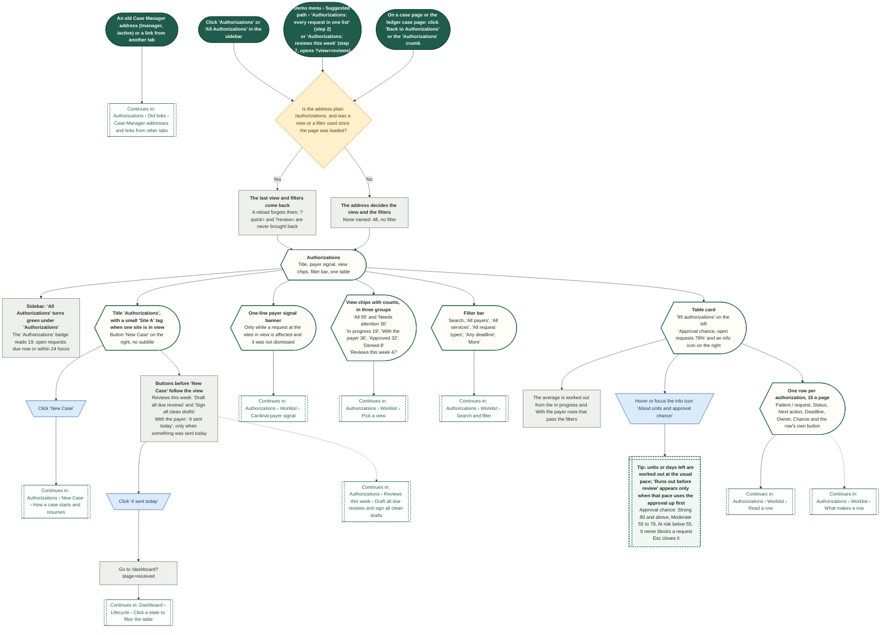

## Authorizations › Worklist › Pick a view

Seven view chips narrow the one table. In progress, With the payer, Approved and Denied say where a request is in its life and add up to All. Needs attention and Reviews this week cut across them, so they sit apart and are never added in. The filters narrow every count; the chosen view narrows only the table.

Route: `/authorizations?view=approved`

Demo only, Both sites at the start: 19 + 36 + 32 + 8 = 95. A request with the payer can still need someone (P-1499 waits on an answer to the payer's question), so it counts in With the payer and in Needs attention.

```mermaid
%%{init: {"theme":"base","themeVariables":{"fontFamily":"'DM Sans', 'Segoe UI', system-ui, sans-serif","fontSize":"15px","lineColor":"#5B6B63","primaryTextColor":"#1C2B25","clusterBkg":"#FBF8F3","clusterBorder":"#D9CDBB","edgeLabelBackground":"#FFFFFF"},"flowchart":{"curve":"basis","nodeSpacing":36,"rankSpacing":48,"padding":12,"htmlLabels":true,"useMaxWidth":false,"wrappingWidth":230}} }%%
flowchart TD
  classDef k_start fill:#1F5C4B,stroke:#174638,color:#FFFFFF,stroke-width:1.5px,font-weight:600
  classDef k_end fill:#DDEFE3,stroke:#2E7D4F,color:#14502F,stroke-width:1.5px,font-weight:600
  classDef k_endx fill:#FBE3E0,stroke:#C0392B,color:#7A1F16,stroke-width:1.5px,font-weight:600
  classDef k_screen fill:#FFFDF8,stroke:#1F5C4B,color:#1C2B25,stroke-width:2px
  classDef k_overlay fill:#F1F7F3,stroke:#1F5C4B,color:#1C2B25,stroke-width:2px,stroke-dasharray:5 3
  classDef k_click fill:#DCEBFA,stroke:#2F6DB5,color:#12365F,stroke-width:1.5px
  classDef k_input fill:#E4E7FF,stroke:#4C5FD5,color:#1D2670,stroke-width:1.5px
  classDef k_process fill:#EEF0EE,stroke:#7A857F,color:#26302B,stroke-width:1.5px
  classDef k_agent fill:#EEE5FA,stroke:#7A4FC2,color:#341A63,stroke-width:1.5px
  classDef k_decision fill:#FFF0CC,stroke:#D9962B,color:#5C3B00,stroke-width:1.5px
  classDef k_store fill:#D5F0EA,stroke:#1C8E7B,color:#0B4A3F,stroke-width:1.5px
  classDef k_doc fill:#F6E9DC,stroke:#B07A4C,color:#4A2E14,stroke-width:1.5px
  classDef k_ext fill:#FFE6D2,stroke:#E07B39,color:#6B2F06,stroke-width:1.5px
  classDef k_wait fill:#E4E8EE,stroke:#6B7C93,color:#26303D,stroke-width:1.5px
  classDef k_toast fill:#FFF9DB,stroke:#C9A400,color:#5A4A00,stroke-width:1.5px
  classDef k_goto fill:#FFFFFF,stroke:#1F5C4B,color:#1F5C4B,stroke-width:1.5px,stroke-dasharray:5 3
  ch@{ shape: curv-trap, label: "<b>View chips under the payer signal</b><br/>The chosen one has a green outline" }
  c1@{ shape: trap-t, label: "Click a chip, for example 'Approved'" }
  d1@{ shape: diam, label: "Is that chip already the chosen one (and not All)?" }
  p1@{ shape: rect, label: "<b>That view is chosen</b><br/>The address gets ?view=approved (All has no ?view=)<br/>The entry is replaced, so Back does not walk through views" }
  p0@{ shape: rect, label: "<b>Back to All</b><br/>?view= leaves the address" }
  pk@{ shape: rect, label: "<b>Search and filters stay as they are</b><br/>The table goes back to page 1 and keeps its sort" }
  subgraph gL ["Life views: they add up to All"]
  v1@{ shape: rect, label: "<b>In progress</b><br/>Preparing and Ready to sign: not sent yet<br/>Saved New Case drafts: Intake not finished, Needs your input, Agents working, Ready to sign" }
  v2@{ shape: rect, label: "<b>With the payer</b><br/>With the payer, Submitted, Under review, Info requested" }
  v3@{ shape: rect, label: "<b>Approved</b><br/>Approved or Partial approval, with units or days used" }
  v4@{ shape: rect, label: "<b>Denied</b><br/>Denial route or Denied, and Accepted denials with a step-down to plan" }
  end
  subgraph gX ["Views that cut across"]
  v5@{ shape: rect, label: "<b>Needs attention</b><br/>A person has to act: not sent yet, a question for you, a denial with a deadline, a ledger case that needs action, a review that needs your update, a step-down to plan" }
  v6@{ shape: rect, label: "<b>Reviews this week</b><br/>Rows whose continued-stay review is due before the end of Sunday" }
  end
  v0@{ shape: rect, label: "<b>All</b><br/>Every row at the sites in view" }
  rv@{ shape: rect, label: "<b>Reviews this week changes the table</b><br/>Column 'Review' shows the review's status; 'Due' shows 'Review 2 · Tue 10/20, 8:30 am'<br/>Rows go by review time; each row's button is the review's own" }
  hb@{ shape: rect, label: "<b>The header follows the view</b><br/>Reviews this week adds 'Draft all due reviews' and 'Sign all clean drafts'<br/>With the payer adds 'N sent today'" }
  cnt@{ shape: rect, label: "<b>Every chip's count follows the search and every filter</b><br/>The chosen view does not change the other chips' counts" }
  d3@{ shape: diam, label: "Does the view have a row after the filters?" }
  e1@{ shape: stadium, label: "The table lists the view's rows" }
  gE@{ shape: subproc, label: "Continues in: Authorizations › Worklist › Search and filter" }
  s2@{ shape: stadium, label: "Open a link with ?view=, for example /authorizations?view=reviews" }
  d2@{ shape: diam, label: "Is it attention, progress, payer, approved, denied or reviews?" }
  ig@{ shape: rect, label: "The value is ignored: All" }
  gA@{ shape: subproc, label: "Continues in: Authorizations › Approved › Approved authorizations and their units" }
  gP@{ shape: subproc, label: "Continues in: Authorizations › In progress › Drafts being prepared" }
  gD@{ shape: subproc, label: "Continues in: Authorizations › Denied › Step-down plans from accepted denials" }
  gR@{ shape: subproc, label: "Continues in: Authorizations › Reviews this week › The view" }
  gW@{ shape: subproc, label: "Continues in: Authorizations › With the payer › A request sent today joins the list" }
  ch --> c1 --> d1
  d1 -->|"No"| p1 --> pk
  d1 -->|"Yes"| p0 --> pk
  pk --> d3
  d3 -->|"Yes"| e1
  d3 -->|"No: 'No authorizations match'"| gE
  ch -.-> cnt
  p1 --> v0 & v1 & v2 & v3 & v4 & v5 & v6
  v1 -.-> gP
  v3 -.-> gA
  v4 -.-> gD
  v2 -.-> gW
  v6 --> rv --> gR
  p1 -.-> hb
  s2 --> d2
  d2 -->|"Yes"| p1
  d2 -->|"No"| ig --> pk
  class ch k_screen
  class c1 k_click
  class d1,d3,d2 k_decision
  class p1,p0,pk,v1,v2,v3,v4,v5,v6,v0,rv,hb,cnt,ig k_process
  class e1 k_end
  class gE,gA,gP,gD,gR,gW k_goto
  class s2 k_start
  style gL fill:#FBF8F3,stroke:#D9CDBB,stroke-width:1.5px,color:#5B6B63
  style gX fill:#FBF8F3,stroke:#D9CDBB,stroke-width:1.5px,color:#5B6B63
```

## Authorizations › Worklist › What makes a row

The worklist stores nothing. Its rows are worked out from what the demo already holds, one row per request: the open queue requests, the approved-authorization ledger, the Dashboard requests, the saved New Case drafts and the accepted denials. A queue request and its ledger record are the same request, so they share one row. The rows are then kept to the sites in view and put in order.

Route: `/authorizations`

Demo only, Both sites at the start: 56 open queue requests (24 of them also have a ledger record), 32 approved authorizations with no open request, and 7 open denials that are in neither list: 95 rows. The 5 saved drafts all belong to queue requests, so they add no row. A row keeps its sources, so the quick views, the case page and the review drawer open the same records as before.

```mermaid
%%{init: {"theme":"base","themeVariables":{"fontFamily":"'DM Sans', 'Segoe UI', system-ui, sans-serif","fontSize":"15px","lineColor":"#5B6B63","primaryTextColor":"#1C2B25","clusterBkg":"#FBF8F3","clusterBorder":"#D9CDBB","edgeLabelBackground":"#FFFFFF"},"flowchart":{"curve":"basis","nodeSpacing":36,"rankSpacing":48,"padding":12,"htmlLabels":true,"useMaxWidth":false,"wrappingWidth":230}} }%%
flowchart TD
  classDef k_start fill:#1F5C4B,stroke:#174638,color:#FFFFFF,stroke-width:1.5px,font-weight:600
  classDef k_end fill:#DDEFE3,stroke:#2E7D4F,color:#14502F,stroke-width:1.5px,font-weight:600
  classDef k_endx fill:#FBE3E0,stroke:#C0392B,color:#7A1F16,stroke-width:1.5px,font-weight:600
  classDef k_screen fill:#FFFDF8,stroke:#1F5C4B,color:#1C2B25,stroke-width:2px
  classDef k_overlay fill:#F1F7F3,stroke:#1F5C4B,color:#1C2B25,stroke-width:2px,stroke-dasharray:5 3
  classDef k_click fill:#DCEBFA,stroke:#2F6DB5,color:#12365F,stroke-width:1.5px
  classDef k_input fill:#E4E7FF,stroke:#4C5FD5,color:#1D2670,stroke-width:1.5px
  classDef k_process fill:#EEF0EE,stroke:#7A857F,color:#26302B,stroke-width:1.5px
  classDef k_agent fill:#EEE5FA,stroke:#7A4FC2,color:#341A63,stroke-width:1.5px
  classDef k_decision fill:#FFF0CC,stroke:#D9962B,color:#5C3B00,stroke-width:1.5px
  classDef k_store fill:#D5F0EA,stroke:#1C8E7B,color:#0B4A3F,stroke-width:1.5px
  classDef k_doc fill:#F6E9DC,stroke:#B07A4C,color:#4A2E14,stroke-width:1.5px
  classDef k_ext fill:#FFE6D2,stroke:#E07B39,color:#6B2F06,stroke-width:1.5px
  classDef k_wait fill:#E4E8EE,stroke:#6B7C93,color:#26303D,stroke-width:1.5px
  classDef k_toast fill:#FFF9DB,stroke:#C9A400,color:#5A4A00,stroke-width:1.5px
  classDef k_goto fill:#FFFFFF,stroke:#1F5C4B,color:#1F5C4B,stroke-width:1.5px,stroke-dasharray:5 3
  s0@{ shape: stadium, label: "<b>The list is drawn, or anything it reads changes</b><br/>(a send, a payer reply, a signature, a draft saved, the demo clock)" }
  subgraph gS ["Sources, in this order"]
  r1@{ shape: rect, label: "<b>1 Open queue requests</b><br/>Preparing, Ready to sign, With the payer, Denial route<br/>A request leaves once nothing is left for a person: sent, decided or settled" }
  r2@{ shape: rect, label: "<b>2 Ledger records</b><br/>Approved authorizations with their units and reviews, and requests waiting on a payer<br/>Plus each request signed and sent in New Case during the demo that the ledger did not have, marked 'New today'" }
  r3@{ shape: rect, label: "<b>3 Dashboard requests in neither list</b><br/>Open denials, and requests decided or sent since" }
  r4@{ shape: rect, label: "<b>4 Saved New Case drafts</b> that are not a request yet" }
  r5@{ shape: rect, label: "<b>5 Accepted denials</b><br/>Denial Intelligence closed them" }
  end
  d2@{ shape: diam, label: "<b>Is the ledger record the same request as a queue row?</b><br/>(same ID or case ID)" }
  j2@{ shape: rect, label: "<b>It joins that row: units used and the review are added, and 'New today' when it applies</b><br/>Status, next action and button stay the request's" }
  o2@{ shape: rect, label: "<b>A row of its own: Approved, With the payer, Info requested, Denial route, Accepted or Preparing</b><br/>When its Dashboard request was decided since, the row says so: Approved, Partial approval or Denied" }
  d4@{ shape: diam, label: "Does the draft belong to a request already listed?" }
  j4@{ shape: rect, label: "<b>It stays on that row</b><br/>The row offers 'Open the draft in New Case'" }
  o4@{ shape: rect, label: "<b>A row of its own in In progress</b><br/>Intake not finished, Needs your input, Agents working or Ready to sign" }
  gP@{ shape: subproc, label: "Continues in: Authorizations › In progress › Drafts being prepared" }
  j5@{ shape: rect, label: "<b>The denial's row reads 'Accepted' in Denied</b><br/>Needs attention, 'Plan the step-down', button 'Open case'" }
  gD@{ shape: subproc, label: "Continues in: Authorizations › Denied › Step-down plans from accepted denials" }
  subgraph gN ["Notes added under the patient"]
  n1@{ shape: rect, label: "'New today': a request signed and sent today" }
  n2@{ shape: rect, label: "'Updated for a payer change · 10/20': Payers redrafted it" }
  n3@{ shape: rect, label: "<b>'Consider a step-down' on R-0873 and P-1522</b><br/>Hover for 'Day 18 of 21 · aftercare visit not booked yet' or 'Day 11 · IOP starts Monday'" }
  end
  gU@{ shape: subproc, label: "Continues in: Authorizations › Worklist › Updated for a payer change" }
  st@{ shape: rect, label: "<b>Only the rows at the sites in view are kept</b><br/>A denial follows its own site; everything else follows its case" }
  gSi@{ shape: subproc, label: "Continues in: Authorizations › Worklist › Sites: what each viewer sees" }
  subgraph gO ["Order, before any sort"]
  o1@{ shape: rect, label: "By deadline: Act now, then Within 24 hours, then the next 7 days, then later" }
  o3@{ shape: rect, label: "Then the rows waiting on a person first" }
  o5@{ shape: rect, label: "Then the soonest due, then the lower approval chance, then the ID" }
  end
  bd@{ shape: rect, label: "<b>A queue request keeps its own deadline band</b><br/>Any other row: overdue or urgent is Act now, under a day is Within 24 hours, under 7 days is the week, else later" }
  e1@{ shape: stadium, label: "One row per request, in that order" }
  gR@{ shape: subproc, label: "Continues in: Authorizations › Worklist › Read a row" }
  s0 --> r1 --> r2 --> d2
  d2 -->|"Yes"| j2
  d2 -->|"No"| o2
  j2 --> r3
  o2 --> r3
  r3 --> r4 --> d4
  d4 -->|"Yes"| j4
  d4 -->|"No"| o4
  o4 -.-> gP
  j4 --> r5
  o4 --> r5
  r5 --> j5
  j5 -.-> gD
  j5 --> n1
  r2 -.-> n1
  n1 --> n2 --> n3
  n2 -.-> gU
  n3 --> st
  st -.-> gSi
  st --> o1 --> o3 --> o5 --> e1
  o1 -.-> bd
  e1 --> gR
  class s0 k_start
  class r1,r2,r3,r4,r5,j2,o2,j4,o4,j5,n1,n2,n3,st,o1,o3,o5,bd k_process
  class d2,d4 k_decision
  class gP,gD,gU,gSi,gR k_goto
  class e1 k_end
  style gS fill:#FBF8F3,stroke:#D9CDBB,stroke-width:1.5px,color:#5B6B63
  style gN fill:#FBF8F3,stroke:#D9CDBB,stroke-width:1.5px,color:#5B6B63
  style gO fill:#FBF8F3,stroke:#D9CDBB,stroke-width:1.5px,color:#5B6B63
```

## Authorizations › Worklist › Read a row

What each cell of a row says and which parts are links. The request ID opens the full case, the small icon beside the patient opens the quick view, and the button at the end does the row's next action. A click on the rest of the row also opens the quick view.

Route: `/authorizations`

At 1400 px and wider every column has its own place. Narrower, the owner sits above the next action and the chance under the deadline; below 1100 px the status sits under the patient. The page never scrolls sideways. On Reviews this week the Next action and Deadline cells show the review instead (drawn with that view).

```mermaid
%%{init: {"theme":"base","themeVariables":{"fontFamily":"'DM Sans', 'Segoe UI', system-ui, sans-serif","fontSize":"15px","lineColor":"#5B6B63","primaryTextColor":"#1C2B25","clusterBkg":"#FBF8F3","clusterBorder":"#D9CDBB","edgeLabelBackground":"#FFFFFF"},"flowchart":{"curve":"basis","nodeSpacing":36,"rankSpacing":48,"padding":12,"htmlLabels":true,"useMaxWidth":false,"wrappingWidth":230}} }%%
flowchart TD
  classDef k_start fill:#1F5C4B,stroke:#174638,color:#FFFFFF,stroke-width:1.5px,font-weight:600
  classDef k_end fill:#DDEFE3,stroke:#2E7D4F,color:#14502F,stroke-width:1.5px,font-weight:600
  classDef k_endx fill:#FBE3E0,stroke:#C0392B,color:#7A1F16,stroke-width:1.5px,font-weight:600
  classDef k_screen fill:#FFFDF8,stroke:#1F5C4B,color:#1C2B25,stroke-width:2px
  classDef k_overlay fill:#F1F7F3,stroke:#1F5C4B,color:#1C2B25,stroke-width:2px,stroke-dasharray:5 3
  classDef k_click fill:#DCEBFA,stroke:#2F6DB5,color:#12365F,stroke-width:1.5px
  classDef k_input fill:#E4E7FF,stroke:#4C5FD5,color:#1D2670,stroke-width:1.5px
  classDef k_process fill:#EEF0EE,stroke:#7A857F,color:#26302B,stroke-width:1.5px
  classDef k_agent fill:#EEE5FA,stroke:#7A4FC2,color:#341A63,stroke-width:1.5px
  classDef k_decision fill:#FFF0CC,stroke:#D9962B,color:#5C3B00,stroke-width:1.5px
  classDef k_store fill:#D5F0EA,stroke:#1C8E7B,color:#0B4A3F,stroke-width:1.5px
  classDef k_doc fill:#F6E9DC,stroke:#B07A4C,color:#4A2E14,stroke-width:1.5px
  classDef k_ext fill:#FFE6D2,stroke:#E07B39,color:#6B2F06,stroke-width:1.5px
  classDef k_wait fill:#E4E8EE,stroke:#6B7C93,color:#26303D,stroke-width:1.5px
  classDef k_toast fill:#FFF9DB,stroke:#C9A400,color:#5A4A00,stroke-width:1.5px
  classDef k_goto fill:#FFFFFF,stroke:#1F5C4B,color:#1F5C4B,stroke-width:1.5px,stroke-dasharray:5 3
  t@{ shape: curv-trap, label: "One row of the table" }
  subgraph gP ["Patient / request"]
  id@{ shape: trap-t, label: "Click the request ID, e.g. 'R-1042' (underlined)" }
  dD@{ shape: diam, label: "Is the row a saved draft that is not a request yet?" }
  gNc@{ shape: subproc, label: "Continues in: Authorizations › New Case › Reopen and resume a case" }
  gC@{ shape: subproc, label: "Continues in: Authorizations › Case page › Ways in" }
  pt@{ shape: rect, label: "<b>' · J.M., 34' (or 'No patient yet')</b><br/>Line under it: 'Residential 3.5 · Summit · Admission' (or 'Level not set', 'No payer yet')" }
  nt@{ shape: rect, label: "<b>Notes under it when they apply</b><br/>'New today', 'Updated for a payer change · 10/20', 'Consider a step-down'" }
  qv@{ shape: trap-t, label: "<b>Click the small icon 'Quick view R-1042' beside the patient</b><br/>(every row but a saved draft and an open denial only the Dashboard has)" }
  end
  subgraph gSt ["Status"]
  st@{ shape: rect, label: "<b>The request's own status chip</b><br/>Preparing, Ready to sign, With the payer, Submitted, Info requested, Approved, Denial route, Accepted ..." }
  fl@{ shape: rect, label: "<b>Extra chips: 'Needs your input'</b><br/>On an approved authorization: 'Needs action', 'Review due' or 'Needs your update'" }
  cf@{ shape: trap-t, label: "Click the 'Coverage needs a fix' chip (it has a dot)" }
  gE@{ shape: subproc, label: "Continues in: Authorizations › Eligibility & Benefits › Verify › Ways in and pre-fill" }
  dU@{ shape: diam, label: "<b>Does the ledger hold an approval for it (days or units)?</b><br/>(approved rows, and some with the payer or not sent yet)" }
  un@{ shape: rect, label: "<b>'12 of 14 days used' (units for IOP) with a thin bar</b><br/>Terracotta from 75 percent used; 'Runs out before review' in red only when the data shows it" }
  nu@{ shape: rect, label: "No units line" }
  gUn@{ shape: subproc, label: "Continues in: Authorizations › Approved › Units used and the run-out flag" }
  end
  subgraph gNx ["Next action and deadline"]
  nx@{ shape: rect, label: "<b>One line: what to do next, the same words as the case page</b><br/>e.g. 'Name the step-down provider', 'Wait for Evergreen to decide', 'Review 2 is drafted.'" }
  od@{ shape: trap-t, label: "<b>Click 'Open the draft in New Case'</b><br/>(a queue request with a saved draft, still in progress)" }
  gDr@{ shape: subproc, label: "Continues in: Authorizations › New Case › Reopen and resume a case" }
  dl@{ shape: rect, label: "<b>Deadline pill in the record's own words</b><br/>'Notice due in 5 h', 'Decision expected Thu', 'Review today', '14 h left'<br/>Red dot only in Act now; 'None' when there is no clock" }
  gDw@{ shape: subproc, label: "Continues in: Authorizations › Approved › What a tracked row's deadline says" }
  end
  ow@{ shape: rect, label: "Owner: the agent holding it, with its badge, or 'None'" }
  cc@{ shape: rect, label: "Chance: one number in its band colour, or 'None' (intake not finished)" }
  ab@{ shape: trap-t, label: "Click the row's button, e.g. 'Go to action'" }
  gA@{ shape: subproc, label: "Continues in: Authorizations › Worklist › A row's action button" }
  rc@{ shape: trap-t, label: "Click the row away from a link or a button" }
  dQ@{ shape: diam, label: "Does the row have a quick view?" }
  nq@{ shape: rect, label: "Nothing happens" }
  gQ@{ shape: subproc, label: "Continues in: Authorizations › Worklist › Quick view panel" }
  t --> id --> dD
  dD -->|"Yes"| gNc
  dD -->|"No"| gC
  t --> pt --> nt
  pt --> qv --> gQ
  t --> st --> fl
  st --> cf --> gE
  st --> dU
  dU -->|"Yes"| un -.-> gUn
  dU -->|"No"| nu
  t --> nx --> dl
  dl -.-> gDw
  nx --> od --> gDr
  t --> ow
  t --> cc
  t --> ab --> gA
  t --> rc --> dQ
  dQ -->|"Yes"| gQ
  dQ -->|"No"| nq
  class t k_screen
  class id,qv,cf,od,ab,rc k_click
  class dD,dU,dQ k_decision
  class gNc,gC,gE,gUn,gDr,gDw,gA,gQ k_goto
  class pt,nt,st,fl,un,nu,nx,dl,ow,cc,nq k_process
  style gP fill:#FBF8F3,stroke:#D9CDBB,stroke-width:1.5px,color:#5B6B63
  style gSt fill:#FBF8F3,stroke:#D9CDBB,stroke-width:1.5px,color:#5B6B63
  style gNx fill:#FBF8F3,stroke:#D9CDBB,stroke-width:1.5px,color:#5B6B63
```

## Authorizations › Worklist › A row's action button

Every row ends with one button: the next action its own record already had, so nothing new is decided here. This diagram covers the open requests (the queue's requests and the Dashboard requests that are in no other list). The buttons of ledger records (approved authorizations), reviews, saved drafts and accepted denials are drawn with those views.

Route: `/authorizations`

The button column stays narrow, so three labels are shortened on the button and said in full in its tooltip and its screen reader name: 'Go to action' (Go to this action), 'Open on Dashboard' (Open on the Dashboard), 'Open the denial' (Open in Denial Intelligence). The button reads the record only when it is clicked: a draft is made from a request only when a person asks for it.

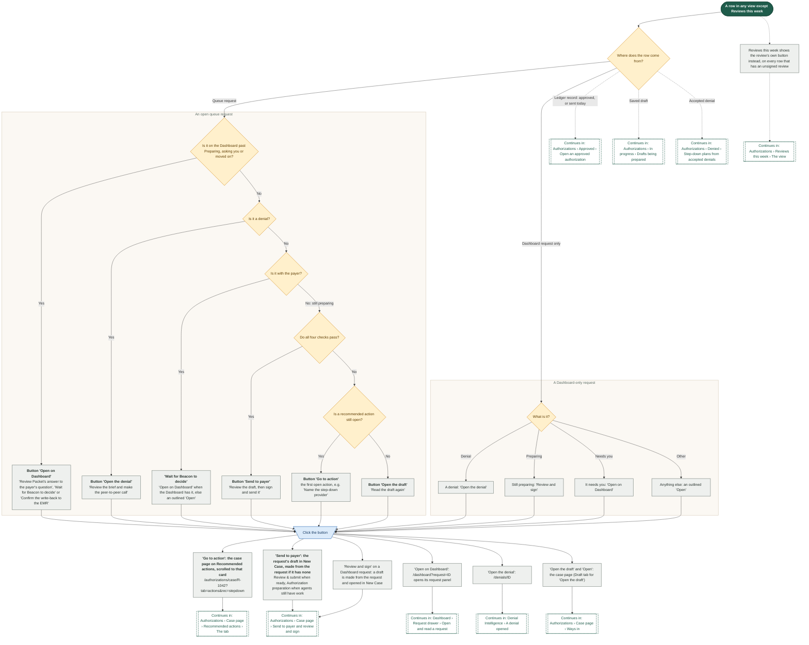

## Authorizations › Worklist › Quick view panel

The right-hand panel that opens from a row: a summary first and a button to the full case. The row decides which panel. A row with a ledger record that is with the payer or approved opens the tracked quick view (units, window, next review). Any other queue request opens the Dashboard's own request panel when the Dashboard has it, or a lighter panel built from the case. Open denials that only the Dashboard has, and saved drafts, have no quick view.

Route: `/authorizations?quick=R-1117`

Demo only, Both sites at the start: 50 rows open the tracked quick view (the 32 approved authorizations and 18 requests with the payer that the ledger tracks), 9 the Dashboard's panel, 29 the lighter panel; the 7 open denials in no other list have none. The panel changes nothing by itself: 'Review and sign' only opens New Case, where a clinician signs.

```mermaid
%%{init: {"theme":"base","themeVariables":{"fontFamily":"'DM Sans', 'Segoe UI', system-ui, sans-serif","fontSize":"15px","lineColor":"#5B6B63","primaryTextColor":"#1C2B25","clusterBkg":"#FBF8F3","clusterBorder":"#D9CDBB","edgeLabelBackground":"#FFFFFF"},"flowchart":{"curve":"basis","nodeSpacing":36,"rankSpacing":48,"padding":12,"htmlLabels":true,"useMaxWidth":false,"wrappingWidth":230}} }%%
flowchart TD
  classDef k_start fill:#1F5C4B,stroke:#174638,color:#FFFFFF,stroke-width:1.5px,font-weight:600
  classDef k_end fill:#DDEFE3,stroke:#2E7D4F,color:#14502F,stroke-width:1.5px,font-weight:600
  classDef k_endx fill:#FBE3E0,stroke:#C0392B,color:#7A1F16,stroke-width:1.5px,font-weight:600
  classDef k_screen fill:#FFFDF8,stroke:#1F5C4B,color:#1C2B25,stroke-width:2px
  classDef k_overlay fill:#F1F7F3,stroke:#1F5C4B,color:#1C2B25,stroke-width:2px,stroke-dasharray:5 3
  classDef k_click fill:#DCEBFA,stroke:#2F6DB5,color:#12365F,stroke-width:1.5px
  classDef k_input fill:#E4E7FF,stroke:#4C5FD5,color:#1D2670,stroke-width:1.5px
  classDef k_process fill:#EEF0EE,stroke:#7A857F,color:#26302B,stroke-width:1.5px
  classDef k_agent fill:#EEE5FA,stroke:#7A4FC2,color:#341A63,stroke-width:1.5px
  classDef k_decision fill:#FFF0CC,stroke:#D9962B,color:#5C3B00,stroke-width:1.5px
  classDef k_store fill:#D5F0EA,stroke:#1C8E7B,color:#0B4A3F,stroke-width:1.5px
  classDef k_doc fill:#F6E9DC,stroke:#B07A4C,color:#4A2E14,stroke-width:1.5px
  classDef k_ext fill:#FFE6D2,stroke:#E07B39,color:#6B2F06,stroke-width:1.5px
  classDef k_wait fill:#E4E8EE,stroke:#6B7C93,color:#26303D,stroke-width:1.5px
  classDef k_toast fill:#FFF9DB,stroke:#C9A400,color:#5A4A00,stroke-width:1.5px
  classDef k_goto fill:#FFFFFF,stroke:#1F5C4B,color:#1F5C4B,stroke-width:1.5px,stroke-dasharray:5 3
  row@{ shape: curv-trap, label: "<b>A row</b><br/>Request ID link, the small icon 'Quick view R-1117' beside the patient, the row's button" }
  c1@{ shape: trap-t, label: "Click the icon 'Quick view R-1117'" }
  c2@{ shape: trap-t, label: "Click the row away from a link or a button" }
  c3@{ shape: trap-t, label: "Keyboard: Tab to the icon, press Enter or Space" }
  s0@{ shape: stadium, label: "Open /authorizations?quick=R-1117 on a fresh load" }
  ad@{ shape: cyl, label: "<b>The address gets ?quick=R-1117</b><br/>It replaces the entry, so Back does not walk through panels<br/>The row is highlighted" }
  d1@{ shape: diam, label: "Is there a row with that ID at the sites in view, with a quick view?" }
  e1@{ shape: stadium, label: "<b>Nothing opens</b><br/>The ID is dropped from the address" }
  d2@{ shape: diam, label: "Does the row have a ledger record, and is it with the payer or approved?" }
  g4@{ shape: subproc, label: "Continues in: Authorizations › Approved › Quick view of a tracked authorization" }
  d3@{ shape: diam, label: "Otherwise it is a queue request: is it also on the Dashboard?" }
  o1@{ shape: win-pane, label: "<b>The Dashboard's request panel</b><br/>Same panel, history, 'Check now', 'Open case' and the demo controls" }
  g1@{ shape: subproc, label: "Continues in: Dashboard › Request drawer › Open and read a request" }
  o2@{ shape: win-pane, label: "<b>Lighter panel from the right</b><br/>Title 'R-1117 · Harborview MA', patient, level of care and request type" }
  f1@{ shape: rect, label: "<b>Focus moves into the panel (the X)</b><br/>Tab and Shift+Tab stay inside it" }
  subgraph gS ["The lighter panel, in order"]
  s1@{ shape: rect, label: "'Next:' line, the same words as the row and the case page" }
  s2@{ shape: rect, label: "<b>Status chips: Preparing, Ready to sign, With the payer or Denial route</b><br/>plus 'Needs your input' and 'Coverage needs a fix' when they apply" }
  s3@{ shape: rect, label: "<b>Deadline, e.g. 'Review due in 30 h'; Requested; Documents, complete or what is missing</b><br/>Waiting on: You, the payer or the agent" }
  s4@{ shape: rect, label: "<b>Approved, used and left and the window, only when the ledger has them</b><br/>Site (for a viewer of both sites), approval chance with its word and range<br/>History: the last three lines, or 'Nothing yet.'" }
  end
  b1@{ shape: trap-t, label: "Click 'Open case'" }
  g2@{ shape: subproc, label: "Continues in: Authorizations › Case page › Ways in" }
  d4@{ shape: diam, label: "Is it still being prepared (Preparing or Ready to sign)?" }
  b2@{ shape: trap-t, label: "Click 'Review and sign'" }
  g3@{ shape: subproc, label: "Continues in: Authorizations › Case page › Send to payer and review and sign" }
  nb@{ shape: rect, label: "<b>No 'Review and sign': it is with the payer</b><br/>'Open case' is the green button" }
  x@{ shape: trap-t, label: "Press Esc, click the X, or click the dimmed area" }
  bk@{ shape: rect, label: "<b>The panel closes and ?quick= leaves the address</b><br/>Focus goes back to the row's icon<br/>Esc closes one layer at a time (a menu or a dialog inside the panel first)" }
  gn@{ shape: rect, label: "<b>The row changes while the panel is open (e.g. the payer answers from the Dashboard panel)</b><br/>The panel follows the row, and closes when the row no longer has a quick view" }
  row --> c1
  row --> c2
  row --> c3
  c1 --> ad
  c2 --> ad
  c3 --> ad
  s0 --> d1
  ad --> d1
  d1 -->|"No"| e1
  d1 -->|"Yes"| d2
  d2 -->|"Yes"| g4
  d2 -->|"No"| d3
  d3 -->|"Yes"| o1 --> g1
  d3 -->|"No"| o2 --> f1
  f1 --> s1 --> s2 --> s3 --> s4
  s4 --> b1 --> g2
  s4 --> d4
  d4 -->|"Yes"| b2 --> g3
  d4 -->|"No"| nb
  o1 --> x
  o2 --> x
  x --> bk
  o2 -.-> gn
  class row k_screen
  class c1,c2,c3,b1,b2,x k_click
  class s0 k_start
  class ad k_store
  class d1,d2,d3,d4 k_decision
  class e1 k_endx
  class g4,g1,g2,g3 k_goto
  class o1,o2 k_overlay
  class f1,s1,s2,s3,s4,nb,bk,gn k_process
  style gS fill:#FBF8F3,stroke:#D9CDBB,stroke-width:1.5px,color:#5B6B63
```

## Authorizations › Worklist › Search and filter

The search box and the four menus people use most (Payer, Service, Request type, Deadline), how filters combine and travel in the web address, 'Clear filters', and what the page says when nothing matches. The Deadline menu and the filters under 'More' have their own diagram. Search and every filter reach only the rows at the sites in view.

Route: `/authorizations?payer=cardinal`

Demo only: filters are written to the web address and kept for the session; a plain /authorizations brings back the last ones. Searching 'cardinal' finds 17 rows at the start (Both sites), because the payer's name is searched too.

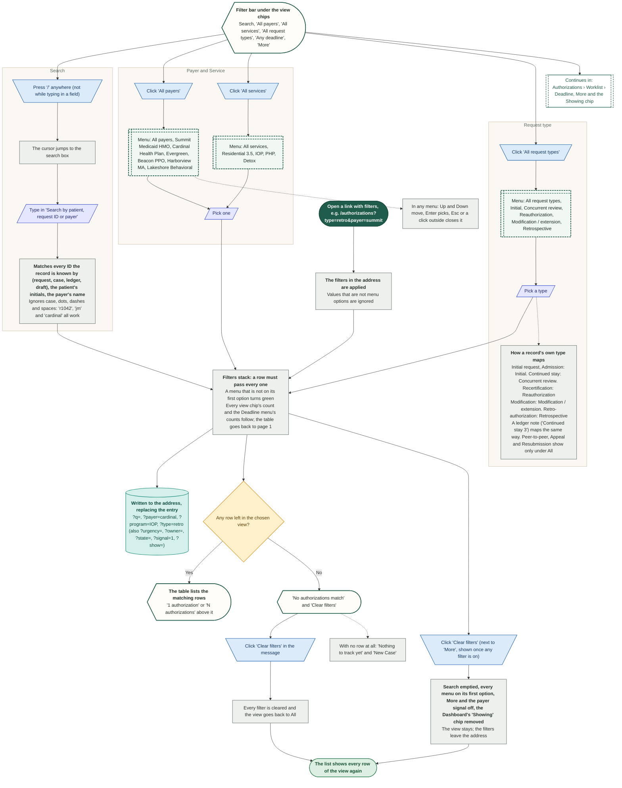

## Authorizations › Worklist › Deadline, More and the Showing chip

The Deadline menu narrows the list by how soon each row is due, and shows how many rows each choice keeps. 'More' opens a second row with three filters people use less: Owner, Status (the exact chip) and the Cardinal payer signal. A Dashboard 'Active' or 'Renewal due' link adds a removable 'Showing' chip. All of them stack with search and the other menus and are kept in the address.

Route: `/authorizations?urgency=now`

Demo only, Both sites at the start on All: Act now 12, Within 24 hours 29, Next 7 days 79. Within 24 hours includes Act now, and Next 7 days includes both. The other 16 rows (15 of them approved authorizations) have no event inside the week. On Reviews this week the same menu counts that view: 6, 16 and 32. 'Showing Active' keeps 40 rows (32 approved, 6 with the payer, 2 in progress) and 'Showing Renewal due' 19, the numbers on the Dashboard's chips.

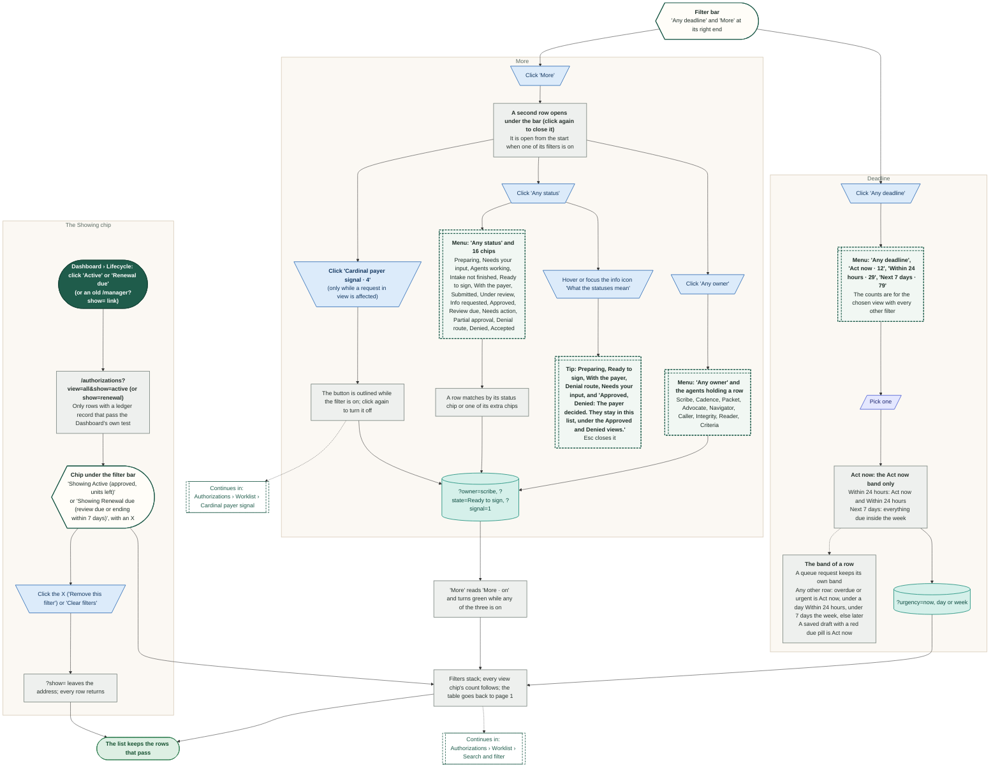

## Authorizations › Worklist › Cardinal payer signal

The one banner on the page: a single line about a payer trend, its info icon, the filter it switches on and the ways to turn that filter off or hide the banner. The same filter is also a button under 'More'.

Route: `/authorizations?signal=1`

Demo only: the banner text and the four affected requests (I-2207, I-2218, I-2271 at Site B and I-2236 at Site A) are seed data; nothing re-scores them live. The count is the affected open requests at the sites in view: Both sites four, Site A one, Site B three.

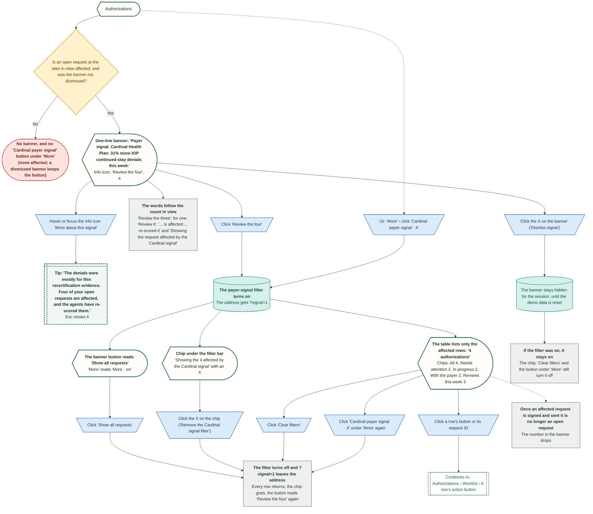

## Authorizations › Worklist › Sort and page

Four of the table's headers sort: Patient / request, Status, Deadline (Due on Reviews this week) and Chance. Each click moves the sort one step on: up, down, then back to the list's own order (Chance starts with the highest first, so it has only two steps). The table shows 15 rows a page. A new view, a filter or a sort always starts again on page 1.

Route: `/authorizations`

The sort lives in the page, not in the address, so a reload or leaving the page goes back to the list's own order. Next action, Owner and the button column do not sort.

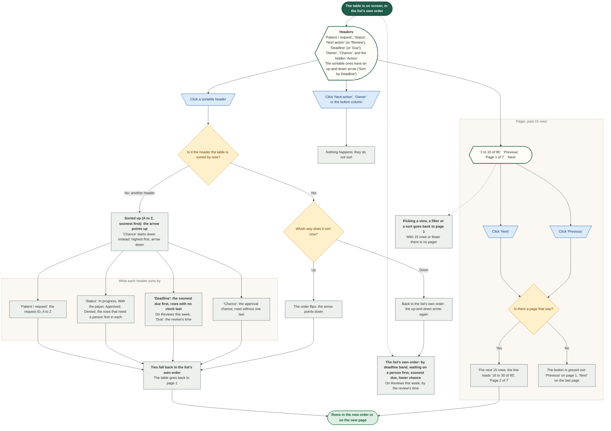

## Authorizations › Worklist › Addresses and old queue links

The view, the filters, the open quick view and the open review all live in the web address, so a link opens the list already narrowed and Back returns to the same place. Only what is set is written, so the plain list has a plain address. The queue's older parameters still work and are rewritten once in today's words.

Route: `/authorizations?view=progress&state=Ready to sign`

Every change replaces the current entry instead of adding one, so Back leaves the list rather than undoing filters one by one. The sort and the page number are not in the address. Old Case Manager addresses (/manager, /active) are drawn with the Case Manager links.

```mermaid
%%{init: {"theme":"base","themeVariables":{"fontFamily":"'DM Sans', 'Segoe UI', system-ui, sans-serif","fontSize":"15px","lineColor":"#5B6B63","primaryTextColor":"#1C2B25","clusterBkg":"#FBF8F3","clusterBorder":"#D9CDBB","edgeLabelBackground":"#FFFFFF"},"flowchart":{"curve":"basis","nodeSpacing":36,"rankSpacing":48,"padding":12,"htmlLabels":true,"useMaxWidth":false,"wrappingWidth":230}} }%%
flowchart TD
  classDef k_start fill:#1F5C4B,stroke:#174638,color:#FFFFFF,stroke-width:1.5px,font-weight:600
  classDef k_end fill:#DDEFE3,stroke:#2E7D4F,color:#14502F,stroke-width:1.5px,font-weight:600
  classDef k_endx fill:#FBE3E0,stroke:#C0392B,color:#7A1F16,stroke-width:1.5px,font-weight:600
  classDef k_screen fill:#FFFDF8,stroke:#1F5C4B,color:#1C2B25,stroke-width:2px
  classDef k_overlay fill:#F1F7F3,stroke:#1F5C4B,color:#1C2B25,stroke-width:2px,stroke-dasharray:5 3
  classDef k_click fill:#DCEBFA,stroke:#2F6DB5,color:#12365F,stroke-width:1.5px
  classDef k_input fill:#E4E7FF,stroke:#4C5FD5,color:#1D2670,stroke-width:1.5px
  classDef k_process fill:#EEF0EE,stroke:#7A857F,color:#26302B,stroke-width:1.5px
  classDef k_agent fill:#EEE5FA,stroke:#7A4FC2,color:#341A63,stroke-width:1.5px
  classDef k_decision fill:#FFF0CC,stroke:#D9962B,color:#5C3B00,stroke-width:1.5px
  classDef k_store fill:#D5F0EA,stroke:#1C8E7B,color:#0B4A3F,stroke-width:1.5px
  classDef k_doc fill:#F6E9DC,stroke:#B07A4C,color:#4A2E14,stroke-width:1.5px
  classDef k_ext fill:#FFE6D2,stroke:#E07B39,color:#6B2F06,stroke-width:1.5px
  classDef k_wait fill:#E4E8EE,stroke:#6B7C93,color:#26303D,stroke-width:1.5px
  classDef k_toast fill:#FFF9DB,stroke:#C9A400,color:#5A4A00,stroke-width:1.5px
  classDef k_goto fill:#FFFFFF,stroke:#1F5C4B,color:#1F5C4B,stroke-width:1.5px,stroke-dasharray:5 3
  s1@{ shape: stadium, label: "A link, a bookmark or a typed address under /authorizations" }
  s2@{ shape: stadium, label: "The sidebar, a 'Back to Authorizations' button or a crumb: plain /authorizations" }
  dP@{ shape: diam, label: "Is the address plain, with a view or filters used earlier in this session?" }
  pR@{ shape: rect, label: "<b>The last view and filters are put back in the address</b><br/>(never ?quick= or ?review=; a reload forgets them)" }
  subgraph gNow ["Today's parameters"]
  a1@{ shape: rect, label: "?view= attention, progress, payer, approved, denied or reviews (All has none)" }
  a2@{ shape: rect, label: "?q=, ?payer=, ?program=, ?type=, ?urgency=, ?owner=, ?state=, ?signal=1, ?show=active or renewal" }
  a3@{ shape: rect, label: "<b>?quick=ID opens that row's quick view</b><br/>?review=ID opens that review's drawer" }
  end
  subgraph gOld ["The queue's older words"]
  o1@{ shape: rect, label: "<b>?status=you: Needs attention</b><br/>?status=input: Needs attention with the status 'Needs your input'" }
  o2@{ shape: rect, label: "?status=preparing or ready: In progress with the status 'Preparing' or 'Ready to sign'" }
  o3@{ shape: rect, label: "<b>?status=payer: With the payer</b><br/>?status=denial: Denied" }
  o4@{ shape: rect, label: "?urgency=, ?type=, ?payer=, ?q= and ?signal=1 keep their meaning" }
  end
  dO@{ shape: diam, label: "Does the address carry ?status= (or Case Manager's ?tab=)?" }
  rw@{ shape: rect, label: "<b>Rewritten once in today's words, replacing the entry</b><br/>/authorizations?status=ready becomes ?view=progress&state=Ready to sign<br/>Case Manager's ?tab=reviews becomes ?view=reviews; any other ?tab= is dropped" }
  ig@{ shape: rect, label: "<b>A value that is not one of the choices is ignored (and left in the address)</b><br/>?view=bogus opens All; ?payer=nope filters nothing" }
  dQ@{ shape: diam, label: "Does ?quick= name a row in view that has a quick view?" }
  dq@{ shape: rect, label: "The ID is dropped from the address; nothing opens" }
  dR@{ shape: diam, label: "Does ?review= name a review of a row in view?" }
  dr@{ shape: rect, label: "No drawer opens" }
  ls@{ shape: curv-trap, label: "The list opens on that view, with those filters and any panel" }
  gQ@{ shape: subproc, label: "Continues in: Authorizations › Worklist › Quick view panel" }
  gR@{ shape: subproc, label: "Continues in: Authorizations › Reviews this week › The review drawer" }
  gM@{ shape: subproc, label: "Continues in: Authorizations › Old links › Case Manager addresses and links from other tabs" }
  bk@{ shape: trap-t, label: "From a case page, press the browser Back button" }
  bb@{ shape: rect, label: "<b>The list returns with the same view, filters and open panel</b><br/>Sort and page start again" }
  e1@{ shape: stadium, label: "The address and the list agree" }
  s1 --> dO
  s2 --> dP
  dP -->|"Yes"| pR --> dO
  dP -->|"No"| dO
  dO -->|"Yes"| o1 & o2 & o3
  o1 & o2 & o3 --> rw --> a1
  dO -->|"No"| a1
  a1 --> a2 --> a3
  o4 -.-> a2
  a2 -.-> ig
  a3 --> dQ
  dQ -->|"No"| dq --> dR
  dQ -->|"Yes"| gQ
  a3 --> dR
  dR -->|"No"| dr --> ls
  dR -->|"Yes"| gR
  dq -.-> ls
  ls --> e1
  ls --> bk --> bb --> e1
  s1 -.-> gM
  class s1,s2 k_start
  class dP,dO,dQ,dR k_decision
  class pR,a1,a2,a3,o1,o2,o3,o4,rw,ig,dq,dr,bb k_process
  class ls k_screen
  class gQ,gR,gM k_goto
  class bk k_click
  class e1 k_end
  style gNow fill:#FBF8F3,stroke:#D9CDBB,stroke-width:1.5px,color:#5B6B63
  style gOld fill:#FBF8F3,stroke:#D9CDBB,stroke-width:1.5px,color:#5B6B63
```

## Authorizations › Worklist › Sites: what each viewer sees

How the list follows the viewer and the site switch in the top bar. Every row, view count, deadline count, the average chance, the sidebar badge, the payer-signal count and the bulk review buttons are worked out from the records at the sites in view, so Site A plus Site B is Both sites. A viewer who may see one site never sees, counts, searches, signs or links to the other site's records.

Route: `/authorizations`

Demo only: a record's site is fixed by the demo (the case ID decides, see src/data/sites.ts; a denial added from a letter carries its own site). The viewer is chosen in the Demo menu under 'Viewing as'; a fresh load starts as Jordan Perez on Both sites.

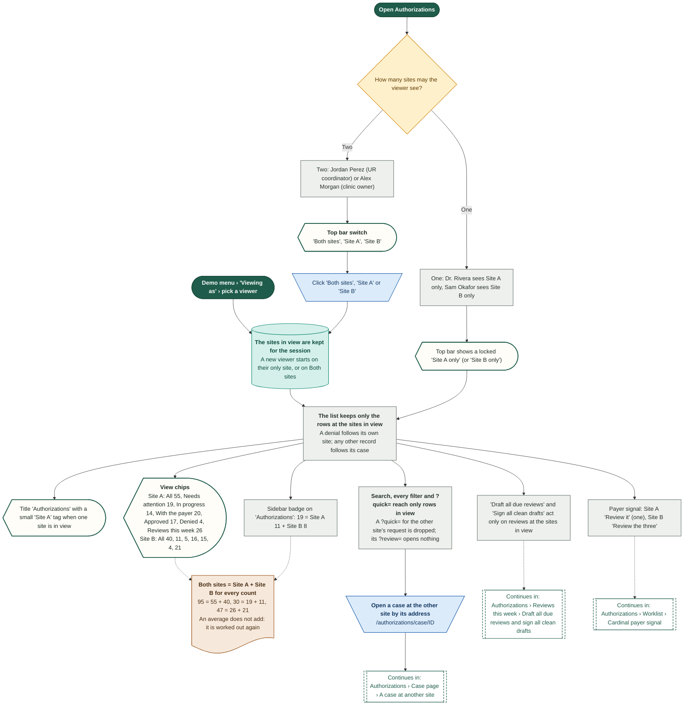

## Authorizations › Case page › Ways in

Every link that opens a case page, and what the page does with the ID it is given: find the request, load your earlier work, pick the tab.

Route: `/authorizations/case/R-1042`

Demo only: R-1042 is the one hand-written case. Every other case page is generated from its queue record or Dashboard request, so the numbers are consistent but the wording is a template. An ID that is an approved authorization with no open request opens the ledger case page. An ID in neither ends at 'Request not found'.

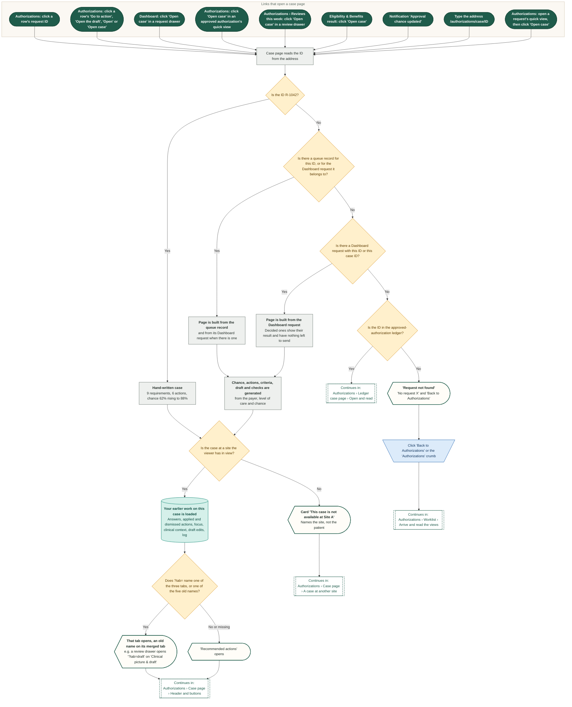

## Authorizations › Case page › Next action

The 'Next:' block at the top of the case page. It names the one thing a person should do on this request and gives one primary button for it; the row in Authorizations shows the same words. 'Send to payer' keeps its gate: the primary button once every check passes, greyed out with its reason in a tooltip until then.

Route: `/authorizations/case/R-1042`

Demo only: the words come from the request's recommended actions, its checks and where the Dashboard says it is. Nothing is decided by it; a clinician still signs in New Case.

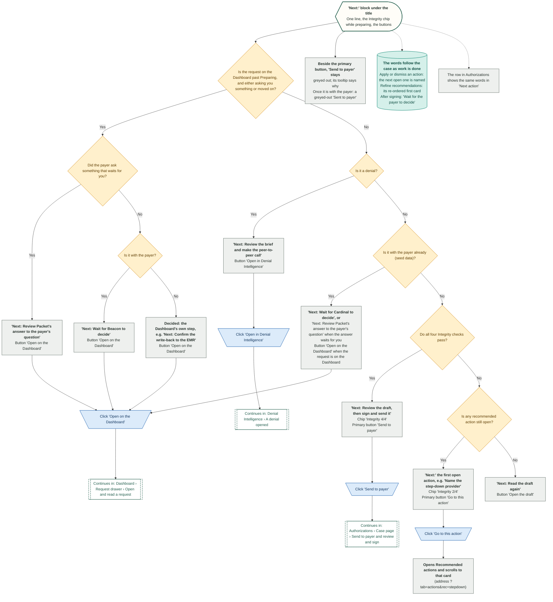

## Authorizations › Case page › Header and buttons

The header card above the figures: the title line with its chips, the line that names the patient, the 'Next' block, the authorization facts and the diagnosis line. It says the level of care, payer, days and site once; nothing below repeats them. It is the same on all three tabs and follows the request once it is sent or decided.

Route: `/authorizations/case/R-1042`

Demo only: the header reads the request's current stage from the Dashboard, so signing and sending in New Case, or a payer reply made with the Dashboard demo controls, shows here at once.

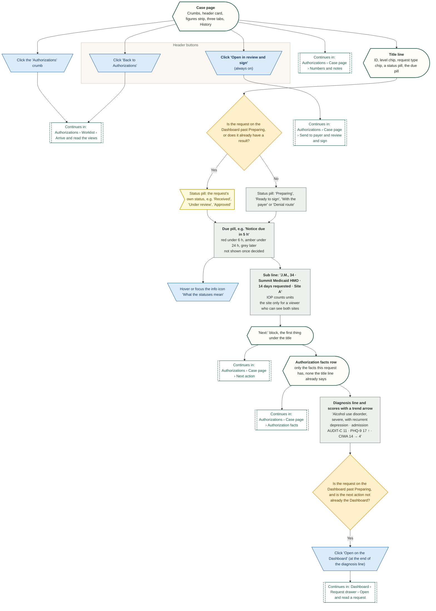

## Authorizations › Case page › Numbers and notes

The strip of three figures under the header card. It stays on screen on all three tabs and changes as actions are applied. What used to be sentences under each figure is in an info icon beside its label.

Route: `/authorizations/case/R-1042`

Demo only: the numbers are seed data plus simple arithmetic.

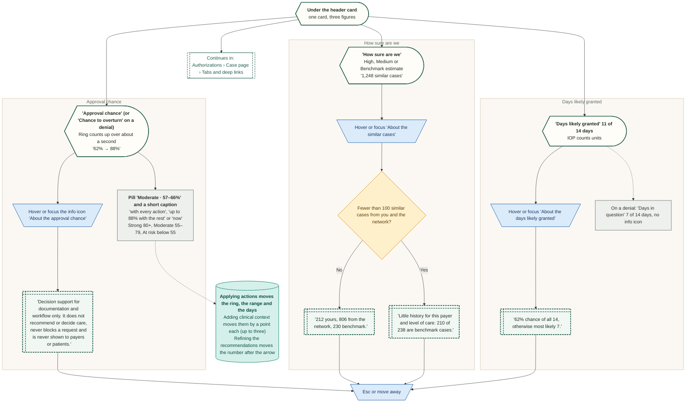

## Authorizations › Case page › Tabs and deep links

The three tabs under the header, how the address follows them, how the five old tab names still land on the merged tabs, what the two badges count, and the buttons that jump to one recommendation card.

Route: `/authorizations/case/R-1042?tab=actions`

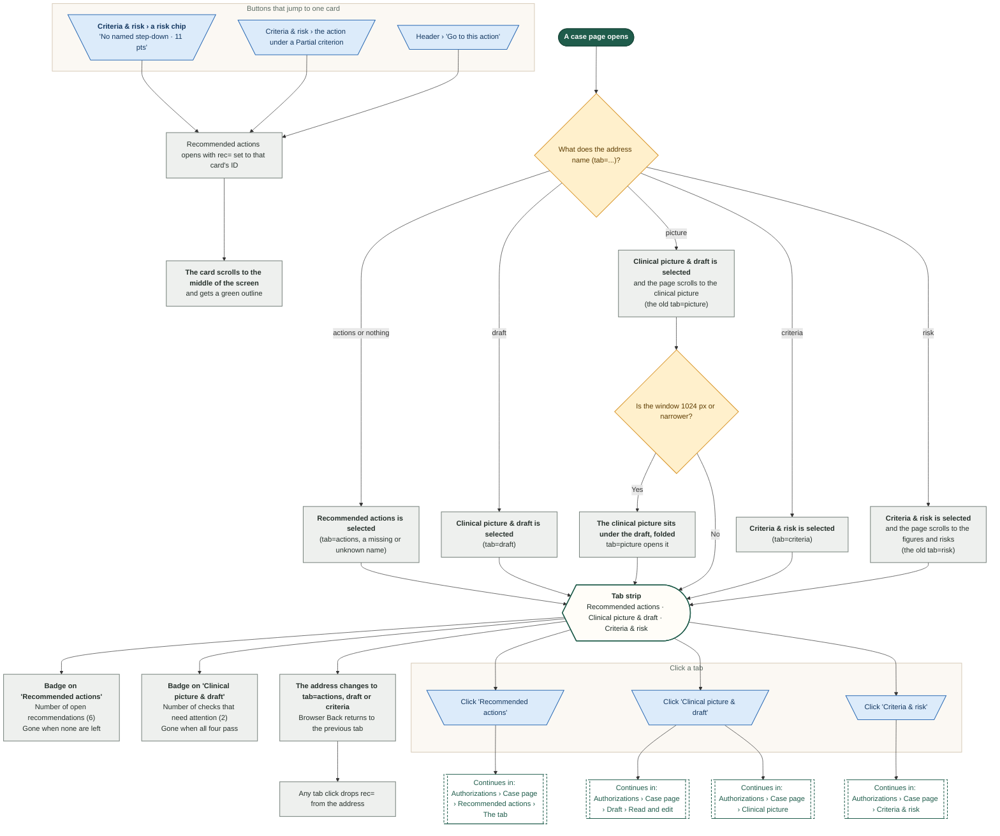

## Authorizations › Case page › A case at another site

What a case page does with the viewer's sites. A case at a site the viewer cannot see shows a short card that names the site and no patient. A viewer who can see both sites gets a quiet site label on the header and a Site fact.

Route: `/authorizations/case/I-2207`

Demo only: the site of a case is fixed by the demo (the case ID decides; a denial belongs to the case it came from). Try it: Demo menu › 'Viewing as' › Dr. Rivera, then open /authorizations/case/I-2207 (a Site B case). A fresh load starts as Jordan Perez on Both sites.

```mermaid
%%{init: {"theme":"base","themeVariables":{"fontFamily":"'DM Sans', 'Segoe UI', system-ui, sans-serif","fontSize":"15px","lineColor":"#5B6B63","primaryTextColor":"#1C2B25","clusterBkg":"#FBF8F3","clusterBorder":"#D9CDBB","edgeLabelBackground":"#FFFFFF"},"flowchart":{"curve":"basis","nodeSpacing":36,"rankSpacing":48,"padding":12,"htmlLabels":true,"useMaxWidth":false,"wrappingWidth":230}} }%%
flowchart TD
  classDef k_start fill:#1F5C4B,stroke:#174638,color:#FFFFFF,stroke-width:1.5px,font-weight:600
  classDef k_end fill:#DDEFE3,stroke:#2E7D4F,color:#14502F,stroke-width:1.5px,font-weight:600
  classDef k_endx fill:#FBE3E0,stroke:#C0392B,color:#7A1F16,stroke-width:1.5px,font-weight:600
  classDef k_screen fill:#FFFDF8,stroke:#1F5C4B,color:#1C2B25,stroke-width:2px
  classDef k_overlay fill:#F1F7F3,stroke:#1F5C4B,color:#1C2B25,stroke-width:2px,stroke-dasharray:5 3
  classDef k_click fill:#DCEBFA,stroke:#2F6DB5,color:#12365F,stroke-width:1.5px
  classDef k_input fill:#E4E7FF,stroke:#4C5FD5,color:#1D2670,stroke-width:1.5px
  classDef k_process fill:#EEF0EE,stroke:#7A857F,color:#26302B,stroke-width:1.5px
  classDef k_agent fill:#EEE5FA,stroke:#7A4FC2,color:#341A63,stroke-width:1.5px
  classDef k_decision fill:#FFF0CC,stroke:#D9962B,color:#5C3B00,stroke-width:1.5px
  classDef k_store fill:#D5F0EA,stroke:#1C8E7B,color:#0B4A3F,stroke-width:1.5px
  classDef k_doc fill:#F6E9DC,stroke:#B07A4C,color:#4A2E14,stroke-width:1.5px
  classDef k_ext fill:#FFE6D2,stroke:#E07B39,color:#6B2F06,stroke-width:1.5px
  classDef k_wait fill:#E4E8EE,stroke:#6B7C93,color:#26303D,stroke-width:1.5px
  classDef k_toast fill:#FFF9DB,stroke:#C9A400,color:#5A4A00,stroke-width:1.5px
  classDef k_goto fill:#FFFFFF,stroke:#1F5C4B,color:#1F5C4B,stroke-width:1.5px,stroke-dasharray:5 3
  s1@{ shape: stadium, label: "<b>Open /authorizations/case/ID</b><br/>(a link, a notification, a row, or typed)" }
  r0@{ shape: rect, label: "<b>The page finds the request for the ID</b><br/>A denial's number is traced back to its case" }
  d0@{ shape: diam, label: "Is there a request for this ID?" }
  nf@{ shape: curv-trap, label: "<b>'Request not found'</b><br/>Nothing about any request is shown, so there is nothing to hide" }
  d1@{ shape: diam, label: "Is the case at a site in view?" }
  oos@{ shape: curv-trap, label: "<b>Card: 'This case is not available at Site A'</b><br/>'I-2207 belongs to Site B. Dr. Rivera can see Site A only. Access follows the site so staff see only the patients they work with.'<br/>No patient, no tabs, no numbers" }
  d2@{ shape: diam, label: "Can the viewer see both sites, and is one site selected in the top bar?" }
  sb@{ shape: trap-t, label: "Click 'Show both sites'" }
  sc@{ shape: cyl, label: "The view becomes Both sites" }
  bd@{ shape: trap-t, label: "Click 'Back to the Dashboard' on the card" }
  g1@{ shape: subproc, label: "Continues in: Dashboard › Arrive › What the page shows" }
  e1@{ shape: stadium, label: "<b>The card stays</b><br/>The viewer's role does not include that site, so there is no way past it" }
  cp@{ shape: curv-trap, label: "<b>The case page opens as usual</b><br/>Next action, facts, tabs, History" }
  d3@{ shape: diam, label: "Can the viewer see both sites?" }
  lb@{ shape: curv-trap, label: "<b>Quiet site label at the end of the sub line</b><br/>'J.M., 34 · Summit Medicaid HMO · Residential 3.5 · 14 days requested · Site A'<br/>and a 'Site' fact: 'Site A' with 'Main campus'" }
  nl@{ shape: curv-trap, label: "<b>No site label and no 'Site' fact</b><br/>(a viewer with one site learns nothing from it)" }
  g2@{ shape: subproc, label: "Continues in: Authorizations › Case page › Ways in" }
  s1 --> r0 --> d0
  d0 -->|"No"| nf
  d0 -->|"Yes"| d1
  d1 -->|"No"| oos --> d2
  d1 -->|"Yes"| cp --> d3
  d2 -->|"Yes"| sb --> sc --> cp
  d2 -->|"No"| e1
  oos --> bd --> g1
  d3 -->|"Yes"| lb
  d3 -->|"No"| nl
  cp -.-> g2
  class s1 k_start
  class r0 k_process
  class d0,d1,d2,d3 k_decision
  class nf,oos,cp,lb,nl k_screen
  class sb,bd k_click
  class sc k_store
  class g1,g2 k_goto
  class e1 k_endx
```

## Authorizations › Case page › Send to payer and review and sign

When the 'Send to payer' button is on or greyed out, what both header buttons do when clicked, and which New Case draft they open. Nothing is sent from the case page: a clinician signs in New Case.

Route: `/authorizations/case/R-1042`

Every request gets a draft in New Case, made from its own data when it has none (five requests have one already: R-1042, I-2207, R-0988, R-1101, I-2262). It never opens blank at Intake. 'Open in review and sign' is always on, even for a request already with the payer.

```mermaid
%%{init: {"theme":"base","themeVariables":{"fontFamily":"'DM Sans', 'Segoe UI', system-ui, sans-serif","fontSize":"15px","lineColor":"#5B6B63","primaryTextColor":"#1C2B25","clusterBkg":"#FBF8F3","clusterBorder":"#D9CDBB","edgeLabelBackground":"#FFFFFF"},"flowchart":{"curve":"basis","nodeSpacing":36,"rankSpacing":48,"padding":12,"htmlLabels":true,"useMaxWidth":false,"wrappingWidth":230}} }%%
flowchart TD
  classDef k_start fill:#1F5C4B,stroke:#174638,color:#FFFFFF,stroke-width:1.5px,font-weight:600
  classDef k_end fill:#DDEFE3,stroke:#2E7D4F,color:#14502F,stroke-width:1.5px,font-weight:600
  classDef k_endx fill:#FBE3E0,stroke:#C0392B,color:#7A1F16,stroke-width:1.5px,font-weight:600
  classDef k_screen fill:#FFFDF8,stroke:#1F5C4B,color:#1C2B25,stroke-width:2px
  classDef k_overlay fill:#F1F7F3,stroke:#1F5C4B,color:#1C2B25,stroke-width:2px,stroke-dasharray:5 3
  classDef k_click fill:#DCEBFA,stroke:#2F6DB5,color:#12365F,stroke-width:1.5px
  classDef k_input fill:#E4E7FF,stroke:#4C5FD5,color:#1D2670,stroke-width:1.5px
  classDef k_process fill:#EEF0EE,stroke:#7A857F,color:#26302B,stroke-width:1.5px
  classDef k_agent fill:#EEE5FA,stroke:#7A4FC2,color:#341A63,stroke-width:1.5px
  classDef k_decision fill:#FFF0CC,stroke:#D9962B,color:#5C3B00,stroke-width:1.5px
  classDef k_store fill:#D5F0EA,stroke:#1C8E7B,color:#0B4A3F,stroke-width:1.5px
  classDef k_doc fill:#F6E9DC,stroke:#B07A4C,color:#4A2E14,stroke-width:1.5px
  classDef k_ext fill:#FFE6D2,stroke:#E07B39,color:#6B2F06,stroke-width:1.5px
  classDef k_wait fill:#E4E8EE,stroke:#6B7C93,color:#26303D,stroke-width:1.5px
  classDef k_toast fill:#FFF9DB,stroke:#C9A400,color:#5A4A00,stroke-width:1.5px
  classDef k_goto fill:#FFFFFF,stroke:#1F5C4B,color:#1F5C4B,stroke-width:1.5px,stroke-dasharray:5 3
  cp@{ shape: curv-trap, label: "<b>Case page</b><br/>'Send to payer' appears once, in the 'Next:' block in the header, on every tab" }
  d1@{ shape: diam, label: "Does the request already have a result (decided)?" }
  r1@{ shape: rect, label: "<b>The button becomes a greyed-out 'Sent to payer'</b><br/>Tooltip: 'Approved. Nothing left to send'<br/>(the result word comes from the request)" }
  d2@{ shape: diam, label: "Is it already with the payer?" }
  r2@{ shape: rect, label: "<b>The button becomes a greyed-out 'Sent to payer'</b><br/>Tooltip: 'With the payer'<br/>The status pill in the title says the same" }
  d3@{ shape: diam, label: "Is it a denial?" }
  r3@{ shape: rect, label: "Greyed out. Tooltip: 'Denied. Advocate has the next step'" }
  d4@{ shape: diam, label: "Do all four Integrity checks pass?" }
  r4@{ shape: rect, label: "<b>Greyed out, next to the primary button for the next action</b><br/>Chip 'Integrity 2/4'; tooltip 'Integrity 2/4: apply the matching actions'" }
  on@{ shape: rect, label: "<b>'Send to payer' is on, chip 'Integrity 4/4'</b><br/>In the 'Next:' block it is the one primary button<br/>Tooltip: 'Opens review and sign. A clinician signs before anything is sent.'" }
  subgraph gChk ["What keeps a check open"]
  k1@{ shape: rect, label: "<b>'Every sentence matches the chart'</b><br/>open after you edit the draft, until 'Re-check'" }
  k2@{ shape: rect, label: "<b>'Payer criteria are covered'</b><br/>open until its action is applied (e.g. 'Name the step-down provider')" }
  k3@{ shape: rect, label: "<b>'Dates are consistent'</b><br/>open until its action is applied (e.g. 'Settle the sertraline start date')" }
  k4@{ shape: rect, label: "<b>'Identifiers are protected'</b><br/>always passes in the demo" }
  end
  dm@{ shape: rect, label: "<b>Dismissing the action does not clear its check</b><br/>The dismiss dialog warns about this" }
  b1@{ shape: trap-t, label: "<b>Click 'Open in review and sign'</b><br/>(header, always on)" }
  b2@{ shape: trap-t, label: "<b>Click 'Send to payer'</b><br/>(only when on)" }
  rp@{ shape: rect, label: "<b>Find this request's draft in New Case</b><br/>The draft named like 'draft-r1042', or any draft with this case ID<br/>Or make one: draftFromRequest" }
  d5@{ shape: diam, label: "Does the request already have a draft?" }
  mk@{ shape: rect, label: "<b>A draft is created from the request</b><br/>Patient, payer, level of care, request type, a reason and diagnoses from the case page<br/>The documents the payer's saved list asks for, as sample files<br/>Not saved, so Authorizations does not list it as a draft" }
  up@{ shape: rect, label: "<b>A draft that exists is brought up to date</b><br/>Answers from applied actions (sertraline date, step-down provider) are added<br/>The therapy note is added when that action was applied<br/>When every check passes the run is marked finished" }
  d6@{ shape: diam, label: "Where does the request stand?" }
  g1@{ shape: subproc, label: "Continues in: Authorizations › New Case › Authorization preparation › Start the run and watch it" }
  g2@{ shape: subproc, label: "Continues in: Authorizations › New Case › Review & submit › Sign and send to payer" }
  g3@{ shape: subproc, label: "Continues in: Authorizations › New Case › Review & submit › After sending" }
  dRec@{ shape: diam, label: "Is the request on the Dashboard (recorded in the store)?" }
  sent@{ shape: stadium, label: "<b>New Case shows 'R-0912 was sent'</b><br/>'Open it on the Dashboard' and 'Back to Authorizations'<br/>The draft is marked sent, so it cannot be signed again" }
  sent2@{ shape: stadium, label: "<b>New Case shows 'R-1131 is with the payer'</b><br/>'It is already with the payer, so there is nothing to sign here.'<br/>'Back to the case' and 'Back to Authorizations'<br/>It does not say it was sent by you, because the store has no such request" }
  ns@{ shape: rect, label: "<b>Nothing has been sent</b><br/>A licensed clinician signs in New Case" }
  cp --> d1
  d1 -->|"Yes"| r1
  d1 -->|"No"| d2
  d2 -->|"Yes"| r2
  d2 -->|"No"| d3
  d3 -->|"Yes"| r3
  d3 -->|"No"| d4
  d4 -->|"No"| r4
  d4 -->|"Yes"| on
  r4 -.-> k1
  r4 -.-> k2
  r4 -.-> k3
  r4 -.-> k4
  k2 --> dm
  k3 --> dm
  cp --> b1
  on --> b2
  b1 --> rp
  b2 --> rp
  rp --> d5
  d5 -->|"No"| mk --> d6
  d5 -->|"Yes"| up --> d6
  d6 -->|"Agents still have work, e.g. R-1042 before its actions are applied"| g1
  d6 -->|"Ready or all four checks passed, e.g. R-0988, R-1142, R-1042 after its actions"| g2
  d6 -->|"Already with the payer or decided"| dRec
  dRec -->|"Yes"| sent
  dRec -->|"No"| sent2
  rp -.-> ns
  sent --> g3
  class cp k_screen
  class d1,d2,d3,d4,d5,d6,dRec k_decision
  class r1,r2,r3,r4,on,k1,k2,k3,k4,dm,rp,mk,up,ns k_process
  class b1,b2 k_click
  class g1,g2,g3 k_goto
  class sent,sent2 k_endx
  style gChk fill:#FBF8F3,stroke:#D9CDBB,stroke-width:1.5px,color:#5B6B63
```

## Authorizations › Case page › Authorization facts

The row of facts under the 'Next:' block. A fact appears only when this request has the data for it, and none repeats the title line (request type, days requested and site are said there once). A request that is not approved yet shows no approved, used, left, window or review date. Nothing says 'N/A'.

Route: `/authorizations/case/I-2207`

Demo only: the numbers come from the approved-authorization ledger (read only) and the request's draft. Four requests to compare: R-1042 (not approved yet), I-2207 (48 units approved, 38 used, ends Fri 10/23), R-0988 (21 days approved, next review today) and R-0951 (14 days approved, window 10/20 to 11/3). The ledger records days used and the end date, not a start date, so the window of a request counted in days starts as many days before the demo's first day as days are used; units (IOP) have no calendar window.

```mermaid
%%{init: {"theme":"base","themeVariables":{"fontFamily":"'DM Sans', 'Segoe UI', system-ui, sans-serif","fontSize":"15px","lineColor":"#5B6B63","primaryTextColor":"#1C2B25","clusterBkg":"#FBF8F3","clusterBorder":"#D9CDBB","edgeLabelBackground":"#FFFFFF"},"flowchart":{"curve":"basis","nodeSpacing":36,"rankSpacing":48,"padding":12,"htmlLabels":true,"useMaxWidth":false,"wrappingWidth":230}} }%%
flowchart TD
  classDef k_start fill:#1F5C4B,stroke:#174638,color:#FFFFFF,stroke-width:1.5px,font-weight:600
  classDef k_end fill:#DDEFE3,stroke:#2E7D4F,color:#14502F,stroke-width:1.5px,font-weight:600
  classDef k_endx fill:#FBE3E0,stroke:#C0392B,color:#7A1F16,stroke-width:1.5px,font-weight:600
  classDef k_screen fill:#FFFDF8,stroke:#1F5C4B,color:#1C2B25,stroke-width:2px
  classDef k_overlay fill:#F1F7F3,stroke:#1F5C4B,color:#1C2B25,stroke-width:2px,stroke-dasharray:5 3
  classDef k_click fill:#DCEBFA,stroke:#2F6DB5,color:#12365F,stroke-width:1.5px
  classDef k_input fill:#E4E7FF,stroke:#4C5FD5,color:#1D2670,stroke-width:1.5px
  classDef k_process fill:#EEF0EE,stroke:#7A857F,color:#26302B,stroke-width:1.5px
  classDef k_agent fill:#EEE5FA,stroke:#7A4FC2,color:#341A63,stroke-width:1.5px
  classDef k_decision fill:#FFF0CC,stroke:#D9962B,color:#5C3B00,stroke-width:1.5px
  classDef k_store fill:#D5F0EA,stroke:#1C8E7B,color:#0B4A3F,stroke-width:1.5px
  classDef k_doc fill:#F6E9DC,stroke:#B07A4C,color:#4A2E14,stroke-width:1.5px
  classDef k_ext fill:#FFE6D2,stroke:#E07B39,color:#6B2F06,stroke-width:1.5px
  classDef k_wait fill:#E4E8EE,stroke:#6B7C93,color:#26303D,stroke-width:1.5px
  classDef k_toast fill:#FFF9DB,stroke:#C9A400,color:#5A4A00,stroke-width:1.5px
  classDef k_goto fill:#FFFFFF,stroke:#1F5C4B,color:#1F5C4B,stroke-width:1.5px,stroke-dasharray:5 3
  fr@{ shape: curv-trap, label: "<b>Authorization facts row</b><br/>Under the 'Next:' block" }
  f1@{ shape: rect, label: "Request type: in the title line as a chip, not here" }
  f2@{ shape: rect, label: "Days or units requested: in the line under the title, not here" }
  d1@{ shape: diam, label: "Does the ledger have an approval for this request (days or units approved)?" }
  f3@{ shape: rect, label: "<b>'Approved'</b><br/>'48 units' with '38 used · 10 left'" }
  dW@{ shape: diam, label: "Is the approval counted in days, and does the ledger give an end date for it?" }
  fw@{ shape: rect, label: "<b>'Window'  '10/20 to 11/3' with 'ends in 14 d'</b><br/>Shown instead of 'Approval ends' (it names the same end date)" }
  d2@{ shape: diam, label: "Does the ledger's next event say when the approval ends or when the next review is?" }
  f4@{ shape: rect, label: "<b>'Approval ends  Fri 10/23' with 'in 3 d'</b><br/>or 'Next review  Tue 10/20' with 'in 5 h'" }
  f5@{ shape: rect, label: "<b>No approved, used, left, expiry or review fact</b><br/>Nothing is shown in their place" }
  d3@{ shape: diam, label: "Does the request have a draft in New Case, or can one be made from it?" }
  fs@{ shape: rect, label: "<b>Site: at the end of the line under the title</b><br/>for a viewer who can see both sites" }
  f6@{ shape: rect, label: "<b>'Documents'</b><br/>'8 of 9' with 'Missing: Therapy note from the last 14 days'<br/>or 'Complete' with 'All 9 in the packet'<br/>Counted against the documents the payer's saved list asks for" }
  d4@{ shape: diam, label: "Has the request been decided?" }
  f7@{ shape: rect, label: "No 'Waiting on' fact" }
  f8@{ shape: rect, label: "<b>'Waiting on'</b><br/>'You' with 'to sign', 'an answer', 'peer-to-peer call' or 'after Scribe drafts'<br/>Or the payer, e.g. 'Summit' with 'decision'" }
  src@{ shape: cyl, label: "<b>Read only</b><br/>The approved-authorization ledger (units, review and expiry dates)<br/>The request's draft and the payer's document list<br/>The request on the Dashboard" }
  wrap@{ shape: rect, label: "<b>Facts wrap onto a second line on a narrow window</b><br/>The page never scrolls sideways" }
  g1@{ shape: subproc, label: "Continues in: Authorizations › Approved › Approved authorizations and their units" }
  fr --> f1 --> f2 --> d1
  d1 -->|"Yes"| f3 --> dW
  d1 -->|"No"| f5
  dW -->|"Yes"| fw --> d3
  dW -->|"No"| d2
  d2 -->|"Yes"| f4 --> d3
  d2 -->|"No"| d3
  f5 --> d3
  d3 -->|"Yes"| f6 --> d4
  d3 -->|"No"| d4
  d4 -->|"Yes"| f7
  d4 -->|"No"| f8
  fr -.-> src
  f8 --> wrap
  f7 --> wrap
  fr -.-> fs
  fr -.-> g1
  class fr k_screen
  class f1,f2,f3,fw,f4,f5,fs,f6,f7,f8,wrap k_process
  class d1,dW,d2,d3,d4 k_decision
  class src k_store
  class g1 k_goto
```

## Authorizations › Case page › History

The one 'History' at the bottom of every case page, closed until opened. Each line says who did it and carries one flag on the right: Agent, Decision, Logged decision or Scheduled. There is no separate 'Logged decisions' box any more.

Route: `/authorizations/case/R-1042`

Demo only: the lines are the request's events in the store plus what was done on this page. Nothing is made up: a request with no events shows 'Nothing yet'. A line that is both a request event and a page action shows once.

```mermaid
%%{init: {"theme":"base","themeVariables":{"fontFamily":"'DM Sans', 'Segoe UI', system-ui, sans-serif","fontSize":"15px","lineColor":"#5B6B63","primaryTextColor":"#1C2B25","clusterBkg":"#FBF8F3","clusterBorder":"#D9CDBB","edgeLabelBackground":"#FFFFFF"},"flowchart":{"curve":"basis","nodeSpacing":36,"rankSpacing":48,"padding":12,"htmlLabels":true,"useMaxWidth":false,"wrappingWidth":230}} }%%
flowchart TD
  classDef k_start fill:#1F5C4B,stroke:#174638,color:#FFFFFF,stroke-width:1.5px,font-weight:600
  classDef k_end fill:#DDEFE3,stroke:#2E7D4F,color:#14502F,stroke-width:1.5px,font-weight:600
  classDef k_endx fill:#FBE3E0,stroke:#C0392B,color:#7A1F16,stroke-width:1.5px,font-weight:600
  classDef k_screen fill:#FFFDF8,stroke:#1F5C4B,color:#1C2B25,stroke-width:2px
  classDef k_overlay fill:#F1F7F3,stroke:#1F5C4B,color:#1C2B25,stroke-width:2px,stroke-dasharray:5 3
  classDef k_click fill:#DCEBFA,stroke:#2F6DB5,color:#12365F,stroke-width:1.5px
  classDef k_input fill:#E4E7FF,stroke:#4C5FD5,color:#1D2670,stroke-width:1.5px
  classDef k_process fill:#EEF0EE,stroke:#7A857F,color:#26302B,stroke-width:1.5px
  classDef k_agent fill:#EEE5FA,stroke:#7A4FC2,color:#341A63,stroke-width:1.5px
  classDef k_decision fill:#FFF0CC,stroke:#D9962B,color:#5C3B00,stroke-width:1.5px
  classDef k_store fill:#D5F0EA,stroke:#1C8E7B,color:#0B4A3F,stroke-width:1.5px
  classDef k_doc fill:#F6E9DC,stroke:#B07A4C,color:#4A2E14,stroke-width:1.5px
  classDef k_ext fill:#FFE6D2,stroke:#E07B39,color:#6B2F06,stroke-width:1.5px
  classDef k_wait fill:#E4E8EE,stroke:#6B7C93,color:#26303D,stroke-width:1.5px
  classDef k_toast fill:#FFF9DB,stroke:#C9A400,color:#5A4A00,stroke-width:1.5px
  classDef k_goto fill:#FFFFFF,stroke:#1F5C4B,color:#1F5C4B,stroke-width:1.5px,stroke-dasharray:5 3
  pg@{ shape: curv-trap, label: "<b>Case page, below the tab panel</b><br/>'History' with a one-line summary: '9 lines · 2 logged decisions'" }
  h1@{ shape: trap-t, label: "<b>Click 'History'</b><br/>(or Tab to it and press Enter or Space)" }
  o1@{ shape: rect, label: "<b>The section opens</b><br/>It is a real button with aria-expanded" }
  d1@{ shape: diam, label: "Any lines?" }
  e0@{ shape: curv-trap, label: "'Nothing yet'" }
  li@{ shape: curv-trap, label: "<b>One list, newest first, planned steps on top</b><br/>Each line: a badge, the name, the time, the text, and a flag on the right" }
  h2@{ shape: trap-t, label: "Click 'History' again" }
  c1@{ shape: rect, label: "The section closes" }
  subgraph gS ["Where the lines come from"]
  s1@{ shape: cyl, label: "<b>The request's events in the store</b><br/>Agents: Reader, Verify, Scribe, Navigator<br/>The payer: 'The payer approved the request'" }
  s2@{ shape: cyl, label: "<b>What you logged on this page</b><br/>'You dismissed ...', 'You added clinical context', 'You refined the recommendations', 'You sent ... a note', 'You edited the draft', 'You sent the draft back to Scribe'" }
  s3@{ shape: cyl, label: "<b>Agent work you started</b><br/>'Scribe applied Name the step-down provider'<br/>'Integrity read the draft again'" }
  s4@{ shape: cyl, label: "<b>Signing in New Case</b><br/>'You signed as Dr. Rivera (clinician) and sent the request'" }
  end
  dup@{ shape: rect, label: "<b>Same line twice is shown once</b><br/>A dismissal the request repeats word for word<br/>The request's 'You added clinical context' at the same minute<br/>The request's 'Scribe added 6 items' when each applied card has its own line" }
  subgraph gF ["The flag on the right"]
  f1@{ shape: rect, label: "'Agent': a Psyflo agent did it" }
  f2@{ shape: rect, label: "<b>'Decision': the payer answered</b><br/>green approved, amber in part or asked for more, red denied" }
  f3@{ shape: rect, label: "'Logged decision': you logged it on this page" }
  f4@{ shape: rect, label: "'Scheduled': planned, not done yet" }
  f5@{ shape: rect, label: "No flag: a person's action from elsewhere, e.g. the signature" }
  end
  pg --> h1 --> o1 --> d1
  d1 -->|"No"| e0
  d1 -->|"Yes"| li
  li --> h2 --> c1
  s1 --> dup
  s2 --> dup
  s3 --> dup
  s4 --> dup
  dup --> li
  li --> f1 & f2 & f3 & f4 & f5
  class pg,e0,li k_screen
  class h1,h2 k_click
  class o1,c1,dup,f1,f2,f3,f4,f5 k_process
  class d1 k_decision
  class s1,s2,s3,s4 k_store
  style gS fill:#FBF8F3,stroke:#D9CDBB,stroke-width:1.5px,color:#5B6B63
  style gF fill:#FBF8F3,stroke:#D9CDBB,stroke-width:1.5px,color:#5B6B63
```

## Authorizations › Case page › Recommended actions › The tab

The layout of the first tab: the cards on the left, the four buttons and the context you added on the right, and when each button is on or off. Each card and each button has its own diagram. Send to payer is in the header, once; what was decided here is in History.

Route: `/authorizations/case/R-1042?tab=actions`

```mermaid
%%{init: {"theme":"base","themeVariables":{"fontFamily":"'DM Sans', 'Segoe UI', system-ui, sans-serif","fontSize":"15px","lineColor":"#5B6B63","primaryTextColor":"#1C2B25","clusterBkg":"#FBF8F3","clusterBorder":"#D9CDBB","edgeLabelBackground":"#FFFFFF"},"flowchart":{"curve":"basis","nodeSpacing":36,"rankSpacing":48,"padding":12,"htmlLabels":true,"useMaxWidth":false,"wrappingWidth":230}} }%%
flowchart TD
  classDef k_start fill:#1F5C4B,stroke:#174638,color:#FFFFFF,stroke-width:1.5px,font-weight:600
  classDef k_end fill:#DDEFE3,stroke:#2E7D4F,color:#14502F,stroke-width:1.5px,font-weight:600
  classDef k_endx fill:#FBE3E0,stroke:#C0392B,color:#7A1F16,stroke-width:1.5px,font-weight:600
  classDef k_screen fill:#FFFDF8,stroke:#1F5C4B,color:#1C2B25,stroke-width:2px
  classDef k_overlay fill:#F1F7F3,stroke:#1F5C4B,color:#1C2B25,stroke-width:2px,stroke-dasharray:5 3
  classDef k_click fill:#DCEBFA,stroke:#2F6DB5,color:#12365F,stroke-width:1.5px
  classDef k_input fill:#E4E7FF,stroke:#4C5FD5,color:#1D2670,stroke-width:1.5px
  classDef k_process fill:#EEF0EE,stroke:#7A857F,color:#26302B,stroke-width:1.5px
  classDef k_agent fill:#EEE5FA,stroke:#7A4FC2,color:#341A63,stroke-width:1.5px
  classDef k_decision fill:#FFF0CC,stroke:#D9962B,color:#5C3B00,stroke-width:1.5px
  classDef k_store fill:#D5F0EA,stroke:#1C8E7B,color:#0B4A3F,stroke-width:1.5px
  classDef k_doc fill:#F6E9DC,stroke:#B07A4C,color:#4A2E14,stroke-width:1.5px
  classDef k_ext fill:#FFE6D2,stroke:#E07B39,color:#6B2F06,stroke-width:1.5px
  classDef k_wait fill:#E4E8EE,stroke:#6B7C93,color:#26303D,stroke-width:1.5px
  classDef k_toast fill:#FFF9DB,stroke:#C9A400,color:#5A4A00,stroke-width:1.5px
  classDef k_goto fill:#FFFFFF,stroke:#1F5C4B,color:#1F5C4B,stroke-width:1.5px,stroke-dasharray:5 3
  s1@{ shape: stadium, label: "Click 'Recommended actions'" }
  at@{ shape: curv-trap, label: "<b>Recommended actions</b><br/>Cards on the left, a narrow side panel on the right" }
  subgraph gL ["Left: the cards"]
  fb@{ shape: curv-trap, label: "<b>Chip 'Focus: Meet payer criteria' with an X 'Clear focus'</b><br/>Only after 'Refine recommendations'" }
  oc@{ shape: curv-trap, label: "<b>Open cards, compact</b><br/>One per recommendation not yet applied or dismissed<br/>After a refinement: in the new order, plus one marked 'Added for your focus'" }
  ap@{ shape: curv-trap, label: "<b>'Applied (6)' (only when something is applied)</b><br/>One line each with a green tick and '+11 pts · applied'<br/>Click a line to open its bullets" }
  dm@{ shape: curv-trap, label: "<b>'Dismissed (1)' (only when something is dismissed)</b><br/>Title struck through, the reason, 'Bring back'" }
  ban@{ shape: odd, label: "One line 'Every recommendation is applied'" }
  end
  subgraph gR ["Right: the side panel"]
  cnt@{ shape: rect, label: "'6 of 6 selected' ('None open' when nothing is left)" }
  b1@{ shape: trap-t, label: "Click 'Apply selected (6)'" }
  b3@{ shape: trap-t, label: "Click 'Refine recommendations'" }
  b4@{ shape: trap-t, label: "Click 'Add clinical context'" }
  b5@{ shape: trap-t, label: "Click 'Dismiss recommendations'" }
  cx@{ shape: curv-trap, label: "<b>'Context you added'</b><br/>Each note with '+1 pt'<br/>Only once a note is added" }
  end
  off@{ shape: rect, label: "<b>Why a button is off</b><br/>Apply and Dismiss: no card is included<br/>All four: while the agents are updating the draft" }
  tk@{ shape: trap-t, label: "Click a card's checkbox or title to leave it out or put it back" }
  up@{ shape: rect, label: "<b>'N of 6 selected' and 'Apply selected (N)' follow</b><br/>Nothing is logged" }
  dAll@{ shape: diam, label: "Is anything open?" }
  dApp@{ shape: diam, label: "Is anything applied?" }
  hs@{ shape: rect, label: "<b>Every dismissal, note, focus and added context lands in History at once</b><br/>flagged 'Logged decision'" }
  g1@{ shape: subproc, label: "Continues in: Authorizations › Case page › Recommended actions › One card" }
  g2@{ shape: subproc, label: "Continues in: Authorizations › Case page › Recommended actions › Apply selected" }
  g4@{ shape: subproc, label: "Continues in: Authorizations › Case page › Recommended actions › Refine and add clinical context" }
  g6@{ shape: subproc, label: "Continues in: Authorizations › Case page › Recommended actions › Add clinical context" }
  g5@{ shape: subproc, label: "Continues in: Authorizations › Case page › Recommended actions › Dismiss and bring back" }
  g7@{ shape: subproc, label: "Continues in: Authorizations › Case page › History" }
  s1 --> at
  at --> dAll
  at --> fb
  dAll -->|"Yes"| oc --> g1
  dAll -->|"No"| dApp
  dApp -->|"Yes"| ban
  dApp -->|"No"| cnt
  at --> ap
  at --> dm
  at --> cnt
  oc --> tk --> up --> cnt
  cnt --> b1 --> g2
  cnt --> b3 --> g4
  cnt --> b4 --> g6
  cnt --> b5 --> g5
  cnt --> off
  at --> cx
  b5 -.-> hs
  b4 -.-> hs
  hs --> g7
  class s1 k_start
  class at,fb,oc,ap,dm,cx k_screen
  class ban k_toast
  class cnt,off,up,hs k_process
  class b1,b3,b4,b5,tk k_click
  class dAll,dApp k_decision
  class g1,g2,g4,g6,g5,g7 k_goto
  style gL fill:#FBF8F3,stroke:#D9CDBB,stroke-width:1.5px,color:#5B6B63
  style gR fill:#FBF8F3,stroke:#D9CDBB,stroke-width:1.5px,color:#5B6B63
```

## Authorizations › Case page › Recommended actions › One card

Everything on one recommendation card: leaving it out, the question some cards ask, notes to the agent that does the work, the 'Why this matters' note and the links.

Route: `/authorizations/case/R-1042?tab=actions`

Demo only: the note box saves your words on the case and logs them. The agent does not read them again until the next Apply.

```mermaid
%%{init: {"theme":"base","themeVariables":{"fontFamily":"'DM Sans', 'Segoe UI', system-ui, sans-serif","fontSize":"15px","lineColor":"#5B6B63","primaryTextColor":"#1C2B25","clusterBkg":"#FBF8F3","clusterBorder":"#D9CDBB","edgeLabelBackground":"#FFFFFF"},"flowchart":{"curve":"basis","nodeSpacing":36,"rankSpacing":48,"padding":12,"htmlLabels":true,"useMaxWidth":false,"wrappingWidth":230}} }%%
flowchart TD
  classDef k_start fill:#1F5C4B,stroke:#174638,color:#FFFFFF,stroke-width:1.5px,font-weight:600
  classDef k_end fill:#DDEFE3,stroke:#2E7D4F,color:#14502F,stroke-width:1.5px,font-weight:600
  classDef k_endx fill:#FBE3E0,stroke:#C0392B,color:#7A1F16,stroke-width:1.5px,font-weight:600
  classDef k_screen fill:#FFFDF8,stroke:#1F5C4B,color:#1C2B25,stroke-width:2px
  classDef k_overlay fill:#F1F7F3,stroke:#1F5C4B,color:#1C2B25,stroke-width:2px,stroke-dasharray:5 3
  classDef k_click fill:#DCEBFA,stroke:#2F6DB5,color:#12365F,stroke-width:1.5px
  classDef k_input fill:#E4E7FF,stroke:#4C5FD5,color:#1D2670,stroke-width:1.5px
  classDef k_process fill:#EEF0EE,stroke:#7A857F,color:#26302B,stroke-width:1.5px
  classDef k_agent fill:#EEE5FA,stroke:#7A4FC2,color:#341A63,stroke-width:1.5px
  classDef k_decision fill:#FFF0CC,stroke:#D9962B,color:#5C3B00,stroke-width:1.5px
  classDef k_store fill:#D5F0EA,stroke:#1C8E7B,color:#0B4A3F,stroke-width:1.5px
  classDef k_doc fill:#F6E9DC,stroke:#B07A4C,color:#4A2E14,stroke-width:1.5px
  classDef k_ext fill:#FFE6D2,stroke:#E07B39,color:#6B2F06,stroke-width:1.5px
  classDef k_wait fill:#E4E8EE,stroke:#6B7C93,color:#26303D,stroke-width:1.5px
  classDef k_toast fill:#FFF9DB,stroke:#C9A400,color:#5A4A00,stroke-width:1.5px
  classDef k_goto fill:#FFFFFF,stroke:#1F5C4B,color:#1F5C4B,stroke-width:1.5px,stroke-dasharray:5 3
  cd@{ shape: curv-trap, label: "<b>Recommendation card</b><br/>Checkbox, title, pills, bullets, 'Why this matters', agent line, buttons" }
  pl@{ shape: rect, label: "<b>Pills</b><br/>'+11 pts' on every card ('+1 pt' for one point)<br/>'Needs your input' or 'Answer added' on cards that ask a question<br/>'Added for your focus' on the card that Refine recommendations added" }
  bl@{ shape: rect, label: "Up to three bullets say what the agent will add" }
  tk@{ shape: trap-t, label: "Click the checkbox or the title" }
  tg@{ shape: rect, label: "<b>Card is included in, or left out of, the draft</b><br/>Side-panel count follows<br/>Nothing is logged" }
  wy@{ shape: trap-t, label: "Click 'Why this matters'" }
  wo@{ shape: rect, label: "<b>A short reason opens under the bullets</b><br/>Click again to close" }
  dQ@{ shape: diam, label: "Does the card ask a question?" }
  subgraph gQ ["Cards with a question"]
  an@{ shape: lean-r, label: "<b>Type the answer in the box</b><br/>e.g. 'Step-down program and first appointment'" }
  dA@{ shape: diam, label: "Is there an answer?" }
  er@{ shape: rect, label: "<b>After a failed Apply, red text under the box</b><br/>'Type your answer before Scribe can apply this.'" }
  sn@{ shape: trap-t, label: "<b>Click 'Send note'</b><br/>(off until there is an answer)" }
  cp@{ shape: rect, label: "<b>No caption</b><br/>After a note: 'Sent to Scribe'" }
  end
  subgraph gN ["Cards without a question"]
  an2@{ shape: trap-t, label: "Click 'Add a note'" }
  ni@{ shape: lean-r, label: "Type in 'Add context or a note for the agent…'" }
  sn2@{ shape: trap-t, label: "<b>Click 'Send note'</b><br/>(off until something is typed)" }
  cn@{ shape: trap-t, label: "Click 'Cancel'" }
  cx@{ shape: rect, label: "<b>The note box closes</b><br/>What you typed is kept if you open it again" }
  sh@{ shape: rect, label: "Under the card: 'Note sent to Packet: “...”'" }
  end
  nt@{ shape: cyl, label: "<b>Note saved on the case</b><br/>Log: 'You sent Scribe a note: ...'" }
  tn@{ shape: odd, label: "<b>'Note sent to Scribe'</b><br/>'It will be used the next time the draft is updated.'" }
  ag@{ shape: hex, label: "<b>Agent: badge and name, e.g. 'Scribe', then 'Why this matters'</b><br/>Scribe writes the plan, Packet attaches documents, Integrity settles dates, Reader finds chart notes, Verify fixes coverage" }
  dL@{ shape: diam, label: "Is it the coverage card?" }
  lk@{ shape: trap-t, label: "Click 'Open Eligibility & Benefits'" }
  gE@{ shape: subproc, label: "Continues in: Authorizations › Eligibility & Benefits › Verify › Ways in and pre-fill" }
  ds@{ shape: trap-t, label: "Click 'Dismiss'" }
  gD@{ shape: subproc, label: "Continues in: Authorizations › Case page › Recommended actions › Dismiss and bring back" }
  lk2@{ shape: rect, label: "<b>While the agents are updating the draft</b><br/>the checkbox, answer box, 'Send note' and 'Dismiss' are locked" }
  cd --> pl --> bl
  cd --> tk --> tg
  cd --> wy --> wo
  cd --> dQ
  dQ -->|"Yes"| an --> dA
  dA -->|"No"| er
  dA -->|"Yes"| sn
  sn --> nt
  sn --> cp
  dQ -->|"No"| an2 --> ni
  ni --> sn2 --> nt
  an2 --> cn --> cx
  sn2 --> sh
  nt --> tn
  cd --> ag --> dL
  dL -->|"Yes"| lk --> gE
  dL -->|"No"| ds
  lk --> ds
  ds --> gD
  cd -.-> lk2
  class cd k_screen
  class pl,bl,tg,wo,er,cp,cx,sh,lk2 k_process
  class tk,wy,sn,an2,sn2,cn,lk,ds k_click
  class dQ,dA,dL k_decision
  class an,ni k_input
  class nt k_store
  class tn k_toast
  class ag k_agent
  class gE,gD k_goto
  style gQ fill:#FBF8F3,stroke:#D9CDBB,stroke-width:1.5px,color:#5B6B63
  style gN fill:#FBF8F3,stroke:#D9CDBB,stroke-width:1.5px,color:#5B6B63
```

## Authorizations › Case page › Recommended actions › Apply selected

What 'Apply selected' does: the check for missing answers, the eight-second work strip, and everything that changes when the agents finish (chance, draft version, log, Dashboard, the row in Authorizations, notification).

Route: `/authorizations/case/R-1042?tab=actions`

Demo only: the eight seconds are a simulated wait. The new chance is the old chance plus the points on the cards you included (and any clinical context), worked out on the page. The run belongs to the app, so it still finishes if you leave the page.

```mermaid
%%{init: {"theme":"base","themeVariables":{"fontFamily":"'DM Sans', 'Segoe UI', system-ui, sans-serif","fontSize":"15px","lineColor":"#5B6B63","primaryTextColor":"#1C2B25","clusterBkg":"#FBF8F3","clusterBorder":"#D9CDBB","edgeLabelBackground":"#FFFFFF"},"flowchart":{"curve":"basis","nodeSpacing":36,"rankSpacing":48,"padding":12,"htmlLabels":true,"useMaxWidth":false,"wrappingWidth":230}} }%%
flowchart TD
  classDef k_start fill:#1F5C4B,stroke:#174638,color:#FFFFFF,stroke-width:1.5px,font-weight:600
  classDef k_end fill:#DDEFE3,stroke:#2E7D4F,color:#14502F,stroke-width:1.5px,font-weight:600
  classDef k_endx fill:#FBE3E0,stroke:#C0392B,color:#7A1F16,stroke-width:1.5px,font-weight:600
  classDef k_screen fill:#FFFDF8,stroke:#1F5C4B,color:#1C2B25,stroke-width:2px
  classDef k_overlay fill:#F1F7F3,stroke:#1F5C4B,color:#1C2B25,stroke-width:2px,stroke-dasharray:5 3
  classDef k_click fill:#DCEBFA,stroke:#2F6DB5,color:#12365F,stroke-width:1.5px
  classDef k_input fill:#E4E7FF,stroke:#4C5FD5,color:#1D2670,stroke-width:1.5px
  classDef k_process fill:#EEF0EE,stroke:#7A857F,color:#26302B,stroke-width:1.5px
  classDef k_agent fill:#EEE5FA,stroke:#7A4FC2,color:#341A63,stroke-width:1.5px
  classDef k_decision fill:#FFF0CC,stroke:#D9962B,color:#5C3B00,stroke-width:1.5px
  classDef k_store fill:#D5F0EA,stroke:#1C8E7B,color:#0B4A3F,stroke-width:1.5px
  classDef k_doc fill:#F6E9DC,stroke:#B07A4C,color:#4A2E14,stroke-width:1.5px
  classDef k_ext fill:#FFE6D2,stroke:#E07B39,color:#6B2F06,stroke-width:1.5px
  classDef k_wait fill:#E4E8EE,stroke:#6B7C93,color:#26303D,stroke-width:1.5px
  classDef k_toast fill:#FFF9DB,stroke:#C9A400,color:#5A4A00,stroke-width:1.5px
  classDef k_goto fill:#FFFFFF,stroke:#1F5C4B,color:#1F5C4B,stroke-width:1.5px,stroke-dasharray:5 3
  ap@{ shape: trap-t, label: "Click 'Apply selected (6)'" }
  d0@{ shape: diam, label: "Is at least one card included?" }
  e0@{ shape: stadium, label: "<b>Button is off</b><br/>Nothing to apply" }
  d1@{ shape: diam, label: "Does an included card ask a question that has no answer?" }
  t1@{ shape: odd, label: "<b>'Add your answer first'</b><br/>'2 selected actions need your input before it can be applied.'" }
  sc@{ shape: rect, label: "<b>Red text on those cards</b><br/>Page scrolls to the first one" }
  e1@{ shape: stadium, label: "<b>Nothing is applied</b><br/>Answer, or uncheck the card, then try again" }
  st@{ shape: rect, label: "<b>New chance worked out</b><br/>Current chance plus the points on the included cards" }
  run@{ shape: cyl, label: "<b>A run starts on this case</b><br/>The four side buttons and every card control lock" }
  top@{ shape: rect, label: "Page scrolls to the top so the strip and the ring are in view" }
  strip@{ shape: curv-trap, label: "<b>Work strip</b><br/>'The agents are updating the draft'" }
  subgraph gA ["Agents in turn"]
  a1@{ shape: hex, label: "<b>Scribe</b><br/>'Reading your answers' › 'Writing the new sentences into the draft' › 'Rewriting 2 sections' › 'Draft updated'" }
  a2@{ shape: hex, label: "<b>Integrity</b><br/>'Reading every sentence against the chart' › 'Checking dates and identifiers' › 'Every sentence matches the chart'" }
  a3@{ shape: hex, label: "<b>Forecaster</b><br/>'Matching 1,248 similar decisions' › 'Re-scoring the approval chance' › 'New chance ready'" }
  end
  w@{ shape: delay, label: "<b>About 8 seconds in all</b><br/>(demo: simulated)<br/>Each agent: Waiting, spinner, green tick" }
  dn@{ shape: cyl, label: "<b>Run ends</b><br/>Cards move to 'Applied'<br/>Chance and 'points left' saved on the case<br/>New draft version: 'Scribe', 'Added 6 recommendations'<br/>History: Scribe applied '...' for each card, flagged 'Agent'" }
  rg@{ shape: rect, label: "<b>Header ring counts up to the new chance</b><br/>Pill, likely range and 'Days likely granted' follow" }
  dQ@{ shape: diam, label: "Is this a queue request with a Dashboard entry?" }
  db@{ shape: cyl, label: "<b>Dashboard request gets the new chance</b><br/>Its own line 'Scribe added 6 items to the draft ...'<br/>not repeated in the case page's History" }
  qu@{ shape: rect, label: "<b>Its row in Authorizations shows the new chance</b><br/>The 'Approval chance, open requests' average moves too" }
  nf@{ shape: odd, label: "<b>Notification from Forecaster: 'Approval chance updated'</b><br/>'R-1042 is now 88% after 6 actions.'<br/>Click it to return to this case" }
  ts@{ shape: odd, label: "<b>Toast: 'Draft updated'</b><br/>'6 actions applied. Approval chance is now 88%.'" }
  dR@{ shape: diam, label: "Do all four checks pass now?" }
  ok@{ shape: rect, label: "<b>'Send to payer' turns on, chip 'Integrity 4/4'</b><br/>Badge on 'Clinical picture & draft' clears<br/>'Every recommendation is applied' if none are left" }
  no@{ shape: rect, label: "<b>'Send to payer' stays off</b><br/>Its reason names the checks still open" }
  pt@{ shape: rect, label: "<b>Cards you left out stay open</b><br/>Header line then reads 'up to N% with the rest'" }
  g1@{ shape: subproc, label: "Continues in: Authorizations › Case page › Draft › Read and edit" }
  ap --> d0
  d0 -->|"No"| e0
  d0 -->|"Yes"| d1
  d1 -->|"Yes"| t1 --> sc --> e1
  d1 -->|"No"| st --> run --> top --> strip
  strip --> a1 --> a2 --> a3
  a3 --> w --> dn
  dn --> rg --> dQ
  dQ -->|"Yes"| db --> qu
  dQ -->|"No"| qu
  dn --> nf
  dn --> ts
  dn --> dR
  dR -->|"Yes"| ok
  dR -->|"No"| no
  dn -.-> pt
  ok --> g1
  class ap k_click
  class d0,d1,dQ,dR k_decision
  class e0,e1 k_endx
  class t1,nf,ts k_toast
  class sc,st,top,rg,qu,ok,no,pt k_process
  class run,dn,db k_store
  class strip k_screen
  class a1,a2,a3 k_agent
  class w k_wait
  class g1 k_goto
  style gA fill:#FBF8F3,stroke:#D9CDBB,stroke-width:1.5px,color:#5B6B63
```

## Authorizations › Case page › Recommended actions › Dismiss and bring back

Dismissing one card or every included card, why the dialog asks for a reason, what it warns about when a card gates 'Send to payer', and how to bring a card back.

Route: `/authorizations/case/R-1042?tab=actions`

The reason is written to the shared list of dismissals that Analytics reads, one line for each time 'Dismiss and log' is confirmed (not one per card). It also shows once in the case page's History, flagged 'Logged decision', on the dismissed card and in the Dashboard request's history.

```mermaid
%%{init: {"theme":"base","themeVariables":{"fontFamily":"'DM Sans', 'Segoe UI', system-ui, sans-serif","fontSize":"15px","lineColor":"#5B6B63","primaryTextColor":"#1C2B25","clusterBkg":"#FBF8F3","clusterBorder":"#D9CDBB","edgeLabelBackground":"#FFFFFF"},"flowchart":{"curve":"basis","nodeSpacing":36,"rankSpacing":48,"padding":12,"htmlLabels":true,"useMaxWidth":false,"wrappingWidth":230}} }%%
flowchart TD
  classDef k_start fill:#1F5C4B,stroke:#174638,color:#FFFFFF,stroke-width:1.5px,font-weight:600
  classDef k_end fill:#DDEFE3,stroke:#2E7D4F,color:#14502F,stroke-width:1.5px,font-weight:600
  classDef k_endx fill:#FBE3E0,stroke:#C0392B,color:#7A1F16,stroke-width:1.5px,font-weight:600
  classDef k_screen fill:#FFFDF8,stroke:#1F5C4B,color:#1C2B25,stroke-width:2px
  classDef k_overlay fill:#F1F7F3,stroke:#1F5C4B,color:#1C2B25,stroke-width:2px,stroke-dasharray:5 3
  classDef k_click fill:#DCEBFA,stroke:#2F6DB5,color:#12365F,stroke-width:1.5px
  classDef k_input fill:#E4E7FF,stroke:#4C5FD5,color:#1D2670,stroke-width:1.5px
  classDef k_process fill:#EEF0EE,stroke:#7A857F,color:#26302B,stroke-width:1.5px
  classDef k_agent fill:#EEE5FA,stroke:#7A4FC2,color:#341A63,stroke-width:1.5px
  classDef k_decision fill:#FFF0CC,stroke:#D9962B,color:#5C3B00,stroke-width:1.5px
  classDef k_store fill:#D5F0EA,stroke:#1C8E7B,color:#0B4A3F,stroke-width:1.5px
  classDef k_doc fill:#F6E9DC,stroke:#B07A4C,color:#4A2E14,stroke-width:1.5px
  classDef k_ext fill:#FFE6D2,stroke:#E07B39,color:#6B2F06,stroke-width:1.5px
  classDef k_wait fill:#E4E8EE,stroke:#6B7C93,color:#26303D,stroke-width:1.5px
  classDef k_toast fill:#FFF9DB,stroke:#C9A400,color:#5A4A00,stroke-width:1.5px
  classDef k_goto fill:#FFFFFF,stroke:#1F5C4B,color:#1F5C4B,stroke-width:1.5px,stroke-dasharray:5 3
  d1@{ shape: trap-t, label: "Click 'Dismiss' on one card" }
  d2@{ shape: trap-t, label: "<b>Click 'Dismiss recommendations' in the side panel</b><br/>(all included cards at once)" }
  m@{ shape: win-pane, label: "Dialog 'Dismiss this recommendation?' or 'Dismiss 3 recommendations?'" }
  li@{ shape: rect, label: "Bullet list of the card titles" }
  dg@{ shape: diam, label: "Does a title clear a check that gates 'Send to payer'?" }
  wb@{ shape: odd, label: "Warning: 'Leaves a Send to payer check open: ...'" }
  subgraph gR ["Reason (pick one)"]
  r1@{ shape: trap-t, label: "Pick 'Already handled outside Psyflo'" }
  r2@{ shape: trap-t, label: "Pick 'Not relevant to this request'" }
  r3@{ shape: trap-t, label: "Pick 'The chart does not support it'" }
  r4@{ shape: trap-t, label: "Pick 'Other'" }
  end
  ot@{ shape: lean-r, label: "Type in 'Tell us in a few words'" }
  dok@{ shape: diam, label: "Is a reason picked, and text typed if it is 'Other'?" }
  dis@{ shape: rect, label: "'Dismiss and log' stays off" }
  cf@{ shape: trap-t, label: "Click 'Dismiss and log'" }
  cx@{ shape: trap-t, label: "Click 'Cancel', the X or the dimmed area, or press Esc" }
  ce@{ shape: stadium, label: "<b>Dialog closes</b><br/>Nothing changes" }
  st@{ shape: cyl, label: "<b>Each card saved as dismissed with the reason and the time</b><br/>Log: You dismissed '(title)'. Reason: ..." }
  dsh@{ shape: cyl, label: "<b>If the request is on the Dashboard: an event on its history</b><br/>'You dismissed ... Reason: ...'" }
  an@{ shape: cyl, label: "<b>Dismissal recorded for Analytics</b><br/>The request and the reason" }
  gA@{ shape: subproc, label: "Continues in: Analytics › Arrive and read the page" }
  tt@{ shape: odd, label: "<b>'Recommendation dismissed' or '3 recommendations dismissed'</b><br/>'The reason is logged and feeds Analytics.'" }
  mv@{ shape: rect, label: "<b>Cards leave the open list</b><br/>Header line 'up to N%' drops their points<br/>'Dismissed (1)' appears: struck-through title, the reason, 'Bring back'" }
  gt@{ shape: rect, label: "<b>If the card gated a check, that check stays open</b><br/>'Send to payer' stays off" }
  bb@{ shape: trap-t, label: "Click 'Bring back' on a dismissed card" }
  rs@{ shape: cyl, label: "<b>Card returns to the open list</b><br/>Log: 'You brought back a dismissed recommendation'" }
  nt@{ shape: rect, label: "No toast; the points count again" }
  d1 --> m
  d2 --> m
  m --> li --> dg
  dg -->|"Yes"| wb
  dg -->|"No"| r1
  wb --> r1
  m --> r1 & r2 & r3 & r4
  r4 --> ot
  r1 --> dok
  r2 --> dok
  r3 --> dok
  ot --> dok
  dok -->|"No"| dis
  dok -->|"Yes"| cf
  m --> cx --> ce
  cf --> st --> dsh
  st --> an --> gA
  st --> tt
  st --> mv --> gt
  mv --> bb --> rs --> nt
  class d1,d2,r1,r2,r3,r4,cf,cx,bb k_click
  class m k_overlay
  class li,dis,mv,gt,nt k_process
  class dg,dok k_decision
  class wb,tt k_toast
  class ot k_input
  class ce k_endx
  class st,dsh,an,rs k_store
  class gA k_goto
  style gR fill:#FBF8F3,stroke:#D9CDBB,stroke-width:1.5px,color:#5B6B63
```

## Authorizations › Case page › Recommended actions › Refine and add clinical context

'Refine recommendations' re-orders the cards and may add one that fits, so the approval chance preview moves. 'Add clinical context' has its own diagram. History shows the trace of both, flagged 'Logged decision'.

Route: `/authorizations/case/R-1042?tab=actions`

Demo only: the refinement is a short simulated wait with a fixed result. The same focus on the same request always gives the same order and the same added card.

```mermaid
%%{init: {"theme":"base","themeVariables":{"fontFamily":"'DM Sans', 'Segoe UI', system-ui, sans-serif","fontSize":"15px","lineColor":"#5B6B63","primaryTextColor":"#1C2B25","clusterBkg":"#FBF8F3","clusterBorder":"#D9CDBB","edgeLabelBackground":"#FFFFFF"},"flowchart":{"curve":"basis","nodeSpacing":36,"rankSpacing":48,"padding":12,"htmlLabels":true,"useMaxWidth":false,"wrappingWidth":230}} }%%
flowchart TD
  classDef k_start fill:#1F5C4B,stroke:#174638,color:#FFFFFF,stroke-width:1.5px,font-weight:600
  classDef k_end fill:#DDEFE3,stroke:#2E7D4F,color:#14502F,stroke-width:1.5px,font-weight:600
  classDef k_endx fill:#FBE3E0,stroke:#C0392B,color:#7A1F16,stroke-width:1.5px,font-weight:600
  classDef k_screen fill:#FFFDF8,stroke:#1F5C4B,color:#1C2B25,stroke-width:2px
  classDef k_overlay fill:#F1F7F3,stroke:#1F5C4B,color:#1C2B25,stroke-width:2px,stroke-dasharray:5 3
  classDef k_click fill:#DCEBFA,stroke:#2F6DB5,color:#12365F,stroke-width:1.5px
  classDef k_input fill:#E4E7FF,stroke:#4C5FD5,color:#1D2670,stroke-width:1.5px
  classDef k_process fill:#EEF0EE,stroke:#7A857F,color:#26302B,stroke-width:1.5px
  classDef k_agent fill:#EEE5FA,stroke:#7A4FC2,color:#341A63,stroke-width:1.5px
  classDef k_decision fill:#FFF0CC,stroke:#D9962B,color:#5C3B00,stroke-width:1.5px
  classDef k_store fill:#D5F0EA,stroke:#1C8E7B,color:#0B4A3F,stroke-width:1.5px
  classDef k_doc fill:#F6E9DC,stroke:#B07A4C,color:#4A2E14,stroke-width:1.5px
  classDef k_ext fill:#FFE6D2,stroke:#E07B39,color:#6B2F06,stroke-width:1.5px
  classDef k_wait fill:#E4E8EE,stroke:#6B7C93,color:#26303D,stroke-width:1.5px
  classDef k_toast fill:#FFF9DB,stroke:#C9A400,color:#5A4A00,stroke-width:1.5px
  classDef k_goto fill:#FFFFFF,stroke:#1F5C4B,color:#1F5C4B,stroke-width:1.5px,stroke-dasharray:5 3
  rf@{ shape: trap-t, label: "Click 'Refine recommendations'" }
  rm@{ shape: win-pane, label: "<b>Panel 'Refine recommendations'</b><br/>three choices" }
  rp@{ shape: lean-r, label: "<b>Pick one focus</b><br/>'Strengthen medical necessity' · 'Meet payer criteria' · 'Reduce denial risk'" }
  rd@{ shape: rect, label: "<b>'Apply focus' stays off until a focus is picked</b><br/>and while that focus is the one already set" }
  ra@{ shape: trap-t, label: "Click 'Apply focus'" }
  rx@{ shape: trap-t, label: "<b>Click 'Cancel', the X or the dimmed area, or press Esc</b><br/>(Esc closes only the panel)" }
  re@{ shape: stadium, label: "<b>Panel closes</b><br/>Nothing changes" }
  sp@{ shape: rect, label: "Button shows a spinner for about 1.2 seconds" }
  hs@{ shape: hex, label: "<b>Historian and Scribe re-rank the cards</b><br/>(demo: simulated)" }
  fs@{ shape: cyl, label: "<b>Focus saved on the case</b><br/>History: 'You refined the recommendations: ...' flagged 'Logged decision'" }
  ro@{ shape: rect, label: "<b>Cards that move that part of the number come first</b><br/>One more card that fits the focus is added at the top, worth up to 2 points<br/>(no card when the request is already too strong to add one)" }
  fb@{ shape: curv-trap, label: "<b>Chip 'Focus: Meet payer criteria' with an X</b><br/>The added card has the pill 'Added for your focus'" }
  pv@{ shape: rect, label: "<b>Approval chance preview moves</b><br/>Header '62% → 90%' and 'Apply selected (7)' follow" }
  tr@{ shape: odd, label: "<b>'Recommendations refined'</b><br/>'Meet payer criteria · one card added · 90% with every action'" }
  cf@{ shape: trap-t, label: "Click the X 'Clear focus' on the chip" }
  cr@{ shape: rect, label: "<b>Original order is back and the added card goes</b><br/>Unless it was already applied or dismissed: then it stays, with its points" }
  lk@{ shape: rect, label: "<b>While the agents are updating the draft</b><br/>both buttons are off" }
  cc@{ shape: trap-t, label: "Click 'Add clinical context'" }
  g1@{ shape: subproc, label: "Continues in: Authorizations › Case page › Recommended actions › Add clinical context" }
  lg@{ shape: curv-trap, label: "<b>History at the bottom of the page</b><br/>the line lands at once, once<br/>no separate 'Logged decisions' box" }
  g2@{ shape: subproc, label: "Continues in: Authorizations › Case page › History" }
  rf --> rm --> rp --> rd --> ra
  rm --> rx --> re
  ra --> sp --> hs --> fs --> ro --> fb --> pv
  fs --> tr
  fs --> lg --> g2
  fb --> cf --> cr
  rf -.-> lk
  cc -.-> lk
  cc --> g1
  class rf,ra,rx,cf,cc k_click
  class rm k_overlay
  class rp k_input
  class rd,sp,ro,pv,cr,lk k_process
  class re k_endx
  class hs k_agent
  class fs k_store
  class fb,lg k_screen
  class tr k_toast
  class g1,g2 k_goto
```

## Authorizations › Case page › Recommended actions › Add clinical context

Adding a note the chart does not show. It is kept in the list the draft and New Case read, shown on the case page, logged in History, and it nudges the approval chance by a point.

Route: `/authorizations/case/R-1042?tab=actions`

Demo only: each of the first three notes adds one point to the approval chance, whatever it says. The draft text on this page is not rewritten here; the draft and New Case read the list themselves.

```mermaid
%%{init: {"theme":"base","themeVariables":{"fontFamily":"'DM Sans', 'Segoe UI', system-ui, sans-serif","fontSize":"15px","lineColor":"#5B6B63","primaryTextColor":"#1C2B25","clusterBkg":"#FBF8F3","clusterBorder":"#D9CDBB","edgeLabelBackground":"#FFFFFF"},"flowchart":{"curve":"basis","nodeSpacing":36,"rankSpacing":48,"padding":12,"htmlLabels":true,"useMaxWidth":false,"wrappingWidth":230}} }%%
flowchart TD
  classDef k_start fill:#1F5C4B,stroke:#174638,color:#FFFFFF,stroke-width:1.5px,font-weight:600
  classDef k_end fill:#DDEFE3,stroke:#2E7D4F,color:#14502F,stroke-width:1.5px,font-weight:600
  classDef k_endx fill:#FBE3E0,stroke:#C0392B,color:#7A1F16,stroke-width:1.5px,font-weight:600
  classDef k_screen fill:#FFFDF8,stroke:#1F5C4B,color:#1C2B25,stroke-width:2px
  classDef k_overlay fill:#F1F7F3,stroke:#1F5C4B,color:#1C2B25,stroke-width:2px,stroke-dasharray:5 3
  classDef k_click fill:#DCEBFA,stroke:#2F6DB5,color:#12365F,stroke-width:1.5px
  classDef k_input fill:#E4E7FF,stroke:#4C5FD5,color:#1D2670,stroke-width:1.5px
  classDef k_process fill:#EEF0EE,stroke:#7A857F,color:#26302B,stroke-width:1.5px
  classDef k_agent fill:#EEE5FA,stroke:#7A4FC2,color:#341A63,stroke-width:1.5px
  classDef k_decision fill:#FFF0CC,stroke:#D9962B,color:#5C3B00,stroke-width:1.5px
  classDef k_store fill:#D5F0EA,stroke:#1C8E7B,color:#0B4A3F,stroke-width:1.5px
  classDef k_doc fill:#F6E9DC,stroke:#B07A4C,color:#4A2E14,stroke-width:1.5px
  classDef k_ext fill:#FFE6D2,stroke:#E07B39,color:#6B2F06,stroke-width:1.5px
  classDef k_wait fill:#E4E8EE,stroke:#6B7C93,color:#26303D,stroke-width:1.5px
  classDef k_toast fill:#FFF9DB,stroke:#C9A400,color:#5A4A00,stroke-width:1.5px
  classDef k_goto fill:#FFFFFF,stroke:#1F5C4B,color:#1F5C4B,stroke-width:1.5px,stroke-dasharray:5 3
  cc@{ shape: trap-t, label: "Click 'Add clinical context'" }
  m@{ shape: win-pane, label: "Pop-up 'Add clinical context'" }
  ta@{ shape: lean-r, label: "<b>Type in the box</b><br/>e.g. 'He called the program himself on 10/19 and asked for a bed.'<br/>Hint: '+1 pt each, up to 3. Not sent to the payer.'" }
  d@{ shape: diam, label: "Is anything typed?" }
  dis@{ shape: rect, label: "'Add context' stays off" }
  ad@{ shape: trap-t, label: "Click 'Add context'" }
  cn@{ shape: trap-t, label: "Click 'Cancel', the X or the dimmed area, or press Esc" }
  cl@{ shape: stadium, label: "<b>Pop-up closes</b><br/>Nothing is added<br/>What you typed stays in the box for next time" }
  lk@{ shape: rect, label: "<b>While the agents are updating the draft</b><br/>the button is off" }
  sv@{ shape: cyl, label: "<b>Note added to the shared list for this request</b><br/>History: 'You added clinical context: ...' flagged 'Logged decision', once" }
  nu@{ shape: rect, label: "<b>Approval chance goes up by 1 point for each of the first three notes</b><br/>The fourth and later notes are kept and listed, with no points" }
  ls@{ shape: curv-trap, label: "<b>Card 'Context you added' in the side panel</b><br/>Each note with '+1 pt' (no pill after the third)" }
  rk@{ shape: curv-trap, label: "<b>Criteria & risk › See the breakdown gets a row</b><br/>'Clinical context you added'<br/>The rows still add up to the chance" }
  dQ@{ shape: diam, label: "Is it a queue request that also has a Dashboard entry?" }
  db@{ shape: cyl, label: "<b>Dashboard request gets the new chance</b><br/>Its own line 'You added clinical context. Approval chance is now 63%'<br/>is not repeated in the case page's History" }
  qu@{ shape: rect, label: "Its row in Authorizations shows the new chance" }
  tc@{ shape: odd, label: "'Clinical context added'" }
  g1@{ shape: subproc, label: "Continues in: Authorizations › Case page › Draft › Read and edit" }
  cc --> m --> ta --> d
  d -->|"No"| dis
  d -->|"Yes"| ad --> sv --> nu --> ls
  nu --> rk
  sv --> dQ
  dQ -->|"Yes"| db --> qu
  dQ -->|"No"| qu
  sv --> tc --> g1
  m --> cn --> cl
  cc -.-> lk
  class cc,ad,cn k_click
  class m k_overlay
  class ta k_input
  class d,dQ k_decision
  class dis,lk,nu,qu k_process
  class cl k_endx
  class sv,db k_store
  class ls,rk k_screen
  class tc k_toast
  class g1 k_goto
```

## Authorizations › Case page › Clinical picture

The clinical picture is a narrow rail beside the draft on 'Clinical picture & draft': diagnosis, the screener chart, the six dimensions of the case's framework, then medications, what stands out and engagement folded. Any item can light the draft sections that use it.

Route: `/authorizations/case/R-1042?tab=draft`

Demo only: the chart content is generated for every request except R-1042, which is hand-written. At 1024 px and narrower the rail sits under the draft, folded.

```mermaid
%%{init: {"theme":"base","themeVariables":{"fontFamily":"'DM Sans', 'Segoe UI', system-ui, sans-serif","fontSize":"15px","lineColor":"#5B6B63","primaryTextColor":"#1C2B25","clusterBkg":"#FBF8F3","clusterBorder":"#D9CDBB","edgeLabelBackground":"#FFFFFF"},"flowchart":{"curve":"basis","nodeSpacing":36,"rankSpacing":48,"padding":12,"htmlLabels":true,"useMaxWidth":false,"wrappingWidth":230}} }%%
flowchart TD
  classDef k_start fill:#1F5C4B,stroke:#174638,color:#FFFFFF,stroke-width:1.5px,font-weight:600
  classDef k_end fill:#DDEFE3,stroke:#2E7D4F,color:#14502F,stroke-width:1.5px,font-weight:600
  classDef k_endx fill:#FBE3E0,stroke:#C0392B,color:#7A1F16,stroke-width:1.5px,font-weight:600
  classDef k_screen fill:#FFFDF8,stroke:#1F5C4B,color:#1C2B25,stroke-width:2px
  classDef k_overlay fill:#F1F7F3,stroke:#1F5C4B,color:#1C2B25,stroke-width:2px,stroke-dasharray:5 3
  classDef k_click fill:#DCEBFA,stroke:#2F6DB5,color:#12365F,stroke-width:1.5px
  classDef k_input fill:#E4E7FF,stroke:#4C5FD5,color:#1D2670,stroke-width:1.5px
  classDef k_process fill:#EEF0EE,stroke:#7A857F,color:#26302B,stroke-width:1.5px
  classDef k_agent fill:#EEE5FA,stroke:#7A4FC2,color:#341A63,stroke-width:1.5px
  classDef k_decision fill:#FFF0CC,stroke:#D9962B,color:#5C3B00,stroke-width:1.5px
  classDef k_store fill:#D5F0EA,stroke:#1C8E7B,color:#0B4A3F,stroke-width:1.5px
  classDef k_doc fill:#F6E9DC,stroke:#B07A4C,color:#4A2E14,stroke-width:1.5px
  classDef k_ext fill:#FFE6D2,stroke:#E07B39,color:#6B2F06,stroke-width:1.5px
  classDef k_wait fill:#E4E8EE,stroke:#6B7C93,color:#26303D,stroke-width:1.5px
  classDef k_toast fill:#FFF9DB,stroke:#C9A400,color:#5A4A00,stroke-width:1.5px
  classDef k_goto fill:#FFFFFF,stroke:#1F5C4B,color:#1F5C4B,stroke-width:1.5px,stroke-dasharray:5 3
  s1@{ shape: stadium, label: "<b>Click 'Clinical picture & draft'</b><br/>(or open an old ?tab=picture link)" }
  dW@{ shape: diam, label: "Wider than 1024 px?" }
  rl@{ shape: curv-trap, label: "Rail 'Clinical picture' beside the draft, about 340 px" }
  rf@{ shape: curv-trap, label: "'Clinical picture' under the draft, folded" }
  of@{ shape: trap-t, label: "Click 'Clinical picture' to open it" }
  subgraph gR ["The rail, top to bottom"]
  dx@{ shape: curv-trap, label: "Diagnosis line, status pill and source chip" }
  ind@{ shape: trap-t, label: "Click 'In draft'" }
  sc@{ shape: curv-trap, label: "Screener chart: Low to High, one line per screener" }
  fw@{ shape: curv-trap, label: "<b>Framework name and six rows</b><br/>'ASAM Criteria' or 'LOCUS · adult mental health'<br/>number, short name, dot and rating" }
  row@{ shape: trap-t, label: "Click a dimension row" }
  pop@{ shape: win-pane, label: "<b>Pop-up: the dimension, its rating on the framework's scale</b><br/>what the chart shows, and the source page quoted" }
  sid@{ shape: trap-t, label: "Click 'Show in draft'" }
  cl@{ shape: trap-t, label: "Click 'Close', X, the dimmed area or Esc" }
  me@{ shape: trap-t, label: "<b>Open 'Medications'</b><br/>name and dose, source chip" }
  so@{ shape: trap-t, label: "<b>Open 'What stands out'</b><br/>four short lines" }
  en@{ shape: trap-t, label: "<b>Open 'Engagement'</b><br/>percent, bar and three ticked checks" }
  end
  lt@{ shape: rect, label: "<b>The draft sections that cite the same chart page turn green for a few seconds</b><br/>and the first scrolls into view" }
  dCt@{ shape: diam, label: "Does any section cite that page?" }
  fb@{ shape: rect, label: "<b>The section the item speaks to lights instead</b><br/>e.g. the diagnosis lights 'Clinical picture'" }
  ch@{ shape: trap-t, label: "Click the source chip" }
  g1@{ shape: subproc, label: "Continues in: Authorizations › Case page › Source chip" }
  g2@{ shape: subproc, label: "Continues in: Authorizations › Case page › Screener chart" }
  g3@{ shape: subproc, label: "Continues in: Authorizations › Case page › Framework: ASAM or LOCUS" }
  g4@{ shape: subproc, label: "Continues in: Authorizations › Case page › Draft › Read and edit" }
  s1 --> dW
  dW -->|"Yes"| rl
  dW -->|"No"| rf --> of --> rl
  rl --> dx & sc & fw
  dx --> ind --> dCt
  dx --> ch --> g1
  sc --> g2
  fw --> row --> pop
  pop --> sid --> dCt
  pop --> cl
  fw --> g3
  rl --> me & so & en
  dCt -->|"Yes"| lt
  dCt -->|"No"| fb
  lt --> g4
  fb --> g4
  class s1 k_start
  class dW,dCt k_decision
  class rl,rf,dx,sc,fw k_screen
  class of,ind,row,sid,cl,me,so,en,ch k_click
  class pop k_overlay
  class lt,fb k_process
  class g1,g2,g3,g4 k_goto
  style gR fill:#FBF8F3,stroke:#D9CDBB,stroke-width:1.5px,color:#5B6B63
```

## Authorizations › Case page › Source chip

The small source chips on the draft, the clinical picture and the criteria. Clicking one opens the page of the chart it points to in a side panel, with the sentence the agents used boxed.

Route: `/authorizations/case/R-1042?tab=draft`

Demo only: the 'page' is a short generated sheet with the quoted sentence. The full document stays in the chart system.

```mermaid
%%{init: {"theme":"base","themeVariables":{"fontFamily":"'DM Sans', 'Segoe UI', system-ui, sans-serif","fontSize":"15px","lineColor":"#5B6B63","primaryTextColor":"#1C2B25","clusterBkg":"#FBF8F3","clusterBorder":"#D9CDBB","edgeLabelBackground":"#FFFFFF"},"flowchart":{"curve":"basis","nodeSpacing":36,"rankSpacing":48,"padding":12,"htmlLabels":true,"useMaxWidth":false,"wrappingWidth":230}} }%%
flowchart TD
  classDef k_start fill:#1F5C4B,stroke:#174638,color:#FFFFFF,stroke-width:1.5px,font-weight:600
  classDef k_end fill:#DDEFE3,stroke:#2E7D4F,color:#14502F,stroke-width:1.5px,font-weight:600
  classDef k_endx fill:#FBE3E0,stroke:#C0392B,color:#7A1F16,stroke-width:1.5px,font-weight:600
  classDef k_screen fill:#FFFDF8,stroke:#1F5C4B,color:#1C2B25,stroke-width:2px
  classDef k_overlay fill:#F1F7F3,stroke:#1F5C4B,color:#1C2B25,stroke-width:2px,stroke-dasharray:5 3
  classDef k_click fill:#DCEBFA,stroke:#2F6DB5,color:#12365F,stroke-width:1.5px
  classDef k_input fill:#E4E7FF,stroke:#4C5FD5,color:#1D2670,stroke-width:1.5px
  classDef k_process fill:#EEF0EE,stroke:#7A857F,color:#26302B,stroke-width:1.5px
  classDef k_agent fill:#EEE5FA,stroke:#7A4FC2,color:#341A63,stroke-width:1.5px
  classDef k_decision fill:#FFF0CC,stroke:#D9962B,color:#5C3B00,stroke-width:1.5px
  classDef k_store fill:#D5F0EA,stroke:#1C8E7B,color:#0B4A3F,stroke-width:1.5px
  classDef k_doc fill:#F6E9DC,stroke:#B07A4C,color:#4A2E14,stroke-width:1.5px
  classDef k_ext fill:#FFE6D2,stroke:#E07B39,color:#6B2F06,stroke-width:1.5px
  classDef k_wait fill:#E4E8EE,stroke:#6B7C93,color:#26303D,stroke-width:1.5px
  classDef k_toast fill:#FFF9DB,stroke:#C9A400,color:#5A4A00,stroke-width:1.5px
  classDef k_goto fill:#FFFFFF,stroke:#1F5C4B,color:#1F5C4B,stroke-width:1.5px,stroke-dasharray:5 3
  subgraph gW ["Where chips appear"]
  w1@{ shape: curv-trap, label: "<b>Clinical picture & draft › each draft section</b><br/>Each sentence from an applied action adds its own" }
  w2@{ shape: curv-trap, label: "Clinical picture rail › diagnosis and medications" }
  w3@{ shape: curv-trap, label: "Criteria & risk › inside each criterion, beside the quoted chart text" }
  end
  c@{ shape: trap-t, label: "<b>Click a source chip</b><br/>e.g. 'Psychiatric eval p.1'" }
  m@{ shape: win-pane, label: "<b>Side panel titled with the source name</b><br/>'J.M., 34 · R-1042'" }
  d1@{ shape: doc, label: "<b>Sheet 'Source document'</b><br/>'Privacy mode: names, dates of birth and member IDs masked'" }
  d2@{ shape: doc, label: "<b>Facts on the sheet</b><br/>Patient, Payer, Level of care, Request" }
  d3@{ shape: doc, label: "The quoted sentence, boxed and highlighted" }
  rd@{ shape: hex, label: "<b>Reader read the chart</b><br/>Integrity checked each sentence against it<br/>(demo: the quote is stored text)" }
  dY@{ shape: diam, label: "Is it a chip for an answer you typed?" }
  yo@{ shape: rect, label: "<b>Chip reads 'Your answer'</b><br/>Quote: 'Typed by you for Scribe on this request.'" }
  x@{ shape: trap-t, label: "Click the X" }
  dim@{ shape: trap-t, label: "Click the dimmed area" }
  esc@{ shape: trap-t, label: "Press Esc" }
  e@{ shape: stadium, label: "<b>Side panel closes</b><br/>You are back on the same tab, nothing changed" }
  w1 --> c
  w2 --> c
  w3 --> c
  c --> m --> d1 --> d2 --> d3
  d3 -.-> rd
  c --> dY
  dY -->|"Yes"| yo
  m --> x --> e
  m --> dim --> e
  m --> esc --> e
  class w1,w2,w3 k_screen
  class c,x,dim,esc k_click
  class m k_overlay
  class d1,d2,d3 k_doc
  class rd k_agent
  class dY k_decision
  class yo k_process
  class e k_end
  style gW fill:#FBF8F3,stroke:#D9CDBB,stroke-width:1.5px,color:#5B6B63
```

## Authorizations › Case page › Screener chart

One small chart of every screener on file in the clinical picture rail. Each screener is scaled to its own range, so the axis runs from Low to High; the raw score is in the tooltip and the results table. A legend of checkboxes shows or hides each line.

Route: `/authorizations/case/R-1042?tab=draft`

Demo only: every case has three to five screeners with six to ten dated points, built from the scores and the old trend chart the case already had, so those numbers stay true. Taken twice a day in residential care and withdrawal management (CIWA-Ar, COWS, craving), weekly elsewhere, AUDIT-C monthly.

```mermaid
%%{init: {"theme":"base","themeVariables":{"fontFamily":"'DM Sans', 'Segoe UI', system-ui, sans-serif","fontSize":"15px","lineColor":"#5B6B63","primaryTextColor":"#1C2B25","clusterBkg":"#FBF8F3","clusterBorder":"#D9CDBB","edgeLabelBackground":"#FFFFFF"},"flowchart":{"curve":"basis","nodeSpacing":36,"rankSpacing":48,"padding":12,"htmlLabels":true,"useMaxWidth":false,"wrappingWidth":230}} }%%
flowchart TD
  classDef k_start fill:#1F5C4B,stroke:#174638,color:#FFFFFF,stroke-width:1.5px,font-weight:600
  classDef k_end fill:#DDEFE3,stroke:#2E7D4F,color:#14502F,stroke-width:1.5px,font-weight:600
  classDef k_endx fill:#FBE3E0,stroke:#C0392B,color:#7A1F16,stroke-width:1.5px,font-weight:600
  classDef k_screen fill:#FFFDF8,stroke:#1F5C4B,color:#1C2B25,stroke-width:2px
  classDef k_overlay fill:#F1F7F3,stroke:#1F5C4B,color:#1C2B25,stroke-width:2px,stroke-dasharray:5 3
  classDef k_click fill:#DCEBFA,stroke:#2F6DB5,color:#12365F,stroke-width:1.5px
  classDef k_input fill:#E4E7FF,stroke:#4C5FD5,color:#1D2670,stroke-width:1.5px
  classDef k_process fill:#EEF0EE,stroke:#7A857F,color:#26302B,stroke-width:1.5px
  classDef k_agent fill:#EEE5FA,stroke:#7A4FC2,color:#341A63,stroke-width:1.5px
  classDef k_decision fill:#FFF0CC,stroke:#D9962B,color:#5C3B00,stroke-width:1.5px
  classDef k_store fill:#D5F0EA,stroke:#1C8E7B,color:#0B4A3F,stroke-width:1.5px
  classDef k_doc fill:#F6E9DC,stroke:#B07A4C,color:#4A2E14,stroke-width:1.5px
  classDef k_ext fill:#FFE6D2,stroke:#E07B39,color:#6B2F06,stroke-width:1.5px
  classDef k_wait fill:#E4E8EE,stroke:#6B7C93,color:#26303D,stroke-width:1.5px
  classDef k_toast fill:#FFF9DB,stroke:#C9A400,color:#5A4A00,stroke-width:1.5px
  classDef k_goto fill:#FFFFFF,stroke:#1F5C4B,color:#1F5C4B,stroke-width:1.5px,stroke-dasharray:5 3
  s1@{ shape: stadium, label: "Rail 'Clinical picture' › Screeners" }
  ch@{ shape: curv-trap, label: "<b>Chart about 170 px high</b><br/>Low to High, dated axis from the first point to 'Today'<br/>one line per screener, each with its own color and marker" }
  lg@{ shape: curv-trap, label: "<b>Legend under it: a checkbox per screener</b><br/>name in bold, what it measures below<br/>e.g. 'CIWA-Ar' Withdrawal, 'Craving' Self-rated, 0 to 10" }
  df@{ shape: rect, label: "<b>The two screeners the page showed before are checked</b><br/>Mental-health cases: the two in the case's scores" }
  subgraph gI ["Read a point"]
  hv@{ shape: lean-r, label: "Point at a marker" }
  kb@{ shape: trap-t, label: "Tab to the chart, then Left, Right, Home or End" }
  tp@{ shape: win-pane, label: "<b>Tooltip: screener, what it measures</b><br/>score of its maximum, date and time" }
  an@{ shape: rect, label: "Screen readers hear the same line" }
  end
  subgraph gL ["Show and hide"]
  un@{ shape: trap-t, label: "Uncheck a screener" }
  hi@{ shape: rect, label: "<b>Its line and markers leave the chart</b><br/>the axis keeps the dates of the lines still shown" }
  re@{ shape: trap-t, label: "Check it again" }
  sh@{ shape: rect, label: "The line is back" }
  end
  subgraph gA ["Add a screener"]
  ad@{ shape: trap-t, label: "Click 'Add screener'" }
  mn@{ shape: win-pane, label: "<b>Menu 'Screeners on file'</b><br/>the ones not in the legend, e.g. PHQ-9 Depression, GAD-7 Anxiety" }
  pk@{ shape: trap-t, label: "Pick one" }
  ins@{ shape: rect, label: "<b>It joins the legend, checked, with its own color and marker</b><br/>the dates widen if it goes back further" }
  esc@{ shape: trap-t, label: "Esc or a click outside" }
  nn@{ shape: rect, label: "Nothing left to add: the button is not shown" }
  end
  subgraph gV ["Every score"]
  vr@{ shape: trap-t, label: "Click 'View results'" }
  tb@{ shape: win-pane, label: "<b>Pop-up 'Screener results'</b><br/>a table: one row per date, newest first<br/>one column per screener on file with its range" }
  cl@{ shape: trap-t, label: "Close, X, the dimmed area or Esc" }
  end
  s1 --> ch & lg
  lg --> df
  ch --> hv --> tp
  ch --> kb --> tp --> an
  lg --> un --> hi --> re --> sh
  lg --> ad --> mn --> pk --> ins
  mn --> esc
  ins -.-> nn
  lg --> vr --> tb --> cl
  class s1 k_start
  class ch,lg k_screen
  class df,an,hi,sh,ins,nn k_process
  class hv k_input
  class kb,un,re,ad,pk,esc,vr,cl k_click
  class tp,mn,tb k_overlay
  style gI fill:#FBF8F3,stroke:#D9CDBB,stroke-width:1.5px,color:#5B6B63
  style gL fill:#FBF8F3,stroke:#D9CDBB,stroke-width:1.5px,color:#5B6B63
  style gA fill:#FBF8F3,stroke:#D9CDBB,stroke-width:1.5px,color:#5B6B63
  style gV fill:#FBF8F3,stroke:#D9CDBB,stroke-width:1.5px,color:#5B6B63
```

## Authorizations › Case page › Framework: ASAM or LOCUS

Which level-of-care framework a case's six dimensions come from. ASAM Criteria for substance use and co-occurring conditions; LOCUS for adults, CALOCUS-CASII under 18, when the condition is mental health alone at IOP or PHP. The name, the scale and the criteria text follow the case.

Route: `/authorizations/case/I-2289?tab=draft`

Demo only: four IOP and PHP requests have a mental health diagnosis alone (I-2289 major depressive disorder, recurrent, severe; P-1637 posttraumatic stress disorder; P-1649 bipolar I disorder, current episode depressed; I-2166 generalized anxiety disorder). Every other demo diagnosis is substance use or co-occurring. Payer criteria such as InterQual or MCG are the payer's, never a framework here.

```mermaid
%%{init: {"theme":"base","themeVariables":{"fontFamily":"'DM Sans', 'Segoe UI', system-ui, sans-serif","fontSize":"15px","lineColor":"#5B6B63","primaryTextColor":"#1C2B25","clusterBkg":"#FBF8F3","clusterBorder":"#D9CDBB","edgeLabelBackground":"#FFFFFF"},"flowchart":{"curve":"basis","nodeSpacing":36,"rankSpacing":48,"padding":12,"htmlLabels":true,"useMaxWidth":false,"wrappingWidth":230}} }%%
flowchart TD
  classDef k_start fill:#1F5C4B,stroke:#174638,color:#FFFFFF,stroke-width:1.5px,font-weight:600
  classDef k_end fill:#DDEFE3,stroke:#2E7D4F,color:#14502F,stroke-width:1.5px,font-weight:600
  classDef k_endx fill:#FBE3E0,stroke:#C0392B,color:#7A1F16,stroke-width:1.5px,font-weight:600
  classDef k_screen fill:#FFFDF8,stroke:#1F5C4B,color:#1C2B25,stroke-width:2px
  classDef k_overlay fill:#F1F7F3,stroke:#1F5C4B,color:#1C2B25,stroke-width:2px,stroke-dasharray:5 3
  classDef k_click fill:#DCEBFA,stroke:#2F6DB5,color:#12365F,stroke-width:1.5px
  classDef k_input fill:#E4E7FF,stroke:#4C5FD5,color:#1D2670,stroke-width:1.5px
  classDef k_process fill:#EEF0EE,stroke:#7A857F,color:#26302B,stroke-width:1.5px
  classDef k_agent fill:#EEE5FA,stroke:#7A4FC2,color:#341A63,stroke-width:1.5px
  classDef k_decision fill:#FFF0CC,stroke:#D9962B,color:#5C3B00,stroke-width:1.5px
  classDef k_store fill:#D5F0EA,stroke:#1C8E7B,color:#0B4A3F,stroke-width:1.5px
  classDef k_doc fill:#F6E9DC,stroke:#B07A4C,color:#4A2E14,stroke-width:1.5px
  classDef k_ext fill:#FFE6D2,stroke:#E07B39,color:#6B2F06,stroke-width:1.5px
  classDef k_wait fill:#E4E8EE,stroke:#6B7C93,color:#26303D,stroke-width:1.5px
  classDef k_toast fill:#FFF9DB,stroke:#C9A400,color:#5A4A00,stroke-width:1.5px
  classDef k_goto fill:#FFFFFF,stroke:#1F5C4B,color:#1F5C4B,stroke-width:1.5px,stroke-dasharray:5 3
  s1@{ shape: stadium, label: "A case page opens" }
  d1@{ shape: diam, label: "Level of care?" }
  d2@{ shape: diam, label: "Is a substance use disorder part of the diagnosis?" }
  d3@{ shape: diam, label: "Age under 18?" }
  as@{ shape: rect, label: "<b>ASAM Criteria</b><br/>six dimensions, risk rating 0 to 4<br/>None, Low, Moderate, High, Severe" }
  lo@{ shape: rect, label: "<b>LOCUS · adult mental health</b><br/>six dimensions, rating 1 to 5<br/>Minimal, Mild, Moderate, Serious, Extreme" }
  ca@{ shape: rect, label: "<b>CALOCUS-CASII · child and adolescent</b><br/>six dimensions, rating 1 to 5" }
  rl@{ shape: curv-trap, label: "<b>Rail: the framework's name, its scale, and six rows</b><br/>Risk of harm, Function, Co-morbidity, Environment, History, Engagement for LOCUS" }
  it@{ shape: trap-t, label: "Hover or focus the info icon 'Which framework applies'" }
  why@{ shape: win-pane, label: "One line, e.g. 'LOCUS applies: a mental health condition with no substance use disorder, adult, at IOP.'" }
  row@{ shape: trap-t, label: "Click a row" }
  pop@{ shape: win-pane, label: "Pop-up: rating of the scale's maximum, what the chart shows, the source page" }
  cr@{ shape: rect, label: "<b>Criteria & risk follows the case</b><br/>ASAM: 'A substance use disorder diagnosis, with severity', readiness, relapse risk<br/>LOCUS: 'A mental health diagnosis, with severity', engagement, risk of harm" }
  g1@{ shape: subproc, label: "Continues in: Authorizations › Case page › Criteria & risk" }
  g2@{ shape: subproc, label: "Continues in: Authorizations › Case page › Clinical picture" }
  s1 --> d1
  d1 -->|"Residential 3.5 or withdrawal management"| as
  d1 -->|"IOP or PHP"| d2
  d2 -->|"Yes, alone or co-occurring"| as
  d2 -->|"No, mental health alone"| d3
  d3 -->|"No"| lo
  d3 -->|"Yes"| ca
  as --> rl
  lo --> rl
  ca --> rl
  rl --> it --> why
  rl --> row --> pop --> g2
  rl --> cr --> g1
  class s1 k_start
  class d1,d2,d3 k_decision
  class as,lo,ca,cr k_process
  class rl k_screen
  class it,row k_click
  class why,pop k_overlay
  class g1,g2 k_goto
```

## Authorizations › Case page › Criteria & risk

The third tab answers one question: does the documentation meet the payer's criteria, and how strong is it. Two figures and the three biggest risks first, then one row per criterion that opens to its evidence, the risk it carries and the action that closes it.

Route: `/authorizations/case/R-1042?tab=criteria`

Demo only: 'Re-check criteria' is a simulated wait. The old ?tab=risk link lands here on the figures.

```mermaid
%%{init: {"theme":"base","themeVariables":{"fontFamily":"'DM Sans', 'Segoe UI', system-ui, sans-serif","fontSize":"15px","lineColor":"#5B6B63","primaryTextColor":"#1C2B25","clusterBkg":"#FBF8F3","clusterBorder":"#D9CDBB","edgeLabelBackground":"#FFFFFF"},"flowchart":{"curve":"basis","nodeSpacing":36,"rankSpacing":48,"padding":12,"htmlLabels":true,"useMaxWidth":false,"wrappingWidth":230}} }%%
flowchart TD
  classDef k_start fill:#1F5C4B,stroke:#174638,color:#FFFFFF,stroke-width:1.5px,font-weight:600
  classDef k_end fill:#DDEFE3,stroke:#2E7D4F,color:#14502F,stroke-width:1.5px,font-weight:600
  classDef k_endx fill:#FBE3E0,stroke:#C0392B,color:#7A1F16,stroke-width:1.5px,font-weight:600
  classDef k_screen fill:#FFFDF8,stroke:#1F5C4B,color:#1C2B25,stroke-width:2px
  classDef k_overlay fill:#F1F7F3,stroke:#1F5C4B,color:#1C2B25,stroke-width:2px,stroke-dasharray:5 3
  classDef k_click fill:#DCEBFA,stroke:#2F6DB5,color:#12365F,stroke-width:1.5px
  classDef k_input fill:#E4E7FF,stroke:#4C5FD5,color:#1D2670,stroke-width:1.5px
  classDef k_process fill:#EEF0EE,stroke:#7A857F,color:#26302B,stroke-width:1.5px
  classDef k_agent fill:#EEE5FA,stroke:#7A4FC2,color:#341A63,stroke-width:1.5px
  classDef k_decision fill:#FFF0CC,stroke:#D9962B,color:#5C3B00,stroke-width:1.5px
  classDef k_store fill:#D5F0EA,stroke:#1C8E7B,color:#0B4A3F,stroke-width:1.5px
  classDef k_doc fill:#F6E9DC,stroke:#B07A4C,color:#4A2E14,stroke-width:1.5px
  classDef k_ext fill:#FFE6D2,stroke:#E07B39,color:#6B2F06,stroke-width:1.5px
  classDef k_wait fill:#E4E8EE,stroke:#6B7C93,color:#26303D,stroke-width:1.5px
  classDef k_toast fill:#FFF9DB,stroke:#C9A400,color:#5A4A00,stroke-width:1.5px
  classDef k_goto fill:#FFFFFF,stroke:#1F5C4B,color:#1F5C4B,stroke-width:1.5px,stroke-dasharray:5 3
  s1@{ shape: stadium, label: "<b>Click 'Criteria & risk'</b><br/>(or open ?tab=criteria or the old ?tab=risk)" }
  top@{ shape: curv-trap, label: "<b>Two figures side by side</b><br/>'Criteria met 8 of 9' with '1 partial'<br/>'Approval chance 62%' with 'Moderate · 57–66%'" }
  br@{ shape: trap-t, label: "Click 'See the breakdown'" }
  rk@{ shape: curv-trap, label: "<b>'Biggest risks': up to three chips</b><br/>'No named step-down · 11 pts', 'Earlier IOP summary not attached · 5 pts', 'Home not described plainly · 4 pts'" }
  dRk@{ shape: diam, label: "Any action still open?" }
  nr@{ shape: rect, label: "Pill 'None open'" }
  chp@{ shape: trap-t, label: "Click a risk chip" }
  tb@{ shape: curv-trap, label: "<b>Card 'What Summit requires'</b><br/>policy v2026.3, approved as asked in the last 90 days, the required tool<br/>one row per criterion, closed" }
  dS@{ shape: diam, label: "For each row: what does the chart show?" }
  met@{ shape: rect, label: "'Met' with a green tick" }
  par@{ shape: rect, label: "<b>'Partial' with an amber icon and '11 pts at risk'</b><br/>covered in the draft, not backed by the chart yet" }
  nm@{ shape: rect, label: "'Not met' with a red icon" }
  op@{ shape: trap-t, label: "Click a row" }
  ev@{ shape: curv-trap, label: "<b>The evidence, the quoted chart text with its source chip</b><br/>and what Criteria says" }
  ac@{ shape: trap-t, label: "<b>Click the action under a Partial row</b><br/>'Name the step-down provider'" }
  chs@{ shape: trap-t, label: "Click the source chip" }
  rc@{ shape: trap-t, label: "Click 'Re-check criteria'" }
  cr@{ shape: hex, label: "<b>Criteria reads the payer's policy again</b><br/>(demo: simulated, nothing changes)" }
  tr@{ shape: odd, label: "<b>'Criteria re-checked'</b><br/>'Summit policy v2026.3: 8 of 9 met'" }
  sd@{ shape: trap-t, label: "Open 'Similar decisions'" }
  sdl@{ shape: curv-trap, label: "<b>The three closest decisions with outcome pills</b><br/>Forecaster's calibration line<br/>'See all' and 'How it is calculated'" }
  ap@{ shape: cyl, label: "<b>Applying the action that fixes a row</b><br/>the row turns 'Met', its chip leaves 'Biggest risks', the figures move" }
  dl@{ shape: rect, label: "Recommended actions opens with that card outlined" }
  g1@{ shape: subproc, label: "Continues in: Authorizations › Case page › Criteria & risk › Pop-ups" }
  g2@{ shape: subproc, label: "Continues in: Authorizations › Case page › Recommended actions › The tab" }
  g3@{ shape: subproc, label: "Continues in: Authorizations › Case page › Source chip" }
  g4@{ shape: subproc, label: "Continues in: Authorizations › Case page › Framework: ASAM or LOCUS" }
  s1 --> top --> br --> g1
  top --> rk --> dRk
  dRk -->|"Yes"| chp --> dl
  dRk -->|"No"| nr
  top --> tb --> dS
  dS -->|"Backed"| met
  dS -->|"Covered, not backed"| par
  dS -->|"Nothing"| nm
  tb --> op --> ev
  ev --> ac --> dl --> g2
  ev --> chs --> g3
  tb --> rc --> cr --> tr
  tb --> sd --> sdl --> g1
  tb -.-> g4
  dl -.-> ap
  class s1 k_start
  class top,rk,tb,ev,sdl k_screen
  class br,chp,op,ac,chs,rc,sd k_click
  class dRk,dS k_decision
  class nr,met,par,nm,dl k_process
  class cr k_agent
  class tr k_toast
  class ap k_store
  class g1,g2,g3,g4 k_goto
```

## Authorizations › Case page › Criteria & risk › Pop-ups

The three pop-ups on Criteria & risk: the breakdown of the approval chance, the full list of comparable decisions, and how the approval chance is calculated.

Route: `/authorizations/case/R-1042?tab=criteria`

```mermaid
%%{init: {"theme":"base","themeVariables":{"fontFamily":"'DM Sans', 'Segoe UI', system-ui, sans-serif","fontSize":"15px","lineColor":"#5B6B63","primaryTextColor":"#1C2B25","clusterBkg":"#FBF8F3","clusterBorder":"#D9CDBB","edgeLabelBackground":"#FFFFFF"},"flowchart":{"curve":"basis","nodeSpacing":36,"rankSpacing":48,"padding":12,"htmlLabels":true,"useMaxWidth":false,"wrappingWidth":230}} }%%
flowchart TD
  classDef k_start fill:#1F5C4B,stroke:#174638,color:#FFFFFF,stroke-width:1.5px,font-weight:600
  classDef k_end fill:#DDEFE3,stroke:#2E7D4F,color:#14502F,stroke-width:1.5px,font-weight:600
  classDef k_endx fill:#FBE3E0,stroke:#C0392B,color:#7A1F16,stroke-width:1.5px,font-weight:600
  classDef k_screen fill:#FFFDF8,stroke:#1F5C4B,color:#1C2B25,stroke-width:2px
  classDef k_overlay fill:#F1F7F3,stroke:#1F5C4B,color:#1C2B25,stroke-width:2px,stroke-dasharray:5 3
  classDef k_click fill:#DCEBFA,stroke:#2F6DB5,color:#12365F,stroke-width:1.5px
  classDef k_input fill:#E4E7FF,stroke:#4C5FD5,color:#1D2670,stroke-width:1.5px
  classDef k_process fill:#EEF0EE,stroke:#7A857F,color:#26302B,stroke-width:1.5px
  classDef k_agent fill:#EEE5FA,stroke:#7A4FC2,color:#341A63,stroke-width:1.5px
  classDef k_decision fill:#FFF0CC,stroke:#D9962B,color:#5C3B00,stroke-width:1.5px
  classDef k_store fill:#D5F0EA,stroke:#1C8E7B,color:#0B4A3F,stroke-width:1.5px
  classDef k_doc fill:#F6E9DC,stroke:#B07A4C,color:#4A2E14,stroke-width:1.5px
  classDef k_ext fill:#FFE6D2,stroke:#E07B39,color:#6B2F06,stroke-width:1.5px
  classDef k_wait fill:#E4E8EE,stroke:#6B7C93,color:#26303D,stroke-width:1.5px
  classDef k_toast fill:#FFF9DB,stroke:#C9A400,color:#5A4A00,stroke-width:1.5px
  classDef k_goto fill:#FFFFFF,stroke:#1F5C4B,color:#1F5C4B,stroke-width:1.5px,stroke-dasharray:5 3
  subgraph gW ["See the breakdown"]
  br@{ shape: trap-t, label: "Click 'See the breakdown'" }
  m0@{ shape: win-pane, label: "<b>Pop-up 'Why 62%'</b><br/>the formula '58 + 4 + 6 + 2 + 0 + 0 − 8 = 62'" }
  bars@{ shape: rect, label: "<b>Bars: the starting point, six rows, then 'Approval chance now'</b><br/>a dashed outline for what is still to come<br/>'Clinical context you added' appears once a note is added" }
  lo@{ shape: rect, label: "<b>'Likely outcomes'</b><br/>Approved as asked 62% · Partly approved 25% · Denied 13%" }
  c0@{ shape: trap-t, label: "Click 'Close'" }
  end
  subgraph gA ["See all"]
  sa@{ shape: trap-t, label: "Click 'See all' under 'Similar decisions'" }
  m1@{ shape: win-pane, label: "<b>Pop-up 'Comparable decisions'</b><br/>six of the closest matches" }
  dy@{ shape: rect, label: "<b>Outcomes use the request's own days</b><br/>e.g. 'Approved 14/14' or 'Approved 7/14'" }
  c1@{ shape: trap-t, label: "Click 'Close'" }
  end
  subgraph gB ["How it is calculated"]
  hc@{ shape: trap-t, label: "Click 'How it is calculated'" }
  m2@{ shape: win-pane, label: "Pop-up 'How the approval chance is calculated'" }
  s1@{ shape: hex, label: "1 Historian finds similar decisions" }
  s2@{ shape: hex, label: "2 Forecaster starts from the base rate" }
  s3@{ shape: rect, label: "<b>3 It adds and takes away points</b><br/>4 The range says how sure it is" }
  s5@{ shape: hex, label: "5 Forecaster checks it every night" }
  c2@{ shape: trap-t, label: "Click 'Got it'" }
  end
  cx@{ shape: trap-t, label: "Click the X, click the dimmed area, or press Esc" }
  e@{ shape: stadium, label: "<b>Pop-up closes</b><br/>You are back on Criteria & risk, nothing changed" }
  br --> m0 --> bars --> lo --> c0 --> e
  m0 --> cx
  sa --> m1 --> dy --> c1 --> e
  m1 --> cx
  hc --> m2 --> s1 --> s2 --> s3 --> s5 --> c2 --> e
  m2 --> cx
  cx --> e
  class br,c0,sa,c1,hc,c2,cx k_click
  class m0,m1,m2 k_overlay
  class bars,lo,dy,s3 k_process
  class s1,s2,s5 k_agent
  class e k_end
  style gW fill:#FBF8F3,stroke:#D9CDBB,stroke-width:1.5px,color:#5B6B63
  style gA fill:#FBF8F3,stroke:#D9CDBB,stroke-width:1.5px,color:#5B6B63
  style gB fill:#FBF8F3,stroke:#D9CDBB,stroke-width:1.5px,color:#5B6B63
```

## Authorizations › Case page › Draft › Read and edit

The main column of 'Clinical picture & draft': the medical necessity request Scribe wrote, section by section, each with its source chips; how sentences from applied actions and added clinical context appear; and how a person edits and saves it. It is the same summary Review & submit shows in New Case, so an edit made in either place is read in the other.

Route: `/authorizations/case/R-1042?tab=draft`

```mermaid
%%{init: {"theme":"base","themeVariables":{"fontFamily":"'DM Sans', 'Segoe UI', system-ui, sans-serif","fontSize":"15px","lineColor":"#5B6B63","primaryTextColor":"#1C2B25","clusterBkg":"#FBF8F3","clusterBorder":"#D9CDBB","edgeLabelBackground":"#FFFFFF"},"flowchart":{"curve":"basis","nodeSpacing":36,"rankSpacing":48,"padding":12,"htmlLabels":true,"useMaxWidth":false,"wrappingWidth":230}} }%%
flowchart TD
  classDef k_start fill:#1F5C4B,stroke:#174638,color:#FFFFFF,stroke-width:1.5px,font-weight:600
  classDef k_end fill:#DDEFE3,stroke:#2E7D4F,color:#14502F,stroke-width:1.5px,font-weight:600
  classDef k_endx fill:#FBE3E0,stroke:#C0392B,color:#7A1F16,stroke-width:1.5px,font-weight:600
  classDef k_screen fill:#FFFDF8,stroke:#1F5C4B,color:#1C2B25,stroke-width:2px
  classDef k_overlay fill:#F1F7F3,stroke:#1F5C4B,color:#1C2B25,stroke-width:2px,stroke-dasharray:5 3
  classDef k_click fill:#DCEBFA,stroke:#2F6DB5,color:#12365F,stroke-width:1.5px
  classDef k_input fill:#E4E7FF,stroke:#4C5FD5,color:#1D2670,stroke-width:1.5px
  classDef k_process fill:#EEF0EE,stroke:#7A857F,color:#26302B,stroke-width:1.5px
  classDef k_agent fill:#EEE5FA,stroke:#7A4FC2,color:#341A63,stroke-width:1.5px
  classDef k_decision fill:#FFF0CC,stroke:#D9962B,color:#5C3B00,stroke-width:1.5px
  classDef k_store fill:#D5F0EA,stroke:#1C8E7B,color:#0B4A3F,stroke-width:1.5px
  classDef k_doc fill:#F6E9DC,stroke:#B07A4C,color:#4A2E14,stroke-width:1.5px
  classDef k_ext fill:#FFE6D2,stroke:#E07B39,color:#6B2F06,stroke-width:1.5px
  classDef k_wait fill:#E4E8EE,stroke:#6B7C93,color:#26303D,stroke-width:1.5px
  classDef k_toast fill:#FFF9DB,stroke:#C9A400,color:#5A4A00,stroke-width:1.5px
  classDef k_goto fill:#FFFFFF,stroke:#1F5C4B,color:#1F5C4B,stroke-width:1.5px,stroke-dasharray:5 3
  s1@{ shape: stadium, label: "<b>Click 'Clinical picture & draft'</b><br/>(or open ?tab=draft)" }
  dr@{ shape: curv-trap, label: "<b>Main column: card 'Medical necessity request'</b><br/>'Version 3 · Scribe · Tue 10:21 am'<br/>The clinical picture rail beside it" }
  sec@{ shape: rect, label: "<b>Sections, each a heading, the text and its source chips</b><br/>'Clinical picture', 'Why a lower level of care is not safe', 'Current severity', 'Plan'<br/>The text is the request's draft in New Case (before it has one, the text that draft would have)" }
  cx@{ shape: rect, label: "<b>A section 'Context added' when notes were added with 'Add clinical context'</b><br/>shown, not edited here" }
  nw@{ shape: rect, label: "<b>Sentences from applied actions follow in a green mark with a 'New' tag</b><br/>Each adds its own chip, e.g. 'Your answer'" }
  lit@{ shape: rect, label: "'In draft' or 'Show in draft' in the clinical picture lights the sections that use that item" }
  ch@{ shape: trap-t, label: "Click a source chip" }
  gC@{ shape: subproc, label: "Continues in: Authorizations › Case page › Source chip" }
  gP@{ shape: subproc, label: "Continues in: Authorizations › Case page › Clinical picture" }
  ed@{ shape: trap-t, label: "Click 'Edit'" }
  em@{ shape: curv-trap, label: "<b>Edit mode</b><br/>One text box per section, e.g. 'Edit Plan'<br/>Header buttons 'Cancel' and 'Save changes'" }
  ty@{ shape: lean-r, label: "Change the text in one or more boxes" }
  cn@{ shape: trap-t, label: "Click 'Cancel'" }
  cd@{ shape: rect, label: "<b>Edit mode closes</b><br/>Nothing is saved" }
  sv@{ shape: trap-t, label: "Click 'Save changes'" }
  dCh@{ shape: diam, label: "Did any box change?" }
  tn@{ shape: odd, label: "'No changes to save'" }
  sd@{ shape: cyl, label: "<b>Edited sections saved, with the sentences already added by applied actions</b><br/>New version 'Edited by you'<br/>History: 'You edited the draft ...' flagged 'Logged decision'<br/>The same text is saved on the request's draft in New Case" }
  ts@{ shape: odd, label: "<b>'Draft saved'</b><br/>'Integrity reads it again before it can be signed.'" }
  dy@{ shape: rect, label: "<b>'Every sentence matches the chart' now warns</b><br/>the header chip drops to 'Integrity 3/4', 'Send to payer' goes off<br/>the 'Integrity checks' fold opens with 'Re-check'" }
  bd@{ shape: rect, label: "Badge on 'Clinical picture & draft' goes up by one" }
  lt@{ shape: rect, label: "Actions applied later add their sentences after the edited text" }
  gK@{ shape: subproc, label: "Continues in: Authorizations › Case page › Draft › Checks, versions and send back" }
  gR@{ shape: subproc, label: "Continues in: Authorizations › New Case › Review & submit › The draft and the summary" }
  s1 --> dr --> sec --> nw
  sec --> ch --> gC
  sec --> cx
  dr --> lit --> gP
  dr --> ed --> em --> ty
  em --> cn --> cd
  em --> sv --> dCh
  dCh -->|"No"| tn
  dCh -->|"Yes"| sd --> ts
  sd --> dy --> bd
  dy --> gK
  sd -.-> lt
  sd --> gR
  class s1 k_start
  class dr,em k_screen
  class sec,cx,nw,lit,cd,dy,bd,lt k_process
  class ch,ed,cn,sv k_click
  class gC,gP,gK,gR k_goto
  class ty k_input
  class dCh k_decision
  class tn,ts k_toast
  class sd k_store
```

## Authorizations › Case page › Draft › Checks, versions and send back

Under the medical necessity request, one click away: Integrity's four checks and 'Re-check', the version list and its read-only viewer, and 'Send back to Scribe'. The header carries the same count as a chip.

Route: `/authorizations/case/R-1042?tab=draft`

Demo only: 'Re-check' and 'Send back to Scribe' are simulated waits. Sending back logs it and shows a toast but does not redraft the text.

```mermaid
%%{init: {"theme":"base","themeVariables":{"fontFamily":"'DM Sans', 'Segoe UI', system-ui, sans-serif","fontSize":"15px","lineColor":"#5B6B63","primaryTextColor":"#1C2B25","clusterBkg":"#FBF8F3","clusterBorder":"#D9CDBB","edgeLabelBackground":"#FFFFFF"},"flowchart":{"curve":"basis","nodeSpacing":36,"rankSpacing":48,"padding":12,"htmlLabels":true,"useMaxWidth":false,"wrappingWidth":230}} }%%
flowchart TD
  classDef k_start fill:#1F5C4B,stroke:#174638,color:#FFFFFF,stroke-width:1.5px,font-weight:600
  classDef k_end fill:#DDEFE3,stroke:#2E7D4F,color:#14502F,stroke-width:1.5px,font-weight:600
  classDef k_endx fill:#FBE3E0,stroke:#C0392B,color:#7A1F16,stroke-width:1.5px,font-weight:600
  classDef k_screen fill:#FFFDF8,stroke:#1F5C4B,color:#1C2B25,stroke-width:2px
  classDef k_overlay fill:#F1F7F3,stroke:#1F5C4B,color:#1C2B25,stroke-width:2px,stroke-dasharray:5 3
  classDef k_click fill:#DCEBFA,stroke:#2F6DB5,color:#12365F,stroke-width:1.5px
  classDef k_input fill:#E4E7FF,stroke:#4C5FD5,color:#1D2670,stroke-width:1.5px
  classDef k_process fill:#EEF0EE,stroke:#7A857F,color:#26302B,stroke-width:1.5px
  classDef k_agent fill:#EEE5FA,stroke:#7A4FC2,color:#341A63,stroke-width:1.5px
  classDef k_decision fill:#FFF0CC,stroke:#D9962B,color:#5C3B00,stroke-width:1.5px
  classDef k_store fill:#D5F0EA,stroke:#1C8E7B,color:#0B4A3F,stroke-width:1.5px
  classDef k_doc fill:#F6E9DC,stroke:#B07A4C,color:#4A2E14,stroke-width:1.5px
  classDef k_ext fill:#FFE6D2,stroke:#E07B39,color:#6B2F06,stroke-width:1.5px
  classDef k_wait fill:#E4E8EE,stroke:#6B7C93,color:#26303D,stroke-width:1.5px
  classDef k_toast fill:#FFF9DB,stroke:#C9A400,color:#5A4A00,stroke-width:1.5px
  classDef k_goto fill:#FFFFFF,stroke:#1F5C4B,color:#1F5C4B,stroke-width:1.5px,stroke-dasharray:5 3
  s1@{ shape: stadium, label: "Under the draft" }
  hc@{ shape: curv-trap, label: "<b>Header chip 'Integrity 2/4' (amber) or 'Integrity 4/4' (green)</b><br/>while the request is being prepared<br/>hover: the checks that are open" }
  hcc@{ shape: trap-t, label: "Click the chip" }
  gt@{ shape: rect, label: "'Clinical picture & draft' opens" }
  ck@{ shape: curv-trap, label: "Fold 'Integrity checks' with '2 open' or '4/4'" }
  ok@{ shape: trap-t, label: "Open it" }
  c1@{ shape: rect, label: "<b>Four rows: 'Every sentence matches the chart', 'Payer criteria are covered',</b><br/>'Dates are consistent', 'Identifiers are protected'" }
  dok@{ shape: diam, label: "Does each check pass?" }
  pass@{ shape: rect, label: "Green tick and 'Pass'" }
  warn@{ shape: rect, label: "<b>Amber triangle, 'Warn' and a note</b><br/>e.g. 'Sertraline start is 9/14 in the medication list and 9/21 in the psychiatric evaluation.'" }
  why@{ shape: rect, label: "<b>A warning clears when the matching action is applied</b><br/>(criteria and dates), or on 'Re-check' after an edit (chart)" }
  rc@{ shape: trap-t, label: "Click 'Re-check'" }
  ig@{ shape: hex, label: "<b>Integrity reads the draft again</b><br/>about 1.6 seconds (demo: simulated)" }
  mr@{ shape: cyl, label: "<b>Edit flag cleared</b><br/>History: 'Integrity read the draft again' flagged 'Agent'" }
  dst@{ shape: diam, label: "Do other checks still warn?" }
  t1@{ shape: odd, label: "'All four checks passed'" }
  t2@{ shape: odd, label: "<b>'1 check needs an action'</b><br/>'Apply the matching recommendation, then check again.'" }
  vs@{ shape: curv-trap, label: "Fold 'Versions' with the count" }
  vo@{ shape: trap-t, label: "Open it" }
  cu@{ shape: rect, label: "<b>Newest first: version, time, author, note</b><br/>the newest carries 'Current', older rows have 'View'" }
  vw@{ shape: trap-t, label: "Click 'View' on an older version" }
  vm@{ shape: win-pane, label: "Pop-up 'Version 2', read only" }
  vc@{ shape: trap-t, label: "Click 'Close', the X, the dimmed area, or press Esc" }
  sk@{ shape: trap-t, label: "Click 'Send back to Scribe'" }
  lg@{ shape: cyl, label: "History: 'You sent the draft back to Scribe' flagged 'Logged decision'" }
  tb@{ shape: odd, label: "'Sent back to Scribe'" }
  gS@{ shape: subproc, label: "Continues in: Authorizations › Case page › Draft › Review, sign and what happens next" }
  s1 --> hc --> hcc --> gt --> ck
  s1 --> ck --> ok --> c1 --> dok
  dok -->|"Yes"| pass
  dok -->|"No"| warn --> why
  c1 --> rc --> ig --> mr --> dst
  dst -->|"No"| t1
  dst -->|"Yes"| t2
  s1 --> vs --> vo --> cu --> vw --> vm --> vc
  s1 --> sk --> lg --> tb
  t1 --> gS
  class s1 k_start
  class hc,ck,vs k_screen
  class hcc,ok,rc,vo,vw,vc,sk k_click
  class gt,c1,pass,warn,why,cu k_process
  class dok,dst k_decision
  class ig k_agent
  class mr,lg k_store
  class t1,t2,tb k_toast
  class vm k_overlay
  class gS k_goto
```

## Authorizations › Case page › Draft › Review, sign and what happens next

What happens when a person sends the request: the one 'Send to payer' in the header, its gate, the hand-off to New Case where a clinician signs, and where the request appears once it is sent.

Route: `/authorizations/case/R-1042?tab=draft`

Demo only: the payer receiving the request is simulated. The summary signed in New Case is the one on this tab: edits, applied actions and added clinical context are all in it.

```mermaid
%%{init: {"theme":"base","themeVariables":{"fontFamily":"'DM Sans', 'Segoe UI', system-ui, sans-serif","fontSize":"15px","lineColor":"#5B6B63","primaryTextColor":"#1C2B25","clusterBkg":"#FBF8F3","clusterBorder":"#D9CDBB","edgeLabelBackground":"#FFFFFF"},"flowchart":{"curve":"basis","nodeSpacing":36,"rankSpacing":48,"padding":12,"htmlLabels":true,"useMaxWidth":false,"wrappingWidth":230}} }%%
flowchart TD
  classDef k_start fill:#1F5C4B,stroke:#174638,color:#FFFFFF,stroke-width:1.5px,font-weight:600
  classDef k_end fill:#DDEFE3,stroke:#2E7D4F,color:#14502F,stroke-width:1.5px,font-weight:600
  classDef k_endx fill:#FBE3E0,stroke:#C0392B,color:#7A1F16,stroke-width:1.5px,font-weight:600
  classDef k_screen fill:#FFFDF8,stroke:#1F5C4B,color:#1C2B25,stroke-width:2px
  classDef k_overlay fill:#F1F7F3,stroke:#1F5C4B,color:#1C2B25,stroke-width:2px,stroke-dasharray:5 3
  classDef k_click fill:#DCEBFA,stroke:#2F6DB5,color:#12365F,stroke-width:1.5px
  classDef k_input fill:#E4E7FF,stroke:#4C5FD5,color:#1D2670,stroke-width:1.5px
  classDef k_process fill:#EEF0EE,stroke:#7A857F,color:#26302B,stroke-width:1.5px
  classDef k_agent fill:#EEE5FA,stroke:#7A4FC2,color:#341A63,stroke-width:1.5px
  classDef k_decision fill:#FFF0CC,stroke:#D9962B,color:#5C3B00,stroke-width:1.5px
  classDef k_store fill:#D5F0EA,stroke:#1C8E7B,color:#0B4A3F,stroke-width:1.5px
  classDef k_doc fill:#F6E9DC,stroke:#B07A4C,color:#4A2E14,stroke-width:1.5px
  classDef k_ext fill:#FFE6D2,stroke:#E07B39,color:#6B2F06,stroke-width:1.5px
  classDef k_wait fill:#E4E8EE,stroke:#6B7C93,color:#26303D,stroke-width:1.5px
  classDef k_toast fill:#FFF9DB,stroke:#C9A400,color:#5A4A00,stroke-width:1.5px
  classDef k_goto fill:#FFFFFF,stroke:#1F5C4B,color:#1F5C4B,stroke-width:1.5px,stroke-dasharray:5 3
  s1@{ shape: stadium, label: "Header 'Next:' block, on any tab" }
  dc@{ shape: diam, label: "Do all four checks pass, and is the request still preparing?" }
  off@{ shape: rect, label: "<b>'Send to payer' is greyed out</b><br/>its tooltip says why, e.g. 'Integrity 2/4: apply the matching actions'<br/>the chip beside it counts the checks" }
  sp@{ shape: trap-t, label: "<b>Click 'Send to payer'</b><br/>(the primary button once ready; tooltip: a clinician signs before anything is sent)" }
  os@{ shape: trap-t, label: "Click 'Open in review and sign' (header, always on)" }
  rp@{ shape: rect, label: "<b>The case page finds this request's draft in New Case, or makes one from the request</b><br/>Review & submit when the request is ready, Authorization preparation when agents still have work" }
  gR@{ shape: subproc, label: "Continues in: Authorizations › New Case › Review & submit › Sign and send to payer" }
  subgraph gSign ["In New Case (drawn in its own diagram)"]
  sg@{ shape: rect, label: "<b>A licensed clinician signs</b><br/>The UR coordinator cannot sign; Dr. Rivera can" }
  py@{ shape: st-rect, label: "<b>Navigator sends the request through the payer's portal</b><br/>(demo: simulated)" }
  pk@{ shape: doc, label: "<b>What goes out</b><br/>The signed summary and the packet's documents" }
  end
  rq@{ shape: cyl, label: "<b>Dashboard: the request moves to 'Received'</b><br/>History: 'You signed as Dr. Rivera (clinician) and sent the request', 'Navigator sent the request through the payer's portal'" }
  cpg@{ shape: curv-trap, label: "Back on the case page or the Dashboard" }
  qg@{ shape: rect, label: "<b>In Authorizations the row leaves In progress</b><br/>It reads With the payer, marked 'New today' when the ledger did not have it<br/>'N sent today' counts it; the sidebar badge drops if it was due now or within 24 hours" }
  cp@{ shape: rect, label: "<b>The case page of a sent request</b><br/>the request's own status chip, e.g. 'Received'<br/>'Next: Wait for Beacon to decide' and a greyed-out 'Sent to payer'<br/>no Integrity chip" }
  gD@{ shape: subproc, label: "Continues in: Dashboard › Request drawer › Open and read a request" }
  gQ@{ shape: subproc, label: "Continues in: Authorizations › With the payer › A request sent today joins the list" }
  s1 --> dc
  dc -->|"No"| off
  dc -->|"Yes"| sp --> rp
  s1 --> os --> rp
  rp --> gR
  gR --> sg --> py --> pk
  sg --> rq --> cpg
  cpg --> cp
  cpg --> gD
  rq --> qg --> gQ
  class s1 k_start
  class dc k_decision
  class off,rp,sg,qg,cp k_process
  class sp,os k_click
  class gR,gD,gQ k_goto
  class py k_ext
  class pk k_doc
  class rq k_store
  class cpg k_screen
  style gSign fill:#FBF8F3,stroke:#D9CDBB,stroke-width:1.5px,color:#5B6B63
```

## Authorizations › Case page › Where the worklist and the case page lead

Every click that takes a person from the Authorizations worklist or a case page into another part of the product. What the case page writes to other screens is in the next diagram.

Route: `/authorizations`

The row buttons of the worklist (Go to action, Send to payer, Open on Dashboard, Open the denial, the review buttons, Start reauthorization) are drawn in their own diagrams; this one shows the links that leave the module from the page itself and from a case page.

```mermaid
%%{init: {"theme":"base","themeVariables":{"fontFamily":"'DM Sans', 'Segoe UI', system-ui, sans-serif","fontSize":"15px","lineColor":"#5B6B63","primaryTextColor":"#1C2B25","clusterBkg":"#FBF8F3","clusterBorder":"#D9CDBB","edgeLabelBackground":"#FFFFFF"},"flowchart":{"curve":"basis","nodeSpacing":36,"rankSpacing":48,"padding":12,"htmlLabels":true,"useMaxWidth":false,"wrappingWidth":230}} }%%
flowchart LR
  classDef k_start fill:#1F5C4B,stroke:#174638,color:#FFFFFF,stroke-width:1.5px,font-weight:600
  classDef k_end fill:#DDEFE3,stroke:#2E7D4F,color:#14502F,stroke-width:1.5px,font-weight:600
  classDef k_endx fill:#FBE3E0,stroke:#C0392B,color:#7A1F16,stroke-width:1.5px,font-weight:600
  classDef k_screen fill:#FFFDF8,stroke:#1F5C4B,color:#1C2B25,stroke-width:2px
  classDef k_overlay fill:#F1F7F3,stroke:#1F5C4B,color:#1C2B25,stroke-width:2px,stroke-dasharray:5 3
  classDef k_click fill:#DCEBFA,stroke:#2F6DB5,color:#12365F,stroke-width:1.5px
  classDef k_input fill:#E4E7FF,stroke:#4C5FD5,color:#1D2670,stroke-width:1.5px
  classDef k_process fill:#EEF0EE,stroke:#7A857F,color:#26302B,stroke-width:1.5px
  classDef k_agent fill:#EEE5FA,stroke:#7A4FC2,color:#341A63,stroke-width:1.5px
  classDef k_decision fill:#FFF0CC,stroke:#D9962B,color:#5C3B00,stroke-width:1.5px
  classDef k_store fill:#D5F0EA,stroke:#1C8E7B,color:#0B4A3F,stroke-width:1.5px
  classDef k_doc fill:#F6E9DC,stroke:#B07A4C,color:#4A2E14,stroke-width:1.5px
  classDef k_ext fill:#FFE6D2,stroke:#E07B39,color:#6B2F06,stroke-width:1.5px
  classDef k_wait fill:#E4E8EE,stroke:#6B7C93,color:#26303D,stroke-width:1.5px
  classDef k_toast fill:#FFF9DB,stroke:#C9A400,color:#5A4A00,stroke-width:1.5px
  classDef k_goto fill:#FFFFFF,stroke:#1F5C4B,color:#1F5C4B,stroke-width:1.5px,stroke-dasharray:5 3
  q@{ shape: curv-trap, label: "Authorizations worklist" }
  cp@{ shape: curv-trap, label: "A case page (any tab)" }
  l1@{ shape: trap-t, label: "Click 'New Case'" }
  l2@{ shape: trap-t, label: "Click the 'Coverage needs a fix' pill on a row" }
  l6@{ shape: trap-t, label: "With the payer view: click '4 sent today'" }
  l3@{ shape: trap-t, label: "On the coverage card: click 'Open Eligibility & Benefits'" }
  l4@{ shape: trap-t, label: "<b>On a denied request: click 'Open in Denial Intelligence'</b><br/>(in the 'Next:' block)" }
  l5@{ shape: trap-t, label: "<b>Click 'Open in review and sign' or 'Send to payer'</b><br/>('Send to payer' is the 'Next:' block's button once every check passes)" }
  l7@{ shape: trap-t, label: "Click 'Back to Authorizations' or the 'Authorizations' crumb" }
  l9@{ shape: trap-t, label: "<b>In a request's quick view panel: click 'Review and sign'</b><br/>(shown while the request is being prepared)" }
  l10@{ shape: trap-t, label: "On the card for a case at another site: click 'Back to the Dashboard'" }
  l8@{ shape: trap-t, label: "<b>Click 'Open on the Dashboard'</b><br/>(in the 'Next:' block or next to the status line, once the request is past Preparing)" }
  g1@{ shape: subproc, label: "Continues in: Authorizations › New Case › How a case starts and resumes" }
  g2@{ shape: subproc, label: "Continues in: Authorizations › Eligibility & Benefits › Verify › Ways in and pre-fill" }
  g5@{ shape: subproc, label: "Continues in: Dashboard › Lifecycle › Click a state to filter the table" }
  g3@{ shape: subproc, label: "Continues in: Denial Intelligence › A denial opened" }
  g4@{ shape: subproc, label: "Continues in: Authorizations › Case page › Send to payer and review and sign" }
  g6@{ shape: subproc, label: "Continues in: Authorizations › Worklist › Arrive and read the views" }
  g7@{ shape: subproc, label: "Continues in: Dashboard › Request drawer › Open and read a request" }
  g8@{ shape: subproc, label: "Continues in: Dashboard › Arrive › What the page shows" }
  q --> l1 --> g1
  q --> l2 --> g2
  q --> l6 --> g5
  q --> l9 --> g4
  q --> l10 --> g8
  cp --> l3 --> g2
  cp --> l4 --> g3
  cp --> l5 --> g4
  cp --> l7 --> g6
  cp --> l8 --> g7
  class q,cp k_screen
  class l1,l2,l6,l3,l4,l5,l7,l9,l10,l8 k_click
  class g1,g2,g5,g3,g4,g6,g7,g8 k_goto
```

## Authorizations › Case page › What it writes to other screens

What a case page changes outside itself: the Dashboard request's chance and history, the notification, the shared lists that Analytics and the draft read, and its row in Authorizations. Nothing here is a link; each happens as a side effect of a click.

Route: `/authorizations/case/R-1042`

Demo only: a case page only writes to the Dashboard for requests that are on both the queue and the Dashboard. Other requests keep their work on the case page alone.

```mermaid
%%{init: {"theme":"base","themeVariables":{"fontFamily":"'DM Sans', 'Segoe UI', system-ui, sans-serif","fontSize":"15px","lineColor":"#5B6B63","primaryTextColor":"#1C2B25","clusterBkg":"#FBF8F3","clusterBorder":"#D9CDBB","edgeLabelBackground":"#FFFFFF"},"flowchart":{"curve":"basis","nodeSpacing":36,"rankSpacing":48,"padding":12,"htmlLabels":true,"useMaxWidth":false,"wrappingWidth":230}} }%%
flowchart TD
  classDef k_start fill:#1F5C4B,stroke:#174638,color:#FFFFFF,stroke-width:1.5px,font-weight:600
  classDef k_end fill:#DDEFE3,stroke:#2E7D4F,color:#14502F,stroke-width:1.5px,font-weight:600
  classDef k_endx fill:#FBE3E0,stroke:#C0392B,color:#7A1F16,stroke-width:1.5px,font-weight:600
  classDef k_screen fill:#FFFDF8,stroke:#1F5C4B,color:#1C2B25,stroke-width:2px
  classDef k_overlay fill:#F1F7F3,stroke:#1F5C4B,color:#1C2B25,stroke-width:2px,stroke-dasharray:5 3
  classDef k_click fill:#DCEBFA,stroke:#2F6DB5,color:#12365F,stroke-width:1.5px
  classDef k_input fill:#E4E7FF,stroke:#4C5FD5,color:#1D2670,stroke-width:1.5px
  classDef k_process fill:#EEF0EE,stroke:#7A857F,color:#26302B,stroke-width:1.5px
  classDef k_agent fill:#EEE5FA,stroke:#7A4FC2,color:#341A63,stroke-width:1.5px
  classDef k_decision fill:#FFF0CC,stroke:#D9962B,color:#5C3B00,stroke-width:1.5px
  classDef k_store fill:#D5F0EA,stroke:#1C8E7B,color:#0B4A3F,stroke-width:1.5px
  classDef k_doc fill:#F6E9DC,stroke:#B07A4C,color:#4A2E14,stroke-width:1.5px
  classDef k_ext fill:#FFE6D2,stroke:#E07B39,color:#6B2F06,stroke-width:1.5px
  classDef k_wait fill:#E4E8EE,stroke:#6B7C93,color:#26303D,stroke-width:1.5px
  classDef k_toast fill:#FFF9DB,stroke:#C9A400,color:#5A4A00,stroke-width:1.5px
  classDef k_goto fill:#FFFFFF,stroke:#1F5C4B,color:#1F5C4B,stroke-width:1.5px,stroke-dasharray:5 3
  s1@{ shape: stadium, label: "Apply selected finishes on a case page" }
  d1@{ shape: diam, label: "Is it a queue request that also has a Dashboard entry?" }
  w1@{ shape: cyl, label: "Dashboard request gets the new chance" }
  w2@{ shape: cyl, label: "<b>Dashboard request history</b><br/>'Scribe added 6 items to the draft. Approval chance is now 88%'" }
  w0@{ shape: rect, label: "Only this case page and its row in Authorizations change" }
  q1@{ shape: rect, label: "<b>Its row in Authorizations shows the new chance</b><br/>The 'Approval chance, open requests' average moves too" }
  n1@{ shape: odd, label: "<b>Notification from Forecaster: 'Approval chance updated'</b><br/>'R-1042 is now 88% after 6 actions.'" }
  n2@{ shape: trap-t, label: "Open Notifications and click 'Approval chance updated'" }
  n3@{ shape: rect, label: "The case page of that request opens" }
  g1@{ shape: subproc, label: "Continues in: Authorizations › Case page › Ways in" }
  s2@{ shape: stadium, label: "Click 'Dismiss and log' on a case page" }
  d2@{ shape: diam, label: "Is the request on the Dashboard?" }
  w3@{ shape: cyl, label: "<b>Dashboard request history</b><br/>'You dismissed ... Reason: ...'" }
  w4@{ shape: rect, label: "<b>Only the case page's History changes</b><br/>one line, flagged 'Logged decision'" }
  w7@{ shape: cyl, label: "<b>Dismissal recorded: the request and the reason</b><br/>Analytics reads it" }
  s4@{ shape: stadium, label: "Click 'Add context' on a case page" }
  w8@{ shape: cyl, label: "<b>Clinical context added to the shared list for the request</b><br/>The draft and New Case read it" }
  d4@{ shape: diam, label: "Is it a queue request that also has a Dashboard entry?" }
  w9@{ shape: cyl, label: "<b>Dashboard request gets the new chance</b><br/>Timeline: 'You added clinical context. ...'" }
  w10@{ shape: rect, label: "<b>Its row in Authorizations shows the new chance</b><br/>The approval chance is one point higher for each of the first three notes" }
  s3@{ shape: stadium, label: "A request is signed and sent in New Case" }
  w5@{ shape: cyl, label: "Dashboard stage 'Received'" }
  w6@{ shape: rect, label: "<b>Its row leaves In progress and reads With the payer</b><br/>The sidebar badge drops if it was due now or within 24 hours" }
  w11@{ shape: rect, label: "<b>Its case page reads the new stage</b><br/>Chip 'Received', the request's own status line, a greyed-out 'Sent to payer' and 'Open on the Dashboard'" }
  s5@{ shape: stadium, label: "The payer decides, or a denial is settled or its appeal is filed" }
  w12@{ shape: rect, label: "<b>Its row moves on and stays in the list</b><br/>Approved, Partial approval or Denied; a denial whose appeal is filed stays 'Denial route'" }
  g2@{ shape: subproc, label: "Continues in: Dashboard › Request drawer › Open and read a request" }
  s1 --> d1
  d1 -->|"Yes"| w1 --> w2
  d1 -->|"No"| w0
  s1 --> q1
  s1 --> n1 --> n2 --> n3 --> g1
  w2 --> g2
  s2 --> d2
  d2 -->|"Yes"| w3 --> g2
  d2 -->|"No"| w4
  s2 --> w7
  s4 --> w8 --> d4
  d4 -->|"Yes"| w9 --> w10
  d4 -->|"No"| w10
  s3 --> w5 --> w6
  w5 --> w11
  w5 --> g2
  s5 --> w12
  class s1,s2,s4,s3,s5 k_start
  class d1,d2,d4 k_decision
  class w1,w2,w3,w7,w8,w9,w5 k_store
  class w0,q1,n3,w4,w10,w6,w11,w12 k_process
  class n1 k_toast
  class n2 k_click
  class g1,g2 k_goto
```
