# Authorizations › Queue and case page

The queue ranked by money and time, and the case page with its five tabs.

Shapes and colours: see `00-overview.md`. Source: `workflows/src/03-authorizations/`.

## Authorizations › Queue › Open the queue and read the top

How a person reaches the queue, what the header line says, and what the five summary tiles show and do. Bands, request tiles, filters and the payer signal each have their own diagram.

Route: `/authorizations`

Demo only: the numbers (56 open, 19 due today, 79%) are seed data. They move when actions are applied on a case page, and a request leaves the queue once it is signed and sent, decided by the payer, or settled in Denial Intelligence.

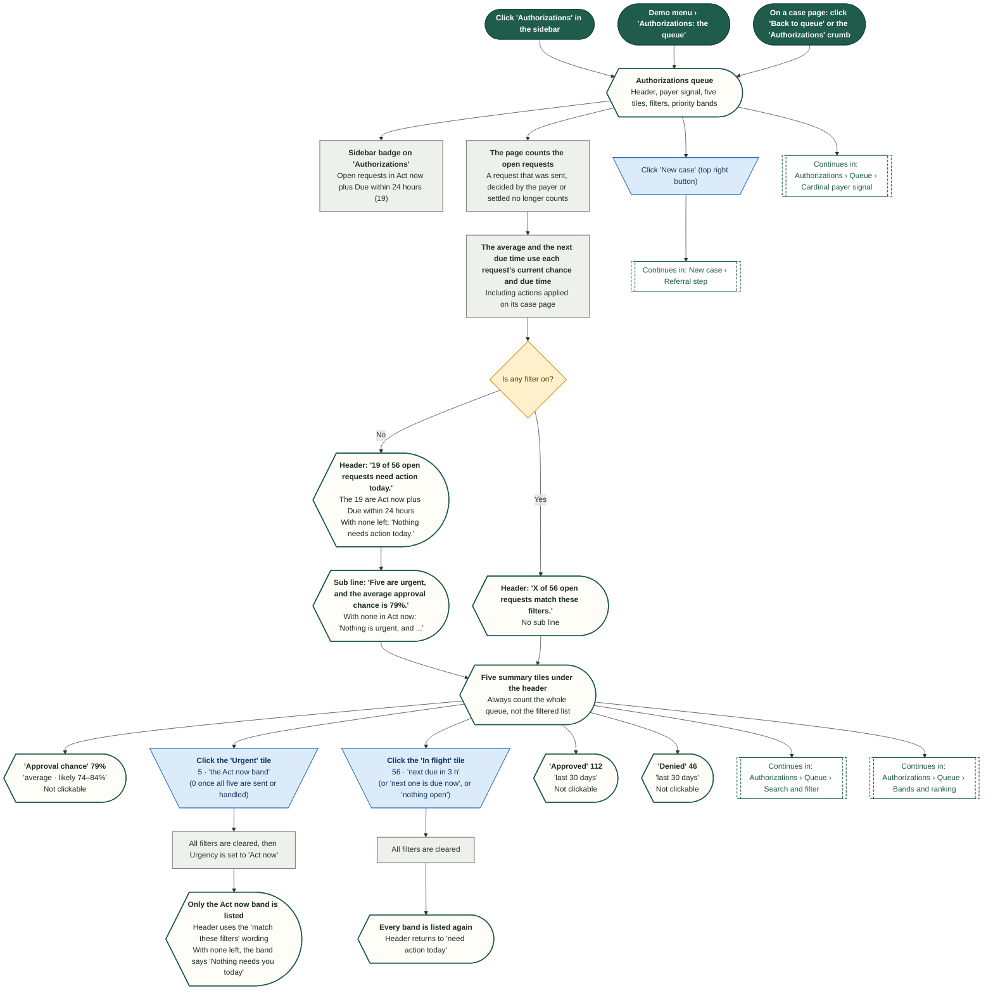

## Authorizations › Queue › Bands and ranking

How open requests are split into three bands, when a request leaves its band, how they are ranked inside a band by how soon each is due, and how a band opens, closes and shows more.

Route: `/authorizations`

Demo only: which band a request sits in is fixed in the seed data. Moving the demo clock changes the due text on each tile ('in 5 h', 'now') but never moves a request to another band.

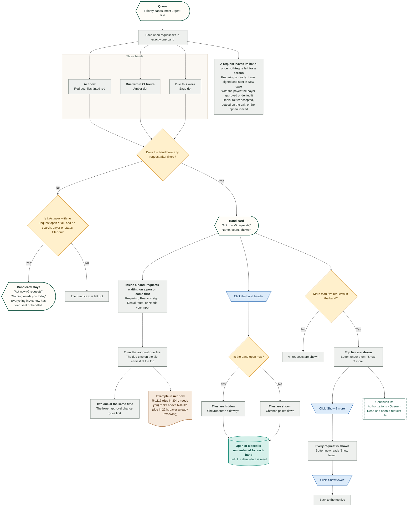

## Authorizations › Queue › Read and open a request tile

What each part of a request tile says, which parts are links, and where the chance, status and due text come from.

Route: `/authorizations`

Only the request ID, the 'Open' button and the 'Coverage needs a fix' pill are clickable. The rest of the tile does nothing.

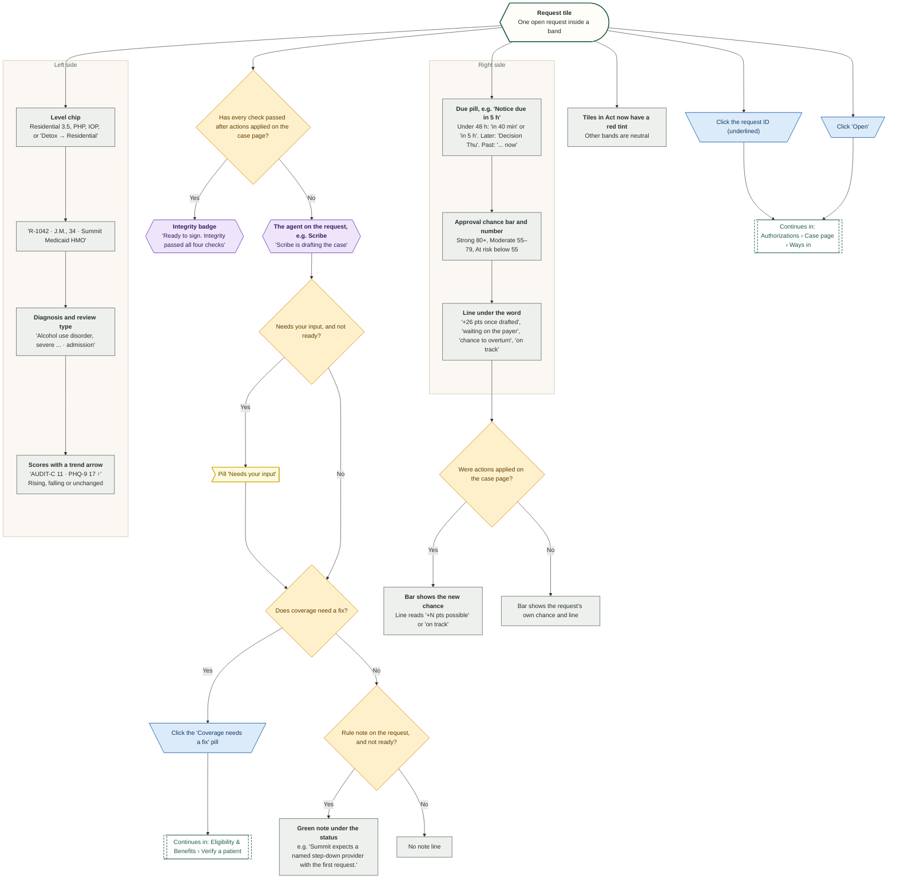

## Authorizations › Queue › Search and filter

The search box and the three menus (Payer, Status, Urgency), how they combine, what the page says when nothing matches, and the 'Nothing needs you today' messages that appear once requests have been sent or handled.

Route: `/authorizations`

Demo only: filters are kept while you move around the app (not in the web address) and are cleared by Reset demo data. 'Nothing needs you today' shows in the Act now band once all five of its requests are sent or handled, and for the whole queue only when no request is left open at all.

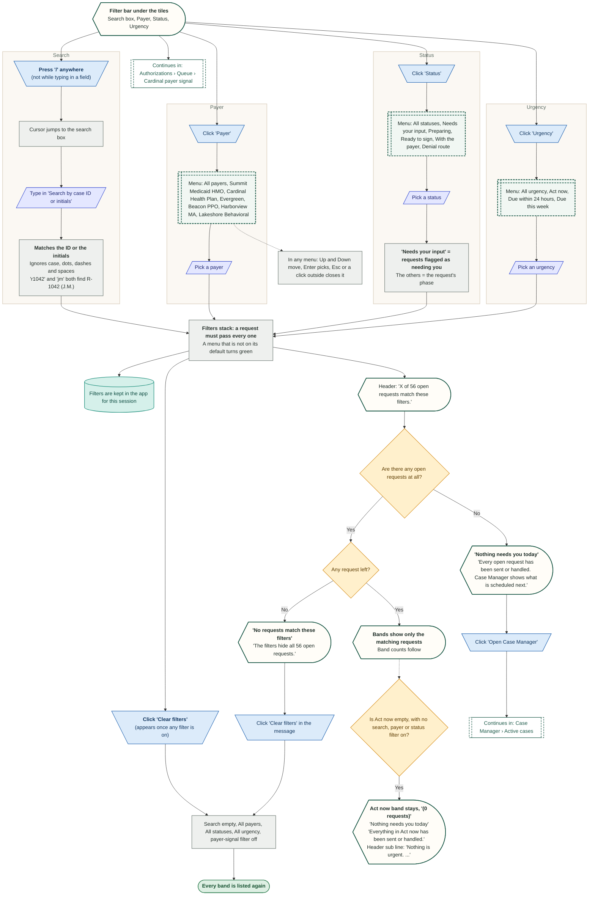

## Authorizations › Queue › Cardinal payer signal

The banner that warns about a payer trend, the filter it switches on, and the three ways to turn the filter off or hide the banner.

Route: `/authorizations`

Demo only: the banner text and which four requests it affects (I-2207, I-2218, I-2236, I-2271) are seed data. Nothing re-scores the requests live.

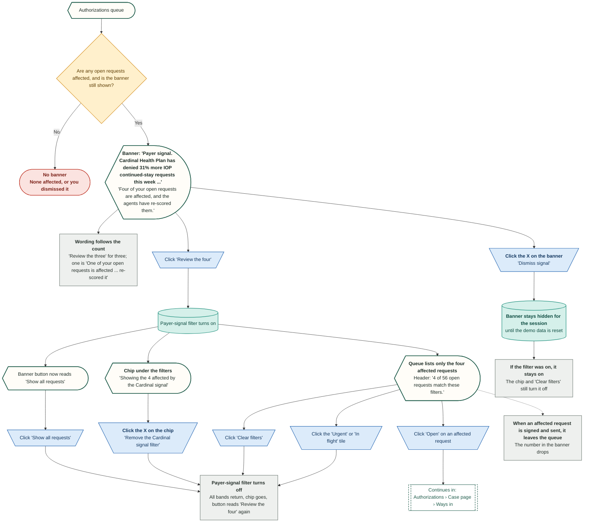

## Authorizations › Case page › Ways in

Every link that opens a case page, and what the page does with the ID it is given: find the request, load your earlier work, pick the tab.

Route: `/authorizations/case/R-1042`

Demo only: R-1042 is the one hand-written case. Every other case page is generated from its queue row or Dashboard request, so the numbers are consistent but the wording is a template. An ID that is in the Case Manager ledger but not in the queue opens the Ledger case page. An ID in neither ends at 'Request not found'.

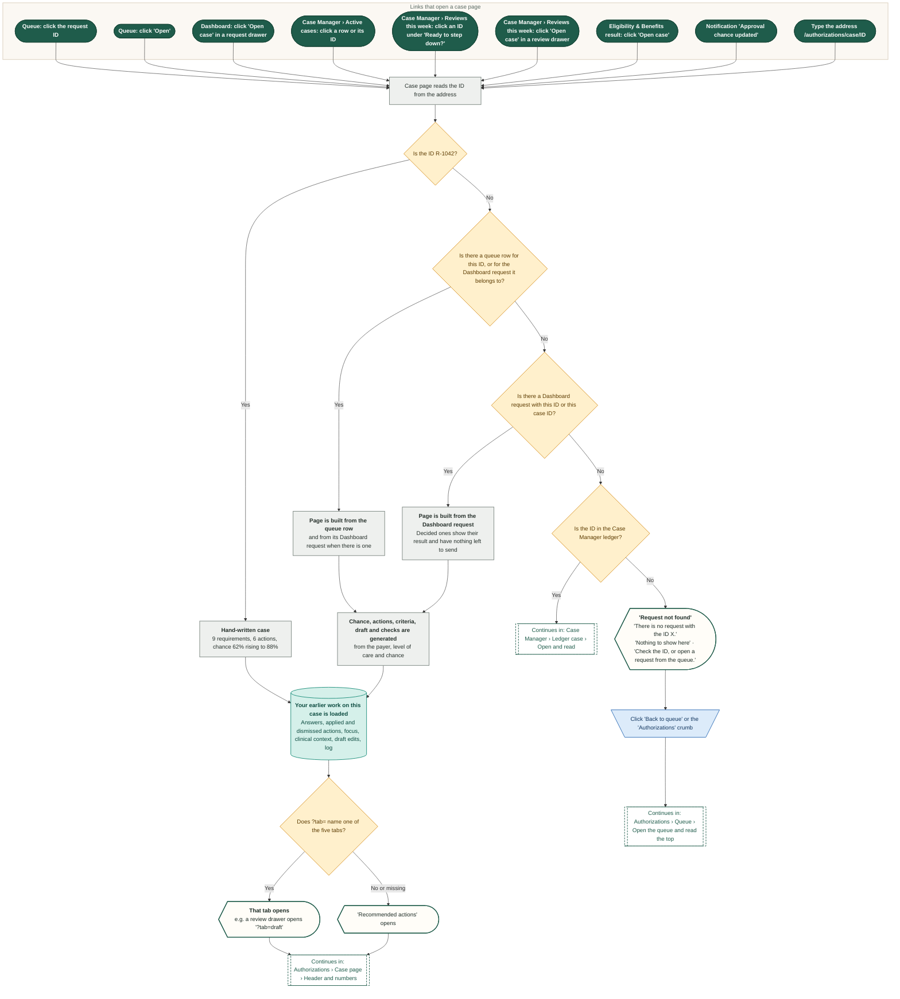

## Authorizations › Case page › Header and buttons

The title block above the tabs and its three buttons. It stays the same on all five tabs, and it follows the request: once the request is sent or decided the header shows its new status. The three number tiles and the notes under it are in the next diagram.

Route: `/authorizations/case/R-1042`

Demo only: the header reads the request's current stage from the Dashboard, so signing and sending in New case, or a payer reply made with the Dashboard demo controls, shows here at once.

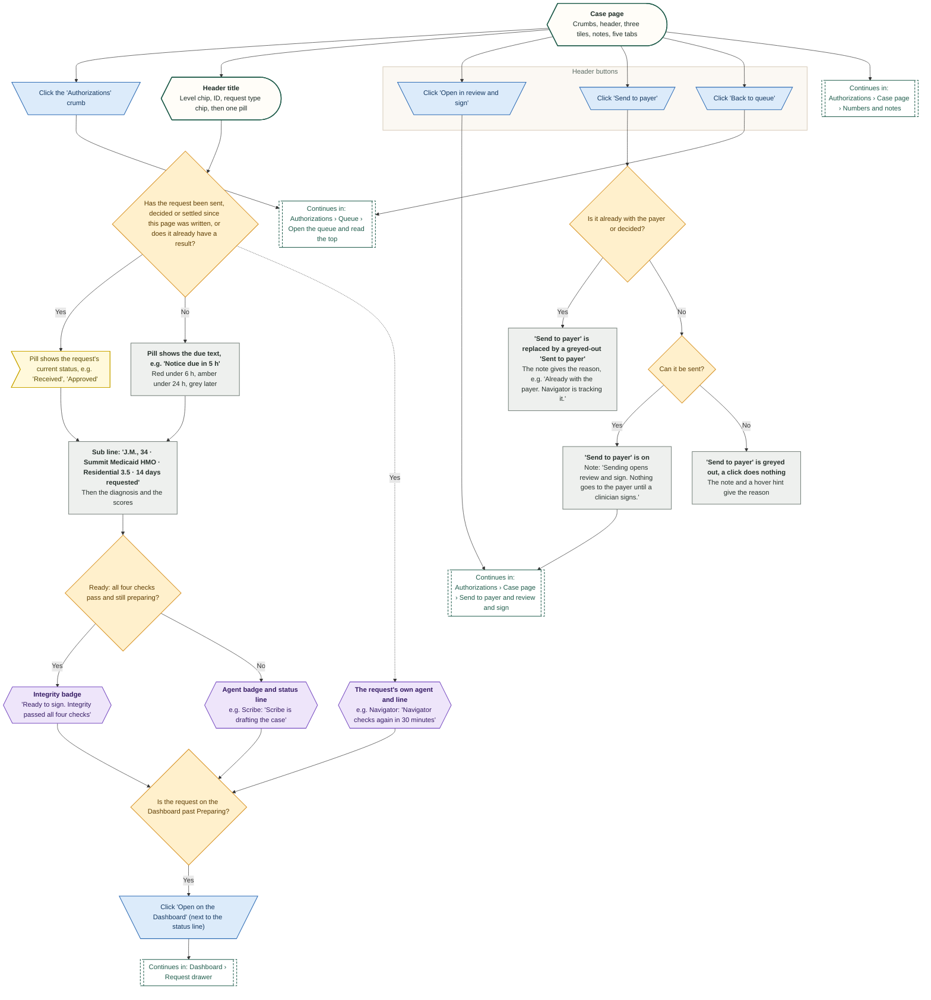

## Authorizations › Case page › Numbers and notes

The three tiles, the denial banner and the two standing notes under the header. They stay on screen on all five tabs and change as actions are applied.

Route: `/authorizations/case/R-1042`

Demo only: the numbers are seed data plus simple arithmetic.

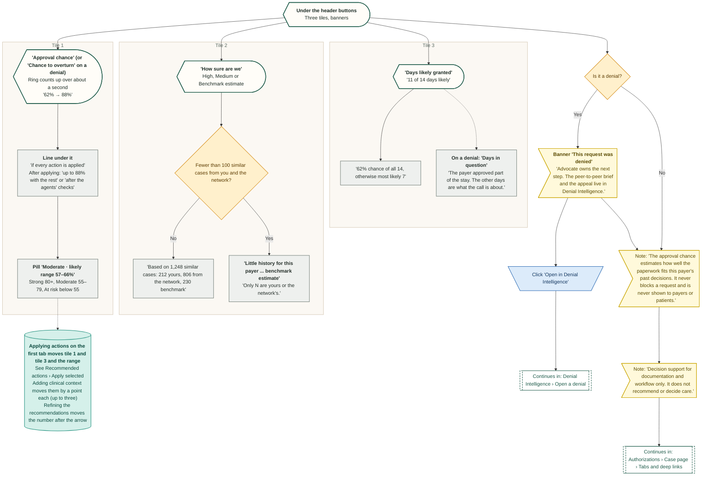

## Authorizations › Case page › Tabs and deep links

The five tabs under the header, how the address follows them, what the two badges count, and the buttons on other tabs that jump to one recommendation card.

Route: `/authorizations/case/R-1042?tab=actions`

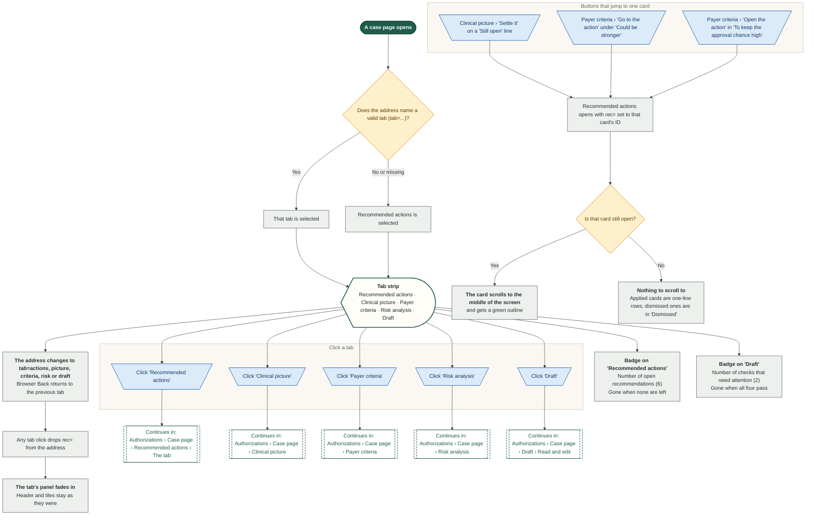

## Authorizations › Case page › Send to payer and review and sign

When the 'Send to payer' button is on or greyed out, what both header buttons do when clicked, and which New case draft they open. Nothing is sent from the case page: a clinician signs in New case.

Route: `/authorizations/case/R-1042`

Every request gets a draft in New case, made from its own data when it has none (five requests have one already: R-1042, I-2207, R-0988, R-1101, I-2262). It never opens blank at the Referral step. 'Open in review and sign' is always on, even for a request already with the payer.

```mermaid
%%{init: {"theme":"base","themeVariables":{"fontFamily":"'DM Sans', 'Segoe UI', system-ui, sans-serif","fontSize":"15px","lineColor":"#5B6B63","primaryTextColor":"#1C2B25","clusterBkg":"#FBF8F3","clusterBorder":"#D9CDBB","edgeLabelBackground":"#FFFFFF"},"flowchart":{"curve":"basis","nodeSpacing":36,"rankSpacing":48,"padding":12,"htmlLabels":true,"useMaxWidth":false,"wrappingWidth":230}} }%%
flowchart TD
  classDef k_start fill:#1F5C4B,stroke:#174638,color:#FFFFFF,stroke-width:1.5px,font-weight:600
  classDef k_end fill:#DDEFE3,stroke:#2E7D4F,color:#14502F,stroke-width:1.5px,font-weight:600
  classDef k_endx fill:#FBE3E0,stroke:#C0392B,color:#7A1F16,stroke-width:1.5px,font-weight:600
  classDef k_screen fill:#FFFDF8,stroke:#1F5C4B,color:#1C2B25,stroke-width:2px
  classDef k_overlay fill:#F1F7F3,stroke:#1F5C4B,color:#1C2B25,stroke-width:2px,stroke-dasharray:5 3
  classDef k_click fill:#DCEBFA,stroke:#2F6DB5,color:#12365F,stroke-width:1.5px
  classDef k_input fill:#E4E7FF,stroke:#4C5FD5,color:#1D2670,stroke-width:1.5px
  classDef k_process fill:#EEF0EE,stroke:#7A857F,color:#26302B,stroke-width:1.5px
  classDef k_agent fill:#EEE5FA,stroke:#7A4FC2,color:#341A63,stroke-width:1.5px
  classDef k_decision fill:#FFF0CC,stroke:#D9962B,color:#5C3B00,stroke-width:1.5px
  classDef k_store fill:#D5F0EA,stroke:#1C8E7B,color:#0B4A3F,stroke-width:1.5px
  classDef k_doc fill:#F6E9DC,stroke:#B07A4C,color:#4A2E14,stroke-width:1.5px
  classDef k_ext fill:#FFE6D2,stroke:#E07B39,color:#6B2F06,stroke-width:1.5px
  classDef k_wait fill:#E4E8EE,stroke:#6B7C93,color:#26303D,stroke-width:1.5px
  classDef k_toast fill:#FFF9DB,stroke:#C9A400,color:#5A4A00,stroke-width:1.5px
  classDef k_goto fill:#FFFFFF,stroke:#1F5C4B,color:#1F5C4B,stroke-width:1.5px,stroke-dasharray:5 3
  cp@{ shape: curv-trap, label: "<b>Case page</b><br/>'Send to payer' appears in the header, the Recommended actions side panel and the Draft tab" }
  d1@{ shape: diam, label: "Does the request already have a result (decided)?" }
  r1@{ shape: rect, label: "<b>The button becomes a disabled 'Sent to payer'</b><br/>Tooltip: 'Approved. Nothing is left to send.'<br/>(the result word comes from the request)" }
  d2@{ shape: diam, label: "Is it already with the payer?" }
  r2@{ shape: rect, label: "<b>The button becomes a disabled 'Sent to payer'</b><br/>Tooltip: 'Already with the payer. Navigator is tracking it.'" }
  d3@{ shape: diam, label: "Is it a denial?" }
  r3@{ shape: rect, label: "Greyed out. Reason: 'This request was denied. Advocate owns the next step.'" }
  d4@{ shape: diam, label: "Do all four Integrity checks pass?" }
  r4@{ shape: rect, label: "Greyed out. Reason: 'Integrity has 2 open checks. Apply the matching actions first.'" }
  on@{ shape: rect, label: "<b>'Send to payer' is on</b><br/>'Sending opens review and sign. Nothing goes to the payer until a clinician signs.'" }
  subgraph gChk ["What keeps a check open"]
  k1@{ shape: rect, label: "<b>'Every sentence matches the chart'</b><br/>open after you edit the draft, until 'Re-check'" }
  k2@{ shape: rect, label: "<b>'Payer criteria are covered'</b><br/>open until its action is applied (e.g. 'Name the step-down provider')" }
  k3@{ shape: rect, label: "<b>'Dates are consistent'</b><br/>open until its action is applied (e.g. 'Settle the sertraline start date')" }
  k4@{ shape: rect, label: "<b>'Identifiers are protected'</b><br/>always passes in the demo" }
  end
  dm@{ shape: rect, label: "<b>Dismissing the action does not clear its check</b><br/>The dismiss dialog warns about this" }
  b1@{ shape: trap-t, label: "<b>Click 'Open in review and sign'</b><br/>(always on)" }
  b2@{ shape: trap-t, label: "<b>Click 'Send to payer'</b><br/>(only when on)" }
  rp@{ shape: rect, label: "<b>Find this request's draft in New case</b><br/>The draft named like 'draft-r1042', or any draft with this case ID<br/>Or make one: draftFromRequest" }
  d5@{ shape: diam, label: "Does the request already have a draft?" }
  mk@{ shape: rect, label: "<b>A draft is created from the request</b><br/>Patient, payer, level of care, request type, a reason and diagnoses from the case page<br/>The documents the payer's saved list asks for, as sample files<br/>Not saved, so Case Manager does not list it" }
  up@{ shape: rect, label: "<b>A draft that exists is brought up to date</b><br/>Answers from applied actions (sertraline date, step-down provider) are added<br/>The therapy note is added when that action was applied<br/>When every check passes the run is marked finished" }
  d6@{ shape: diam, label: "Where does the request stand?" }
  g1@{ shape: subproc, label: "Continues in: New case › Agents work" }
  g2@{ shape: subproc, label: "Continues in: New case › Review and sign" }
  g3@{ shape: subproc, label: "Continues in: Review and sign › After sending" }
  sent@{ shape: stadium, label: "<b>New case shows 'R-0912 was sent'</b><br/>'Open it on the Dashboard' and 'Back to Case Manager'<br/>The draft is marked sent, so it cannot be signed again" }
  ns@{ shape: rect, label: "<b>Nothing has been sent</b><br/>A licensed clinician signs in New case" }
  cp --> d1
  d1 -->|"Yes"| r1
  d1 -->|"No"| d2
  d2 -->|"Yes"| r2
  d2 -->|"No"| d3
  d3 -->|"Yes"| r3
  d3 -->|"No"| d4
  d4 -->|"No"| r4
  d4 -->|"Yes"| on
  r4 -.-> k1
  r4 -.-> k2
  r4 -.-> k3
  r4 -.-> k4
  k2 --> dm
  k3 --> dm
  cp --> b1
  on --> b2
  b1 --> rp
  b2 --> rp
  rp --> d5
  d5 -->|"No"| mk --> d6
  d5 -->|"Yes"| up --> d6
  d6 -->|"Agents still have work, e.g. R-1042 before its actions are applied"| g1
  d6 -->|"Ready or all four checks passed, e.g. R-0988, R-1142, R-1042 after its actions"| g2
  d6 -->|"Already with the payer or decided"| sent
  rp -.-> ns
  sent --> g3
  class cp k_screen
  class d1,d2,d3,d4,d5,d6 k_decision
  class r1,r2,r3,r4,on,k1,k2,k3,k4,dm,rp,mk,up,ns k_process
  class b1,b2 k_click
  class g1,g2,g3 k_goto
  class sent k_endx
  style gChk fill:#FBF8F3,stroke:#D9CDBB,stroke-width:1.5px,color:#5B6B63
```

## Authorizations › Case page › Recommended actions › The tab

The layout of the first tab: the cards on the left, the five buttons, the context you added and the decision log on the right, and when each button is on or off. Each card and each button has its own diagram.

Route: `/authorizations/case/R-1042?tab=actions`

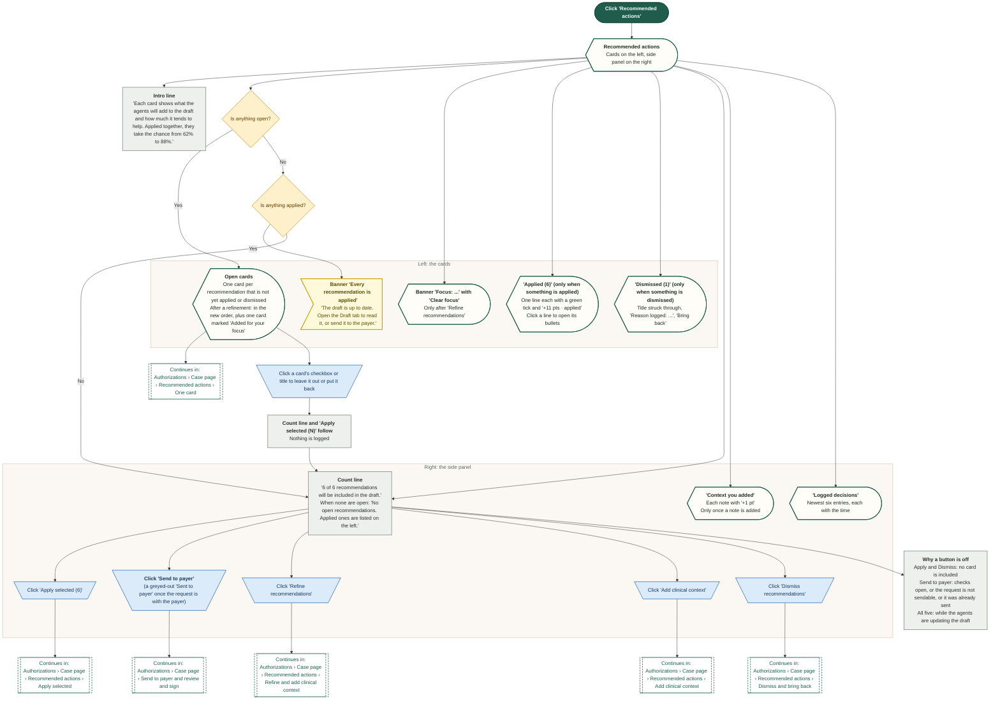

## Authorizations › Case page › Recommended actions › One card

Everything on one recommendation card: leaving it out, the question some cards ask, notes to the agent that does the work, the 'Why this matters' note and the links.

Route: `/authorizations/case/R-1042?tab=actions`

Demo only: the note box saves your words on the case and logs them. The agent does not read them again until the next Apply.

```mermaid
%%{init: {"theme":"base","themeVariables":{"fontFamily":"'DM Sans', 'Segoe UI', system-ui, sans-serif","fontSize":"15px","lineColor":"#5B6B63","primaryTextColor":"#1C2B25","clusterBkg":"#FBF8F3","clusterBorder":"#D9CDBB","edgeLabelBackground":"#FFFFFF"},"flowchart":{"curve":"basis","nodeSpacing":36,"rankSpacing":48,"padding":12,"htmlLabels":true,"useMaxWidth":false,"wrappingWidth":230}} }%%
flowchart TD
  classDef k_start fill:#1F5C4B,stroke:#174638,color:#FFFFFF,stroke-width:1.5px,font-weight:600
  classDef k_end fill:#DDEFE3,stroke:#2E7D4F,color:#14502F,stroke-width:1.5px,font-weight:600
  classDef k_endx fill:#FBE3E0,stroke:#C0392B,color:#7A1F16,stroke-width:1.5px,font-weight:600
  classDef k_screen fill:#FFFDF8,stroke:#1F5C4B,color:#1C2B25,stroke-width:2px
  classDef k_overlay fill:#F1F7F3,stroke:#1F5C4B,color:#1C2B25,stroke-width:2px,stroke-dasharray:5 3
  classDef k_click fill:#DCEBFA,stroke:#2F6DB5,color:#12365F,stroke-width:1.5px
  classDef k_input fill:#E4E7FF,stroke:#4C5FD5,color:#1D2670,stroke-width:1.5px
  classDef k_process fill:#EEF0EE,stroke:#7A857F,color:#26302B,stroke-width:1.5px
  classDef k_agent fill:#EEE5FA,stroke:#7A4FC2,color:#341A63,stroke-width:1.5px
  classDef k_decision fill:#FFF0CC,stroke:#D9962B,color:#5C3B00,stroke-width:1.5px
  classDef k_store fill:#D5F0EA,stroke:#1C8E7B,color:#0B4A3F,stroke-width:1.5px
  classDef k_doc fill:#F6E9DC,stroke:#B07A4C,color:#4A2E14,stroke-width:1.5px
  classDef k_ext fill:#FFE6D2,stroke:#E07B39,color:#6B2F06,stroke-width:1.5px
  classDef k_wait fill:#E4E8EE,stroke:#6B7C93,color:#26303D,stroke-width:1.5px
  classDef k_toast fill:#FFF9DB,stroke:#C9A400,color:#5A4A00,stroke-width:1.5px
  classDef k_goto fill:#FFFFFF,stroke:#1F5C4B,color:#1F5C4B,stroke-width:1.5px,stroke-dasharray:5 3
  cd@{ shape: curv-trap, label: "<b>Recommendation card</b><br/>Checkbox, title, pills, bullets, 'Why this matters', agent line, buttons" }
  pl@{ shape: rect, label: "<b>Pills</b><br/>'+11 pts' on every card ('+1 pt' for one point)<br/>'Needs your input' or 'Answer added' on cards that ask a question<br/>'Added for your focus' on the card that Refine recommendations added" }
  bl@{ shape: rect, label: "Up to three bullets say what the agent will add" }
  tk@{ shape: trap-t, label: "Click the checkbox or the title" }
  tg@{ shape: rect, label: "<b>Card is included in, or left out of, the draft</b><br/>Side-panel count follows<br/>Nothing is logged" }
  wy@{ shape: trap-t, label: "Click 'Why this matters'" }
  wo@{ shape: rect, label: "<b>A short reason opens under the bullets</b><br/>Click again to close" }
  dQ@{ shape: diam, label: "Does the card ask a question?" }
  subgraph gQ ["Cards with a question"]
  an@{ shape: lean-r, label: "<b>Type the answer in the box</b><br/>e.g. 'Step-down program and first appointment'" }
  dA@{ shape: diam, label: "Is there an answer?" }
  er@{ shape: rect, label: "<b>After a failed Apply, red text under the box</b><br/>'Type your answer before Scribe can apply this.'" }
  sn@{ shape: trap-t, label: "<b>Click 'Send note'</b><br/>(off until there is an answer)" }
  cp@{ shape: rect, label: "<b>Caption: 'Scribe uses your answer in the draft.'</b><br/>After a note: 'Note sent to Scribe.'" }
  end
  subgraph gN ["Cards without a question"]
  an2@{ shape: trap-t, label: "Click 'Add a note'" }
  ni@{ shape: lean-r, label: "Type in 'Add context or a note for the agent…'" }
  sn2@{ shape: trap-t, label: "<b>Click 'Send note'</b><br/>(off until something is typed)" }
  cn@{ shape: trap-t, label: "Click 'Cancel'" }
  cx@{ shape: rect, label: "<b>The note box closes</b><br/>What you typed is kept if you open it again" }
  sh@{ shape: rect, label: "Under the card: 'Note sent to Packet: “...”'" }
  end
  nt@{ shape: cyl, label: "<b>Note saved on the case</b><br/>Log: 'You sent Scribe a note: ...'" }
  tn@{ shape: odd, label: "<b>'Note sent to Scribe'</b><br/>'It will be used the next time the draft is updated.'" }
  ag@{ shape: hex, label: "<b>Agent line: badge and 'Scribe does this'</b><br/>Scribe writes the plan, Packet attaches documents, Integrity settles dates, Reader finds chart notes, Verify fixes coverage" }
  dL@{ shape: diam, label: "Is it the coverage card?" }
  lk@{ shape: trap-t, label: "Click 'Open Eligibility & Benefits'" }
  gE@{ shape: subproc, label: "Continues in: Eligibility & Benefits › Verify a patient" }
  ds@{ shape: trap-t, label: "Click 'Dismiss'" }
  gD@{ shape: subproc, label: "Continues in: Authorizations › Case page › Recommended actions › Dismiss and bring back" }
  lk2@{ shape: rect, label: "<b>While the agents are updating the draft</b><br/>the checkbox, answer box, 'Send note' and 'Dismiss' are locked" }
  cd --> pl --> bl
  cd --> tk --> tg
  cd --> wy --> wo
  cd --> dQ
  dQ -->|"Yes"| an --> dA
  dA -->|"No"| er
  dA -->|"Yes"| sn
  sn --> nt
  sn --> cp
  dQ -->|"No"| an2 --> ni
  ni --> sn2 --> nt
  an2 --> cn --> cx
  sn2 --> sh
  nt --> tn
  cd --> ag --> dL
  dL -->|"Yes"| lk --> gE
  dL -->|"No"| ds
  lk --> ds
  ds --> gD
  cd -.-> lk2
  class cd k_screen
  class pl,bl,tg,wo,er,cp,cx,sh,lk2 k_process
  class tk,wy,sn,an2,sn2,cn,lk,ds k_click
  class dQ,dA,dL k_decision
  class an,ni k_input
  class nt k_store
  class tn k_toast
  class ag k_agent
  class gE,gD k_goto
  style gQ fill:#FBF8F3,stroke:#D9CDBB,stroke-width:1.5px,color:#5B6B63
  style gN fill:#FBF8F3,stroke:#D9CDBB,stroke-width:1.5px,color:#5B6B63
```

## Authorizations › Case page › Recommended actions › Apply selected

What 'Apply selected' does: the check for missing answers, the eight-second work strip, and everything that changes when the agents finish (chance, draft version, log, Dashboard, queue, notification).

Route: `/authorizations/case/R-1042?tab=actions`

Demo only: the eight seconds are a simulated wait. The new chance is the old chance plus the points on the cards you included (and any clinical context), worked out on the page. The run belongs to the app, so it still finishes if you leave the page.

```mermaid
%%{init: {"theme":"base","themeVariables":{"fontFamily":"'DM Sans', 'Segoe UI', system-ui, sans-serif","fontSize":"15px","lineColor":"#5B6B63","primaryTextColor":"#1C2B25","clusterBkg":"#FBF8F3","clusterBorder":"#D9CDBB","edgeLabelBackground":"#FFFFFF"},"flowchart":{"curve":"basis","nodeSpacing":36,"rankSpacing":48,"padding":12,"htmlLabels":true,"useMaxWidth":false,"wrappingWidth":230}} }%%
flowchart TD
  classDef k_start fill:#1F5C4B,stroke:#174638,color:#FFFFFF,stroke-width:1.5px,font-weight:600
  classDef k_end fill:#DDEFE3,stroke:#2E7D4F,color:#14502F,stroke-width:1.5px,font-weight:600
  classDef k_endx fill:#FBE3E0,stroke:#C0392B,color:#7A1F16,stroke-width:1.5px,font-weight:600
  classDef k_screen fill:#FFFDF8,stroke:#1F5C4B,color:#1C2B25,stroke-width:2px
  classDef k_overlay fill:#F1F7F3,stroke:#1F5C4B,color:#1C2B25,stroke-width:2px,stroke-dasharray:5 3
  classDef k_click fill:#DCEBFA,stroke:#2F6DB5,color:#12365F,stroke-width:1.5px
  classDef k_input fill:#E4E7FF,stroke:#4C5FD5,color:#1D2670,stroke-width:1.5px
  classDef k_process fill:#EEF0EE,stroke:#7A857F,color:#26302B,stroke-width:1.5px
  classDef k_agent fill:#EEE5FA,stroke:#7A4FC2,color:#341A63,stroke-width:1.5px
  classDef k_decision fill:#FFF0CC,stroke:#D9962B,color:#5C3B00,stroke-width:1.5px
  classDef k_store fill:#D5F0EA,stroke:#1C8E7B,color:#0B4A3F,stroke-width:1.5px
  classDef k_doc fill:#F6E9DC,stroke:#B07A4C,color:#4A2E14,stroke-width:1.5px
  classDef k_ext fill:#FFE6D2,stroke:#E07B39,color:#6B2F06,stroke-width:1.5px
  classDef k_wait fill:#E4E8EE,stroke:#6B7C93,color:#26303D,stroke-width:1.5px
  classDef k_toast fill:#FFF9DB,stroke:#C9A400,color:#5A4A00,stroke-width:1.5px
  classDef k_goto fill:#FFFFFF,stroke:#1F5C4B,color:#1F5C4B,stroke-width:1.5px,stroke-dasharray:5 3
  ap@{ shape: trap-t, label: "Click 'Apply selected (6)'" }
  d0@{ shape: diam, label: "Is at least one card included?" }
  e0@{ shape: stadium, label: "<b>Button is off</b><br/>Nothing to apply" }
  d1@{ shape: diam, label: "Does an included card ask a question that has no answer?" }
  t1@{ shape: odd, label: "<b>'Add your answer first'</b><br/>'2 selected actions need your input before it can be applied.'" }
  sc@{ shape: rect, label: "<b>Red text on those cards</b><br/>Page scrolls to the first one" }
  e1@{ shape: stadium, label: "<b>Nothing is applied</b><br/>Answer, or uncheck the card, then try again" }
  st@{ shape: rect, label: "<b>New chance worked out</b><br/>Current chance plus the points on the included cards" }
  run@{ shape: cyl, label: "<b>A run starts on this case</b><br/>All five side buttons and every card control lock" }
  top@{ shape: rect, label: "Page scrolls to the top so the strip and the ring are in view" }
  strip@{ shape: curv-trap, label: "<b>Work strip</b><br/>'The agents are updating the draft · about 8 seconds'" }
  subgraph gA ["Agents in turn"]
  a1@{ shape: hex, label: "<b>Scribe</b><br/>'Reading your answers' › 'Writing the new sentences into the draft' › 'Rewriting 2 sections' › 'Draft updated'" }
  a2@{ shape: hex, label: "<b>Integrity</b><br/>'Reading every sentence against the chart' › 'Checking dates and identifiers' › 'Every sentence matches the chart'" }
  a3@{ shape: hex, label: "<b>Forecaster</b><br/>'Matching 1,248 similar decisions' › 'Re-scoring the approval chance' › 'New chance ready'" }
  end
  w@{ shape: delay, label: "<b>About 8 seconds in all</b><br/>(demo: simulated)<br/>Each agent: Waiting, spinner, green tick" }
  dn@{ shape: cyl, label: "<b>Run ends</b><br/>Cards move to 'Applied'<br/>Chance and 'points left' saved on the case<br/>New draft version: 'Scribe', 'Added 6 recommendations'<br/>Log: Scribe applied '...' for each card" }
  rg@{ shape: rect, label: "<b>Header ring counts up to the new chance</b><br/>Pill, likely range and 'Days likely granted' follow" }
  dQ@{ shape: diam, label: "Is this a queue request with a Dashboard entry?" }
  db@{ shape: cyl, label: "<b>Dashboard request gets the new chance</b><br/>Timeline: 'Scribe added 6 items to the draft. Approval chance is now 88%'" }
  qu@{ shape: rect, label: "<b>Queue tile shows the new chance</b><br/>Line reads '+N pts possible' or 'on track'<br/>Queue average moves too" }
  nf@{ shape: odd, label: "<b>Notification from Forecaster: 'Approval chance updated'</b><br/>'R-1042 is now 88% after 6 actions.'<br/>Click it to return to this case" }
  ts@{ shape: odd, label: "<b>Toast: 'Draft updated'</b><br/>'6 actions applied. Approval chance is now 88%.'" }
  dR@{ shape: diam, label: "Do all four checks pass now?" }
  ok@{ shape: rect, label: "<b>'Send to payer' turns on</b><br/>Badge on the Draft tab clears<br/>Banner 'Every recommendation is applied' if none are left" }
  no@{ shape: rect, label: "<b>'Send to payer' stays off</b><br/>Its reason names the checks still open" }
  pt@{ shape: rect, label: "<b>Cards you left out stay open</b><br/>Header line then reads 'up to N% with the rest'" }
  g1@{ shape: subproc, label: "Continues in: Authorizations › Case page › Draft › Read and edit" }
  ap --> d0
  d0 -->|"No"| e0
  d0 -->|"Yes"| d1
  d1 -->|"Yes"| t1 --> sc --> e1
  d1 -->|"No"| st --> run --> top --> strip
  strip --> a1 --> a2 --> a3
  a3 --> w --> dn
  dn --> rg --> dQ
  dQ -->|"Yes"| db --> qu
  dQ -->|"No"| qu
  dn --> nf
  dn --> ts
  dn --> dR
  dR -->|"Yes"| ok
  dR -->|"No"| no
  dn -.-> pt
  ok --> g1
  class ap k_click
  class d0,d1,dQ,dR k_decision
  class e0,e1 k_endx
  class t1,nf,ts k_toast
  class sc,st,top,rg,qu,ok,no,pt k_process
  class run,dn,db k_store
  class strip k_screen
  class a1,a2,a3 k_agent
  class w k_wait
  class g1 k_goto
  style gA fill:#FBF8F3,stroke:#D9CDBB,stroke-width:1.5px,color:#5B6B63
```

## Authorizations › Case page › Recommended actions › Dismiss and bring back

Dismissing one card or every included card, why the dialog asks for a reason, what it warns about when a card gates 'Send to payer', and how to bring a card back.

Route: `/authorizations/case/R-1042?tab=actions`

The reason is written to the shared list of dismissals that Analytics reads, one line for each time 'Dismiss and log' is confirmed (not one per card). It also shows in 'Logged decisions', on the dismissed card and in the Dashboard request's history.

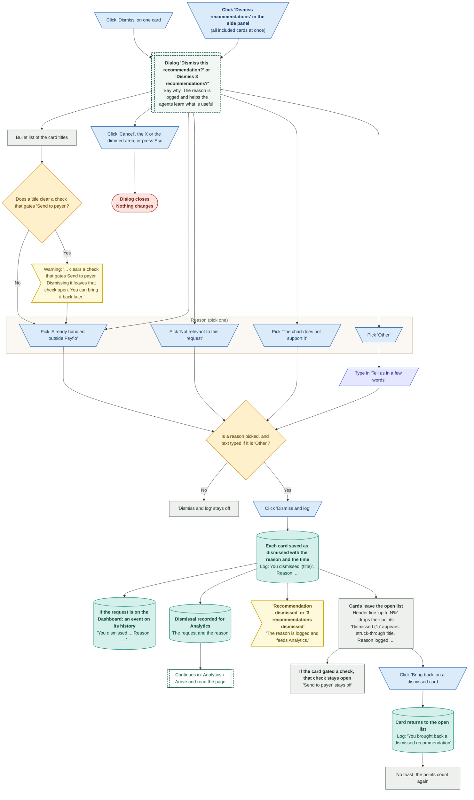

## Authorizations › Case page › Recommended actions › Refine and add clinical context

'Refine recommendations' re-orders the cards and may add one that fits, so the approval chance preview moves. 'Add clinical context' has its own diagram; the 'Logged decisions' list shows the trace of both.

Route: `/authorizations/case/R-1042?tab=actions`

Demo only: the refinement is a short simulated wait with a fixed result. The same focus on the same request always gives the same order and the same added card.

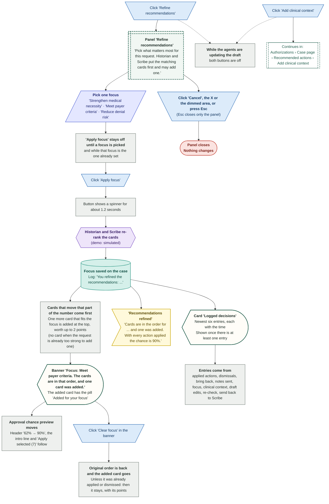

## Authorizations › Case page › Recommended actions › Add clinical context

Adding a note the chart does not show. It is kept in the list the Draft tab and New case read, shown on the case page, and it nudges the approval chance by a point.

Route: `/authorizations/case/R-1042?tab=actions`

Demo only: each of the first three notes adds one point to the approval chance, whatever it says. The draft text on this page is not rewritten here; the Draft tab and New case read the list themselves.

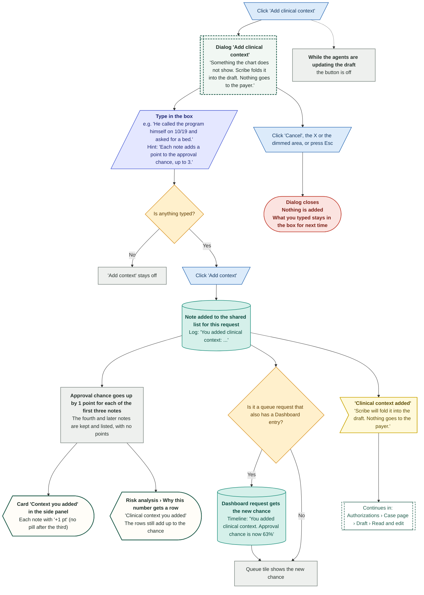

## Authorizations › Case page › Clinical picture

The second tab: what Reader and Placement built from the chart, the six ASAM dimensions, the trend chart, and the 'Still open' list whose 'Settle it' buttons jump back to a recommendation.

Route: `/authorizations/case/R-1042?tab=picture`

Demo only: the chart content is generated text for every request except R-1042, which is hand-written.

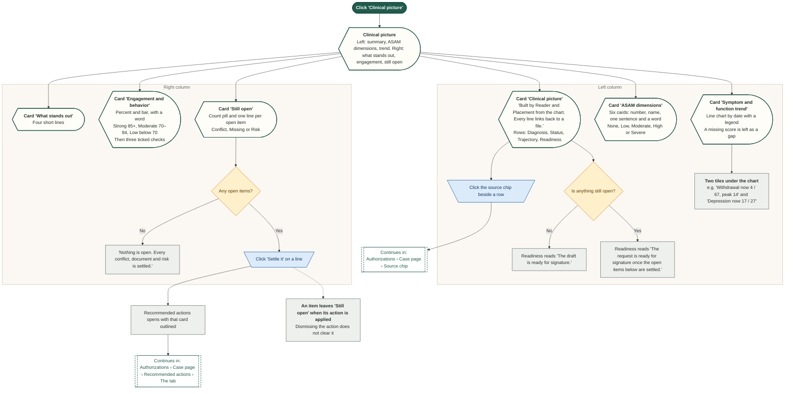

## Authorizations › Case page › Source chip

The small source chips that appear on three tabs. Clicking one opens the page of the chart it points to, with the sentence the agents used boxed.

Route: `/authorizations/case/R-1042?tab=picture`

Demo only: the 'page' is a short generated sheet with the quoted sentence. The full document stays in the chart system.

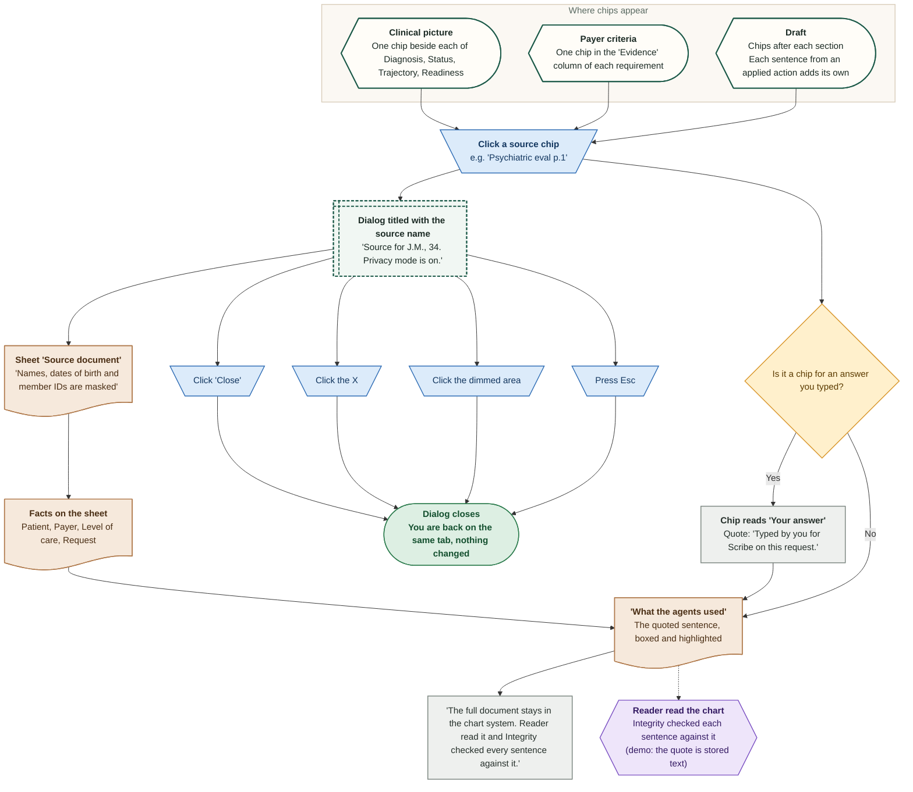

## Authorizations › Case page › Payer criteria

The third tab: what this payer asks for, read by Criteria from the policy, which requirements the chart backs, which could be stronger, and the buttons that jump to the matching action or re-check.

Route: `/authorizations/case/R-1042?tab=criteria`

Demo only: 'Re-check criteria' is a simulated wait. The 'less than 10 s' and 'usually over an hour' figures are fixed text.

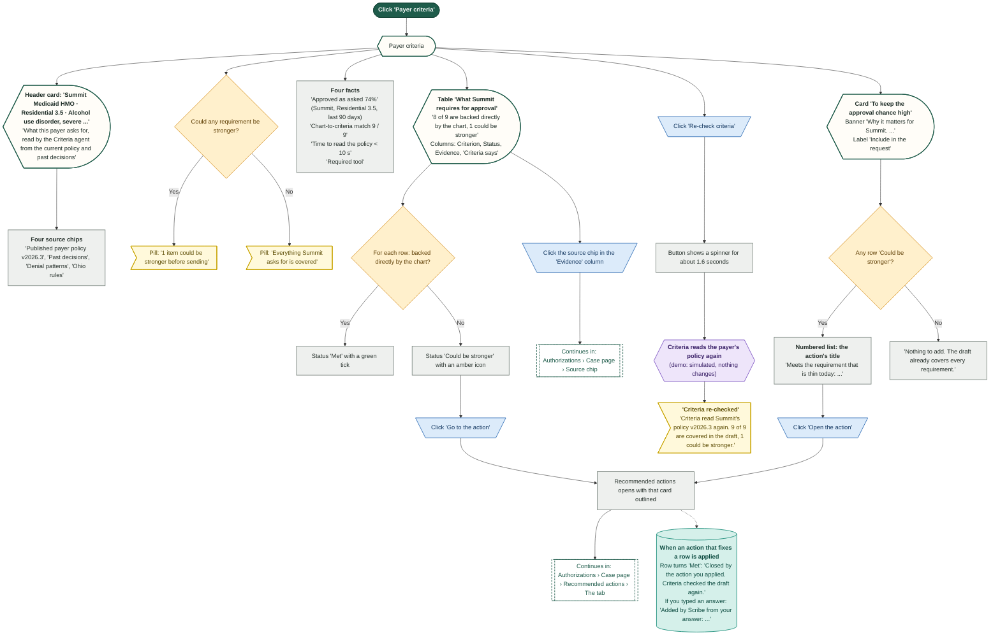

## Authorizations › Case page › Risk analysis

The fourth tab: how often similar requests were approved, why the chance is what it is, the likely outcomes, how sure Forecaster is, and the two pop-ups behind 'See all' and 'How it is calculated'.

Route: `/authorizations/case/R-1042?tab=risk`

Demo only: the history behind the numbers is generated, and the 'Calibrated' line is fixed text. The sums on the page are real: the rows always add up to the chance now.

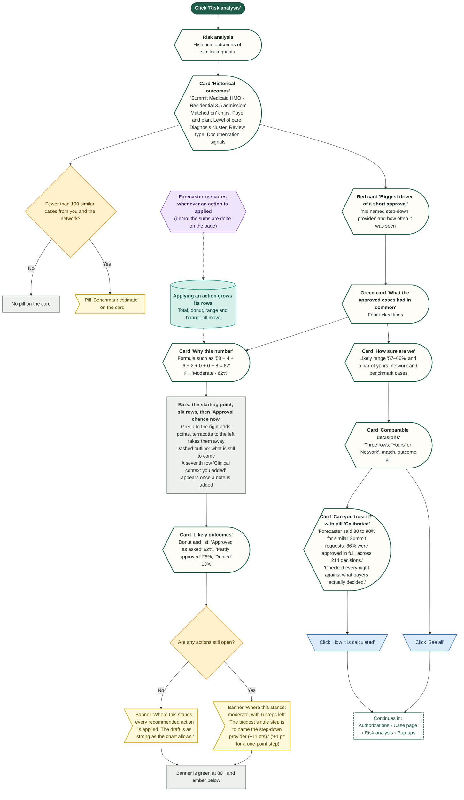

## Authorizations › Case page › Risk analysis › Pop-ups

The two dialogs on the Risk analysis tab: the full list of comparable decisions, and the plain-words explanation of how the approval chance is calculated.

Route: `/authorizations/case/R-1042?tab=risk`

```mermaid
%%{init: {"theme":"base","themeVariables":{"fontFamily":"'DM Sans', 'Segoe UI', system-ui, sans-serif","fontSize":"15px","lineColor":"#5B6B63","primaryTextColor":"#1C2B25","clusterBkg":"#FBF8F3","clusterBorder":"#D9CDBB","edgeLabelBackground":"#FFFFFF"},"flowchart":{"curve":"basis","nodeSpacing":36,"rankSpacing":48,"padding":12,"htmlLabels":true,"useMaxWidth":false,"wrappingWidth":230}} }%%
flowchart TD
  classDef k_start fill:#1F5C4B,stroke:#174638,color:#FFFFFF,stroke-width:1.5px,font-weight:600
  classDef k_end fill:#DDEFE3,stroke:#2E7D4F,color:#14502F,stroke-width:1.5px,font-weight:600
  classDef k_endx fill:#FBE3E0,stroke:#C0392B,color:#7A1F16,stroke-width:1.5px,font-weight:600
  classDef k_screen fill:#FFFDF8,stroke:#1F5C4B,color:#1C2B25,stroke-width:2px
  classDef k_overlay fill:#F1F7F3,stroke:#1F5C4B,color:#1C2B25,stroke-width:2px,stroke-dasharray:5 3
  classDef k_click fill:#DCEBFA,stroke:#2F6DB5,color:#12365F,stroke-width:1.5px
  classDef k_input fill:#E4E7FF,stroke:#4C5FD5,color:#1D2670,stroke-width:1.5px
  classDef k_process fill:#EEF0EE,stroke:#7A857F,color:#26302B,stroke-width:1.5px
  classDef k_agent fill:#EEE5FA,stroke:#7A4FC2,color:#341A63,stroke-width:1.5px
  classDef k_decision fill:#FFF0CC,stroke:#D9962B,color:#5C3B00,stroke-width:1.5px
  classDef k_store fill:#D5F0EA,stroke:#1C8E7B,color:#0B4A3F,stroke-width:1.5px
  classDef k_doc fill:#F6E9DC,stroke:#B07A4C,color:#4A2E14,stroke-width:1.5px
  classDef k_ext fill:#FFE6D2,stroke:#E07B39,color:#6B2F06,stroke-width:1.5px
  classDef k_wait fill:#E4E8EE,stroke:#6B7C93,color:#26303D,stroke-width:1.5px
  classDef k_toast fill:#FFF9DB,stroke:#C9A400,color:#5A4A00,stroke-width:1.5px
  classDef k_goto fill:#FFFFFF,stroke:#1F5C4B,color:#1F5C4B,stroke-width:1.5px,stroke-dasharray:5 3
  subgraph gA ["See all"]
  sa@{ shape: trap-t, label: "Click 'See all' on 'Comparable decisions'" }
  m1@{ shape: win-pane, label: "<b>Dialog 'Comparable decisions'</b><br/>'6 of the closest matches from your own and the network's history'" }
  rw@{ shape: rect, label: "<b>Six rows, each with who, match and an outcome pill</b><br/>The three from the card, then three more" }
  mr@{ shape: rect, label: "<b>The extra rows</b><br/>'Same payer, plan named, scores falling' (Network, close match)<br/>'Earlier attempt not documented' (Yours, close match)<br/>'Recent relapse, no step-down named' (Network, partial match)" }
  dy@{ shape: rect, label: "<b>Outcomes use the request's own days</b><br/>e.g. 'Approved 14/14' or 'Approved 7/14' for a 14-day request" }
  c1@{ shape: trap-t, label: "Click 'Close'" }
  end
  subgraph gB ["How it is calculated"]
  hc@{ shape: trap-t, label: "Click 'How it is calculated'" }
  m2@{ shape: win-pane, label: "<b>Dialog 'How the approval chance is calculated'</b><br/>'In plain words. Updated nightly.'" }
  s1@{ shape: hex, label: "<b>1 Historian finds similar decisions</b><br/>Same payer and plan, level of care, diagnosis cluster, review type and documentation signals" }
  s2@{ shape: hex, label: "<b>2 Forecaster starts from the base rate</b><br/>How often the payer approved those requests as asked" }
  s3@{ shape: rect, label: "<b>3 It adds and takes away points</b><br/>Each row is something the draft shows, or does not show yet" }
  s4@{ shape: rect, label: "<b>4 The range says how sure it is</b><br/>With little history it says 'Benchmark estimate'" }
  s5@{ shape: hex, label: "<b>5 It is checked every night</b><br/>Forecaster compares what it said with what payers decided" }
  nt@{ shape: rect, label: "Footer: 'It estimates how well the paperwork fits the payer's past decisions. It does not decide care, never blocks a request, and is never shown to payers or patients.'" }
  c2@{ shape: trap-t, label: "Click 'Got it'" }
  end
  cx@{ shape: trap-t, label: "Click the X, click the dimmed area, or press Esc" }
  e@{ shape: stadium, label: "<b>Dialog closes</b><br/>You are back on Risk analysis, nothing changed" }
  sa --> m1 --> rw --> mr --> dy --> c1 --> e
  m1 --> cx
  hc --> m2 --> s1 --> s2 --> s3 --> s4 --> s5 --> nt --> c2 --> e
  m2 --> cx
  cx --> e
  class sa,c1,hc,c2,cx k_click
  class m1,m2 k_overlay
  class rw,mr,dy,s3,s4,nt k_process
  class s1,s2,s5 k_agent
  class e k_end
  style gA fill:#FBF8F3,stroke:#D9CDBB,stroke-width:1.5px,color:#5B6B63
  style gB fill:#FBF8F3,stroke:#D9CDBB,stroke-width:1.5px,color:#5B6B63
```

## Authorizations › Case page › Draft › Read and edit

The fifth tab, left side: the medical-necessity summary Scribe wrote, how sentences from applied actions and added clinical context appear, and how a person edits and saves it. It is the same summary Review and sign shows in New case: one text for each request, so an edit made in either place is read in the other.

Route: `/authorizations/case/R-1042?tab=draft`

```mermaid
%%{init: {"theme":"base","themeVariables":{"fontFamily":"'DM Sans', 'Segoe UI', system-ui, sans-serif","fontSize":"15px","lineColor":"#5B6B63","primaryTextColor":"#1C2B25","clusterBkg":"#FBF8F3","clusterBorder":"#D9CDBB","edgeLabelBackground":"#FFFFFF"},"flowchart":{"curve":"basis","nodeSpacing":36,"rankSpacing":48,"padding":12,"htmlLabels":true,"useMaxWidth":false,"wrappingWidth":230}} }%%
flowchart TD
  classDef k_start fill:#1F5C4B,stroke:#174638,color:#FFFFFF,stroke-width:1.5px,font-weight:600
  classDef k_end fill:#DDEFE3,stroke:#2E7D4F,color:#14502F,stroke-width:1.5px,font-weight:600
  classDef k_endx fill:#FBE3E0,stroke:#C0392B,color:#7A1F16,stroke-width:1.5px,font-weight:600
  classDef k_screen fill:#FFFDF8,stroke:#1F5C4B,color:#1C2B25,stroke-width:2px
  classDef k_overlay fill:#F1F7F3,stroke:#1F5C4B,color:#1C2B25,stroke-width:2px,stroke-dasharray:5 3
  classDef k_click fill:#DCEBFA,stroke:#2F6DB5,color:#12365F,stroke-width:1.5px
  classDef k_input fill:#E4E7FF,stroke:#4C5FD5,color:#1D2670,stroke-width:1.5px
  classDef k_process fill:#EEF0EE,stroke:#7A857F,color:#26302B,stroke-width:1.5px
  classDef k_agent fill:#EEE5FA,stroke:#7A4FC2,color:#341A63,stroke-width:1.5px
  classDef k_decision fill:#FFF0CC,stroke:#D9962B,color:#5C3B00,stroke-width:1.5px
  classDef k_store fill:#D5F0EA,stroke:#1C8E7B,color:#0B4A3F,stroke-width:1.5px
  classDef k_doc fill:#F6E9DC,stroke:#B07A4C,color:#4A2E14,stroke-width:1.5px
  classDef k_ext fill:#FFE6D2,stroke:#E07B39,color:#6B2F06,stroke-width:1.5px
  classDef k_wait fill:#E4E8EE,stroke:#6B7C93,color:#26303D,stroke-width:1.5px
  classDef k_toast fill:#FFF9DB,stroke:#C9A400,color:#5A4A00,stroke-width:1.5px
  classDef k_goto fill:#FFFFFF,stroke:#1F5C4B,color:#1F5C4B,stroke-width:1.5px,stroke-dasharray:5 3
  s1@{ shape: stadium, label: "Click 'Draft'" }
  dr@{ shape: curv-trap, label: "<b>Draft</b><br/>Left: 'Medical-necessity summary'. Right: 'Checks', 'Versions', send buttons" }
  hd@{ shape: rect, label: "<b>Card subtitle</b><br/>'Version 3 · written by Scribe, checked by Integrity · every statement links to the chart'" }
  sec@{ shape: rect, label: "<b>Four sections in a row, each with its source chips</b><br/>'Clinical picture.', 'Why a lower level of care is not safe.', 'Current severity.', 'Plan.'<br/>The text is the request's draft in New case (before it has one, the text that draft would have)" }
  cx@{ shape: rect, label: "<b>A fifth paragraph 'Context added.' when notes were added with 'Add clinical context'</b><br/>The notes in the person's own words, no chips<br/>Shown but not edited here: Edit has no box for it" }
  nw@{ shape: rect, label: "<b>Sentences from applied actions follow in a green mark with a 'New' tag</b><br/>Each adds its own chip, e.g. 'Your answer'" }
  ch@{ shape: trap-t, label: "Click a source chip" }
  gC@{ shape: subproc, label: "Continues in: Authorizations › Case page › Source chip" }
  ed@{ shape: trap-t, label: "Click 'Edit'" }
  em@{ shape: curv-trap, label: "<b>Edit mode</b><br/>One text box per section, e.g. 'Edit Plan'<br/>Header buttons 'Cancel' and 'Save changes'" }
  ty@{ shape: lean-r, label: "Change the text in one or more boxes" }
  cn@{ shape: trap-t, label: "Click 'Cancel'" }
  cd@{ shape: rect, label: "<b>Edit mode closes</b><br/>Nothing is saved" }
  sv@{ shape: trap-t, label: "Click 'Save changes'" }
  dCh@{ shape: diam, label: "Did any box change?" }
  tn@{ shape: odd, label: "'No changes to save'" }
  sd@{ shape: cyl, label: "<b>Edited sections saved</b><br/>The edit keeps the sentences already added by applied actions<br/>New version: 'Version 4', 'You', 'Edited by you'<br/>Log: 'You edited the draft. Integrity will read it again before it can be signed'<br/>The same text is saved on the request's draft in New case, so Review and sign reads it" }
  ts@{ shape: odd, label: "<b>'Draft saved'</b><br/>'Integrity needs to read it again before it can be signed. Use Re-check.'" }
  dy@{ shape: rect, label: "<b>'Every sentence matches the chart' now warns</b><br/>'You edited the draft. Integrity has not read it again yet.'<br/>'Send to payer' goes off" }
  bd@{ shape: rect, label: "Badge on the Draft tab goes up by one" }
  lt@{ shape: rect, label: "Actions applied later add their sentences after the edited text" }
  gK@{ shape: subproc, label: "Continues in: Authorizations › Case page › Draft › Checks, versions and send back" }
  gR@{ shape: subproc, label: "Continues in: Review and sign › The draft and the summary" }
  s1 --> dr --> hd --> sec --> nw
  sec --> ch --> gC
  sec --> cx
  dr --> ed --> em --> ty
  em --> cn --> cd
  em --> sv --> dCh
  dCh -->|"No"| tn
  dCh -->|"Yes"| sd --> ts
  sd --> dy --> bd
  dy --> gK
  sd -.-> lt
  sd --> gR
  class s1 k_start
  class dr,em k_screen
  class hd,sec,cx,nw,cd,dy,bd,lt k_process
  class ch,ed,cn,sv k_click
  class gC,gK,gR k_goto
  class ty k_input
  class dCh k_decision
  class tn,ts k_toast
  class sd k_store
```

## Authorizations › Case page › Draft › Checks, versions and send back

The right column of the Draft tab: Integrity's four checks and 'Re-check', the version list and its read-only viewer, and 'Send back to Scribe'.

Route: `/authorizations/case/R-1042?tab=draft`

Demo only: 'Re-check' and 'Send back to Scribe' are simulated waits. Sending back logs the request and shows a toast but does not redraft the text.

```mermaid
%%{init: {"theme":"base","themeVariables":{"fontFamily":"'DM Sans', 'Segoe UI', system-ui, sans-serif","fontSize":"15px","lineColor":"#5B6B63","primaryTextColor":"#1C2B25","clusterBkg":"#FBF8F3","clusterBorder":"#D9CDBB","edgeLabelBackground":"#FFFFFF"},"flowchart":{"curve":"basis","nodeSpacing":36,"rankSpacing":48,"padding":12,"htmlLabels":true,"useMaxWidth":false,"wrappingWidth":230}} }%%
flowchart TD
  classDef k_start fill:#1F5C4B,stroke:#174638,color:#FFFFFF,stroke-width:1.5px,font-weight:600
  classDef k_end fill:#DDEFE3,stroke:#2E7D4F,color:#14502F,stroke-width:1.5px,font-weight:600
  classDef k_endx fill:#FBE3E0,stroke:#C0392B,color:#7A1F16,stroke-width:1.5px,font-weight:600
  classDef k_screen fill:#FFFDF8,stroke:#1F5C4B,color:#1C2B25,stroke-width:2px
  classDef k_overlay fill:#F1F7F3,stroke:#1F5C4B,color:#1C2B25,stroke-width:2px,stroke-dasharray:5 3
  classDef k_click fill:#DCEBFA,stroke:#2F6DB5,color:#12365F,stroke-width:1.5px
  classDef k_input fill:#E4E7FF,stroke:#4C5FD5,color:#1D2670,stroke-width:1.5px
  classDef k_process fill:#EEF0EE,stroke:#7A857F,color:#26302B,stroke-width:1.5px
  classDef k_agent fill:#EEE5FA,stroke:#7A4FC2,color:#341A63,stroke-width:1.5px
  classDef k_decision fill:#FFF0CC,stroke:#D9962B,color:#5C3B00,stroke-width:1.5px
  classDef k_store fill:#D5F0EA,stroke:#1C8E7B,color:#0B4A3F,stroke-width:1.5px
  classDef k_doc fill:#F6E9DC,stroke:#B07A4C,color:#4A2E14,stroke-width:1.5px
  classDef k_ext fill:#FFE6D2,stroke:#E07B39,color:#6B2F06,stroke-width:1.5px
  classDef k_wait fill:#E4E8EE,stroke:#6B7C93,color:#26303D,stroke-width:1.5px
  classDef k_toast fill:#FFF9DB,stroke:#C9A400,color:#5A4A00,stroke-width:1.5px
  classDef k_goto fill:#FFFFFF,stroke:#1F5C4B,color:#1F5C4B,stroke-width:1.5px,stroke-dasharray:5 3
  s1@{ shape: stadium, label: "On the Draft tab, look at the right column" }
  ck@{ shape: curv-trap, label: "<b>Card 'Checks'</b><br/>'Integrity's four checks'<br/>Pill 'All clear' or '2 open'" }
  c1@{ shape: rect, label: "'Every sentence matches the chart'" }
  c2@{ shape: rect, label: "'Payer criteria are covered'" }
  c3@{ shape: rect, label: "'Dates are consistent'" }
  c4@{ shape: rect, label: "'Identifiers are protected'" }
  dok@{ shape: diam, label: "Does each check pass?" }
  pass@{ shape: rect, label: "Green tick and 'Pass'" }
  warn@{ shape: rect, label: "<b>Amber triangle, 'Warn' and a note</b><br/>e.g. 'Sertraline start is 9/14 in the medication list and 9/21 in the psychiatric evaluation.'" }
  why@{ shape: rect, label: "<b>A warning clears when the matching action is applied</b><br/>(criteria and dates), or on 'Re-check' after an edit (chart)" }
  rc@{ shape: trap-t, label: "Click 'Re-check'" }
  ig@{ shape: hex, label: "<b>Integrity reads the draft again</b><br/>Spinner on the button for about 1.6 seconds<br/>(demo: simulated)" }
  mr@{ shape: cyl, label: "<b>Edit flag cleared</b><br/>Log: 'Integrity read the draft again'" }
  dst@{ shape: diam, label: "Do other checks still warn?" }
  t1@{ shape: odd, label: "<b>'All four checks passed'</b><br/>'Integrity read every sentence against the chart again.'" }
  t2@{ shape: odd, label: "<b>'1 check needs an action'</b><br/>'Apply the matching recommendation, then check again.'" }
  vs@{ shape: curv-trap, label: "<b>Card 'Versions'</b><br/>Newest first: 'Version 3', time, author, note" }
  cu@{ shape: rect, label: "<b>Newest row carries a 'Current' pill</b><br/>Older rows have 'View'" }
  vw@{ shape: trap-t, label: "Click 'View' on an older version" }
  vm@{ shape: win-pane, label: "<b>Dialog 'Version 2'</b><br/>Time and author. 'Read only.' Then the text" }
  vc@{ shape: trap-t, label: "Click 'Close', the X, the dimmed area, or press Esc" }
  vn@{ shape: rect, label: "<b>A new version appears after every Apply</b><br/>('Scribe', 'Added 6 recommendations')<br/>and every saved edit ('You', 'Edited by you')" }
  sb@{ shape: curv-trap, label: "<b>Bottom card</b><br/>'Send to payer' (a disabled 'Sent to payer' once the payer has it), 'Send back to Scribe', and a note" }
  sk@{ shape: trap-t, label: "Click 'Send back to Scribe'" }
  bz@{ shape: rect, label: "Spinner for about 1.4 seconds" }
  lg@{ shape: cyl, label: "Log: 'You sent the draft back to Scribe'" }
  tb@{ shape: odd, label: "<b>'Sent back to Scribe'</b><br/>'Scribe will redraft the summary and Integrity will check it again.'" }
  gS@{ shape: subproc, label: "Continues in: Authorizations › Case page › Draft › Review, sign and what happens next" }
  s1 --> ck --> c1 & c2 & c3 & c4
  c1 --> dok
  c2 --> dok
  c3 --> dok
  c4 --> dok
  dok -->|"Yes"| pass
  dok -->|"No"| warn --> why
  ck --> rc --> ig --> mr --> dst
  dst -->|"No"| t1
  dst -->|"Yes"| t2
  s1 --> vs --> cu
  cu --> vw --> vm --> vc
  vs --> vn
  s1 --> sb --> sk --> bz --> lg --> tb
  sb --> gS
  class s1 k_start
  class ck,vs,sb k_screen
  class c1,c2,c3,c4,pass,warn,why,cu,vn,bz k_process
  class dok,dst k_decision
  class rc,vw,vc,sk k_click
  class ig k_agent
  class mr,lg k_store
  class t1,t2,tb k_toast
  class vm k_overlay
  class gS k_goto
```

## Authorizations › Case page › Draft › Review, sign and what happens next

What happens when a person leaves the Draft tab to send the request: the gate, the hand-off to New case where a clinician signs, and where the request appears once it is sent.

Route: `/authorizations/case/R-1042?tab=draft`

Demo only: the payer receiving the request is simulated. The summary signed in New case is the one on this tab: edits, applied actions and added clinical context are all in it.

```mermaid
%%{init: {"theme":"base","themeVariables":{"fontFamily":"'DM Sans', 'Segoe UI', system-ui, sans-serif","fontSize":"15px","lineColor":"#5B6B63","primaryTextColor":"#1C2B25","clusterBkg":"#FBF8F3","clusterBorder":"#D9CDBB","edgeLabelBackground":"#FFFFFF"},"flowchart":{"curve":"basis","nodeSpacing":36,"rankSpacing":48,"padding":12,"htmlLabels":true,"useMaxWidth":false,"wrappingWidth":230}} }%%
flowchart TD
  classDef k_start fill:#1F5C4B,stroke:#174638,color:#FFFFFF,stroke-width:1.5px,font-weight:600
  classDef k_end fill:#DDEFE3,stroke:#2E7D4F,color:#14502F,stroke-width:1.5px,font-weight:600
  classDef k_endx fill:#FBE3E0,stroke:#C0392B,color:#7A1F16,stroke-width:1.5px,font-weight:600
  classDef k_screen fill:#FFFDF8,stroke:#1F5C4B,color:#1C2B25,stroke-width:2px
  classDef k_overlay fill:#F1F7F3,stroke:#1F5C4B,color:#1C2B25,stroke-width:2px,stroke-dasharray:5 3
  classDef k_click fill:#DCEBFA,stroke:#2F6DB5,color:#12365F,stroke-width:1.5px
  classDef k_input fill:#E4E7FF,stroke:#4C5FD5,color:#1D2670,stroke-width:1.5px
  classDef k_process fill:#EEF0EE,stroke:#7A857F,color:#26302B,stroke-width:1.5px
  classDef k_agent fill:#EEE5FA,stroke:#7A4FC2,color:#341A63,stroke-width:1.5px
  classDef k_decision fill:#FFF0CC,stroke:#D9962B,color:#5C3B00,stroke-width:1.5px
  classDef k_store fill:#D5F0EA,stroke:#1C8E7B,color:#0B4A3F,stroke-width:1.5px
  classDef k_doc fill:#F6E9DC,stroke:#B07A4C,color:#4A2E14,stroke-width:1.5px
  classDef k_ext fill:#FFE6D2,stroke:#E07B39,color:#6B2F06,stroke-width:1.5px
  classDef k_wait fill:#E4E8EE,stroke:#6B7C93,color:#26303D,stroke-width:1.5px
  classDef k_toast fill:#FFF9DB,stroke:#C9A400,color:#5A4A00,stroke-width:1.5px
  classDef k_goto fill:#FFFFFF,stroke:#1F5C4B,color:#1F5C4B,stroke-width:1.5px,stroke-dasharray:5 3
  s1@{ shape: stadium, label: "On the Draft tab: read the summary and the four checks" }
  dc@{ shape: diam, label: "Do all four checks pass, and is the request still preparing?" }
  off@{ shape: rect, label: "<b>'Send to payer' is off</b><br/>The reason sits under the button, e.g. 'Integrity has 2 open checks. Apply the matching actions first.'" }
  sp@{ shape: trap-t, label: "Click 'Send to payer' (large button)" }
  os@{ shape: trap-t, label: "Click 'Open in review and sign' (header button)" }
  rp@{ shape: rect, label: "<b>The case page finds this request's draft in New case, or makes one from the request</b><br/>The draft opens at Review and sign when the request is ready, at Agents work when agents still have work" }
  ns@{ shape: rect, label: "<b>Nothing is sent yet</b><br/>'Nothing goes to the payer until a clinician signs.'" }
  gR@{ shape: subproc, label: "Continues in: New case › Review and sign" }
  subgraph gSign ["In New case (summary only, drawn in its own diagram)"]
  sg@{ shape: rect, label: "<b>A licensed clinician signs with 'Sign and send'</b><br/>The UR coordinator cannot sign; Dr. Rivera can" }
  py@{ shape: st-rect, label: "<b>Navigator sends the request through the payer's portal</b><br/>(demo: simulated)" }
  pk@{ shape: doc, label: "<b>What goes out</b><br/>The signed summary and the packet's documents" }
  end
  rq@{ shape: cyl, label: "<b>Dashboard: the request is created, or moves to 'Received'</b><br/>History: 'You signed and sent the request', 'Navigator sent the request through the payer's portal', 'Navigator saved the receipt to the case'" }
  tt@{ shape: odd, label: "<b>Toast 'Sent to the payer'</b><br/>'R-0988 is on the Dashboard as Received.'" }
  nt@{ shape: odd, label: "<b>Notification from Navigator: 'Sent to the payer'</b><br/>'R-0988 was sent. It now shows as Received on the Dashboard.'" }
  db@{ shape: curv-trap, label: "<b>Dashboard opens on that request</b><br/>Stage 'Received'" }
  qg@{ shape: rect, label: "<b>Back in the queue the request is gone</b><br/>The open count drops by one<br/>The sidebar badge too, if it was in Act now or Due within 24 hours" }
  cp@{ shape: rect, label: "<b>The case page of a sent request shows the request's own status</b><br/>and a disabled 'Sent to payer' in place of 'Send to payer'" }
  gD@{ shape: subproc, label: "Continues in: Dashboard › Request drawer" }
  gQ@{ shape: subproc, label: "Continues in: Authorizations › Queue › Open the queue and read the top" }
  s1 --> dc
  dc -->|"No"| off
  dc -->|"Yes"| sp --> rp
  s1 --> os --> rp
  rp --> ns --> gR
  gR --> sg --> py --> pk
  sg --> rq
  rq --> tt
  rq --> nt
  rq --> db --> gD
  rq --> qg --> gQ
  qg -.-> cp
  class s1 k_start
  class dc k_decision
  class off,rp,ns,sg,qg,cp k_process
  class sp,os k_click
  class gR,gD,gQ k_goto
  class py k_ext
  class pk k_doc
  class rq k_store
  class tt,nt k_toast
  class db k_screen
  style gSign fill:#FBF8F3,stroke:#D9CDBB,stroke-width:1.5px,color:#5B6B63
```

## Authorizations › Case page › Where the queue and the case page lead

Every click that takes a person from the queue or a case page into another part of the product. What the case page writes to other screens is in the next diagram.

Route: `/authorizations`

Case Manager has links into the case page, but the case page has no link back to Case Manager. The only link from this module to Case Manager is the queue's empty message, which shows once every open request has been sent or handled.

```mermaid
%%{init: {"theme":"base","themeVariables":{"fontFamily":"'DM Sans', 'Segoe UI', system-ui, sans-serif","fontSize":"15px","lineColor":"#5B6B63","primaryTextColor":"#1C2B25","clusterBkg":"#FBF8F3","clusterBorder":"#D9CDBB","edgeLabelBackground":"#FFFFFF"},"flowchart":{"curve":"basis","nodeSpacing":36,"rankSpacing":48,"padding":12,"htmlLabels":true,"useMaxWidth":false,"wrappingWidth":230}} }%%
flowchart LR
  classDef k_start fill:#1F5C4B,stroke:#174638,color:#FFFFFF,stroke-width:1.5px,font-weight:600
  classDef k_end fill:#DDEFE3,stroke:#2E7D4F,color:#14502F,stroke-width:1.5px,font-weight:600
  classDef k_endx fill:#FBE3E0,stroke:#C0392B,color:#7A1F16,stroke-width:1.5px,font-weight:600
  classDef k_screen fill:#FFFDF8,stroke:#1F5C4B,color:#1C2B25,stroke-width:2px
  classDef k_overlay fill:#F1F7F3,stroke:#1F5C4B,color:#1C2B25,stroke-width:2px,stroke-dasharray:5 3
  classDef k_click fill:#DCEBFA,stroke:#2F6DB5,color:#12365F,stroke-width:1.5px
  classDef k_input fill:#E4E7FF,stroke:#4C5FD5,color:#1D2670,stroke-width:1.5px
  classDef k_process fill:#EEF0EE,stroke:#7A857F,color:#26302B,stroke-width:1.5px
  classDef k_agent fill:#EEE5FA,stroke:#7A4FC2,color:#341A63,stroke-width:1.5px
  classDef k_decision fill:#FFF0CC,stroke:#D9962B,color:#5C3B00,stroke-width:1.5px
  classDef k_store fill:#D5F0EA,stroke:#1C8E7B,color:#0B4A3F,stroke-width:1.5px
  classDef k_doc fill:#F6E9DC,stroke:#B07A4C,color:#4A2E14,stroke-width:1.5px
  classDef k_ext fill:#FFE6D2,stroke:#E07B39,color:#6B2F06,stroke-width:1.5px
  classDef k_wait fill:#E4E8EE,stroke:#6B7C93,color:#26303D,stroke-width:1.5px
  classDef k_toast fill:#FFF9DB,stroke:#C9A400,color:#5A4A00,stroke-width:1.5px
  classDef k_goto fill:#FFFFFF,stroke:#1F5C4B,color:#1F5C4B,stroke-width:1.5px,stroke-dasharray:5 3
  q@{ shape: curv-trap, label: "Authorizations queue" }
  cp@{ shape: curv-trap, label: "A case page (any tab)" }
  l1@{ shape: trap-t, label: "Click 'New case'" }
  l2@{ shape: trap-t, label: "Click the 'Coverage needs a fix' pill on a tile" }
  l6@{ shape: trap-t, label: "Click 'Open Case Manager' in the empty message" }
  l3@{ shape: trap-t, label: "On the coverage card: click 'Open Eligibility & Benefits'" }
  l4@{ shape: trap-t, label: "On a denied request: click 'Open in Denial Intelligence'" }
  l5@{ shape: trap-t, label: "Click 'Open in review and sign' or 'Send to payer'" }
  l7@{ shape: trap-t, label: "Click 'Back to queue' or the 'Authorizations' crumb" }
  l8@{ shape: trap-t, label: "<b>Click 'Open on the Dashboard'</b><br/>(once the request is past Preparing)" }
  g1@{ shape: subproc, label: "Continues in: New case › Referral step" }
  g2@{ shape: subproc, label: "Continues in: Eligibility & Benefits › Verify a patient" }
  g5@{ shape: subproc, label: "Continues in: Case Manager › Active cases" }
  g3@{ shape: subproc, label: "Continues in: Denial Intelligence › Open a denial" }
  g4@{ shape: subproc, label: "Continues in: Authorizations › Case page › Send to payer and review and sign" }
  g6@{ shape: subproc, label: "Continues in: Authorizations › Queue › Open the queue and read the top" }
  g7@{ shape: subproc, label: "Continues in: Dashboard › Request drawer" }
  q --> l1 --> g1
  q --> l2 --> g2
  q --> l6 --> g5
  cp --> l3 --> g2
  cp --> l4 --> g3
  cp --> l5 --> g4
  cp --> l7 --> g6
  cp --> l8 --> g7
  class q,cp k_screen
  class l1,l2,l6,l3,l4,l5,l7,l8 k_click
  class g1,g2,g5,g3,g4,g6,g7 k_goto
```

## Authorizations › Case page › What it writes to other screens

What a case page changes outside itself: the Dashboard request's chance and history, the notification, the shared lists that Analytics and the Draft tab read, and the queue. Nothing here is a link; each happens as a side effect of a click.

Route: `/authorizations/case/R-1042`

Demo only: a case page only writes to the Dashboard for requests that are on both the queue and the Dashboard. Other requests keep their work on the case page alone.

```mermaid
%%{init: {"theme":"base","themeVariables":{"fontFamily":"'DM Sans', 'Segoe UI', system-ui, sans-serif","fontSize":"15px","lineColor":"#5B6B63","primaryTextColor":"#1C2B25","clusterBkg":"#FBF8F3","clusterBorder":"#D9CDBB","edgeLabelBackground":"#FFFFFF"},"flowchart":{"curve":"basis","nodeSpacing":36,"rankSpacing":48,"padding":12,"htmlLabels":true,"useMaxWidth":false,"wrappingWidth":230}} }%%
flowchart TD
  classDef k_start fill:#1F5C4B,stroke:#174638,color:#FFFFFF,stroke-width:1.5px,font-weight:600
  classDef k_end fill:#DDEFE3,stroke:#2E7D4F,color:#14502F,stroke-width:1.5px,font-weight:600
  classDef k_endx fill:#FBE3E0,stroke:#C0392B,color:#7A1F16,stroke-width:1.5px,font-weight:600
  classDef k_screen fill:#FFFDF8,stroke:#1F5C4B,color:#1C2B25,stroke-width:2px
  classDef k_overlay fill:#F1F7F3,stroke:#1F5C4B,color:#1C2B25,stroke-width:2px,stroke-dasharray:5 3
  classDef k_click fill:#DCEBFA,stroke:#2F6DB5,color:#12365F,stroke-width:1.5px
  classDef k_input fill:#E4E7FF,stroke:#4C5FD5,color:#1D2670,stroke-width:1.5px
  classDef k_process fill:#EEF0EE,stroke:#7A857F,color:#26302B,stroke-width:1.5px
  classDef k_agent fill:#EEE5FA,stroke:#7A4FC2,color:#341A63,stroke-width:1.5px
  classDef k_decision fill:#FFF0CC,stroke:#D9962B,color:#5C3B00,stroke-width:1.5px
  classDef k_store fill:#D5F0EA,stroke:#1C8E7B,color:#0B4A3F,stroke-width:1.5px
  classDef k_doc fill:#F6E9DC,stroke:#B07A4C,color:#4A2E14,stroke-width:1.5px
  classDef k_ext fill:#FFE6D2,stroke:#E07B39,color:#6B2F06,stroke-width:1.5px
  classDef k_wait fill:#E4E8EE,stroke:#6B7C93,color:#26303D,stroke-width:1.5px
  classDef k_toast fill:#FFF9DB,stroke:#C9A400,color:#5A4A00,stroke-width:1.5px
  classDef k_goto fill:#FFFFFF,stroke:#1F5C4B,color:#1F5C4B,stroke-width:1.5px,stroke-dasharray:5 3
  s1@{ shape: stadium, label: "Apply selected finishes on a case page" }
  d1@{ shape: diam, label: "Is it a queue request that also has a Dashboard entry?" }
  w1@{ shape: cyl, label: "Dashboard request gets the new chance" }
  w2@{ shape: cyl, label: "<b>Dashboard request history</b><br/>'Scribe added 6 items to the draft. Approval chance is now 88%'" }
  w0@{ shape: rect, label: "Only this case page and the queue change" }
  q1@{ shape: rect, label: "<b>Queue tile shows the new chance</b><br/>Line reads '+N pts possible' or 'on track'<br/>Queue average moves too" }
  n1@{ shape: odd, label: "<b>Notification from Forecaster: 'Approval chance updated'</b><br/>'R-1042 is now 88% after 6 actions.'" }
  n2@{ shape: trap-t, label: "Open Notifications and click 'Approval chance updated'" }
  n3@{ shape: rect, label: "The case page of that request opens" }
  g1@{ shape: subproc, label: "Continues in: Authorizations › Case page › Ways in" }
  s2@{ shape: stadium, label: "Click 'Dismiss and log' on a case page" }
  d2@{ shape: diam, label: "Is the request on the Dashboard?" }
  w3@{ shape: cyl, label: "<b>Dashboard request history</b><br/>'You dismissed ... Reason: ...'" }
  w4@{ shape: rect, label: "<b>Only the case page log changes</b><br/>'Logged decisions'" }
  w7@{ shape: cyl, label: "<b>Dismissal recorded: the request and the reason</b><br/>Analytics reads it" }
  s4@{ shape: stadium, label: "Click 'Add context' on a case page" }
  w8@{ shape: cyl, label: "<b>Clinical context added to the shared list for the request</b><br/>The Draft tab and New case read it" }
  d4@{ shape: diam, label: "Is it a queue request that also has a Dashboard entry?" }
  w9@{ shape: cyl, label: "<b>Dashboard request gets the new chance</b><br/>Timeline: 'You added clinical context. ...'" }
  w10@{ shape: rect, label: "<b>Queue tile shows the new chance</b><br/>The approval chance is one point higher for each of the first three notes" }
  s3@{ shape: stadium, label: "A request is signed and sent in New case" }
  w5@{ shape: cyl, label: "Dashboard stage 'Received'" }
  w6@{ shape: rect, label: "<b>Queue drops the request</b><br/>The open count drops by one<br/>The sidebar badge too, if it was in Act now or Due within 24 hours" }
  w11@{ shape: rect, label: "<b>Its case page reads the new stage</b><br/>Chip 'Received', the request's own status line, a greyed-out 'Sent to payer' and 'Open on the Dashboard'" }
  s5@{ shape: stadium, label: "The payer decides, or a denial is settled or its appeal is filed" }
  w12@{ shape: rect, label: "<b>Queue drops the request from its band</b><br/>When Act now is empty the band says 'Nothing needs you today'" }
  g2@{ shape: subproc, label: "Continues in: Dashboard › Request drawer" }
  s1 --> d1
  d1 -->|"Yes"| w1 --> w2
  d1 -->|"No"| w0
  s1 --> q1
  s1 --> n1 --> n2 --> n3 --> g1
  w2 --> g2
  s2 --> d2
  d2 -->|"Yes"| w3 --> g2
  d2 -->|"No"| w4
  s2 --> w7
  s4 --> w8 --> d4
  d4 -->|"Yes"| w9 --> w10
  d4 -->|"No"| w10
  s3 --> w5 --> w6
  w5 --> w11
  w5 --> g2
  s5 --> w12
  class s1,s2,s4,s3,s5 k_start
  class d1,d2,d4 k_decision
  class w1,w2,w3,w7,w8,w9,w5 k_store
  class w0,q1,n3,w4,w10,w6,w11,w12 k_process
  class n1 k_toast
  class n2 k_click
  class g1,g2 k_goto
```
