# Authorizations › New Case

Four steps for five request types: Intake (patient onboarding, with Pull from EMR, Import a file and Paste a screenshot), Eligibility & Benefits, Clinical documentation with authorization preparation, Review & submit.

Shapes and colours: see `00-overview.md`. Source: `workflows/src/04-new-case/`.

## Authorizations › New Case › How a case starts and resumes

New Case is a page that makes or reopens a case (a 'draft'). This diagram covers every way in and how a new case is made from the address: a referral, a verification, a patient, an authorization type or nothing. Reopening a case that exists, and what a viewer at one site can open, are in the next diagram.

Route: `/authorizations/new`

Demo only: the hosted preview keeps the address in memory, so ?referral= cannot be typed there. The button 'Start a case from this referral' still works in it.

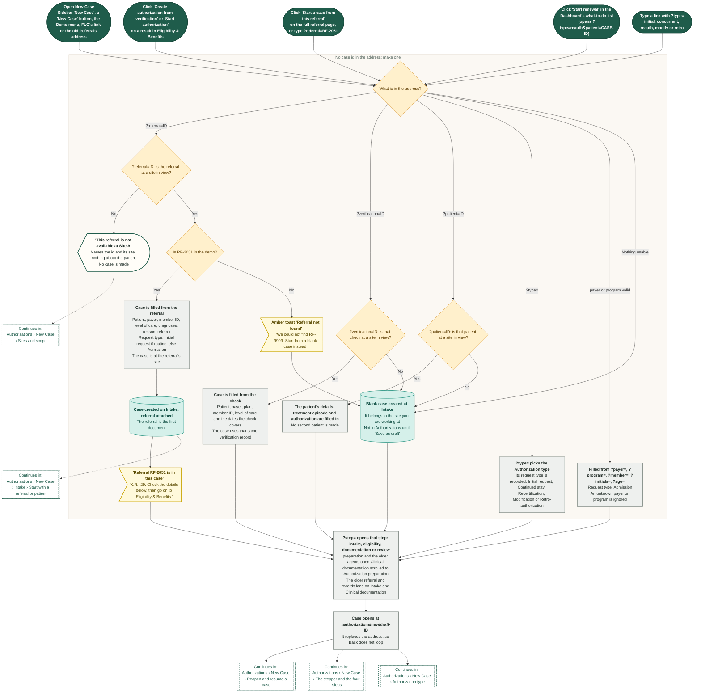

## Authorizations › New Case › The stepper and the four steps

The strip at the top of New Case: Intake, Eligibility & Benefits, Clinical documentation, Review & submit. Authorization preparation (the agents' run) is the last section of Clinical documentation. Every step opens at any time, forward or back; the draft keeps what was typed and what the agents did. Each step shows one state under its name; hovering it gives the one reason.

Route: `/authorizations/new/:draftId`

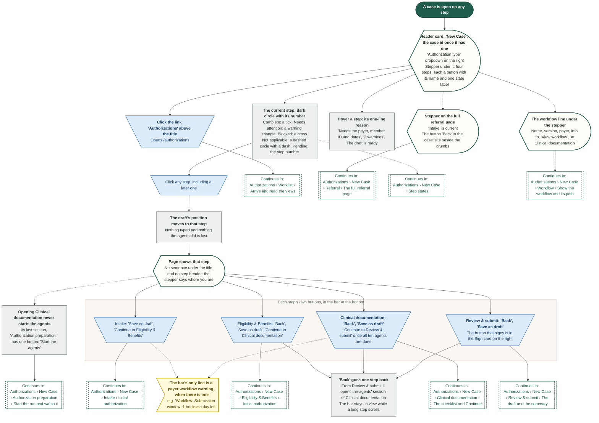

## Authorizations › New Case › Step states

Every step is in one of five states, worked out from the case itself, so the stepper, its tooltips and 'What is missing' never disagree. Only a few conditions stop a request from being sent (marked Blocked); everything else warns and the person can go on. The states are Complete, Needs attention, Pending, Not applicable and Blocked.

Route: `/authorizations/new/:draftId (the stepper; the reason is the step's tooltip)`

```mermaid
%%{init: {"theme":"base","themeVariables":{"fontFamily":"'DM Sans', 'Segoe UI', system-ui, sans-serif","fontSize":"15px","lineColor":"#5B6B63","primaryTextColor":"#1C2B25","clusterBkg":"#FBF8F3","clusterBorder":"#D9CDBB","edgeLabelBackground":"#FFFFFF"},"flowchart":{"curve":"basis","nodeSpacing":36,"rankSpacing":48,"padding":12,"htmlLabels":true,"useMaxWidth":false,"wrappingWidth":230}} }%%
flowchart TD
  classDef k_start fill:#1F5C4B,stroke:#174638,color:#FFFFFF,stroke-width:1.5px,font-weight:600
  classDef k_end fill:#DDEFE3,stroke:#2E7D4F,color:#14502F,stroke-width:1.5px,font-weight:600
  classDef k_endx fill:#FBE3E0,stroke:#C0392B,color:#7A1F16,stroke-width:1.5px,font-weight:600
  classDef k_screen fill:#FFFDF8,stroke:#1F5C4B,color:#1C2B25,stroke-width:2px
  classDef k_overlay fill:#F1F7F3,stroke:#1F5C4B,color:#1C2B25,stroke-width:2px,stroke-dasharray:5 3
  classDef k_click fill:#DCEBFA,stroke:#2F6DB5,color:#12365F,stroke-width:1.5px
  classDef k_input fill:#E4E7FF,stroke:#4C5FD5,color:#1D2670,stroke-width:1.5px
  classDef k_process fill:#EEF0EE,stroke:#7A857F,color:#26302B,stroke-width:1.5px
  classDef k_agent fill:#EEE5FA,stroke:#7A4FC2,color:#341A63,stroke-width:1.5px
  classDef k_decision fill:#FFF0CC,stroke:#D9962B,color:#5C3B00,stroke-width:1.5px
  classDef k_store fill:#D5F0EA,stroke:#1C8E7B,color:#0B4A3F,stroke-width:1.5px
  classDef k_doc fill:#F6E9DC,stroke:#B07A4C,color:#4A2E14,stroke-width:1.5px
  classDef k_ext fill:#FFE6D2,stroke:#E07B39,color:#6B2F06,stroke-width:1.5px
  classDef k_wait fill:#E4E8EE,stroke:#6B7C93,color:#26303D,stroke-width:1.5px
  classDef k_toast fill:#FFF9DB,stroke:#C9A400,color:#5A4A00,stroke-width:1.5px
  classDef k_goto fill:#FFFFFF,stroke:#1F5C4B,color:#1F5C4B,stroke-width:1.5px,stroke-dasharray:5 3
  s1@{ shape: stadium, label: "Look at the stepper, or hover a step for its reason" }
  subgraph gMeaning ["What the five labels mean"]
  m1@{ shape: rect, label: "<b>Complete</b><br/>Everything this step needs is done" }
  m2@{ shape: rect, label: "<b>Needs attention</b><br/>Something to fix or answer. The person can still go on" }
  m3@{ shape: rect, label: "<b>Pending</b><br/>Not started, or waiting on an agent or a reply" }
  m4@{ shape: rect, label: "<b>Not applicable</b><br/>The payer needs no authorization, so nothing is prepared or sent" }
  m5@{ shape: rect, label: "<b>Blocked</b><br/>A condition that stops sending, listed on Review & submit" }
  end
  subgraph gIntake ["1 · Intake"]
  d1@{ shape: diam, label: "Which is true first?" }
  i1@{ shape: rect, label: "Pending · 'Not started'" }
  i2@{ shape: rect, label: "<b>Blocked · 'A matching request exists'</b><br/>A possible duplicate nobody has answered" }
  i3@{ shape: rect, label: "<b>Needs attention · 'N items to fill in'</b><br/>Patient, payer, service, dates, the authorization, the proposed change, the reason for a retro" }
  i4@{ shape: rect, label: "Complete · 'Patient, payer, service and dates are in'" }
  end
  subgraph gElig ["2 · Eligibility & Benefits"]
  d2@{ shape: diam, label: "Which is true first?" }
  e1@{ shape: rect, label: "<b>Pending · 'Needs the payer, member ID and dates'</b><br/>or 'Verify has not checked yet'" }
  e2@{ shape: rect, label: "<b>Blocked · 'Coverage is not active'</b><br/>Confirmed inactive, and no documented exception" }
  e3@{ shape: rect, label: "<b>Needs attention · 'N warnings'</b><br/>or 'The last check is old. Refresh it'<br/>or 'The check covers other dates. Refresh it'" }
  e4@{ shape: rect, label: "<b>Complete · 'Coverage and benefits checked'</b><br/>or 'No authorization required'" }
  end
  subgraph gDocs ["3 · Clinical documentation, with Authorization preparation as its last section"]
  d3@{ shape: diam, label: "Which is true first?" }
  p1@{ shape: rect, label: "<b>Needs attention · 'An agent could not finish'</b><br/>'An agent has a question'<br/>'Paused in Settings'" }
  c1@{ shape: rect, label: "<b>Pending · 'Reader is reading the files'</b><br/>or 'No documents yet'" }
  c2@{ shape: rect, label: "<b>Needs attention · 'N required documents to add'</b><br/>or 'N documents have a finding'" }
  p2@{ shape: rect, label: "<b>Pending · 'Agents not started'</b><br/>or 'The agents are working'" }
  p3@{ shape: rect, label: "<b>Needs attention · 'N required documents missing'</b><br/>or 'A step was skipped', once the agents are done" }
  c3@{ shape: rect, label: "<b>Complete · 'The draft is ready'</b><br/>All ten agents done, every required document in" }
  end
  subgraph gRev ["4 · Review & submit"]
  d5@{ shape: diam, label: "Which is true first?" }
  r1@{ shape: rect, label: "Complete · 'Sent'" }
  r2@{ shape: rect, label: "<b>Pending · 'After the agents finish'</b><br/>or 'Waiting for a clinician to sign'" }
  r3@{ shape: rect, label: "<b>Blocked · 'N items stop sending'</b><br/>No patient, payer, service or dates; coverage inactive with no documented exception; an unanswered duplicate; no clinician sign-off" }
  r4@{ shape: rect, label: "Needs attention · 'N to acknowledge'" }
  end
  dNa@{ shape: diam, label: "<b>Does the payer need no authorization for this service?</b><br/>And no documented exception to go on" }
  pNa@{ shape: rect, label: "<b>Steps 3 and 4 read 'Not applicable'</b><br/>'The payer needs no authorization'<br/>Steps 1 and 2 keep their own state" }
  pWarn@{ shape: rect, label: "<b>Everything else only warns</b><br/>Missing documents, an empty section of the summary, a check that could not run<br/>The person can save, go on and send after acknowledging" }
  gNoAuth@{ shape: subproc, label: "Continues in: Authorizations › New Case › Eligibility & Benefits › No authorization required" }
  gMis@{ shape: subproc, label: "Continues in: Authorizations › New Case › Review & submit › What is missing" }
  gStep@{ shape: subproc, label: "Continues in: Authorizations › New Case › The stepper and the four steps" }
  s1 --> m1 & m2 & m3 & m4 & m5
  s1 --> d1 & d2 & d3 & d5
  d1 -->|"Nothing added yet"| i1
  d1 -->|"Duplicate unanswered"| i2
  d1 -->|"Items open"| i3
  d1 -->|"All in"| i4
  d2 -->|"Not checked"| e1
  d2 -->|"Coverage inactive"| e2
  d2 -->|"Warning or old check"| e3
  d2 -->|"Clear"| e4
  d3 -->|"Failed, question or paused"| p1
  d3 -->|"Reading, or nothing"| c1
  d3 -->|"Before the run: required item or finding"| c2
  d3 -->|"Documents in, run not started or running"| p2
  d3 -->|"Run done, a gap"| p3
  d3 -->|"Run done, all in"| c3
  d5 -->|"Sent"| r1
  d5 -->|"Agents not finished, or only the signature left"| r2
  d5 -->|"Blocking item"| r3
  d5 -->|"Items to acknowledge"| r4
  s1 --> dNa
  dNa -->|"Yes"| pNa --> gNoAuth
  dNa -->|"No"| pWarn
  r3 -.-> gMis
  r4 -.-> gMis
  s1 -.-> gStep
  class s1 k_start
  class m1,m2,m3,m4,m5,i1,i2,i3,i4,e1,e2,e3,e4,p1,c1,c2,p2,p3,c3,r1,r2,r3,r4,pNa,pWarn k_process
  class d1,d2,d3,d5,dNa k_decision
  class gNoAuth,gMis,gStep k_goto
  style gMeaning fill:#FBF8F3,stroke:#D9CDBB,stroke-width:1.5px,color:#5B6B63
  style gIntake fill:#FBF8F3,stroke:#D9CDBB,stroke-width:1.5px,color:#5B6B63
  style gElig fill:#FBF8F3,stroke:#D9CDBB,stroke-width:1.5px,color:#5B6B63
  style gDocs fill:#FBF8F3,stroke:#D9CDBB,stroke-width:1.5px,color:#5B6B63
  style gRev fill:#FBF8F3,stroke:#D9CDBB,stroke-width:1.5px,color:#5B6B63
```

## Authorizations › New Case › Authorization type

One dropdown, 'Authorization type', decides what Intake asks, how Eligibility & Benefits behaves, which documents are typical, what the justification says and which request type the demo records. It can be set by a link, by the Dashboard or by hand.

Route: `/authorizations/new/:draftId (the dropdown under the title) and ?type=`

Demo only: the type is the demo's own request type. A real payer's form has its own fields.

```mermaid
%%{init: {"theme":"base","themeVariables":{"fontFamily":"'DM Sans', 'Segoe UI', system-ui, sans-serif","fontSize":"15px","lineColor":"#5B6B63","primaryTextColor":"#1C2B25","clusterBkg":"#FBF8F3","clusterBorder":"#D9CDBB","edgeLabelBackground":"#FFFFFF"},"flowchart":{"curve":"basis","nodeSpacing":36,"rankSpacing":48,"padding":12,"htmlLabels":true,"useMaxWidth":false,"wrappingWidth":230}} }%%
flowchart TD
  classDef k_start fill:#1F5C4B,stroke:#174638,color:#FFFFFF,stroke-width:1.5px,font-weight:600
  classDef k_end fill:#DDEFE3,stroke:#2E7D4F,color:#14502F,stroke-width:1.5px,font-weight:600
  classDef k_endx fill:#FBE3E0,stroke:#C0392B,color:#7A1F16,stroke-width:1.5px,font-weight:600
  classDef k_screen fill:#FFFDF8,stroke:#1F5C4B,color:#1C2B25,stroke-width:2px
  classDef k_overlay fill:#F1F7F3,stroke:#1F5C4B,color:#1C2B25,stroke-width:2px,stroke-dasharray:5 3
  classDef k_click fill:#DCEBFA,stroke:#2F6DB5,color:#12365F,stroke-width:1.5px
  classDef k_input fill:#E4E7FF,stroke:#4C5FD5,color:#1D2670,stroke-width:1.5px
  classDef k_process fill:#EEF0EE,stroke:#7A857F,color:#26302B,stroke-width:1.5px
  classDef k_agent fill:#EEE5FA,stroke:#7A4FC2,color:#341A63,stroke-width:1.5px
  classDef k_decision fill:#FFF0CC,stroke:#D9962B,color:#5C3B00,stroke-width:1.5px
  classDef k_store fill:#D5F0EA,stroke:#1C8E7B,color:#0B4A3F,stroke-width:1.5px
  classDef k_doc fill:#F6E9DC,stroke:#B07A4C,color:#4A2E14,stroke-width:1.5px
  classDef k_ext fill:#FFE6D2,stroke:#E07B39,color:#6B2F06,stroke-width:1.5px
  classDef k_wait fill:#E4E8EE,stroke:#6B7C93,color:#26303D,stroke-width:1.5px
  classDef k_toast fill:#FFF9DB,stroke:#C9A400,color:#5A4A00,stroke-width:1.5px
  classDef k_goto fill:#FFFFFF,stroke:#1F5C4B,color:#1F5C4B,stroke-width:1.5px,stroke-dasharray:5 3
  s1@{ shape: stadium, label: "<b>Open New Case</b><br/>The dropdown starts on 'Initial authorization'" }
  s2@{ shape: stadium, label: "<b>Open a link with ?type= or paths.newCase({type})</b><br/>initial, concurrent, reauth, modify or retro" }
  s3@{ shape: stadium, label: "Click 'Authorization type' under the page title" }
  dKnown@{ shape: diam, label: "<b>Is the value one of the five?</b><br/>And has the case not started and not been sent" }
  pIgnore@{ shape: rect, label: "<b>An unknown value is ignored</b><br/>A case that has started keeps its type" }
  o1@{ shape: win-pane, label: "<b>Authorization type menu</b><br/>Initial authorization<br/>Concurrent review<br/>Reauthorization / renewal<br/>Modification / extension<br/>Retroactive authorization" }
  c1@{ shape: trap-t, label: "Pick a type" }
  dSent@{ shape: diam, label: "Was the case already sent?" }
  dKind@{ shape: diam, label: "Which type was picked?" }
  eSent@{ shape: stadium, label: "The dropdown is switched off" }
  dEx@{ shape: diam, label: "<b>Does the new type follow an existing authorization?</b><br/>Concurrent review, Reauthorization or Modification" }
  dPat@{ shape: diam, label: "Is the patient from the patient book?" }
  pClear@{ shape: rect, label: "<b>A patient typed by hand is cleared</b><br/>Patient, payer, plan, member ID, level of care and the referral<br/>Intake asks to find the patient instead, so no second patient is made" }
  pKeep@{ shape: rect, label: "The patient stays" }
  pNew@{ shape: rect, label: "<b>Initial and Retroactive: the link to an episode and authorization is dropped</b><br/>A new stay has none yet" }
  subgraph gRecord ["The request type the demo records"]
  r1@{ shape: cyl, label: "<b>Initial authorization</b><br/>Initial request, or Admission when the case already has it" }
  r2@{ shape: cyl, label: "<b>Concurrent review</b><br/>Continued stay" }
  r3@{ shape: cyl, label: "<b>Reauthorization / renewal</b><br/>Recertification" }
  r4@{ shape: cyl, label: "<b>Modification / extension</b><br/>Modification" }
  r5@{ shape: cyl, label: "<b>Retroactive authorization</b><br/>Retro-authorization" }
  end
  pTidy@{ shape: rect, label: "<b>A 'continue with a reason' said about a duplicate is cleared</b><br/>The proposed change is dropped when leaving Modification<br/>The retro reason is dropped when leaving Retroactive" }
  dRan@{ shape: diam, label: "Had the agents already worked?" }
  tStale@{ shape: odd, label: "<b>'Records changed after the agents ran'</b><br/>'Their work was cleared. The agents check again when you continue.'" }
  sOut@{ shape: curv-trap, label: "Every step now follows the type" }
  subgraph gEffect ["What the type changes"]
  x1@{ shape: rect, label: "Intake: what is asked, and from where" }
  x2@{ shape: rect, label: "Eligibility & Benefits: what the check is for" }
  x3@{ shape: rect, label: "Clinical documentation: the typical items" }
  x4@{ shape: rect, label: "Authorization preparation: the justification's heading and content" }
  x5@{ shape: rect, label: "Review & submit: the 'Request' line and the history of the request" }
  end
  g1@{ shape: subproc, label: "Continues in: Authorizations › New Case › Intake › Initial authorization" }
  g2@{ shape: subproc, label: "Continues in: Authorizations › New Case › Intake › Concurrent review" }
  g3@{ shape: subproc, label: "Continues in: Authorizations › New Case › Intake › Reauthorization / renewal" }
  g4@{ shape: subproc, label: "Continues in: Authorizations › New Case › Intake › Modification / extension" }
  g5@{ shape: subproc, label: "Continues in: Authorizations › New Case › Intake › Retroactive authorization" }
  gDocs@{ shape: subproc, label: "Continues in: Authorizations › New Case › Clinical documentation › Required and typical documents by type" }
  gJust@{ shape: subproc, label: "Continues in: Authorizations › New Case › Authorization preparation › Justification by type" }
  s1 --> s3
  s2 --> dKnown
  dKnown -->|"No"| pIgnore --> s3
  dKnown -->|"Yes"| c1
  s3 --> o1 --> c1 --> dSent
  dSent -->|"Yes"| eSent
  dSent -->|"No"| dKind
  dKind -->|"Initial authorization"| r1
  dKind -->|"Concurrent review"| r2
  dKind -->|"Reauthorization / renewal"| r3
  dKind -->|"Modification / extension"| r4
  dKind -->|"Retroactive authorization"| r5
  r1 --> dEx
  r2 --> dEx
  r3 --> dEx
  r4 --> dEx
  r5 --> dEx
  dEx -->|"Yes"| dPat
  dEx -->|"No"| pNew
  dPat -->|"No"| pClear
  dPat -->|"Yes"| pKeep
  pClear --> pTidy
  pKeep --> pTidy
  pNew --> pTidy
  pTidy --> dRan
  dRan -->|"Yes"| tStale --> sOut
  dRan -->|"No"| sOut
  sOut --> x1 & x2 & x3 & x4 & x5
  x1 --> g1
  x1 -.-> g2 & g3 & g4 & g5
  x3 --> gDocs
  x4 --> gJust
  class s1,s2,s3 k_start
  class dKnown,dSent,dKind,dEx,dPat,dRan k_decision
  class pIgnore,pClear,pKeep,pNew,pTidy,x1,x2,x3,x4,x5 k_process
  class o1 k_overlay
  class c1 k_click
  class eSent k_endx
  class r1,r2,r3,r4,r5 k_store
  class tStale k_toast
  class sOut k_screen
  class g1,g2,g3,g4,g5,gDocs,gJust k_goto
  style gRecord fill:#FBF8F3,stroke:#D9CDBB,stroke-width:1.5px,color:#5B6B63
  style gEffect fill:#FBF8F3,stroke:#D9CDBB,stroke-width:1.5px,color:#5B6B63
```

## Authorizations › New Case › Intake › Initial authorization

Intake is patient onboarding. One row of ways in sits at the top (Pull from EMR, Import a file, Paste a screenshot, Referrals, Known patient), then one form: Patient, Coverage, Request and a folded More. Everything stays editable and nothing here stops the person from going on: what is missing is listed on Review & submit. A possible duplicate is the one alert Intake raises.

Route: `/authorizations/new/:draftId (Intake, type 'Initial authorization')`

```mermaid
%%{init: {"theme":"base","themeVariables":{"fontFamily":"'DM Sans', 'Segoe UI', system-ui, sans-serif","fontSize":"15px","lineColor":"#5B6B63","primaryTextColor":"#1C2B25","clusterBkg":"#FBF8F3","clusterBorder":"#D9CDBB","edgeLabelBackground":"#FFFFFF"},"flowchart":{"curve":"basis","nodeSpacing":36,"rankSpacing":48,"padding":12,"htmlLabels":true,"useMaxWidth":false,"wrappingWidth":230}} }%%
flowchart TD
  classDef k_start fill:#1F5C4B,stroke:#174638,color:#FFFFFF,stroke-width:1.5px,font-weight:600
  classDef k_end fill:#DDEFE3,stroke:#2E7D4F,color:#14502F,stroke-width:1.5px,font-weight:600
  classDef k_endx fill:#FBE3E0,stroke:#C0392B,color:#7A1F16,stroke-width:1.5px,font-weight:600
  classDef k_screen fill:#FFFDF8,stroke:#1F5C4B,color:#1C2B25,stroke-width:2px
  classDef k_overlay fill:#F1F7F3,stroke:#1F5C4B,color:#1C2B25,stroke-width:2px,stroke-dasharray:5 3
  classDef k_click fill:#DCEBFA,stroke:#2F6DB5,color:#12365F,stroke-width:1.5px
  classDef k_input fill:#E4E7FF,stroke:#4C5FD5,color:#1D2670,stroke-width:1.5px
  classDef k_process fill:#EEF0EE,stroke:#7A857F,color:#26302B,stroke-width:1.5px
  classDef k_agent fill:#EEE5FA,stroke:#7A4FC2,color:#341A63,stroke-width:1.5px
  classDef k_decision fill:#FFF0CC,stroke:#D9962B,color:#5C3B00,stroke-width:1.5px
  classDef k_store fill:#D5F0EA,stroke:#1C8E7B,color:#0B4A3F,stroke-width:1.5px
  classDef k_doc fill:#F6E9DC,stroke:#B07A4C,color:#4A2E14,stroke-width:1.5px
  classDef k_ext fill:#FFE6D2,stroke:#E07B39,color:#6B2F06,stroke-width:1.5px
  classDef k_wait fill:#E4E8EE,stroke:#6B7C93,color:#26303D,stroke-width:1.5px
  classDef k_toast fill:#FFF9DB,stroke:#C9A400,color:#5A4A00,stroke-width:1.5px
  classDef k_goto fill:#FFFFFF,stroke:#1F5C4B,color:#1F5C4B,stroke-width:1.5px,stroke-dasharray:5 3
  s1@{ shape: stadium, label: "<b>Open Intake on an initial authorization</b><br/>A new case, a referral continued into it, a known patient picked, or ?verification=" }
  sc@{ shape: curv-trap, label: "<b>Intake · Initial authorization</b><br/>The row of ways in, then the form<br/>No sentence under the title" }
  subgraph gWays ["The row of ways in"]
  cImp@{ shape: trap-t, label: "<b>Click 'Pull from EMR', 'Import a file' or 'Paste a screenshot'</b><br/>or press Ctrl+V or Cmd+V in the row" }
  cRefs@{ shape: trap-t, label: "Click 'Referrals' (count of open referrals)" }
  cKnown@{ shape: trap-t, label: "Click 'Known patient'" }
  end
  gImp@{ shape: subproc, label: "Continues in: Authorizations › New Case › Intake › Start with a referral or patient" }
  sFrom@{ shape: curv-trap, label: "<b>Once a referral or a known patient is in, one line under the row</b><br/>'From referral RF-2051 · St. Brigid Medical Center' or 'Existing patient R-1042'<br/>and 'Use a different referral' or 'Use a different patient'" }
  cRef@{ shape: trap-t, label: "Click the referral number in the line" }
  gRef@{ shape: subproc, label: "Continues in: Authorizations › New Case › Referral › The full referral page" }
  pPay@{ shape: rect, label: "<b>A case Payers redrafted after a payer change shows one line</b><br/>'Updated for a payer change on 10/20'" }
  sDup@{ shape: curv-trap, label: "<b>One alert at a time</b><br/>'This looks like a request that already exists' (only when one matches)" }
  gDup@{ shape: subproc, label: "Continues in: Authorizations › New Case › Intake › Possible duplicate" }
  subgraph gForm ["The form, one card"]
  f1@{ shape: curv-trap, label: "<b>Patient</b><br/>Initials, Date of birth with Age beside it, Sex" }
  f2@{ shape: curv-trap, label: "<b>Coverage</b><br/>Payer, Plan type (the payer's own plans), Member ID" }
  f3@{ shape: curv-trap, label: "<b>Request</b><br/>Level of care, Request type (Initial request or Admission), Requested start date<br/>Primary diagnosis (ICD-10), Site" }
  f4@{ shape: curv-trap, label: "<b>More, folded</b><br/>Secondary insurance, Requested end date, Attending clinician and NPI, Referral source<br/>Guardian, only for a patient under 18" }
  end
  gRows@{ shape: subproc, label: "Continues in: Authorizations › New Case › Intake › Patient, insurance and request rows" }
  gSite@{ shape: subproc, label: "Continues in: Authorizations › New Case › Sites and scope" }
  subgraph gFoot ["Bar at the bottom, always in view"]
  ft@{ shape: curv-trap, label: "'Save as draft' and 'Continue to Eligibility & Benefits'" }
  h1@{ shape: odd, label: "<b>A payer workflow warning, when there is one</b><br/>'Workflow: ...'" }
  end
  cSave@{ shape: trap-t, label: "Click 'Save as draft'" }
  tSave@{ shape: odd, label: "<b>'Draft saved'</b><br/>'R-1701 is in Authorizations.'" }
  gSave@{ shape: subproc, label: "Continues in: Authorizations › New Case › Save as draft and leave" }
  cCont@{ shape: trap-t, label: "Click 'Continue to Eligibility & Benefits'" }
  pGo@{ shape: rect, label: "<b>Moves to step 2</b><br/>Nothing blocks the click" }
  gElig@{ shape: subproc, label: "Continues in: Authorizations › New Case › Eligibility & Benefits › Initial authorization" }
  s1 --> sc
  sc --> cImp --> gImp
  sc --> cRefs --> gImp
  sc --> cKnown --> gImp
  sc --> sFrom
  sFrom --> cRef --> gRef
  sc --> pPay
  sc --> sDup -.-> gDup
  sc --> f1 & f2 & f3 & f4
  f1 --> gRows
  f2 --> gRows
  f3 --> gRows
  f3 -.-> gSite
  f4 -.-> gRows
  sc --> ft
  ft -.-> h1
  ft --> cSave --> tSave --> gSave
  ft --> cCont --> pGo --> gElig
  class s1 k_start
  class sc,sFrom,sDup,f1,f2,f3,f4,ft k_screen
  class cImp,cRefs,cKnown,cRef,cSave,cCont k_click
  class gImp,gRef,gDup,gRows,gSite,gSave,gElig k_goto
  class pPay,pGo k_process
  class h1,tSave k_toast
  style gWays fill:#FBF8F3,stroke:#D9CDBB,stroke-width:1.5px,color:#5B6B63
  style gForm fill:#FBF8F3,stroke:#D9CDBB,stroke-width:1.5px,color:#5B6B63
  style gFoot fill:#FBF8F3,stroke:#D9CDBB,stroke-width:1.5px,color:#5B6B63
```

## Authorizations › New Case › Intake › Concurrent review

A concurrent review asks the payer to approve more days of a stay that is already authorized. Intake finds the patient and the authorization, says what state it is in, and asks for the dates of the next stretch. The request is recorded as a continued stay. It is never a duplicate of the authorization it follows.

Route: `/authorizations/new/:draftId?type=concurrent (Intake)`

```mermaid
%%{init: {"theme":"base","themeVariables":{"fontFamily":"'DM Sans', 'Segoe UI', system-ui, sans-serif","fontSize":"15px","lineColor":"#5B6B63","primaryTextColor":"#1C2B25","clusterBkg":"#FBF8F3","clusterBorder":"#D9CDBB","edgeLabelBackground":"#FFFFFF"},"flowchart":{"curve":"basis","nodeSpacing":36,"rankSpacing":48,"padding":12,"htmlLabels":true,"useMaxWidth":false,"wrappingWidth":230}} }%%
flowchart TD
  classDef k_start fill:#1F5C4B,stroke:#174638,color:#FFFFFF,stroke-width:1.5px,font-weight:600
  classDef k_end fill:#DDEFE3,stroke:#2E7D4F,color:#14502F,stroke-width:1.5px,font-weight:600
  classDef k_endx fill:#FBE3E0,stroke:#C0392B,color:#7A1F16,stroke-width:1.5px,font-weight:600
  classDef k_screen fill:#FFFDF8,stroke:#1F5C4B,color:#1C2B25,stroke-width:2px
  classDef k_overlay fill:#F1F7F3,stroke:#1F5C4B,color:#1C2B25,stroke-width:2px,stroke-dasharray:5 3
  classDef k_click fill:#DCEBFA,stroke:#2F6DB5,color:#12365F,stroke-width:1.5px
  classDef k_input fill:#E4E7FF,stroke:#4C5FD5,color:#1D2670,stroke-width:1.5px
  classDef k_process fill:#EEF0EE,stroke:#7A857F,color:#26302B,stroke-width:1.5px
  classDef k_agent fill:#EEE5FA,stroke:#7A4FC2,color:#341A63,stroke-width:1.5px
  classDef k_decision fill:#FFF0CC,stroke:#D9962B,color:#5C3B00,stroke-width:1.5px
  classDef k_store fill:#D5F0EA,stroke:#1C8E7B,color:#0B4A3F,stroke-width:1.5px
  classDef k_doc fill:#F6E9DC,stroke:#B07A4C,color:#4A2E14,stroke-width:1.5px
  classDef k_ext fill:#FFE6D2,stroke:#E07B39,color:#6B2F06,stroke-width:1.5px
  classDef k_wait fill:#E4E8EE,stroke:#6B7C93,color:#26303D,stroke-width:1.5px
  classDef k_toast fill:#FFF9DB,stroke:#C9A400,color:#5A4A00,stroke-width:1.5px
  classDef k_goto fill:#FFFFFF,stroke:#1F5C4B,color:#1F5C4B,stroke-width:1.5px,stroke-dasharray:5 3
  s1@{ shape: stadium, label: "<b>Pick 'Concurrent review' in 'Authorization type'</b><br/>Or open ?type=concurrent" }
  sc@{ shape: curv-trap, label: "<b>Intake · Concurrent review</b><br/>'Find the patient, then the authorization this review is for.'" }
  gFind@{ shape: subproc, label: "Continues in: Authorizations › New Case › Intake › Find a patient and the authorization" }
  dHas@{ shape: diam, label: "Is a patient and an authorization chosen?" }
  sAuth@{ shape: curv-trap, label: "<b>Authorization card and one quiet sentence about its state</b><br/>None left, Expiring soon, Not approved yet or Closed" }
  dDup@{ shape: diam, label: "<b>Does another open request, draft or active authorization overlap these dates?</b><br/>The authorization this review follows is left out" }
  gDup@{ shape: subproc, label: "Continues in: Authorizations › New Case › Intake › Possible duplicate" }
  sDates@{ shape: curv-trap, label: "<b>Card 'Dates to review'</b><br/>'The next stretch starts the day after the approval ends, or today when it already has.' · Residential 3.5 · Summit Medicaid HMO" }
  iFrom@{ shape: lean-r, label: "<b>'Requested start date'</b><br/>Filled from the authorization" }
  iTo@{ shape: lean-r, label: "<b>'Requested end date' (optional)</b><br/>Left empty: the usual days for the level of care" }
  dBad@{ shape: diam, label: "Is the end before the start?" }
  tBad@{ shape: odd, label: "Field error: 'The end is before the start.'" }
  st@{ shape: cyl, label: "<b>The request is recorded as 'Continued stay'</b><br/>It carries the patient, treatment episode and authorization ids" }
  pCheck@{ shape: rect, label: "<b>Eligibility & Benefits will show the patient's last check</b><br/>and the authorization already on file" }
  pDoc@{ shape: rect, label: "Typical documents: progress note since the last review, updated treatment plan, current ASAM reassessment, step-down or discharge plan" }
  gElig@{ shape: subproc, label: "Continues in: Authorizations › New Case › Eligibility & Benefits › Concurrent review" }
  gDocs@{ shape: subproc, label: "Continues in: Authorizations › New Case › Clinical documentation › Required and typical documents by type" }
  subgraph gFoot ["Footer bar"]
  cSave@{ shape: trap-t, label: "Click 'Save as draft'" }
  cCont@{ shape: trap-t, label: "Click 'Continue to Eligibility & Benefits'" }
  tHint@{ shape: odd, label: "'Still to add: authorization. You can go on; Review & submit lists what is missing.'" }
  end
  gSave@{ shape: subproc, label: "Continues in: Authorizations › New Case › Save as draft and leave" }
  s1 --> sc --> gFind
  sc --> dHas
  dHas -->|"No"| gFind
  dHas -->|"Yes"| sAuth --> dDup
  dDup -->|"Yes"| gDup
  dDup -->|"No"| sDates
  gDup -.-> sDates
  sDates --> iFrom --> iTo --> dBad
  dBad -->|"Yes"| tBad --> iTo
  dBad -->|"No"| st
  st --> pCheck --> gElig
  st --> pDoc --> gDocs
  sDates --> tHint
  sDates --> cSave --> gSave
  sDates --> cCont --> gElig
  class s1 k_start
  class sc,sAuth,sDates k_screen
  class gFind,gDup,gElig,gDocs,gSave k_goto
  class dHas,dDup,dBad k_decision
  class iFrom,iTo k_input
  class tBad,tHint k_toast
  class st k_store
  class pCheck,pDoc k_process
  class cSave,cCont k_click
  style gFoot fill:#FBF8F3,stroke:#D9CDBB,stroke-width:1.5px,color:#5B6B63
```

## Authorizations › New Case › Intake › Reauthorization / renewal

A renewal asks for a new authorization when the current one is ending or has run out. Intake finds the patient and the authorization that is ending, says how much is left and when it ends, and asks for the dates to renew. The Dashboard's 'Start renewal' opens it with the patient already chosen. The request is recorded as a recertification.

Route: `/authorizations/new/:draftId?type=reauth (Intake)`

```mermaid
%%{init: {"theme":"base","themeVariables":{"fontFamily":"'DM Sans', 'Segoe UI', system-ui, sans-serif","fontSize":"15px","lineColor":"#5B6B63","primaryTextColor":"#1C2B25","clusterBkg":"#FBF8F3","clusterBorder":"#D9CDBB","edgeLabelBackground":"#FFFFFF"},"flowchart":{"curve":"basis","nodeSpacing":36,"rankSpacing":48,"padding":12,"htmlLabels":true,"useMaxWidth":false,"wrappingWidth":230}} }%%
flowchart TD
  classDef k_start fill:#1F5C4B,stroke:#174638,color:#FFFFFF,stroke-width:1.5px,font-weight:600
  classDef k_end fill:#DDEFE3,stroke:#2E7D4F,color:#14502F,stroke-width:1.5px,font-weight:600
  classDef k_endx fill:#FBE3E0,stroke:#C0392B,color:#7A1F16,stroke-width:1.5px,font-weight:600
  classDef k_screen fill:#FFFDF8,stroke:#1F5C4B,color:#1C2B25,stroke-width:2px
  classDef k_overlay fill:#F1F7F3,stroke:#1F5C4B,color:#1C2B25,stroke-width:2px,stroke-dasharray:5 3
  classDef k_click fill:#DCEBFA,stroke:#2F6DB5,color:#12365F,stroke-width:1.5px
  classDef k_input fill:#E4E7FF,stroke:#4C5FD5,color:#1D2670,stroke-width:1.5px
  classDef k_process fill:#EEF0EE,stroke:#7A857F,color:#26302B,stroke-width:1.5px
  classDef k_agent fill:#EEE5FA,stroke:#7A4FC2,color:#341A63,stroke-width:1.5px
  classDef k_decision fill:#FFF0CC,stroke:#D9962B,color:#5C3B00,stroke-width:1.5px
  classDef k_store fill:#D5F0EA,stroke:#1C8E7B,color:#0B4A3F,stroke-width:1.5px
  classDef k_doc fill:#F6E9DC,stroke:#B07A4C,color:#4A2E14,stroke-width:1.5px
  classDef k_ext fill:#FFE6D2,stroke:#E07B39,color:#6B2F06,stroke-width:1.5px
  classDef k_wait fill:#E4E8EE,stroke:#6B7C93,color:#26303D,stroke-width:1.5px
  classDef k_toast fill:#FFF9DB,stroke:#C9A400,color:#5A4A00,stroke-width:1.5px
  classDef k_goto fill:#FFFFFF,stroke:#1F5C4B,color:#1F5C4B,stroke-width:1.5px,stroke-dasharray:5 3
  s1@{ shape: stadium, label: "<b>Pick 'Reauthorization / renewal' in 'Authorization type'</b><br/>Or open ?type=reauth" }
  s2@{ shape: stadium, label: "<b>Click 'Start renewal' in the Dashboard's what-to-do list</b><br/>?type=reauth&patient=CASE-ID" }
  sc@{ shape: curv-trap, label: "<b>Intake · Reauthorization / renewal</b><br/>'Find the patient, then the authorization that is ending.'" }
  pAuto@{ shape: rect, label: "<b>The patient is chosen for the person</b><br/>If the patient has one episode and one authorization, both are chosen too" }
  gFind@{ shape: subproc, label: "Continues in: Authorizations › New Case › Intake › Find a patient and the authorization" }
  sAuth@{ shape: curv-trap, label: "<b>Authorization card</b><br/>Status, approved dates, authorized, left, expires on, 'History'" }
  dState@{ shape: diam, label: "How much is left?" }
  n1@{ shape: rect, label: "<b>Expiring soon</b><br/>'3 days left and the approval ends soon. Ask before it runs out.'" }
  n2@{ shape: rect, label: "<b>None left</b><br/>'No days are left, so the next stretch needs a request now.'" }
  n3@{ shape: rect, label: "<b>Plenty left</b><br/>No sentence<br/>The renewal can still be started early" }
  sDates@{ shape: curv-trap, label: "<b>Card 'Dates to renew'</b><br/>'The next stretch starts the day after the approval ends, or today when it already has.'" }
  iFrom@{ shape: lean-r, label: "<b>'Requested start date'</b><br/>The day after the approved window ends<br/>Today when it has already ended" }
  iTo@{ shape: lean-r, label: "<b>'Requested end date' (optional)</b><br/>Left empty: the usual days for the level of care" }
  st@{ shape: cyl, label: "<b>The request is recorded as 'Recertification'</b><br/>It carries the patient, episode and authorization ids" }
  dDup@{ shape: diam, label: "Another open request or active authorization overlapping the new dates?" }
  gDup@{ shape: subproc, label: "Continues in: Authorizations › New Case › Intake › Possible duplicate" }
  pPayer@{ shape: rect, label: "If the plan has changed since the last stay, Eligibility & Benefits says so and offers to switch the case" }
  pDoc@{ shape: rect, label: "Typical documents: progress summary since the last authorization, updated treatment plan, current ASAM reassessment, attendance record" }
  gElig@{ shape: subproc, label: "Continues in: Authorizations › New Case › Eligibility & Benefits › Reauthorization / renewal" }
  gDocs@{ shape: subproc, label: "Continues in: Authorizations › New Case › Clinical documentation › Required and typical documents by type" }
  cSave@{ shape: trap-t, label: "Click 'Save as draft'" }
  cCont@{ shape: trap-t, label: "Click 'Continue to Eligibility & Benefits'" }
  gSave@{ shape: subproc, label: "Continues in: Authorizations › New Case › Save as draft and leave" }
  s1 --> sc --> gFind
  s2 --> pAuto --> sAuth
  gFind -.-> sAuth
  sc --> sAuth --> dState
  dState -->|"Ends within 7 days, or 2 left or fewer"| n1
  dState -->|"Used up"| n2
  dState -->|"More left"| n3
  n1 --> sDates
  n2 --> sDates
  n3 --> sDates
  sDates --> iFrom --> iTo --> st
  sDates --> dDup
  dDup -->|"Yes"| gDup
  st --> pPayer --> gElig
  st --> pDoc --> gDocs
  st --> cSave --> gSave
  st --> cCont --> gElig
  class s1,s2 k_start
  class sc,sAuth,sDates k_screen
  class pAuto,n1,n2,n3,pPayer,pDoc k_process
  class gFind,gDup,gElig,gDocs,gSave k_goto
  class dState,dDup k_decision
  class iFrom,iTo k_input
  class st k_store
  class cSave,cCont k_click
```

## Authorizations › New Case › Intake › Modification / extension

A modification asks the payer to change an authorization that is already approved: more days or units, other dates, a different service, or a correction. It is a request, never an approval, and says so. Intake finds the patient and the authorization, then asks what should change and why.

Route: `/authorizations/new/:draftId?type=modify (Intake)`

```mermaid
%%{init: {"theme":"base","themeVariables":{"fontFamily":"'DM Sans', 'Segoe UI', system-ui, sans-serif","fontSize":"15px","lineColor":"#5B6B63","primaryTextColor":"#1C2B25","clusterBkg":"#FBF8F3","clusterBorder":"#D9CDBB","edgeLabelBackground":"#FFFFFF"},"flowchart":{"curve":"basis","nodeSpacing":36,"rankSpacing":48,"padding":12,"htmlLabels":true,"useMaxWidth":false,"wrappingWidth":230}} }%%
flowchart TD
  classDef k_start fill:#1F5C4B,stroke:#174638,color:#FFFFFF,stroke-width:1.5px,font-weight:600
  classDef k_end fill:#DDEFE3,stroke:#2E7D4F,color:#14502F,stroke-width:1.5px,font-weight:600
  classDef k_endx fill:#FBE3E0,stroke:#C0392B,color:#7A1F16,stroke-width:1.5px,font-weight:600
  classDef k_screen fill:#FFFDF8,stroke:#1F5C4B,color:#1C2B25,stroke-width:2px
  classDef k_overlay fill:#F1F7F3,stroke:#1F5C4B,color:#1C2B25,stroke-width:2px,stroke-dasharray:5 3
  classDef k_click fill:#DCEBFA,stroke:#2F6DB5,color:#12365F,stroke-width:1.5px
  classDef k_input fill:#E4E7FF,stroke:#4C5FD5,color:#1D2670,stroke-width:1.5px
  classDef k_process fill:#EEF0EE,stroke:#7A857F,color:#26302B,stroke-width:1.5px
  classDef k_agent fill:#EEE5FA,stroke:#7A4FC2,color:#341A63,stroke-width:1.5px
  classDef k_decision fill:#FFF0CC,stroke:#D9962B,color:#5C3B00,stroke-width:1.5px
  classDef k_store fill:#D5F0EA,stroke:#1C8E7B,color:#0B4A3F,stroke-width:1.5px
  classDef k_doc fill:#F6E9DC,stroke:#B07A4C,color:#4A2E14,stroke-width:1.5px
  classDef k_ext fill:#FFE6D2,stroke:#E07B39,color:#6B2F06,stroke-width:1.5px
  classDef k_wait fill:#E4E8EE,stroke:#6B7C93,color:#26303D,stroke-width:1.5px
  classDef k_toast fill:#FFF9DB,stroke:#C9A400,color:#5A4A00,stroke-width:1.5px
  classDef k_goto fill:#FFFFFF,stroke:#1F5C4B,color:#1F5C4B,stroke-width:1.5px,stroke-dasharray:5 3
  s1@{ shape: stadium, label: "<b>Pick 'Modification / extension' in 'Authorization type'</b><br/>Or open ?type=modify" }
  sc@{ shape: curv-trap, label: "<b>Intake · Modification / extension</b><br/>'Find the patient, then the authorization to change, and say what should change.'" }
  gFind@{ shape: subproc, label: "Continues in: Authorizations › New Case › Intake › Find a patient and the authorization" }
  sAuth@{ shape: curv-trap, label: "<b>Authorization card</b><br/>Status, approved dates, authorized, left, expires on, 'History'" }
  subgraph gChange ["Card 'Proposed change'"]
  sChg@{ shape: curv-trap, label: "<b>'Say what should change and why. The payer decides.'</b><br/>Pill 'Payer approval: not yet. This is a request, not an approval.'" }
  iKind@{ shape: lean-r, label: "<b>Pick 'What should change'</b><br/>More units, More days, Revised dates, Different service or level of care, A correction" }
  dMore@{ shape: diam, label: "More units or More days?" }
  iAmt@{ shape: lean-r, label: "<b>'How many more units' or 'How many more days'</b><br/>1 to 90" }
  iWhy@{ shape: lean-r, label: "<b>'Why the change is needed'</b><br/>One or two sentences; Scribe uses only what the chart supports" }
  end
  sDates@{ shape: curv-trap, label: "<b>Card 'Dates the change covers'</b><br/>'From today, unless the change revises the dates.'" }
  iFrom@{ shape: lean-r, label: "<b>'Change starts'</b><br/>Today" }
  iTo@{ shape: lean-r, label: "'Change ends' (optional)" }
  st@{ shape: cyl, label: "<b>The request is recorded as 'Modification'</b><br/>The change is kept on the case with the authorization's ids<br/>The authorization itself is not touched" }
  dEmpty@{ shape: diam, label: "Is the reason for the change empty?" }
  tEmpty@{ shape: odd, label: "<b>Review & submit lists 'Proposed change' to acknowledge</b><br/>'Say what should change and why. A modification is a request, not an approval.'" }
  pDup@{ shape: rect, label: "<b>A modification is never a duplicate of the authorization it changes</b><br/>Another open request or active authorization for the same dates still is" }
  gDup@{ shape: subproc, label: "Continues in: Authorizations › New Case › Intake › Possible duplicate" }
  pHist@{ shape: rect, label: "<b>After sending, the request's History says</b><br/>'You asked for a change to the authorization'<br/>'This is a request, not an approval. Nothing changes until the payer approves it.'" }
  pDoc@{ shape: rect, label: "Typical documents: clinical note that supports the change, updated treatment plan, the current authorization letter" }
  gElig@{ shape: subproc, label: "Continues in: Authorizations › New Case › Eligibility & Benefits › Modification / extension" }
  gDocs@{ shape: subproc, label: "Continues in: Authorizations › New Case › Clinical documentation › Required and typical documents by type" }
  gJust@{ shape: subproc, label: "Continues in: Authorizations › New Case › Authorization preparation › Justification by type" }
  cSave@{ shape: trap-t, label: "Click 'Save as draft'" }
  cCont@{ shape: trap-t, label: "Click 'Continue to Eligibility & Benefits'" }
  gSave@{ shape: subproc, label: "Continues in: Authorizations › New Case › Save as draft and leave" }
  s1 --> sc --> gFind
  sc --> sAuth --> sChg
  sChg --> iKind --> dMore
  dMore -->|"Yes"| iAmt --> iWhy
  dMore -->|"No"| iWhy
  iWhy --> dEmpty
  dEmpty -->|"Yes"| tEmpty
  dEmpty -->|"No"| sDates
  tEmpty --> sDates
  sDates --> iFrom --> iTo --> st
  st --> pHist
  st --> pDup -.-> gDup
  st --> pDoc --> gDocs
  st --> gJust
  st --> cSave --> gSave
  st --> cCont --> gElig
  class s1 k_start
  class sc,sAuth,sChg,sDates k_screen
  class gFind,gDup,gElig,gDocs,gJust,gSave k_goto
  class iKind,iAmt,iWhy,iFrom,iTo k_input
  class dMore,dEmpty k_decision
  class st k_store
  class tEmpty k_toast
  class pDup,pHist,pDoc k_process
  class cSave,cCont k_click
  style gChange fill:#FBF8F3,stroke:#D9CDBB,stroke-width:1.5px,color:#5B6B63
```

## Authorizations › New Case › Intake › Retroactive authorization

A retroactive authorization asks for approval of care that was already given. Intake is the same onboarding form (imported, a known patient, or typed in) with the dates of service in the Request section, then why no authorization was in place and the supporting documents. Once a payer is chosen, one line quotes its Backdating rule, or says none is on file.

Route: `/authorizations/new/:draftId?type=retro (Intake)`

Demo only: every built-in payer has a Backdating rule. A payer added on Payers has none, which shows the 'No rule on file' wording.

```mermaid
%%{init: {"theme":"base","themeVariables":{"fontFamily":"'DM Sans', 'Segoe UI', system-ui, sans-serif","fontSize":"15px","lineColor":"#5B6B63","primaryTextColor":"#1C2B25","clusterBkg":"#FBF8F3","clusterBorder":"#D9CDBB","edgeLabelBackground":"#FFFFFF"},"flowchart":{"curve":"basis","nodeSpacing":36,"rankSpacing":48,"padding":12,"htmlLabels":true,"useMaxWidth":false,"wrappingWidth":230}} }%%
flowchart TD
  classDef k_start fill:#1F5C4B,stroke:#174638,color:#FFFFFF,stroke-width:1.5px,font-weight:600
  classDef k_end fill:#DDEFE3,stroke:#2E7D4F,color:#14502F,stroke-width:1.5px,font-weight:600
  classDef k_endx fill:#FBE3E0,stroke:#C0392B,color:#7A1F16,stroke-width:1.5px,font-weight:600
  classDef k_screen fill:#FFFDF8,stroke:#1F5C4B,color:#1C2B25,stroke-width:2px
  classDef k_overlay fill:#F1F7F3,stroke:#1F5C4B,color:#1C2B25,stroke-width:2px,stroke-dasharray:5 3
  classDef k_click fill:#DCEBFA,stroke:#2F6DB5,color:#12365F,stroke-width:1.5px
  classDef k_input fill:#E4E7FF,stroke:#4C5FD5,color:#1D2670,stroke-width:1.5px
  classDef k_process fill:#EEF0EE,stroke:#7A857F,color:#26302B,stroke-width:1.5px
  classDef k_agent fill:#EEE5FA,stroke:#7A4FC2,color:#341A63,stroke-width:1.5px
  classDef k_decision fill:#FFF0CC,stroke:#D9962B,color:#5C3B00,stroke-width:1.5px
  classDef k_store fill:#D5F0EA,stroke:#1C8E7B,color:#0B4A3F,stroke-width:1.5px
  classDef k_doc fill:#F6E9DC,stroke:#B07A4C,color:#4A2E14,stroke-width:1.5px
  classDef k_ext fill:#FFE6D2,stroke:#E07B39,color:#6B2F06,stroke-width:1.5px
  classDef k_wait fill:#E4E8EE,stroke:#6B7C93,color:#26303D,stroke-width:1.5px
  classDef k_toast fill:#FFF9DB,stroke:#C9A400,color:#5A4A00,stroke-width:1.5px
  classDef k_goto fill:#FFFFFF,stroke:#1F5C4B,color:#1F5C4B,stroke-width:1.5px,stroke-dasharray:5 3
  s1@{ shape: stadium, label: "<b>Pick 'Retroactive authorization' in 'Authorization type'</b><br/>Or open ?type=retro" }
  sc@{ shape: curv-trap, label: "<b>Intake · Retroactive authorization</b><br/>The row of ways in without 'Referrals', then the form, then one card for the reason and the documents" }
  gWays@{ shape: subproc, label: "Continues in: Authorizations › New Case › Intake › Start with a referral or patient" }
  gForm@{ shape: subproc, label: "Continues in: Authorizations › New Case › Intake › Patient, insurance and request rows" }
  dRule@{ shape: diam, label: "Is a payer chosen, and has it a Backdating rule on file?" }
  pNoLine@{ shape: rect, label: "No line until a payer is chosen" }
  tRule@{ shape: odd, label: "<b>One line above the form</b><br/>'Summit's Backdating rule: ...'" }
  tNo@{ shape: odd, label: "<b>One amber line: 'No rule on file for Riverbend. Check with the payer.'</b><br/>Review & submit adds a note 'Retroactive rule'" }
  gPayers@{ shape: subproc, label: "Continues in: Payers › Rules & Instructions › Edit a rule" }
  sDup@{ shape: curv-trap, label: "'This looks like a request that already exists' only when one matches" }
  gDup@{ shape: subproc, label: "Continues in: Authorizations › New Case › Intake › Possible duplicate" }
  sReq@{ shape: curv-trap, label: "<b>Request section: 'Level of care', 'First date of service', 'Last date of service'</b><br/>No 'Request type': it is 'Retro-authorization'" }
  iFrom@{ shape: lean-r, label: "'First date of service' (required)" }
  iTo@{ shape: lean-r, label: "<b>'Last date of service' (required)</b><br/>Without it Review & submit asks the person to acknowledge it; the first date is what blocks" }
  dBad@{ shape: diam, label: "Is the last date before the first?" }
  tBad@{ shape: odd, label: "Field error: 'Before the first date'" }
  sWhy@{ shape: curv-trap, label: "<b>'WHY IT WAS NOT OBTAINED AHEAD OF TIME'</b><br/>Four reasons to click, and 'Reason'" }
  cChip@{ shape: trap-t, label: "<b>Click a reason</b><br/>'Coverage was pending when the patient was admitted', 'The patient was admitted after hours or on a weekend, and the notice window passed', 'The payer was not known on the day of admission', 'The notice was sent but the payer has no record of it'" }
  iReason@{ shape: lean-r, label: "Type or edit the 'Reason'" }
  dReason@{ shape: diam, label: "Is the reason empty?" }
  tReason@{ shape: odd, label: "<b>Review & submit lists 'Why it was not obtained ahead of time' to acknowledge</b><br/>'The payer will ask why no authorization was in place. Add the reason.'" }
  sDoc@{ shape: curv-trap, label: "<b>'SUPPORTING DOCUMENTS'</b><br/>Drop zone 'Admission order, eligibility check, attendance'" }
  iDrop@{ shape: lean-r, label: "Drop supporting documents, or click to choose files" }
  aRead@{ shape: hex, label: "<b>Reader sorts the files into the document list</b><br/>Shown as chips with the file names" }
  st@{ shape: cyl, label: "<b>The request is recorded as 'Retro-authorization'</b><br/>Dates of service, the reason and the files are kept on the case" }
  gElig@{ shape: subproc, label: "Continues in: Authorizations › New Case › Eligibility & Benefits › Retroactive authorization" }
  gDocs@{ shape: subproc, label: "Continues in: Authorizations › New Case › Clinical documentation › Required and typical documents by type" }
  cSave@{ shape: trap-t, label: "Click 'Save as draft'" }
  cCont@{ shape: trap-t, label: "Click 'Continue to Eligibility & Benefits'" }
  gSave@{ shape: subproc, label: "Continues in: Authorizations › New Case › Save as draft and leave" }
  s1 --> sc
  sc -.-> gWays
  sc -.-> gForm
  sc --> dRule
  dRule -->|"No payer yet"| pNoLine
  dRule -->|"Rule on file"| tRule
  dRule -->|"No rule on file"| tNo -.-> gPayers
  sc --> sDup -.-> gDup
  sc --> sReq --> iFrom --> iTo --> dBad
  dBad -->|"Yes"| tBad --> iTo
  dBad -->|"No"| sWhy
  sWhy --> cChip --> iReason
  sWhy --> iReason --> dReason
  dReason -->|"Yes"| tReason --> sDoc
  dReason -->|"No"| sDoc
  sDoc --> iDrop --> aRead --> st
  sDoc --> st
  st --> gElig
  st --> gDocs
  st --> cSave --> gSave
  st --> cCont --> gElig
  class s1 k_start
  class sc,sDup,sReq,sWhy,sDoc k_screen
  class gWays,gForm,gPayers,gDup,gElig,gDocs,gSave k_goto
  class dRule,dBad,dReason k_decision
  class pNoLine k_process
  class tRule,tNo,tBad,tReason k_toast
  class iFrom,iTo,iReason,iDrop k_input
  class cChip,cSave,cCont k_click
  class aRead k_agent
  class st k_store
```

## Authorizations › New Case › Intake › Find a patient and the authorization

A review, a renewal or a modification follows an authorization that exists, so Intake finds the patient first, then the treatment episode and the authorization. Picking a patient never creates a second one. The search covers the sites in view only: a viewer at one site never finds, counts or links to the other site's patients.

Route: `/authorizations/new/:draftId (Intake, types Concurrent review, Reauthorization, Modification; also the search under Initial and Retroactive)`

```mermaid
%%{init: {"theme":"base","themeVariables":{"fontFamily":"'DM Sans', 'Segoe UI', system-ui, sans-serif","fontSize":"15px","lineColor":"#5B6B63","primaryTextColor":"#1C2B25","clusterBkg":"#FBF8F3","clusterBorder":"#D9CDBB","edgeLabelBackground":"#FFFFFF"},"flowchart":{"curve":"basis","nodeSpacing":36,"rankSpacing":48,"padding":12,"htmlLabels":true,"useMaxWidth":false,"wrappingWidth":230}} }%%
flowchart TD
  classDef k_start fill:#1F5C4B,stroke:#174638,color:#FFFFFF,stroke-width:1.5px,font-weight:600
  classDef k_end fill:#DDEFE3,stroke:#2E7D4F,color:#14502F,stroke-width:1.5px,font-weight:600
  classDef k_endx fill:#FBE3E0,stroke:#C0392B,color:#7A1F16,stroke-width:1.5px,font-weight:600
  classDef k_screen fill:#FFFDF8,stroke:#1F5C4B,color:#1C2B25,stroke-width:2px
  classDef k_overlay fill:#F1F7F3,stroke:#1F5C4B,color:#1C2B25,stroke-width:2px,stroke-dasharray:5 3
  classDef k_click fill:#DCEBFA,stroke:#2F6DB5,color:#12365F,stroke-width:1.5px
  classDef k_input fill:#E4E7FF,stroke:#4C5FD5,color:#1D2670,stroke-width:1.5px
  classDef k_process fill:#EEF0EE,stroke:#7A857F,color:#26302B,stroke-width:1.5px
  classDef k_agent fill:#EEE5FA,stroke:#7A4FC2,color:#341A63,stroke-width:1.5px
  classDef k_decision fill:#FFF0CC,stroke:#D9962B,color:#5C3B00,stroke-width:1.5px
  classDef k_store fill:#D5F0EA,stroke:#1C8E7B,color:#0B4A3F,stroke-width:1.5px
  classDef k_doc fill:#F6E9DC,stroke:#B07A4C,color:#4A2E14,stroke-width:1.5px
  classDef k_ext fill:#FFE6D2,stroke:#E07B39,color:#6B2F06,stroke-width:1.5px
  classDef k_wait fill:#E4E8EE,stroke:#6B7C93,color:#26303D,stroke-width:1.5px
  classDef k_toast fill:#FFF9DB,stroke:#C9A400,color:#5A4A00,stroke-width:1.5px
  classDef k_goto fill:#FFFFFF,stroke:#1F5C4B,color:#1F5C4B,stroke-width:1.5px,stroke-dasharray:5 3
  s1@{ shape: stadium, label: "<b>Intake, type Concurrent review, Reauthorization or Modification</b><br/>No patient chosen yet" }
  s2@{ shape: stadium, label: "<b>Open a link with ?patient=CASE-ID</b><br/>(the Dashboard's 'Start renewal')" }
  sc1@{ shape: curv-trap, label: "<b>Card 'Find the patient'</b><br/>The type's line, then 'The patient already exists, so no one is added.'<br/>Search box 'Find a patient'" }
  i1@{ shape: lean-r, label: "<b>Type initials or a case ID</b><br/>'Initials or case ID, for example J.M. or R-1042'<br/>'Searches Site A only. Initials and case IDs; a name never enters the app.'" }
  p1@{ shape: rect, label: "<b>Search runs on the patients at the sites in view only</b><br/>Initials with or without dots, or a case ID" }
  d1@{ shape: diam, label: "Any match?" }
  tNo@{ shape: odd, label: "<b>'No patient at Site A matches “Q.Z.”. Check the initials or the case ID.'</b><br/>A patient at the other site is never listed, and never counted" }
  sList@{ shape: curv-trap, label: "<b>Up to 6 rows</b><br/>Initials, age, case ID · payer · levels of care<br/>With both sites in view: the site too<br/>Pill with the latest authorization: Active, Expiring soon, None left, Not approved yet, or 'No authorization'" }
  pMore@{ shape: rect, label: "'3 more. Type more of the initials or the case ID to narrow it down.'" }
  cPick@{ shape: trap-t, label: "Click a row" }
  dSite@{ shape: diam, label: "Is the patient at a site in view?" }
  pGuard@{ shape: rect, label: "<b>Nothing happens</b><br/>A link or a stale list cannot bring in the other site's patient" }
  st1@{ shape: cyl, label: "<b>The case is linked to the patient, their treatment episode and authorization</b><br/>Payer, member ID (last four), level of care and site come from the patient<br/>No new patient is made" }
  pStart@{ shape: rect, label: "<b>The request starts the day after the approval ends, or today when it already has</b><br/>A modification starts today" }
  subgraph gAfter ["Once a patient is chosen"]
  sPat@{ shape: curv-trap, label: "<b>Patient card</b><br/>'J.M., 34 R-1042'<br/>'Summit Medicaid HMO · member ID …4821 · Site A'<br/>Button 'Change patient'" }
  cChange@{ shape: trap-t, label: "Click 'Change patient'" }
  pClear@{ shape: rect, label: "<b>Patient, episode, authorization and the check are let go</b><br/>The search shows again" }
  dEp@{ shape: diam, label: "More than one treatment episode?" }
  iEp@{ shape: lean-r, label: "<b>Pick 'Which treatment episode?'</b><br/>Level of care and label, payer, and each authorization's status and dates" }
  dAu@{ shape: diam, label: "More than one authorization in the episode?" }
  iAu@{ shape: lean-r, label: "<b>Pick 'Which authorization?'</b><br/>Label and id, a status pill, the approved dates" }
  sCard@{ shape: curv-trap, label: "<b>Authorization card</b><br/>Status pill, 'Approved dates', 'Authorized', 'Left', 'Expires on'<br/>Button 'History'" }
  cHist@{ shape: trap-t, label: "Click 'History'" }
  oHist@{ shape: win-pane, label: "<b>Drawer 'Authorization history'</b><br/>Under the title: initials, age · level of care · authorization ID<br/>Each line: text, who acted (the payer, an agent or a person), when" }
  cEsc@{ shape: trap-t, label: "Press Escape or close the drawer" }
  dNone@{ shape: diam, label: "Does the patient have an authorization on file?" }
  tNone@{ shape: odd, label: "'This patient has no authorization on file.'" }
  end
  dStatus@{ shape: diam, label: "What state is the authorization in?" }
  n1@{ shape: rect, label: "<b>None left</b><br/>'No days are left, so the next stretch needs a request now.'" }
  n2@{ shape: rect, label: "<b>Expiring soon</b><br/>'3 days left and the approval ends soon. Ask before it runs out.'" }
  n3@{ shape: rect, label: "<b>Not approved yet</b><br/>'Nothing is approved yet. A review follows an approval, so check this is the right authorization.'" }
  n4@{ shape: rect, label: "<b>Closed</b><br/>'This request was decided and no approved window is open.'" }
  n5@{ shape: rect, label: "<b>Active</b><br/>No sentence" }
  pNext@{ shape: rect, label: "<b>Intake goes on with the type's own cards: the dates and, for a modification, the proposed change</b><br/>The sentence is one quiet line, never a banner" }
  gType@{ shape: subproc, label: "Continues in: Authorizations › New Case › Intake › Concurrent review" }
  gRe@{ shape: subproc, label: "Continues in: Authorizations › New Case › Intake › Reauthorization / renewal" }
  gMod@{ shape: subproc, label: "Continues in: Authorizations › New Case › Intake › Modification / extension" }
  gDup@{ shape: subproc, label: "Continues in: Authorizations › New Case › Intake › Possible duplicate" }
  gSite@{ shape: subproc, label: "Continues in: Authorizations › New Case › Sites and scope" }
  gElig@{ shape: subproc, label: "Continues in: Authorizations › New Case › Eligibility & Benefits › Concurrent review" }
  s1 --> sc1 --> i1 --> p1 --> d1
  d1 -->|"No"| tNo --> i1
  d1 -->|"Yes"| sList --> cPick --> dSite
  sList --> pMore
  dSite -->|"No"| pGuard
  dSite -->|"Yes"| st1 --> pStart --> sPat
  s2 --> dSite
  sPat --> cChange --> pClear --> sc1
  sPat --> dEp
  dEp -->|"Yes"| iEp --> dAu
  dEp -->|"No"| dAu
  dAu -->|"Yes"| iAu --> sCard
  dAu -->|"No"| dNone
  dNone -->|"Yes"| sCard
  dNone -->|"No"| tNone
  sCard --> cHist --> oHist --> cEsc
  sCard --> dStatus
  dStatus -->|"None left"| n1
  dStatus -->|"Expiring soon"| n2
  dStatus -->|"Not approved yet"| n3
  dStatus -->|"Closed"| n4
  dStatus -->|"Active"| n5
  n1 --> pNext
  n2 --> pNext
  n3 --> pNext
  n4 --> pNext
  n5 --> pNext
  pNext --> gType
  pNext --> gRe
  pNext --> gMod
  sc1 -.-> gSite
  sCard -.-> gDup
  pStart -.-> gElig
  class s1,s2 k_start
  class sc1,sList,sPat,sCard k_screen
  class i1,iEp,iAu k_input
  class p1,pMore,pGuard,pStart,pClear,n1,n2,n3,n4,n5,pNext k_process
  class d1,dSite,dEp,dAu,dNone,dStatus k_decision
  class tNo,tNone k_toast
  class cPick,cChange,cHist,cEsc k_click
  class st1 k_store
  class oHist k_overlay
  class gType,gRe,gMod,gDup,gSite,gElig k_goto
  style gAfter fill:#FBF8F3,stroke:#D9CDBB,stroke-width:1.5px,color:#5B6B63
```

## Authorizations › New Case › Intake › Start with a referral or patient

The row of ways in at the top of Intake. Three bring a record in (Pull from EMR, Import a file, Paste a screenshot) and end in the same review with Apply. Referrals opens the incoming referrals in a side panel, with a drop zone for new referral documents. Known patient opens the patient search in a side panel. Typing straight into the form is the by-hand way. Everything shows only the sites in view.

Route: `/authorizations/new/:draftId (Intake, Initial authorization or Retroactive authorization)`

Demo only: Reader's reading of a dropped referral is invented. The same file name always gives the same one of three sample referrals. A referral read from dropped files is placed at the site the person is working at.

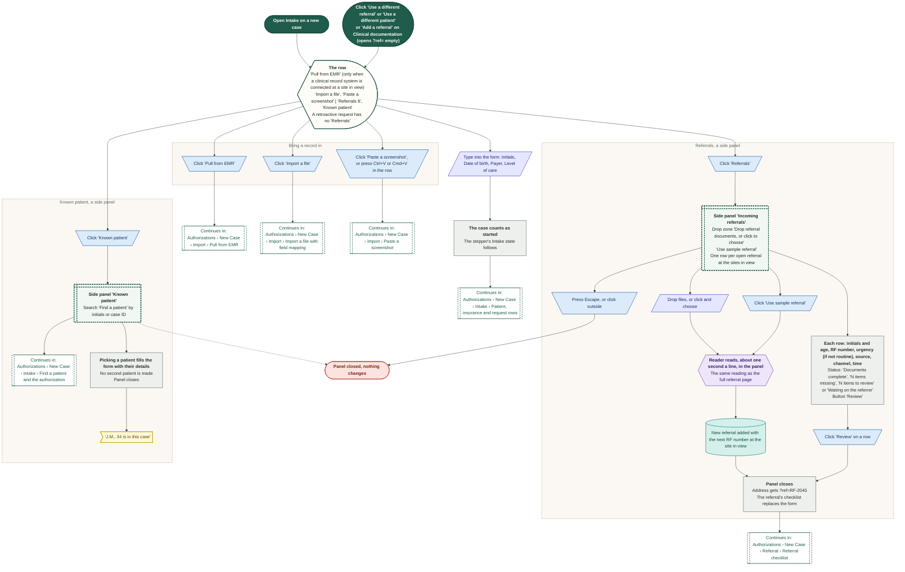

## Authorizations › New Case › Referral › Referral checklist

One referral as a checklist of 11 items in four sections. Reader found each item or did not. This diagram covers the rows and their buttons; the buttons around the card are in 'Checklist buttons'.

Route: `/authorizations/new/:draftId?ref=RF-2053`

Demo only: Reader's findings are invented. Real world (PRD 03): a referral comes from a primary care home or hospital and intake collects the releases, signatures and records.

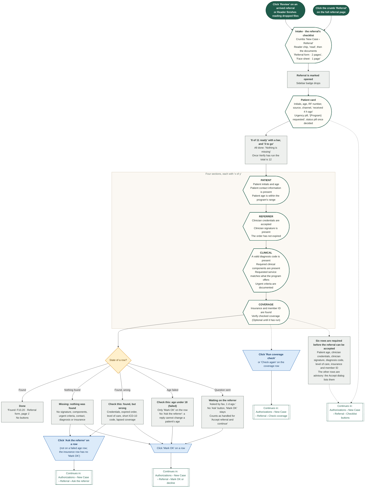

## Authorizations › New Case › Referral › Ask the referrer

Ask the referrer for what is missing. The same dialog opens from the checklist and from the full referral page. In the demo nothing leaves the app.

Route: `/authorizations/new/:draftId?ref=RF-2053`

Demo only: nothing is sent. The referrer's answer is in the next diagram, 'The referrer replies'.

```mermaid
%%{init: {"theme":"base","themeVariables":{"fontFamily":"'DM Sans', 'Segoe UI', system-ui, sans-serif","fontSize":"15px","lineColor":"#5B6B63","primaryTextColor":"#1C2B25","clusterBkg":"#FBF8F3","clusterBorder":"#D9CDBB","edgeLabelBackground":"#FFFFFF"},"flowchart":{"curve":"basis","nodeSpacing":36,"rankSpacing":48,"padding":12,"htmlLabels":true,"useMaxWidth":false,"wrappingWidth":230}} }%%
flowchart TD
  classDef k_start fill:#1F5C4B,stroke:#174638,color:#FFFFFF,stroke-width:1.5px,font-weight:600
  classDef k_end fill:#DDEFE3,stroke:#2E7D4F,color:#14502F,stroke-width:1.5px,font-weight:600
  classDef k_endx fill:#FBE3E0,stroke:#C0392B,color:#7A1F16,stroke-width:1.5px,font-weight:600
  classDef k_screen fill:#FFFDF8,stroke:#1F5C4B,color:#1C2B25,stroke-width:2px
  classDef k_overlay fill:#F1F7F3,stroke:#1F5C4B,color:#1C2B25,stroke-width:2px,stroke-dasharray:5 3
  classDef k_click fill:#DCEBFA,stroke:#2F6DB5,color:#12365F,stroke-width:1.5px
  classDef k_input fill:#E4E7FF,stroke:#4C5FD5,color:#1D2670,stroke-width:1.5px
  classDef k_process fill:#EEF0EE,stroke:#7A857F,color:#26302B,stroke-width:1.5px
  classDef k_agent fill:#EEE5FA,stroke:#7A4FC2,color:#341A63,stroke-width:1.5px
  classDef k_decision fill:#FFF0CC,stroke:#D9962B,color:#5C3B00,stroke-width:1.5px
  classDef k_store fill:#D5F0EA,stroke:#1C8E7B,color:#0B4A3F,stroke-width:1.5px
  classDef k_doc fill:#F6E9DC,stroke:#B07A4C,color:#4A2E14,stroke-width:1.5px
  classDef k_ext fill:#FFE6D2,stroke:#E07B39,color:#6B2F06,stroke-width:1.5px
  classDef k_wait fill:#E4E8EE,stroke:#6B7C93,color:#26303D,stroke-width:1.5px
  classDef k_toast fill:#FFF9DB,stroke:#C9A400,color:#5A4A00,stroke-width:1.5px
  classDef k_goto fill:#FFFFFF,stroke:#1F5C4B,color:#1F5C4B,stroke-width:1.5px,stroke-dasharray:5 3
  s1@{ shape: stadium, label: "<b>Click 'Ask the referrer' on a row,</b><br/>or 'Ask the referrer for the 4 missing items'" }
  s2@{ shape: stadium, label: "<b>Full page: click 'Request information',</b><br/>'Request information for all open findings',<br/>or Resolve › 'Request information'" }
  o1@{ shape: win-pane, label: "<b>'Request more information'</b><br/>'To Crisis line 988 follow-up, fax (614) 555-0100'<br/>'The message comes from the 4 open items. The referral moves to Awaiting info until they reply.'" }
  p1@{ shape: rect, label: "<b>Message is written from the open items</b><br/>One numbered line each: signed copy, current order, credentials or cosigner, form parts, ICD-10 code, level of care, risk screening, phone number, insurance card<br/>A failed age check is never listed" }
  p1b@{ shape: rect, label: "<b>No open items: 'The message comes from this referral'</b><br/>One line: 'Anything you can add that supports the request'" }
  i1@{ shape: lean-r, label: "<b>Pick 'Send by': Fax, E-referral, Email or Phone call</b><br/>Starts at the referral's own channel; phone and portal start at Email" }
  d1@{ shape: diam, label: "Message edited by hand?" }
  p2@{ shape: rect, label: "<b>Message is rewritten for the new channel</b><br/>'Please reply by email and Reader will pick it up'" }
  p3@{ shape: rect, label: "Message stays as typed" }
  i2@{ shape: lean-r, label: "Edit the 'Message'" }
  d2@{ shape: diam, label: "Message empty?" }
  p4@{ shape: rect, label: "'Send request' stays disabled" }
  cCancel@{ shape: trap-t, label: "<b>Click 'Cancel' or 'Close', press Escape,</b><br/>or click outside the dialog" }
  e1@{ shape: stadium, label: "<b>Nothing is sent</b><br/>The referral is unchanged" }
  cSend@{ shape: trap-t, label: "Click 'Send request'" }
  st1@{ shape: cyl, label: "<b>Referral is Awaiting info</b><br/>When and how it was asked, and the message, are saved" }
  p5@{ shape: rect, label: "<b>Timeline gets 'You asked Crisis line 988 follow-up for more information by email'</b><br/>and a pending 'Reader will read the reply when it arrives'" }
  x1@{ shape: st-rect, label: "<b>Referrer receives the request</b><br/>(demo: simulated, nothing is sent)" }
  t1@{ shape: odd, label: "<b>'Request sent'</b><br/>'Crisis line 988 follow-up was asked for more information. RF-2053 is Awaiting info.'" }
  sc1@{ shape: curv-trap, label: "<b>Checklist after sending</b><br/>Asked rows read 'Waiting on the referrer. Asked by email, just now.'<br/>No 'Ask' buttons, 'Mark OK' stays, button 'Demo: the referrer replies' appears<br/>Asked rows no longer block 'Accept referral and continue'" }
  g1@{ shape: subproc, label: "Continues in: Authorizations › New Case › Referral › The referrer replies" }
  s1 --> o1
  s2 --> o1
  o1 --> p1 --> i1
  o1 -.-> p1b -.-> i1
  i1 --> d1
  d1 -->|"No"| p2 --> i2
  d1 -->|"Yes"| p3 --> i2
  i2 --> d2
  d2 -->|"Yes"| p4 --> cCancel
  d2 -->|"No"| cSend
  o1 --> cCancel --> e1
  cSend --> st1 --> p5 --> x1 --> t1 --> sc1 --> g1
  class s1,s2 k_start
  class o1 k_overlay
  class p1,p1b,p2,p3,p4,p5 k_process
  class i1,i2 k_input
  class d1,d2 k_decision
  class cCancel,cSend k_click
  class e1 k_endx
  class st1 k_store
  class x1 k_ext
  class t1 k_toast
  class sc1 k_screen
  class g1 k_goto
```

## Authorizations › New Case › Referral › Accept a referral

Accepting a referral takes a bed or slot, records who owns it, and takes the referral into the case's Intake, where it fills in the details. Six findings must be dealt with first. The other open findings are listed in the dialog and do not stop it.

Route: `/authorizations/new/:draftId?ref=RF-2048`

```mermaid
%%{init: {"theme":"base","themeVariables":{"fontFamily":"'DM Sans', 'Segoe UI', system-ui, sans-serif","fontSize":"15px","lineColor":"#5B6B63","primaryTextColor":"#1C2B25","clusterBkg":"#FBF8F3","clusterBorder":"#D9CDBB","edgeLabelBackground":"#FFFFFF"},"flowchart":{"curve":"basis","nodeSpacing":36,"rankSpacing":48,"padding":12,"htmlLabels":true,"useMaxWidth":false,"wrappingWidth":230}} }%%
flowchart TD
  classDef k_start fill:#1F5C4B,stroke:#174638,color:#FFFFFF,stroke-width:1.5px,font-weight:600
  classDef k_end fill:#DDEFE3,stroke:#2E7D4F,color:#14502F,stroke-width:1.5px,font-weight:600
  classDef k_endx fill:#FBE3E0,stroke:#C0392B,color:#7A1F16,stroke-width:1.5px,font-weight:600
  classDef k_screen fill:#FFFDF8,stroke:#1F5C4B,color:#1C2B25,stroke-width:2px
  classDef k_overlay fill:#F1F7F3,stroke:#1F5C4B,color:#1C2B25,stroke-width:2px,stroke-dasharray:5 3
  classDef k_click fill:#DCEBFA,stroke:#2F6DB5,color:#12365F,stroke-width:1.5px
  classDef k_input fill:#E4E7FF,stroke:#4C5FD5,color:#1D2670,stroke-width:1.5px
  classDef k_process fill:#EEF0EE,stroke:#7A857F,color:#26302B,stroke-width:1.5px
  classDef k_agent fill:#EEE5FA,stroke:#7A4FC2,color:#341A63,stroke-width:1.5px
  classDef k_decision fill:#FFF0CC,stroke:#D9962B,color:#5C3B00,stroke-width:1.5px
  classDef k_store fill:#D5F0EA,stroke:#1C8E7B,color:#0B4A3F,stroke-width:1.5px
  classDef k_doc fill:#F6E9DC,stroke:#B07A4C,color:#4A2E14,stroke-width:1.5px
  classDef k_ext fill:#FFE6D2,stroke:#E07B39,color:#6B2F06,stroke-width:1.5px
  classDef k_wait fill:#E4E8EE,stroke:#6B7C93,color:#26303D,stroke-width:1.5px
  classDef k_toast fill:#FFF9DB,stroke:#C9A400,color:#5A4A00,stroke-width:1.5px
  classDef k_goto fill:#FFFFFF,stroke:#1F5C4B,color:#1F5C4B,stroke-width:1.5px,stroke-dasharray:5 3
  s1@{ shape: stadium, label: "<b>Click 'Accept referral and continue'</b><br/>on the checklist" }
  s2@{ shape: stadium, label: "<b>Click 'Accept referral'</b><br/>on the full referral page" }
  s3@{ shape: stadium, label: "<b>Click 'Continue with this referral'</b><br/>on the checklist or on the green banner of the full page" }
  dB@{ shape: diam, label: "<b>Is a required finding still open?</b><br/>Patient age, clinician credentials, clinician signature,<br/>diagnosis code, level of care, insurance and member ID" }
  tB@{ shape: odd, label: "<b>The button is disabled</b><br/>One line under it: 'Resolve 4 items first: clinician credentials, clinician signature, diagnosis code, insurance and member ID.'" }
  eB@{ shape: stadium, label: "<b>Nothing opens</b><br/>'Mark OK', the referrer's reply or 'Ask the referrer' lifts an item (a failed age: only 'Mark OK')<br/>'Decline' stays available" }
  o1@{ shape: win-pane, label: "<b>'Accept this referral?'</b><br/>'RF-2048 · A.P., 45 · Dr. Lindqvist, Family Medicine'" }
  d1@{ shape: diam, label: "Anything still open?" }
  t1@{ shape: odd, label: "<b>Amber banner '3 things are still open'</b><br/>Each open finding, 'Coverage has not been checked yet.' or the lapsed coverage<br/>'You can accept anyway. Each open item stays on the timeline.'" }
  t2@{ shape: odd, label: "<b>Green banner</b><br/>'All 9 checks are clear and coverage is confirmed.'" }
  subgraph gForm ["Three fields"]
  i1@{ shape: lean-r, label: "<b>Pick 'Owner'</b><br/>Jordan Perez, Taylor Brooks or Morgan Lee<br/>Starts as the referral's owner, else Jordan Perez" }
  i2@{ shape: lean-r, label: "<b>Pick 'Program'</b><br/>Residential 3.5, IOP, PHP or Detox, each with '2 open'<br/>Starts as the program requested" }
  p1@{ shape: rect, label: "<b>Hint under the date reads the program's room</b><br/>'Residential 3.5: 2 beds open this week, 1 after this.'<br/>None left: 'Accepting puts the referral on the waiting list.'" }
  i3@{ shape: lean-r, label: "<b>Set 'Target admission date'</b><br/>Starts at tomorrow" }
  end
  d2@{ shape: diam, label: "Is the date valid?" }
  p2@{ shape: rect, label: "'Accept referral' is disabled" }
  cX@{ shape: trap-t, label: "<b>Click 'Cancel' or 'Close', press Escape,</b><br/>or click outside the dialog<br/>(Escape closes an open Owner or Program menu first)" }
  e1@{ shape: stadium, label: "Nothing changes" }
  c1@{ shape: trap-t, label: "Click 'Accept referral'" }
  st1@{ shape: cyl, label: "<b>Referral is Accepted</b><br/>Owner, program, target date saved<br/>Timeline 'Accepted into IOP' with any open findings counted" }
  st2@{ shape: cyl, label: "<b>Program capacity drops by one bed or slot</b><br/>(never below zero)" }
  t3@{ shape: odd, label: "<b>'Referral accepted'</b><br/>'RF-2048 is accepted into IOP.'" }
  p3@{ shape: rect, label: "<b>Referral leaves 'Incoming referrals'</b><br/>(only open referrals are listed)" }
  d3@{ shape: diam, label: "Accepted from where?" }
  subgraph gPg ["From the full referral page"]
  sc1@{ shape: curv-trap, label: "<b>Page stays open</b><br/>Green banner 'Accepted into IOP'<br/>'Target admission 10/21/2026. Owner Taylor Brooks.'" }
  c2@{ shape: trap-t, label: "<b>Click 'Continue with this referral'</b><br/>(or 'Open R-1042' when a request is linked)" }
  p7@{ shape: rect, label: "<b>Uses the case in the address (?draft=)</b><br/>Without one, a new blank case is made first" }
  end
  subgraph gAsk ["Attach the referral to the case"]
  d4@{ shape: diam, label: "Have the agents already run on this case?" }
  oA@{ shape: win-pane, label: "<b>'Attach this referral?'</b><br/>'Attaching this referral makes the agents re-check the case. Continue?'<br/>'Their finished work is cleared. You start them again after Clinical documentation.'" }
  cCancel@{ shape: trap-t, label: "<b>Click 'Cancel' or 'Close', press Escape,</b><br/>or click outside the dialog" }
  eA@{ shape: stadium, label: "<b>Nothing is attached and the agents' work stays</b><br/>A referral just accepted stays accepted:<br/>the button now reads 'Continue with this referral'" }
  cCont@{ shape: trap-t, label: "Click 'Continue'" }
  p6@{ shape: rect, label: "<b>Agents' results and answers are cleared</b><br/>Because the patient and documents changed<br/>The case goes back to Intake" }
  tR@{ shape: odd, label: "<b>'The agents will re-check this case'</b><br/>'RF-2048 changed the case, so the agents' earlier work was cleared.'" }
  p4@{ shape: rect, label: "<b>Copied into the case: patient, payer, member ID,</b><br/>level of care (the accepted program), diagnoses, reason<br/>Request type: Initial request if routine, else Admission" }
  p5@{ shape: rect, label: "<b>Referral becomes the first document</b><br/>'RF-2048 referral.pdf'" }
  t4@{ shape: odd, label: "<b>'Referral RF-2048 is in this case'</b><br/>'A.P., 45. Check the details below, then go on to Eligibility & Benefits.'" }
  end
  g1@{ shape: subproc, label: "Continues in: Authorizations › New Case › Intake › Initial authorization" }
  s1 --> dB
  s2 --> dB
  dB -->|"Yes"| tB --> eB
  dB -->|"No"| o1
  o1 --> d1
  d1 -->|"Yes"| t1 --> i1
  d1 -->|"No"| t2 --> i1
  i1 --> i2 --> p1 --> i3 --> d2
  d2 -->|"No"| p2 --> cX
  d2 -->|"Yes"| c1
  o1 --> cX --> e1
  c1 --> st1 --> st2 --> t3 --> p3 --> d3
  d3 -->|"Checklist, at once"| d4
  d3 -->|"Full page, later"| sc1 --> c2 --> p7 --> d4
  s3 --> d4
  d4 -->|"No"| p4
  d4 -->|"Yes"| oA
  oA --> cCancel --> eA
  oA --> cCont --> p6 --> p4
  p6 -.-> tR
  p4 --> p5 --> t4 --> g1
  class s1,s2,s3 k_start
  class dB,d1,d2,d3,d4 k_decision
  class tB,t1,t2,t3,tR,t4 k_toast
  class eB,e1,eA k_endx
  class o1,oA k_overlay
  class i1,i2,i3 k_input
  class p1,p2,p3,p7,p6,p4,p5 k_process
  class cX,c1,c2,cCancel,cCont k_click
  class st1,st2 k_store
  class sc1 k_screen
  class g1 k_goto
  style gForm fill:#FBF8F3,stroke:#D9CDBB,stroke-width:1.5px,color:#5B6B63
  style gPg fill:#FBF8F3,stroke:#D9CDBB,stroke-width:1.5px,color:#5B6B63
  style gAsk fill:#FBF8F3,stroke:#D9CDBB,stroke-width:1.5px,color:#5B6B63
```

## Authorizations › New Case › Referral › Mark OK or decline

Two ways to decide a referral without waiting for the referrer. 'Mark OK' accepts one finding with a written reason. 'Decline' closes the referral with a reason, and can be undone with 'Reopen referral'.

Route: `/authorizations/new/:draftId?ref=RF-2048`

```mermaid
%%{init: {"theme":"base","themeVariables":{"fontFamily":"'DM Sans', 'Segoe UI', system-ui, sans-serif","fontSize":"15px","lineColor":"#5B6B63","primaryTextColor":"#1C2B25","clusterBkg":"#FBF8F3","clusterBorder":"#D9CDBB","edgeLabelBackground":"#FFFFFF"},"flowchart":{"curve":"basis","nodeSpacing":36,"rankSpacing":48,"padding":12,"htmlLabels":true,"useMaxWidth":false,"wrappingWidth":230}} }%%
flowchart TD
  classDef k_start fill:#1F5C4B,stroke:#174638,color:#FFFFFF,stroke-width:1.5px,font-weight:600
  classDef k_end fill:#DDEFE3,stroke:#2E7D4F,color:#14502F,stroke-width:1.5px,font-weight:600
  classDef k_endx fill:#FBE3E0,stroke:#C0392B,color:#7A1F16,stroke-width:1.5px,font-weight:600
  classDef k_screen fill:#FFFDF8,stroke:#1F5C4B,color:#1C2B25,stroke-width:2px
  classDef k_overlay fill:#F1F7F3,stroke:#1F5C4B,color:#1C2B25,stroke-width:2px,stroke-dasharray:5 3
  classDef k_click fill:#DCEBFA,stroke:#2F6DB5,color:#12365F,stroke-width:1.5px
  classDef k_input fill:#E4E7FF,stroke:#4C5FD5,color:#1D2670,stroke-width:1.5px
  classDef k_process fill:#EEF0EE,stroke:#7A857F,color:#26302B,stroke-width:1.5px
  classDef k_agent fill:#EEE5FA,stroke:#7A4FC2,color:#341A63,stroke-width:1.5px
  classDef k_decision fill:#FFF0CC,stroke:#D9962B,color:#5C3B00,stroke-width:1.5px
  classDef k_store fill:#D5F0EA,stroke:#1C8E7B,color:#0B4A3F,stroke-width:1.5px
  classDef k_doc fill:#F6E9DC,stroke:#B07A4C,color:#4A2E14,stroke-width:1.5px
  classDef k_ext fill:#FFE6D2,stroke:#E07B39,color:#6B2F06,stroke-width:1.5px
  classDef k_wait fill:#E4E8EE,stroke:#6B7C93,color:#26303D,stroke-width:1.5px
  classDef k_toast fill:#FFF9DB,stroke:#C9A400,color:#5A4A00,stroke-width:1.5px
  classDef k_goto fill:#FFFFFF,stroke:#1F5C4B,color:#1F5C4B,stroke-width:1.5px,stroke-dasharray:5 3
  s1@{ shape: stadium, label: "Click 'Mark OK' on a checklist row" }
  s2@{ shape: stadium, label: "<b>Full page, Validation tab:</b><br/>Resolve › 'Mark OK with reason'" }
  s3@{ shape: stadium, label: "<b>Click 'Decline'</b><br/>Checklist, or the full page header<br/>Stays available while 'Accept' is disabled" }
  subgraph gOk ["Mark OK"]
  o1@{ shape: win-pane, label: "<b>'Mark OK with a reason'</b><br/>Subtitle: the check, e.g. 'Clinician signature is present'<br/>'Reader found: The signature line is empty. Reader cannot confirm who ordered this.'" }
  i1@{ shape: lean-r, label: "<b>Type a 'Reason' (required)</b><br/>Hint 'Logged with your name on the activity timeline.'<br/>Placeholder 'Why is it fine to go ahead?'" }
  d1@{ shape: diam, label: "At least 5 characters?" }
  p1@{ shape: rect, label: "'Mark OK' stays disabled" }
  c1@{ shape: trap-t, label: "Click 'Mark OK'" }
  st1@{ shape: cyl, label: "<b>Finding is marked resolved with your reason</b><br/>The source document itself does not change" }
  p2@{ shape: rect, label: "Timeline 'You overrode: Clinician signature is present' with the reason" }
  t1@{ shape: odd, label: "<b>'Marked OK'</b><br/>'Your reason is on the activity timeline.'" }
  sc1@{ shape: curv-trap, label: "<b>Row turns Done</b><br/>'Marked OK by Jordan Perez: …'<br/>Progress goes up by one; Validation tab shows pill 'Marked OK'<br/>A required row no longer blocks 'Accept referral and continue'" }
  end
  cX1@{ shape: trap-t, label: "<b>Click 'Cancel' or 'Close', press Escape,</b><br/>or click outside the dialog" }
  e1@{ shape: stadium, label: "Nothing changes" }
  subgraph gDec ["Decline"]
  o2@{ shape: win-pane, label: "<b>'Decline RF-2048?'</b><br/>'The reason goes on the activity timeline. You can reopen a declined referral later.'" }
  p3@{ shape: rect, label: "<b>'Reason' starts as the likely one</b><br/>Outside age range if age failed; Coverage cannot be confirmed if coverage lapsed;<br/>Clinical criteria not met if a check failed; else Needs a higher level of care" }
  i2@{ shape: lean-r, label: "<b>Pick a 'Reason'</b><br/>Outside age range, Outside service area, Needs a higher level of care, No bed available, Coverage cannot be confirmed, Clinical criteria not met, Referrer withdrew" }
  i3@{ shape: lean-r, label: "<b>Type a 'Note' (optional)</b><br/>'Only your team sees this.'" }
  i4@{ shape: lean-r, label: "<b>Switch 'Send a courtesy reply to the referrer (by fax)'</b><br/>On to start with" }
  c2@{ shape: trap-t, label: "Click 'Decline referral'" }
  st2@{ shape: cyl, label: "<b>Referral is Declined</b><br/>Reason, note and courtesy choice saved<br/>Timeline 'Declined: Needs a higher level of care'" }
  d2@{ shape: diam, label: "Courtesy reply on?" }
  x1@{ shape: st-rect, label: "<b>Referrer gets a courtesy reply by fax, email or e-referral</b><br/>(demo: simulated)" }
  p4@{ shape: rect, label: "Timeline 'Courtesy reply sent to Dr. Lindqvist, Family Medicine by fax'" }
  t2@{ shape: odd, label: "<b>'Declined: Needs a higher level of care'</b><br/>'1 referral. Courtesy replies were sent.'" }
  sc2@{ shape: curv-trap, label: "<b>Checklist after declining</b><br/>Red banner 'Declined: …'<br/>Main button is 'Reopen referral'; no Accept, no Decline" }
  end
  cX2@{ shape: trap-t, label: "<b>Click 'Cancel' or 'Close', press Escape,</b><br/>or click outside the dialog" }
  e2@{ shape: stadium, label: "Nothing changes" }
  subgraph gRe ["Undo"]
  c3@{ shape: trap-t, label: "<b>Click 'Reopen referral'</b><br/>Checklist, header, or 'Reopen' on the red banner" }
  st3@{ shape: cyl, label: "<b>Referral is In review again</b><br/>Decline cleared; timeline 'You reopened the referral'" }
  t3@{ shape: odd, label: "<b>'Referral reopened'</b><br/>'RF-2048 is back In review.'" }
  end
  s1 --> o1
  s2 --> o1
  o1 --> i1 --> d1
  d1 -->|"No"| p1 --> cX1
  d1 -->|"Yes"| c1 --> st1 --> p2 --> t1 --> sc1
  o1 --> cX1 --> e1
  s3 --> o2 --> p3 --> i2 --> i3 --> i4 --> c2 --> st2 --> d2
  d2 -->|"Yes"| x1 --> p4 --> t2
  d2 -->|"No"| t2
  t2 --> sc2 --> c3 --> st3 --> t3
  o2 --> cX2 --> e2
  class s1,s2,s3 k_start
  class o1,o2 k_overlay
  class i1,i2,i3,i4 k_input
  class d1,d2 k_decision
  class p1,p2,p3,p4 k_process
  class c1,cX1,c2,cX2,c3 k_click
  class st1,st2,st3 k_store
  class t1,t2,t3 k_toast
  class sc1,sc2 k_screen
  class e1,e2 k_endx
  class x1 k_ext
  style gOk fill:#FBF8F3,stroke:#D9CDBB,stroke-width:1.5px,color:#5B6B63
  style gDec fill:#FBF8F3,stroke:#D9CDBB,stroke-width:1.5px,color:#5B6B63
  style gRe fill:#FBF8F3,stroke:#D9CDBB,stroke-width:1.5px,color:#5B6B63
```

## Authorizations › New Case › Referral › Check coverage

Verify can check a referral's coverage from the checklist row or from the Coverage tab on the full page. For the full check, the Coverage tab hands off to Eligibility & Benefits.

Route: `/authorizations/new/:draftId?ref=RF-2053 (checklist) and /authorizations/new/referral/RF-2053 (Coverage tab)`

Demo only: Verify's answer is fixed for each referral (covered, authorization first, lapsed, or no insurance) and takes about three seconds. Real world (PRD 02): coverage is verified before the first appointment, and intakes without a card get insurance discovery.

```mermaid
%%{init: {"theme":"base","themeVariables":{"fontFamily":"'DM Sans', 'Segoe UI', system-ui, sans-serif","fontSize":"15px","lineColor":"#5B6B63","primaryTextColor":"#1C2B25","clusterBkg":"#FBF8F3","clusterBorder":"#D9CDBB","edgeLabelBackground":"#FFFFFF"},"flowchart":{"curve":"basis","nodeSpacing":36,"rankSpacing":48,"padding":12,"htmlLabels":true,"useMaxWidth":false,"wrappingWidth":230}} }%%
flowchart TD
  classDef k_start fill:#1F5C4B,stroke:#174638,color:#FFFFFF,stroke-width:1.5px,font-weight:600
  classDef k_end fill:#DDEFE3,stroke:#2E7D4F,color:#14502F,stroke-width:1.5px,font-weight:600
  classDef k_endx fill:#FBE3E0,stroke:#C0392B,color:#7A1F16,stroke-width:1.5px,font-weight:600
  classDef k_screen fill:#FFFDF8,stroke:#1F5C4B,color:#1C2B25,stroke-width:2px
  classDef k_overlay fill:#F1F7F3,stroke:#1F5C4B,color:#1C2B25,stroke-width:2px,stroke-dasharray:5 3
  classDef k_click fill:#DCEBFA,stroke:#2F6DB5,color:#12365F,stroke-width:1.5px
  classDef k_input fill:#E4E7FF,stroke:#4C5FD5,color:#1D2670,stroke-width:1.5px
  classDef k_process fill:#EEF0EE,stroke:#7A857F,color:#26302B,stroke-width:1.5px
  classDef k_agent fill:#EEE5FA,stroke:#7A4FC2,color:#341A63,stroke-width:1.5px
  classDef k_decision fill:#FFF0CC,stroke:#D9962B,color:#5C3B00,stroke-width:1.5px
  classDef k_store fill:#D5F0EA,stroke:#1C8E7B,color:#0B4A3F,stroke-width:1.5px
  classDef k_doc fill:#F6E9DC,stroke:#B07A4C,color:#4A2E14,stroke-width:1.5px
  classDef k_ext fill:#FFE6D2,stroke:#E07B39,color:#6B2F06,stroke-width:1.5px
  classDef k_wait fill:#E4E8EE,stroke:#6B7C93,color:#26303D,stroke-width:1.5px
  classDef k_toast fill:#FFF9DB,stroke:#C9A400,color:#5A4A00,stroke-width:1.5px
  classDef k_goto fill:#FFFFFF,stroke:#1F5C4B,color:#1F5C4B,stroke-width:1.5px,stroke-dasharray:5 3
  s1@{ shape: stadium, label: "<b>Checklist, Coverage section:</b><br/>'Verify checked coverage' row" }
  s2@{ shape: stadium, label: "Full page: open the 'Coverage' tab" }
  d1@{ shape: diam, label: "Does the referral list an insurance?" }
  p1@{ shape: rect, label: "<b>Row says 'Optional'</b><br/>'Verify needs the insurance and member ID first.'<br/>No button" }
  g1@{ shape: subproc, label: "Continues in: Authorizations › New Case › Referral › Ask the referrer" }
  p2@{ shape: rect, label: "<b>Row says 'Optional'</b><br/>'Not checked yet. Verify looks up eligibility, the plan and whether an authorization is needed first.'" }
  c1@{ shape: trap-t, label: "Click 'Run coverage check'" }
  subgraph gTab ["Coverage tab"]
  sc1@{ shape: curv-trap, label: "<b>Card 'Coverage has not been checked'</b><br/>'Verify looks up eligibility, the plan, the authorization rule and the program's network status.'" }
  p3@{ shape: rect, label: "<b>No insurance on the referral:</b><br/>'Verify will report that it cannot confirm coverage'" }
  c2@{ shape: trap-t, label: "Click 'Run coverage check'" }
  o1@{ shape: win-pane, label: "<b>Card 'Verify is checking coverage'</b><br/>'This takes a few seconds.'<br/>Eligibility with Summit · Benefits and plan · Authorization rule and network status" }
  end
  st0@{ shape: cyl, label: "<b>Verify is running for this referral</b><br/>Row shows 'Verify is checking coverage.' with a spinner" }
  a1@{ shape: hex, label: "<b>Verify checks eligibility, benefits and plan,</b><br/>authorization rule and network status" }
  d2@{ shape: diam, label: "What does Verify find?" }
  st1@{ shape: cyl, label: "<b>Coverage saved on the referral</b><br/>Timeline 'Verify checked coverage: …'" }
  t1@{ shape: odd, label: "<b>'Verify checked coverage'</b><br/>'Covered and ready to admit'" }
  t2@{ shape: odd, label: "<b>'Verify checked coverage'</b><br/>'Covered, but you need an authorization first'" }
  t3@{ shape: odd, label: "<b>Amber toast 'Verify checked coverage'</b><br/>'Coverage has lapsed. Fix this before billing'" }
  p4@{ shape: rect, label: "<b>Checklist row turns Done</b><br/>Progress changes from 11 to 12 items" }
  p5@{ shape: rect, label: "<b>Row turns 'Check this' with 'Check again'</b><br/>Red banner on the full page 'Verify found that coverage has lapsed' with 'Open coverage'" }
  sc2@{ shape: curv-trap, label: "<b>Coverage tab result</b><br/>Banner with the headline, 'Check again'<br/>Card 'Payment checks' with six lines and 'Checked live at 10:42 am'" }
  c3@{ shape: trap-t, label: "Click 'Check again'" }
  c4@{ shape: trap-t, label: "Click 'Open full Eligibility & Benefits check'" }
  p6@{ shape: rect, label: "<b>Opens Verify a patient with the referral's payer,</b><br/>member ID, level of care and a made-up birth date filled in<br/>The address keeps ?referral=RF-2053 (and ?case= once the referral is a request)" }
  g2@{ shape: subproc, label: "Continues in: Authorizations › Eligibility & Benefits › Verify › Ways in and pre-fill" }
  s3@{ shape: stadium, label: "<b>Coming back: 'Start authorization'</b><br/>on the coverage result (authorization first)" }
  p7@{ shape: rect, label: "<b>Opens a NEW case with payer, level of care, member ID, initials and age</b><br/>It is not tied to the referral or its case" }
  g3@{ shape: subproc, label: "Continues in: Authorizations › New Case › How a case starts and resumes" }
  s4@{ shape: stadium, label: "<b>Click 'Back to referral RF-2053'</b><br/>on Verify a patient or its result<br/>(shown when the address has ?referral=)" }
  p8@{ shape: rect, label: "<b>Opens the full referral page for RF-2053</b><br/>Once the referral is a request the link reads 'Back to case R-1042'<br/>The full page finds the case that holds the referral, so 'Back to the case' still works" }
  s1 --> d1
  d1 -->|"No"| p1 --> g1
  d1 -->|"Yes"| p2 --> c1
  c1 --> st0
  s2 --> sc1
  sc1 -.-> p3
  sc1 --> c2 --> st0
  st0 --> o1
  st0 --> a1 --> d2
  d2 -->|"Covered"| st1
  d2 -->|"Authorization first"| st1
  d2 -->|"Lapsed"| st1
  st1 --> t1 --> p4
  st1 --> t2 --> p4
  st1 --> t3 --> p5
  p4 --> sc2
  p5 --> sc2
  p5 --> c3 --> st0
  sc2 --> c3
  sc2 --> c4 --> p6 --> g2
  s4 --> p8 --> sc2
  s3 --> p7 --> g3
  class s1,s2,s3,s4 k_start
  class d1,d2 k_decision
  class p1,p2,p3,p4,p5,p6,p7,p8 k_process
  class g1,g2,g3 k_goto
  class c1,c2,c3,c4 k_click
  class sc1,sc2 k_screen
  class o1 k_overlay
  class st0,st1 k_store
  class a1 k_agent
  class t1,t2,t3 k_toast
  style gTab fill:#FBF8F3,stroke:#D9CDBB,stroke-width:1.5px,color:#5B6B63
```

## Authorizations › New Case › Referral › The full referral page

One referral in full: the header, the one decision banner, the source document on the left and five tabs on the right. It is a page inside New Case, so 'Back to the case' and the breadcrumb lead back to the case.

Route: `/authorizations/new/referral/RF-2053?draft=draft-1001`

```mermaid
%%{init: {"theme":"base","themeVariables":{"fontFamily":"'DM Sans', 'Segoe UI', system-ui, sans-serif","fontSize":"15px","lineColor":"#5B6B63","primaryTextColor":"#1C2B25","clusterBkg":"#FBF8F3","clusterBorder":"#D9CDBB","edgeLabelBackground":"#FFFFFF"},"flowchart":{"curve":"basis","nodeSpacing":36,"rankSpacing":48,"padding":12,"htmlLabels":true,"useMaxWidth":false,"wrappingWidth":230}} }%%
flowchart TD
  classDef k_start fill:#1F5C4B,stroke:#174638,color:#FFFFFF,stroke-width:1.5px,font-weight:600
  classDef k_end fill:#DDEFE3,stroke:#2E7D4F,color:#14502F,stroke-width:1.5px,font-weight:600
  classDef k_endx fill:#FBE3E0,stroke:#C0392B,color:#7A1F16,stroke-width:1.5px,font-weight:600
  classDef k_screen fill:#FFFDF8,stroke:#1F5C4B,color:#1C2B25,stroke-width:2px
  classDef k_overlay fill:#F1F7F3,stroke:#1F5C4B,color:#1C2B25,stroke-width:2px,stroke-dasharray:5 3
  classDef k_click fill:#DCEBFA,stroke:#2F6DB5,color:#12365F,stroke-width:1.5px
  classDef k_input fill:#E4E7FF,stroke:#4C5FD5,color:#1D2670,stroke-width:1.5px
  classDef k_process fill:#EEF0EE,stroke:#7A857F,color:#26302B,stroke-width:1.5px
  classDef k_agent fill:#EEE5FA,stroke:#7A4FC2,color:#341A63,stroke-width:1.5px
  classDef k_decision fill:#FFF0CC,stroke:#D9962B,color:#5C3B00,stroke-width:1.5px
  classDef k_store fill:#D5F0EA,stroke:#1C8E7B,color:#0B4A3F,stroke-width:1.5px
  classDef k_doc fill:#F6E9DC,stroke:#B07A4C,color:#4A2E14,stroke-width:1.5px
  classDef k_ext fill:#FFE6D2,stroke:#E07B39,color:#6B2F06,stroke-width:1.5px
  classDef k_wait fill:#E4E8EE,stroke:#6B7C93,color:#26303D,stroke-width:1.5px
  classDef k_toast fill:#FFF9DB,stroke:#C9A400,color:#5A4A00,stroke-width:1.5px
  classDef k_goto fill:#FFFFFF,stroke:#1F5C4B,color:#1F5C4B,stroke-width:1.5px,stroke-dasharray:5 3
  s1@{ shape: stadium, label: "<b>Click 'Open the full referral'</b><br/>on the referral checklist" }
  s2@{ shape: stadium, label: "<b>Click 'View' on the 'Referral or admission order' row</b><br/>on the Clinical documentation step" }
  s3@{ shape: stadium, label: "<b>Open an old link such as /referrals/RF-2053</b><br/>(no case in the address)" }
  p1@{ shape: rect, label: "<b>Address is /authorizations/new/referral/RF-2053?draft=…</b><br/>The case id rides along so the page can lead back to it<br/>Without it, a draft that already holds this referral is used" }
  d1@{ shape: diam, label: "Is that referral in the demo?" }
  sc0@{ shape: curv-trap, label: "<b>Crumbs 'New Case › Referral › RF-9999'</b><br/>'That referral is not in the demo'<br/>'Referral RF-9999 does not exist. Go back to the referral step to drop the documents or pick one that arrived.'" }
  cBack@{ shape: trap-t, label: "Click 'Back to the referral step'" }
  gStart@{ shape: subproc, label: "Continues in: Authorizations › New Case › Intake › Start with a referral or patient" }
  st1@{ shape: cyl, label: "<b>Referral is marked opened</b><br/>Sidebar badge on 'New Case' drops" }
  sc1@{ shape: curv-trap, label: "<b>Referral page</b><br/>Crumbs 'New Case › Referral › RF-2053' and, at the right, the button 'Back to the case'<br/>Stepper: 'Intake' is current, nothing in it is clickable" }
  sH@{ shape: curv-trap, label: "<b>Header card</b><br/>Pill '{Program} requested', big RF number, status pill, urgency pill<br/>Patient · source · channel · received · payer<br/>Small stepper Received, Reviewed, Decided, Admitted" }
  pSla@{ shape: rect, label: "<b>Red pill 'Past response target' while New or In review</b><br/>after 1 hour (emergent), 4 hours (urgent) or 24 hours (routine)" }
  gHead@{ shape: subproc, label: "Continues in: Authorizations › New Case › Referral › Header actions" }
  gBan@{ shape: subproc, label: "Continues in: Authorizations › New Case › Referral › Decision banners" }
  sBan@{ shape: curv-trap, label: "<b>One banner under the header</b><br/>The most important one: declined, accepted, coverage lapsed, waiting on the referrer, or Reader found N things to check" }
  subgraph gCr ["Breadcrumb"]
  cC1@{ shape: trap-t, label: "Click the crumb 'New Case'" }
  cC2@{ shape: trap-t, label: "Click the crumb 'Referral'" }
  dC@{ shape: diam, label: "Is there a case?" }
  dD@{ shape: diam, label: "Is there a case?" }
  pC1@{ shape: rect, label: "Opens that case (its current step)" }
  pC2@{ shape: rect, label: "Opens the checklist for this referral: ?ref=RF-2053" }
  pC3@{ shape: rect, label: "<b>Opens New Case with no case id</b><br/>A new blank case starts" }
  pC4@{ shape: rect, label: "'RF-2053' is plain text, not a link" }
  end
  subgraph gBk ["Back to the case"]
  cBk@{ shape: trap-t, label: "<b>Click 'Back to the case'</b><br/>(beside the crumbs)" }
  dBk@{ shape: diam, label: "<b>Is there a case?</b><br/>(?draft= in the address, or a draft that holds this referral)" }
  pBk1@{ shape: rect, label: "Opens that case (its current step)" }
  pBk2@{ shape: rect, label: "<b>Opens New Case with no case id</b><br/>A new blank case starts" }
  end
  gOv@{ shape: subproc, label: "Continues in: Authorizations › New Case › How a case starts and resumes" }
  gChk@{ shape: subproc, label: "Continues in: Authorizations › New Case › Referral › Referral checklist" }
  subgraph gTwo ["Two columns"]
  sDoc@{ shape: curv-trap, label: "<b>Left: 'Source document' card (stays in view while you scroll)</b><br/>'Fax from {referrer}, Mon 2:10 pm'<br/>'Referral form' and 'Face sheet', print, page buttons" }
  sTab@{ shape: curv-trap, label: "<b>Right: tabs</b><br/>Extracted · Validation (with the count of open findings) · Coverage · Fit · Activity" }
  end
  cT1@{ shape: trap-t, label: "Click 'Extracted' (the tab it opens on)" }
  cT2@{ shape: trap-t, label: "Click 'Validation'" }
  cT3@{ shape: trap-t, label: "Click 'Coverage'" }
  cT4@{ shape: trap-t, label: "Click 'Fit'" }
  cT5@{ shape: trap-t, label: "Click 'Activity'" }
  gT1@{ shape: subproc, label: "Continues in: Authorizations › New Case › Referral › Full page: Extracted tab and document" }
  gT2@{ shape: subproc, label: "Continues in: Authorizations › New Case › Referral › Full page: Validation tab" }
  gT3@{ shape: subproc, label: "Continues in: Authorizations › New Case › Referral › Check coverage" }
  gT4@{ shape: subproc, label: "Continues in: Authorizations › New Case › Referral › Full page: Fit, Activity and notes" }
  s1 --> p1
  s2 --> p1
  s3 --> p1
  p1 --> d1
  d1 -->|"No"| sc0 --> cBack --> gStart
  d1 -->|"Yes"| st1 --> sc1 --> sH --> pSla
  sH --> gHead
  sc1 --> sBan --> gBan
  sc1 --> cC1 --> dC
  sc1 --> cBk --> dBk
  dBk -->|"Yes"| pBk1 --> gOv
  dBk -->|"No"| pBk2 --> gOv
  sc1 --> cC2 --> dD
  dC -->|"Yes"| pC1 --> gOv
  dC -->|"No"| pC3 --> gOv
  dD -->|"Yes"| pC2 --> gChk
  dD -->|"No"| pC3
  sc1 -.-> pC4
  sc1 --> sDoc
  sc1 --> sTab
  sTab --> cT1 --> gT1
  sTab --> cT2 --> gT2
  sTab --> cT3 --> gT3
  sTab --> cT4 --> gT4
  sTab --> cT5 --> gT4
  sDoc -.-> gT1
  class s1,s2,s3 k_start
  class p1,pSla,pC1,pC2,pC3,pC4,pBk1,pBk2 k_process
  class d1,dC,dD,dBk k_decision
  class sc0,sc1,sH,sBan,sDoc,sTab k_screen
  class cBack,cC1,cC2,cBk,cT1,cT2,cT3,cT4,cT5 k_click
  class gStart,gHead,gBan,gOv,gChk,gT1,gT2,gT3,gT4 k_goto
  class st1 k_store
  style gCr fill:#FBF8F3,stroke:#D9CDBB,stroke-width:1.5px,color:#5B6B63
  style gBk fill:#FBF8F3,stroke:#D9CDBB,stroke-width:1.5px,color:#5B6B63
  style gTwo fill:#FBF8F3,stroke:#D9CDBB,stroke-width:1.5px,color:#5B6B63
```

## Authorizations › New Case › Referral › Referral statuses

A referral is New, In review, Awaiting info, Accepted, Scheduled, Admitted or Declined. The first three are 'open' and appear in 'Incoming referrals'. Each box shows what the checklist and the full page allow; each arrow is the button that moves it.

Route: `/authorizations/new/:draftId?ref=RF-2053 and /authorizations/new/referral/RF-2053`

```mermaid
%%{init: {"theme":"base","themeVariables":{"fontFamily":"'DM Sans', 'Segoe UI', system-ui, sans-serif","fontSize":"15px","lineColor":"#5B6B63","primaryTextColor":"#1C2B25","clusterBkg":"#FBF8F3","clusterBorder":"#D9CDBB","edgeLabelBackground":"#FFFFFF"},"flowchart":{"curve":"basis","nodeSpacing":36,"rankSpacing":48,"padding":12,"htmlLabels":true,"useMaxWidth":false,"wrappingWidth":230}} }%%
flowchart TD
  classDef k_start fill:#1F5C4B,stroke:#174638,color:#FFFFFF,stroke-width:1.5px,font-weight:600
  classDef k_end fill:#DDEFE3,stroke:#2E7D4F,color:#14502F,stroke-width:1.5px,font-weight:600
  classDef k_endx fill:#FBE3E0,stroke:#C0392B,color:#7A1F16,stroke-width:1.5px,font-weight:600
  classDef k_screen fill:#FFFDF8,stroke:#1F5C4B,color:#1C2B25,stroke-width:2px
  classDef k_overlay fill:#F1F7F3,stroke:#1F5C4B,color:#1C2B25,stroke-width:2px,stroke-dasharray:5 3
  classDef k_click fill:#DCEBFA,stroke:#2F6DB5,color:#12365F,stroke-width:1.5px
  classDef k_input fill:#E4E7FF,stroke:#4C5FD5,color:#1D2670,stroke-width:1.5px
  classDef k_process fill:#EEF0EE,stroke:#7A857F,color:#26302B,stroke-width:1.5px
  classDef k_agent fill:#EEE5FA,stroke:#7A4FC2,color:#341A63,stroke-width:1.5px
  classDef k_decision fill:#FFF0CC,stroke:#D9962B,color:#5C3B00,stroke-width:1.5px
  classDef k_store fill:#D5F0EA,stroke:#1C8E7B,color:#0B4A3F,stroke-width:1.5px
  classDef k_doc fill:#F6E9DC,stroke:#B07A4C,color:#4A2E14,stroke-width:1.5px
  classDef k_ext fill:#FFE6D2,stroke:#E07B39,color:#6B2F06,stroke-width:1.5px
  classDef k_wait fill:#E4E8EE,stroke:#6B7C93,color:#26303D,stroke-width:1.5px
  classDef k_toast fill:#FFF9DB,stroke:#C9A400,color:#5A4A00,stroke-width:1.5px
  classDef k_goto fill:#FFFFFF,stroke:#1F5C4B,color:#1F5C4B,stroke-width:1.5px,stroke-dasharray:5 3
  s1@{ shape: stadium, label: "<b>A referral arrives</b><br/>Or Reader reads dropped files" }
  subgraph gOpen ["Open: listed in 'Incoming referrals'"]
  stNew@{ shape: cyl, label: "<b>NEW</b><br/>Checklist: Accept, Ask, Mark OK, Run coverage, Decline<br/>Full page: Accept, Request information, Decline, Start a case from this referral<br/>Accept is disabled while a required item is open<br/>Banner 'Reader found N things to check'" }
  stRev@{ shape: cyl, label: "<b>IN REVIEW</b><br/>Same buttons as New<br/>Set when someone gets an owner, or after a reply or a reopen" }
  stAwait@{ shape: cyl, label: "<b>AWAITING INFO</b><br/>Pill 'Waiting on the referrer'<br/>Checklist: Accept, Decline, Mark OK; no 'Ask'<br/>Full page: Accept, Decline; no 'Request information'<br/>Asked rows no longer block Accept<br/>Banner 'Waiting on the referrer'" }
  end
  stAcc@{ shape: cyl, label: "<b>ACCEPTED</b><br/>Not in 'Incoming referrals'<br/>Checklist: 'Continue with this referral'<br/>Full page: 'Schedule intake'<br/>Green banner with 'Continue with this referral'" }
  stSch@{ shape: cyl, label: "<b>SCHEDULED</b><br/>Checklist: 'Continue with this referral'<br/>Full page: 'Mark admitted', 'Change intake'<br/>Banner adds 'Intake visit Thu 9:00 am'" }
  stAdm@{ shape: cyl, label: "<b>ADMITTED</b><br/>Checklist: 'Open the case' when a case or draft exists,<br/>else the note 'Admitted' with 'See the full referral'<br/>Full page: no decision buttons<br/>Banner 'Admitted into IOP'" }
  stDec@{ shape: cyl, label: "<b>DECLINED</b><br/>Checklist and full page: 'Reopen referral'<br/>Red banner 'Declined: reason' with 'Reopen'<br/>'A courtesy reply went to the referrer.'" }
  c1@{ shape: trap-t, label: "Pick an 'Owner' on the full page" }
  c2@{ shape: trap-t, label: "Click 'Send request'" }
  c3@{ shape: trap-t, label: "Click 'Demo: the referrer replies'" }
  c4@{ shape: trap-t, label: "<b>Click 'Accept referral' or</b><br/>'Accept referral and continue'" }
  c5@{ shape: trap-t, label: "Click 'Decline referral'" }
  c6@{ shape: trap-t, label: "<b>Click 'Reopen referral'</b><br/>or 'Reopen' on the red banner" }
  c7@{ shape: trap-t, label: "Click 'Schedule intake'" }
  c8@{ shape: trap-t, label: "Click 'Mark admitted'" }
  gAsk@{ shape: subproc, label: "Continues in: Authorizations › New Case › Referral › Ask the referrer" }
  gReply@{ shape: subproc, label: "Continues in: Authorizations › New Case › Referral › The referrer replies" }
  gAcc@{ shape: subproc, label: "Continues in: Authorizations › New Case › Referral › Accept a referral" }
  gDec@{ shape: subproc, label: "Continues in: Authorizations › New Case › Referral › Mark OK or decline" }
  gSch@{ shape: subproc, label: "Continues in: Authorizations › New Case › Referral › Schedule intake" }
  gBan@{ shape: subproc, label: "Continues in: Authorizations › New Case › Referral › Decision banners" }
  gMed@{ shape: subproc, label: "Continues in: Authorizations › New Case › Intake › Initial authorization" }
  cCont@{ shape: trap-t, label: "Click 'Continue with this referral'" }
  dReq@{ shape: diam, label: "Did this referral start a request?" }
  cOpen@{ shape: trap-t, label: "<b>Click 'Open R-1042'</b><br/>(banner also says 'Linked request R-1042' with its chip)" }
  cOC@{ shape: trap-t, label: "<b>Click 'Open the case'</b><br/>(checklist of an admitted referral)" }
  gCase@{ shape: subproc, label: "Continues in: Authorizations › Case page › Ways in" }
  gDash@{ shape: subproc, label: "<b>Continues in: Dashboard</b><br/>Opens request R-1042" }
  s1 --> stNew
  stNew --> c1 --> stRev
  stNew --> c2 --> gAsk
  stRev --> c2
  gAsk --> stAwait
  stAwait --> c3 --> gReply
  gReply --> stRev
  stNew --> c4
  stRev --> c4
  stAwait --> c4
  c4 --> gAcc --> stAcc
  stNew --> c5
  stRev --> c5
  stAwait --> c5
  c5 --> gDec --> stDec
  stDec --> c6 --> stRev
  stAcc --> c7 --> gSch --> stSch
  stSch --> c8 --> stAdm
  stAcc --> cCont
  stSch --> cCont
  cCont --> gMed
  stAcc --> dReq
  stSch --> dReq
  stAdm -.-> cOpen
  stAdm --> cOC --> gCase
  dReq -->|"Yes"| cOpen --> gDash
  dReq -->|"No"| cCont
  stNew -.-> gBan
  class s1 k_start
  class stNew,stRev,stAwait,stAcc,stSch,stAdm,stDec k_store
  class c1,c2,c3,c4,c5,c6,c7,c8,cCont,cOpen,cOC k_click
  class gAsk,gReply,gAcc,gDec,gSch,gBan,gMed,gCase,gDash k_goto
  class dReq k_decision
  style gOpen fill:#FBF8F3,stroke:#D9CDBB,stroke-width:1.5px,color:#5B6B63
```

## Authorizations › New Case › Referral › Full page: Extracted tab and document

What Reader pulled out of the documents, field by field, next to the source document. A person can see the evidence for each field, correct a value, and page through the original.

Route: `/authorizations/new/referral/RF-2053?draft=draft-1001`

Demo only: Print and the page buttons act on an invented document; nothing prints.

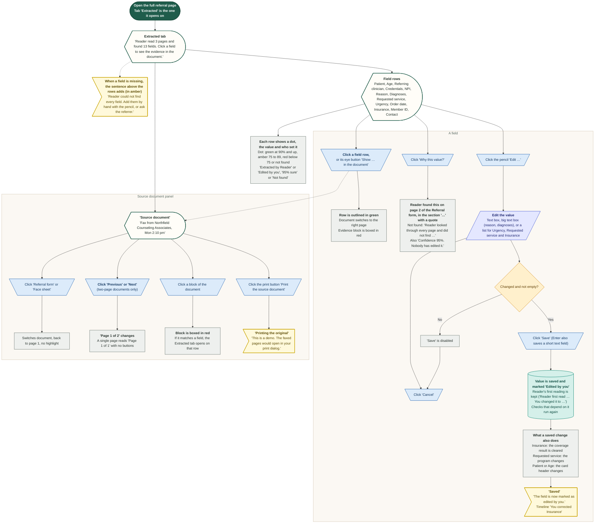

## Authorizations › New Case › Referral › Full page: Validation tab

The nine checks Reader ran on the referral, split by document. Each open finding can be shown in the document, asked of the referrer, or marked OK with a reason.

Route: `/authorizations/new/referral/RF-2053?draft=draft-1001`

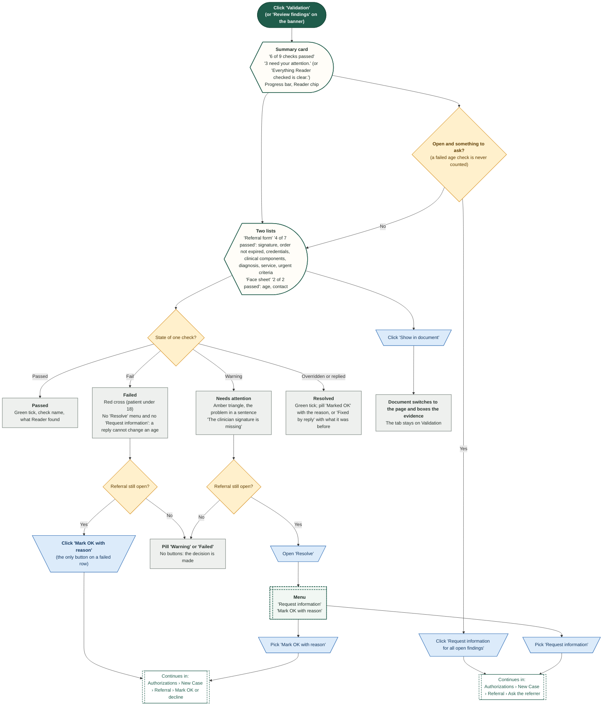

## Authorizations › New Case › Referral › Full page: Fit, Activity and notes

The two read-mostly tabs, Fit (Placement's view of the level of care and the beds left) and Activity (what happened and private notes), plus the 'Add note' dialog from the header.

Route: `/authorizations/new/referral/RF-2053?draft=draft-1001`

```mermaid
%%{init: {"theme":"base","themeVariables":{"fontFamily":"'DM Sans', 'Segoe UI', system-ui, sans-serif","fontSize":"15px","lineColor":"#5B6B63","primaryTextColor":"#1C2B25","clusterBkg":"#FBF8F3","clusterBorder":"#D9CDBB","edgeLabelBackground":"#FFFFFF"},"flowchart":{"curve":"basis","nodeSpacing":36,"rankSpacing":48,"padding":12,"htmlLabels":true,"useMaxWidth":false,"wrappingWidth":230}} }%%
flowchart TD
  classDef k_start fill:#1F5C4B,stroke:#174638,color:#FFFFFF,stroke-width:1.5px,font-weight:600
  classDef k_end fill:#DDEFE3,stroke:#2E7D4F,color:#14502F,stroke-width:1.5px,font-weight:600
  classDef k_endx fill:#FBE3E0,stroke:#C0392B,color:#7A1F16,stroke-width:1.5px,font-weight:600
  classDef k_screen fill:#FFFDF8,stroke:#1F5C4B,color:#1C2B25,stroke-width:2px
  classDef k_overlay fill:#F1F7F3,stroke:#1F5C4B,color:#1C2B25,stroke-width:2px,stroke-dasharray:5 3
  classDef k_click fill:#DCEBFA,stroke:#2F6DB5,color:#12365F,stroke-width:1.5px
  classDef k_input fill:#E4E7FF,stroke:#4C5FD5,color:#1D2670,stroke-width:1.5px
  classDef k_process fill:#EEF0EE,stroke:#7A857F,color:#26302B,stroke-width:1.5px
  classDef k_agent fill:#EEE5FA,stroke:#7A4FC2,color:#341A63,stroke-width:1.5px
  classDef k_decision fill:#FFF0CC,stroke:#D9962B,color:#5C3B00,stroke-width:1.5px
  classDef k_store fill:#D5F0EA,stroke:#1C8E7B,color:#0B4A3F,stroke-width:1.5px
  classDef k_doc fill:#F6E9DC,stroke:#B07A4C,color:#4A2E14,stroke-width:1.5px
  classDef k_ext fill:#FFE6D2,stroke:#E07B39,color:#6B2F06,stroke-width:1.5px
  classDef k_wait fill:#E4E8EE,stroke:#6B7C93,color:#26303D,stroke-width:1.5px
  classDef k_toast fill:#FFF9DB,stroke:#C9A400,color:#5A4A00,stroke-width:1.5px
  classDef k_goto fill:#FFFFFF,stroke:#1F5C4B,color:#1F5C4B,stroke-width:1.5px,stroke-dasharray:5 3
  s1@{ shape: stadium, label: "Click 'Fit'" }
  s2@{ shape: stadium, label: "Click 'Activity'" }
  s3@{ shape: stadium, label: "Click 'Add note' in the header" }
  subgraph gFit ["Fit tab"]
  f1@{ shape: curv-trap, label: "<b>'Level of care'</b><br/>'Placement reads the referral against the six ASAM dimensions'<br/>'The referral supports' PHP, 92% confident · 'Next best' IOP, 63%" }
  f2@{ shape: odd, label: "<b>Amber banner when Placement suggests another program</b><br/>'The referral asks for IOP. Placement suggests PHP.'<br/>'You choose the program when you accept. Placement only reads the referral. A clinician decides the level of care.'" }
  f3@{ shape: curv-trap, label: "<b>Six dimensions, each with a note and four bars</b><br/>Intoxication and withdrawal · Medical conditions · Mood, behavior and thinking · Readiness to change · Relapse and continued use · Recovery environment" }
  f4@{ shape: curv-trap, label: "<b>'Capacity'</b><br/>'Open this week. Accepting a referral takes one bed or slot.'<br/>One row per program: 'PHP: 5 slots open this week', chips 'Requested' and 'Suggested', '19 of 24 full'<br/>Red 'no beds open this week' at zero" }
  f5@{ shape: rect, label: "Read only: nothing on the Fit tab can be clicked" }
  end
  subgraph gAct ["Activity tab"]
  a1@{ shape: curv-trap, label: "<b>'Activity' 'Agents and people, oldest first'</b><br/>Timeline: received, read, checked, suggested, assigned, asked, decided<br/>Upcoming steps are dashed" }
  a2@{ shape: curv-trap, label: "<b>'Notes' with the count</b><br/>The card subtitle adds '· private, visible only to you and your team'<br/>'No notes yet.' or each note with its author and time" }
  a3@{ shape: lean-r, label: "<b>Type in 'Add a note'</b><br/>Placeholder 'Type your note'" }
  a4@{ shape: diam, label: "Anything typed?" }
  a5@{ shape: rect, label: "'Add note' is disabled" }
  a6@{ shape: trap-t, label: "Click 'Add note'" }
  end
  subgraph gMod ["Header 'Add note' dialog"]
  m1@{ shape: win-pane, label: "<b>'Add a note'</b><br/>Amber banner 'These notes are private and only visible to you and your team. The referrer cannot see them.'" }
  m2@{ shape: lean-r, label: "<b>Type in the box</b><br/>Placeholder 'Type your note'" }
  m3@{ shape: diam, label: "Anything typed?" }
  m4@{ shape: rect, label: "'Add note' is disabled" }
  m5@{ shape: trap-t, label: "Click 'Add note'" }
  m6@{ shape: trap-t, label: "<b>Click 'Cancel' or 'Close', press Escape,</b><br/>or click outside the dialog" }
  m7@{ shape: stadium, label: "No note is saved" }
  end
  n1@{ shape: cyl, label: "<b>Note is saved with its author and time</b><br/>Timeline 'Jordan Perez added a note' with the text" }
  n2@{ shape: odd, label: "<b>'Note added'</b><br/>'Only you and your team can see it.'" }
  n3@{ shape: curv-trap, label: "<b>Notes list shows the new note first</b><br/>The text box empties (Activity tab)" }
  s1 --> f1 --> f2 --> f3 --> f4 --> f5
  s2 --> a1 --> a2 --> a3 --> a4
  a4 -->|"No"| a5
  a4 -->|"Yes"| a6 --> n1
  s3 --> m1 --> m2 --> m3
  m3 -->|"No"| m4 --> m6
  m3 -->|"Yes"| m5 --> n1
  m1 --> m6 --> m7
  n1 --> n2 --> n3
  class s1,s2,s3 k_start
  class f1,f3,f4,a1,a2,n3 k_screen
  class f2,n2 k_toast
  class f5,a5,m4 k_process
  class a3,m2 k_input
  class a4,m3 k_decision
  class a6,m5,m6 k_click
  class m1 k_overlay
  class m7 k_endx
  class n1 k_store
  style gFit fill:#FBF8F3,stroke:#D9CDBB,stroke-width:1.5px,color:#5B6B63
  style gAct fill:#FBF8F3,stroke:#D9CDBB,stroke-width:1.5px,color:#5B6B63
  style gMod fill:#FBF8F3,stroke:#D9CDBB,stroke-width:1.5px,color:#5B6B63
```

## Authorizations › New Case › Referral › Checklist buttons

The buttons around the referral checklist: replace the documents, ask the referrer, decline, open the full page, and the main button, which changes with the referral's status and is disabled while a required item is open.

Route: `/authorizations/new/:draftId?ref=RF-2053`

Demo only: 'Demo: the referrer replies' stands in for the referrer answering.

```mermaid
%%{init: {"theme":"base","themeVariables":{"fontFamily":"'DM Sans', 'Segoe UI', system-ui, sans-serif","fontSize":"15px","lineColor":"#5B6B63","primaryTextColor":"#1C2B25","clusterBkg":"#FBF8F3","clusterBorder":"#D9CDBB","edgeLabelBackground":"#FFFFFF"},"flowchart":{"curve":"basis","nodeSpacing":36,"rankSpacing":48,"padding":12,"htmlLabels":true,"useMaxWidth":false,"wrappingWidth":230}} }%%
flowchart TD
  classDef k_start fill:#1F5C4B,stroke:#174638,color:#FFFFFF,stroke-width:1.5px,font-weight:600
  classDef k_end fill:#DDEFE3,stroke:#2E7D4F,color:#14502F,stroke-width:1.5px,font-weight:600
  classDef k_endx fill:#FBE3E0,stroke:#C0392B,color:#7A1F16,stroke-width:1.5px,font-weight:600
  classDef k_screen fill:#FFFDF8,stroke:#1F5C4B,color:#1C2B25,stroke-width:2px
  classDef k_overlay fill:#F1F7F3,stroke:#1F5C4B,color:#1C2B25,stroke-width:2px,stroke-dasharray:5 3
  classDef k_click fill:#DCEBFA,stroke:#2F6DB5,color:#12365F,stroke-width:1.5px
  classDef k_input fill:#E4E7FF,stroke:#4C5FD5,color:#1D2670,stroke-width:1.5px
  classDef k_process fill:#EEF0EE,stroke:#7A857F,color:#26302B,stroke-width:1.5px
  classDef k_agent fill:#EEE5FA,stroke:#7A4FC2,color:#341A63,stroke-width:1.5px
  classDef k_decision fill:#FFF0CC,stroke:#D9962B,color:#5C3B00,stroke-width:1.5px
  classDef k_store fill:#D5F0EA,stroke:#1C8E7B,color:#0B4A3F,stroke-width:1.5px
  classDef k_doc fill:#F6E9DC,stroke:#B07A4C,color:#4A2E14,stroke-width:1.5px
  classDef k_ext fill:#FFE6D2,stroke:#E07B39,color:#6B2F06,stroke-width:1.5px
  classDef k_wait fill:#E4E8EE,stroke:#6B7C93,color:#26303D,stroke-width:1.5px
  classDef k_toast fill:#FFF9DB,stroke:#C9A400,color:#5A4A00,stroke-width:1.5px
  classDef k_goto fill:#FFFFFF,stroke:#1F5C4B,color:#1F5C4B,stroke-width:1.5px,stroke-dasharray:5 3
  s1@{ shape: stadium, label: "On the referral checklist" }
  sc1@{ shape: curv-trap, label: "<b>Referral checklist</b><br/>Patient card, four sections, buttons below" }
  subgraph gTop ["Above the card"]
  cDiff@{ shape: trap-t, label: "Click 'Use different documents'" }
  pDiff@{ shape: rect, label: "<b>Address becomes ?ref= (empty), so the start screen shows</b><br/>The case keeps its old referral until you continue" }
  end
  gStart@{ shape: subproc, label: "Continues in: Authorizations › New Case › Intake › Start with a referral or patient" }
  subgraph gFoot ["Under the sections"]
  dAsk@{ shape: diam, label: "<b>Open, not waiting, and something to ask?</b><br/>(a failed age check is never counted)" }
  cFoot@{ shape: trap-t, label: "<b>Click 'Ask the referrer for the missing item'</b><br/>or '…for the 4 missing items'" }
  cDec@{ shape: trap-t, label: "<b>Click 'Decline'</b><br/>(only while open; never disabled)" }
  dWait@{ shape: diam, label: "Awaiting info?" }
  cDemo@{ shape: trap-t, label: "Click 'Demo: the referrer replies'" }
  cFull@{ shape: trap-t, label: "Click 'Open the full referral'" }
  end
  gAsk@{ shape: subproc, label: "Continues in: Authorizations › New Case › Referral › Ask the referrer" }
  gOk@{ shape: subproc, label: "Continues in: Authorizations › New Case › Referral › Mark OK or decline" }
  gFull@{ shape: subproc, label: "Continues in: Authorizations › New Case › Referral › The full referral page" }
  dSt@{ shape: diam, label: "Referral status?" }
  dReq@{ shape: diam, label: "<b>Is a required item still open?</b><br/>Patient age, credentials, signature,<br/>diagnosis code, level of care, insurance and member ID" }
  tDis@{ shape: odd, label: "<b>'Accept referral and continue' is disabled</b><br/>Line under it: 'Resolve 4 items first: clinician credentials, clinician signature, diagnosis code, insurance and member ID.'" }
  pLift@{ shape: rect, label: "<b>Each item is lifted by 'Mark OK', by the referrer's reply,</b><br/>or once it has been asked of the referrer (a failed age: only 'Mark OK')<br/>The line shortens, then disappears" }
  cAcc@{ shape: trap-t, label: "Click 'Accept referral and continue'" }
  pAcc@{ shape: rect, label: "<b>Advisory findings are only listed in the Accept dialog</b><br/>You can accept anyway" }
  gAcc@{ shape: subproc, label: "Continues in: Authorizations › New Case › Referral › Accept a referral" }
  tAcc@{ shape: odd, label: "<b>Green banner</b><br/>'Accepted into IOP. Target admission 10/21/2026.'" }
  cCont@{ shape: trap-t, label: "Click 'Continue with this referral'" }
  gCont@{ shape: subproc, label: "<b>Continues in: Authorizations › New Case › Referral › Accept a referral</b><br/>(attach the referral to the case; asks first when the agents ran)" }
  tDec@{ shape: odd, label: "<b>Red banner</b><br/>'Declined: Needs a higher level of care.'" }
  cRe@{ shape: trap-t, label: "Click 'Reopen referral'" }
  stRe@{ shape: cyl, label: "<b>Referral is In review again</b><br/>Decision cleared" }
  tRe@{ shape: odd, label: "<b>'Referral reopened'</b><br/>'RF-2048 is back In review.'" }
  dCase@{ shape: diam, label: "Did this referral start a case or a draft?" }
  cOpen@{ shape: trap-t, label: "Click 'Open the case'" }
  pOpen@{ shape: rect, label: "<b>Opens its request on the case page,</b><br/>or its draft at its current step<br/>If the draft is the one on screen: goes back to its Intake, where the referral fills the details" }
  tAdm@{ shape: odd, label: "<b>Calm note 'Admitted'</b><br/>Link 'See the full referral'" }
  gCase@{ shape: subproc, label: "Continues in: Authorizations › Case page › Ways in" }
  gMed@{ shape: subproc, label: "Continues in: Authorizations › New Case › Intake › Initial authorization" }
  s1 --> sc1
  sc1 --> cDiff --> pDiff --> gStart
  sc1 --> dAsk
  dAsk -->|"Yes"| cFoot --> gAsk
  dAsk -->|"No"| cDec
  sc1 --> cDec --> gOk
  sc1 --> dWait
  dWait -->|"Yes"| cDemo --> gAsk
  dWait -->|"No"| cFull
  sc1 --> cFull --> gFull
  sc1 --> dSt
  dSt -->|"New, In review, Awaiting info"| dReq
  dReq -->|"Yes"| tDis --> pLift
  dReq -->|"No"| cAcc --> pAcc --> gAcc
  pLift -.-> cAcc
  dSt -->|"Accepted or Scheduled"| tAcc --> cCont --> gCont
  dSt -->|"Declined"| tDec --> cRe --> stRe --> tRe
  dSt -->|"Admitted"| dCase
  dCase -->|"Yes"| cOpen --> pOpen
  pOpen --> gCase
  pOpen -.-> gMed
  dCase -->|"No"| tAdm --> gFull
  class s1 k_start
  class sc1 k_screen
  class cDiff,cFoot,cDec,cDemo,cFull,cAcc,cCont,cRe,cOpen k_click
  class pDiff,pLift,pAcc,pOpen k_process
  class gStart,gAsk,gOk,gFull,gAcc,gCont,gCase,gMed k_goto
  class dAsk,dWait,dSt,dReq,dCase k_decision
  class tDis,tAcc,tDec,tRe,tAdm k_toast
  class stRe k_store
  style gTop fill:#FBF8F3,stroke:#D9CDBB,stroke-width:1.5px,color:#5B6B63
  style gFoot fill:#FBF8F3,stroke:#D9CDBB,stroke-width:1.5px,color:#5B6B63
```

## Authorizations › New Case › Referral › The referrer replies

After a request goes out the referral waits. In the demo one button plays the referrer's answer; Reader reads it and the checklist updates.

Route: `/authorizations/new/:draftId?ref=RF-2053`

Demo only: the real referrer's answer (fax, e-referral, email or call) is simulated by 'Demo: the referrer replies' or More › 'Demo: simulate the referrer's reply'.

```mermaid
%%{init: {"theme":"base","themeVariables":{"fontFamily":"'DM Sans', 'Segoe UI', system-ui, sans-serif","fontSize":"15px","lineColor":"#5B6B63","primaryTextColor":"#1C2B25","clusterBkg":"#FBF8F3","clusterBorder":"#D9CDBB","edgeLabelBackground":"#FFFFFF"},"flowchart":{"curve":"basis","nodeSpacing":36,"rankSpacing":48,"padding":12,"htmlLabels":true,"useMaxWidth":false,"wrappingWidth":230}} }%%
flowchart TD
  classDef k_start fill:#1F5C4B,stroke:#174638,color:#FFFFFF,stroke-width:1.5px,font-weight:600
  classDef k_end fill:#DDEFE3,stroke:#2E7D4F,color:#14502F,stroke-width:1.5px,font-weight:600
  classDef k_endx fill:#FBE3E0,stroke:#C0392B,color:#7A1F16,stroke-width:1.5px,font-weight:600
  classDef k_screen fill:#FFFDF8,stroke:#1F5C4B,color:#1C2B25,stroke-width:2px
  classDef k_overlay fill:#F1F7F3,stroke:#1F5C4B,color:#1C2B25,stroke-width:2px,stroke-dasharray:5 3
  classDef k_click fill:#DCEBFA,stroke:#2F6DB5,color:#12365F,stroke-width:1.5px
  classDef k_input fill:#E4E7FF,stroke:#4C5FD5,color:#1D2670,stroke-width:1.5px
  classDef k_process fill:#EEF0EE,stroke:#7A857F,color:#26302B,stroke-width:1.5px
  classDef k_agent fill:#EEE5FA,stroke:#7A4FC2,color:#341A63,stroke-width:1.5px
  classDef k_decision fill:#FFF0CC,stroke:#D9962B,color:#5C3B00,stroke-width:1.5px
  classDef k_store fill:#D5F0EA,stroke:#1C8E7B,color:#0B4A3F,stroke-width:1.5px
  classDef k_doc fill:#F6E9DC,stroke:#B07A4C,color:#4A2E14,stroke-width:1.5px
  classDef k_ext fill:#FFE6D2,stroke:#E07B39,color:#6B2F06,stroke-width:1.5px
  classDef k_wait fill:#E4E8EE,stroke:#6B7C93,color:#26303D,stroke-width:1.5px
  classDef k_toast fill:#FFF9DB,stroke:#C9A400,color:#5A4A00,stroke-width:1.5px
  classDef k_goto fill:#FFFFFF,stroke:#1F5C4B,color:#1F5C4B,stroke-width:1.5px,stroke-dasharray:5 3
  s1@{ shape: stadium, label: "<b>Referral is Awaiting info</b><br/>after 'Send request'" }
  sc1@{ shape: curv-trap, label: "<b>Checklist while waiting</b><br/>Asked rows read 'Waiting on the referrer. Asked by email, just now.'<br/>Only 'Mark OK' stays on those rows" }
  w1@{ shape: delay, label: "<b>Time passes</b><br/>The referral stays Awaiting info" }
  x1@{ shape: st-rect, label: "<b>Referrer answers by fax, e-referral, email or phone</b><br/>(demo: simulated)" }
  subgraph gBtn ["The demo button"]
  c1@{ shape: trap-t, label: "Checklist: click 'Demo: the referrer replies'" }
  c2@{ shape: trap-t, label: "Full page: click More › 'Demo: simulate the referrer's reply'" }
  d1@{ shape: diam, label: "Is the referral Awaiting info?" }
  t1@{ shape: odd, label: "<b>'Nothing to answer yet'</b><br/>'Use Request information first. The demo reply answers an open request.'" }
  end
  a1@{ shape: hex, label: "Reader reads the reply and runs the nine checks again" }
  p1@{ shape: rect, label: "Fixed by the reply: signed order, current dates, a cosigning clinician, an ICD-10 code, missing form parts, level of care, phone number" }
  d2@{ shape: diam, label: "Did the referral have no insurance?" }
  p2@{ shape: rect, label: "<b>An insurance card arrives: Summit Medicaid HMO, member ID …4410</b><br/>Coverage has not been checked yet" }
  d3@{ shape: diam, label: "Is the patient under 18?" }
  p3@{ shape: rect, label: "<b>Age is not fixed by a reply</b><br/>The row stays 'Check this' and only 'Mark OK' lifts it" }
  st1@{ shape: cyl, label: "<b>Referral is In review again</b><br/>Fixed rows read 'Resolved by the referrer's reply'" }
  p4@{ shape: rect, label: "<b>Timeline: 'Reply received from … by email'</b><br/>'Reader read the reply and updated the extracted fields'<br/>'Validation ran again: 3 findings resolved, 9 of 9 checks passed' (fewer if age failed)" }
  t2@{ shape: odd, label: "<b>'The referrer replied'</b><br/>'3 findings resolved. RF-2053 is back In review.'" }
  t3@{ shape: odd, label: "<b>Bell 'The referrer replied'</b><br/>'Crisis line 988 follow-up answered RF-2053. Reader read the reply and 3 findings are resolved.'" }
  sc2@{ shape: curv-trap, label: "<b>Checklist after the reply</b><br/>'11 of 11 ready', 'Nothing is missing'<br/>'Run coverage check' is available<br/>'Accept referral and continue' is enabled (unless the age failed)" }
  g1@{ shape: subproc, label: "Continues in: Authorizations › New Case › Referral › Accept a referral" }
  s1 --> sc1 --> w1 --> x1
  x1 --> c1 --> d1
  x1 --> c2 --> d1
  d1 -->|"No"| t1
  d1 -->|"Yes"| a1 --> p1 --> d2
  d2 -->|"Yes"| p2 --> d3
  d2 -->|"No"| d3
  d3 -->|"Yes"| p3 --> st1
  d3 -->|"No"| st1
  st1 --> p4 --> t2 --> sc2 --> g1
  p4 -.-> t3
  class s1 k_start
  class sc1,sc2 k_screen
  class w1 k_wait
  class x1 k_ext
  class c1,c2 k_click
  class d1,d2,d3 k_decision
  class t1,t2,t3 k_toast
  class a1 k_agent
  class p1,p2,p3,p4 k_process
  class st1 k_store
  class g1 k_goto
  style gBtn fill:#FBF8F3,stroke:#D9CDBB,stroke-width:1.5px,color:#5B6B63
```

## Authorizations › New Case › Referral › Header actions

The buttons in the header card of the full referral page. The decision buttons open the same dialogs as the checklist, and 'Accept referral' is disabled in the same way. 'Start a case from this referral', 'Owner', 'Add note' and 'More' are only here.

Route: `/authorizations/new/referral/RF-2053?draft=draft-1001`

Demo only: 'Demo: simulate the referrer's reply' plays the referrer. 'Download' and the print button save nothing.

```mermaid
%%{init: {"theme":"base","themeVariables":{"fontFamily":"'DM Sans', 'Segoe UI', system-ui, sans-serif","fontSize":"15px","lineColor":"#5B6B63","primaryTextColor":"#1C2B25","clusterBkg":"#FBF8F3","clusterBorder":"#D9CDBB","edgeLabelBackground":"#FFFFFF"},"flowchart":{"curve":"basis","nodeSpacing":36,"rankSpacing":48,"padding":12,"htmlLabels":true,"useMaxWidth":false,"wrappingWidth":230}} }%%
flowchart TD
  classDef k_start fill:#1F5C4B,stroke:#174638,color:#FFFFFF,stroke-width:1.5px,font-weight:600
  classDef k_end fill:#DDEFE3,stroke:#2E7D4F,color:#14502F,stroke-width:1.5px,font-weight:600
  classDef k_endx fill:#FBE3E0,stroke:#C0392B,color:#7A1F16,stroke-width:1.5px,font-weight:600
  classDef k_screen fill:#FFFDF8,stroke:#1F5C4B,color:#1C2B25,stroke-width:2px
  classDef k_overlay fill:#F1F7F3,stroke:#1F5C4B,color:#1C2B25,stroke-width:2px,stroke-dasharray:5 3
  classDef k_click fill:#DCEBFA,stroke:#2F6DB5,color:#12365F,stroke-width:1.5px
  classDef k_input fill:#E4E7FF,stroke:#4C5FD5,color:#1D2670,stroke-width:1.5px
  classDef k_process fill:#EEF0EE,stroke:#7A857F,color:#26302B,stroke-width:1.5px
  classDef k_agent fill:#EEE5FA,stroke:#7A4FC2,color:#341A63,stroke-width:1.5px
  classDef k_decision fill:#FFF0CC,stroke:#D9962B,color:#5C3B00,stroke-width:1.5px
  classDef k_store fill:#D5F0EA,stroke:#1C8E7B,color:#0B4A3F,stroke-width:1.5px
  classDef k_doc fill:#F6E9DC,stroke:#B07A4C,color:#4A2E14,stroke-width:1.5px
  classDef k_ext fill:#FFE6D2,stroke:#E07B39,color:#6B2F06,stroke-width:1.5px
  classDef k_wait fill:#E4E8EE,stroke:#6B7C93,color:#26303D,stroke-width:1.5px
  classDef k_toast fill:#FFF9DB,stroke:#C9A400,color:#5A4A00,stroke-width:1.5px
  classDef k_goto fill:#FFFFFF,stroke:#1F5C4B,color:#1F5C4B,stroke-width:1.5px,stroke-dasharray:5 3
  s1@{ shape: stadium, label: "<b>On the full referral page</b><br/>header card" }
  subgraph gDec ["Decision buttons (left)"]
  dReq@{ shape: diam, label: "<b>Is a required finding still open?</b><br/>Same six as the checklist" }
  tDis@{ shape: odd, label: "<b>'Accept referral' is disabled</b><br/>Line under the buttons: 'Resolve 4 items first: …'<br/>'Mark OK', a reply or 'Request information' lifts an item" }
  cAcc@{ shape: trap-t, label: "<b>Click 'Accept referral'</b><br/>While open" }
  cReq@{ shape: trap-t, label: "<b>Click 'Request information'</b><br/>Only while New or In review" }
  cDec@{ shape: trap-t, label: "<b>Click 'Decline'</b><br/>While open" }
  end
  gAcc@{ shape: subproc, label: "Continues in: Authorizations › New Case › Referral › Accept a referral" }
  gAsk@{ shape: subproc, label: "Continues in: Authorizations › New Case › Referral › Ask the referrer" }
  gOk@{ shape: subproc, label: "Continues in: Authorizations › New Case › Referral › Mark OK or decline" }
  cSt@{ shape: trap-t, label: "<b>Click 'Schedule intake', 'Mark admitted'</b><br/>or 'Change intake'<br/>Accepted and Scheduled only" }
  gSt@{ shape: subproc, label: "Continues in: Authorizations › New Case › Referral › Schedule intake" }
  cRe@{ shape: trap-t, label: "<b>Click 'Reopen referral'</b><br/>Declined only" }
  cStart@{ shape: trap-t, label: "<b>Click 'Start a case from this referral'</b><br/>Shown unless the referral is declined or already has a case" }
  pStart@{ shape: rect, label: "<b>Opens /authorizations/new?referral=RF-2053</b><br/>A new case is made from the referral and opens on Intake with the referral's details filled in" }
  gNew@{ shape: subproc, label: "Continues in: Authorizations › New Case › How a case starts and resumes" }
  stRe@{ shape: cyl, label: "<b>Referral is In review again</b><br/>Timeline 'You reopened the referral'<br/>Toast 'Referral reopened'" }
  subgraph gOwn ["Owner"]
  cOwn@{ shape: trap-t, label: "<b>Open 'Owner' and pick a person</b><br/>Jordan Perez, Taylor Brooks, Morgan Lee or Unassigned" }
  stOwn@{ shape: cyl, label: "<b>Owner is saved</b><br/>A New referral moves to In review when it gets an owner<br/>Timeline 'Assigned to Taylor Brooks'" }
  tOwn@{ shape: odd, label: "<b>'Assigned to Taylor Brooks'</b><br/>'RF-2053'<br/>Unassigned: 'Owner removed'" }
  end
  cNote@{ shape: trap-t, label: "Click 'Add note'" }
  gNote@{ shape: subproc, label: "Continues in: Authorizations › New Case › Referral › Full page: Fit, Activity and notes" }
  subgraph gMore ["More"]
  cMore@{ shape: trap-t, label: "Click 'More'" }
  oMore@{ shape: win-pane, label: "<b>Menu</b><br/>'Demo: simulate the referrer's reply'<br/>'Download the source document'<br/>'Copy link to this referral'" }
  cReply@{ shape: trap-t, label: "Pick 'Demo: simulate the referrer's reply'" }
  cDown@{ shape: trap-t, label: "Pick 'Download the source document'" }
  cCopy@{ shape: trap-t, label: "Pick 'Copy link to this referral'" }
  dHost@{ shape: diam, label: "Is this the hosted preview?" }
  tHost@{ shape: odd, label: "<b>'Copy link is off in this preview'</b><br/>'Open the single-file version of the demo to use it.'" }
  pCopy@{ shape: rect, label: "Page address is copied to the clipboard" }
  tCopy@{ shape: odd, label: "<b>'Link copied'</b><br/>'It opens this referral for anyone on your team.'" }
  tDown@{ shape: odd, label: "<b>'Downloading the original'</b><br/>'RF-2053.pdf, 2 pages. This is a demo, so no file is saved.'" }
  end
  gReply@{ shape: subproc, label: "Continues in: Authorizations › New Case › Referral › The referrer replies" }
  s1 --> dReq
  dReq -->|"Yes"| tDis
  dReq -->|"No"| cAcc --> gAcc
  s1 --> cReq --> gAsk
  s1 --> cDec --> gOk
  s1 --> cSt --> gSt
  s1 --> cRe --> stRe
  s1 --> cStart --> pStart --> gNew
  s1 --> cOwn --> stOwn --> tOwn
  s1 --> cNote --> gNote
  s1 --> cMore --> oMore
  oMore --> cReply --> gReply
  oMore --> cDown --> tDown
  oMore --> cCopy --> dHost
  dHost -->|"Yes"| tHost
  dHost -->|"No"| pCopy --> tCopy
  class s1 k_start
  class dReq,dHost k_decision
  class tDis,tOwn,tHost,tCopy,tDown k_toast
  class cAcc,cReq,cDec,cSt,cRe,cStart,cOwn,cNote,cMore,cReply,cDown,cCopy k_click
  class gAcc,gAsk,gOk,gSt,gNew,gNote,gReply k_goto
  class pStart,pCopy k_process
  class stRe,stOwn k_store
  class oMore k_overlay
  style gDec fill:#FBF8F3,stroke:#D9CDBB,stroke-width:1.5px,color:#5B6B63
  style gOwn fill:#FBF8F3,stroke:#D9CDBB,stroke-width:1.5px,color:#5B6B63
  style gMore fill:#FBF8F3,stroke:#D9CDBB,stroke-width:1.5px,color:#5B6B63
```

## Authorizations › New Case › Referral › Decision banners

The one banner between the header and the document. It says where the referral stands in words and offers the next step as a button. Only the most important one shows (declined, accepted, coverage lapsed, waiting on the referrer, findings), so the page has one alert at a time. On the Coverage and Fit tabs, which carry their own headline, and on the Validation tab, which lists the findings, the banner that points at that tab steps aside.

Route: `/authorizations/new/referral/RF-2053?draft=draft-1001`

```mermaid
%%{init: {"theme":"base","themeVariables":{"fontFamily":"'DM Sans', 'Segoe UI', system-ui, sans-serif","fontSize":"15px","lineColor":"#5B6B63","primaryTextColor":"#1C2B25","clusterBkg":"#FBF8F3","clusterBorder":"#D9CDBB","edgeLabelBackground":"#FFFFFF"},"flowchart":{"curve":"basis","nodeSpacing":36,"rankSpacing":48,"padding":12,"htmlLabels":true,"useMaxWidth":false,"wrappingWidth":230}} }%%
flowchart TD
  classDef k_start fill:#1F5C4B,stroke:#174638,color:#FFFFFF,stroke-width:1.5px,font-weight:600
  classDef k_end fill:#DDEFE3,stroke:#2E7D4F,color:#14502F,stroke-width:1.5px,font-weight:600
  classDef k_endx fill:#FBE3E0,stroke:#C0392B,color:#7A1F16,stroke-width:1.5px,font-weight:600
  classDef k_screen fill:#FFFDF8,stroke:#1F5C4B,color:#1C2B25,stroke-width:2px
  classDef k_overlay fill:#F1F7F3,stroke:#1F5C4B,color:#1C2B25,stroke-width:2px,stroke-dasharray:5 3
  classDef k_click fill:#DCEBFA,stroke:#2F6DB5,color:#12365F,stroke-width:1.5px
  classDef k_input fill:#E4E7FF,stroke:#4C5FD5,color:#1D2670,stroke-width:1.5px
  classDef k_process fill:#EEF0EE,stroke:#7A857F,color:#26302B,stroke-width:1.5px
  classDef k_agent fill:#EEE5FA,stroke:#7A4FC2,color:#341A63,stroke-width:1.5px
  classDef k_decision fill:#FFF0CC,stroke:#D9962B,color:#5C3B00,stroke-width:1.5px
  classDef k_store fill:#D5F0EA,stroke:#1C8E7B,color:#0B4A3F,stroke-width:1.5px
  classDef k_doc fill:#F6E9DC,stroke:#B07A4C,color:#4A2E14,stroke-width:1.5px
  classDef k_ext fill:#FFE6D2,stroke:#E07B39,color:#6B2F06,stroke-width:1.5px
  classDef k_wait fill:#E4E8EE,stroke:#6B7C93,color:#26303D,stroke-width:1.5px
  classDef k_toast fill:#FFF9DB,stroke:#C9A400,color:#5A4A00,stroke-width:1.5px
  classDef k_goto fill:#FFFFFF,stroke:#1F5C4B,color:#1F5C4B,stroke-width:1.5px,stroke-dasharray:5 3
  s1@{ shape: stadium, label: "Open the full referral page" }
  d1@{ shape: diam, label: "Which banner is the most important one that applies?" }
  subgraph gDec ["Declined"]
  t1@{ shape: odd, label: "<b>Red banner 'Declined: Needs a higher level of care'</b><br/>The note, then 'A courtesy reply went to the referrer.'<br/>or 'No reply was sent to the referrer.'" }
  c1@{ shape: trap-t, label: "Click 'Reopen'" }
  st1@{ shape: cyl, label: "Referral is In review again" }
  end
  subgraph gAcc ["Decided and moving on"]
  t2@{ shape: odd, label: "<b>Green banner 'Accepted into IOP' (or 'Admitted into IOP')</b><br/>'Target admission 10/21/2026. Owner Taylor Brooks.'<br/>Scheduled adds 'Intake visit Thu 9:00 am'" }
  d2@{ shape: diam, label: "Did this referral start a request?" }
  t3@{ shape: odd, label: "<b>'Linked request R-1042' with its status chip</b><br/>button 'Open R-1042'" }
  c2@{ shape: trap-t, label: "Click 'Open R-1042' or the link 'R-1042'" }
  t4@{ shape: odd, label: "'No request is linked yet. Continue with this referral to build the authorization for this patient.'" }
  c3@{ shape: trap-t, label: "<b>Click 'Continue with this referral'</b><br/>(not shown once Admitted)" }
  p1@{ shape: rect, label: "<b>Uses the case in the address, or starts a new one</b><br/>Referral goes into the case<br/>Asks 'Attach this referral?' first when the agents already ran" }
  end
  subgraph gOpen ["Open referral"]
  t5@{ shape: odd, label: "<b>Amber banner 'Waiting on the referrer'</b><br/>'You asked … by fax Mon 2:10 pm. Reader reads the reply as soon as it arrives. For the demo, open More and choose 'Demo: simulate the referrer's reply'.'" }
  t6@{ shape: odd, label: "<b>Amber banner 'Reader found 3 things to check'</b><br/>The problems in a sentence. Only while New or In review" }
  c4@{ shape: trap-t, label: "Click 'Review findings'" }
  p2@{ shape: rect, label: "Validation tab opens" }
  t7@{ shape: odd, label: "<b>Red banner 'Verify found that coverage has lapsed'</b><br/>'Fix this before billing. Ask the referrer about a renewal or a new plan.'" }
  c5@{ shape: trap-t, label: "Click 'Open coverage'" }
  p3@{ shape: rect, label: "Coverage tab opens" }
  end
  g1@{ shape: subproc, label: "Continues in: Authorizations › New Case › Referral › Full page: Validation tab" }
  g2@{ shape: subproc, label: "Continues in: Authorizations › New Case › Referral › Check coverage" }
  g3@{ shape: subproc, label: "<b>Continues in: Authorizations › New Case › Referral › Accept a referral</b><br/>(attach the referral, then Intake)" }
  g4@{ shape: subproc, label: "<b>Continues in: Dashboard</b><br/>Opens request R-1042" }
  e1@{ shape: stadium, label: "<b>No banner</b><br/>A New or In review referral with no open findings and no lapsed coverage" }
  s1 --> d1
  d1 -->|"Declined"| t1 --> c1 --> st1
  d1 -->|"Accepted, Scheduled, Admitted"| t2 --> d2
  d2 -->|"Yes"| t3 --> c2 --> g4
  d2 -->|"No"| t4 --> c3 --> p1 --> g3
  d1 -->|"Awaiting info"| t5
  d1 -->|"Open findings"| t6 --> c4 --> p2 --> g1
  d1 -->|"Coverage lapsed"| t7 --> c5 --> p3 --> g2
  d1 -->|"Nothing to say"| e1
  class s1 k_start
  class d1,d2 k_decision
  class t1,t2,t3,t4,t5,t6,t7 k_toast
  class c1,c2,c3,c4,c5 k_click
  class st1 k_store
  class p1,p2,p3 k_process
  class g1,g2,g3,g4 k_goto
  class e1 k_end
  style gDec fill:#FBF8F3,stroke:#D9CDBB,stroke-width:1.5px,color:#5B6B63
  style gAcc fill:#FBF8F3,stroke:#D9CDBB,stroke-width:1.5px,color:#5B6B63
  style gOpen fill:#FBF8F3,stroke:#D9CDBB,stroke-width:1.5px,color:#5B6B63
```

## Authorizations › New Case › Referral › Schedule intake

After a referral is accepted, the full page books the intake visit and then marks the patient admitted. These two steps move a referral through Scheduled to Admitted.

Route: `/authorizations/new/referral/RF-2053?draft=draft-1001`

```mermaid
%%{init: {"theme":"base","themeVariables":{"fontFamily":"'DM Sans', 'Segoe UI', system-ui, sans-serif","fontSize":"15px","lineColor":"#5B6B63","primaryTextColor":"#1C2B25","clusterBkg":"#FBF8F3","clusterBorder":"#D9CDBB","edgeLabelBackground":"#FFFFFF"},"flowchart":{"curve":"basis","nodeSpacing":36,"rankSpacing":48,"padding":12,"htmlLabels":true,"useMaxWidth":false,"wrappingWidth":230}} }%%
flowchart TD
  classDef k_start fill:#1F5C4B,stroke:#174638,color:#FFFFFF,stroke-width:1.5px,font-weight:600
  classDef k_end fill:#DDEFE3,stroke:#2E7D4F,color:#14502F,stroke-width:1.5px,font-weight:600
  classDef k_endx fill:#FBE3E0,stroke:#C0392B,color:#7A1F16,stroke-width:1.5px,font-weight:600
  classDef k_screen fill:#FFFDF8,stroke:#1F5C4B,color:#1C2B25,stroke-width:2px
  classDef k_overlay fill:#F1F7F3,stroke:#1F5C4B,color:#1C2B25,stroke-width:2px,stroke-dasharray:5 3
  classDef k_click fill:#DCEBFA,stroke:#2F6DB5,color:#12365F,stroke-width:1.5px
  classDef k_input fill:#E4E7FF,stroke:#4C5FD5,color:#1D2670,stroke-width:1.5px
  classDef k_process fill:#EEF0EE,stroke:#7A857F,color:#26302B,stroke-width:1.5px
  classDef k_agent fill:#EEE5FA,stroke:#7A4FC2,color:#341A63,stroke-width:1.5px
  classDef k_decision fill:#FFF0CC,stroke:#D9962B,color:#5C3B00,stroke-width:1.5px
  classDef k_store fill:#D5F0EA,stroke:#1C8E7B,color:#0B4A3F,stroke-width:1.5px
  classDef k_doc fill:#F6E9DC,stroke:#B07A4C,color:#4A2E14,stroke-width:1.5px
  classDef k_ext fill:#FFE6D2,stroke:#E07B39,color:#6B2F06,stroke-width:1.5px
  classDef k_wait fill:#E4E8EE,stroke:#6B7C93,color:#26303D,stroke-width:1.5px
  classDef k_toast fill:#FFF9DB,stroke:#C9A400,color:#5A4A00,stroke-width:1.5px
  classDef k_goto fill:#FFFFFF,stroke:#1F5C4B,color:#1F5C4B,stroke-width:1.5px,stroke-dasharray:5 3
  s1@{ shape: stadium, label: "<b>Referral is Accepted</b><br/>Full page header" }
  c1@{ shape: trap-t, label: "Click 'Schedule intake'" }
  o1@{ shape: win-pane, label: "<b>'Schedule intake'</b><br/>'RF-2053 · O.D., 33'" }
  i1@{ shape: lean-r, label: "<b>Pick a 'Date'</b><br/>Starts two days after the demo clock" }
  i2@{ shape: lean-r, label: "<b>Pick a 'Time'</b><br/>Starts at 9:00 am" }
  d1@{ shape: diam, label: "Is the date valid?" }
  p1@{ shape: rect, label: "'Schedule intake' is disabled" }
  c2@{ shape: trap-t, label: "Click 'Schedule intake'" }
  cX@{ shape: trap-t, label: "<b>Click 'Cancel' or 'Close', press Escape,</b><br/>or click outside the dialog" }
  e1@{ shape: stadium, label: "Nothing changes" }
  st1@{ shape: cyl, label: "<b>Referral is Scheduled</b><br/>Intake time saved<br/>Timeline 'You scheduled the intake visit' and a dashed 'Intake visit' entry" }
  t1@{ shape: odd, label: "<b>'Intake scheduled'</b><br/>'RF-2053 is Scheduled. Intake visit Thu 9:00 am.'" }
  sc1@{ shape: curv-trap, label: "<b>Header now shows 'Mark admitted' and 'Change intake'</b><br/>Banner 'Intake visit Thu 9:00 am'" }
  c3@{ shape: trap-t, label: "Click 'Change intake'" }
  o2@{ shape: win-pane, label: "<b>'Change the intake visit'</b><br/>Same Date and Time, starting at the booked visit" }
  c4@{ shape: trap-t, label: "Click 'Mark admitted'" }
  st2@{ shape: cyl, label: "<b>Referral is Admitted</b><br/>Timeline 'Marked admitted'" }
  t2@{ shape: odd, label: "<b>'Marked admitted'</b><br/>'RF-2053 counts as admitted in the funnel.'" }
  sc2@{ shape: curv-trap, label: "<b>Green banner 'Admitted into IOP'</b><br/>Header has no decision buttons" }
  c5@{ shape: trap-t, label: "<b>Click 'Continue with this referral' on the banner</b><br/>or on the checklist" }
  g1@{ shape: subproc, label: "Continues in: Authorizations › New Case › Intake › Initial authorization" }
  s1 --> c1 --> o1 --> i1 --> i2 --> d1
  d1 -->|"No"| p1 --> cX
  d1 -->|"Yes"| c2 --> st1 --> t1 --> sc1
  o1 --> cX --> e1
  sc1 --> c3 --> o2 --> c2
  sc1 --> c4 --> st2 --> t2 --> sc2
  sc1 --> c5 --> g1
  class s1 k_start
  class c1,c2,cX,c3,c4,c5 k_click
  class o1,o2 k_overlay
  class i1,i2 k_input
  class d1 k_decision
  class p1 k_process
  class e1 k_endx
  class st1,st2 k_store
  class t1,t2 k_toast
  class sc1,sc2 k_screen
  class g1 k_goto
```

## Authorizations › New Case › Intake › Possible duplicate

Intake warns when the case looks like a request that already exists: the same patient, payer and level of care with an open request, a saved draft that has not been sent, or an active authorization whose dates overlap. It never refuses. The person opens the other one, or continues with a short reason, which stays on the case and in the request's History. Only records at the sites in view are compared.

Route: `/authorizations/new/:draftId (Intake, the one alert)`

```mermaid
%%{init: {"theme":"base","themeVariables":{"fontFamily":"'DM Sans', 'Segoe UI', system-ui, sans-serif","fontSize":"15px","lineColor":"#5B6B63","primaryTextColor":"#1C2B25","clusterBkg":"#FBF8F3","clusterBorder":"#D9CDBB","edgeLabelBackground":"#FFFFFF"},"flowchart":{"curve":"basis","nodeSpacing":36,"rankSpacing":48,"padding":12,"htmlLabels":true,"useMaxWidth":false,"wrappingWidth":230}} }%%
flowchart TD
  classDef k_start fill:#1F5C4B,stroke:#174638,color:#FFFFFF,stroke-width:1.5px,font-weight:600
  classDef k_end fill:#DDEFE3,stroke:#2E7D4F,color:#14502F,stroke-width:1.5px,font-weight:600
  classDef k_endx fill:#FBE3E0,stroke:#C0392B,color:#7A1F16,stroke-width:1.5px,font-weight:600
  classDef k_screen fill:#FFFDF8,stroke:#1F5C4B,color:#1C2B25,stroke-width:2px
  classDef k_overlay fill:#F1F7F3,stroke:#1F5C4B,color:#1C2B25,stroke-width:2px,stroke-dasharray:5 3
  classDef k_click fill:#DCEBFA,stroke:#2F6DB5,color:#12365F,stroke-width:1.5px
  classDef k_input fill:#E4E7FF,stroke:#4C5FD5,color:#1D2670,stroke-width:1.5px
  classDef k_process fill:#EEF0EE,stroke:#7A857F,color:#26302B,stroke-width:1.5px
  classDef k_agent fill:#EEE5FA,stroke:#7A4FC2,color:#341A63,stroke-width:1.5px
  classDef k_decision fill:#FFF0CC,stroke:#D9962B,color:#5C3B00,stroke-width:1.5px
  classDef k_store fill:#D5F0EA,stroke:#1C8E7B,color:#0B4A3F,stroke-width:1.5px
  classDef k_doc fill:#F6E9DC,stroke:#B07A4C,color:#4A2E14,stroke-width:1.5px
  classDef k_ext fill:#FFE6D2,stroke:#E07B39,color:#6B2F06,stroke-width:1.5px
  classDef k_wait fill:#E4E8EE,stroke:#6B7C93,color:#26303D,stroke-width:1.5px
  classDef k_toast fill:#FFF9DB,stroke:#C9A400,color:#5A4A00,stroke-width:1.5px
  classDef k_goto fill:#FFFFFF,stroke:#1F5C4B,color:#1F5C4B,stroke-width:1.5px,stroke-dasharray:5 3
  s1@{ shape: stadium, label: "<b>Patient, payer and level of care are in</b><br/>The check runs as soon as they are" }
  d1@{ shape: diam, label: "<b>Does another record match?</b><br/>Same patient (initials and age, or the patient's id), same payer, same level of care" }
  pWhat@{ shape: rect, label: "<b>What counts as a match</b><br/>An open request: Preparing, Received, Under review or Info requested<br/>A saved draft not yet sent whose dates overlap<br/>An active or expiring authorization whose approved dates overlap the dates asked for" }
  pLeft@{ shape: rect, label: "<b>Left out</b><br/>The case itself<br/>The authorization a review, renewal or modification follows<br/>Anything at a site the viewer cannot see" }
  eNone@{ shape: stadium, label: "<b>No alert</b><br/>Intake is Complete when nothing else is open" }
  sBan@{ shape: curv-trap, label: "<b>Amber alert, the only one on Intake</b><br/>'This looks like a request that already exists'<br/>'R-1042, admission request, being prepared. Summit Medicaid HMO, Residential 3.5.'<br/>'Same patient, payer and level of care, with dates that overlap. Sending both would ask the payer for the same days twice.'" }
  pState@{ shape: rect, label: "<b>Intake shows Blocked</b><br/>'A matching request exists'<br/>The footer hint says 'A matching request exists. Open it, or continue with a reason.'" }
  cOpen@{ shape: trap-t, label: "Click 'Open R-1042'" }
  pOpen@{ shape: rect, label: "<b>A request opens on its case page</b><br/>A draft opens in New Case" }
  gCase@{ shape: subproc, label: "Continues in: Authorizations › Case page › Ways in" }
  cWhy@{ shape: trap-t, label: "Click 'Continue with a reason'" }
  iWhy@{ shape: lean-r, label: "<b>Type in 'Why is this a different request?'</b><br/>'For example: the first request was for the earlier stay'" }
  dText@{ shape: diam, label: "Is there a reason?" }
  pOff@{ shape: rect, label: "'Continue with this reason' stays switched off" }
  cDo@{ shape: trap-t, label: "Click 'Continue with this reason'" }
  cCancel@{ shape: trap-t, label: "Click 'Cancel'" }
  pBack@{ shape: rect, label: "The box closes; the alert stays" }
  st@{ shape: cyl, label: "<b>The reason is saved on the case with what it is about</b><br/>The alert becomes one quiet line" }
  sSaid@{ shape: curv-trap, label: "<b>'Continuing with a reason. R-1042, ... Your reason: ...'</b><br/>Button 'Undo'" }
  cUndo@{ shape: trap-t, label: "Click 'Undo'" }
  pUndo@{ shape: rect, label: "The alert is back and Intake is Blocked again" }
  pRev@{ shape: rect, label: "<b>Review & submit lists 'Possible duplicate' as a note</b><br/>'You went on and said why: ...'<br/>Sending is no longer stopped by it" }
  stHist@{ shape: cyl, label: "<b>After sending, the request's History says</b><br/>'You sent this request knowing a matching one exists'<br/>'Your reason: ...'" }
  pType@{ shape: rect, label: "<b>Changing the Authorization type clears the reason</b><br/>The check runs again for the new type" }
  gSign@{ shape: subproc, label: "Continues in: Authorizations › New Case › Review & submit › Sign and send to payer" }
  gMis@{ shape: subproc, label: "Continues in: Authorizations › New Case › Review & submit › What is missing" }
  s1 --> d1
  d1 -.-> pWhat
  d1 -.-> pLeft
  d1 -->|"No"| eNone
  d1 -->|"Yes"| sBan --> pState
  sBan --> cOpen --> pOpen --> gCase
  sBan --> cWhy --> iWhy --> dText
  dText -->|"No"| pOff --> iWhy
  dText -->|"Yes"| cDo --> st --> sSaid
  iWhy --> cCancel --> pBack --> sBan
  sSaid --> cUndo --> pUndo --> sBan
  st --> pRev --> gMis
  st --> stHist --> gSign
  sSaid -.-> pType
  class s1 k_start
  class d1,dText k_decision
  class pWhat,pLeft,pState,pOpen,pOff,pBack,pUndo,pRev,pType k_process
  class eNone k_endx
  class sBan,sSaid k_screen
  class cOpen,cWhy,cDo,cCancel,cUndo k_click
  class gCase,gSign,gMis k_goto
  class iWhy k_input
  class st,stHist k_store
```

## Authorizations › New Case › Intake › Patient, insurance and request rows

The form of patient onboarding, one card in three sections and a folded More. Every field writes straight into the draft; nothing needs saving. An import, a referral, a verification or a known patient fills the fields, and every one stays editable. Required fields carry an asterisk; nothing is blocked here, and Review & submit lists what is missing.

Route: `/authorizations/new/:draftId (Intake, the onboarding form)`

```mermaid
%%{init: {"theme":"base","themeVariables":{"fontFamily":"'DM Sans', 'Segoe UI', system-ui, sans-serif","fontSize":"15px","lineColor":"#5B6B63","primaryTextColor":"#1C2B25","clusterBkg":"#FBF8F3","clusterBorder":"#D9CDBB","edgeLabelBackground":"#FFFFFF"},"flowchart":{"curve":"basis","nodeSpacing":36,"rankSpacing":48,"padding":12,"htmlLabels":true,"useMaxWidth":false,"wrappingWidth":230}} }%%
flowchart TD
  classDef k_start fill:#1F5C4B,stroke:#174638,color:#FFFFFF,stroke-width:1.5px,font-weight:600
  classDef k_end fill:#DDEFE3,stroke:#2E7D4F,color:#14502F,stroke-width:1.5px,font-weight:600
  classDef k_endx fill:#FBE3E0,stroke:#C0392B,color:#7A1F16,stroke-width:1.5px,font-weight:600
  classDef k_screen fill:#FFFDF8,stroke:#1F5C4B,color:#1C2B25,stroke-width:2px
  classDef k_overlay fill:#F1F7F3,stroke:#1F5C4B,color:#1C2B25,stroke-width:2px,stroke-dasharray:5 3
  classDef k_click fill:#DCEBFA,stroke:#2F6DB5,color:#12365F,stroke-width:1.5px
  classDef k_input fill:#E4E7FF,stroke:#4C5FD5,color:#1D2670,stroke-width:1.5px
  classDef k_process fill:#EEF0EE,stroke:#7A857F,color:#26302B,stroke-width:1.5px
  classDef k_agent fill:#EEE5FA,stroke:#7A4FC2,color:#341A63,stroke-width:1.5px
  classDef k_decision fill:#FFF0CC,stroke:#D9962B,color:#5C3B00,stroke-width:1.5px
  classDef k_store fill:#D5F0EA,stroke:#1C8E7B,color:#0B4A3F,stroke-width:1.5px
  classDef k_doc fill:#F6E9DC,stroke:#B07A4C,color:#4A2E14,stroke-width:1.5px
  classDef k_ext fill:#FFE6D2,stroke:#E07B39,color:#6B2F06,stroke-width:1.5px
  classDef k_wait fill:#E4E8EE,stroke:#6B7C93,color:#26303D,stroke-width:1.5px
  classDef k_toast fill:#FFF9DB,stroke:#C9A400,color:#5A4A00,stroke-width:1.5px
  classDef k_goto fill:#FFFFFF,stroke:#1F5C4B,color:#1F5C4B,stroke-width:1.5px,stroke-dasharray:5 3
  s1@{ shape: stadium, label: "Intake is open on an initial or a retroactive authorization" }
  s2@{ shape: stadium, label: "<b>'Continues in' from Payers or Eligibility & Benefits:</b><br/>a new payer or a verification fills the coverage" }
  subgraph gPat ["Patient"]
  iIni@{ shape: lean-r, label: "Type 'Initials' (upper case, at most 8 characters)" }
  iDob@{ shape: lean-r, label: "Pick 'Date of birth'" }
  pAge@{ shape: rect, label: "<b>Age is worked out from the date of birth on the demo day and shown beside it</b><br/>The age box is then read only" }
  iAge@{ shape: lean-r, label: "A draft that has only an age (from a referral) keeps its age, editable" }
  iSex@{ shape: lean-r, label: "Pick 'Sex': Female, Male, Other or not stated" }
  end
  subgraph gCov ["Coverage"]
  iPayer@{ shape: lean-r, label: "Pick 'Payer'" }
  pPlans@{ shape: rect, label: "<b>'Plan type' offers the payer's own plans, the first one picked</b><br/>Summit: HMO. Beacon: PPO, HMO, EPO. Harborview: Medicare Advantage, D-SNP" }
  iPlan@{ shape: lean-r, label: "Pick another 'Plan type'" }
  iMem@{ shape: lean-r, label: "Type 'Member ID'" }
  end
  subgraph gReq ["Request"]
  iLoc@{ shape: lean-r, label: "Pick 'Level of care': Residential 3.5, IOP, PHP, Detox" }
  iType@{ shape: lean-r, label: "<b>Pick 'Request type': Initial request or Admission</b><br/>A retroactive request records Retro-authorization and shows no choice" }
  iStart@{ shape: lean-r, label: "<b>Pick 'Requested start date'</b><br/>Retroactive: 'First date of service' and 'Last date of service'" }
  iDx@{ shape: lean-r, label: "<b>Search 'Primary diagnosis (ICD-10)' by code or name, pick one</b><br/>The first chip is the primary" }
  iSite@{ shape: lean-r, label: "<b>'Site': Site A or Site B with both sites in view</b><br/>One site in view, or a case with its id: the site name only" }
  end
  subgraph gMore ["More, folded"]
  cMore@{ shape: trap-t, label: "<b>Click 'More'</b><br/>Its summary names what is filled, e.g. 'Referral source'" }
  m1@{ shape: lean-r, label: "'Secondary insurance': None or a payer, then its member ID" }
  m2@{ shape: lean-r, label: "'Requested end date': empty asks for the usual length" }
  m3@{ shape: lean-r, label: "'Attending clinician' and 'Clinician NPI' (10 digits, else '10 digits')" }
  m4@{ shape: lean-r, label: "'Referral source' (a referral fills it with the organization and the clinician)" }
  m5@{ shape: lean-r, label: "'Guardian': initials and relationship, only when the patient is under 18" }
  end
  st@{ shape: cyl, label: "<b>Each change is written to the draft at once</b><br/>After the agents ran, a change clears their work" }
  tStale@{ shape: odd, label: "<b>'Records changed after the agents ran'</b><br/>'Their work was cleared. The agents check again when you continue.'" }
  sMark@{ shape: curv-trap, label: "<b>A field an import filled says 'From EMR', 'From file' or 'From screenshot' under it</b><br/>until the person changes it" }
  pState@{ shape: rect, label: "<b>The Intake state on the stepper follows</b><br/>Complete once patient, payer, service and dates are in" }
  gImp@{ shape: subproc, label: "Continues in: Authorizations › New Case › Import › Review what was found and apply" }
  gSite@{ shape: subproc, label: "Continues in: Authorizations › New Case › Sites and scope" }
  gStates@{ shape: subproc, label: "Continues in: Authorizations › New Case › Step states" }
  s1 --> iIni --> iDob --> pAge
  s1 --> iAge
  iDob --> iSex
  s1 --> iPayer --> pPlans --> iPlan --> iMem
  s2 --> iPayer
  s1 --> iLoc --> iType --> iStart --> iDx --> iSite
  iSite -.-> gSite
  s1 --> cMore --> m1 & m2 & m3 & m4 & m5
  iIni --> st
  iSex --> st
  iMem --> st
  iDx --> st
  m5 --> st
  st -.-> tStale
  st --> pState -.-> gStates
  s1 -.-> sMark -.-> gImp
  class s1,s2 k_start
  class iIni,iDob,iAge,iSex,iPayer,iPlan,iMem,iLoc,iType,iStart,iDx,iSite,m1,m2,m3,m4,m5 k_input
  class pAge,pPlans,pState k_process
  class cMore k_click
  class st k_store
  class tStale k_toast
  class sMark k_screen
  class gImp,gSite,gStates k_goto
  style gPat fill:#FBF8F3,stroke:#D9CDBB,stroke-width:1.5px,color:#5B6B63
  style gCov fill:#FBF8F3,stroke:#D9CDBB,stroke-width:1.5px,color:#5B6B63
  style gReq fill:#FBF8F3,stroke:#D9CDBB,stroke-width:1.5px,color:#5B6B63
  style gMore fill:#FBF8F3,stroke:#D9CDBB,stroke-width:1.5px,color:#5B6B63
```

## Authorizations › New Case › Sites and scope

A clinic can run more than one site, and staff at one site must not see the other site's patients. New Case follows the sites in view everywhere: the incoming referrals, the patient search, the duplicate check, the site a new case belongs to, and every link. A record at a site the viewer cannot see is never named, counted or searched; a link to it shows 'not available' and nothing else.

Route: `/authorizations/new (the site switcher in the top bar decides what is in view)`

Demo only: Jordan Perez sees Both sites, Dr. Rivera sees Site A, Sam Okafor sees Site B. Choose the viewer in the Demo menu. A case id decides its site, so a new case gets an id that falls at the site it was made for.

```mermaid
%%{init: {"theme":"base","themeVariables":{"fontFamily":"'DM Sans', 'Segoe UI', system-ui, sans-serif","fontSize":"15px","lineColor":"#5B6B63","primaryTextColor":"#1C2B25","clusterBkg":"#FBF8F3","clusterBorder":"#D9CDBB","edgeLabelBackground":"#FFFFFF"},"flowchart":{"curve":"basis","nodeSpacing":36,"rankSpacing":48,"padding":12,"htmlLabels":true,"useMaxWidth":false,"wrappingWidth":230}} }%%
flowchart TD
  classDef k_start fill:#1F5C4B,stroke:#174638,color:#FFFFFF,stroke-width:1.5px,font-weight:600
  classDef k_end fill:#DDEFE3,stroke:#2E7D4F,color:#14502F,stroke-width:1.5px,font-weight:600
  classDef k_endx fill:#FBE3E0,stroke:#C0392B,color:#7A1F16,stroke-width:1.5px,font-weight:600
  classDef k_screen fill:#FFFDF8,stroke:#1F5C4B,color:#1C2B25,stroke-width:2px
  classDef k_overlay fill:#F1F7F3,stroke:#1F5C4B,color:#1C2B25,stroke-width:2px,stroke-dasharray:5 3
  classDef k_click fill:#DCEBFA,stroke:#2F6DB5,color:#12365F,stroke-width:1.5px
  classDef k_input fill:#E4E7FF,stroke:#4C5FD5,color:#1D2670,stroke-width:1.5px
  classDef k_process fill:#EEF0EE,stroke:#7A857F,color:#26302B,stroke-width:1.5px
  classDef k_agent fill:#EEE5FA,stroke:#7A4FC2,color:#341A63,stroke-width:1.5px
  classDef k_decision fill:#FFF0CC,stroke:#D9962B,color:#5C3B00,stroke-width:1.5px
  classDef k_store fill:#D5F0EA,stroke:#1C8E7B,color:#0B4A3F,stroke-width:1.5px
  classDef k_doc fill:#F6E9DC,stroke:#B07A4C,color:#4A2E14,stroke-width:1.5px
  classDef k_ext fill:#FFE6D2,stroke:#E07B39,color:#6B2F06,stroke-width:1.5px
  classDef k_wait fill:#E4E8EE,stroke:#6B7C93,color:#26303D,stroke-width:1.5px
  classDef k_toast fill:#FFF9DB,stroke:#C9A400,color:#5A4A00,stroke-width:1.5px
  classDef k_goto fill:#FFFFFF,stroke:#1F5C4B,color:#1F5C4B,stroke-width:1.5px,stroke-dasharray:5 3
  s1@{ shape: stadium, label: "<b>The viewer and the site switcher</b><br/>Top bar: 'Both sites', 'Site A' or 'Site B'<br/>A viewer limited to one site has nothing to switch" }
  d1@{ shape: diam, label: "How many sites are in view?" }
  pOne@{ shape: rect, label: "<b>One site</b><br/>Everything below shows that site only<br/>Nothing says how many records are at the other site" }
  pBoth@{ shape: rect, label: "<b>Both sites</b><br/>Everything shows both, and each row can name its site" }
  subgraph gLists ["What shows in New Case"]
  l1@{ shape: curv-trap, label: "<b>'Incoming referrals (N)'</b><br/>Only open referrals at the sites in view<br/>The sidebar badge on 'New Case' counts the same ones" }
  l2@{ shape: curv-trap, label: "<b>Patient search</b><br/>'Searches Site A only.'<br/>'No patient at Site A matches “Q.Z.”.' when the match is at the other site<br/>With both sites in view each row names its site" }
  l3@{ shape: curv-trap, label: "<b>Possible duplicate</b><br/>Only requests, drafts and authorizations at the sites in view are compared" }
  l4@{ shape: curv-trap, label: "<b>Eligibility & Benefits and Review & submit</b><br/>The verification and the case belong to the case's site" }
  end
  subgraph gSite ["The site a new case belongs to"]
  dLock@{ shape: diam, label: "Does the case have an id or a patient yet?" }
  sPick@{ shape: curv-trap, label: "<b>Both sites in view: a 'Site' choice, Site A or Site B</b><br/>'A new patient belongs to one site. Staff at the other site will not see this case.'" }
  cSite@{ shape: trap-t, label: "Pick a site" }
  pOneSite@{ shape: rect, label: "One site in view: 'Site A · this case is at the site you are working at.'" }
  pLocked@{ shape: rect, label: "<b>Locked</b><br/>With a patient: 'the patient's site'<br/>With an id: 'set when the case got its ID'" }
  stId@{ shape: cyl, label: "<b>The case id is chosen so that it falls at the site</b><br/>R- for Residential 3.5 and Detox, I- for IOP, P- for PHP" }
  pRef@{ shape: rect, label: "<b>A referral read from dropped files is placed at the site in view</b><br/>Its RF number is the next one that falls there" }
  pNarrow@{ shape: rect, label: "<b>Narrowing the view while a blank case is open</b><br/>The case moves to the site in view<br/>A case with an id or a patient stays where it is" }
  end
  subgraph gLinks ["A link to a record at a site that is not in view"]
  dLink@{ shape: diam, label: "What does the link open?" }
  o1@{ shape: curv-trap, label: "<b>A referral: ?referral=RF-2045 or the full referral page</b><br/>'This referral is not available at Site A'" }
  o2@{ shape: curv-trap, label: "<b>A case being prepared: /authorizations/new/draft-ID</b><br/>'This case is not available at Site A'" }
  o3@{ shape: rect, label: "<b>?patient= and ?verification= from the other site are ignored</b><br/>A blank case opens instead" }
  o4@{ shape: rect, label: "<b>Picking a patient from a stale list does nothing</b><br/>The other site's patient cannot be brought in" }
  dWho@{ shape: diam, label: "Can the viewer see both sites?" }
  sShow@{ shape: curv-trap, label: "<b>One-site viewer: 'RF-2045 belongs to Site B. Dr. Rivera can see Site A only. Access follows the site, so staff see only the patients they work with.'</b><br/>No patient, payer or date" }
  cShow@{ shape: trap-t, label: "Click 'Show Site B'" }
  pShow@{ shape: rect, label: "The view switches to that site and the record opens" }
  end
  gStart@{ shape: subproc, label: "Continues in: Authorizations › New Case › Intake › Start with a referral or patient" }
  gFind@{ shape: subproc, label: "Continues in: Authorizations › New Case › Intake › Find a patient and the authorization" }
  gDup@{ shape: subproc, label: "Continues in: Authorizations › New Case › Intake › Possible duplicate" }
  gShell@{ shape: subproc, label: "Continues in: Global shell › Top bar › Site switcher" }
  s1 --> d1
  d1 -->|"One"| pOne --> l1
  d1 -->|"Both"| pBoth --> l1
  l1 --> l2 --> l3 --> l4
  l1 -.-> gStart
  l2 -.-> gFind
  l3 -.-> gDup
  s1 -.-> gShell
  pBoth --> dLock
  pOne --> dLock
  dLock -->|"No, both sites in view"| sPick --> cSite --> stId
  dLock -->|"No, one site in view"| pOneSite --> stId
  dLock -->|"Yes"| pLocked
  stId --> pRef
  stId --> pNarrow
  s1 --> dLink
  dLink -->|"A referral"| o1 --> dWho
  dLink -->|"A case"| o2 --> dWho
  dLink -->|"A patient or a verification"| o3
  dLink -->|"A patient in the list"| o4
  dWho -->|"No"| sShow
  dWho -->|"Yes"| cShow --> pShow
  class s1 k_start
  class d1,dLock,dLink,dWho k_decision
  class pOne,pBoth,pOneSite,pLocked,pRef,pNarrow,o3,o4,pShow k_process
  class l1,l2,l3,l4,sPick,o1,o2,sShow k_screen
  class cSite,cShow k_click
  class stId k_store
  class gStart,gFind,gDup,gShell k_goto
  style gLists fill:#FBF8F3,stroke:#D9CDBB,stroke-width:1.5px,color:#5B6B63
  style gSite fill:#FBF8F3,stroke:#D9CDBB,stroke-width:1.5px,color:#5B6B63
  style gLinks fill:#FBF8F3,stroke:#D9CDBB,stroke-width:1.5px,color:#5B6B63
```

## Authorizations › New Case › Reopen and resume a case

What happens when the address names a case: it reopens where it was left, a case that was already sent says so, a case at another site is not available to a viewer who cannot see that site, and an unknown id says so. A case whose agents already ran never reopens on Intake; one saved while the agents worked (the old step 4) opens Clinical documentation scrolled to Authorization preparation.

Route: `/authorizations/new/:draftId`

```mermaid
%%{init: {"theme":"base","themeVariables":{"fontFamily":"'DM Sans', 'Segoe UI', system-ui, sans-serif","fontSize":"15px","lineColor":"#5B6B63","primaryTextColor":"#1C2B25","clusterBkg":"#FBF8F3","clusterBorder":"#D9CDBB","edgeLabelBackground":"#FFFFFF"},"flowchart":{"curve":"basis","nodeSpacing":36,"rankSpacing":48,"padding":12,"htmlLabels":true,"useMaxWidth":false,"wrappingWidth":230}} }%%
flowchart TD
  classDef k_start fill:#1F5C4B,stroke:#174638,color:#FFFFFF,stroke-width:1.5px,font-weight:600
  classDef k_end fill:#DDEFE3,stroke:#2E7D4F,color:#14502F,stroke-width:1.5px,font-weight:600
  classDef k_endx fill:#FBE3E0,stroke:#C0392B,color:#7A1F16,stroke-width:1.5px,font-weight:600
  classDef k_screen fill:#FFFDF8,stroke:#1F5C4B,color:#1C2B25,stroke-width:2px
  classDef k_overlay fill:#F1F7F3,stroke:#1F5C4B,color:#1C2B25,stroke-width:2px,stroke-dasharray:5 3
  classDef k_click fill:#DCEBFA,stroke:#2F6DB5,color:#12365F,stroke-width:1.5px
  classDef k_input fill:#E4E7FF,stroke:#4C5FD5,color:#1D2670,stroke-width:1.5px
  classDef k_process fill:#EEF0EE,stroke:#7A857F,color:#26302B,stroke-width:1.5px
  classDef k_agent fill:#EEE5FA,stroke:#7A4FC2,color:#341A63,stroke-width:1.5px
  classDef k_decision fill:#FFF0CC,stroke:#D9962B,color:#5C3B00,stroke-width:1.5px
  classDef k_store fill:#D5F0EA,stroke:#1C8E7B,color:#0B4A3F,stroke-width:1.5px
  classDef k_doc fill:#F6E9DC,stroke:#B07A4C,color:#4A2E14,stroke-width:1.5px
  classDef k_ext fill:#FFE6D2,stroke:#E07B39,color:#6B2F06,stroke-width:1.5px
  classDef k_wait fill:#E4E8EE,stroke:#6B7C93,color:#26303D,stroke-width:1.5px
  classDef k_toast fill:#FFF9DB,stroke:#C9A400,color:#5A4A00,stroke-width:1.5px
  classDef k_goto fill:#FFFFFF,stroke:#1F5C4B,color:#1F5C4B,stroke-width:1.5px,stroke-dasharray:5 3
  s1@{ shape: stadium, label: "A case id is in the address" }
  s2@{ shape: stadium, label: "<b>Click a button on a draft row in Authorizations (In progress)</b><br/>'Continue', 'Watch', 'Answer' or 'Review and sign'" }
  s3@{ shape: stadium, label: "<b>Click 'Open in review and sign' or 'Send to payer' on a case page</b><br/>A draft is made from the request, or the one it has is brought up to date" }
  pReq@{ shape: rect, label: "<b>Draft opens on Review & submit when the request is ready</b><br/>on Clinical documentation at Authorization preparation when agents still have work<br/>Never a blank draft" }
  d3@{ shape: diam, label: "Is there a case with that id?" }
  sc1@{ shape: curv-trap, label: "<b>New Case</b><br/>'We could not find that draft'<br/>'It may have been cleared when the demo data was reset.'" }
  c1@{ shape: trap-t, label: "Click 'Start a new case'" }
  gNew@{ shape: subproc, label: "Continues in: Authorizations › New Case › How a case starts and resumes" }
  dSite@{ shape: diam, label: "Is the case at a site in view?" }
  scOut@{ shape: curv-trap, label: "<b>'This case is not available at Site B'</b><br/>'R-0975 belongs to Site B. Dr. Rivera can see Site A only.'<br/>No patient, payer or dates are shown" }
  cShow@{ shape: trap-t, label: "<b>Click 'Show Site B'</b><br/>Only for a viewer who may see both sites" }
  pShow@{ shape: rect, label: "<b>The site view switches to Site B</b><br/>The case opens" }
  d4@{ shape: diam, label: "Was it signed and sent?" }
  sc2@{ shape: curv-trap, label: "<b>'R-1234 was sent'</b><br/>'Signed and sent (demo)', or 'Already with the payer'" }
  c2@{ shape: trap-t, label: "Click 'Open the case', or 'Open it on the Dashboard'" }
  c3@{ shape: trap-t, label: "Click 'Back to Authorizations'" }
  d5@{ shape: diam, label: "Did the agents already run, with the case still on an earlier step?" }
  p9@{ shape: rect, label: "<b>Opens on Clinical documentation, scrolled to Authorization preparation, when fewer than ten agents are done</b><br/>else on Review & submit<br/>A later click in the stepper is not undone" }
  sc3@{ shape: curv-trap, label: "<b>New Case</b><br/>Link 'Authorizations', the header card 'New Case' with the case id and the 'Authorization type' dropdown<br/>The stepper with each step's state, the workflow line, then the step" }
  c4@{ shape: trap-t, label: "Click the link 'Authorizations'" }
  d6@{ shape: diam, label: "Which step is the case on?" }
  pNarrow@{ shape: rect, label: "<b>Narrowing the site view while a blank case is open</b><br/>A case with no patient and no ID moves to the site in view; one with an ID or a patient stays at its own site" }
  gCm@{ shape: subproc, label: "Continues in: Authorizations › Worklist › Arrive and read the views" }
  gDash@{ shape: subproc, label: "<b>Continues in: Dashboard</b><br/>Opens the request" }
  gCase@{ shape: subproc, label: "Continues in: Authorizations › Case page › Send to payer and review and sign" }
  gSites@{ shape: subproc, label: "Continues in: Authorizations › New Case › Sites and scope" }
  g1@{ shape: subproc, label: "Continues in: Authorizations › New Case › Intake › Initial authorization" }
  g1b@{ shape: subproc, label: "Continues in: Authorizations › New Case › Intake › Find a patient and the authorization" }
  g2@{ shape: subproc, label: "Continues in: Authorizations › New Case › Eligibility & Benefits › Initial authorization" }
  g3@{ shape: subproc, label: "Continues in: Authorizations › New Case › Clinical documentation › The checklist and Continue" }
  g4@{ shape: subproc, label: "Continues in: Authorizations › New Case › Authorization preparation › Start the run and watch it" }
  g5@{ shape: subproc, label: "Continues in: Authorizations › New Case › Review & submit › The draft and the summary" }
  s3 --> pReq --> d3
  s1 --> d3
  s2 --> d3
  d3 -->|"No"| sc1 --> c1 --> gNew
  d3 -->|"Yes"| dSite
  dSite -->|"No"| scOut
  scOut --> cShow --> pShow --> d4
  scOut -.-> gSites
  dSite -->|"Yes"| d4
  d4 -->|"Yes"| sc2
  sc2 --> c2 --> gDash
  sc2 --> c3 --> gCm
  d4 -->|"No"| d5
  d5 -->|"Yes"| p9 --> sc3
  d5 -->|"No"| sc3
  sc3 --> c4 --> gCm
  sc3 --> d6
  sc3 -.-> pNarrow
  s3 -.-> gCase
  d6 -->|"Intake, initial or retroactive"| g1
  d6 -->|"Intake, review, renewal or modification"| g1b
  d6 -->|"Eligibility & Benefits"| g2
  d6 -->|"Clinical documentation"| g3
  d6 -->|"Clinical documentation, agents started"| g4
  d6 -->|"Review & submit"| g5
  class s1,s2,s3 k_start
  class pReq,pShow,p9,pNarrow k_process
  class d3,dSite,d4,d5,d6 k_decision
  class sc1,scOut,sc2,sc3 k_screen
  class c1,cShow,c2,c3,c4 k_click
  class gNew,gCm,gDash,gCase,gSites,g1,g1b,g2,g3,g4,g5 k_goto
```

## Authorizations › New Case › Eligibility & Benefits › Initial authorization

Step 2 for a new stay. Verify runs a check for the dates asked, or reuses one made in the last 24 hours for the same patient, payer and level of care; a chip says which. It is the same record the Eligibility & Benefits page shows. Warnings say what to do next and never trap the person; only coverage confirmed inactive with no documented exception stops the final send.

Route: `/authorizations/new/:draftId (step 2 of 4, type 'Initial authorization')`

```mermaid
%%{init: {"theme":"base","themeVariables":{"fontFamily":"'DM Sans', 'Segoe UI', system-ui, sans-serif","fontSize":"15px","lineColor":"#5B6B63","primaryTextColor":"#1C2B25","clusterBkg":"#FBF8F3","clusterBorder":"#D9CDBB","edgeLabelBackground":"#FFFFFF"},"flowchart":{"curve":"basis","nodeSpacing":36,"rankSpacing":48,"padding":12,"htmlLabels":true,"useMaxWidth":false,"wrappingWidth":230}} }%%
flowchart TD
  classDef k_start fill:#1F5C4B,stroke:#174638,color:#FFFFFF,stroke-width:1.5px,font-weight:600
  classDef k_end fill:#DDEFE3,stroke:#2E7D4F,color:#14502F,stroke-width:1.5px,font-weight:600
  classDef k_endx fill:#FBE3E0,stroke:#C0392B,color:#7A1F16,stroke-width:1.5px,font-weight:600
  classDef k_screen fill:#FFFDF8,stroke:#1F5C4B,color:#1C2B25,stroke-width:2px
  classDef k_overlay fill:#F1F7F3,stroke:#1F5C4B,color:#1C2B25,stroke-width:2px,stroke-dasharray:5 3
  classDef k_click fill:#DCEBFA,stroke:#2F6DB5,color:#12365F,stroke-width:1.5px
  classDef k_input fill:#E4E7FF,stroke:#4C5FD5,color:#1D2670,stroke-width:1.5px
  classDef k_process fill:#EEF0EE,stroke:#7A857F,color:#26302B,stroke-width:1.5px
  classDef k_agent fill:#EEE5FA,stroke:#7A4FC2,color:#341A63,stroke-width:1.5px
  classDef k_decision fill:#FFF0CC,stroke:#D9962B,color:#5C3B00,stroke-width:1.5px
  classDef k_store fill:#D5F0EA,stroke:#1C8E7B,color:#0B4A3F,stroke-width:1.5px
  classDef k_doc fill:#F6E9DC,stroke:#B07A4C,color:#4A2E14,stroke-width:1.5px
  classDef k_ext fill:#FFE6D2,stroke:#E07B39,color:#6B2F06,stroke-width:1.5px
  classDef k_wait fill:#E4E8EE,stroke:#6B7C93,color:#26303D,stroke-width:1.5px
  classDef k_toast fill:#FFF9DB,stroke:#C9A400,color:#5A4A00,stroke-width:1.5px
  classDef k_goto fill:#FFFFFF,stroke:#1F5C4B,color:#1F5C4B,stroke-width:1.5px,stroke-dasharray:5 3
  s1@{ shape: stadium, label: "<b>Click 'Continue to Eligibility & Benefits' on Intake</b><br/>Or click step 2 in the stepper" }
  sc@{ shape: curv-trap, label: "<b>Eligibility & Benefits · Initial authorization</b><br/>No sentence under the title" }
  dIn@{ shape: diam, label: "Are the payer, level of care, member ID and start date in?" }
  sNeed@{ shape: curv-trap, label: "<b>One line 'Verify needs the payer, level of care, member ID and start date'</b><br/>and 'Open Intake'" }
  cIntake@{ shape: trap-t, label: "Click 'Open Intake'" }
  gIntake@{ shape: subproc, label: "Continues in: Authorizations › New Case › Intake › Initial authorization" }
  dHave@{ shape: diam, label: "<b>Is there a check for this patient, payer and level of care</b><br/>that covers the dates and is under 24 hours old?" }
  pReuse@{ shape: rect, label: "<b>The check is reused</b><br/>Chip 'Reused · checked Tue 10:42 am'; 'Refresh verification' is the way to ask again" }
  stId@{ shape: cyl, label: "<b>The case gets its id first, so the check is filed under it</b><br/>The id falls at the case's site" }
  aV@{ shape: hex, label: "<b>Verify checks coverage and benefits with Summit, about 1.2 seconds</b><br/>Spinner and 'Checking coverage and benefits with Summit'" }
  xPlan@{ shape: st-rect, label: "<b>The payer's eligibility service (demo: simulated)</b><br/>Answers from the member ID's last four digits" }
  stRec@{ shape: cyl, label: "<b>Check saved as a verification record</b><br/>The case remembers its id<br/>The same record is on Eligibility & Benefits" }
  dOld@{ shape: diam, label: "Is the check old, or for other dates?" }
  tOld@{ shape: odd, label: "<b>Chip 'Checked 30 h ago' or 'Covers other dates'</b><br/>The check runs again by itself for an initial request" }
  sSum@{ shape: curv-trap, label: "<b>Verification summary</b><br/>'Coverage and benefits · Summit'<br/>'Last verified Tue 10:44 am, 2 min ago. Simulated source.'<br/>Coverage, Plan type and routing, Benefits, Authorization, Provider, Existing authorization" }
  cRef@{ shape: trap-t, label: "Click 'Refresh verification'" }
  pRef@{ shape: rect, label: "<b>Verify asks again</b><br/>The record is replaced" }
  cDet@{ shape: trap-t, label: "Click 'View full verification details'" }
  oDet@{ shape: win-pane, label: "<b>Drawer 'Verification details'</b><br/>The full record, the same as on Eligibility & Benefits" }
  dWarn@{ shape: diam, label: "Does the check have warnings?" }
  gWarn@{ shape: subproc, label: "Continues in: Authorizations › New Case › Eligibility & Benefits › Warnings and documented exceptions" }
  dNoAuth@{ shape: diam, label: "Does the payer need no authorization?" }
  gNoAuth@{ shape: subproc, label: "Continues in: Authorizations › New Case › Eligibility & Benefits › No authorization required" }
  sNote@{ shape: curv-trap, label: "<b>Link 'Open in Eligibility & Benefits' above the summary</b><br/>The summary itself says 'Simulated source'" }
  gEb@{ shape: subproc, label: "Continues in: Authorizations › Eligibility & Benefits › The shared verification record" }
  subgraph gFoot ["Footer bar"]
  cBack@{ shape: trap-t, label: "Click 'Back'" }
  cSave@{ shape: trap-t, label: "Click 'Save as draft'" }
  cCont@{ shape: trap-t, label: "Click 'Continue to Clinical documentation'" }
  tHint@{ shape: odd, label: "The bar's only line is a payer workflow warning, when there is one" }
  end
  gDocs@{ shape: subproc, label: "Continues in: Authorizations › New Case › Clinical documentation › The checklist and Continue" }
  s1 --> sc --> dIn
  dIn -->|"No"| sNeed --> cIntake --> gIntake
  dIn -->|"Yes"| dHave
  dHave -->|"Yes"| pReuse --> sSum
  dHave -->|"No"| stId --> aV --> xPlan --> stRec --> sSum
  sSum --> dOld
  dOld -->|"Yes"| tOld
  sSum --> cRef --> pRef --> aV
  sSum --> cDet --> oDet
  sSum --> dWarn
  dWarn -->|"Yes"| gWarn
  sSum --> dNoAuth
  dNoAuth -->|"Yes"| gNoAuth
  sSum -.-> sNote -.-> gEb
  sSum --> cBack
  sSum --> cSave
  sSum --> cCont --> gDocs
  sSum --> tHint
  class s1 k_start
  class sc,sNeed,sSum,sNote k_screen
  class dIn,dHave,dOld,dWarn,dNoAuth k_decision
  class cIntake,cRef,cDet,cBack,cSave,cCont k_click
  class gIntake,gWarn,gNoAuth,gEb,gDocs k_goto
  class pReuse,pRef k_process
  class stId,stRec k_store
  class aV k_agent
  class xPlan k_ext
  class tOld,tHint k_toast
  class oDet k_overlay
  style gFoot fill:#FBF8F3,stroke:#D9CDBB,stroke-width:1.5px,color:#5B6B63
```

## Authorizations › New Case › Eligibility & Benefits › Concurrent review

A review follows a stay that is already authorized, so step 2 shows the check the patient already has instead of starting a new one. It sits beside the authorization on file: what was approved, what is used and what is left. The person refreshes it only if it is old or something changed.

Route: `/authorizations/new/:draftId (step 2 of 4, type 'Concurrent review')`

```mermaid
%%{init: {"theme":"base","themeVariables":{"fontFamily":"'DM Sans', 'Segoe UI', system-ui, sans-serif","fontSize":"15px","lineColor":"#5B6B63","primaryTextColor":"#1C2B25","clusterBkg":"#FBF8F3","clusterBorder":"#D9CDBB","edgeLabelBackground":"#FFFFFF"},"flowchart":{"curve":"basis","nodeSpacing":36,"rankSpacing":48,"padding":12,"htmlLabels":true,"useMaxWidth":false,"wrappingWidth":230}} }%%
flowchart TD
  classDef k_start fill:#1F5C4B,stroke:#174638,color:#FFFFFF,stroke-width:1.5px,font-weight:600
  classDef k_end fill:#DDEFE3,stroke:#2E7D4F,color:#14502F,stroke-width:1.5px,font-weight:600
  classDef k_endx fill:#FBE3E0,stroke:#C0392B,color:#7A1F16,stroke-width:1.5px,font-weight:600
  classDef k_screen fill:#FFFDF8,stroke:#1F5C4B,color:#1C2B25,stroke-width:2px
  classDef k_overlay fill:#F1F7F3,stroke:#1F5C4B,color:#1C2B25,stroke-width:2px,stroke-dasharray:5 3
  classDef k_click fill:#DCEBFA,stroke:#2F6DB5,color:#12365F,stroke-width:1.5px
  classDef k_input fill:#E4E7FF,stroke:#4C5FD5,color:#1D2670,stroke-width:1.5px
  classDef k_process fill:#EEF0EE,stroke:#7A857F,color:#26302B,stroke-width:1.5px
  classDef k_agent fill:#EEE5FA,stroke:#7A4FC2,color:#341A63,stroke-width:1.5px
  classDef k_decision fill:#FFF0CC,stroke:#D9962B,color:#5C3B00,stroke-width:1.5px
  classDef k_store fill:#D5F0EA,stroke:#1C8E7B,color:#0B4A3F,stroke-width:1.5px
  classDef k_doc fill:#F6E9DC,stroke:#B07A4C,color:#4A2E14,stroke-width:1.5px
  classDef k_ext fill:#FFE6D2,stroke:#E07B39,color:#6B2F06,stroke-width:1.5px
  classDef k_wait fill:#E4E8EE,stroke:#6B7C93,color:#26303D,stroke-width:1.5px
  classDef k_toast fill:#FFF9DB,stroke:#C9A400,color:#5A4A00,stroke-width:1.5px
  classDef k_goto fill:#FFFFFF,stroke:#1F5C4B,color:#1F5C4B,stroke-width:1.5px,stroke-dasharray:5 3
  s1@{ shape: stadium, label: "Click 'Continue to Eligibility & Benefits' on Intake" }
  sc@{ shape: curv-trap, label: "<b>Eligibility & Benefits · Concurrent review</b><br/>'The patient's last check is shown. Refresh it if it is old.'" }
  dKey@{ shape: diam, label: "Which record does the case use?" }
  pEp@{ shape: rect, label: "<b>The record of the patient's treatment episode</b><br/>The same one Eligibility & Benefits keeps for that patient" }
  pOwn@{ shape: rect, label: "A case with its own check keeps it" }
  dSame@{ shape: diam, label: "Is it for the same payer and level of care as the case?" }
  pOther@{ shape: rect, label: "<b>The case lets go of it</b><br/>And Verify makes a check of its own, as for an initial request" }
  gInit@{ shape: subproc, label: "Continues in: Authorizations › New Case › Eligibility & Benefits › Initial authorization" }
  sSum@{ shape: curv-trap, label: "<b>Verification summary</b><br/>Coverage, Plan type and routing, Benefits, Authorization: 'Concurrent review'<br/>'Summit reviews each stay while an authorization is on file. A review is needed to continue.'<br/>Existing authorization: the reference, the service, the approved dates, 'N of M units used, K left'" }
  dAge@{ shape: diam, label: "Is the check old, or for other dates?" }
  tOld@{ shape: odd, label: "<b>Chip 'Checked 30 h ago'</b><br/>Nothing runs by itself: the person decides" }
  cRef@{ shape: trap-t, label: "Click 'Refresh verification'" }
  aV@{ shape: hex, label: "Verify asks again, about 1.2 seconds" }
  stRec@{ shape: cyl, label: "<b>The record is replaced</b><br/>The case still uses the patient's record" }
  dWarn@{ shape: diam, label: "<b>Does the check have warnings?</b><br/>Coverage lapsed, member ID, benefit, network" }
  gWarn@{ shape: subproc, label: "Continues in: Authorizations › New Case › Eligibility & Benefits › Warnings and documented exceptions" }
  dNone@{ shape: diam, label: "Does the payer need no authorization for this service?" }
  gNoAuth@{ shape: subproc, label: "Continues in: Authorizations › New Case › Eligibility & Benefits › No authorization required" }
  pPaused@{ shape: rect, label: "<b>Verify paused in Settings: the last result stays</b><br/>With 'The refresh ... could not run because Verify is paused in Settings. This is the last result.'" }
  subgraph gFoot ["Footer bar"]
  cBack@{ shape: trap-t, label: "Click 'Back'" }
  cSave@{ shape: trap-t, label: "Click 'Save as draft'" }
  cCont@{ shape: trap-t, label: "Click 'Continue to Clinical documentation'" }
  end
  gDocs@{ shape: subproc, label: "Continues in: Authorizations › New Case › Clinical documentation › Required and typical documents by type" }
  s1 --> sc --> dKey
  dKey -->|"An episode is chosen"| pEp --> dSame
  dKey -->|"The case has its own"| pOwn --> dSame
  dSame -->|"No"| pOther --> gInit
  dSame -->|"Yes"| sSum
  sSum --> dAge
  dAge -->|"Yes"| tOld --> cRef
  dAge -->|"No"| dWarn
  sSum --> cRef --> aV --> stRec --> dWarn
  aV -.-> pPaused
  dWarn -->|"Yes"| gWarn
  dWarn -->|"No"| dNone
  dNone -->|"Yes"| gNoAuth
  dNone -->|"No"| cCont
  sSum --> cBack
  sSum --> cSave
  cCont --> gDocs
  class s1 k_start
  class sc,sSum k_screen
  class dKey,dSame,dAge,dWarn,dNone k_decision
  class pEp,pOwn,pOther,pPaused k_process
  class gInit,gWarn,gNoAuth,gDocs k_goto
  class tOld k_toast
  class cRef,cBack,cSave,cCont k_click
  class aV k_agent
  class stRec k_store
  style gFoot fill:#FBF8F3,stroke:#D9CDBB,stroke-width:1.5px,color:#5B6B63
```

## Authorizations › New Case › Eligibility & Benefits › Reauthorization / renewal

A renewal has to check that coverage continues and that the plan has not changed. The patient's last check is shown with the authorization that is ending. When the member has moved to another plan, step 2 says so and offers to switch the case to it, then Verify checks the new plan. Nothing is switched without a click.

Route: `/authorizations/new/:draftId (step 2 of 4, type 'Reauthorization / renewal')`

```mermaid
%%{init: {"theme":"base","themeVariables":{"fontFamily":"'DM Sans', 'Segoe UI', system-ui, sans-serif","fontSize":"15px","lineColor":"#5B6B63","primaryTextColor":"#1C2B25","clusterBkg":"#FBF8F3","clusterBorder":"#D9CDBB","edgeLabelBackground":"#FFFFFF"},"flowchart":{"curve":"basis","nodeSpacing":36,"rankSpacing":48,"padding":12,"htmlLabels":true,"useMaxWidth":false,"wrappingWidth":230}} }%%
flowchart TD
  classDef k_start fill:#1F5C4B,stroke:#174638,color:#FFFFFF,stroke-width:1.5px,font-weight:600
  classDef k_end fill:#DDEFE3,stroke:#2E7D4F,color:#14502F,stroke-width:1.5px,font-weight:600
  classDef k_endx fill:#FBE3E0,stroke:#C0392B,color:#7A1F16,stroke-width:1.5px,font-weight:600
  classDef k_screen fill:#FFFDF8,stroke:#1F5C4B,color:#1C2B25,stroke-width:2px
  classDef k_overlay fill:#F1F7F3,stroke:#1F5C4B,color:#1C2B25,stroke-width:2px,stroke-dasharray:5 3
  classDef k_click fill:#DCEBFA,stroke:#2F6DB5,color:#12365F,stroke-width:1.5px
  classDef k_input fill:#E4E7FF,stroke:#4C5FD5,color:#1D2670,stroke-width:1.5px
  classDef k_process fill:#EEF0EE,stroke:#7A857F,color:#26302B,stroke-width:1.5px
  classDef k_agent fill:#EEE5FA,stroke:#7A4FC2,color:#341A63,stroke-width:1.5px
  classDef k_decision fill:#FFF0CC,stroke:#D9962B,color:#5C3B00,stroke-width:1.5px
  classDef k_store fill:#D5F0EA,stroke:#1C8E7B,color:#0B4A3F,stroke-width:1.5px
  classDef k_doc fill:#F6E9DC,stroke:#B07A4C,color:#4A2E14,stroke-width:1.5px
  classDef k_ext fill:#FFE6D2,stroke:#E07B39,color:#6B2F06,stroke-width:1.5px
  classDef k_wait fill:#E4E8EE,stroke:#6B7C93,color:#26303D,stroke-width:1.5px
  classDef k_toast fill:#FFF9DB,stroke:#C9A400,color:#5A4A00,stroke-width:1.5px
  classDef k_goto fill:#FFFFFF,stroke:#1F5C4B,color:#1F5C4B,stroke-width:1.5px,stroke-dasharray:5 3
  s1@{ shape: stadium, label: "Click 'Continue to Eligibility & Benefits' on Intake" }
  sc@{ shape: curv-trap, label: "<b>Eligibility & Benefits · Reauthorization / renewal</b><br/>No sentence under the title" }
  sSum@{ shape: curv-trap, label: "<b>Verification summary</b><br/>The patient's last check for this episode<br/>Existing authorization: the one that is ending, with what is used and left" }
  dAge@{ shape: diam, label: "Is the check old, or for other dates?" }
  tOld@{ shape: odd, label: "<b>Chip 'Checked 30 h ago'</b><br/>The person decides when to refresh" }
  cRef@{ shape: trap-t, label: "Click 'Refresh verification'" }
  aV@{ shape: hex, label: "Verify asks the plan again, about 1.2 seconds" }
  gWarn@{ shape: subproc, label: "Continues in: Authorizations › New Case › Eligibility & Benefits › Warnings and documented exceptions" }
  dPlan@{ shape: diam, label: "<b>Has the member moved to another plan?</b><br/>Example: B.N. (R-0975), Evergreen to Cardinal since 10/01, or a member ID ending 7070" }
  sPlan@{ shape: curv-trap, label: "<b>Warning in the summary</b><br/>'The payer changed. The member is with Cardinal Health Plan since 10/01. Start the request with the new plan.'<br/>For B.N. also 'Coverage is not active': the old plan ended 09/30<br/>Section 'What you can do': 'None of this stops you.'" }
  cSwitch@{ shape: trap-t, label: "Click 'Switch this case to Cardinal'" }
  stSw@{ shape: cyl, label: "<b>The case's payer and plan type change</b><br/>The link to the old check is dropped" }
  aV2@{ shape: hex, label: "Verify checks the new plan for the renewal dates" }
  cKeep@{ shape: trap-t, label: "Go on with the old plan" }
  tKeep@{ shape: odd, label: "<b>The warning stays in the summary</b><br/>Review & submit lists 'Payer changed' to acknowledge" }
  dNoAuth@{ shape: diam, label: "Does the payer need no authorization for this level of care?" }
  gNoAuth@{ shape: subproc, label: "Continues in: Authorizations › New Case › Eligibility & Benefits › No authorization required" }
  pPaused@{ shape: rect, label: "<b>Verify paused in Settings: the last result stays with a 'Verification service unavailable' warning</b><br/>'Open Settings to resume Verify'" }
  subgraph gFoot ["Footer bar"]
  cBack@{ shape: trap-t, label: "Click 'Back'" }
  cSave@{ shape: trap-t, label: "Click 'Save as draft'" }
  cCont@{ shape: trap-t, label: "Click 'Continue to Clinical documentation'" }
  end
  gDocs@{ shape: subproc, label: "Continues in: Authorizations › New Case › Clinical documentation › Required and typical documents by type" }
  s1 --> sc --> sSum --> dAge
  dAge -->|"Yes"| tOld --> cRef
  sSum --> cRef --> aV --> dPlan
  dAge -->|"No"| dPlan
  dPlan -->|"Yes"| sPlan
  sPlan --> cSwitch --> stSw --> aV2 --> dNoAuth
  sPlan --> cKeep --> tKeep --> dNoAuth
  dPlan -->|"No"| dNoAuth
  sPlan -.-> gWarn
  dNoAuth -->|"Yes"| gNoAuth
  dNoAuth -->|"No"| cCont
  aV -.-> pPaused
  sSum --> cBack
  sSum --> cSave
  cCont --> gDocs
  class s1 k_start
  class sc,sSum,sPlan k_screen
  class dAge,dPlan,dNoAuth k_decision
  class tOld,tKeep k_toast
  class cRef,cSwitch,cKeep,cBack,cSave,cCont k_click
  class aV,aV2 k_agent
  class gWarn,gNoAuth,gDocs k_goto
  class stSw k_store
  class pPaused k_process
  style gFoot fill:#FBF8F3,stroke:#D9CDBB,stroke-width:1.5px,color:#5B6B63
```

## Authorizations › New Case › Eligibility & Benefits › Modification / extension

A modification changes an authorization that is already approved, so step 2 checks whether the change alters what the plan requires: the authorization requirement, the benefit and the network. The patient's last check is shown beside the authorization. The request stays a request: nothing about the authorization changes until the payer approves it.

Route: `/authorizations/new/:draftId (step 2 of 4, type 'Modification / extension')`

```mermaid
%%{init: {"theme":"base","themeVariables":{"fontFamily":"'DM Sans', 'Segoe UI', system-ui, sans-serif","fontSize":"15px","lineColor":"#5B6B63","primaryTextColor":"#1C2B25","clusterBkg":"#FBF8F3","clusterBorder":"#D9CDBB","edgeLabelBackground":"#FFFFFF"},"flowchart":{"curve":"basis","nodeSpacing":36,"rankSpacing":48,"padding":12,"htmlLabels":true,"useMaxWidth":false,"wrappingWidth":230}} }%%
flowchart TD
  classDef k_start fill:#1F5C4B,stroke:#174638,color:#FFFFFF,stroke-width:1.5px,font-weight:600
  classDef k_end fill:#DDEFE3,stroke:#2E7D4F,color:#14502F,stroke-width:1.5px,font-weight:600
  classDef k_endx fill:#FBE3E0,stroke:#C0392B,color:#7A1F16,stroke-width:1.5px,font-weight:600
  classDef k_screen fill:#FFFDF8,stroke:#1F5C4B,color:#1C2B25,stroke-width:2px
  classDef k_overlay fill:#F1F7F3,stroke:#1F5C4B,color:#1C2B25,stroke-width:2px,stroke-dasharray:5 3
  classDef k_click fill:#DCEBFA,stroke:#2F6DB5,color:#12365F,stroke-width:1.5px
  classDef k_input fill:#E4E7FF,stroke:#4C5FD5,color:#1D2670,stroke-width:1.5px
  classDef k_process fill:#EEF0EE,stroke:#7A857F,color:#26302B,stroke-width:1.5px
  classDef k_agent fill:#EEE5FA,stroke:#7A4FC2,color:#341A63,stroke-width:1.5px
  classDef k_decision fill:#FFF0CC,stroke:#D9962B,color:#5C3B00,stroke-width:1.5px
  classDef k_store fill:#D5F0EA,stroke:#1C8E7B,color:#0B4A3F,stroke-width:1.5px
  classDef k_doc fill:#F6E9DC,stroke:#B07A4C,color:#4A2E14,stroke-width:1.5px
  classDef k_ext fill:#FFE6D2,stroke:#E07B39,color:#6B2F06,stroke-width:1.5px
  classDef k_wait fill:#E4E8EE,stroke:#6B7C93,color:#26303D,stroke-width:1.5px
  classDef k_toast fill:#FFF9DB,stroke:#C9A400,color:#5A4A00,stroke-width:1.5px
  classDef k_goto fill:#FFFFFF,stroke:#1F5C4B,color:#1F5C4B,stroke-width:1.5px,stroke-dasharray:5 3
  s1@{ shape: stadium, label: "Click 'Continue to Eligibility & Benefits' on Intake" }
  sc@{ shape: curv-trap, label: "<b>Eligibility & Benefits · Modification / extension</b><br/>No sentence under the title" }
  sSum@{ shape: curv-trap, label: "<b>Verification summary</b><br/>The patient's last check<br/>Authorization: Required, Concurrent review, Not required or Unknown<br/>Existing authorization with what is used and left" }
  dChg@{ shape: diam, label: "What is the proposed change?" }
  c1@{ shape: rect, label: "<b>More days or units, or revised dates</b><br/>The check should cover the new dates<br/>Chip 'Covers other dates'" }
  c2@{ shape: rect, label: "<b>A different service or level of care</b><br/>The check is for another level of care, so it does not describe this case<br/>Verify makes a new one" }
  c3@{ shape: rect, label: "<b>A correction</b><br/>The last check is shown as it is" }
  dAge@{ shape: diam, label: "Is the check old, or for other dates?" }
  tOld@{ shape: odd, label: "Chip 'Covers other dates'" }
  cRef@{ shape: trap-t, label: "Click 'Refresh verification'" }
  aV@{ shape: hex, label: "Verify asks the plan again, about 1.2 seconds" }
  dReq@{ shape: diam, label: "What does the check say about the authorization?" }
  q1@{ shape: rect, label: "<b>Required or Concurrent review</b><br/>The change goes to the payer as a request" }
  q2@{ shape: rect, label: "<b>Unknown</b><br/>Warning 'Authorization requirement unknown'<br/>'No rule on file says whether Summit requires an authorization for this service. Check with Summit. Nothing was assumed.'" }
  q3@{ shape: rect, label: "<b>Not required</b><br/>'No authorization required': go to the three actions" }
  gWarn@{ shape: subproc, label: "Continues in: Authorizations › New Case › Eligibility & Benefits › Warnings and documented exceptions" }
  gNoAuth@{ shape: subproc, label: "Continues in: Authorizations › New Case › Eligibility & Benefits › No authorization required" }
  pNote@{ shape: rect, label: "<b>The request is not an approval</b><br/>The authorization keeps its approved dates and units until the payer decides" }
  subgraph gFoot ["Footer bar"]
  cBack@{ shape: trap-t, label: "Click 'Back'" }
  cSave@{ shape: trap-t, label: "Click 'Save as draft'" }
  cCont@{ shape: trap-t, label: "Click 'Continue to Clinical documentation'" }
  end
  gDocs@{ shape: subproc, label: "Continues in: Authorizations › New Case › Clinical documentation › Required and typical documents by type" }
  s1 --> sc --> sSum --> dChg
  dChg -->|"More days, more units, revised dates"| c1
  dChg -->|"Different service"| c2
  dChg -->|"A correction"| c3
  c1 --> dAge
  c2 --> aV
  c3 --> dReq
  dAge -->|"Yes"| tOld --> cRef --> aV --> dReq
  dAge -->|"No"| dReq
  dReq -->|"Required or concurrent"| q1 --> pNote
  dReq -->|"Unknown"| q2 --> gWarn
  dReq -->|"Not required"| q3 --> gNoAuth
  pNote --> cCont
  sSum --> cBack
  sSum --> cSave
  cCont --> gDocs
  class s1 k_start
  class sc,sSum k_screen
  class dChg,dAge,dReq k_decision
  class c1,c2,c3,q1,q2,q3,pNote k_process
  class tOld k_toast
  class cRef,cBack,cSave,cCont k_click
  class aV k_agent
  class gWarn,gNoAuth,gDocs k_goto
  style gFoot fill:#FBF8F3,stroke:#D9CDBB,stroke-width:1.5px,color:#5B6B63
```

## Authorizations › New Case › Eligibility & Benefits › Retroactive authorization

For care already given, Verify checks coverage for the dates of service, not for today. The check runs by itself, and again when it is old. When coverage had lapsed on those dates the warning says so and points to retro-eligibility; the person can go on with a documented exception. Retro approval still depends on the payer.

Route: `/authorizations/new/:draftId (step 2 of 4, type 'Retroactive authorization')`

```mermaid
%%{init: {"theme":"base","themeVariables":{"fontFamily":"'DM Sans', 'Segoe UI', system-ui, sans-serif","fontSize":"15px","lineColor":"#5B6B63","primaryTextColor":"#1C2B25","clusterBkg":"#FBF8F3","clusterBorder":"#D9CDBB","edgeLabelBackground":"#FFFFFF"},"flowchart":{"curve":"basis","nodeSpacing":36,"rankSpacing":48,"padding":12,"htmlLabels":true,"useMaxWidth":false,"wrappingWidth":230}} }%%
flowchart TD
  classDef k_start fill:#1F5C4B,stroke:#174638,color:#FFFFFF,stroke-width:1.5px,font-weight:600
  classDef k_end fill:#DDEFE3,stroke:#2E7D4F,color:#14502F,stroke-width:1.5px,font-weight:600
  classDef k_endx fill:#FBE3E0,stroke:#C0392B,color:#7A1F16,stroke-width:1.5px,font-weight:600
  classDef k_screen fill:#FFFDF8,stroke:#1F5C4B,color:#1C2B25,stroke-width:2px
  classDef k_overlay fill:#F1F7F3,stroke:#1F5C4B,color:#1C2B25,stroke-width:2px,stroke-dasharray:5 3
  classDef k_click fill:#DCEBFA,stroke:#2F6DB5,color:#12365F,stroke-width:1.5px
  classDef k_input fill:#E4E7FF,stroke:#4C5FD5,color:#1D2670,stroke-width:1.5px
  classDef k_process fill:#EEF0EE,stroke:#7A857F,color:#26302B,stroke-width:1.5px
  classDef k_agent fill:#EEE5FA,stroke:#7A4FC2,color:#341A63,stroke-width:1.5px
  classDef k_decision fill:#FFF0CC,stroke:#D9962B,color:#5C3B00,stroke-width:1.5px
  classDef k_store fill:#D5F0EA,stroke:#1C8E7B,color:#0B4A3F,stroke-width:1.5px
  classDef k_doc fill:#F6E9DC,stroke:#B07A4C,color:#4A2E14,stroke-width:1.5px
  classDef k_ext fill:#FFE6D2,stroke:#E07B39,color:#6B2F06,stroke-width:1.5px
  classDef k_wait fill:#E4E8EE,stroke:#6B7C93,color:#26303D,stroke-width:1.5px
  classDef k_toast fill:#FFF9DB,stroke:#C9A400,color:#5A4A00,stroke-width:1.5px
  classDef k_goto fill:#FFFFFF,stroke:#1F5C4B,color:#1F5C4B,stroke-width:1.5px,stroke-dasharray:5 3
  s1@{ shape: stadium, label: "Click 'Continue to Eligibility & Benefits' on Intake" }
  sc@{ shape: curv-trap, label: "<b>Eligibility & Benefits · Retroactive authorization</b><br/>No sentence under the title; the check covers the dates of service" }
  dIn@{ shape: diam, label: "Are the payer, level of care, member ID and the first date of service in?" }
  sNeed@{ shape: curv-trap, label: "<b>Card 'Verify needs a little more'</b><br/>Button 'Open Intake'" }
  gIntake@{ shape: subproc, label: "Continues in: Authorizations › New Case › Intake › Retroactive authorization" }
  dHave@{ shape: diam, label: "<b>Is there a check for this payer and level of care</b><br/>that covers the dates of service and is under 24 hours old?" }
  pReuse@{ shape: rect, label: "The check is reused" }
  stId@{ shape: cyl, label: "The case gets its id first, so the check is filed under it" }
  aV@{ shape: hex, label: "Verify checks coverage for the dates of service with Summit, about 1.2 seconds" }
  stRec@{ shape: cyl, label: "<b>Check saved</b><br/>The same record is on Eligibility & Benefits" }
  sSum@{ shape: curv-trap, label: "<b>Verification summary for the dates of service</b><br/>'Dates of service' in the details panel" }
  dLapse@{ shape: diam, label: "<b>Was coverage active on the dates of service?</b><br/>Example: K.W., member ID ending 1012, lapsed 10/12" }
  sLapse@{ shape: curv-trap, label: "<b>Warning 'Coverage is not active'</b><br/>'Coverage lapsed 10/12. Ask the payer, or request retro-eligibility; a retro-authorization can cover the gap.'" }
  cDoc@{ shape: trap-t, label: "Click 'Continue with a documented exception'" }
  iWhy@{ shape: lean-r, label: "<b>'Why go on without confirmed coverage?'</b><br/>'For example: the member renewed on 10/22 and the plan has not updated yet'" }
  cOk@{ shape: trap-t, label: "Click 'Document and continue'" }
  stDoc@{ shape: cyl, label: "<b>The reason is kept on the case</b><br/>It goes to the request's History when sent" }
  pBlock@{ shape: rect, label: "<b>Without a documented exception the warning stays</b><br/>Review & submit marks 'Coverage' as a blocking item" }
  pRule@{ shape: rect, label: "<b>Retro approval depends on the payer</b><br/>Its Backdating rule, or 'No rule on file for ...', is on Intake and a note on Review & submit" }
  gIntake2@{ shape: subproc, label: "Continues in: Authorizations › New Case › Intake › Retroactive authorization" }
  gWarn@{ shape: subproc, label: "Continues in: Authorizations › New Case › Eligibility & Benefits › Warnings and documented exceptions" }
  gNoAuth@{ shape: subproc, label: "Continues in: Authorizations › New Case › Eligibility & Benefits › No authorization required" }
  subgraph gFoot ["Footer bar"]
  cBack@{ shape: trap-t, label: "Click 'Back'" }
  cSave@{ shape: trap-t, label: "Click 'Save as draft'" }
  cCont@{ shape: trap-t, label: "Click 'Continue to Clinical documentation'" }
  end
  gDocs@{ shape: subproc, label: "Continues in: Authorizations › New Case › Clinical documentation › Required and typical documents by type" }
  s1 --> sc --> dIn
  dIn -->|"No"| sNeed --> gIntake
  dIn -->|"Yes"| dHave
  dHave -->|"Yes"| pReuse --> sSum
  dHave -->|"No"| stId --> aV --> stRec --> sSum
  sSum --> dLapse
  dLapse -->|"Yes, active"| cCont
  dLapse -->|"No, lapsed"| sLapse
  sSum -.-> pRule --> gIntake2
  sLapse --> cDoc --> iWhy --> cOk --> stDoc --> cCont
  sLapse --> pBlock
  sLapse -.-> gWarn
  sSum -.-> gNoAuth
  sSum --> cBack
  sSum --> cSave
  cCont --> gDocs
  class s1 k_start
  class sc,sNeed,sSum,sLapse k_screen
  class dIn,dHave,dLapse k_decision
  class gIntake,gIntake2,gWarn,gNoAuth,gDocs k_goto
  class pReuse,pBlock,pRule k_process
  class stId,stRec,stDoc k_store
  class aV k_agent
  class cDoc,cOk,cBack,cSave,cCont k_click
  class iWhy k_input
  style gFoot fill:#FBF8F3,stroke:#D9CDBB,stroke-width:1.5px,color:#5B6B63
```

## Authorizations › New Case › Eligibility & Benefits › Warnings and documented exceptions

A check can end with warnings. Each says what was found and what to do next, in one line, and none of them traps the person. A section 'What you can do' offers one action each. Coverage that is confirmed inactive, or a check that could not run, can be gone past with a documented exception: a short reason, kept on the case and written to the request's History. Only coverage confirmed inactive with no documented exception stops the final send.

Route: `/authorizations/new/:draftId (step 2 of 4, the summary's warnings and 'What you can do')`

Demo only: the check is scripted from the last four digits of the member ID. 1012 lapsed, 9999 not found, 8080 known under another ID, 7070 moved to another plan, 3030 service not covered, 5050 benefit not confirmed, 4040 clinic enrollment not confirmed, 2020 no authorization rule on file, 6060 another plan pays first, 9090 every day used.

```mermaid
%%{init: {"theme":"base","themeVariables":{"fontFamily":"'DM Sans', 'Segoe UI', system-ui, sans-serif","fontSize":"15px","lineColor":"#5B6B63","primaryTextColor":"#1C2B25","clusterBkg":"#FBF8F3","clusterBorder":"#D9CDBB","edgeLabelBackground":"#FFFFFF"},"flowchart":{"curve":"basis","nodeSpacing":36,"rankSpacing":48,"padding":12,"htmlLabels":true,"useMaxWidth":false,"wrappingWidth":230}} }%%
flowchart TD
  classDef k_start fill:#1F5C4B,stroke:#174638,color:#FFFFFF,stroke-width:1.5px,font-weight:600
  classDef k_end fill:#DDEFE3,stroke:#2E7D4F,color:#14502F,stroke-width:1.5px,font-weight:600
  classDef k_endx fill:#FBE3E0,stroke:#C0392B,color:#7A1F16,stroke-width:1.5px,font-weight:600
  classDef k_screen fill:#FFFDF8,stroke:#1F5C4B,color:#1C2B25,stroke-width:2px
  classDef k_overlay fill:#F1F7F3,stroke:#1F5C4B,color:#1C2B25,stroke-width:2px,stroke-dasharray:5 3
  classDef k_click fill:#DCEBFA,stroke:#2F6DB5,color:#12365F,stroke-width:1.5px
  classDef k_input fill:#E4E7FF,stroke:#4C5FD5,color:#1D2670,stroke-width:1.5px
  classDef k_process fill:#EEF0EE,stroke:#7A857F,color:#26302B,stroke-width:1.5px
  classDef k_agent fill:#EEE5FA,stroke:#7A4FC2,color:#341A63,stroke-width:1.5px
  classDef k_decision fill:#FFF0CC,stroke:#D9962B,color:#5C3B00,stroke-width:1.5px
  classDef k_store fill:#D5F0EA,stroke:#1C8E7B,color:#0B4A3F,stroke-width:1.5px
  classDef k_doc fill:#F6E9DC,stroke:#B07A4C,color:#4A2E14,stroke-width:1.5px
  classDef k_ext fill:#FFE6D2,stroke:#E07B39,color:#6B2F06,stroke-width:1.5px
  classDef k_wait fill:#E4E8EE,stroke:#6B7C93,color:#26303D,stroke-width:1.5px
  classDef k_toast fill:#FFF9DB,stroke:#C9A400,color:#5A4A00,stroke-width:1.5px
  classDef k_goto fill:#FFFFFF,stroke:#1F5C4B,color:#1F5C4B,stroke-width:1.5px,stroke-dasharray:5 3
  s1@{ shape: stadium, label: "<b>A check ends with warnings</b><br/>The summary lists each in one quiet block 'Warnings'" }
  d1@{ shape: diam, label: "Which warning?" }
  subgraph gW ["The warnings, and what to do"]
  w1@{ shape: rect, label: "<b>Coverage is not active</b><br/>'Check the member ID and the dates, or ask the plan. You can go on with a documented exception.'<br/>Member ID ending 1012, or coverage ended" }
  w2@{ shape: rect, label: "<b>The payer changed</b><br/>'Switch the case to the new plan and check again.'" }
  w3@{ shape: rect, label: "<b>Member ID does not match</b><br/>'Correct the member ID in Intake, or call the plan.'<br/>Ending 8080 or 9999" }
  w4@{ shape: rect, label: "<b>Benefit not confirmed</b><br/>'Ask the plan to confirm the benefit before the request is signed.'<br/>Ending 5050" }
  w5@{ shape: rect, label: "<b>Service not covered</b><br/>'Check the level of care, or ask the plan about an exception.'<br/>Ending 3030" }
  w6@{ shape: rect, label: "<b>Provider participation not confirmed</b><br/>'Confirm the clinic is in network with this plan.'<br/>Ending 4040" }
  w7@{ shape: rect, label: "<b>Verification service unavailable</b><br/>'Resume Verify in Settings and refresh, or go on with a documented exception.'<br/>Verify paused in Settings, or a refresh that could not run" }
  w8@{ shape: rect, label: "<b>Authorization requirement unknown</b><br/>'Ask the payer. Until then the request is prepared as if one is needed.'<br/>Ending 2020, or a payer added on Payers that does not cover the level of care" }
  end
  sAct@{ shape: curv-trap, label: "<b>Section 'What you can do'</b><br/>One short button per warning" }
  a1@{ shape: trap-t, label: "Click 'Switch this case to Cardinal'" }
  sa1@{ shape: cyl, label: "<b>Payer and plan type change</b><br/>The old check is let go and Verify checks the new plan" }
  a2@{ shape: trap-t, label: "Click 'Correct the member ID in Intake'" }
  a3@{ shape: trap-t, label: "Click 'Change the level of care in Intake'" }
  gIntake@{ shape: subproc, label: "Continues in: Authorizations › New Case › Intake › Patient, insurance and request rows" }
  a4@{ shape: trap-t, label: "Click the link 'Open Settings to resume Verify'" }
  gSettings@{ shape: subproc, label: "Continues in: Settings › Pause › What the rest of the app shows" }
  pResume@{ shape: rect, label: "After Verify is resumed, 'Refresh verification' runs the check" }
  subgraph gDoc ["A documented exception"]
  b1@{ shape: trap-t, label: "<b>Click 'Continue with a documented exception'</b><br/>(coverage not active or member ID mismatch)<br/>or 'Continue without a verification' (the check could not run)" }
  iWhy@{ shape: lean-r, label: "<b>Type the reason</b><br/>'Why go on without confirmed coverage?'<br/>'Why go on without a verification?'" }
  dText@{ shape: diam, label: "Is there a reason?" }
  pOff@{ shape: rect, label: "'Document and continue' stays switched off" }
  cOk@{ shape: trap-t, label: "Click 'Document and continue'" }
  cCancel@{ shape: trap-t, label: "Click 'Cancel'" }
  st@{ shape: cyl, label: "<b>The reason is kept on the case with what it is about</b><br/>'Documented exception. ...' and 'Undo'" }
  cUndo@{ shape: trap-t, label: "Click 'Undo'" }
  end
  subgraph gEffect ["What it changes"]
  e1@{ shape: rect, label: "<b>Eligibility & Benefits: Blocked becomes Needs attention</b><br/>The warning becomes a note" }
  e2@{ shape: rect, label: "<b>Review & submit: the item 'Coverage' stops blocking</b><br/>It says 'You went on with a documented exception: ...'" }
  e3@{ shape: cyl, label: "<b>After sending, the request's History says</b><br/>'You went on without confirmed coverage and said why'<br/>'You went on without a verification and said why'" }
  end
  pAck@{ shape: rect, label: "<b>A warning with no documented exception and no block</b><br/>Review & submit lists it to acknowledge<br/>Signing needs the tick-box 'I reviewed the warning ... and want to sign anyway.'" }
  gMis@{ shape: subproc, label: "Continues in: Authorizations › New Case › Review & submit › What is missing" }
  gSign@{ shape: subproc, label: "Continues in: Authorizations › New Case › Review & submit › Sign and send to payer" }
  s1 --> d1
  d1 -->|"Coverage"| w1
  d1 -->|"Payer"| w2
  d1 -->|"Member ID"| w3
  d1 -->|"Benefit"| w4
  d1 -->|"Service"| w5
  d1 -->|"Network"| w6
  d1 -->|"Unavailable"| w7
  d1 -->|"Requirement"| w8
  w1 --> sAct
  w2 --> sAct
  w3 --> sAct
  w5 --> sAct
  w7 --> sAct
  w4 --> pAck
  w6 --> pAck
  w8 --> pAck
  sAct --> a1 --> sa1
  sAct --> a2 --> gIntake
  sAct --> a3 --> gIntake
  sAct --> a4 --> gSettings
  a4 -.-> pResume
  sAct --> b1 --> iWhy --> dText
  dText -->|"No"| pOff --> iWhy
  dText -->|"Yes"| cOk --> st
  iWhy --> cCancel
  st --> cUndo
  st --> e1
  st --> e2 --> gMis
  st --> e3 --> gSign
  pAck --> gMis
  class s1 k_start
  class d1,dText k_decision
  class w1,w2,w3,w4,w5,w6,w7,w8,pResume,pOff,e1,e2,pAck k_process
  class sAct k_screen
  class a1,a2,a3,a4,b1,cOk,cCancel,cUndo k_click
  class sa1,st,e3 k_store
  class gIntake,gSettings,gMis,gSign k_goto
  class iWhy k_input
  style gW fill:#FBF8F3,stroke:#D9CDBB,stroke-width:1.5px,color:#5B6B63
  style gDoc fill:#FBF8F3,stroke:#D9CDBB,stroke-width:1.5px,color:#5B6B63
  style gEffect fill:#FBF8F3,stroke:#D9CDBB,stroke-width:1.5px,color:#5B6B63
```

## Authorizations › New Case › Eligibility & Benefits › No authorization required

Some payers need no authorization for some levels of care, for example Beacon for IOP and PHP, as its rule on Payers says. When the check says so, nothing is prepared or sent unless the person chooses to. The step offers three actions: save the verification, return to Authorizations, or continue with a documented exception. Steps 3 and 4 are marked Not applicable and still open.

Route: `/authorizations/new/:draftId (step 2 of 4, the outcome 'No authorization is required')`

```mermaid
%%{init: {"theme":"base","themeVariables":{"fontFamily":"'DM Sans', 'Segoe UI', system-ui, sans-serif","fontSize":"15px","lineColor":"#5B6B63","primaryTextColor":"#1C2B25","clusterBkg":"#FBF8F3","clusterBorder":"#D9CDBB","edgeLabelBackground":"#FFFFFF"},"flowchart":{"curve":"basis","nodeSpacing":36,"rankSpacing":48,"padding":12,"htmlLabels":true,"useMaxWidth":false,"wrappingWidth":230}} }%%
flowchart TD
  classDef k_start fill:#1F5C4B,stroke:#174638,color:#FFFFFF,stroke-width:1.5px,font-weight:600
  classDef k_end fill:#DDEFE3,stroke:#2E7D4F,color:#14502F,stroke-width:1.5px,font-weight:600
  classDef k_endx fill:#FBE3E0,stroke:#C0392B,color:#7A1F16,stroke-width:1.5px,font-weight:600
  classDef k_screen fill:#FFFDF8,stroke:#1F5C4B,color:#1C2B25,stroke-width:2px
  classDef k_overlay fill:#F1F7F3,stroke:#1F5C4B,color:#1C2B25,stroke-width:2px,stroke-dasharray:5 3
  classDef k_click fill:#DCEBFA,stroke:#2F6DB5,color:#12365F,stroke-width:1.5px
  classDef k_input fill:#E4E7FF,stroke:#4C5FD5,color:#1D2670,stroke-width:1.5px
  classDef k_process fill:#EEF0EE,stroke:#7A857F,color:#26302B,stroke-width:1.5px
  classDef k_agent fill:#EEE5FA,stroke:#7A4FC2,color:#341A63,stroke-width:1.5px
  classDef k_decision fill:#FFF0CC,stroke:#D9962B,color:#5C3B00,stroke-width:1.5px
  classDef k_store fill:#D5F0EA,stroke:#1C8E7B,color:#0B4A3F,stroke-width:1.5px
  classDef k_doc fill:#F6E9DC,stroke:#B07A4C,color:#4A2E14,stroke-width:1.5px
  classDef k_ext fill:#FFE6D2,stroke:#E07B39,color:#6B2F06,stroke-width:1.5px
  classDef k_wait fill:#E4E8EE,stroke:#6B7C93,color:#26303D,stroke-width:1.5px
  classDef k_toast fill:#FFF9DB,stroke:#C9A400,color:#5A4A00,stroke-width:1.5px
  classDef k_goto fill:#FFFFFF,stroke:#1F5C4B,color:#1F5C4B,stroke-width:1.5px,stroke-dasharray:5 3
  s1@{ shape: stadium, label: "<b>Verify finishes: the payer needs no authorization for this level of care and these dates</b><br/>Example: Beacon PPO, IOP" }
  d1@{ shape: diam, label: "Does the case already have a documented exception for it?" }
  sCard@{ shape: curv-trap, label: "<b>Card 'No authorization is required'</b><br/>'Beacon PPO needs no authorization for IOP, 10/22/2026 to 11/11/2026. Rule: ...'" }
  pSteps@{ shape: rect, label: "<b>The stepper reads</b><br/>Step 2 Complete · No authorization required<br/>Steps 3 and 4 Not applicable · 'The payer needs no authorization'" }
  subgraph gThree ["The three actions"]
  a1@{ shape: trap-t, label: "Click 'Save verification to the patient record'" }
  s1a@{ shape: cyl, label: "<b>The verification is saved</b><br/>It shows in Eligibility & Benefits" }
  t1@{ shape: odd, label: "<b>'Verification saved'</b><br/>'J.M.'s verification is in Eligibility & Benefits.'" }
  p1@{ shape: rect, label: "<b>A case that was never saved as a draft is discarded</b><br/>Nothing is left in Authorizations" }
  a2@{ shape: trap-t, label: "Click 'Return to Authorizations'" }
  p2@{ shape: rect, label: "<b>A case that was never saved as a draft is discarded</b><br/>The page opens Authorizations (/authorizations)" }
  a3@{ shape: trap-t, label: "Click 'Continue with a documented exception'" }
  iWhy@{ shape: lean-r, label: "<b>'Why send a request when none is required?'</b><br/>'For example: the payer's care manager asked for a review in writing'" }
  dText@{ shape: diam, label: "Is there a reason?" }
  pOff@{ shape: rect, label: "'Document and continue' stays switched off" }
  cOk@{ shape: trap-t, label: "Click 'Document and continue'" }
  cCancel@{ shape: trap-t, label: "Click 'Cancel'" }
  st@{ shape: cyl, label: "<b>The reason is kept on the case</b><br/>'Documented exception. ...' and 'Undo'" }
  end
  pOn@{ shape: rect, label: "<b>Steps 3, 4 and 5 are applicable again</b><br/>Clinical documentation, Authorization preparation and Review & submit work as usual" }
  pRev@{ shape: rect, label: "<b>Review & submit lists 'No authorization needed' as a note</b><br/>'You went on with a documented exception: ...'" }
  stHist@{ shape: cyl, label: "<b>After sending, the request's History says</b><br/>'You sent this request although the payer needs no authorization, and said why'" }
  pOpen@{ shape: rect, label: "<b>Without a decision the person may still open steps 3 and 4</b><br/>Nothing there is sent: the step says it is Not applicable" }
  pAck@{ shape: rect, label: "<b>Review & submit, without a documented exception</b><br/>Lists 'No authorization needed' as an item to acknowledge before signing<br/>'The payer needs no authorization for this service: ... Save the verification, return to Authorizations, or go on with a documented exception.'" }
  gEb@{ shape: subproc, label: "Continues in: Authorizations › Eligibility & Benefits › Result › What the page shows" }
  gCm@{ shape: subproc, label: "Continues in: Authorizations › Worklist › Arrive and read the views" }
  gDocs@{ shape: subproc, label: "Continues in: Authorizations › New Case › Clinical documentation › The checklist and Continue" }
  gSign@{ shape: subproc, label: "Continues in: Authorizations › New Case › Review & submit › Sign and send to payer" }
  gPayers@{ shape: subproc, label: "Continues in: Payers › Rules & Instructions › Edit a rule" }
  s1 --> d1
  d1 -->|"No"| sCard
  d1 -->|"Yes"| pOn
  sCard --> pSteps
  sCard -.-> gPayers
  sCard --> a1 --> s1a --> t1 --> p1 --> gEb
  sCard --> a2 --> p2 --> gCm
  sCard --> a3 --> iWhy --> dText
  dText -->|"No"| pOff --> iWhy
  dText -->|"Yes"| cOk --> st --> pOn
  iWhy --> cCancel --> sCard
  pSteps --> pOpen --> pAck --> gSign
  pOn --> pRev
  pOn --> gDocs
  pRev --> stHist --> gSign
  class s1 k_start
  class d1,dText k_decision
  class sCard k_screen
  class pSteps,p1,p2,pOff,pOn,pRev,pOpen,pAck k_process
  class a1,a2,a3,cOk,cCancel k_click
  class s1a,st,stHist k_store
  class t1 k_toast
  class iWhy k_input
  class gEb,gCm,gDocs,gSign,gPayers k_goto
  style gThree fill:#FBF8F3,stroke:#D9CDBB,stroke-width:1.5px,color:#5B6B63
```

## Authorizations › New Case › Import › Pull from EMR

Pull a chart from a clinical record system that is connected at a site in view. The pull ends in the same review as a file or a screenshot: what was found, a box for each, and Apply. A field whose EMR column still waits for a mapping in EMR Connect is left out and said so. The same component is used on Eligibility & Benefits and, without the pull, on EMR Connect.

Route: `/authorizations/new/:draftId (Intake, and the documents row of Clinical documentation)`

Demo only: the connection is simulated. The charts are invented and live in the demo's EMR Connect systems (Site A's and Site B's clinical record).

```mermaid
%%{init: {"theme":"base","themeVariables":{"fontFamily":"'DM Sans', 'Segoe UI', system-ui, sans-serif","fontSize":"15px","lineColor":"#5B6B63","primaryTextColor":"#1C2B25","clusterBkg":"#FBF8F3","clusterBorder":"#D9CDBB","edgeLabelBackground":"#FFFFFF"},"flowchart":{"curve":"basis","nodeSpacing":36,"rankSpacing":48,"padding":12,"htmlLabels":true,"useMaxWidth":false,"wrappingWidth":230}} }%%
flowchart TD
  classDef k_start fill:#1F5C4B,stroke:#174638,color:#FFFFFF,stroke-width:1.5px,font-weight:600
  classDef k_end fill:#DDEFE3,stroke:#2E7D4F,color:#14502F,stroke-width:1.5px,font-weight:600
  classDef k_endx fill:#FBE3E0,stroke:#C0392B,color:#7A1F16,stroke-width:1.5px,font-weight:600
  classDef k_screen fill:#FFFDF8,stroke:#1F5C4B,color:#1C2B25,stroke-width:2px
  classDef k_overlay fill:#F1F7F3,stroke:#1F5C4B,color:#1C2B25,stroke-width:2px,stroke-dasharray:5 3
  classDef k_click fill:#DCEBFA,stroke:#2F6DB5,color:#12365F,stroke-width:1.5px
  classDef k_input fill:#E4E7FF,stroke:#4C5FD5,color:#1D2670,stroke-width:1.5px
  classDef k_process fill:#EEF0EE,stroke:#7A857F,color:#26302B,stroke-width:1.5px
  classDef k_agent fill:#EEE5FA,stroke:#7A4FC2,color:#341A63,stroke-width:1.5px
  classDef k_decision fill:#FFF0CC,stroke:#D9962B,color:#5C3B00,stroke-width:1.5px
  classDef k_store fill:#D5F0EA,stroke:#1C8E7B,color:#0B4A3F,stroke-width:1.5px
  classDef k_doc fill:#F6E9DC,stroke:#B07A4C,color:#4A2E14,stroke-width:1.5px
  classDef k_ext fill:#FFE6D2,stroke:#E07B39,color:#6B2F06,stroke-width:1.5px
  classDef k_wait fill:#E4E8EE,stroke:#6B7C93,color:#26303D,stroke-width:1.5px
  classDef k_toast fill:#FFF9DB,stroke:#C9A400,color:#5A4A00,stroke-width:1.5px
  classDef k_goto fill:#FFFFFF,stroke:#1F5C4B,color:#1F5C4B,stroke-width:1.5px,stroke-dasharray:5 3
  s1@{ shape: stadium, label: "<b>Click 'Pull from EMR'</b><br/>Intake: fills the patient, coverage and request<br/>Clinical documentation: brings the chart's earlier notes" }
  dCon@{ shape: diam, label: "Is a clinical record system connected at a site in view?" }
  pHide@{ shape: rect, label: "<b>No 'Pull from EMR' button</b><br/>Import a file and Paste a screenshot remain" }
  o1@{ shape: win-pane, label: "<b>Chart picker under the row</b><br/>'J.M., 34 · Summit Medicaid HMO · Residential 3.5'<br/>Each chart names its system and a note: 'Admitted yesterday'" }
  dSite@{ shape: diam, label: "Which site's system?" }
  pA@{ shape: rect, label: "Site A's clinical record: J.M. and L.G." }
  pB@{ shape: rect, label: "Site B's clinical record: A.R. and S.T." }
  i1@{ shape: lean-r, label: "Pick a chart" }
  c1@{ shape: trap-t, label: "Click 'Pull'" }
  w1@{ shape: delay, label: "'Pulling', about one second" }
  x1@{ shape: st-rect, label: "The record system answers (demo: simulated)" }
  dMap@{ shape: diam, label: "Does a field of that system still need a mapping?" }
  pLeft@{ shape: rect, label: "<b>That field is left out</b><br/>Site B: 'Level of care' and 'Referral source' leave the level of care and the payer blank" }
  sRev@{ shape: curv-trap, label: "<b>Review</b><br/>'8 fields found' · 'Pulled from Clinical record · Site A'<br/>One box per field: label and value, ticked<br/>'2 documents': the earlier notes and diagnoses" }
  tMap@{ shape: odd, label: "Under the list: 'Level of care: “Level of care” in the Site B record needs a mapping' with 'Map it'" }
  gEmr@{ shape: subproc, label: "Continues in: EMR Connect › Needs a mapping › Map a field" }
  gReview@{ shape: subproc, label: "Continues in: Authorizations › New Case › Import › Review what was found and apply" }
  cClose@{ shape: trap-t, label: "Click the X, or 'Pull from EMR' again" }
  eClose@{ shape: stadium, label: "The panel closes, nothing applied" }
  s1 --> dCon
  dCon -->|"No"| pHide
  dCon -->|"Yes"| o1 --> dSite
  dSite -->|"Site A"| pA --> i1
  dSite -->|"Site B"| pB --> i1
  i1 --> c1 --> w1 --> x1 --> dMap
  dMap -->|"Yes"| pLeft --> sRev
  dMap -->|"No"| sRev
  pLeft -.-> tMap -.-> gEmr
  sRev --> gReview
  o1 --> cClose --> eClose
  class s1 k_start
  class dCon,dSite,dMap k_decision
  class pHide,pA,pB,pLeft k_process
  class o1 k_overlay
  class i1 k_input
  class c1,cClose k_click
  class w1 k_wait
  class x1 k_ext
  class sRev k_screen
  class tMap k_toast
  class gEmr,gReview k_goto
  class eClose k_endx
```

## Authorizations › New Case › Import › Import a file with field mapping

Import an export from any record system. A CSV or XLSX file goes through a field-mapping step: each column on the left, a Psyflo field on the right, guessed from the header and the first row, any column can be skipped. A PDF is read as a document. Cells copied from a spreadsheet can be pasted the same way. The file is read in the browser and never uploaded.

Route: `/authorizations/new/:draftId (Intake, and the documents row of Clinical documentation)`

Demo only: 'Use a sample export' loads a built-in CSV of three invented patients. A PDF's reading is simulated and says so.

```mermaid
%%{init: {"theme":"base","themeVariables":{"fontFamily":"'DM Sans', 'Segoe UI', system-ui, sans-serif","fontSize":"15px","lineColor":"#5B6B63","primaryTextColor":"#1C2B25","clusterBkg":"#FBF8F3","clusterBorder":"#D9CDBB","edgeLabelBackground":"#FFFFFF"},"flowchart":{"curve":"basis","nodeSpacing":36,"rankSpacing":48,"padding":12,"htmlLabels":true,"useMaxWidth":false,"wrappingWidth":230}} }%%
flowchart TD
  classDef k_start fill:#1F5C4B,stroke:#174638,color:#FFFFFF,stroke-width:1.5px,font-weight:600
  classDef k_end fill:#DDEFE3,stroke:#2E7D4F,color:#14502F,stroke-width:1.5px,font-weight:600
  classDef k_endx fill:#FBE3E0,stroke:#C0392B,color:#7A1F16,stroke-width:1.5px,font-weight:600
  classDef k_screen fill:#FFFDF8,stroke:#1F5C4B,color:#1C2B25,stroke-width:2px
  classDef k_overlay fill:#F1F7F3,stroke:#1F5C4B,color:#1C2B25,stroke-width:2px,stroke-dasharray:5 3
  classDef k_click fill:#DCEBFA,stroke:#2F6DB5,color:#12365F,stroke-width:1.5px
  classDef k_input fill:#E4E7FF,stroke:#4C5FD5,color:#1D2670,stroke-width:1.5px
  classDef k_process fill:#EEF0EE,stroke:#7A857F,color:#26302B,stroke-width:1.5px
  classDef k_agent fill:#EEE5FA,stroke:#7A4FC2,color:#341A63,stroke-width:1.5px
  classDef k_decision fill:#FFF0CC,stroke:#D9962B,color:#5C3B00,stroke-width:1.5px
  classDef k_store fill:#D5F0EA,stroke:#1C8E7B,color:#0B4A3F,stroke-width:1.5px
  classDef k_doc fill:#F6E9DC,stroke:#B07A4C,color:#4A2E14,stroke-width:1.5px
  classDef k_ext fill:#FFE6D2,stroke:#E07B39,color:#6B2F06,stroke-width:1.5px
  classDef k_wait fill:#E4E8EE,stroke:#6B7C93,color:#26303D,stroke-width:1.5px
  classDef k_toast fill:#FFF9DB,stroke:#C9A400,color:#5A4A00,stroke-width:1.5px
  classDef k_goto fill:#FFFFFF,stroke:#1F5C4B,color:#1F5C4B,stroke-width:1.5px,stroke-dasharray:5 3
  s1@{ shape: stadium, label: "Click 'Import a file'" }
  o1@{ shape: win-pane, label: "<b>Drop zone 'Choose or drop a CSV, XLSX or PDF export'</b><br/>Link 'Use a sample export'" }
  i1@{ shape: lean-r, label: "Drop a file, or click and choose one" }
  c1@{ shape: trap-t, label: "Click 'Use a sample export'" }
  iPaste@{ shape: lean-r, label: "Or paste cells copied from a spreadsheet (Ctrl+V)" }
  dKind@{ shape: diam, label: "What kind of file?" }
  pCsv@{ shape: rect, label: "<b>CSV or tab-separated text is read as a table</b><br/>Quoted cells, commas and line breaks inside cells are kept" }
  pXlsx@{ shape: rect, label: "<b>XLSX: the first sheet is read in the browser</b><br/>Date cells are read as dates" }
  pPdf@{ shape: rect, label: "<b>PDF: read as a document</b><br/>Its title comes from the file name" }
  wPdf@{ shape: delay, label: "'Reading patients.pdf…', about one second" }
  pImg@{ shape: rect, label: "An image goes the screenshot way" }
  gShot@{ shape: subproc, label: "Continues in: Authorizations › New Case › Import › Paste a screenshot" }
  tBad@{ shape: odd, label: "<b>'notes.docx is not a CSV, XLSX, PDF or image.'</b><br/>or 'Could not read X. Save it as CSV and try again.'" }
  subgraph gMap ["Field mapping"]
  sMap@{ shape: curv-trap, label: "<b>'patients-export.csv' · 12 columns · 3 rows · 11 mapped</b><br/>Column | First row | Psyflo field" }
  pGuess@{ shape: rect, label: "<b>Each column is guessed from its header ('DOB' to Date of birth, 'Primary payer' to Payer)</b><br/>then from the first row's value (an ICD-10 code, a payer's name)<br/>'MRN' has no Psyflo field: Skip" }
  iRow@{ shape: lean-r, label: "Pick 'Row 2 · R.D.' when the export has several patients" }
  iField@{ shape: lean-r, label: "<b>Change a field, or choose 'Skip'</b><br/>A field can be used by one column only" }
  cApply@{ shape: trap-t, label: "Click 'Apply mapping'" }
  cCancel@{ shape: trap-t, label: "Click 'Cancel'" }
  end
  pRead@{ shape: rect, label: "<b>Values are read into Psyflo's form</b><br/>Payer name to the payer, 'Intensive outpatient' to IOP, '06/14/1989' to a date<br/>'Last note' and 'Prior dx' become documents" }
  tUnread@{ shape: odd, label: "<b>A value that cannot be read is listed as not used</b><br/>e.g. 'Payer: “Acme Health”: not a payer in Psyflo'" }
  gReview@{ shape: subproc, label: "Continues in: Authorizations › New Case › Import › Review what was found and apply" }
  s1 --> o1
  o1 --> i1 --> dKind
  o1 --> c1 --> pCsv
  o1 --> iPaste --> pCsv
  dKind -->|"CSV"| pCsv
  dKind -->|"XLSX"| pXlsx
  dKind -->|"PDF"| pPdf --> wPdf --> gReview
  dKind -->|"Image"| pImg --> gShot
  dKind -->|"Other, or unreadable"| tBad
  pCsv --> sMap
  pXlsx --> sMap
  sMap --> pGuess --> iRow --> iField --> cApply --> pRead --> gReview
  pRead -.-> tUnread
  sMap --> cCancel --> o1
  class s1 k_start
  class o1 k_overlay
  class i1,iPaste,iRow,iField k_input
  class c1,cApply,cCancel k_click
  class dKind k_decision
  class pCsv,pXlsx,pPdf,pImg,pGuess,pRead k_process
  class wPdf k_wait
  class gShot,gReview k_goto
  class tBad,tUnread k_toast
  class sMap k_screen
  style gMap fill:#FBF8F3,stroke:#D9CDBB,stroke-width:1.5px,color:#5B6B63
```

## Authorizations › New Case › Import › Paste a screenshot

For a record system with no connection and no export: take a screenshot of the chart and paste it. FLO reads it and shows the fields it found, with a 'Check' mark where it is unsure. The image stays in the browser; nothing is uploaded. It works the same in the hosted preview.

Route: `/authorizations/new/:draftId (Intake, and the documents row of Clinical documentation)`

Demo only: the reading is simulated and deterministic, and the review says 'Demo: reading is simulated' once. 'Use a sample screenshot' reads a built-in picture of an invented chart header (K.L., Beacon PPO, IOP).

```mermaid
%%{init: {"theme":"base","themeVariables":{"fontFamily":"'DM Sans', 'Segoe UI', system-ui, sans-serif","fontSize":"15px","lineColor":"#5B6B63","primaryTextColor":"#1C2B25","clusterBkg":"#FBF8F3","clusterBorder":"#D9CDBB","edgeLabelBackground":"#FFFFFF"},"flowchart":{"curve":"basis","nodeSpacing":36,"rankSpacing":48,"padding":12,"htmlLabels":true,"useMaxWidth":false,"wrappingWidth":230}} }%%
flowchart TD
  classDef k_start fill:#1F5C4B,stroke:#174638,color:#FFFFFF,stroke-width:1.5px,font-weight:600
  classDef k_end fill:#DDEFE3,stroke:#2E7D4F,color:#14502F,stroke-width:1.5px,font-weight:600
  classDef k_endx fill:#FBE3E0,stroke:#C0392B,color:#7A1F16,stroke-width:1.5px,font-weight:600
  classDef k_screen fill:#FFFDF8,stroke:#1F5C4B,color:#1C2B25,stroke-width:2px
  classDef k_overlay fill:#F1F7F3,stroke:#1F5C4B,color:#1C2B25,stroke-width:2px,stroke-dasharray:5 3
  classDef k_click fill:#DCEBFA,stroke:#2F6DB5,color:#12365F,stroke-width:1.5px
  classDef k_input fill:#E4E7FF,stroke:#4C5FD5,color:#1D2670,stroke-width:1.5px
  classDef k_process fill:#EEF0EE,stroke:#7A857F,color:#26302B,stroke-width:1.5px
  classDef k_agent fill:#EEE5FA,stroke:#7A4FC2,color:#341A63,stroke-width:1.5px
  classDef k_decision fill:#FFF0CC,stroke:#D9962B,color:#5C3B00,stroke-width:1.5px
  classDef k_store fill:#D5F0EA,stroke:#1C8E7B,color:#0B4A3F,stroke-width:1.5px
  classDef k_doc fill:#F6E9DC,stroke:#B07A4C,color:#4A2E14,stroke-width:1.5px
  classDef k_ext fill:#FFE6D2,stroke:#E07B39,color:#6B2F06,stroke-width:1.5px
  classDef k_wait fill:#E4E8EE,stroke:#6B7C93,color:#26303D,stroke-width:1.5px
  classDef k_toast fill:#FFF9DB,stroke:#C9A400,color:#5A4A00,stroke-width:1.5px
  classDef k_goto fill:#FFFFFF,stroke:#1F5C4B,color:#1F5C4B,stroke-width:1.5px,stroke-dasharray:5 3
  s1@{ shape: stadium, label: "Click 'Paste a screenshot'" }
  s2@{ shape: stadium, label: "<b>Press Ctrl+V or Cmd+V anywhere in the import row</b><br/>with a screenshot on the clipboard" }
  o1@{ shape: win-pane, label: "<b>Paste target, focused</b><br/>'Paste (Ctrl+V), drop or choose an image'<br/>Link 'Use a sample screenshot'" }
  i1@{ shape: lean-r, label: "Paste with Ctrl+V or Cmd+V" }
  i2@{ shape: lean-r, label: "Drop an image, or click and choose one" }
  c1@{ shape: trap-t, label: "Click 'Use a sample screenshot'" }
  pThumb@{ shape: rect, label: "<b>The image is shown as a small thumbnail</b><br/>Read in the browser only" }
  a1@{ shape: hex, label: "<b>FLO reads the screenshot</b><br/>'Reading…', about one second" }
  dWhat@{ shape: diam, label: "What is being read?" }
  pPat@{ shape: rect, label: "<b>Intake: initials, date of birth, sex, payer, plan type, member ID, level of care, primary diagnosis, start date</b><br/>and the notes it shows, as documents" }
  pDoc@{ shape: rect, label: "Clinical documentation: the note itself, with its date" }
  sRev@{ shape: curv-trap, label: "<b>Review</b><br/>'9 fields found' · 'From a pasted screenshot' with the thumbnail<br/>'Check' beside Member ID and Start date<br/>'Demo: reading is simulated'" }
  gReview@{ shape: subproc, label: "Continues in: Authorizations › New Case › Import › Review what was found and apply" }
  cClose@{ shape: trap-t, label: "Click the X" }
  eClose@{ shape: stadium, label: "Nothing applied" }
  s1 --> o1
  s2 --> pThumb
  o1 --> i1 --> pThumb
  o1 --> i2 --> pThumb
  o1 --> c1 --> pThumb
  pThumb --> a1 --> dWhat
  dWhat -->|"Patient"| pPat --> sRev
  dWhat -->|"Documents"| pDoc --> sRev
  sRev --> gReview
  o1 --> cClose --> eClose
  class s1,s2 k_start
  class o1 k_overlay
  class i1,i2 k_input
  class c1,cClose k_click
  class pThumb,pPat,pDoc k_process
  class a1 k_agent
  class dWhat k_decision
  class sRev k_screen
  class gReview k_goto
  class eClose k_endx
```

## Authorizations › New Case › Import › Review what was found and apply

Every way in ends here. Nothing is applied until Apply. A found value that differs from what the form already holds says what it replaces, so nothing is overwritten silently. Applied fields say where they came from in small text until the person changes them.

Route: `/authorizations/new/:draftId (Intake, Clinical documentation; the same review on Eligibility & Benefits and EMR Connect)`

```mermaid
%%{init: {"theme":"base","themeVariables":{"fontFamily":"'DM Sans', 'Segoe UI', system-ui, sans-serif","fontSize":"15px","lineColor":"#5B6B63","primaryTextColor":"#1C2B25","clusterBkg":"#FBF8F3","clusterBorder":"#D9CDBB","edgeLabelBackground":"#FFFFFF"},"flowchart":{"curve":"basis","nodeSpacing":36,"rankSpacing":48,"padding":12,"htmlLabels":true,"useMaxWidth":false,"wrappingWidth":230}} }%%
flowchart TD
  classDef k_start fill:#1F5C4B,stroke:#174638,color:#FFFFFF,stroke-width:1.5px,font-weight:600
  classDef k_end fill:#DDEFE3,stroke:#2E7D4F,color:#14502F,stroke-width:1.5px,font-weight:600
  classDef k_endx fill:#FBE3E0,stroke:#C0392B,color:#7A1F16,stroke-width:1.5px,font-weight:600
  classDef k_screen fill:#FFFDF8,stroke:#1F5C4B,color:#1C2B25,stroke-width:2px
  classDef k_overlay fill:#F1F7F3,stroke:#1F5C4B,color:#1C2B25,stroke-width:2px,stroke-dasharray:5 3
  classDef k_click fill:#DCEBFA,stroke:#2F6DB5,color:#12365F,stroke-width:1.5px
  classDef k_input fill:#E4E7FF,stroke:#4C5FD5,color:#1D2670,stroke-width:1.5px
  classDef k_process fill:#EEF0EE,stroke:#7A857F,color:#26302B,stroke-width:1.5px
  classDef k_agent fill:#EEE5FA,stroke:#7A4FC2,color:#341A63,stroke-width:1.5px
  classDef k_decision fill:#FFF0CC,stroke:#D9962B,color:#5C3B00,stroke-width:1.5px
  classDef k_store fill:#D5F0EA,stroke:#1C8E7B,color:#0B4A3F,stroke-width:1.5px
  classDef k_doc fill:#F6E9DC,stroke:#B07A4C,color:#4A2E14,stroke-width:1.5px
  classDef k_ext fill:#FFE6D2,stroke:#E07B39,color:#6B2F06,stroke-width:1.5px
  classDef k_wait fill:#E4E8EE,stroke:#6B7C93,color:#26303D,stroke-width:1.5px
  classDef k_toast fill:#FFF9DB,stroke:#C9A400,color:#5A4A00,stroke-width:1.5px
  classDef k_goto fill:#FFFFFF,stroke:#1F5C4B,color:#1F5C4B,stroke-width:1.5px,stroke-dasharray:5 3
  s1@{ shape: stadium, label: "A pull, a file or a screenshot was read" }
  sc@{ shape: curv-trap, label: "<b>'9 fields found' and the source</b><br/>One row per field: a box (ticked), the label, the value<br/>'Check' where the reading is unsure<br/>Documents listed under 'N documents'" }
  dCur@{ shape: diam, label: "Does the form already hold a different value?" }
  tRep@{ shape: odd, label: "'replaces J.M.' beside that row" }
  iUntick@{ shape: lean-r, label: "Untick a field or a document to leave it out" }
  cApply@{ shape: trap-t, label: "Click 'Apply 10'" }
  cCancel@{ shape: trap-t, label: "Click 'Cancel'" }
  pBack@{ shape: rect, label: "Back to that way in, nothing applied" }
  dKnown@{ shape: diam, label: "Does the case follow a known patient?" }
  pHold@{ shape: rect, label: "<b>The patient and the plan stay as they are</b><br/>Only the diagnosis, start date and documents are applied" }
  st1@{ shape: cyl, label: "<b>Intake fields filled</b><br/>Date of birth sets the age<br/>The payer's first plan type when the plan is not one it offers" }
  st2@{ shape: cyl, label: "<b>Documents added to the case and read by Reader</b><br/>A document already in the case is never replaced" }
  t1@{ shape: odd, label: "<b>'Applied 9 fields and 2 documents'</b><br/>'From the sample screenshot'" }
  sMark@{ shape: curv-trap, label: "<b>Under each filled field, small text</b><br/>'From EMR', 'From file' or 'From screenshot'<br/>Gone once the person changes the field" }
  e1@{ shape: stadium, label: "The form shows the record; the person checks it and goes on" }
  s1 --> sc --> dCur
  dCur -->|"Yes"| tRep --> iUntick
  dCur -->|"No"| iUntick
  iUntick --> cApply --> dKnown
  sc --> cCancel --> pBack
  dKnown -->|"Yes"| pHold --> st2
  dKnown -->|"No"| st1 --> st2
  st2 --> t1 --> sMark --> e1
  class s1 k_start
  class sc,sMark k_screen
  class dCur,dKnown k_decision
  class tRep,t1 k_toast
  class iUntick k_input
  class cApply,cCancel k_click
  class pBack,pHold k_process
  class st1,st2 k_store
  class e1 k_end
```

## Authorizations › New Case › Clinical documentation › The checklist and Continue

Step 3 is one page: a drop bar and the import row, one checklist card with a clinical summary and a document list, and, as the last section, Authorization preparation (the agents' run). The required documents come from the payer's saved list for the level of care. What a request of this type usually carries is labelled 'Typical for ...', never as a payer's rule. Nothing here blocks: the checklist shows what is missing, and Review & submit lists it again with a fix.

Route: `/authorizations/new/:draftId (step 3 of 4, 'Clinical documentation')`

```mermaid
%%{init: {"theme":"base","themeVariables":{"fontFamily":"'DM Sans', 'Segoe UI', system-ui, sans-serif","fontSize":"15px","lineColor":"#5B6B63","primaryTextColor":"#1C2B25","clusterBkg":"#FBF8F3","clusterBorder":"#D9CDBB","edgeLabelBackground":"#FFFFFF"},"flowchart":{"curve":"basis","nodeSpacing":36,"rankSpacing":48,"padding":12,"htmlLabels":true,"useMaxWidth":false,"wrappingWidth":230}} }%%
flowchart TD
  classDef k_start fill:#1F5C4B,stroke:#174638,color:#FFFFFF,stroke-width:1.5px,font-weight:600
  classDef k_end fill:#DDEFE3,stroke:#2E7D4F,color:#14502F,stroke-width:1.5px,font-weight:600
  classDef k_endx fill:#FBE3E0,stroke:#C0392B,color:#7A1F16,stroke-width:1.5px,font-weight:600
  classDef k_screen fill:#FFFDF8,stroke:#1F5C4B,color:#1C2B25,stroke-width:2px
  classDef k_overlay fill:#F1F7F3,stroke:#1F5C4B,color:#1C2B25,stroke-width:2px,stroke-dasharray:5 3
  classDef k_click fill:#DCEBFA,stroke:#2F6DB5,color:#12365F,stroke-width:1.5px
  classDef k_input fill:#E4E7FF,stroke:#4C5FD5,color:#1D2670,stroke-width:1.5px
  classDef k_process fill:#EEF0EE,stroke:#7A857F,color:#26302B,stroke-width:1.5px
  classDef k_agent fill:#EEE5FA,stroke:#7A4FC2,color:#341A63,stroke-width:1.5px
  classDef k_decision fill:#FFF0CC,stroke:#D9962B,color:#5C3B00,stroke-width:1.5px
  classDef k_store fill:#D5F0EA,stroke:#1C8E7B,color:#0B4A3F,stroke-width:1.5px
  classDef k_doc fill:#F6E9DC,stroke:#B07A4C,color:#4A2E14,stroke-width:1.5px
  classDef k_ext fill:#FFE6D2,stroke:#E07B39,color:#6B2F06,stroke-width:1.5px
  classDef k_wait fill:#E4E8EE,stroke:#6B7C93,color:#26303D,stroke-width:1.5px
  classDef k_toast fill:#FFF9DB,stroke:#C9A400,color:#5A4A00,stroke-width:1.5px
  classDef k_goto fill:#FFFFFF,stroke:#1F5C4B,color:#1F5C4B,stroke-width:1.5px,stroke-dasharray:5 3
  s1@{ shape: stadium, label: "<b>Click 'Continue to Clinical documentation' on Eligibility & Benefits</b><br/>Or click step 3 in the stepper" }
  s2@{ shape: stadium, label: "<b>Click 'Continue' on a draft row in Authorizations (In progress)</b><br/>whose agents have not started" }
  sc@{ shape: curv-trap, label: "<b>Clinical documentation</b><br/>No sentence under the title<br/>Header button 'Use sample chart'" }
  subgraph gPage ["The page"]
  dz@{ shape: curv-trap, label: "<b>Drop bar 'Drop the chart, the insurance card and any documents, or click to choose'</b><br/>Under it: 'Pull from EMR', 'Import a file', 'Paste a screenshot'" }
  pr@{ shape: curv-trap, label: "<b>Progress line</b><br/>'3 of 4 ready' with a bar and '1 to go', or 'Nothing is missing'<br/>Pill 'Required documents are in' while an optional one is still open<br/>'Privacy mode' with an info tip" }
  gc@{ shape: curv-trap, label: "<b>CLINICAL SUMMARY</b><br/>'Diagnoses (ICD-10)' (Recommended), 'Reason for the request' (Recommended)" }
  gd@{ shape: curv-trap, label: "<b>DOCUMENTS · SUMMIT, with '7 of 9'</b><br/>Required first, then recommended, then typical for the type, then any file not on the list<br/>An empty row has no sentence under it" }
  prep@{ shape: curv-trap, label: "<b>Last section: 'Authorization preparation'</b><br/>with 'Start the agents'" }
  pPay@{ shape: rect, label: "<b>A case Payers redrafted after a payer change shows one line</b><br/>'Updated for a payer change on 10/20'" }
  ft@{ shape: curv-trap, label: "<b>Bar at the bottom, always in view</b><br/>'Back', 'Save as draft'<br/>'Continue to Review & submit' once all ten agents are done" }
  end
  g41@{ shape: subproc, label: "Continues in: Authorizations › New Case › Clinical documentation › Drop files and let Reader sort them" }
  g45@{ shape: subproc, label: "Continues in: Authorizations › New Case › Clinical documentation › Bring notes in from the EMR, a file or a screenshot" }
  g42@{ shape: subproc, label: "Continues in: Authorizations › New Case › Clinical documentation › Required and typical documents by type" }
  g43@{ shape: subproc, label: "Continues in: Authorizations › New Case › Clinical documentation › Clinical summary and document rows" }
  g44@{ shape: subproc, label: "Continues in: Authorizations › New Case › Clinical documentation › Replace a document or mark it not available" }
  pCount@{ shape: rect, label: "<b>'N of M ready' counts the required documents and the typical ones for the type</b><br/>A document marked not available counts as ready: the person dealt with it<br/>Recommended documents are not counted" }
  pStep@{ shape: rect, label: "<b>The step reads Needs attention · 'N required documents to add'</b><br/>or Pending · 'Agents not started' with everything in" }
  subgraph gBtn ["Buttons"]
  cBack@{ shape: trap-t, label: "Click 'Back'" }
  pBack@{ shape: rect, label: "<b>Back to Eligibility & Benefits</b><br/>The draft is kept" }
  cSave@{ shape: trap-t, label: "Click 'Save as draft'" }
  cStart@{ shape: trap-t, label: "Click 'Start the agents' in Authorization preparation" }
  oConf@{ shape: win-pane, label: "<b>Start the agents?</b><br/>J.M., Residential 3.5 · Summit Medicaid HMO<br/>'8 of 9 documents ready'<br/>'Missing: Therapy note from the last 14 days' when one is" }
  cCancel@{ shape: trap-t, label: "Click 'Cancel', press Escape, or click outside" }
  cGo@{ shape: trap-t, label: "Click 'Start the agents'" }
  cRev@{ shape: trap-t, label: "Click 'Continue to Review & submit'" }
  end
  gSave@{ shape: subproc, label: "Continues in: Authorizations › New Case › Save as draft and leave" }
  gAgents@{ shape: subproc, label: "Continues in: Authorizations › New Case › Authorization preparation › Start the run and watch it" }
  gElig@{ shape: subproc, label: "Continues in: Authorizations › New Case › Eligibility & Benefits › Initial authorization" }
  gRev@{ shape: subproc, label: "Continues in: Authorizations › New Case › Review & submit › The draft and the summary" }
  eNo@{ shape: stadium, label: "Nothing starts" }
  s1 --> sc
  s2 --> sc
  sc --> dz --> pr --> gc --> gd --> prep --> ft
  sc --> pPay
  dz --> g41
  dz --> g45
  gc --> g43
  gd --> g43
  gd --> g44
  gd --> g42
  pr --> pCount --> pStep
  ft --> cBack --> pBack --> gElig
  ft --> cSave --> gSave
  prep --> cStart --> oConf
  oConf --> cCancel --> eNo
  oConf --> cGo --> gAgents
  ft --> cRev --> gRev
  class s1,s2 k_start
  class sc,dz,pr,gc,gd,prep,ft k_screen
  class pPay,pCount,pStep,pBack k_process
  class g41,g45,g42,g43,g44,gSave,gAgents,gElig,gRev k_goto
  class cBack,cSave,cStart,cCancel,cGo,cRev k_click
  class oConf k_overlay
  class eNo k_endx
  style gPage fill:#FBF8F3,stroke:#D9CDBB,stroke-width:1.5px,color:#5B6B63
  style gBtn fill:#FBF8F3,stroke:#D9CDBB,stroke-width:1.5px,color:#5B6B63
```

## Authorizations › New Case › Clinical documentation › Drop files and let Reader sort them

One drop bar takes the whole pile. Reader sorts files by what their names say, fills what is still blank, reads each file, and reports in one toast. 'Use sample chart' does the same job for J.M. in one click. A retroactive request has a smaller drop zone on Intake that works the same way.

Route: `/authorizations/new/:draftId (step 3 of 4, the drop bar and 'Use sample chart')`

```mermaid
%%{init: {"theme":"base","themeVariables":{"fontFamily":"'DM Sans', 'Segoe UI', system-ui, sans-serif","fontSize":"15px","lineColor":"#5B6B63","primaryTextColor":"#1C2B25","clusterBkg":"#FBF8F3","clusterBorder":"#D9CDBB","edgeLabelBackground":"#FFFFFF"},"flowchart":{"curve":"basis","nodeSpacing":36,"rankSpacing":48,"padding":12,"htmlLabels":true,"useMaxWidth":false,"wrappingWidth":230}} }%%
flowchart TD
  classDef k_start fill:#1F5C4B,stroke:#174638,color:#FFFFFF,stroke-width:1.5px,font-weight:600
  classDef k_end fill:#DDEFE3,stroke:#2E7D4F,color:#14502F,stroke-width:1.5px,font-weight:600
  classDef k_endx fill:#FBE3E0,stroke:#C0392B,color:#7A1F16,stroke-width:1.5px,font-weight:600
  classDef k_screen fill:#FFFDF8,stroke:#1F5C4B,color:#1C2B25,stroke-width:2px
  classDef k_overlay fill:#F1F7F3,stroke:#1F5C4B,color:#1C2B25,stroke-width:2px,stroke-dasharray:5 3
  classDef k_click fill:#DCEBFA,stroke:#2F6DB5,color:#12365F,stroke-width:1.5px
  classDef k_input fill:#E4E7FF,stroke:#4C5FD5,color:#1D2670,stroke-width:1.5px
  classDef k_process fill:#EEF0EE,stroke:#7A857F,color:#26302B,stroke-width:1.5px
  classDef k_agent fill:#EEE5FA,stroke:#7A4FC2,color:#341A63,stroke-width:1.5px
  classDef k_decision fill:#FFF0CC,stroke:#D9962B,color:#5C3B00,stroke-width:1.5px
  classDef k_store fill:#D5F0EA,stroke:#1C8E7B,color:#0B4A3F,stroke-width:1.5px
  classDef k_doc fill:#F6E9DC,stroke:#B07A4C,color:#4A2E14,stroke-width:1.5px
  classDef k_ext fill:#FFE6D2,stroke:#E07B39,color:#6B2F06,stroke-width:1.5px
  classDef k_wait fill:#E4E8EE,stroke:#6B7C93,color:#26303D,stroke-width:1.5px
  classDef k_toast fill:#FFF9DB,stroke:#C9A400,color:#5A4A00,stroke-width:1.5px
  classDef k_goto fill:#FFFFFF,stroke:#1F5C4B,color:#1F5C4B,stroke-width:1.5px,stroke-dasharray:5 3
  s1@{ shape: stadium, label: "On step 3, give the drop bar some files" }
  i1@{ shape: lean-r, label: "<b>Drop files on 'Drop the chart, the insurance card and any documents, or click to choose'</b><br/>Any names, any order, several at once" }
  c1@{ shape: trap-t, label: "Click the bar, or press Enter or Space" }
  p0@{ shape: rect, label: "<b>The file picker opens</b><br/>Several files can be chosen" }
  dNone@{ shape: diam, label: "Any file chosen?" }
  eNone@{ shape: stadium, label: "Nothing happens" }
  p1@{ shape: rect, label: "<b>Each file becomes a name and a size in KB</b><br/>Nothing is uploaded (demo)" }
  a1@{ shape: hex, label: "<b>Reader sorts the pile</b><br/>Insurance cards first, then everything else" }
  subgraph gCard ["1 · Card"]
  dCard@{ shape: diam, label: "<b>Is a file named like a card?</b><br/>Whole words: insurance, card, member, id" }
  pCard@{ shape: rect, label: "<b>The first card fills only what is blank:</b><br/>Payer and plan, Member ID" }
  pPayer@{ shape: rect, label: "<b>Payer comes from a payer name in the file name</b><br/>Otherwise Summit Medicaid HMO" }
  end
  subgraph gChart ["2 · Chart"]
  dChart@{ shape: diam, label: "Is there a file that is not a card?" }
  pFill@{ shape: rect, label: "<b>Fills only what is blank, from J.M.'s chart:</b><br/>Patient, Level of care, Request type, Diagnoses, Reason<br/>The request type follows the Authorization type" }
  pKeep@{ shape: rect, label: "<b>Never overwrites what was typed</b><br/>or what a referral or EMR Connect gave" }
  end
  subgraph gSlot ["3 · Slots"]
  a2@{ shape: hex, label: "<b>Reader looks for document words in the file name</b><br/>asam, urine, nursing, medication, psychosocial, therapy..." }
  dName@{ shape: diam, label: "<b>Does the name match a document?</b><br/>The longest matching word wins" }
  dTaken@{ shape: diam, label: "Did an earlier file in this drop already take that slot?" }
  pDup@{ shape: rect, label: "Second file: 'Could not place'" }
  pPlace@{ shape: rect, label: "<b>File goes into its slot</b><br/>It replaces any file already in that slot<br/>and clears a 'marked not available' on it" }
  dOpen@{ shape: diam, label: "No match: is a required slot still open?" }
  pGuess@{ shape: rect, label: "<b>Takes the first open required slot on the payer's list, referral last</b><br/>Skips a document marked 'not available'<br/>'Reader guessed the slot. Check it'" }
  pNone@{ shape: rect, label: "<b>'Could not place'</b><br/>Any file type is taken, but there is no slot left" }
  end
  st1@{ shape: cyl, label: "<b>Draft updated once</b><br/>Each filled row remembers its file: 'Read from FILE by Reader. Check it.'" }
  pReset@{ shape: rect, label: "<b>If the agents had already run, the run restarts</b><br/>Because the documents changed" }
  tStale@{ shape: odd, label: "<b>'Records changed after the agents ran'</b><br/>'Their work was cleared. The agents check again when you continue.'" }
  a3@{ shape: hex, label: "<b>Reader reads each placed file</b><br/>About 1 second each, one after another<br/>Row shows 'Reader is reading'" }
  dFind@{ shape: diam, label: "<b>Does the file get a finding?</b><br/>Sample files are scripted<br/>Other files: about 1 case in 5" }
  pOk@{ shape: rect, label: "Row: 'N checks passed'" }
  pWarn@{ shape: rect, label: "Row: 'Check this' with the finding text" }
  t1@{ shape: odd, label: "<b>'Reader sorted 6 files: 2 matched, 4 need a look'</b><br/>'Could not place: ... Check where Reader put: ... Findings in: ...'" }
  pTick@{ shape: rect, label: "<b>Checklist rows tick off</b><br/>'N of M ready' goes up<br/>'Start the agents' is never switched off" }
  g30@{ shape: subproc, label: "Continues in: Authorizations › New Case › Clinical documentation › The checklist and Continue" }
  subgraph gSample ["Use sample chart"]
  c2@{ shape: trap-t, label: "Click 'Use sample chart' (top right of step 3)" }
  dHas@{ shape: diam, label: "<b>Does the case already have a patient?</b><br/>From a referral, an EMR pull or typed initials" }
  stAll@{ shape: cyl, label: "<b>Fills T.W., 41, born 03/02/1985, Female · Summit Medicaid HMO · …5519</b><br/>Residential 3.5 · Admission · F10.20, F33.2 · reason" }
  stKeep@{ shape: cyl, label: "<b>Keeps that patient and request</b><br/>Adds only a blank member ID, start date or type" }
  stDocs@{ shape: cyl, label: "<b>Adds a sample file for each document on the payer's saved list</b><br/>Summit: 8 of 9. 'Therapy note from the last 14 days' is left out on purpose" }
  t2@{ shape: odd, label: "<b>'Sample chart loaded'</b><br/>'T.W., 41. 8 of 9 documents are added and being checked.'" }
  end
  s1 --> i1
  s1 --> c1
  c1 --> p0 --> dNone
  dNone -->|"No"| eNone
  dNone -->|"Yes"| p1
  i1 --> p1
  p1 --> a1 --> dCard
  dCard -->|"Yes"| pCard --> pPayer --> dChart
  dCard -->|"No"| dChart
  dChart -->|"Yes"| pFill --> pKeep --> a2
  dChart -->|"No"| a2
  a2 --> dName
  dName -->|"Yes"| dTaken
  dName -->|"No"| dOpen
  dTaken -->|"Yes"| pDup --> st1
  dTaken -->|"No"| pPlace --> st1
  dOpen -->|"Yes"| pGuess --> st1
  dOpen -->|"No"| pNone --> st1
  st1 --> pReset --> a3 --> dFind
  pReset -.-> tStale
  dFind -->|"No"| pOk --> t1
  dFind -->|"Yes"| pWarn --> t1
  t1 --> pTick --> g30
  s1 --> c2
  c2 --> dHas
  dHas -->|"No"| stAll --> stDocs
  dHas -->|"Yes"| stKeep --> stDocs
  stDocs --> t2 --> a3
  class s1 k_start
  class i1 k_input
  class c1,c2 k_click
  class p0,p1,pCard,pPayer,pFill,pKeep,pDup,pPlace,pGuess,pNone,pReset,pOk,pWarn,pTick k_process
  class dNone,dCard,dChart,dName,dTaken,dOpen,dFind,dHas k_decision
  class eNone k_endx
  class a1,a2,a3 k_agent
  class st1,stAll,stKeep,stDocs k_store
  class tStale,t1,t2 k_toast
  class g30 k_goto
  style gCard fill:#FBF8F3,stroke:#D9CDBB,stroke-width:1.5px,color:#5B6B63
  style gChart fill:#FBF8F3,stroke:#D9CDBB,stroke-width:1.5px,color:#5B6B63
  style gSlot fill:#FBF8F3,stroke:#D9CDBB,stroke-width:1.5px,color:#5B6B63
  style gSample fill:#FBF8F3,stroke:#D9CDBB,stroke-width:1.5px,color:#5B6B63
```

## Authorizations › New Case › Clinical documentation › Required and typical documents by type

Which documents a case needs comes from two places. The required ones come from the payer's saved list for the level of care (Payers › Rules & Instructions › Clinical documentation). What a request of this type usually carries is added under them and labelled 'Typical for a continued stay' and so on. Typical items are the demo's advice, never a payer's rule, and never required. 'N of M ready' counts both.

Route: `/authorizations/new/:draftId (step 3 of 4, the Documents list)`

```mermaid
%%{init: {"theme":"base","themeVariables":{"fontFamily":"'DM Sans', 'Segoe UI', system-ui, sans-serif","fontSize":"15px","lineColor":"#5B6B63","primaryTextColor":"#1C2B25","clusterBkg":"#FBF8F3","clusterBorder":"#D9CDBB","edgeLabelBackground":"#FFFFFF"},"flowchart":{"curve":"basis","nodeSpacing":36,"rankSpacing":48,"padding":12,"htmlLabels":true,"useMaxWidth":false,"wrappingWidth":230}} }%%
flowchart TD
  classDef k_start fill:#1F5C4B,stroke:#174638,color:#FFFFFF,stroke-width:1.5px,font-weight:600
  classDef k_end fill:#DDEFE3,stroke:#2E7D4F,color:#14502F,stroke-width:1.5px,font-weight:600
  classDef k_endx fill:#FBE3E0,stroke:#C0392B,color:#7A1F16,stroke-width:1.5px,font-weight:600
  classDef k_screen fill:#FFFDF8,stroke:#1F5C4B,color:#1C2B25,stroke-width:2px
  classDef k_overlay fill:#F1F7F3,stroke:#1F5C4B,color:#1C2B25,stroke-width:2px,stroke-dasharray:5 3
  classDef k_click fill:#DCEBFA,stroke:#2F6DB5,color:#12365F,stroke-width:1.5px
  classDef k_input fill:#E4E7FF,stroke:#4C5FD5,color:#1D2670,stroke-width:1.5px
  classDef k_process fill:#EEF0EE,stroke:#7A857F,color:#26302B,stroke-width:1.5px
  classDef k_agent fill:#EEE5FA,stroke:#7A4FC2,color:#341A63,stroke-width:1.5px
  classDef k_decision fill:#FFF0CC,stroke:#D9962B,color:#5C3B00,stroke-width:1.5px
  classDef k_store fill:#D5F0EA,stroke:#1C8E7B,color:#0B4A3F,stroke-width:1.5px
  classDef k_doc fill:#F6E9DC,stroke:#B07A4C,color:#4A2E14,stroke-width:1.5px
  classDef k_ext fill:#FFE6D2,stroke:#E07B39,color:#6B2F06,stroke-width:1.5px
  classDef k_wait fill:#E4E8EE,stroke:#6B7C93,color:#26303D,stroke-width:1.5px
  classDef k_toast fill:#FFF9DB,stroke:#C9A400,color:#5A4A00,stroke-width:1.5px
  classDef k_goto fill:#FFFFFF,stroke:#1F5C4B,color:#1F5C4B,stroke-width:1.5px,stroke-dasharray:5 3
  s1@{ shape: stadium, label: "<b>Open Clinical documentation</b><br/>The Authorization type decides the typical items" }
  pReq@{ shape: rect, label: "<b>Required documents</b><br/>The list saved on Payers › Rules & Instructions › Clinical documentation for this payer and level of care<br/>Summit Residential 3.5: 9 documents, 7 required<br/>No payer or level of care yet: only the referral and the diagnosis report" }
  gPayers@{ shape: subproc, label: "Continues in: Payers › Rules & Instructions › Edit the document list" }
  dKind@{ shape: diam, label: "Which Authorization type?" }
  t1@{ shape: rect, label: "<b>Initial authorization</b><br/>No extra typical items<br/>The payer's list is the list" }
  t2@{ shape: rect, label: "<b>Concurrent review · 'Typical for a continued stay'</b><br/>Progress note since the last review<br/>Updated treatment plan<br/>Current ASAM reassessment<br/>Step-down or discharge plan" }
  t3@{ shape: rect, label: "<b>Reauthorization / renewal · 'Typical for a renewal'</b><br/>Progress summary since the last authorization<br/>Updated treatment plan<br/>Current ASAM reassessment<br/>Attendance record" }
  t4@{ shape: rect, label: "<b>Modification / extension · 'Typical for a modification'</b><br/>Clinical note that supports the change<br/>Updated treatment plan<br/>The current authorization letter" }
  t5@{ shape: rect, label: "<b>Retroactive authorization · 'Typical for a retroactive authorization'</b><br/>Admission order with its date<br/>Eligibility check from the admission date<br/>Attendance record for the dates of service<br/>Why the authorization was not obtained" }
  dFit@{ shape: diam, label: "<b>Does the title fit a standard document the payer already lists?</b><br/>e.g. 'Updated treatment plan' fits Treatment plan, 'Current ASAM reassessment' fits ASAM assessment" }
  pSame@{ shape: rect, label: "<b>It is not listed twice</b><br/>A dropped file fills the one row" }
  pOwn@{ shape: rect, label: "<b>It is its own row</b><br/>Reader cannot match a file by name, so the person adds it" }
  sRow@{ shape: curv-trap, label: "<b>The Documents list</b><br/>Required first · Recommended · Typical for the type · 'Not on the list' for a file the payer does not ask for" }
  pHint@{ shape: rect, label: "<b>A typical row says 'Typical for a continued stay. You can continue without it.'</b><br/>A required row says 'Not found yet. Drop it above or add it here.'" }
  pCount@{ shape: rect, label: "<b>Progress line 'N of M ready'</b><br/>Required plus typical, with 'Mark not available' counting as ready<br/>'3 of 4 ready' reads three items in and one to go" }
  pJust@{ shape: rect, label: "<b>Authorization preparation lists a missing typical item as evidence that is missing</b><br/>'... is not in the case. It is typical for a continued stay.'" }
  gRows@{ shape: subproc, label: "Continues in: Authorizations › New Case › Clinical documentation › Clinical summary and document rows" }
  gMark@{ shape: subproc, label: "Continues in: Authorizations › New Case › Clinical documentation › Replace a document or mark it not available" }
  gJust@{ shape: subproc, label: "Continues in: Authorizations › New Case › Authorization preparation › Justification by type" }
  gRev@{ shape: subproc, label: "Continues in: Authorizations › New Case › Review & submit › Validation summary and checks" }
  s1 --> pReq --> dKind
  pReq -.-> gPayers
  dKind -->|"Initial"| t1
  dKind -->|"Concurrent"| t2
  dKind -->|"Reauthorization"| t3
  dKind -->|"Modification"| t4
  dKind -->|"Retroactive"| t5
  t2 --> dFit
  t3 --> dFit
  t4 --> dFit
  t5 --> dFit
  t1 --> sRow
  dFit -->|"Yes"| pSame --> sRow
  dFit -->|"No"| pOwn --> sRow
  sRow --> pHint --> pCount
  pCount --> pJust --> gJust
  sRow --> gRows
  sRow --> gMark
  pCount -.-> gRev
  class s1 k_start
  class pReq,t1,t2,t3,t4,t5,pSame,pOwn,pHint,pCount,pJust k_process
  class gPayers,gRows,gMark,gJust,gRev k_goto
  class dKind,dFit k_decision
  class sRow k_screen
```

## Authorizations › New Case › Clinical documentation › Clinical summary and document rows

The clinical summary rows are typed or picked in a small editor under the row. Document rows list what the payer asks for, plus what is typical for the type, and each one is added, looked at, replaced, marked not available or taken out with the buttons on the row. Replace and Mark not available have their own diagram.

Route: `/authorizations/new/:draftId (step 3 of 4, Clinical summary and Documents lists)`

```mermaid
%%{init: {"theme":"base","themeVariables":{"fontFamily":"'DM Sans', 'Segoe UI', system-ui, sans-serif","fontSize":"15px","lineColor":"#5B6B63","primaryTextColor":"#1C2B25","clusterBkg":"#FBF8F3","clusterBorder":"#D9CDBB","edgeLabelBackground":"#FFFFFF"},"flowchart":{"curve":"basis","nodeSpacing":36,"rankSpacing":48,"padding":12,"htmlLabels":true,"useMaxWidth":false,"wrappingWidth":230}} }%%
flowchart TD
  classDef k_start fill:#1F5C4B,stroke:#174638,color:#FFFFFF,stroke-width:1.5px,font-weight:600
  classDef k_end fill:#DDEFE3,stroke:#2E7D4F,color:#14502F,stroke-width:1.5px,font-weight:600
  classDef k_endx fill:#FBE3E0,stroke:#C0392B,color:#7A1F16,stroke-width:1.5px,font-weight:600
  classDef k_screen fill:#FFFDF8,stroke:#1F5C4B,color:#1C2B25,stroke-width:2px
  classDef k_overlay fill:#F1F7F3,stroke:#1F5C4B,color:#1C2B25,stroke-width:2px,stroke-dasharray:5 3
  classDef k_click fill:#DCEBFA,stroke:#2F6DB5,color:#12365F,stroke-width:1.5px
  classDef k_input fill:#E4E7FF,stroke:#4C5FD5,color:#1D2670,stroke-width:1.5px
  classDef k_process fill:#EEF0EE,stroke:#7A857F,color:#26302B,stroke-width:1.5px
  classDef k_agent fill:#EEE5FA,stroke:#7A4FC2,color:#341A63,stroke-width:1.5px
  classDef k_decision fill:#FFF0CC,stroke:#D9962B,color:#5C3B00,stroke-width:1.5px
  classDef k_store fill:#D5F0EA,stroke:#1C8E7B,color:#0B4A3F,stroke-width:1.5px
  classDef k_doc fill:#F6E9DC,stroke:#B07A4C,color:#4A2E14,stroke-width:1.5px
  classDef k_ext fill:#FFE6D2,stroke:#E07B39,color:#6B2F06,stroke-width:1.5px
  classDef k_wait fill:#E4E8EE,stroke:#6B7C93,color:#26303D,stroke-width:1.5px
  classDef k_toast fill:#FFF9DB,stroke:#C9A400,color:#5A4A00,stroke-width:1.5px
  classDef k_goto fill:#FFFFFF,stroke:#1F5C4B,color:#1F5C4B,stroke-width:1.5px,stroke-dasharray:5 3
  s1@{ shape: stadium, label: "On step 3, read the Clinical summary and Documents lists" }
  sc@{ shape: curv-trap, label: "<b>Clinical summary: 'Diagnoses (ICD-10)' (Recommended), 'Reason for the request' (Recommended)</b><br/>Documents: one row for each document the payer asks for, then the typical ones" }
  subgraph gReq ["Clinical summary rows"]
  cDx@{ shape: trap-t, label: "Click 'Add' on 'Diagnoses (ICD-10)'" }
  iDx@{ shape: lean-r, label: "<b>Type in 'Add a diagnosis, e.g. F10 or alcohol'</b><br/>'Search by code or name, then pick one to add it'" }
  pDx@{ shape: rect, label: "<b>Up to six matches from 13 codes</b><br/>Codes already added are hidden" }
  cPickDx@{ shape: trap-t, label: "Click a match" }
  pChip@{ shape: rect, label: "A chip with the code and name is added and the box clears" }
  cRemDx@{ shape: trap-t, label: "Click the x on a chip ('Remove F10.20')" }
  cReason@{ shape: trap-t, label: "Click 'Add' on 'Reason for the request'" }
  iReason@{ shape: lean-r, label: "<b>Type one or two plain sentences</b><br/>'Scribe uses it in the summary.'" }
  cDone@{ shape: trap-t, label: "Click 'Done', or press Escape in a text box" }
  stReq@{ shape: cyl, label: "<b>Draft updated as you type</b><br/>If the agents had already run, the run restarts" }
  tStale@{ shape: odd, label: "<b>'Records changed after the agents ran'</b><br/>'Their work was cleared. The agents check again when you continue.'" }
  end
  subgraph gDocs ["Document rows"]
  pList@{ shape: rect, label: "<b>The list saved on Payers › Rules & Instructions › Clinical documentation decides the rows</b><br/>Typed for the Authorization type: 'Typical for a continued stay'<br/>A line that fits no standard document is its own required row" }
  dRow@{ shape: diam, label: "What does the row hold?" }
  rMiss@{ shape: rect, label: "<b>Required, empty: 'Not found yet. Drop it above or add it here.'</b><br/>Buttons 'Add file', 'Use sample file' and 'Mark not available'" }
  rOpt@{ shape: rect, label: "<b>Recommended or typical, empty: 'You can continue without it.'</b><br/>Same three buttons" }
  rMarked@{ shape: rect, label: "<b>Marked not available: 'Marked not available: REASON · Summit asks for it, so the review will warn.'</b><br/>Counts as ready. Buttons 'Add file' and 'Undo'" }
  rRef@{ shape: rect, label: "<b>Referral row, empty: 'No referral attached. Drop a referral or an admission order, or add a referral.'</b><br/>Also 'Add a referral' on an initial authorization<br/>Other types: 'No referral or admission order attached. Drop one above or add it here.'" }
  rFile@{ shape: rect, label: "<b>File in place: name, then 'N checks passed' or the finding</b><br/>A finding Scribe can settle says 'Scribe will ask you to confirm it.'<br/>Buttons: the eye, 'Replace' and the x" }
  rExtra@{ shape: rect, label: "File the payer does not ask for: tagged 'Not on the list'" }
  rRead@{ shape: rect, label: "Reader is reading: 'FILE · Reader is reading', about 1 second" }
  cAdd@{ shape: trap-t, label: "Click 'Add file'" }
  iFile@{ shape: lean-r, label: "Choose one file in the picker" }
  cSample@{ shape: trap-t, label: "Click 'Use sample file'" }
  aRead@{ shape: hex, label: "Reader reads the file for about 1 second" }
  cEye@{ shape: trap-t, label: "Click the eye ('View FILE NAME')" }
  oView@{ shape: win-pane, label: "<b>Drawer with the document's name and 'FILE NAME · 186 KB'</b><br/>Page 1 of 3 with the cited passage boxed under 'Evidence'" }
  cClose@{ shape: trap-t, label: "Press Escape or close the drawer" }
  cX@{ shape: trap-t, label: "Click the x ('Remove FILE NAME')" }
  stDrop@{ shape: cyl, label: "<b>Document taken out</b><br/>The row goes back to missing, recommended or typical" }
  cView@{ shape: trap-t, label: "Click 'View' on the referral that came with the case" }
  cAddRef@{ shape: trap-t, label: "Click 'Add a referral' (initial authorization)" }
  end
  gAct@{ shape: subproc, label: "Continues in: Authorizations › New Case › Clinical documentation › Replace a document or mark it not available" }
  gStart@{ shape: subproc, label: "Continues in: Authorizations › New Case › Intake › Start with a referral or patient" }
  gRef@{ shape: subproc, label: "Continues in: Authorizations › New Case › Referral › The full referral page" }
  gTyp@{ shape: subproc, label: "Continues in: Authorizations › New Case › Clinical documentation › Required and typical documents by type" }
  s1 --> sc
  sc --> cDx --> iDx --> pDx --> cPickDx --> pChip
  pChip --> cRemDx
  sc --> cReason --> iReason --> cDone
  cRemDx --> stReq
  cDone --> stReq
  pChip --> cDone
  stReq -.-> tStale
  sc --> pList --> dRow
  pList -.-> gTyp
  dRow -->|"Required, no file"| rMiss
  dRow -->|"Recommended or typical, no file"| rOpt
  dRow -->|"Referral, no file"| rRef
  dRow -->|"Marked not available"| rMarked
  dRow -->|"File in place"| rFile
  dRow -->|"Just given to Reader"| rRead
  dRow -->|"Not on the payer's list"| rExtra
  rMiss --> cAdd
  rMiss --> cSample
  rMiss --> gAct
  rMarked --> gAct
  rOpt --> cAdd
  rRef --> cAddRef --> gStart
  cAdd --> iFile --> aRead
  cSample --> aRead
  aRead --> rFile
  rRead --> rFile
  rFile --> cEye --> oView --> cClose
  rFile --> gAct
  rFile --> cX --> stDrop --> gAct
  rFile --> cView --> gRef
  stDrop -.-> stReq
  class s1 k_start
  class sc k_screen
  class cDx,cPickDx,cRemDx,cReason,cDone,cAdd,cSample,cEye,cClose,cX,cView,cAddRef k_click
  class iDx,iReason,iFile k_input
  class pDx,pChip,pList,rMiss,rOpt,rMarked,rRef,rFile,rExtra,rRead k_process
  class stReq,stDrop k_store
  class tStale k_toast
  class dRow k_decision
  class aRead k_agent
  class oView k_overlay
  class gAct,gStart,gRef,gTyp k_goto
  style gReq fill:#FBF8F3,stroke:#D9CDBB,stroke-width:1.5px,color:#5B6B63
  style gDocs fill:#FBF8F3,stroke:#D9CDBB,stroke-width:1.5px,color:#5B6B63
```

## Authorizations › New Case › Clinical documentation › Replace a document or mark it not available

Two more buttons on a document row. 'Replace' swaps a file for another one and Reader reads it again. 'Mark not available' says the document does not exist, with a short reason. The checklist counts it as handled, and the review warns when the payer requires it.

Route: `/authorizations/new/:draftId (step 3 of 4, Documents list)`

```mermaid
%%{init: {"theme":"base","themeVariables":{"fontFamily":"'DM Sans', 'Segoe UI', system-ui, sans-serif","fontSize":"15px","lineColor":"#5B6B63","primaryTextColor":"#1C2B25","clusterBkg":"#FBF8F3","clusterBorder":"#D9CDBB","edgeLabelBackground":"#FFFFFF"},"flowchart":{"curve":"basis","nodeSpacing":36,"rankSpacing":48,"padding":12,"htmlLabels":true,"useMaxWidth":false,"wrappingWidth":230}} }%%
flowchart TD
  classDef k_start fill:#1F5C4B,stroke:#174638,color:#FFFFFF,stroke-width:1.5px,font-weight:600
  classDef k_end fill:#DDEFE3,stroke:#2E7D4F,color:#14502F,stroke-width:1.5px,font-weight:600
  classDef k_endx fill:#FBE3E0,stroke:#C0392B,color:#7A1F16,stroke-width:1.5px,font-weight:600
  classDef k_screen fill:#FFFDF8,stroke:#1F5C4B,color:#1C2B25,stroke-width:2px
  classDef k_overlay fill:#F1F7F3,stroke:#1F5C4B,color:#1C2B25,stroke-width:2px,stroke-dasharray:5 3
  classDef k_click fill:#DCEBFA,stroke:#2F6DB5,color:#12365F,stroke-width:1.5px
  classDef k_input fill:#E4E7FF,stroke:#4C5FD5,color:#1D2670,stroke-width:1.5px
  classDef k_process fill:#EEF0EE,stroke:#7A857F,color:#26302B,stroke-width:1.5px
  classDef k_agent fill:#EEE5FA,stroke:#7A4FC2,color:#341A63,stroke-width:1.5px
  classDef k_decision fill:#FFF0CC,stroke:#D9962B,color:#5C3B00,stroke-width:1.5px
  classDef k_store fill:#D5F0EA,stroke:#1C8E7B,color:#0B4A3F,stroke-width:1.5px
  classDef k_doc fill:#F6E9DC,stroke:#B07A4C,color:#4A2E14,stroke-width:1.5px
  classDef k_ext fill:#FFE6D2,stroke:#E07B39,color:#6B2F06,stroke-width:1.5px
  classDef k_wait fill:#E4E8EE,stroke:#6B7C93,color:#26303D,stroke-width:1.5px
  classDef k_toast fill:#FFF9DB,stroke:#C9A400,color:#5A4A00,stroke-width:1.5px
  classDef k_goto fill:#FFFFFF,stroke:#1F5C4B,color:#1F5C4B,stroke-width:1.5px,stroke-dasharray:5 3
  s1@{ shape: stadium, label: "On step 3, look at a document row" }
  dRow@{ shape: diam, label: "Does the row have a file?" }
  subgraph gReplace ["Replace"]
  cRep@{ shape: trap-t, label: "Click 'Replace' (next to the eye and the x)" }
  iFile@{ shape: lean-r, label: "Choose one file in the picker" }
  pSwap@{ shape: rect, label: "The new file takes the old file's place in that slot" }
  aRead@{ shape: hex, label: "<b>Reader reads the new file for about 1 second</b><br/>Row shows 'Reader is reading'" }
  pClean@{ shape: rect, label: "<b>Demo: a replacement is read clean</b><br/>Row shows 'NEW FILE · N checks passed'" }
  dAfter@{ shape: diam, label: "Had the agents already run?" }
  tStale@{ shape: odd, label: "<b>'Records changed after the agents ran'</b><br/>'Their work was cleared. The agents check again when you continue.'" }
  end
  subgraph gMark ["Mark not available"]
  cMark@{ shape: trap-t, label: "<b>Click 'Mark not available'</b><br/>(on an empty row, next to 'Add file' and 'Use sample file')" }
  oWhy@{ shape: win-pane, label: "<b>Editor opens under the row</b><br/>'Why is it not available?' with a box, 'Mark not available' and 'Cancel'" }
  iWhy@{ shape: lean-r, label: "<b>Type a few words, up to 80 characters</b><br/>'For example: the patient has not had one done yet'" }
  dText@{ shape: diam, label: "Is there a reason?" }
  pOff@{ shape: rect, label: "'Mark not available' stays switched off" }
  cDo@{ shape: trap-t, label: "Click 'Mark not available', or press Enter" }
  cEsc@{ shape: trap-t, label: "Click 'Cancel', or press Escape in the box" }
  pNo@{ shape: rect, label: "Editor closes; nothing changes" }
  stMark@{ shape: cyl, label: "<b>The reason is saved with the case</b><br/>Any file in that slot is taken out" }
  end
  subgraph gRow ["What the row and the page say"]
  dReq@{ shape: diam, label: "Does the payer's list require the document?" }
  rReq@{ shape: rect, label: "<b>Row shows an amber box</b><br/>'Marked not available: REASON · Summit asks for it, so the review will warn.'" }
  rRec@{ shape: rect, label: "<b>Row shows a ticked box</b><br/>'Marked not available: REASON · You can sign without it.'" }
  pReady@{ shape: rect, label: "<b>Counts as ready in 'N of M ready'</b><br/>It is not listed as 'Not in yet' in the footer" }
  cUndo@{ shape: trap-t, label: "Click 'Undo'" }
  pUndo@{ shape: rect, label: "<b>The mark is removed</b><br/>The row is missing again" }
  cAdd@{ shape: trap-t, label: "<b>Click 'Add file'</b><br/>The file replaces the mark" }
  end
  gRev@{ shape: subproc, label: "Continues in: Authorizations › New Case › Review & submit › Validation summary and checks" }
  gQ@{ shape: subproc, label: "Continues in: Authorizations › New Case › Authorization preparation › An agent asks a question" }
  gRec@{ shape: subproc, label: "Continues in: Authorizations › New Case › Clinical documentation › Clinical summary and document rows" }
  s1 --> dRow
  dRow -->|"Yes"| cRep --> iFile --> pSwap --> aRead --> pClean --> dAfter
  dAfter -->|"Yes"| tStale
  dAfter -->|"No"| gRec
  tStale --> gRec
  dRow -->|"No"| cMark --> oWhy --> iWhy --> dText
  dText -->|"No"| pOff --> iWhy
  dText -->|"Yes"| cDo --> stMark --> dReq
  oWhy --> cEsc --> pNo
  dReq -->|"Yes"| rReq --> pReady
  dReq -->|"No, recommended"| rRec --> pReady
  pReady --> cUndo --> pUndo --> dRow
  pReady --> cAdd --> pSwap
  rReq --> gRev
  pReady -.->|"No psychiatric evaluation, or no document for the lower-level reason"| gQ
  class s1 k_start
  class dRow,dAfter,dText,dReq k_decision
  class cRep,cMark,cDo,cEsc,cUndo,cAdd k_click
  class iFile,iWhy k_input
  class pSwap,pClean,pOff,pNo,rReq,rRec,pReady,pUndo k_process
  class aRead k_agent
  class tStale k_toast
  class oWhy k_overlay
  class stMark k_store
  class gRev,gQ,gRec k_goto
  style gReplace fill:#FBF8F3,stroke:#D9CDBB,stroke-width:1.5px,color:#5B6B63
  style gMark fill:#FBF8F3,stroke:#D9CDBB,stroke-width:1.5px,color:#5B6B63
  style gRow fill:#FBF8F3,stroke:#D9CDBB,stroke-width:1.5px,color:#5B6B63
```

## Authorizations › New Case › Clinical documentation › Bring notes in from the EMR, a file or a screenshot

Under the drop bar sits the same import row as on Intake: Pull from EMR (only when a clinical record system is connected at a site in view), Import a file and Paste a screenshot. Here it brings documents: the chart's earlier notes, the rows of a document export, or a pasted note. They land on the checklist, where Reader reads them. A document already in the case is never replaced.

Route: `/authorizations/new/:draftId (step 3 of 4, the row under the drop bar)`

```mermaid
%%{init: {"theme":"base","themeVariables":{"fontFamily":"'DM Sans', 'Segoe UI', system-ui, sans-serif","fontSize":"15px","lineColor":"#5B6B63","primaryTextColor":"#1C2B25","clusterBkg":"#FBF8F3","clusterBorder":"#D9CDBB","edgeLabelBackground":"#FFFFFF"},"flowchart":{"curve":"basis","nodeSpacing":36,"rankSpacing":48,"padding":12,"htmlLabels":true,"useMaxWidth":false,"wrappingWidth":230}} }%%
flowchart TD
  classDef k_start fill:#1F5C4B,stroke:#174638,color:#FFFFFF,stroke-width:1.5px,font-weight:600
  classDef k_end fill:#DDEFE3,stroke:#2E7D4F,color:#14502F,stroke-width:1.5px,font-weight:600
  classDef k_endx fill:#FBE3E0,stroke:#C0392B,color:#7A1F16,stroke-width:1.5px,font-weight:600
  classDef k_screen fill:#FFFDF8,stroke:#1F5C4B,color:#1C2B25,stroke-width:2px
  classDef k_overlay fill:#F1F7F3,stroke:#1F5C4B,color:#1C2B25,stroke-width:2px,stroke-dasharray:5 3
  classDef k_click fill:#DCEBFA,stroke:#2F6DB5,color:#12365F,stroke-width:1.5px
  classDef k_input fill:#E4E7FF,stroke:#4C5FD5,color:#1D2670,stroke-width:1.5px
  classDef k_process fill:#EEF0EE,stroke:#7A857F,color:#26302B,stroke-width:1.5px
  classDef k_agent fill:#EEE5FA,stroke:#7A4FC2,color:#341A63,stroke-width:1.5px
  classDef k_decision fill:#FFF0CC,stroke:#D9962B,color:#5C3B00,stroke-width:1.5px
  classDef k_store fill:#D5F0EA,stroke:#1C8E7B,color:#0B4A3F,stroke-width:1.5px
  classDef k_doc fill:#F6E9DC,stroke:#B07A4C,color:#4A2E14,stroke-width:1.5px
  classDef k_ext fill:#FFE6D2,stroke:#E07B39,color:#6B2F06,stroke-width:1.5px
  classDef k_wait fill:#E4E8EE,stroke:#6B7C93,color:#26303D,stroke-width:1.5px
  classDef k_toast fill:#FFF9DB,stroke:#C9A400,color:#5A4A00,stroke-width:1.5px
  classDef k_goto fill:#FFFFFF,stroke:#1F5C4B,color:#1F5C4B,stroke-width:1.5px,stroke-dasharray:5 3
  s1@{ shape: stadium, label: "On step 3, under the drop bar" }
  dSys@{ shape: diam, label: "<b>Is a clinical record system connected at a site in view?</b><br/>'Needs attention' and disconnected systems do not count" }
  pNo@{ shape: rect, label: "No 'Pull from EMR' button" }
  cEmr@{ shape: trap-t, label: "Click 'Pull from EMR', pick a chart, click 'Pull'" }
  cFile@{ shape: trap-t, label: "<b>Click 'Import a file'</b><br/>A document export: title and date columns, one document per row" }
  cShot@{ shape: trap-t, label: "<b>Click 'Paste a screenshot', or press Ctrl+V or Cmd+V</b><br/>A screenshot of a note" }
  gEmr@{ shape: subproc, label: "Continues in: Authorizations › New Case › Import › Pull from EMR" }
  gFile@{ shape: subproc, label: "Continues in: Authorizations › New Case › Import › Import a file with field mapping" }
  gShot@{ shape: subproc, label: "Continues in: Authorizations › New Case › Import › Paste a screenshot" }
  sRev@{ shape: curv-trap, label: "<b>Review: '3 documents found'</b><br/>A box for each: 'Psychiatric evaluation · 10/18/2026'" }
  cApply@{ shape: trap-t, label: "Click 'Apply 3'" }
  dSlot@{ shape: diam, label: "Does a document's title match a slot on the payer's list?" }
  pSlot@{ shape: rect, label: "It takes that slot: 'Progress note' goes to 'Therapy note from the last 14 days'" }
  pExtra@{ shape: rect, label: "It is listed as 'Not on the list'" }
  dTaken@{ shape: diam, label: "Is that slot already filled?" }
  pKeep@{ shape: rect, label: "<b>Kept as it is; the toast names it</b><br/>'Already in the case: Medication list.'" }
  aRead@{ shape: hex, label: "<b>Reader reads each new document</b><br/>The row shows 'Reader is reading', then its checks" }
  t1@{ shape: odd, label: "<b>'Applied 3 documents'</b><br/>'Pulled from Clinical record · Site A'" }
  pStale@{ shape: rect, label: "<b>If the agents had already run, the run starts over</b><br/>Because the records changed" }
  tStale@{ shape: odd, label: "<b>'Records changed after the agents ran'</b><br/>'Their work was cleared. The agents check again when you continue.'" }
  gRec@{ shape: subproc, label: "Continues in: Authorizations › New Case › Clinical documentation › The checklist and Continue" }
  s1 --> dSys
  dSys -->|"No"| pNo
  dSys -->|"Yes"| cEmr --> gEmr
  s1 --> cFile --> gFile
  s1 --> cShot --> gShot
  gEmr -.-> sRev
  gFile -.-> sRev
  gShot -.-> sRev
  sRev --> cApply --> dSlot
  dSlot -->|"Yes"| dTaken
  dSlot -->|"No"| pExtra --> aRead
  dTaken -->|"No"| pSlot --> aRead
  dTaken -->|"Yes"| pKeep --> t1
  aRead --> t1 --> gRec
  aRead -.-> pStale -.-> tStale
  class s1 k_start
  class dSys,dSlot,dTaken k_decision
  class pNo,pSlot,pExtra,pKeep,pStale k_process
  class cEmr,cFile,cShot,cApply k_click
  class gEmr,gFile,gShot,gRec k_goto
  class sRev k_screen
  class aRead k_agent
  class t1,tStale k_toast
```

## Authorizations › New Case › Authorization preparation › Start the run and watch it

'Authorization preparation' is the last section of Clinical documentation. Before the run it is one line with 'Start the agents', which asks once; then ten agents work in order for about 13 seconds. Opening the step never starts them. The section shows each agent's line, the approval chance climbing, two ways to raise it, and Pause and Skip ahead. A paused agent holds the run, and Verify can fail to reach a payer's portal. All progress is written to the draft.

Route: `/authorizations/new/:draftId (step 3 of 4, Clinical documentation, its last section 'Authorization preparation')`

```mermaid
%%{init: {"theme":"base","themeVariables":{"fontFamily":"'DM Sans', 'Segoe UI', system-ui, sans-serif","fontSize":"15px","lineColor":"#5B6B63","primaryTextColor":"#1C2B25","clusterBkg":"#FBF8F3","clusterBorder":"#D9CDBB","edgeLabelBackground":"#FFFFFF"},"flowchart":{"curve":"basis","nodeSpacing":36,"rankSpacing":48,"padding":12,"htmlLabels":true,"useMaxWidth":false,"wrappingWidth":230}} }%%
flowchart TD
  classDef k_start fill:#1F5C4B,stroke:#174638,color:#FFFFFF,stroke-width:1.5px,font-weight:600
  classDef k_end fill:#DDEFE3,stroke:#2E7D4F,color:#14502F,stroke-width:1.5px,font-weight:600
  classDef k_endx fill:#FBE3E0,stroke:#C0392B,color:#7A1F16,stroke-width:1.5px,font-weight:600
  classDef k_screen fill:#FFFDF8,stroke:#1F5C4B,color:#1C2B25,stroke-width:2px
  classDef k_overlay fill:#F1F7F3,stroke:#1F5C4B,color:#1C2B25,stroke-width:2px,stroke-dasharray:5 3
  classDef k_click fill:#DCEBFA,stroke:#2F6DB5,color:#12365F,stroke-width:1.5px
  classDef k_input fill:#E4E7FF,stroke:#4C5FD5,color:#1D2670,stroke-width:1.5px
  classDef k_process fill:#EEF0EE,stroke:#7A857F,color:#26302B,stroke-width:1.5px
  classDef k_agent fill:#EEE5FA,stroke:#7A4FC2,color:#341A63,stroke-width:1.5px
  classDef k_decision fill:#FFF0CC,stroke:#D9962B,color:#5C3B00,stroke-width:1.5px
  classDef k_store fill:#D5F0EA,stroke:#1C8E7B,color:#0B4A3F,stroke-width:1.5px
  classDef k_doc fill:#F6E9DC,stroke:#B07A4C,color:#4A2E14,stroke-width:1.5px
  classDef k_ext fill:#FFE6D2,stroke:#E07B39,color:#6B2F06,stroke-width:1.5px
  classDef k_wait fill:#E4E8EE,stroke:#6B7C93,color:#26303D,stroke-width:1.5px
  classDef k_toast fill:#FFF9DB,stroke:#C9A400,color:#5A4A00,stroke-width:1.5px
  classDef k_goto fill:#FFFFFF,stroke:#1F5C4B,color:#1F5C4B,stroke-width:1.5px,stroke-dasharray:5 3
  s0@{ shape: stadium, label: "<b>Open Clinical documentation, or a link with ?step=preparation</b><br/>The page scrolls to its last section when the address names it" }
  sNot@{ shape: curv-trap, label: "<b>Section 'Authorization preparation', one line</b><br/>Button 'Start the agents'" }
  cNot@{ shape: trap-t, label: "Click 'Start the agents'" }
  gDocs@{ shape: subproc, label: "Continues in: Authorizations › New Case › Clinical documentation › The checklist and Continue" }
  o1@{ shape: win-pane, label: "<b>Start the agents?</b><br/>J.M., Residential 3.5 · Summit Medicaid HMO<br/>'8 of 9 documents ready'<br/>'Missing: Therapy note from the last 14 days' when one is" }
  cCancel@{ shape: trap-t, label: "Click 'Cancel', press Escape, or click outside" }
  eCancel@{ shape: stadium, label: "Back where it was; nothing started" }
  cStart@{ shape: trap-t, label: "Click 'Start the agents'" }
  st1@{ shape: cyl, label: "<b>Draft saved as a case with an ID such as R-1701</b><br/>It now shows in Authorizations as an In progress row" }
  st2@{ shape: cyl, label: "<b>Run set up</b><br/>Chance range from the payer: 62% to 88% for Summit<br/>Questions planned: one, or two when the chart leaves a gap<br/>Clock set from the request type" }
  sc@{ shape: curv-trap, label: "<b>Section 'Authorization preparation', scrolled into view</b><br/>Chip '1 of 10 · 0:02' that counts up<br/>The case id 'R-1701' beside 'New Case' in the header" }
  pRow@{ shape: rect, label: "Each agent row goes 'Waiting' (name only), then 'Working' with a spinner and what it is doing, then a green tick with its time and what it found" }
  subgraph gRun ["Ten agents, in this order"]
  a1@{ shape: hex, label: "<b>Reader · 1.3 s</b><br/>'Read 8 files and found 214 facts. Identifiers are now codes'" }
  a2@{ shape: hex, label: "<b>Verify · 1.0 s</b><br/>'Coverage is active and prior authorization is required'<br/>First run for Cardinal: it cannot reach the portal and stops" }
  a3@{ shape: hex, label: "<b>Criteria · 1.4 s</b><br/>'Matched the chart to Summit's criteria: 9 of 9 requirements met'" }
  a4@{ shape: hex, label: "<b>Historian · 1.3 s</b><br/>'Reviewed 1,248 similar Summit decisions: 212 your own, 806 network, 230 benchmark'" }
  a5@{ shape: hex, label: "<b>Placement · 1.0 s</b><br/>'The chart supports Residential 3.5 (ASAM 3.5)'" }
  a6@{ shape: hex, label: "<b>Forecaster · 1.1 s</b><br/>'Approval chance 88%, likely 83-92%'" }
  a7@{ shape: hex, label: "<b>Scribe · 2.2 s</b><br/>Stops to ask its question (two when the chart leaves a gap), then 'Drafted the medical-necessity summary'" }
  a8@{ shape: hex, label: "<b>Integrity · 1.4 s</b><br/>'Every sentence traces to the chart'" }
  a9@{ shape: hex, label: "<b>Packet · 1.3 s</b><br/>'Assembled Summit's form with 8 attachments'" }
  a10@{ shape: hex, label: "<b>Scrubber · 1.0 s</b><br/>'Checked the request for errors. None found'" }
  end
  subgraph gFoot ["Buttons in the section's header"]
  cPause@{ shape: trap-t, label: "<b>Click 'Pause all agents'</b><br/>Same as 'Pause all agents' in Settings: the whole app is paused" }
  tPause@{ shape: odd, label: "<b>Banner 'Agents are paused in Settings' with 'Resume agents'</b><br/>Row: 'Paused in Settings'<br/>The run holds at the agent it was on" }
  cResume@{ shape: trap-t, label: "<b>Click 'Resume agents'</b><br/>Settings shows them resumed too" }
  cSkip@{ shape: trap-t, label: "Click 'Skip ahead'" }
  pFast@{ shape: rect, label: "<b>Each step now takes about 0.14 s</b><br/>The button switches off<br/>A question still stops the run" }
  cBack@{ shape: trap-t, label: "Click 'Back' in the bar at the bottom" }
  cRev@{ shape: trap-t, label: "<b>Click 'Continue to Review & submit' in the bar</b><br/>Shown once all ten agents are done" }
  end
  tRec@{ shape: odd, label: "<b>Banner 'Records changed after the last run. The agents are running again.'</b><br/>Shown while the run repeats after the documents or the details changed" }
  pAway@{ shape: rect, label: "<b>Leave the page and progress is kept in the draft</b><br/>The agents only move while Clinical documentation is open" }
  pJust@{ shape: rect, label: "<b>After Scribe: a closed section titled for the type</b><br/>'Initial request justification', 'Continued-stay justification', 'Renewal justification', 'Modification justification' or 'Retroactive justification'<br/>'4 sections · 8 documents'. Pill 'N missing' or 'Nothing missing'" }
  gJust@{ shape: subproc, label: "Continues in: Authorizations › New Case › Authorization preparation › Justification by type" }
  gChance@{ shape: subproc, label: "Continues in: Authorizations › New Case › Authorization preparation › Approval chance and ways to raise it" }
  g46@{ shape: subproc, label: "Continues in: Authorizations › New Case › Authorization preparation › An agent could not finish" }
  g47@{ shape: subproc, label: "Continues in: Authorizations › New Case › Authorization preparation › Paused in Settings" }
  g35@{ shape: subproc, label: "Continues in: Authorizations › New Case › Authorization preparation › An agent asks a question" }
  gRev@{ shape: subproc, label: "Continues in: Authorizations › New Case › Review & submit › The draft and the summary" }
  g36@{ shape: subproc, label: "Continues in: Authorizations › New Case › Authorization preparation › Finished, paused or left" }
  s0 --> sNot --> cNot --> o1
  sNot -.-> gDocs
  o1 --> cCancel --> eCancel
  o1 --> cStart --> st1 --> st2 --> sc --> pRow --> a1
  a1 --> a2 --> a3 --> a4 --> a5 --> a6 --> a7 --> a8 --> a9 --> a10 --> g36
  a7 -.->|"Stops once"| g35
  a7 --> pJust --> gJust
  sc --> tRec
  a2 -.->|"Cardinal, first run"| g46
  sc --> cPause --> tPause --> cResume
  tPause --> g47
  sc --> cSkip --> pFast
  sc --> cBack --> g36
  sc --> cRev --> gRev
  sc --> pAway --> g36
  sc -.-> gChance
  a6 -.-> gChance
  class s0 k_start
  class sNot,sc k_screen
  class cNot,cCancel,cStart,cPause,cResume,cSkip,cBack,cRev k_click
  class gDocs,gJust,gChance,g46,g47,g35,gRev,g36 k_goto
  class o1 k_overlay
  class eCancel k_endx
  class st1,st2 k_store
  class pRow,pFast,pAway,pJust k_process
  class a1,a2,a3,a4,a5,a6,a7,a8,a9,a10 k_agent
  class tPause,tRec k_toast
  style gRun fill:#FBF8F3,stroke:#D9CDBB,stroke-width:1.5px,color:#5B6B63
  style gFoot fill:#FBF8F3,stroke:#D9CDBB,stroke-width:1.5px,color:#5B6B63
```

## Authorizations › New Case › Authorization preparation › An agent asks a question

Scribe (or Packet) stops to ask what the chart cannot say, and the agents wait. A run has one question, or two when the chart leaves a gap, and the pop-up says 'Question 1 of N' with the true N. A question cannot be skipped: 'Answer later' only closes the pop-up. Each answer goes into the draft and into the summary.

Route: `/authorizations/new/:draftId (step 3 of 4, the 'Authorization preparation' section and the question pop-up)`

```mermaid
%%{init: {"theme":"base","themeVariables":{"fontFamily":"'DM Sans', 'Segoe UI', system-ui, sans-serif","fontSize":"15px","lineColor":"#5B6B63","primaryTextColor":"#1C2B25","clusterBkg":"#FBF8F3","clusterBorder":"#D9CDBB","edgeLabelBackground":"#FFFFFF"},"flowchart":{"curve":"basis","nodeSpacing":36,"rankSpacing":48,"padding":12,"htmlLabels":true,"useMaxWidth":false,"wrappingWidth":230}} }%%
flowchart TD
  classDef k_start fill:#1F5C4B,stroke:#174638,color:#FFFFFF,stroke-width:1.5px,font-weight:600
  classDef k_end fill:#DDEFE3,stroke:#2E7D4F,color:#14502F,stroke-width:1.5px,font-weight:600
  classDef k_endx fill:#FBE3E0,stroke:#C0392B,color:#7A1F16,stroke-width:1.5px,font-weight:600
  classDef k_screen fill:#FFFDF8,stroke:#1F5C4B,color:#1C2B25,stroke-width:2px
  classDef k_overlay fill:#F1F7F3,stroke:#1F5C4B,color:#1C2B25,stroke-width:2px,stroke-dasharray:5 3
  classDef k_click fill:#DCEBFA,stroke:#2F6DB5,color:#12365F,stroke-width:1.5px
  classDef k_input fill:#E4E7FF,stroke:#4C5FD5,color:#1D2670,stroke-width:1.5px
  classDef k_process fill:#EEF0EE,stroke:#7A857F,color:#26302B,stroke-width:1.5px
  classDef k_agent fill:#EEE5FA,stroke:#7A4FC2,color:#341A63,stroke-width:1.5px
  classDef k_decision fill:#FFF0CC,stroke:#D9962B,color:#5C3B00,stroke-width:1.5px
  classDef k_store fill:#D5F0EA,stroke:#1C8E7B,color:#0B4A3F,stroke-width:1.5px
  classDef k_doc fill:#F6E9DC,stroke:#B07A4C,color:#4A2E14,stroke-width:1.5px
  classDef k_ext fill:#FFE6D2,stroke:#E07B39,color:#6B2F06,stroke-width:1.5px
  classDef k_wait fill:#E4E8EE,stroke:#6B7C93,color:#26303D,stroke-width:1.5px
  classDef k_toast fill:#FFF9DB,stroke:#C9A400,color:#5A4A00,stroke-width:1.5px
  classDef k_goto fill:#FFFFFF,stroke:#1F5C4B,color:#1F5C4B,stroke-width:1.5px,stroke-dasharray:5 3
  s1@{ shape: stadium, label: "<b>The run reaches Scribe</b><br/>(Packet for IOP and PHP)" }
  p1@{ shape: rect, label: "The agent works about 45% of its step, then stops" }
  dKey@{ shape: diam, label: "<b>Which questions were planned when the agents started?</b><br/>The first one is asked now, a second right after the first answer" }
  q1@{ shape: rect, label: "<b>Sertraline</b><br/>'Sertraline starts 9/14 on the medication list and 9/21 in the psychiatric evaluation. Which is right?'<br/>Choices: '9/14 (the medication list)', '9/21 (the psychiatric evaluation)'" }
  q2@{ shape: rect, label: "<b>Step-down provider</b><br/>'Is a named step-down provider on file? Summit asks for one in residential continued stays.'<br/>Choices: 'Yes, a named provider is on file', 'Not yet. One will be named before day 10', 'Not applicable for this request'" }
  q4@{ shape: rect, label: "<b>Diagnosis duration (Scribe)</b><br/>'How long has the patient had this diagnosis? The psychiatric evaluation is not in the case, so Scribe cannot read it from there.'<br/>Choices: 'Less than a year', 'One to five years', 'More than five years'" }
  q5@{ shape: rect, label: "<b>Why a lower level is not enough (Scribe)</b><br/>'Why is a lower level of care not enough? The chart does not say, and the payer will ask.'<br/>Choices: 'A lower level was tried and did not hold', 'Home is not safe or supportive enough', 'Symptoms are too severe for a lower level'" }
  q3@{ shape: rect, label: "<b>Discharge date (Packet)</b><br/>'Is a discharge or step-down date planned in the next 30 days? The payer's form asks for it.'<br/>Choices: 'Yes, within 2 weeks', 'Yes, within 30 days', 'Not decided yet'" }
  sc@{ shape: curv-trap, label: "<b>The Authorization preparation section shows the question</b><br/>The asking row: 'Needs your answer' and a button 'Answer'<br/>Green card: 'Question 1 of 2 from Scribe.' and the text<br/>No banner shows while the question is open<br/>Hint: 'The agents are waiting for your answer.'" }
  oM@{ shape: win-pane, label: "<b>Scribe has a question</b><br/>'Question 1 of 2 for this case. The agents wait for you.'<br/>Choice cards, then 'Or add a note in your own words'" }
  pNoSkip@{ shape: rect, label: "'Pause all agents' and 'Skip ahead' do not get past the question" }
  iChoice@{ shape: lean-r, label: "<b>Click one choice card</b><br/>It highlights" }
  iNote@{ shape: lean-r, label: "<b>Type a note</b><br/>'Optional with a button above, or use it on its own.'" }
  dReady@{ shape: diam, label: "A choice or a note given?" }
  pOff@{ shape: rect, label: "'Send answer' stays switched off" }
  cSend@{ shape: trap-t, label: "Click 'Send answer'" }
  stAns@{ shape: cyl, label: "<b>Answer saved on the draft</b><br/>The choice's words without the bracket, or the typed note<br/>A note typed with a choice is kept beside it" }
  stClear@{ shape: cyl, label: "The summary draft is cleared so Scribe rebuilds it" }
  tYou@{ shape: odd, label: "<b>'You answered Scribe: ANSWER. It is in the draft.'</b><br/>With a typed note: 'ANSWER · NOTE. It is in the draft.'" }
  dMore@{ shape: diam, label: "Is a second question planned for this agent?" }
  aGo@{ shape: hex, label: "<b>The agent finishes the other 55% of its step</b><br/>Then the remaining agents run" }
  pEffect@{ shape: rect, label: "<b>Sertraline answer: the Medication list finding becomes 'Sertraline start date confirmed by you: 9/14'</b><br/>Step-down 'Yes': the tick-box 'Name the step-down provider' disappears<br/>A duration or lower-level answer becomes a sentence in the summary" }
  pSum@{ shape: rect, label: "<b>The draft summary uses the answer</b><br/>Clinical picture: 'Sertraline was started on 9/14.'<br/>Plan: 'A named step-down provider is on file.'" }
  cLater@{ shape: trap-t, label: "Click 'Answer later', press Escape, or click outside" }
  pLater@{ shape: rect, label: "<b>Pop-up closes; the agents stay stopped</b><br/>Banner stays; the row keeps 'Needs your answer'" }
  cAnswer@{ shape: trap-t, label: "Click 'Answer' on the agent's row" }
  pLeave@{ shape: rect, label: "Leave and come back: the pop-up opens again by itself" }
  gCM@{ shape: subproc, label: "Continues in: Authorizations › In progress › Drafts being prepared" }
  g36@{ shape: subproc, label: "Continues in: Authorizations › New Case › Authorization preparation › Finished, paused or left" }
  s1 --> p1 --> dKey
  dKey -->|"Medication list has the sertraline finding"| q1
  dKey -->|"Residential 3.5 or Detox"| q2
  dKey -->|"IOP or PHP"| q3
  dKey -->|"Second question: no psychiatric evaluation in the case"| q4
  dKey -->|"Second question: no psychosocial, treatment plan, ASAM or nursing document for the level of care, or no reason"| q5
  q1 --> sc
  q2 --> sc
  q3 --> sc
  q4 --> sc
  q5 --> sc
  sc --> oM --> pNoSkip
  oM --> iChoice --> dReady
  oM --> iNote --> dReady
  dReady -->|"No"| pOff --> iChoice
  dReady -->|"Yes"| cSend --> stAns --> stClear --> tYou --> dMore
  dMore -->|"Yes"| p1
  dMore -->|"No"| aGo --> pEffect --> pSum --> g36
  oM --> cLater --> pLater --> cAnswer --> oM
  pLater --> pLeave --> oM
  sc --> gCM
  class s1 k_start
  class p1,q1,q2,q4,q5,q3,pNoSkip,pOff,pEffect,pSum,pLater,pLeave k_process
  class dKey,dReady,dMore k_decision
  class sc k_screen
  class oM k_overlay
  class iChoice,iNote k_input
  class cSend,cLater,cAnswer k_click
  class stAns,stClear k_store
  class tYou k_toast
  class aGo k_agent
  class gCM,g36 k_goto
```

## Authorizations › New Case › Authorization preparation › Finished, paused or left

What the person can do when the ten agents are done, when the run stops, when they go Back, and when they reopen a draft that already ran. Changing the details or the documents after the agents ran starts the run over: a toast says so and a banner in the section says it again. An agent that cannot finish waits for Retry or Skip, and an agent paused in Settings holds the run.

Route: `/authorizations/new/:draftId (step 3 of 4, the 'Authorization preparation' section after the run)`

```mermaid
%%{init: {"theme":"base","themeVariables":{"fontFamily":"'DM Sans', 'Segoe UI', system-ui, sans-serif","fontSize":"15px","lineColor":"#5B6B63","primaryTextColor":"#1C2B25","clusterBkg":"#FBF8F3","clusterBorder":"#D9CDBB","edgeLabelBackground":"#FFFFFF"},"flowchart":{"curve":"basis","nodeSpacing":36,"rankSpacing":48,"padding":12,"htmlLabels":true,"useMaxWidth":false,"wrappingWidth":230}} }%%
flowchart TD
  classDef k_start fill:#1F5C4B,stroke:#174638,color:#FFFFFF,stroke-width:1.5px,font-weight:600
  classDef k_end fill:#DDEFE3,stroke:#2E7D4F,color:#14502F,stroke-width:1.5px,font-weight:600
  classDef k_endx fill:#FBE3E0,stroke:#C0392B,color:#7A1F16,stroke-width:1.5px,font-weight:600
  classDef k_screen fill:#FFFDF8,stroke:#1F5C4B,color:#1C2B25,stroke-width:2px
  classDef k_overlay fill:#F1F7F3,stroke:#1F5C4B,color:#1C2B25,stroke-width:2px,stroke-dasharray:5 3
  classDef k_click fill:#DCEBFA,stroke:#2F6DB5,color:#12365F,stroke-width:1.5px
  classDef k_input fill:#E4E7FF,stroke:#4C5FD5,color:#1D2670,stroke-width:1.5px
  classDef k_process fill:#EEF0EE,stroke:#7A857F,color:#26302B,stroke-width:1.5px
  classDef k_agent fill:#EEE5FA,stroke:#7A4FC2,color:#341A63,stroke-width:1.5px
  classDef k_decision fill:#FFF0CC,stroke:#D9962B,color:#5C3B00,stroke-width:1.5px
  classDef k_store fill:#D5F0EA,stroke:#1C8E7B,color:#0B4A3F,stroke-width:1.5px
  classDef k_doc fill:#F6E9DC,stroke:#B07A4C,color:#4A2E14,stroke-width:1.5px
  classDef k_ext fill:#FFE6D2,stroke:#E07B39,color:#6B2F06,stroke-width:1.5px
  classDef k_wait fill:#E4E8EE,stroke:#6B7C93,color:#26303D,stroke-width:1.5px
  classDef k_toast fill:#FFF9DB,stroke:#C9A400,color:#5A4A00,stroke-width:1.5px
  classDef k_goto fill:#FFFFFF,stroke:#1F5C4B,color:#1F5C4B,stroke-width:1.5px,stroke-dasharray:5 3
  s1@{ shape: stadium, label: "<b>Scrubber finishes</b><br/>The last of ten agents" }
  s2@{ shape: stadium, label: "<b>Click 'Back' on Review & submit</b><br/>It opens Clinical documentation at this section" }
  t1@{ shape: odd, label: "<b>Section header: 'Authorization preparation' with the pill 'Done'</b><br/>The ten rows fold under 'All ten agents' with the total time" }
  p1@{ shape: rect, label: "<b>'Continue to Review & submit' appears in the bar</b><br/>'Pause all agents' and 'Skip ahead' go away" }
  pStop@{ shape: rect, label: "The run stops for a question, an agent that could not finish, a pause in Settings, or when the page is closed" }
  gFail@{ shape: subproc, label: "Continues in: Authorizations › New Case › Authorization preparation › An agent could not finish" }
  gPause@{ shape: subproc, label: "Continues in: Authorizations › New Case › Authorization preparation › Paused in Settings" }
  dWhat@{ shape: diam, label: "What does the person do?" }
  cTick@{ shape: trap-t, label: "Tick or untick a 'To raise it further' box" }
  pTick@{ shape: rect, label: "Chance moves; the summary is rebuilt on the next step" }
  cReview@{ shape: trap-t, label: "Click 'Continue to Review & submit'" }
  gReview@{ shape: subproc, label: "Continues in: Authorizations › New Case › Review & submit › The draft and the summary" }
  cBack@{ shape: trap-t, label: "Click 'Back'" }
  cStep@{ shape: trap-t, label: "Click 'Intake', 'Eligibility & Benefits' or 'Clinical documentation' in the stepper" }
  pLock@{ shape: rect, label: "<b>The stepper opens 'Review & submit' at any time</b><br/>Before the agents finish it says 'The packet is built when the agents finish' and offers 'Open Authorization preparation'" }
  sRec@{ shape: curv-trap, label: "<b>The step that was clicked</b><br/>Everything is as it was left" }
  dEdit@{ shape: diam, label: "Does the person change the records?" }
  pSame@{ shape: rect, label: "<b>Nothing changed</b><br/>The agents' work is kept" }
  cCont@{ shape: trap-t, label: "Click 'Clinical documentation' in the stepper" }
  pDirect@{ shape: rect, label: "<b>The section shows the run as it was</b><br/>No 'Start the agents?' question" }
  stStale@{ shape: cyl, label: "<b>A change to the patient, payer, member ID, level of care, request type, dates, diagnoses, reason, proposed change or retro reason</b><br/>Or a document added, removed or replaced" }
  pReset@{ shape: rect, label: "<b>The run starts over: all ten agents back to 'Waiting'</b><br/>Answers, ticked boxes, summary edits and a send-back note are cleared" }
  tToast@{ shape: odd, label: "<b>Toast on the step: 'Records changed after the agents ran'</b><br/>'Their work was cleared. The agents check again when you continue.'" }
  tBanner@{ shape: odd, label: "<b>In the section once the agents start again: 'Records changed after the last run. The agents are running again.'</b><br/>It goes away when all ten are done" }
  cCont2@{ shape: trap-t, label: "Click 'Start the agents' in the section" }
  oConf@{ shape: win-pane, label: "Start the agents?" }
  gStart@{ shape: subproc, label: "Continues in: Authorizations › New Case › Authorization preparation › Start the run and watch it" }
  gQ@{ shape: subproc, label: "Continues in: Authorizations › New Case › Authorization preparation › An agent asks a question" }
  eBack@{ shape: stadium, label: "<b>The section shows the run as it was</b><br/>Finished agents stay finished" }
  subgraph gResume ["Opening a draft that already ran"]
  s3@{ shape: stadium, label: "<b>Click 'Continue', 'Watch', 'Answer' or 'Review and sign'</b><br/>on a draft row in Authorizations › In progress<br/>Or 'Open in review and sign' / 'Send to payer' on a case page" }
  pOpen@{ shape: rect, label: "<b>The page opens that draft from its address</b><br/>It is not reset<br/>A draft made from a request opens on Review & submit when it is ready, else on Clinical documentation at Authorization preparation" }
  dFar@{ shape: diam, label: "How far did the agents get?" }
  rNone@{ shape: rect, label: "<b>None yet</b><br/>Opens on the step it was left on: Intake, Eligibility & Benefits or Clinical documentation" }
  rMid@{ shape: rect, label: "<b>Some of the ten, or saved at the old step 4</b><br/>Opens Clinical documentation scrolled to Authorization preparation; the run carries on" }
  rAsk@{ shape: rect, label: "<b>Waiting on a question</b><br/>Opens there too, and the question pop-up shows at once" }
  rAll@{ shape: rect, label: "<b>All ten</b><br/>Opens step 4 'Review & submit'" }
  end
  s1 --> t1 --> p1 --> pStop --> dWhat
  s2 --> p1
  pStop -.-> gFail
  pStop -.-> gPause
  dWhat --> cTick --> pTick
  dWhat --> cReview --> gReview
  dWhat --> cBack --> sRec
  dWhat --> cStep --> sRec
  cStep -.-> pLock
  sRec --> dEdit
  dEdit -->|"No"| pSame --> cCont --> pDirect --> eBack
  dEdit -->|"Yes"| stStale --> pReset --> tToast --> cCont2 --> oConf --> gStart
  oConf --> tBanner
  s3 --> pOpen --> dFar
  dFar -->|"0 of 10"| rNone
  dFar -->|"1 to 9, no question"| rMid
  dFar -->|"1 to 9, question open"| rAsk
  dFar -->|"10 of 10"| rAll
  rMid --> gStart
  rAsk --> gQ
  rAll --> gReview
  class s1,s2,s3 k_start
  class t1,tToast,tBanner k_toast
  class p1,pStop,pTick,pLock,pSame,pDirect,pReset,pOpen,rNone,rMid,rAsk,rAll k_process
  class gFail,gPause,gReview,gStart,gQ k_goto
  class dWhat,dEdit,dFar k_decision
  class cTick,cReview,cBack,cStep,cCont,cCont2 k_click
  class sRec k_screen
  class stStale k_store
  class oConf k_overlay
  class eBack k_end
  style gResume fill:#FBF8F3,stroke:#D9CDBB,stroke-width:1.5px,color:#5B6B63
```

## Authorizations › New Case › Authorization preparation › An agent could not finish

Verify cannot reach Cardinal's portal the first time a case for Cardinal runs. The row says 'Could not finish' and the run holds until the person chooses 'Retry' or 'Skip and note'. Retry works. Skip adds a warning to Review and sign and a note to the request's history.

Route: `/authorizations/new/:draftId (step 3 of 4, Clinical documentation, its last section 'Authorization preparation')`

Trigger, no hidden step: any new case whose payer is Cardinal Health Plan. Pull the EMR Connect chart L.G., 29 (Cardinal), or pick Cardinal under 'Payer and plan' on Intake, then go on to Clinical documentation, Continue and 'Start the agents'. Other payers never fail. Cases opened from a request on the case page never fail either.

```mermaid
%%{init: {"theme":"base","themeVariables":{"fontFamily":"'DM Sans', 'Segoe UI', system-ui, sans-serif","fontSize":"15px","lineColor":"#5B6B63","primaryTextColor":"#1C2B25","clusterBkg":"#FBF8F3","clusterBorder":"#D9CDBB","edgeLabelBackground":"#FFFFFF"},"flowchart":{"curve":"basis","nodeSpacing":36,"rankSpacing":48,"padding":12,"htmlLabels":true,"useMaxWidth":false,"wrappingWidth":230}} }%%
flowchart TD
  classDef k_start fill:#1F5C4B,stroke:#174638,color:#FFFFFF,stroke-width:1.5px,font-weight:600
  classDef k_end fill:#DDEFE3,stroke:#2E7D4F,color:#14502F,stroke-width:1.5px,font-weight:600
  classDef k_endx fill:#FBE3E0,stroke:#C0392B,color:#7A1F16,stroke-width:1.5px,font-weight:600
  classDef k_screen fill:#FFFDF8,stroke:#1F5C4B,color:#1C2B25,stroke-width:2px
  classDef k_overlay fill:#F1F7F3,stroke:#1F5C4B,color:#1C2B25,stroke-width:2px,stroke-dasharray:5 3
  classDef k_click fill:#DCEBFA,stroke:#2F6DB5,color:#12365F,stroke-width:1.5px
  classDef k_input fill:#E4E7FF,stroke:#4C5FD5,color:#1D2670,stroke-width:1.5px
  classDef k_process fill:#EEF0EE,stroke:#7A857F,color:#26302B,stroke-width:1.5px
  classDef k_agent fill:#EEE5FA,stroke:#7A4FC2,color:#341A63,stroke-width:1.5px
  classDef k_decision fill:#FFF0CC,stroke:#D9962B,color:#5C3B00,stroke-width:1.5px
  classDef k_store fill:#D5F0EA,stroke:#1C8E7B,color:#0B4A3F,stroke-width:1.5px
  classDef k_doc fill:#F6E9DC,stroke:#B07A4C,color:#4A2E14,stroke-width:1.5px
  classDef k_ext fill:#FFE6D2,stroke:#E07B39,color:#6B2F06,stroke-width:1.5px
  classDef k_wait fill:#E4E8EE,stroke:#6B7C93,color:#26303D,stroke-width:1.5px
  classDef k_toast fill:#FFF9DB,stroke:#C9A400,color:#5A4A00,stroke-width:1.5px
  classDef k_goto fill:#FFFFFF,stroke:#1F5C4B,color:#1F5C4B,stroke-width:1.5px,stroke-dasharray:5 3
  s1@{ shape: stadium, label: "<b>Verify's turn, second of ten</b><br/>The run has reached the coverage check" }
  dPay@{ shape: diam, label: "<b>Is the payer Cardinal Health Plan?</b><br/>And has this case never had a Retry or a Skip" }
  pOk@{ shape: rect, label: "Verify answers: 'Coverage is active and prior authorization is required'" }
  xPortal@{ shape: st-rect, label: "<b>Cardinal's provider portal (demo: simulated)</b><br/>Does not answer" }
  aV@{ shape: hex, label: "Verify tries for about 0.6 seconds, then stops" }
  sFail@{ shape: curv-trap, label: "<b>Row 'Verify': pill 'Could not finish'</b><br/>'Could not reach Cardinal's portal. Coverage is not confirmed yet'<br/>Buttons 'Retry' and 'Skip and note'<br/>The nine agents behind it show 'Waiting'" }
  pHold@{ shape: rect, label: "<b>The run holds</b><br/>Footer hint: 'Verify could not finish. Retry it, or skip it and note it.'<br/>Dashboard note: 'Verify could not reach Cardinal's portal. Retry it or skip it'<br/>The draft's row in Authorizations: 'Verify could not reach Cardinal's portal.'<br/>The case counts as needing a person" }
  cRetry@{ shape: trap-t, label: "Click 'Retry'" }
  stRetry@{ shape: cyl, label: "<b>Failure cleared</b><br/>The draft remembers that Verify has been retried, so a later run of this case does not fail again" }
  aV2@{ shape: hex, label: "Verify runs its step again and answers" }
  gRun@{ shape: subproc, label: "Continues in: Authorizations › New Case › Authorization preparation › Start the run and watch it" }
  cSkip@{ shape: trap-t, label: "Click 'Skip and note'" }
  stSkip@{ shape: cyl, label: "<b>Verify counts as done and is marked skipped</b><br/>Row: pill 'Skipped and noted'<br/>'Skipped. Cardinal's portal could not be reached, so coverage is not confirmed'" }
  pAfter@{ shape: rect, label: "The other nine agents run as usual" }
  gReview@{ shape: subproc, label: "Continues in: Authorizations › New Case › Review & submit › Validation summary and checks" }
  tWarn@{ shape: odd, label: "<b>Review & submit, Checks: 'Request has no errors' warns</b><br/>'Verify could not reach Cardinal's portal, so coverage was not confirmed. You skipped it and noted it.'<br/>Signing needs the acknowledgement tick-box" }
  stNote@{ shape: cyl, label: "<b>After 'Sign and send to payer', the request's history says</b><br/>'Verify could not reach Cardinal's portal before signing'<br/>'Coverage was not confirmed. You skipped it and noted it.'" }
  gSign@{ shape: subproc, label: "Continues in: Authorizations › New Case › Review & submit › Sign and send to payer" }
  cLeave@{ shape: trap-t, label: "Leave the page, or click 'Back'" }
  pStay@{ shape: rect, label: "<b>The draft keeps the failure</b><br/>Opening it again shows the same row" }
  cOther@{ shape: trap-t, label: "Records change before Retry (any intake edit)" }
  pReset@{ shape: rect, label: "<b>The run starts over</b><br/>The failure is gone and Verify tries again; if Retry was already used it passes" }
  gRec@{ shape: subproc, label: "Continues in: Authorizations › New Case › Clinical documentation › The checklist and Continue" }
  s1 --> dPay
  dPay -->|"No"| pOk --> gRun
  dPay -->|"Yes"| xPortal --> aV --> sFail --> pHold
  pHold --> cRetry --> stRetry --> aV2 --> gRun
  pHold --> cSkip --> stSkip --> pAfter --> tWarn --> stNote --> gSign
  pAfter --> gReview
  pHold --> cLeave --> pStay
  pHold --> cOther --> pReset --> gRec
  class s1 k_start
  class dPay k_decision
  class pOk,pHold,pAfter,pStay,pReset k_process
  class xPortal k_ext
  class aV,aV2 k_agent
  class sFail k_screen
  class cRetry,cSkip,cLeave,cOther k_click
  class stRetry,stSkip,stNote k_store
  class gRun,gReview,gSign,gRec k_goto
  class tWarn k_toast
```

## Authorizations › New Case › Authorization preparation › Paused in Settings

The run reads the same pause switches as Settings. An agent paused there does not take its turn, whether it was paused in Settings or with 'Pause all agents' on this page. The run holds at that agent until someone resumes it.

Route: `/authorizations/new/:draftId (step 3 of 4, Clinical documentation, its last section 'Authorization preparation')`

```mermaid
%%{init: {"theme":"base","themeVariables":{"fontFamily":"'DM Sans', 'Segoe UI', system-ui, sans-serif","fontSize":"15px","lineColor":"#5B6B63","primaryTextColor":"#1C2B25","clusterBkg":"#FBF8F3","clusterBorder":"#D9CDBB","edgeLabelBackground":"#FFFFFF"},"flowchart":{"curve":"basis","nodeSpacing":36,"rankSpacing":48,"padding":12,"htmlLabels":true,"useMaxWidth":false,"wrappingWidth":230}} }%%
flowchart TD
  classDef k_start fill:#1F5C4B,stroke:#174638,color:#FFFFFF,stroke-width:1.5px,font-weight:600
  classDef k_end fill:#DDEFE3,stroke:#2E7D4F,color:#14502F,stroke-width:1.5px,font-weight:600
  classDef k_endx fill:#FBE3E0,stroke:#C0392B,color:#7A1F16,stroke-width:1.5px,font-weight:600
  classDef k_screen fill:#FFFDF8,stroke:#1F5C4B,color:#1C2B25,stroke-width:2px
  classDef k_overlay fill:#F1F7F3,stroke:#1F5C4B,color:#1C2B25,stroke-width:2px,stroke-dasharray:5 3
  classDef k_click fill:#DCEBFA,stroke:#2F6DB5,color:#12365F,stroke-width:1.5px
  classDef k_input fill:#E4E7FF,stroke:#4C5FD5,color:#1D2670,stroke-width:1.5px
  classDef k_process fill:#EEF0EE,stroke:#7A857F,color:#26302B,stroke-width:1.5px
  classDef k_agent fill:#EEE5FA,stroke:#7A4FC2,color:#341A63,stroke-width:1.5px
  classDef k_decision fill:#FFF0CC,stroke:#D9962B,color:#5C3B00,stroke-width:1.5px
  classDef k_store fill:#D5F0EA,stroke:#1C8E7B,color:#0B4A3F,stroke-width:1.5px
  classDef k_doc fill:#F6E9DC,stroke:#B07A4C,color:#4A2E14,stroke-width:1.5px
  classDef k_ext fill:#FFE6D2,stroke:#E07B39,color:#6B2F06,stroke-width:1.5px
  classDef k_wait fill:#E4E8EE,stroke:#6B7C93,color:#26303D,stroke-width:1.5px
  classDef k_toast fill:#FFF9DB,stroke:#C9A400,color:#5A4A00,stroke-width:1.5px
  classDef k_goto fill:#FFFFFF,stroke:#1F5C4B,color:#1F5C4B,stroke-width:1.5px,stroke-dasharray:5 3
  s1@{ shape: stadium, label: "<b>An agent is paused</b><br/>In Settings (one agent or all), or by 'Pause all agents' in the footer here" }
  cPause@{ shape: trap-t, label: "Click 'Pause all agents' in the footer" }
  pAll@{ shape: rect, label: "<b>All sixteen agents are paused</b><br/>Settings shows 'All agents are paused'" }
  dTurn@{ shape: diam, label: "Is the agent whose turn it is paused?" }
  pGo@{ shape: rect, label: "<b>The run carries on</b><br/>A later agent that is paused stops it when its turn comes" }
  pHold@{ shape: rect, label: "<b>That agent does not advance</b><br/>Its row shows 'Paused in Settings'<br/>The agents before it keep their ticks, the ones after it show 'Waiting'<br/>'Skip ahead' is switched off and the clock chip stops" }
  dAll@{ shape: diam, label: "Are all agents paused?" }
  sAll@{ shape: curv-trap, label: "<b>Banner 'Agents are paused in Settings'</b><br/>'Nothing is read, checked or drafted until it is resumed. Nothing has been sent to the payer.'<br/>Button 'Resume agents'" }
  sOne@{ shape: curv-trap, label: "<b>Banner 'Verify is paused in Settings' (the paused agent's name)</b><br/>Same text<br/>Button 'Resume Verify'" }
  pFoot@{ shape: rect, label: "<b>Footer: the button reads 'Resume agents' while any agent is paused, 'Pause all agents' otherwise</b><br/>Hint: 'Paused in Settings.'" }
  cAll@{ shape: trap-t, label: "Click 'Resume agents' (banner or footer)" }
  rAll@{ shape: rect, label: "All agents are resumed, here and in Settings" }
  cOne@{ shape: trap-t, label: "Click 'Resume Verify'" }
  rOne@{ shape: rect, label: "<b>Only that agent is resumed</b><br/>Others stay paused in Settings" }
  cSet@{ shape: trap-t, label: "Resume in Settings instead" }
  aGo@{ shape: hex, label: "<b>The run carries on from the agent it held at</b><br/>It does not start over" }
  gSettings@{ shape: subproc, label: "Continues in: Settings › Pause › What the rest of the app shows" }
  gRun@{ shape: subproc, label: "Continues in: Authorizations › New Case › Authorization preparation › Start the run and watch it" }
  gAsk@{ shape: subproc, label: "Continues in: Authorizations › New Case › Authorization preparation › An agent asks a question" }
  pAsk@{ shape: rect, label: "<b>A question still waits for an answer</b><br/>Pausing does not answer it, and neither does Skip ahead" }
  s1 --> dTurn
  s1 --> gSettings
  cPause --> pAll --> dTurn
  dTurn -->|"No"| pGo --> gRun
  dTurn -->|"Yes"| pHold --> dAll
  dAll -->|"Yes"| sAll
  dAll -->|"No"| sOne
  pHold --> pFoot
  sAll --> cAll --> rAll --> aGo
  sOne --> cOne --> rOne --> aGo
  pHold --> cSet --> aGo
  aGo --> gRun
  pHold -.-> pAsk -.-> gAsk
  s1 --> cPause
  class s1 k_start
  class cPause,cAll,cOne,cSet k_click
  class pAll,pGo,pHold,pFoot,rAll,rOne,pAsk k_process
  class dTurn,dAll k_decision
  class sAll,sOne k_screen
  class aGo k_agent
  class gSettings,gRun,gAsk k_goto
```

## Authorizations › New Case › Authorization preparation › Justification by type

Scribe prepares a justification for the type of request. Four sections are the same for every type; one section, what the request rests on, differs. It is built only from the documents and answers in the case. Evidence that is not there is listed as missing and never filled in. The same text is on Review & submit, where it can be edited.

Route: `/authorizations/new/:draftId (step 3 of 4 once Scribe is done, and the summary on Review & submit)`

Demo only: the sentences are written from the case's own data and fixed phrases. A real justification would be drafted from the chart.

```mermaid
%%{init: {"theme":"base","themeVariables":{"fontFamily":"'DM Sans', 'Segoe UI', system-ui, sans-serif","fontSize":"15px","lineColor":"#5B6B63","primaryTextColor":"#1C2B25","clusterBkg":"#FBF8F3","clusterBorder":"#D9CDBB","edgeLabelBackground":"#FFFFFF"},"flowchart":{"curve":"basis","nodeSpacing":36,"rankSpacing":48,"padding":12,"htmlLabels":true,"useMaxWidth":false,"wrappingWidth":230}} }%%
flowchart TD
  classDef k_start fill:#1F5C4B,stroke:#174638,color:#FFFFFF,stroke-width:1.5px,font-weight:600
  classDef k_end fill:#DDEFE3,stroke:#2E7D4F,color:#14502F,stroke-width:1.5px,font-weight:600
  classDef k_endx fill:#FBE3E0,stroke:#C0392B,color:#7A1F16,stroke-width:1.5px,font-weight:600
  classDef k_screen fill:#FFFDF8,stroke:#1F5C4B,color:#1C2B25,stroke-width:2px
  classDef k_overlay fill:#F1F7F3,stroke:#1F5C4B,color:#1C2B25,stroke-width:2px,stroke-dasharray:5 3
  classDef k_click fill:#DCEBFA,stroke:#2F6DB5,color:#12365F,stroke-width:1.5px
  classDef k_input fill:#E4E7FF,stroke:#4C5FD5,color:#1D2670,stroke-width:1.5px
  classDef k_process fill:#EEF0EE,stroke:#7A857F,color:#26302B,stroke-width:1.5px
  classDef k_agent fill:#EEE5FA,stroke:#7A4FC2,color:#341A63,stroke-width:1.5px
  classDef k_decision fill:#FFF0CC,stroke:#D9962B,color:#5C3B00,stroke-width:1.5px
  classDef k_store fill:#D5F0EA,stroke:#1C8E7B,color:#0B4A3F,stroke-width:1.5px
  classDef k_doc fill:#F6E9DC,stroke:#B07A4C,color:#4A2E14,stroke-width:1.5px
  classDef k_ext fill:#FFE6D2,stroke:#E07B39,color:#6B2F06,stroke-width:1.5px
  classDef k_wait fill:#E4E8EE,stroke:#6B7C93,color:#26303D,stroke-width:1.5px
  classDef k_toast fill:#FFF9DB,stroke:#C9A400,color:#5A4A00,stroke-width:1.5px
  classDef k_goto fill:#FFFFFF,stroke:#1F5C4B,color:#1F5C4B,stroke-width:1.5px,stroke-dasharray:5 3
  s1@{ shape: stadium, label: "<b>Scribe finishes its step (seventh of ten)</b><br/>The section 'Initial request justification' (or the type's own name) appears under the agent list, closed" }
  sCard@{ shape: curv-trap, label: "<b>Closed section titled for the type</b><br/>'Initial request justification', 'Continued-stay justification', 'Renewal justification', 'Modification justification' or 'Retroactive justification'<br/>'5 sections from the 8 documents in the case. Scribe adds only what the chart supports.'<br/>Pill 'N missing' or 'Nothing missing'" }
  cOpen@{ shape: trap-t, label: "Click the section to open it" }
  sOpen@{ shape: curv-trap, label: "<b>Each section: a bold heading, then its text</b><br/>At the end, if anything is missing: 'Evidence that is missing' with a list" }
  dKind@{ shape: diam, label: "Which Authorization type?" }
  subgraph gSame ["Sections every type has"]
  a1@{ shape: rect, label: "<b>Clinical picture</b><br/>Who, age, diagnoses, how long (from an answer), the reason given, withdrawal scores when a nursing note is in" }
  a2@{ shape: rect, label: "<b>Why a lower level of care is not safe</b><br/>'Why this level of care is still needed' for a review or a renewal<br/>'Why weekly outpatient care is not enough' (IOP), 'Why withdrawal needs medical monitoring' (Detox)" }
  a3@{ shape: rect, label: "<b>Current severity</b><br/>Scores from the psychiatric evaluation, or 'The chart records current symptoms and day-to-day function.'" }
  a4@{ shape: rect, label: "<b>Plan</b><br/>The days or units asked for, and the step-down" }
  end
  subgraph gBasis ["The section that differs"]
  b0@{ shape: rect, label: "<b>Initial authorization</b><br/>No extra section: there is no earlier authorization to point at" }
  b1@{ shape: rect, label: "Concurrent review<br/><b>Progress since the last review</b><br/>How much of the current authorization is used, and the latest therapy note<br/>'No therapy or progress note is in the case, so progress since the last review is not documented yet.'" }
  b2@{ shape: rect, label: "Reauthorization / renewal<br/><b>Progress since the authorization began</b><br/>What is used, attendance for the period, and the treatment plan<br/>'No attendance record is in the case, so attendance for the period is not documented yet.'" }
  b3@{ shape: rect, label: "Modification / extension<br/><b>What changes and why</b><br/>'The request is for more days: 7 more days.' and the reason typed on Intake<br/>'This is a request. Nothing about the authorization changes until the payer approves it.'" }
  b4@{ shape: rect, label: "Retroactive authorization<br/><b>Dates of service and why no authorization was in place</b><br/>'Care was given from 10/05/2026 to 10/12/2026.' and the reason typed on Intake<br/>Plan: 'The authorization is asked from the first day of care, so it covers the days already delivered.'" }
  end
  subgraph gGap ["What is never filled in"]
  dGap@{ shape: diam, label: "Is the evidence in the case?" }
  g1@{ shape: rect, label: "<b>A required document that is not in the case</b><br/>'ASAM assessment is not in the case. The payer lists it as required.'" }
  g2@{ shape: rect, label: "<b>A typical item that is not in the case</b><br/>'Progress note since the last review is not in the case. It is typical for a continued stay.'" }
  g3@{ shape: rect, label: "<b>'The chart does not yet say why a lower level of care is not enough.'</b><br/>Scribe asks a question when it is the second one it needs" }
  g4@{ shape: rect, label: "<b>'The reason for the change has not been added.' (modification)</b><br/>'The reason no authorization was in place has not been added.' (retroactive)" }
  g5@{ shape: rect, label: "<b>Each gap is listed in the card's 'Evidence that is missing'</b><br/>and under 'What is missing' on Review & submit" }
  end
  pEdit@{ shape: rect, label: "<b>On Review & submit the same text is editable</b><br/>An edit is kept until the summary is rebuilt: after a new answer, a tick in 'To raise it further', 'Send back to Scribe', or a change to the details or documents" }
  gQ@{ shape: subproc, label: "Continues in: Authorizations › New Case › Authorization preparation › An agent asks a question" }
  gSum@{ shape: subproc, label: "Continues in: Authorizations › New Case › Review & submit › The draft and the summary" }
  gMis@{ shape: subproc, label: "Continues in: Authorizations › New Case › Review & submit › What is missing" }
  gDocs@{ shape: subproc, label: "Continues in: Authorizations › New Case › Clinical documentation › Required and typical documents by type" }
  s1 --> sCard --> cOpen --> sOpen --> dKind
  sOpen --> a1 & a2 & a3 & a4
  dKind -->|"Initial"| b0
  dKind -->|"Concurrent"| b1
  dKind -->|"Reauthorization"| b2
  dKind -->|"Modification"| b3
  dKind -->|"Retroactive"| b4
  b1 --> dGap
  b2 --> dGap
  b3 --> dGap
  b4 --> dGap
  b0 --> dGap
  a2 --> dGap
  dGap -->|"Required document missing"| g1
  dGap -->|"Typical item missing"| g2
  dGap -->|"No lower-level evidence"| g3
  dGap -->|"No reason typed"| g4
  g1 --> g5
  g2 --> g5
  g3 --> g5
  g4 --> g5
  g3 -.-> gQ
  g1 -.-> gDocs
  g5 --> gMis
  sOpen --> pEdit --> gSum
  class s1 k_start
  class sCard,sOpen k_screen
  class cOpen k_click
  class dKind,dGap k_decision
  class a1,a2,a3,a4,b0,b1,b2,b3,b4,g1,g2,g3,g4,g5,pEdit k_process
  class gQ,gSum,gMis,gDocs k_goto
  style gSame fill:#FBF8F3,stroke:#D9CDBB,stroke-width:1.5px,color:#5B6B63
  style gBasis fill:#FBF8F3,stroke:#D9CDBB,stroke-width:1.5px,color:#5B6B63
  style gGap fill:#FBF8F3,stroke:#D9CDBB,stroke-width:1.5px,color:#5B6B63
```

## Authorizations › New Case › Authorization preparation › Approval chance and ways to raise it

The approval chance is a ring that climbs as agents finish, with where it started and a likely range. Two optional actions can raise it. It estimates how well the paperwork fits this payer's past decisions and never decides care. Required documents that are not in the case, or a start date the payer's rule does not allow, hold it back.

Route: `/authorizations/new/:draftId (step 3 of 4, the right column of 'Authorization preparation'; also on Review & submit)`

```mermaid
%%{init: {"theme":"base","themeVariables":{"fontFamily":"'DM Sans', 'Segoe UI', system-ui, sans-serif","fontSize":"15px","lineColor":"#5B6B63","primaryTextColor":"#1C2B25","clusterBkg":"#FBF8F3","clusterBorder":"#D9CDBB","edgeLabelBackground":"#FFFFFF"},"flowchart":{"curve":"basis","nodeSpacing":36,"rankSpacing":48,"padding":12,"htmlLabels":true,"useMaxWidth":false,"wrappingWidth":230}} }%%
flowchart TD
  classDef k_start fill:#1F5C4B,stroke:#174638,color:#FFFFFF,stroke-width:1.5px,font-weight:600
  classDef k_end fill:#DDEFE3,stroke:#2E7D4F,color:#14502F,stroke-width:1.5px,font-weight:600
  classDef k_endx fill:#FBE3E0,stroke:#C0392B,color:#7A1F16,stroke-width:1.5px,font-weight:600
  classDef k_screen fill:#FFFDF8,stroke:#1F5C4B,color:#1C2B25,stroke-width:2px
  classDef k_overlay fill:#F1F7F3,stroke:#1F5C4B,color:#1C2B25,stroke-width:2px,stroke-dasharray:5 3
  classDef k_click fill:#DCEBFA,stroke:#2F6DB5,color:#12365F,stroke-width:1.5px
  classDef k_input fill:#E4E7FF,stroke:#4C5FD5,color:#1D2670,stroke-width:1.5px
  classDef k_process fill:#EEF0EE,stroke:#7A857F,color:#26302B,stroke-width:1.5px
  classDef k_agent fill:#EEE5FA,stroke:#7A4FC2,color:#341A63,stroke-width:1.5px
  classDef k_decision fill:#FFF0CC,stroke:#D9962B,color:#5C3B00,stroke-width:1.5px
  classDef k_store fill:#D5F0EA,stroke:#1C8E7B,color:#0B4A3F,stroke-width:1.5px
  classDef k_doc fill:#F6E9DC,stroke:#B07A4C,color:#4A2E14,stroke-width:1.5px
  classDef k_ext fill:#FFE6D2,stroke:#E07B39,color:#6B2F06,stroke-width:1.5px
  classDef k_wait fill:#E4E8EE,stroke:#6B7C93,color:#26303D,stroke-width:1.5px
  classDef k_toast fill:#FFF9DB,stroke:#C9A400,color:#5A4A00,stroke-width:1.5px
  classDef k_goto fill:#FFFFFF,stroke:#1F5C4B,color:#1F5C4B,stroke-width:1.5px,stroke-dasharray:5 3
  s1@{ shape: stadium, label: "Open the Authorization preparation section with the agents running or done" }
  sc@{ shape: curv-trap, label: "<b>Right column</b><br/>Card 'Approval chance': the ring, 'started at 62% → 88%', the likely range<br/>Card 'To raise it further' with two ticks" }
  cBack@{ shape: trap-t, label: "Open Review & submit" }
  sRev@{ shape: curv-trap, label: "<b>Review & submit shows the same number</b><br/>'Strong · likely 83-92%'<br/>'Summit usually decides in about 1.5 days. Based on 1,248 similar cases.'<br/>The 'Held back' sentence is under 'What is missing'" }
  gMis@{ shape: subproc, label: "Continues in: Authorizations › New Case › Review & submit › What is missing" }
  subgraph gChance ["Approval chance panel"]
  pRing@{ shape: rect, label: "<b>Ring starts at 62% ('started at 62%')</b><br/>It climbs as Verify, Criteria, Historian and Placement finish: 65, 72, 78, 83" }
  pPill@{ shape: rect, label: "Pill: 'Moderate so far · likely 53-70%'" }
  pSettle@{ shape: rect, label: "<b>After Forecaster: 88%</b><br/>Pill: 'Strong · likely 83-92%'<br/>'Based on 1,248 similar cases'" }
  pHeld@{ shape: rect, label: "<b>Below the pill: 'Held back 3 points: 1 thing the payer asks for is not met.'</b><br/>Three points for each required document that is not in the case, and for a start date the payer's backdating rule does not allow, up to 12" }
  end
  subgraph gRaise ["To raise it further"]
  cTick1@{ shape: trap-t, label: "<b>Tick 'Name the step-down provider'</b><br/>+2-4" }
  cTick2@{ shape: trap-t, label: "<b>Tick 'Attach the 2025 IOP discharge summary'</b><br/>+1-3" }
  pBoost@{ shape: rect, label: "<b>Chance goes up 3 or 2 points, never above 97%</b><br/>The summary will be rebuilt with an extra line" }
  cUntick@{ shape: trap-t, label: "<b>Untick a box</b><br/>The points come off" }
  end
  s1 --> sc --> pRing --> pPill --> pSettle --> pHeld
  sc --> cTick1 --> pBoost
  sc --> cTick2 --> pBoost
  pBoost --> cUntick
  sc --> cBack --> sRev
  pHeld -.-> gMis
  sRev -.-> gMis
  class s1 k_start
  class sc,sRev k_screen
  class cBack,cTick1,cTick2,cUntick k_click
  class gMis k_goto
  class pRing,pPill,pSettle,pHeld,pBoost k_process
  style gChance fill:#FBF8F3,stroke:#D9CDBB,stroke-width:1.5px,color:#5B6B63
  style gRaise fill:#FBF8F3,stroke:#D9CDBB,stroke-width:1.5px,color:#5B6B63
```

## Authorizations › New Case › Review & submit › The draft and the summary

Step 4 starts with what is missing (next diagram), then lists the whole case in one short summary, then shows the packet the payer will read: the medical-necessity summary Scribe drafted, which can be edited, with a chip for every chart page it came from. It is the same summary the case page's Draft tab shows: an edit made in either place is read in the other. The validation summary (closed until opened), the checks and the Sign card are in the diagrams after it.

Route: `/authorizations/new/:draftId (step 4 of 4, 'Review & submit')`

```mermaid
%%{init: {"theme":"base","themeVariables":{"fontFamily":"'DM Sans', 'Segoe UI', system-ui, sans-serif","fontSize":"15px","lineColor":"#5B6B63","primaryTextColor":"#1C2B25","clusterBkg":"#FBF8F3","clusterBorder":"#D9CDBB","edgeLabelBackground":"#FFFFFF"},"flowchart":{"curve":"basis","nodeSpacing":36,"rankSpacing":48,"padding":12,"htmlLabels":true,"useMaxWidth":false,"wrappingWidth":230}} }%%
flowchart TD
  classDef k_start fill:#1F5C4B,stroke:#174638,color:#FFFFFF,stroke-width:1.5px,font-weight:600
  classDef k_end fill:#DDEFE3,stroke:#2E7D4F,color:#14502F,stroke-width:1.5px,font-weight:600
  classDef k_endx fill:#FBE3E0,stroke:#C0392B,color:#7A1F16,stroke-width:1.5px,font-weight:600
  classDef k_screen fill:#FFFDF8,stroke:#1F5C4B,color:#1C2B25,stroke-width:2px
  classDef k_overlay fill:#F1F7F3,stroke:#1F5C4B,color:#1C2B25,stroke-width:2px,stroke-dasharray:5 3
  classDef k_click fill:#DCEBFA,stroke:#2F6DB5,color:#12365F,stroke-width:1.5px
  classDef k_input fill:#E4E7FF,stroke:#4C5FD5,color:#1D2670,stroke-width:1.5px
  classDef k_process fill:#EEF0EE,stroke:#7A857F,color:#26302B,stroke-width:1.5px
  classDef k_agent fill:#EEE5FA,stroke:#7A4FC2,color:#341A63,stroke-width:1.5px
  classDef k_decision fill:#FFF0CC,stroke:#D9962B,color:#5C3B00,stroke-width:1.5px
  classDef k_store fill:#D5F0EA,stroke:#1C8E7B,color:#0B4A3F,stroke-width:1.5px
  classDef k_doc fill:#F6E9DC,stroke:#B07A4C,color:#4A2E14,stroke-width:1.5px
  classDef k_ext fill:#FFE6D2,stroke:#E07B39,color:#6B2F06,stroke-width:1.5px
  classDef k_wait fill:#E4E8EE,stroke:#6B7C93,color:#26303D,stroke-width:1.5px
  classDef k_toast fill:#FFF9DB,stroke:#C9A400,color:#5A4A00,stroke-width:1.5px
  classDef k_goto fill:#FFFFFF,stroke:#1F5C4B,color:#1F5C4B,stroke-width:1.5px,stroke-dasharray:5 3
  s1@{ shape: stadium, label: "<b>Click 'Continue to Review & submit' on Clinical documentation</b><br/>Or click step 4 in the stepper at any time<br/>Or 'Review and sign' on a ready draft row in Authorizations" }
  sc@{ shape: curv-trap, label: "<b>Review & submit</b><br/>No sentence under the title<br/>The stepper: 'Review & submit' current" }
  dReady@{ shape: diam, label: "Have all ten agents finished?" }
  sNot@{ shape: curv-trap, label: "<b>One line 'The packet is built when the agents finish'</b><br/>Button 'Open Authorization preparation' (Clinical documentation, at its last section)<br/>Checks and Validation summary are not shown yet<br/>The Sign card says 'After the agents finish'" }
  subgraph gLayout ["Layout"]
  sL@{ shape: curv-trap, label: "<b>Left column</b><br/>1 'What is missing' (the one alert) · 2 'Summary' · 3 the Medical-necessity summary · 4 the Validation summary (closed)" }
  sR@{ shape: curv-trap, label: "<b>Right column</b><br/>Checks (names only), Approval chance, the Sign card" }
  sF@{ shape: curv-trap, label: "<b>Footer bar</b><br/>'Back', 'Save as draft'" }
  end
  sSum@{ shape: curv-trap, label: "<b>Card 'Summary'</b><br/>Ten rows, worked out from the draft, never typed" }
  pRows@{ shape: rect, label: "Patient · Payer · Request · Service · Dates and length · Eligibility · Existing authorization · Documentation · Medical necessity · Outstanding" }
  pEx@{ shape: rect, label: "<b>Examples</b><br/>Patient: 'J.M., 34 · existing patient R-1042', or 'T.W., 41 · born 03/02/1985 · Female · new patient'<br/>Request: 'Concurrent review · recorded as Continued stay'<br/>Dates and length: '10/22/2026 to 11/11/2026 · 21 days (the usual length)'<br/>Eligibility: 'Coverage active, benefits covered, authorization required. Checked 2 min ago, simulated source.'<br/>Existing authorization: 'AU-I-2144 · ... · 32 of 48 units left, ends 11/19/2026' or 'None. This starts a new stay.'<br/>Documentation: '3 of 4 ready, 1 required document missing'<br/>Outstanding: 'Nothing outstanding' or '2 to acknowledge, 1 note'" }
  sNarr@{ shape: curv-trap, label: "<b>Card 'Medical-necessity summary'</b><br/>Sections: Clinical picture, the type's own section, the level-of-care reason, Current severity, Plan" }
  pCtx@{ shape: rect, label: "<b>A paragraph 'Context added.' shows when notes were added on the case page</b><br/>It is shown here but not edited here" }
  pNote@{ shape: rect, label: "<b>A draft Payers redrafted after a payer change shows one line above</b><br/>'Updated for a payer change on 10/20'" }
  sChance@{ shape: curv-trap, label: "<b>Approval chance card</b><br/>Ring and 'Strong · likely 83-92%'<br/>'Summit usually decides in about 1.5 days. Based on 1,248 similar cases.'" }
  subgraph gChip ["Source chips"]
  cChip@{ shape: trap-t, label: "<b>Click a chip under a section</b><br/>For example 'Psychiatric eval p.3'" }
  pChips@{ shape: rect, label: "Chips appear only for documents that are in the case" }
  oSrc@{ shape: win-pane, label: "<b>Drawer with the document's name</b><br/>Page 1 of 3, the cited passage boxed under 'Evidence'" }
  cCloseSrc@{ shape: trap-t, label: "Press Escape or close the drawer" }
  end
  subgraph gEdit ["Edit the summary"]
  cEdit@{ shape: trap-t, label: "<b>Click 'Edit' on the summary card</b><br/>Or 'Edit the summary' under What is missing" }
  oEdit@{ shape: win-pane, label: "<b>Each section becomes a text box under its heading</b><br/>Header buttons 'Cancel' and 'Save changes'" }
  iText@{ shape: lean-r, label: "Change the text of any section" }
  cCancel@{ shape: trap-t, label: "Click 'Cancel'" }
  cSave@{ shape: trap-t, label: "Click 'Save changes'" }
  stNarr@{ shape: cyl, label: "<b>Summary saved on the draft as edited</b><br/>The case page's Draft tab now reads this text" }
  aInt@{ shape: hex, label: "<b>Integrity re-checks the edits (demo: simulated)</b><br/>Checks show 'Re-checking' for about 1 second<br/>The Sign card is off meanwhile" }
  dEmpty@{ shape: diam, label: "Is any section empty?" }
  tOk@{ shape: odd, label: "<b>'Integrity re-checked your edits'</b><br/>'Every sentence still traces to the chart.'" }
  tEmpty@{ shape: odd, label: "<b>'Integrity re-checked your edits'</b><br/>'One section is empty. You can still sign it, and the summary will say so.'" }
  pEmpty@{ shape: rect, label: "<b>The empty section reads 'This section is empty.' in red</b><br/>The check 'Every sentence traced to the chart' warns<br/>'What is missing' lists it to acknowledge, with 'Edit the summary'" }
  end
  pLost@{ shape: rect, label: "<b>Edits are lost when the summary is rebuilt</b><br/>After a new answer, a tick in 'To raise it further', 'Send back to Scribe', or a change to the details or documents" }
  cBack@{ shape: trap-t, label: "Click 'Back'" }
  cSaveD@{ shape: trap-t, label: "Click 'Save as draft'" }
  tSaved@{ shape: odd, label: "<b>'Draft saved'</b><br/>'R-1701 is in Authorizations.'" }
  gMis@{ shape: subproc, label: "Continues in: Authorizations › New Case › Review & submit › What is missing" }
  gVal@{ shape: subproc, label: "Continues in: Authorizations › New Case › Review & submit › Validation summary and checks" }
  gSign@{ shape: subproc, label: "Continues in: Authorizations › New Case › Review & submit › Sign and send to payer" }
  gPrep@{ shape: subproc, label: "Continues in: Authorizations › New Case › Authorization preparation › Finished, paused or left" }
  gSave@{ shape: subproc, label: "Continues in: Authorizations › New Case › Save as draft and leave" }
  gDraft@{ shape: subproc, label: "Continues in: Authorizations › Case page › Draft › Read and edit" }
  gJust@{ shape: subproc, label: "Continues in: Authorizations › New Case › Authorization preparation › Justification by type" }
  s1 --> sc --> dReady
  dReady -->|"No"| sNot --> gPrep
  dReady -->|"Yes"| sL & sR & sF
  sL --> gMis
  sL --> sSum --> pRows --> pEx
  sL --> sNarr
  sL --> gVal
  sR --> sChance
  sR --> gVal
  sR --> gSign
  sNarr --> pCtx
  sL --> pNote
  sNarr -.-> gDraft
  sNarr -.-> gJust
  sNarr --> cChip --> pChips --> oSrc --> cCloseSrc
  sNarr --> cEdit --> oEdit --> iText
  iText --> cCancel
  iText --> cSave --> stNarr --> aInt --> dEmpty
  dEmpty -->|"No"| tOk
  dEmpty -->|"Yes"| tEmpty --> pEmpty
  stNarr -.-> pLost
  sF --> cBack --> gPrep
  sF --> cSaveD --> tSaved --> gSave
  class s1 k_start
  class sc,sNot,sL,sR,sF,sSum,sNarr,sChance k_screen
  class dReady,dEmpty k_decision
  class pRows,pEx,pCtx,pNote,pChips,pEmpty,pLost k_process
  class cChip,cCloseSrc,cEdit,cCancel,cSave,cBack,cSaveD k_click
  class oSrc,oEdit k_overlay
  class iText k_input
  class stNarr k_store
  class aInt k_agent
  class tOk,tEmpty,tSaved k_toast
  class gMis,gVal,gSign,gPrep,gSave,gDraft,gJust k_goto
  style gLayout fill:#FBF8F3,stroke:#D9CDBB,stroke-width:1.5px,color:#5B6B63
  style gChip fill:#FBF8F3,stroke:#D9CDBB,stroke-width:1.5px,color:#5B6B63
  style gEdit fill:#FBF8F3,stroke:#D9CDBB,stroke-width:1.5px,color:#5B6B63
```

## Authorizations › New Case › Review & submit › What is missing

The first thing on the last step. It lists what holds the request back, blocking items first, each with the action that already exists for it. It is the one alert on this step. When nothing is missing it is one calm line. Only a few things block sending; the rest are warnings the person acknowledges, or notes. Nothing is sent from here: a clinician signs in the Sign card.

Route: `/authorizations/new/:draftId (step 4 of 4, the first card on the left)`

Demo only: the items come from the case itself (Intake and Eligibility & Benefits), the validation rows and the four checks, so they change at once when the details, documents, answers or the summary change.

```mermaid
%%{init: {"theme":"base","themeVariables":{"fontFamily":"'DM Sans', 'Segoe UI', system-ui, sans-serif","fontSize":"15px","lineColor":"#5B6B63","primaryTextColor":"#1C2B25","clusterBkg":"#FBF8F3","clusterBorder":"#D9CDBB","edgeLabelBackground":"#FFFFFF"},"flowchart":{"curve":"basis","nodeSpacing":36,"rankSpacing":48,"padding":12,"htmlLabels":true,"useMaxWidth":false,"wrappingWidth":230}} }%%
flowchart TD
  classDef k_start fill:#1F5C4B,stroke:#174638,color:#FFFFFF,stroke-width:1.5px,font-weight:600
  classDef k_end fill:#DDEFE3,stroke:#2E7D4F,color:#14502F,stroke-width:1.5px,font-weight:600
  classDef k_endx fill:#FBE3E0,stroke:#C0392B,color:#7A1F16,stroke-width:1.5px,font-weight:600
  classDef k_screen fill:#FFFDF8,stroke:#1F5C4B,color:#1C2B25,stroke-width:2px
  classDef k_overlay fill:#F1F7F3,stroke:#1F5C4B,color:#1C2B25,stroke-width:2px,stroke-dasharray:5 3
  classDef k_click fill:#DCEBFA,stroke:#2F6DB5,color:#12365F,stroke-width:1.5px
  classDef k_input fill:#E4E7FF,stroke:#4C5FD5,color:#1D2670,stroke-width:1.5px
  classDef k_process fill:#EEF0EE,stroke:#7A857F,color:#26302B,stroke-width:1.5px
  classDef k_agent fill:#EEE5FA,stroke:#7A4FC2,color:#341A63,stroke-width:1.5px
  classDef k_decision fill:#FFF0CC,stroke:#D9962B,color:#5C3B00,stroke-width:1.5px
  classDef k_store fill:#D5F0EA,stroke:#1C8E7B,color:#0B4A3F,stroke-width:1.5px
  classDef k_doc fill:#F6E9DC,stroke:#B07A4C,color:#4A2E14,stroke-width:1.5px
  classDef k_ext fill:#FFE6D2,stroke:#E07B39,color:#6B2F06,stroke-width:1.5px
  classDef k_wait fill:#E4E8EE,stroke:#6B7C93,color:#26303D,stroke-width:1.5px
  classDef k_toast fill:#FFF9DB,stroke:#C9A400,color:#5A4A00,stroke-width:1.5px
  classDef k_goto fill:#FFFFFF,stroke:#1F5C4B,color:#1F5C4B,stroke-width:1.5px,stroke-dasharray:5 3
  s1@{ shape: stadium, label: "Arrive on step 4 'Review & submit'" }
  d1@{ shape: diam, label: "Is anything missing?" }
  ok@{ shape: curv-trap, label: "Card 'Nothing is missing'" }
  mc@{ shape: curv-trap, label: "<b>Card 'What is missing'</b><br/>Pill: 'Blocked', 'N to acknowledge' or 'N to look at'<br/>Each row's icon says what it does: a red cross blocks, amber asks for an acknowledgement, grey does not stop signing" }
  hb@{ shape: rect, label: "<b>When the case does not meet what the payer asks, the only subtitle is</b><br/>'−3 points on the approval chance'" }
  subgraph gSev ["Three kinds of item, in this order"]
  k1@{ shape: rect, label: "<b>Blocks sending</b> (red cross)<br/>No patient, payer, service or dates<br/>Coverage confirmed inactive with no documented exception<br/>A possible duplicate nobody has answered" }
  k2@{ shape: rect, label: "<b>Acknowledge before signing</b> (amber)<br/>A required document that is not in the case or has a finding, or is marked not available<br/>No authorization chosen, an empty proposed change, no retro reason, no last date of service<br/>Coverage that was not checked, a check that could not run, a payer change, a benefit or network the plan did not confirm<br/>An empty section of the summary, a late notice or window, a start date outside the payer's rule, a no-authorization rule" }
  k3@{ shape: rect, label: "<b>Does not stop signing</b> (grey)<br/>A recommended document that is not added<br/>A documented exception, with the reason<br/>No Backdating rule on file for a retro-authorization<br/>An authorization that is not approved yet" }
  end
  subgraph gFix ["The fix button on an item"]
  f1@{ shape: trap-t, label: "<b>Click 'Open Intake'</b><br/>(no patient, payer, service or dates; the duplicate)" }
  f2@{ shape: trap-t, label: "<b>Click 'Open Eligibility & Benefits'</b><br/>(coverage and the plan's warnings)" }
  f3@{ shape: trap-t, label: "<b>Click 'Open Clinical documentation'</b><br/>(documents and findings)" }
  p1@{ shape: rect, label: "<b>The step opens</b><br/>Changing the details or documents restarts the agents when they had run" }
  f4@{ shape: trap-t, label: "<b>Click 'Edit the summary'</b><br/>(an empty section)" }
  p2@{ shape: rect, label: "The summary scrolls into view and opens for editing" }
  f5@{ shape: trap-t, label: "<b>Click 'Send back to Scribe'</b><br/>(a named step-down provider is not on file)" }
  o5@{ shape: win-pane, label: "<b>Send back to Scribe dialog</b><br/>Same as the button in the Sign card" }
  p4@{ shape: rect, label: "<b>An item with no fix button is information only</b><br/>e.g. a notice that has passed, or the payer's no-authorization rule" }
  end
  dBlk@{ shape: diam, label: "Any blocking item left?" }
  eBlk@{ shape: stadium, label: "<b>The Sign card says 'Fix first: coverage'</b><br/>'Sign and send to payer (demo)' stays off" }
  pAck@{ shape: rect, label: "<b>'Sign and send to payer (demo)' needs the attestation,</b><br/>the acknowledgement of the warnings under What is missing,<br/>and a clinician as the signer" }
  gSign@{ shape: subproc, label: "Continues in: Authorizations › New Case › Review & submit › Sign and send to payer" }
  gVal@{ shape: subproc, label: "Continues in: Authorizations › New Case › Review & submit › Validation summary and checks" }
  gInt@{ shape: subproc, label: "Continues in: Authorizations › New Case › Intake › Initial authorization" }
  gElig@{ shape: subproc, label: "Continues in: Authorizations › New Case › Eligibility & Benefits › Warnings and documented exceptions" }
  gRec@{ shape: subproc, label: "Continues in: Authorizations › New Case › Clinical documentation › Replace a document or mark it not available" }
  gSB@{ shape: subproc, label: "Continues in: Authorizations › New Case › Review & submit › Send back to Scribe" }
  s1 --> d1
  d1 -->|"No"| ok
  d1 -->|"Yes"| mc
  mc --> hb
  mc --> k1 & k2 & k3
  k1 --> f1
  k1 --> f2
  k2 --> f1
  k2 --> f2
  k2 --> f3
  k3 --> f3
  k2 --> f4
  k2 --> f5
  k2 -.-> p4
  f1 --> p1 --> gInt
  f2 --> p1
  p1 -.-> gElig
  f3 --> p1 --> gRec
  f4 --> p2
  f5 --> o5 --> gSB
  mc --> dBlk
  dBlk -->|"Yes"| eBlk
  dBlk -->|"No"| pAck --> gSign
  ok --> pAck
  mc -.-> gVal
  class s1 k_start
  class d1,dBlk k_decision
  class ok,mc k_screen
  class hb,k1,k2,k3,p1,p2,p4,pAck k_process
  class f1,f2,f3,f4,f5 k_click
  class o5 k_overlay
  class eBlk k_endx
  class gSign,gVal,gInt,gElig,gRec,gSB k_goto
  style gSev fill:#FBF8F3,stroke:#D9CDBB,stroke-width:1.5px,color:#5B6B63
  style gFix fill:#FBF8F3,stroke:#D9CDBB,stroke-width:1.5px,color:#5B6B63
```

## Authorizations › New Case › Review & submit › Validation summary and checks

The validation summary lists the start date and what Reader found in every document the payer asks for. It is a closed section until opened; the rows that need a look are open inside it, and the same findings are listed with their fixes under 'What is missing'. The Checks card has four checks from four agents and shows their names and state. Every row and check is worked out from the case, the payer's saved documents (Payers › Rules & Instructions › Clinical documentation) and rules (Payers › Rules & Instructions). A warning can be signed after an acknowledgement; only a re-check in progress holds the Sign card off.

Route: `/authorizations/new/:draftId (step 4 of 4, Validation summary and Checks)`

```mermaid
%%{init: {"theme":"base","themeVariables":{"fontFamily":"'DM Sans', 'Segoe UI', system-ui, sans-serif","fontSize":"15px","lineColor":"#5B6B63","primaryTextColor":"#1C2B25","clusterBkg":"#FBF8F3","clusterBorder":"#D9CDBB","edgeLabelBackground":"#FFFFFF"},"flowchart":{"curve":"basis","nodeSpacing":36,"rankSpacing":48,"padding":12,"htmlLabels":true,"useMaxWidth":false,"wrappingWidth":230}} }%%
flowchart TD
  classDef k_start fill:#1F5C4B,stroke:#174638,color:#FFFFFF,stroke-width:1.5px,font-weight:600
  classDef k_end fill:#DDEFE3,stroke:#2E7D4F,color:#14502F,stroke-width:1.5px,font-weight:600
  classDef k_endx fill:#FBE3E0,stroke:#C0392B,color:#7A1F16,stroke-width:1.5px,font-weight:600
  classDef k_screen fill:#FFFDF8,stroke:#1F5C4B,color:#1C2B25,stroke-width:2px
  classDef k_overlay fill:#F1F7F3,stroke:#1F5C4B,color:#1C2B25,stroke-width:2px,stroke-dasharray:5 3
  classDef k_click fill:#DCEBFA,stroke:#2F6DB5,color:#12365F,stroke-width:1.5px
  classDef k_input fill:#E4E7FF,stroke:#4C5FD5,color:#1D2670,stroke-width:1.5px
  classDef k_process fill:#EEF0EE,stroke:#7A857F,color:#26302B,stroke-width:1.5px
  classDef k_agent fill:#EEE5FA,stroke:#7A4FC2,color:#341A63,stroke-width:1.5px
  classDef k_decision fill:#FFF0CC,stroke:#D9962B,color:#5C3B00,stroke-width:1.5px
  classDef k_store fill:#D5F0EA,stroke:#1C8E7B,color:#0B4A3F,stroke-width:1.5px
  classDef k_doc fill:#F6E9DC,stroke:#B07A4C,color:#4A2E14,stroke-width:1.5px
  classDef k_ext fill:#FFE6D2,stroke:#E07B39,color:#6B2F06,stroke-width:1.5px
  classDef k_wait fill:#E4E8EE,stroke:#6B7C93,color:#26303D,stroke-width:1.5px
  classDef k_toast fill:#FFF9DB,stroke:#C9A400,color:#5A4A00,stroke-width:1.5px
  classDef k_goto fill:#FFFFFF,stroke:#1F5C4B,color:#1F5C4B,stroke-width:1.5px,stroke-dasharray:5 3
  s1@{ shape: stadium, label: "On step 4, read the Validation summary and the Checks" }
  subgraph gVal ["Validation summary"]
  sV@{ shape: curv-trap, label: "<b>Validation summary (closed section)</b><br/>'Reader checked every document against the payer's guidelines.'<br/>Pill: 'N to look at' or 'Nothing to look at'<br/>Click the header to open it" }
  pRows@{ shape: rect, label: "One row for 'Start date', then the referral, the required documents and the recommended ones, from the payer's saved list" }
  dStart@{ shape: diam, label: "<b>Is there a start date, and is it inside the payer's backdating rule?</b><br/>Summit: none back. Beacon: 2 days. Evergreen: 3 days. A retro-authorization uses the payer's retro line (Summit: 72 hours)" }
  pStartOk@{ shape: rect, label: "<b>Green tick</b><br/>'The start date 10/20/2026 is inside what Summit allows'" }
  pStartBad@{ shape: rect, label: "<b>Amber icon, row open</b><br/>'The start date 10/10/2026 is 10 days back. Summit does not backdate an authorization.'<br/>Or 'No start date. Summit will count from the day it receives the request.'" }
  dMiss@{ shape: diam, label: "Is the document in the case?" }
  dMark@{ shape: diam, label: "Was it marked not available?" }
  pMarkReq@{ shape: rect, label: "<b>Required: amber</b><br/>'Marked not available: REASON. Summit requires it, so it may ask for it.'" }
  pMarkRec@{ shape: rect, label: "<b>Recommended: green</b><br/>'Marked not available: REASON. You can sign without it.'" }
  pNotAdded@{ shape: rect, label: "<b>Required: 'This document was not added.'</b><br/>Recommended: 'Not added. Summit lists it. You can sign without it.'" }
  dRow@{ shape: diam, label: "Does the document have an open finding?" }
  pAmber@{ shape: rect, label: "<b>Amber icon, row open</b><br/>Green ticks for checks passed, an amber line for the finding" }
  pGreen@{ shape: rect, label: "Green tick, row closed" }
  pSettled@{ shape: rect, label: "<b>A finding settled by an answer turns green</b><br/>'Sertraline start date confirmed by you: 9/14'" }
  cRow@{ shape: trap-t, label: "Click a row" }
  pToggle@{ shape: rect, label: "Its findings open or close (the arrow turns)" }
  end
  subgraph gChecks ["Checks card"]
  sC@{ shape: curv-trap, label: "<b>Checks</b><br/>Pill: 'All clear', '1 warning', '2 warnings' or 'Re-checking'<br/>Each check shows its name and a tick, warning or spinner<br/>What it found is under 'What is missing'" }
  c1@{ shape: hex, label: "<b>Integrity: 'Every sentence traced to the chart'</b><br/>Warns when a section is empty<br/>Re-checking while edits are read" }
  c2@{ shape: hex, label: "<b>Scrubber: 'Request has no errors'</b><br/>Warns on: coverage not active, a skipped Verify, a required document with an open finding, a start date outside the rule or missing, a notice or retro window that has passed" }
  c3@{ shape: hex, label: "<b>Criteria: 'All 9 Summit requirements covered'</b><br/>'8 of 9 ... covered' when a required document is missing or marked not available, or the step-down answer was 'Not yet'" }
  c4@{ shape: hex, label: "<b>Placement: 'Level of care matches the request'</b><br/>Warns when there is no ASAM assessment, the ASAM assessment has a finding, or the payer's no-authorization rule names this level of care" }
  end
  dKind@{ shape: diam, label: "What state is a check in?" }
  kPass@{ shape: rect, label: "<b>Pass</b><br/>Green tick, nothing to do" }
  kWarn@{ shape: rect, label: "<b>Warning</b><br/>Amber<br/>The detail is under 'What is missing'<br/>Signs after the person ticks an acknowledgement" }
  kCheck@{ shape: rect, label: "<b>Re-checking</b><br/>Spinner for about 1 second<br/>The Sign card cannot be used yet" }
  tW1@{ shape: odd, label: "'Coverage is not active for these dates. See Eligibility & Benefits.'" }
  tW2@{ shape: odd, label: "<b>'1 required document has an open finding. See the validation summary.'</b><br/>A recommended document never raises it" }
  tW3@{ shape: odd, label: "'Verify could not reach Cardinal's portal, so coverage was not confirmed. You skipped it and noted it.'" }
  tW4@{ shape: odd, label: "'Psychosocial history is marked not available, so Summit has no evidence for it.'" }
  tW5@{ shape: odd, label: "<b>'The Current severity section is empty. Add the text or send the draft back to Scribe.'</b><br/>The quoted heading is the empty section's" }
  tW6@{ shape: odd, label: "'1 required document is not in the case: Discharge summary. Add it on Clinical documentation, or mark it not available.'" }
  pHeld@{ shape: rect, label: "<b>The approval chance is held back 3 points for each required document that is not in the case and for a start date the rule does not allow, up to 12</b><br/>The sentence is in the subtitle of 'What is missing'" }
  pHover@{ shape: rect, label: "Hover an agent badge to see the agent's name" }
  gSign@{ shape: subproc, label: "Continues in: Authorizations › New Case › Review & submit › Sign and send to payer" }
  gMis@{ shape: subproc, label: "Continues in: Authorizations › New Case › Review & submit › What is missing" }
  gDocs@{ shape: subproc, label: "Continues in: Authorizations › New Case › Clinical documentation › Replace a document or mark it not available" }
  gRules@{ shape: subproc, label: "Continues in: Payers › Rules & Instructions › Edit a rule" }
  s1 --> sV --> pRows --> dStart
  dStart -->|"Yes"| pStartOk
  dStart -->|"No"| pStartBad
  pRows --> dMiss
  dMiss -->|"No"| dMark
  dMark -->|"Yes, required"| pMarkReq
  dMark -->|"Yes, recommended"| pMarkRec
  dMark -->|"No"| pNotAdded
  dMiss -->|"Yes"| dRow
  dRow -->|"Yes"| pAmber
  dRow -->|"No"| pGreen
  pAmber -.-> pSettled
  pRows --> cRow --> pToggle
  pMarkReq -.-> gDocs
  pStartBad -.-> gRules
  s1 --> sC
  sC --> c1 & c2 & c3 & c4
  c1 & c2 & c3 & c4 --> dKind
  dKind -->|"Pass"| kPass
  dKind -->|"Anything found"| kWarn
  dKind -->|"Edits being read"| kCheck
  c2 --> tW1
  c2 --> tW2
  c2 --> tW3
  c3 --> tW4
  c1 --> tW5
  c3 --> tW6
  c3 -.-> pHeld
  sC -.-> pHover
  kWarn --> gSign
  kWarn -.-> gMis
  class s1 k_start
  class sV,sC k_screen
  class pRows,pStartOk,pStartBad,pMarkReq,pMarkRec,pNotAdded,pAmber,pGreen,pSettled,pToggle,kPass,kWarn,kCheck,pHeld,pHover k_process
  class dStart,dMiss,dMark,dRow,dKind k_decision
  class cRow k_click
  class c1,c2,c3,c4 k_agent
  class tW1,tW2,tW3,tW4,tW5,tW6 k_toast
  class gSign,gMis,gDocs,gRules k_goto
  style gVal fill:#FBF8F3,stroke:#D9CDBB,stroke-width:1.5px,color:#5B6B63
  style gChecks fill:#FBF8F3,stroke:#D9CDBB,stroke-width:1.5px,color:#5B6B63
```

## Authorizations › New Case › Review & submit › Sign and send to payer

Only a licensed clinician can sign. The card opens signed in as Jordan Perez, a UR coordinator, so the first step is to switch to Dr. Rivera. Signing needs an attestation, an acknowledgement when something warns, and nothing blocking. The send is simulated and says so. After the confirm the request is saved, linked to its patient, episode, authorization and verification, shown on the Dashboard, in the Authorizations queue and in Case Manager, and the new case opens.

Route: `/authorizations/new/:draftId (step 4 of 4, the Sign card)`

```mermaid
%%{init: {"theme":"base","themeVariables":{"fontFamily":"'DM Sans', 'Segoe UI', system-ui, sans-serif","fontSize":"15px","lineColor":"#5B6B63","primaryTextColor":"#1C2B25","clusterBkg":"#FBF8F3","clusterBorder":"#D9CDBB","edgeLabelBackground":"#FFFFFF"},"flowchart":{"curve":"basis","nodeSpacing":36,"rankSpacing":48,"padding":12,"htmlLabels":true,"useMaxWidth":false,"wrappingWidth":230}} }%%
flowchart TD
  classDef k_start fill:#1F5C4B,stroke:#174638,color:#FFFFFF,stroke-width:1.5px,font-weight:600
  classDef k_end fill:#DDEFE3,stroke:#2E7D4F,color:#14502F,stroke-width:1.5px,font-weight:600
  classDef k_endx fill:#FBE3E0,stroke:#C0392B,color:#7A1F16,stroke-width:1.5px,font-weight:600
  classDef k_screen fill:#FFFDF8,stroke:#1F5C4B,color:#1C2B25,stroke-width:2px
  classDef k_overlay fill:#F1F7F3,stroke:#1F5C4B,color:#1C2B25,stroke-width:2px,stroke-dasharray:5 3
  classDef k_click fill:#DCEBFA,stroke:#2F6DB5,color:#12365F,stroke-width:1.5px
  classDef k_input fill:#E4E7FF,stroke:#4C5FD5,color:#1D2670,stroke-width:1.5px
  classDef k_process fill:#EEF0EE,stroke:#7A857F,color:#26302B,stroke-width:1.5px
  classDef k_agent fill:#EEE5FA,stroke:#7A4FC2,color:#341A63,stroke-width:1.5px
  classDef k_decision fill:#FFF0CC,stroke:#D9962B,color:#5C3B00,stroke-width:1.5px
  classDef k_store fill:#D5F0EA,stroke:#1C8E7B,color:#0B4A3F,stroke-width:1.5px
  classDef k_doc fill:#F6E9DC,stroke:#B07A4C,color:#4A2E14,stroke-width:1.5px
  classDef k_ext fill:#FFE6D2,stroke:#E07B39,color:#6B2F06,stroke-width:1.5px
  classDef k_wait fill:#E4E8EE,stroke:#6B7C93,color:#26303D,stroke-width:1.5px
  classDef k_toast fill:#FFF9DB,stroke:#C9A400,color:#5A4A00,stroke-width:1.5px
  classDef k_goto fill:#FFFFFF,stroke:#1F5C4B,color:#1F5C4B,stroke-width:1.5px,stroke-dasharray:5 3
  s1@{ shape: stadium, label: "On step 4, find the Sign card" }
  cWho@{ shape: trap-t, label: "Click the 'Signing as' dropdown" }
  oWho@{ shape: win-pane, label: "<b>Two names</b><br/>'Jordan Perez (UR coordinator)'<br/>'Dr. Rivera (clinician)'" }
  dWho@{ shape: diam, label: "Who is chosen?" }
  tUR@{ shape: odd, label: "<b>A muted line under the dropdown, not a banner</b><br/>'Only a clinician signs. Switch to Dr. Rivera.'" }
  iRiv@{ shape: lean-r, label: "Pick 'Dr. Rivera (clinician)'" }
  dBlock@{ shape: diam, label: "<b>Is anything blocking?</b><br/>No patient, payer, service or dates; coverage inactive with no documented exception; an unanswered duplicate" }
  tBlock@{ shape: odd, label: "'Fix first: coverage'" }
  dWarn@{ shape: diam, label: "Does 'What is missing' list a warning to acknowledge?" }
  iAck@{ shape: lean-r, label: "Tick 'I reviewed the warning under What is missing and want to sign anyway.'" }
  iAtt@{ shape: lean-r, label: "Tick 'I reviewed this summary and it reflects the record. The level of care is my clinical judgment.'" }
  dCan@{ shape: diam, label: "Agents done, clinician chosen, attestation ticked, nothing blocking, no re-check, warnings acknowledged?" }
  eOff@{ shape: stadium, label: "'Sign and send to payer (demo)' stays switched off" }
  sNote@{ shape: curv-trap, label: "<b>The button's own label says '(demo)'</b><br/>No sentence under it" }
  cSign@{ shape: trap-t, label: "Click 'Sign and send to payer (demo)'" }
  oConf@{ shape: win-pane, label: "<b>Sign and send to payer (demo)?</b><br/>'Signing as Dr. Rivera, clinician'<br/>Patient, Payer, Request, Level of care, Approval chance, Attachments<br/>'Demo: the send is simulated.'" }
  cCancel@{ shape: trap-t, label: "Click 'Cancel', press Escape, or click outside" }
  eCancel@{ shape: stadium, label: "Pop-up closes; nothing is sent" }
  cConfirm@{ shape: trap-t, label: "Click 'Sign and send to payer (demo)' in the pop-up" }
  dReady@{ shape: diam, label: "Are all ten agents done?" }
  tCould@{ shape: odd, label: "<b>'Could not sign yet'</b><br/>'All agents must finish before the request can be signed.'" }
  dOn@{ shape: diam, label: "Is the case already on the Dashboard as Preparing?" }
  stNew@{ shape: cyl, label: "<b>A new request is added</b><br/>Stage 'Received', held by Navigator<br/>The case keeps its id" }
  stMove@{ shape: cyl, label: "<b>That request moves from Preparing to Received</b><br/>The same id is kept" }
  aNav@{ shape: hex, label: "Navigator files the request through the payer's portal (demo: simulated)" }
  xPortal@{ shape: st-rect, label: "<b>Payer portal (demo: simulated)</b><br/>Receives the request and gives a receipt" }
  stLink@{ shape: cyl, label: "<b>The request is linked</b><br/>Patient (an existing patient is never copied; a new patient becomes one), treatment episode, authorization and verification" }
  stQueue@{ shape: cyl, label: "The request joins Authorizations as a With the payer row, marked 'New today'" }
  stEv@{ shape: cyl, label: "<b>History: 'You signed as Dr. Rivera (clinician) and sent the request'</b><br/>'Navigator sent the request through the payer's portal'<br/>'Navigator saved the receipt to the case'<br/>A documented exception, a duplicate reason or a proposed change: one line each, with the reason<br/>If Verify was skipped: 'Verify could not reach Cardinal's portal before signing'" }
  stDraft@{ shape: cyl, label: "<b>The draft is marked sent</b><br/>'N sent today' on Authorizations › With the payer goes up by one" }
  tNotif@{ shape: odd, label: "<b>Notification: 'Sent to the payer'</b><br/>'R-1701 was sent. It now shows as Received on the Dashboard.'" }
  tSent@{ shape: odd, label: "<b>'Sent to the payer'</b><br/>'R-1701 is on the Dashboard as Received.'" }
  pNav@{ shape: rect, label: "The new case opens: /authorizations/case/R-1701" }
  eStay@{ shape: stadium, label: "Stays on step 4; nothing is sent" }
  cBack@{ shape: trap-t, label: "Click 'Send back to Scribe'" }
  gCase@{ shape: subproc, label: "Continues in: Authorizations › Case page › Header and buttons" }
  gAfter@{ shape: subproc, label: "Continues in: Authorizations › New Case › Review & submit › After sending" }
  gSB@{ shape: subproc, label: "Continues in: Authorizations › New Case › Review & submit › Send back to Scribe" }
  gMis@{ shape: subproc, label: "Continues in: Authorizations › New Case › Review & submit › What is missing" }
  s1 --> cWho --> oWho --> dWho
  dWho -->|"Jordan Perez"| tUR --> eOff
  dWho -->|"Dr. Rivera"| iRiv --> dBlock
  dBlock -->|"Yes"| tBlock --> eOff
  tBlock -.-> gMis
  dBlock -->|"No"| dWarn
  dWarn -->|"Yes"| iAck --> iAtt
  dWarn -->|"No"| iAtt
  iAtt --> dCan
  dCan -->|"No"| eOff
  dCan -->|"Yes"| sNote --> cSign --> oConf
  oConf --> cCancel --> eCancel
  oConf --> cConfirm --> dReady
  dReady -->|"No"| tCould --> eStay
  dReady -->|"Yes"| dOn
  dOn -->|"No"| stNew
  dOn -->|"Yes"| stMove
  stNew --> aNav
  stMove --> aNav
  aNav --> xPortal --> stLink --> stQueue --> stEv --> stDraft --> tNotif --> tSent --> pNav --> gCase
  pNav --> gAfter
  s1 --> cBack --> gSB
  class s1 k_start
  class cWho,cSign,cCancel,cConfirm,cBack k_click
  class oWho,oConf k_overlay
  class dWho,dBlock,dWarn,dCan,dReady,dOn k_decision
  class tUR,tBlock,tCould,tNotif,tSent k_toast
  class iRiv,iAck,iAtt k_input
  class eOff,eCancel,eStay k_endx
  class sNote k_screen
  class stNew,stMove,stLink,stQueue,stEv,stDraft k_store
  class aNav k_agent
  class xPortal k_ext
  class pNav k_process
  class gCase,gAfter,gSB,gMis k_goto
```

## Authorizations › New Case › Review & submit › After sending

What changes once the request is signed and sent: the new case opens, the Dashboard shows it as Received, Authorizations lists it under With the payer instead of In progress, and the patient's record gains the request. An existing patient is never copied: the request joins the patient, the treatment episode and the authorization it belongs to. The draft's own address turns into a 'was sent' page.

Route: `/authorizations/case/R-1701, then /dashboard and /authorizations`

```mermaid
%%{init: {"theme":"base","themeVariables":{"fontFamily":"'DM Sans', 'Segoe UI', system-ui, sans-serif","fontSize":"15px","lineColor":"#5B6B63","primaryTextColor":"#1C2B25","clusterBkg":"#FBF8F3","clusterBorder":"#D9CDBB","edgeLabelBackground":"#FFFFFF"},"flowchart":{"curve":"basis","nodeSpacing":36,"rankSpacing":48,"padding":12,"htmlLabels":true,"useMaxWidth":false,"wrappingWidth":230}} }%%
flowchart TD
  classDef k_start fill:#1F5C4B,stroke:#174638,color:#FFFFFF,stroke-width:1.5px,font-weight:600
  classDef k_end fill:#DDEFE3,stroke:#2E7D4F,color:#14502F,stroke-width:1.5px,font-weight:600
  classDef k_endx fill:#FBE3E0,stroke:#C0392B,color:#7A1F16,stroke-width:1.5px,font-weight:600
  classDef k_screen fill:#FFFDF8,stroke:#1F5C4B,color:#1C2B25,stroke-width:2px
  classDef k_overlay fill:#F1F7F3,stroke:#1F5C4B,color:#1C2B25,stroke-width:2px,stroke-dasharray:5 3
  classDef k_click fill:#DCEBFA,stroke:#2F6DB5,color:#12365F,stroke-width:1.5px
  classDef k_input fill:#E4E7FF,stroke:#4C5FD5,color:#1D2670,stroke-width:1.5px
  classDef k_process fill:#EEF0EE,stroke:#7A857F,color:#26302B,stroke-width:1.5px
  classDef k_agent fill:#EEE5FA,stroke:#7A4FC2,color:#341A63,stroke-width:1.5px
  classDef k_decision fill:#FFF0CC,stroke:#D9962B,color:#5C3B00,stroke-width:1.5px
  classDef k_store fill:#D5F0EA,stroke:#1C8E7B,color:#0B4A3F,stroke-width:1.5px
  classDef k_doc fill:#F6E9DC,stroke:#B07A4C,color:#4A2E14,stroke-width:1.5px
  classDef k_ext fill:#FFE6D2,stroke:#E07B39,color:#6B2F06,stroke-width:1.5px
  classDef k_wait fill:#E4E8EE,stroke:#6B7C93,color:#26303D,stroke-width:1.5px
  classDef k_toast fill:#FFF9DB,stroke:#C9A400,color:#5A4A00,stroke-width:1.5px
  classDef k_goto fill:#FFFFFF,stroke:#1F5C4B,color:#1F5C4B,stroke-width:1.5px,stroke-dasharray:5 3
  s1@{ shape: stadium, label: "The request is signed and sent" }
  sCase@{ shape: curv-trap, label: "<b>The new case opens</b><br/>Case page for R-1701 with its tabs<br/>History has the lines written at signing" }
  gCase@{ shape: subproc, label: "Continues in: Authorizations › Case page › Header and buttons" }
  subgraph gDash ["Dashboard"]
  sDash@{ shape: curv-trap, label: "<b>Dashboard</b><br/>The request is in the table and in its drawer: '/dashboard?request=R-1701'<br/>Chip 'Received', held by Navigator" }
  pCount@{ shape: rect, label: "<b>In the lifecycle counts 'Received' goes up by one</b><br/>The 'Preparing' count goes down by one: a saved draft was counted there until now" }
  tToast@{ shape: odd, label: "<b>Toast: 'Sent to the payer'</b><br/>Bell notification: 'Sent to the payer'" }
  end
  gOpen@{ shape: subproc, label: "Continues in: Dashboard › Request drawer › Open and read a request" }
  subgraph gQueue ["Authorizations"]
  sQ@{ shape: curv-trap, label: "<b>Authorizations, With the payer view</b><br/>One row for the request, marked 'New today'<br/>The draft's In progress row is gone, so 'Needs attention' no longer counts it" }
  pQ@{ shape: rect, label: "Only a viewer who can see the case's site sees the row" }
  end
  gQueue@{ shape: subproc, label: "Continues in: Authorizations › Worklist › Read a row" }
  subgraph gPat ["The patient's record"]
  stLink@{ shape: cyl, label: "<b>The request is linked to its patient, treatment episode, authorization and verification</b><br/>A new patient becomes a patient<br/>A review, renewal or modification joins its authorization: History gets 'Continued stay request signed and sent'<br/>A new stay for a known patient gets its own episode and a pending authorization" }
  pBook@{ shape: rect, label: "<b>The next search finds the patient once, with the new authorization shown as Not approved yet</b><br/>A second new case for them finds this one as a possible duplicate" }
  pVer@{ shape: rect, label: "<b>The check from step 2 is the same record Eligibility & Benefits shows</b><br/>It is filed under the case id" }
  end
  gEb@{ shape: subproc, label: "Continues in: Authorizations › Eligibility & Benefits › List › What the screen shows" }
  subgraph gWas ["The draft's own address"]
  cBr@{ shape: trap-t, label: "Press the browser's Back button, or reopen the case's address" }
  sWas@{ shape: curv-trap, label: "<b>R-1701 was sent</b><br/>'It was signed and sent to the payer (demo). The agents are following it from the Dashboard.'<br/>If the store does not hold the request: 'R-1701 is with the payer'" }
  pNoSign@{ shape: rect, label: "<b>'This case is no longer being prepared'</b><br/>'Nothing more is needed here.'<br/>It cannot be signed a second time" }
  cOpenCase@{ shape: trap-t, label: "Click 'Open the case'" }
  cOpenDash@{ shape: trap-t, label: "Click 'Open it on the Dashboard'" }
  cBackCM@{ shape: trap-t, label: "Click 'Back to Authorizations'" }
  end
  subgraph gCM ["Authorizations › With the payer"]
  sCM@{ shape: curv-trap, label: "<b>Authorizations</b><br/>The plain address reopens the last view used" }
  cSent@{ shape: trap-t, label: "On the With the payer view, click the 'N sent today' button" }
  pSentN@{ shape: rect, label: "<b>The count is one higher (4 becomes 5)</b><br/>The button opens the Dashboard's Received requests" }
  end
  gDash2@{ shape: subproc, label: "Continues in: Dashboard › Requests table › Order, rows and paging" }
  gCM2@{ shape: subproc, label: "Continues in: Authorizations › With the payer › A request sent today joins the list" }
  s1 --> sCase --> gCase
  s1 --> sDash --> pCount
  sDash --> tToast
  sDash --> gOpen
  s1 --> sQ --> pQ --> gQueue
  s1 --> stLink --> pBook
  stLink --> pVer --> gEb
  s1 --> cBr --> sWas --> pNoSign
  pNoSign --> cOpenCase --> sCase
  pNoSign --> cOpenDash --> sDash
  pNoSign --> cBackCM --> sCM
  sQ --> cSent --> pSentN --> gDash2
  sCM --> sQ
  sQ -.-> gCM2
  class s1 k_start
  class sCase,sDash,sQ,sWas,sCM k_screen
  class gCase,gOpen,gQueue,gEb,gDash2,gCM2 k_goto
  class pCount,pQ,pBook,pVer,pNoSign,pSentN k_process
  class tToast k_toast
  class stLink k_store
  class cBr,cOpenCase,cOpenDash,cBackCM,cSent k_click
  style gDash fill:#FBF8F3,stroke:#D9CDBB,stroke-width:1.5px,color:#5B6B63
  style gQueue fill:#FBF8F3,stroke:#D9CDBB,stroke-width:1.5px,color:#5B6B63
  style gPat fill:#FBF8F3,stroke:#D9CDBB,stroke-width:1.5px,color:#5B6B63
  style gWas fill:#FBF8F3,stroke:#D9CDBB,stroke-width:1.5px,color:#5B6B63
  style gCM fill:#FBF8F3,stroke:#D9CDBB,stroke-width:1.5px,color:#5B6B63
```

## Authorizations › New Case › Review & submit › Send back to Scribe

Anyone on the Sign card can send the draft back, with or without a note, and so can the 'Send back to Scribe' button under What is missing. Scribe, Integrity, Packet and Scrubber run again in a few seconds and the person returns to review. The note is added to the Plan section.

Route: `/authorizations/new/:draftId (step 4 of 4, then the 'Authorization preparation' section and back)`

```mermaid
%%{init: {"theme":"base","themeVariables":{"fontFamily":"'DM Sans', 'Segoe UI', system-ui, sans-serif","fontSize":"15px","lineColor":"#5B6B63","primaryTextColor":"#1C2B25","clusterBkg":"#FBF8F3","clusterBorder":"#D9CDBB","edgeLabelBackground":"#FFFFFF"},"flowchart":{"curve":"basis","nodeSpacing":36,"rankSpacing":48,"padding":12,"htmlLabels":true,"useMaxWidth":false,"wrappingWidth":230}} }%%
flowchart TD
  classDef k_start fill:#1F5C4B,stroke:#174638,color:#FFFFFF,stroke-width:1.5px,font-weight:600
  classDef k_end fill:#DDEFE3,stroke:#2E7D4F,color:#14502F,stroke-width:1.5px,font-weight:600
  classDef k_endx fill:#FBE3E0,stroke:#C0392B,color:#7A1F16,stroke-width:1.5px,font-weight:600
  classDef k_screen fill:#FFFDF8,stroke:#1F5C4B,color:#1C2B25,stroke-width:2px
  classDef k_overlay fill:#F1F7F3,stroke:#1F5C4B,color:#1C2B25,stroke-width:2px,stroke-dasharray:5 3
  classDef k_click fill:#DCEBFA,stroke:#2F6DB5,color:#12365F,stroke-width:1.5px
  classDef k_input fill:#E4E7FF,stroke:#4C5FD5,color:#1D2670,stroke-width:1.5px
  classDef k_process fill:#EEF0EE,stroke:#7A857F,color:#26302B,stroke-width:1.5px
  classDef k_agent fill:#EEE5FA,stroke:#7A4FC2,color:#341A63,stroke-width:1.5px
  classDef k_decision fill:#FFF0CC,stroke:#D9962B,color:#5C3B00,stroke-width:1.5px
  classDef k_store fill:#D5F0EA,stroke:#1C8E7B,color:#0B4A3F,stroke-width:1.5px
  classDef k_doc fill:#F6E9DC,stroke:#B07A4C,color:#4A2E14,stroke-width:1.5px
  classDef k_ext fill:#FFE6D2,stroke:#E07B39,color:#6B2F06,stroke-width:1.5px
  classDef k_wait fill:#E4E8EE,stroke:#6B7C93,color:#26303D,stroke-width:1.5px
  classDef k_toast fill:#FFF9DB,stroke:#C9A400,color:#5A4A00,stroke-width:1.5px
  classDef k_goto fill:#FFFFFF,stroke:#1F5C4B,color:#1F5C4B,stroke-width:1.5px,stroke-dasharray:5 3
  s1@{ shape: stadium, label: "<b>On step 4, click 'Send back to Scribe'</b><br/>Or the same button on an item under What is missing" }
  o1@{ shape: win-pane, label: "<b>Send back to Scribe</b><br/>Box: 'What should Scribe change?' and three suggestions" }
  iNote@{ shape: lean-r, label: "<b>Type a note, or leave the box empty</b><br/>'Optional. Your note is added to the plan section.'" }
  cQ1@{ shape: trap-t, label: "Click 'Say more about the risk at home'" }
  cQ2@{ shape: trap-t, label: "Click 'Shorten the clinical picture'" }
  cQ3@{ shape: trap-t, label: "Click 'Mention the lower levels of care that were tried'" }
  pFill@{ shape: rect, label: "The chip's words fill the note box" }
  cCancel@{ shape: trap-t, label: "Click 'Cancel', press Escape, or click outside" }
  eCancel@{ shape: stadium, label: "Pop-up closes; nothing changes" }
  cSend@{ shape: trap-t, label: "Click 'Send back'" }
  st1@{ shape: cyl, label: "<b>The draft goes back to Clinical documentation, at Authorization preparation, with six agents done</b><br/>The summary is cleared<br/>A revision count goes up by one<br/>The note is kept" }
  pReset@{ shape: rect, label: "Both tick-boxes on the Sign card are unticked" }
  t1@{ shape: odd, label: "<b>'Sent back to Scribe'</b><br/>'The agents are re-drafting. You will see the new draft in a moment.'" }
  sRun@{ shape: curv-trap, label: "<b>Clinical documentation, scrolled to 'Authorization preparation'</b><br/>The first six agents stay done" }
  subgraph gRerun ["The four agents run again"]
  a1@{ shape: hex, label: "<b>Scribe · 2.2 s</b><br/>Writes the summary again" }
  a2@{ shape: hex, label: "<b>Integrity · 1.4 s</b><br/>Checks every sentence again" }
  a3@{ shape: hex, label: "<b>Packet · 1.3 s</b><br/>Assembles the form again" }
  a4@{ shape: hex, label: "<b>Scrubber · 1.0 s</b><br/>Checks the request for errors again" }
  end
  pNoQ@{ shape: rect, label: "<b>No new question is asked</b><br/>Earlier answers stay in the draft" }
  tDone@{ shape: odd, label: "Section pill 'Done'; the rows fold under 'All ten agents'" }
  cReview@{ shape: trap-t, label: "Click 'Review & submit'" }
  sRev@{ shape: curv-trap, label: "<b>Review & submit again</b><br/>The Plan section ends: 'Reviewer's note, addressed: YOUR NOTE'" }
  cStay@{ shape: trap-t, label: "Click the browser's Back, or leave" }
  pAway@{ shape: rect, label: "The run only moves while Clinical documentation is open" }
  gSign@{ shape: subproc, label: "Continues in: Authorizations › New Case › Review & submit › Sign and send to payer" }
  s1 --> o1
  o1 --> iNote
  o1 --> cQ1 & cQ2 & cQ3 --> pFill --> iNote
  o1 --> cCancel --> eCancel
  iNote --> cSend --> st1 --> pReset --> t1 --> sRun --> a1 --> a2 --> a3 --> a4 --> pNoQ --> tDone --> cReview --> sRev --> gSign
  sRun --> cStay --> pAway
  class s1 k_start
  class o1 k_overlay
  class iNote k_input
  class cQ1,cQ2,cQ3,cCancel,cSend,cReview,cStay k_click
  class pFill,pReset,pNoQ,pAway k_process
  class eCancel k_endx
  class st1 k_store
  class t1,tDone k_toast
  class sRun,sRev k_screen
  class a1,a2,a3,a4 k_agent
  class gSign k_goto
  style gRerun fill:#FBF8F3,stroke:#D9CDBB,stroke-width:1.5px,color:#5B6B63
```

## Authorizations › New Case › Workflow › Match and pin the payer workflow

The Payer Workflow Studio is configuration; New Case is execution. Once Intake knows the payer, the level of care and the Authorization type, New Case finds the published payer workflow that fits, shows its name and version in one calm line under the stepper, and stores it on the draft. Until the workflow has run past Intake the case follows the best match, so a changed payer or level of care matches again. After that the version is pinned. Workflows are clinic-wide; the case and its history stay at the case's site.

Route: `/authorizations/new/:draftId (the Workflow line under the stepper)`

Matching reads the published workflows only. A draft or archived workflow is never matched. The five stages (Intake, Eligibility & Benefits, Clinical documentation, Authorization preparation, Review & submit) do not change.

```mermaid
%%{init: {"theme":"base","themeVariables":{"fontFamily":"'DM Sans', 'Segoe UI', system-ui, sans-serif","fontSize":"15px","lineColor":"#5B6B63","primaryTextColor":"#1C2B25","clusterBkg":"#FBF8F3","clusterBorder":"#D9CDBB","edgeLabelBackground":"#FFFFFF"},"flowchart":{"curve":"basis","nodeSpacing":36,"rankSpacing":48,"padding":12,"htmlLabels":true,"useMaxWidth":false,"wrappingWidth":230}} }%%
flowchart TD
  classDef k_start fill:#1F5C4B,stroke:#174638,color:#FFFFFF,stroke-width:1.5px,font-weight:600
  classDef k_end fill:#DDEFE3,stroke:#2E7D4F,color:#14502F,stroke-width:1.5px,font-weight:600
  classDef k_endx fill:#FBE3E0,stroke:#C0392B,color:#7A1F16,stroke-width:1.5px,font-weight:600
  classDef k_screen fill:#FFFDF8,stroke:#1F5C4B,color:#1C2B25,stroke-width:2px
  classDef k_overlay fill:#F1F7F3,stroke:#1F5C4B,color:#1C2B25,stroke-width:2px,stroke-dasharray:5 3
  classDef k_click fill:#DCEBFA,stroke:#2F6DB5,color:#12365F,stroke-width:1.5px
  classDef k_input fill:#E4E7FF,stroke:#4C5FD5,color:#1D2670,stroke-width:1.5px
  classDef k_process fill:#EEF0EE,stroke:#7A857F,color:#26302B,stroke-width:1.5px
  classDef k_agent fill:#EEE5FA,stroke:#7A4FC2,color:#341A63,stroke-width:1.5px
  classDef k_decision fill:#FFF0CC,stroke:#D9962B,color:#5C3B00,stroke-width:1.5px
  classDef k_store fill:#D5F0EA,stroke:#1C8E7B,color:#0B4A3F,stroke-width:1.5px
  classDef k_doc fill:#F6E9DC,stroke:#B07A4C,color:#4A2E14,stroke-width:1.5px
  classDef k_ext fill:#FFE6D2,stroke:#E07B39,color:#6B2F06,stroke-width:1.5px
  classDef k_wait fill:#E4E8EE,stroke:#6B7C93,color:#26303D,stroke-width:1.5px
  classDef k_toast fill:#FFF9DB,stroke:#C9A400,color:#5A4A00,stroke-width:1.5px
  classDef k_goto fill:#FFFFFF,stroke:#1F5C4B,color:#1F5C4B,stroke-width:1.5px,stroke-dasharray:5 3
  s1@{ shape: stadium, label: "<b>On Intake, the payer and the level of care are filled in</b><br/>(the Authorization type is chosen under the page heading)" }
  p1@{ shape: rect, label: "<b>The facts are built from the case</b><br/>Payer, its plan product and state (from Payers), level of care, Authorization type, today's demo date, requested start date" }
  p2@{ shape: rect, label: "<b>The published workflows are matched</b><br/>By payer, product, state, service, request type and effective date<br/>The most specific applicable one is preferred" }
  d1@{ shape: diam, label: "Is there one best match?" }
  st1@{ shape: cyl, label: "<b>The workflow is stored on the draft</b><br/>Name, version, why it matched, when it was applied<br/>Not yet pinned" }
  st2@{ shape: cyl, label: "<b>History line, kept on the draft until the request exists</b><br/>'Workflow applied: Initial Authorization, Residential SUD v3 (Summit)'" }
  sc1@{ shape: curv-trap, label: "<b>Line under the stepper</b><br/>'Workflow: Initial Authorization, Residential SUD · v3 · Summit'<br/>Info icon, 'View workflow', 'At Intake'" }
  cInfo@{ shape: trap-t, label: "Hover over the info icon, or focus it with Tab" }
  oInfo@{ shape: win-pane, label: "<b>'Why this workflow'</b><br/>The match explanation<br/>'Rules read: ...' with each rule's verification state<br/>'The workflow can still change until it runs past Intake.'" }
  d2@{ shape: diam, label: "<b>Has the workflow run past Intake?</b><br/>A later step opened, or the agents started" }
  iChg@{ shape: lean-r, label: "Change the payer, the level of care or the Authorization type in Intake" }
  pChg@{ shape: rect, label: "<b>Matched again</b><br/>If a different workflow fits, it replaces the old one on the draft" }
  stChg@{ shape: cyl, label: "History: 'Workflow applied: ...' for the new match" }
  cStep@{ shape: trap-t, label: "Click 'Continue to Eligibility & Benefits', or any later step in the stepper" }
  pRun@{ shape: rect, label: "<b>The workflow runs against the case at that step</b><br/>The engine that Test Workflow uses, with this case's facts" }
  stPin@{ shape: cyl, label: "<b>The version is pinned to the case</b><br/>The line now says 'This version is pinned to the case since ...'" }
  wNew@{ shape: delay, label: "Later, a person publishes a newer version, or the case details change" }
  d3@{ shape: diam, label: "Did something change after the pin?" }
  pQuiet@{ shape: rect, label: "<b>Nothing changes on its own</b><br/>The case keeps the version it started with" }
  g1@{ shape: subproc, label: "Continues in: Authorizations › New Case › Workflow › A newer version exists" }
  g2@{ shape: subproc, label: "Continues in: Authorizations › New Case › Workflow › The case changed after the workflow started" }
  g3@{ shape: subproc, label: "Continues in: Authorizations › New Case › Workflow › Default process and equal matches" }
  g4@{ shape: subproc, label: "Continues in: Authorizations › New Case › Workflow › Show the workflow and its path" }
  eNone@{ shape: stadium, label: "<b>No payer or level of care yet</b><br/>The Workflow line is not shown" }
  eDone@{ shape: stadium, label: "The case follows one workflow version" }
  s1 --> p1 --> p2 --> d1
  d1 -->|"Yes"| st1 --> st2 --> sc1
  d1 -->|"No match, or two equal matches"| g3
  sc1 --> cInfo --> oInfo
  sc1 --> d2
  d2 -->|"No"| iChg --> pChg --> stChg --> sc1
  d2 -->|"Not yet"| cStep --> pRun --> stPin --> wNew --> d3
  d3 -->|"Newer version published"| g1
  d3 -->|"Payer, level of care or type changed"| g2
  d3 -->|"Nothing"| pQuiet --> eDone
  sc1 -.-> g4
  s1 -.-> eNone
  class s1 k_start
  class p1,p2,pChg,pRun,pQuiet k_process
  class d1,d2,d3 k_decision
  class st1,st2,stChg,stPin k_store
  class sc1 k_screen
  class cInfo,cStep k_click
  class oInfo k_overlay
  class iChg k_input
  class wNew k_wait
  class g1,g2,g3,g4 k_goto
  class eNone k_endx
  class eDone k_end
```

## Authorizations › New Case › Workflow › Default process and equal matches

When no published workflow fits the case, New Case uses a clearly labelled default process for the request type and invents no payer rule. When two published workflows are equally specific, nothing is picked silently: the line names both, the default is used, and a person chooses in a small side panel. The choice is written to the case's history with who made it.

Route: `/authorizations/new/:draftId (the Workflow line under the stepper)`

The default is illustrative. It is not payer policy and it never claims a payer rule. The wording of the default is the same for each request type: 'Default process for a concurrent review. No payer workflow matches. Illustrative, not payer policy.'

```mermaid
%%{init: {"theme":"base","themeVariables":{"fontFamily":"'DM Sans', 'Segoe UI', system-ui, sans-serif","fontSize":"15px","lineColor":"#5B6B63","primaryTextColor":"#1C2B25","clusterBkg":"#FBF8F3","clusterBorder":"#D9CDBB","edgeLabelBackground":"#FFFFFF"},"flowchart":{"curve":"basis","nodeSpacing":36,"rankSpacing":48,"padding":12,"htmlLabels":true,"useMaxWidth":false,"wrappingWidth":230}} }%%
flowchart TD
  classDef k_start fill:#1F5C4B,stroke:#174638,color:#FFFFFF,stroke-width:1.5px,font-weight:600
  classDef k_end fill:#DDEFE3,stroke:#2E7D4F,color:#14502F,stroke-width:1.5px,font-weight:600
  classDef k_endx fill:#FBE3E0,stroke:#C0392B,color:#7A1F16,stroke-width:1.5px,font-weight:600
  classDef k_screen fill:#FFFDF8,stroke:#1F5C4B,color:#1C2B25,stroke-width:2px
  classDef k_overlay fill:#F1F7F3,stroke:#1F5C4B,color:#1C2B25,stroke-width:2px,stroke-dasharray:5 3
  classDef k_click fill:#DCEBFA,stroke:#2F6DB5,color:#12365F,stroke-width:1.5px
  classDef k_input fill:#E4E7FF,stroke:#4C5FD5,color:#1D2670,stroke-width:1.5px
  classDef k_process fill:#EEF0EE,stroke:#7A857F,color:#26302B,stroke-width:1.5px
  classDef k_agent fill:#EEE5FA,stroke:#7A4FC2,color:#341A63,stroke-width:1.5px
  classDef k_decision fill:#FFF0CC,stroke:#D9962B,color:#5C3B00,stroke-width:1.5px
  classDef k_store fill:#D5F0EA,stroke:#1C8E7B,color:#0B4A3F,stroke-width:1.5px
  classDef k_doc fill:#F6E9DC,stroke:#B07A4C,color:#4A2E14,stroke-width:1.5px
  classDef k_ext fill:#FFE6D2,stroke:#E07B39,color:#6B2F06,stroke-width:1.5px
  classDef k_wait fill:#E4E8EE,stroke:#6B7C93,color:#26303D,stroke-width:1.5px
  classDef k_toast fill:#FFF9DB,stroke:#C9A400,color:#5A4A00,stroke-width:1.5px
  classDef k_goto fill:#FFFFFF,stroke:#1F5C4B,color:#1F5C4B,stroke-width:1.5px,stroke-dasharray:5 3
  s1@{ shape: stadium, label: "The case's payer, level of care and Authorization type are known" }
  p1@{ shape: rect, label: "The published workflows are matched" }
  d1@{ shape: diam, label: "What did the match find?" }
  subgraph gNone ["Nothing matches"]
  n1@{ shape: cyl, label: "<b>The labelled default for the request type is stored on the draft</b><br/>'Default process for a concurrent review'" }
  n2@{ shape: cyl, label: "<b>History: 'Default workflow applied: Default process for a concurrent review'</b><br/>Detail: the match explanation" }
  n3@{ shape: curv-trap, label: "<b>Workflow line</b><br/>'Workflow: Default process for a concurrent review'<br/>Pill 'Illustrative default'<br/>No version or payer after the name" }
  n4@{ shape: trap-t, label: "Hover over the info icon" }
  n5@{ shape: win-pane, label: "'Default process for a concurrent review. No payer workflow matches. Illustrative, not payer policy.'" }
  end
  subgraph gConf ["Two workflows are equally specific"]
  c1@{ shape: cyl, label: "The default is stored on the draft for now" }
  c2@{ shape: curv-trap, label: "<b>Workflow line</b><br/>'Workflow: Default process for a ... Illustrative default'<br/>In amber: '<Workflow A> and <Workflow B> match equally. The default is used until you choose.'<br/>Button 'Choose a workflow'" }
  c3@{ shape: trap-t, label: "Click 'Choose a workflow'" }
  c4@{ shape: win-pane, label: "<b>Side panel 'Choose a workflow'</b><br/>One radio choice per workflow: name, version, request type, services, effective date, why it matched" }
  c5@{ shape: lean-r, label: "Pick one" }
  c6@{ shape: trap-t, label: "Click 'Use this workflow'" }
  c7@{ shape: trap-t, label: "Click 'Keep the default for now', press Escape, or click outside" }
  c8@{ shape: rect, label: "<b>The panel closes</b><br/>The default stays" }
  c9@{ shape: cyl, label: "<b>The choice is stored on the case with the names it was chosen among</b><br/>The workflow replaces the default (it is pinned once the workflow has run past Intake)" }
  c10@{ shape: cyl, label: "<b>History: 'Workflow chosen: Initial Authorization, Residential SUD v3 (Initial Authorization, IOP matched equally)'</b><br/>Detail: who chose and why they matched" }
  c11@{ shape: odd, label: "<b>'Workflow applied'</b><br/>'Initial Authorization, Residential SUD, version 3 is what this case follows now.'" }
  end
  d2@{ shape: diam, label: "Does the case change so the same two no longer compete?" }
  p2@{ shape: rect, label: "<b>The choice no longer holds</b><br/>A fresh match is made (before the workflow has run past Intake), or offered for review (after)" }
  g1@{ shape: subproc, label: "Continues in: Authorizations › New Case › Workflow › Match and pin the payer workflow" }
  g2@{ shape: subproc, label: "Continues in: Authorizations › New Case › Workflow › The case changed after the workflow started" }
  e1@{ shape: stadium, label: "The case follows the workflow a person chose" }
  e2@{ shape: stadium, label: "The case follows the default, clearly labelled" }
  s1 --> p1 --> d1
  d1 -->|"No match"| n1 --> n2 --> n3 --> e2
  n3 --> n4 --> n5
  d1 -->|"Equal matches"| c1 --> c2 --> c3 --> c4 --> c5 --> c6 --> c9 --> c10 --> c11 --> e1
  c4 --> c7 --> c8 --> e2
  d1 -->|"One best match"| g1
  c11 --> d2
  d2 -->|"Yes"| p2 --> g2
  d2 -->|"No"| e1
  class s1 k_start
  class p1,c8,p2 k_process
  class d1,d2 k_decision
  class n1,n2,c1,c9,c10 k_store
  class n3,c2 k_screen
  class n4,c3,c6,c7 k_click
  class n5,c4 k_overlay
  class c5 k_input
  class c11 k_toast
  class g1,g2 k_goto
  class e1,e2 k_end
  style gNone fill:#FBF8F3,stroke:#D9CDBB,stroke-width:1.5px,color:#5B6B63
  style gConf fill:#FBF8F3,stroke:#D9CDBB,stroke-width:1.5px,color:#5B6B63
```

## Authorizations › New Case › Workflow › A newer version exists

A case keeps the workflow version it started with. If a person publishes a newer version of the same workflow in Payers, the case is not switched. The Workflow line says so quietly and offers 'Review newer version'. The side panel shows what changed and what it would mean for this case now. Nothing changes until a person clicks Apply, and applying is written to the case's history. A packet that was already sent is never rewritten.

Route: `/authorizations/new/:draftId (the Workflow line and the 'Review newer version' side panel)`

```mermaid
%%{init: {"theme":"base","themeVariables":{"fontFamily":"'DM Sans', 'Segoe UI', system-ui, sans-serif","fontSize":"15px","lineColor":"#5B6B63","primaryTextColor":"#1C2B25","clusterBkg":"#FBF8F3","clusterBorder":"#D9CDBB","edgeLabelBackground":"#FFFFFF"},"flowchart":{"curve":"basis","nodeSpacing":36,"rankSpacing":48,"padding":12,"htmlLabels":true,"useMaxWidth":false,"wrappingWidth":230}} }%%
flowchart TD
  classDef k_start fill:#1F5C4B,stroke:#174638,color:#FFFFFF,stroke-width:1.5px,font-weight:600
  classDef k_end fill:#DDEFE3,stroke:#2E7D4F,color:#14502F,stroke-width:1.5px,font-weight:600
  classDef k_endx fill:#FBE3E0,stroke:#C0392B,color:#7A1F16,stroke-width:1.5px,font-weight:600
  classDef k_screen fill:#FFFDF8,stroke:#1F5C4B,color:#1C2B25,stroke-width:2px
  classDef k_overlay fill:#F1F7F3,stroke:#1F5C4B,color:#1C2B25,stroke-width:2px,stroke-dasharray:5 3
  classDef k_click fill:#DCEBFA,stroke:#2F6DB5,color:#12365F,stroke-width:1.5px
  classDef k_input fill:#E4E7FF,stroke:#4C5FD5,color:#1D2670,stroke-width:1.5px
  classDef k_process fill:#EEF0EE,stroke:#7A857F,color:#26302B,stroke-width:1.5px
  classDef k_agent fill:#EEE5FA,stroke:#7A4FC2,color:#341A63,stroke-width:1.5px
  classDef k_decision fill:#FFF0CC,stroke:#D9962B,color:#5C3B00,stroke-width:1.5px
  classDef k_store fill:#D5F0EA,stroke:#1C8E7B,color:#0B4A3F,stroke-width:1.5px
  classDef k_doc fill:#F6E9DC,stroke:#B07A4C,color:#4A2E14,stroke-width:1.5px
  classDef k_ext fill:#FFE6D2,stroke:#E07B39,color:#6B2F06,stroke-width:1.5px
  classDef k_wait fill:#E4E8EE,stroke:#6B7C93,color:#26303D,stroke-width:1.5px
  classDef k_toast fill:#FFF9DB,stroke:#C9A400,color:#5A4A00,stroke-width:1.5px
  classDef k_goto fill:#FFFFFF,stroke:#1F5C4B,color:#1F5C4B,stroke-width:1.5px,stroke-dasharray:5 3
  s1@{ shape: stadium, label: "<b>A case is pinned to a version, for example v3</b><br/>A person publishes v4 of the same workflow in Payers › Workflow Builder" }
  p1@{ shape: rect, label: "<b>The next time the case is drawn it is compared with the latest published version</b><br/>The case still follows v3" }
  sc1@{ shape: curv-trap, label: "<b>Workflow line, quietly</b><br/>'Workflow: Initial Authorization, Residential SUD · v3 · Summit'<br/>'A newer version exists (v4).'<br/>Button 'Review newer version'" }
  c1@{ shape: trap-t, label: "Click 'Review newer version'" }
  o1@{ shape: win-pane, label: "<b>Side panel 'Review newer version'</b><br/>'This case started on ... version 3 and keeps it until you decide. Version 4 was published since.'<br/>Who saved it, when, and the reason they gave" }
  p2@{ shape: rect, label: "<b>What changed is worked out from the two versions</b><br/>Added, removed and changed steps, the services and dates it covers, whether the routes changed" }
  sc2@{ shape: curv-trap, label: "<b>'What changed'</b><br/>A short list, for example 'Added: Check provider network (Eligibility & Benefits)'<br/>or 'The steps are the same. Only the saved version number moved.'" }
  p3@{ shape: rect, label: "Both versions run on this case's facts" }
  sc3@{ shape: curv-trap, label: "<b>'What it would mean for this case'</b><br/>'Now, v3' and the outcome sentence<br/>'With v4' and the outcome sentence" }
  sc4@{ shape: curv-trap, label: "'Applying it changes the steps this case follows from here. A packet that was already sent is never rewritten. The switch is written to the case's history.'" }
  c2@{ shape: trap-t, label: "Click 'Apply version 4'" }
  st1@{ shape: cyl, label: "The case now follows v4 and is pinned to it" }
  st2@{ shape: cyl, label: "<b>History: 'Workflow updated: Initial Authorization, Residential SUD v3 to v4, reviewed by Jordan Perez'</b><br/>Detail: what changed, and that requests already sent are not changed" }
  t1@{ shape: odd, label: "<b>'Workflow applied'</b><br/>'Initial Authorization, Residential SUD, version 4 is what this case follows now.'" }
  c3@{ shape: trap-t, label: "Click 'Keep version 3', press Escape, or click outside" }
  p4@{ shape: rect, label: "<b>The panel closes</b><br/>The case keeps v3<br/>The quiet line stays" }
  e1@{ shape: stadium, label: "Nothing was changed" }
  e2@{ shape: stadium, label: "The case follows v4 from here" }
  g1@{ shape: subproc, label: "Continues in: Authorizations › New Case › Workflow › Show the workflow and its path" }
  g2@{ shape: subproc, label: "Continues in: Authorizations › New Case › Workflow › What the workflow adds to the history" }
  g3@{ shape: subproc, label: "Continues in: Payers › Workflow Builder › Publish a workflow" }
  s1 --> p1 --> sc1 --> c1 --> o1 --> p2 --> sc2 --> p3 --> sc3 --> sc4
  sc4 --> c2 --> st1 --> st2 --> t1 --> e2
  sc4 --> c3 --> p4 --> e1
  o1 --> c3
  st2 -.-> g2
  sc1 -.-> g1
  s1 -.-> g3
  class s1 k_start
  class p1,p2,p3,p4 k_process
  class sc1,sc2,sc3,sc4 k_screen
  class c1,c2,c3 k_click
  class o1 k_overlay
  class st1,st2 k_store
  class t1 k_toast
  class e1 k_endx
  class e2 k_end
  class g1,g2,g3 k_goto
```

## Authorizations › New Case › Workflow › The case changed after the workflow started

Once the workflow has run past Intake, a change to the payer, the level of care or the Authorization type does not switch the workflow behind the person's back. The line says the case details changed and offers 'Review the match'. The side panel shows the workflow that would match now. A person decides, and the decision is written to the case's history.

Route: `/authorizations/new/:draftId (the Workflow line and the 'Review the workflow match' side panel)`

```mermaid
%%{init: {"theme":"base","themeVariables":{"fontFamily":"'DM Sans', 'Segoe UI', system-ui, sans-serif","fontSize":"15px","lineColor":"#5B6B63","primaryTextColor":"#1C2B25","clusterBkg":"#FBF8F3","clusterBorder":"#D9CDBB","edgeLabelBackground":"#FFFFFF"},"flowchart":{"curve":"basis","nodeSpacing":36,"rankSpacing":48,"padding":12,"htmlLabels":true,"useMaxWidth":false,"wrappingWidth":230}} }%%
flowchart TD
  classDef k_start fill:#1F5C4B,stroke:#174638,color:#FFFFFF,stroke-width:1.5px,font-weight:600
  classDef k_end fill:#DDEFE3,stroke:#2E7D4F,color:#14502F,stroke-width:1.5px,font-weight:600
  classDef k_endx fill:#FBE3E0,stroke:#C0392B,color:#7A1F16,stroke-width:1.5px,font-weight:600
  classDef k_screen fill:#FFFDF8,stroke:#1F5C4B,color:#1C2B25,stroke-width:2px
  classDef k_overlay fill:#F1F7F3,stroke:#1F5C4B,color:#1C2B25,stroke-width:2px,stroke-dasharray:5 3
  classDef k_click fill:#DCEBFA,stroke:#2F6DB5,color:#12365F,stroke-width:1.5px
  classDef k_input fill:#E4E7FF,stroke:#4C5FD5,color:#1D2670,stroke-width:1.5px
  classDef k_process fill:#EEF0EE,stroke:#7A857F,color:#26302B,stroke-width:1.5px
  classDef k_agent fill:#EEE5FA,stroke:#7A4FC2,color:#341A63,stroke-width:1.5px
  classDef k_decision fill:#FFF0CC,stroke:#D9962B,color:#5C3B00,stroke-width:1.5px
  classDef k_store fill:#D5F0EA,stroke:#1C8E7B,color:#0B4A3F,stroke-width:1.5px
  classDef k_doc fill:#F6E9DC,stroke:#B07A4C,color:#4A2E14,stroke-width:1.5px
  classDef k_ext fill:#FFE6D2,stroke:#E07B39,color:#6B2F06,stroke-width:1.5px
  classDef k_wait fill:#E4E8EE,stroke:#6B7C93,color:#26303D,stroke-width:1.5px
  classDef k_toast fill:#FFF9DB,stroke:#C9A400,color:#5A4A00,stroke-width:1.5px
  classDef k_goto fill:#FFFFFF,stroke:#1F5C4B,color:#1F5C4B,stroke-width:1.5px,stroke-dasharray:5 3
  s1@{ shape: stadium, label: "<b>The workflow is pinned</b><br/>The person goes back to Intake and changes the payer, the level of care or the Authorization type" }
  p1@{ shape: rect, label: "A fresh match is made for the case as it is now" }
  d1@{ shape: diam, label: "<b>Is it a different workflow from the one the case follows?</b><br/>A workflow published later for other cases does not count: only a change to this case's own payer, level of care or type does" }
  p2@{ shape: rect, label: "<b>Nothing to review</b><br/>The pinned version keeps running with the new facts" }
  sc1@{ shape: curv-trap, label: "<b>Workflow line, in amber</b><br/>'The case details changed since this workflow was applied.'<br/>Button 'Review the match'" }
  c1@{ shape: trap-t, label: "Click 'Review the match'" }
  o1@{ shape: win-pane, label: "<b>Side panel 'Review the workflow match'</b><br/>'This case still follows ... version 3. A match for the case as it is now would use ... version 2.'<br/>The reason it matches" }
  d2@{ shape: diam, label: "Do two workflows match the changed case equally?" }
  sc2@{ shape: curv-trap, label: "<b>The line offers 'Choose a workflow' instead of 'Review the match'</b><br/>'<A> and <B> match equally. The default is used until you choose.'" }
  c2@{ shape: trap-t, label: "Click 'Apply ...'" }
  st1@{ shape: cyl, label: "The case follows the new match and is pinned to it" }
  st2@{ shape: cyl, label: "History: 'Workflow changed: Initial Authorization, Residential SUD to Initial Authorization, IOP v2, reviewed by Jordan Perez'" }
  t1@{ shape: odd, label: "'Workflow applied'" }
  c3@{ shape: trap-t, label: "Click 'Keep version 3', press Escape, or click outside" }
  e1@{ shape: stadium, label: "The case follows the new match" }
  e2@{ shape: stadium, label: "The case keeps its workflow" }
  g1@{ shape: subproc, label: "Continues in: Authorizations › New Case › Workflow › Default process and equal matches" }
  s1 --> p1 --> d1
  d1 -->|"No"| p2 --> e2
  d1 -->|"Yes"| d2
  d2 -->|"Yes"| sc2 --> g1
  d2 -->|"No"| sc1 --> c1 --> o1 --> c2 --> st1 --> st2 --> t1 --> e1
  o1 --> c3 --> e2
  class s1 k_start
  class p1,p2 k_process
  class d1,d2 k_decision
  class sc1,sc2 k_screen
  class c1,c2,c3 k_click
  class o1 k_overlay
  class st1,st2 k_store
  class t1 k_toast
  class e1 k_end
  class e2 k_endx
  class g1 k_goto
```

## Authorizations › New Case › Workflow › Show the workflow and its path

'View workflow' opens the Studio's read-only canvas in a right-hand panel, showing the version this case follows and the path so far: the steps that ran, the steps that were skipped, and the ones still pending. Nothing in the panel can be edited; changes are made in Payers. 'Trace' lists what the workflow did on this case, the same lines that go to the request's History when it is signed and sent.

Route: `/authorizations/new/:draftId (the 'View workflow' side panel and the 'Trace' side panel)`

```mermaid
%%{init: {"theme":"base","themeVariables":{"fontFamily":"'DM Sans', 'Segoe UI', system-ui, sans-serif","fontSize":"15px","lineColor":"#5B6B63","primaryTextColor":"#1C2B25","clusterBkg":"#FBF8F3","clusterBorder":"#D9CDBB","edgeLabelBackground":"#FFFFFF"},"flowchart":{"curve":"basis","nodeSpacing":36,"rankSpacing":48,"padding":12,"htmlLabels":true,"useMaxWidth":false,"wrappingWidth":230}} }%%
flowchart TD
  classDef k_start fill:#1F5C4B,stroke:#174638,color:#FFFFFF,stroke-width:1.5px,font-weight:600
  classDef k_end fill:#DDEFE3,stroke:#2E7D4F,color:#14502F,stroke-width:1.5px,font-weight:600
  classDef k_endx fill:#FBE3E0,stroke:#C0392B,color:#7A1F16,stroke-width:1.5px,font-weight:600
  classDef k_screen fill:#FFFDF8,stroke:#1F5C4B,color:#1C2B25,stroke-width:2px
  classDef k_overlay fill:#F1F7F3,stroke:#1F5C4B,color:#1C2B25,stroke-width:2px,stroke-dasharray:5 3
  classDef k_click fill:#DCEBFA,stroke:#2F6DB5,color:#12365F,stroke-width:1.5px
  classDef k_input fill:#E4E7FF,stroke:#4C5FD5,color:#1D2670,stroke-width:1.5px
  classDef k_process fill:#EEF0EE,stroke:#7A857F,color:#26302B,stroke-width:1.5px
  classDef k_agent fill:#EEE5FA,stroke:#7A4FC2,color:#341A63,stroke-width:1.5px
  classDef k_decision fill:#FFF0CC,stroke:#D9962B,color:#5C3B00,stroke-width:1.5px
  classDef k_store fill:#D5F0EA,stroke:#1C8E7B,color:#0B4A3F,stroke-width:1.5px
  classDef k_doc fill:#F6E9DC,stroke:#B07A4C,color:#4A2E14,stroke-width:1.5px
  classDef k_ext fill:#FFE6D2,stroke:#E07B39,color:#6B2F06,stroke-width:1.5px
  classDef k_wait fill:#E4E8EE,stroke:#6B7C93,color:#26303D,stroke-width:1.5px
  classDef k_toast fill:#FFF9DB,stroke:#C9A400,color:#5A4A00,stroke-width:1.5px
  classDef k_goto fill:#FFFFFF,stroke:#1F5C4B,color:#1F5C4B,stroke-width:1.5px,stroke-dasharray:5 3
  s1@{ shape: stadium, label: "On any step, the Workflow line shows 'View workflow'" }
  c1@{ shape: trap-t, label: "Click 'View workflow'" }
  dDef@{ shape: diam, label: "Is the case on the labelled default process?" }
  oDef@{ shape: win-pane, label: "<b>Side panel 'Default process for ...' with the pill 'Illustrative default'</b><br/>'No payer workflow matches. Illustrative, not payer policy.'<br/>The steps by stage, each Done, Skipped, Waiting, Pending or Not reached, with what happened" }
  p1@{ shape: rect, label: "<b>The version the case is pinned to is opened (a saved snapshot, not the working copy)</b><br/>The engine runs it on this case's facts to get the path" }
  o1@{ shape: win-pane, label: "<b>Side panel: the read-only workflow canvas</b><br/>Steps that ran, steps that were skipped and steps that are pending are highlighted<br/>Rule references with their verification state" }
  c2@{ shape: trap-t, label: "Click a step" }
  sc1@{ shape: curv-trap, label: "<b>What the step did on this case</b><br/>Its message, the rules it read, its warnings" }
  c3@{ shape: trap-t, label: "Click the close button, press Escape, or click outside" }
  p2@{ shape: rect, label: "<b>The panel closes</b><br/>The step the person was on is unchanged" }
  d1@{ shape: diam, label: "Has the workflow written anything to the case yet?" }
  c4@{ shape: trap-t, label: "Click 'Trace' in the Workflow line" }
  o2@{ shape: win-pane, label: "<b>Side panel 'Workflow trace'</b><br/>'Initial Authorization, Residential SUD, version 3'<br/>One line per entry, with the time and who: a named agent, 'Psyflo' or 'You' (a choice, a review or an override)" }
  sc2@{ shape: curv-trap, label: "<b>Under the title</b><br/>'These lines are written to the request's History when it is signed and sent.'<br/>or, once the request exists, 'These lines are in the request's History on the case page.'" }
  sc3@{ shape: curv-trap, label: "<b>No 'Trace' button yet</b><br/>The line shows only the name, 'View workflow' and where the workflow is" }
  c5@{ shape: trap-t, label: "Click the close button, press Escape, or click outside" }
  e1@{ shape: stadium, label: "Back on the step" }
  g1@{ shape: subproc, label: "Continues in: Payers › Workflow Builder › Read a workflow" }
  g2@{ shape: subproc, label: "Continues in: Authorizations › New Case › Workflow › What the workflow adds to the history" }
  s1 --> c1 --> dDef
  dDef -->|"No"| p1 --> o1
  dDef -->|"Yes"| oDef --> c3
  o1 --> c2 --> sc1 --> c3
  o1 --> c3 --> p2 --> e1
  s1 --> d1
  d1 -->|"Yes"| c4 --> o2 --> sc2 --> c5 --> e1
  d1 -->|"No"| sc3 --> e1
  o1 -.-> g1
  o2 -.-> g2
  class s1 k_start
  class c1,c2,c3,c4,c5 k_click
  class dDef,d1 k_decision
  class oDef,o1,o2 k_overlay
  class p1,p2 k_process
  class sc1,sc2,sc3 k_screen
  class e1 k_end
  class g1,g2 k_goto
```

## Authorizations › New Case › Workflow › What the workflow says at each step

The workflow runs again whenever the person changes step and whenever a document or the verification changes. Where it stands is the one chip at the end of the workflow line under the stepper ('At Clinical documentation'); the path is one click away in View workflow. No step repeats it in a sentence. The workflow informs and warns; it never adds a blocker. A warning of its own is folded into the step's one existing alert (the line next to the buttons, or 'What is missing' on Review & submit), never shown as a second alert. Only the conditions from the earlier design still stop a send: no patient, payer, service or dates; coverage confirmed inactive with no documented exception; an unanswered duplicate; no clinician sign-off.

Route: `/authorizations/new/:draftId (the workflow line under the stepper, each step's bar and 'What is missing')`

```mermaid
%%{init: {"theme":"base","themeVariables":{"fontFamily":"'DM Sans', 'Segoe UI', system-ui, sans-serif","fontSize":"15px","lineColor":"#5B6B63","primaryTextColor":"#1C2B25","clusterBkg":"#FBF8F3","clusterBorder":"#D9CDBB","edgeLabelBackground":"#FFFFFF"},"flowchart":{"curve":"basis","nodeSpacing":36,"rankSpacing":48,"padding":12,"htmlLabels":true,"useMaxWidth":false,"wrappingWidth":230}} }%%
flowchart TD
  classDef k_start fill:#1F5C4B,stroke:#174638,color:#FFFFFF,stroke-width:1.5px,font-weight:600
  classDef k_end fill:#DDEFE3,stroke:#2E7D4F,color:#14502F,stroke-width:1.5px,font-weight:600
  classDef k_endx fill:#FBE3E0,stroke:#C0392B,color:#7A1F16,stroke-width:1.5px,font-weight:600
  classDef k_screen fill:#FFFDF8,stroke:#1F5C4B,color:#1C2B25,stroke-width:2px
  classDef k_overlay fill:#F1F7F3,stroke:#1F5C4B,color:#1C2B25,stroke-width:2px,stroke-dasharray:5 3
  classDef k_click fill:#DCEBFA,stroke:#2F6DB5,color:#12365F,stroke-width:1.5px
  classDef k_input fill:#E4E7FF,stroke:#4C5FD5,color:#1D2670,stroke-width:1.5px
  classDef k_process fill:#EEF0EE,stroke:#7A857F,color:#26302B,stroke-width:1.5px
  classDef k_agent fill:#EEE5FA,stroke:#7A4FC2,color:#341A63,stroke-width:1.5px
  classDef k_decision fill:#FFF0CC,stroke:#D9962B,color:#5C3B00,stroke-width:1.5px
  classDef k_store fill:#D5F0EA,stroke:#1C8E7B,color:#0B4A3F,stroke-width:1.5px
  classDef k_doc fill:#F6E9DC,stroke:#B07A4C,color:#4A2E14,stroke-width:1.5px
  classDef k_ext fill:#FFE6D2,stroke:#E07B39,color:#6B2F06,stroke-width:1.5px
  classDef k_wait fill:#E4E8EE,stroke:#6B7C93,color:#26303D,stroke-width:1.5px
  classDef k_toast fill:#FFF9DB,stroke:#C9A400,color:#5A4A00,stroke-width:1.5px
  classDef k_goto fill:#FFFFFF,stroke:#1F5C4B,color:#1F5C4B,stroke-width:1.5px,stroke-dasharray:5 3
  s1@{ shape: stadium, label: "The person opens a step, adds a document, or refreshes the verification" }
  p1@{ shape: rect, label: "<b>The facts are rebuilt</b><br/>The verification record (coverage, benefit, authorization requirement, provider participation, existing authorization), which of the payer's documents are in the case, the dates, the sign-off" }
  dChk@{ shape: diam, label: "Has Verify checked coverage for this case yet?" }
  scWait@{ shape: curv-trap, label: "<b>The line says 'At Eligibility & Benefits'</b><br/>The run waits for the check; it does not send the case to a person for a plan nobody asked" }
  p2@{ shape: rect, label: "<b>The pinned version runs</b><br/>The same engine as Test Workflow in Payers" }
  sc1@{ shape: curv-trap, label: "<b>The line says where the workflow stopped, e.g. 'At Clinical documentation'</b><br/>The engine's preparation stage also reads 'At Clinical documentation'<br/>'View workflow' shows the path and why it stopped" }
  d1@{ shape: diam, label: "<b>Does the workflow have a warning of its own?</b><br/>For example 'Verify benefits for this service: Limited benefit: check the limit before the request goes out'" }
  p3@{ shape: rect, label: "No extra text" }
  d2@{ shape: diam, label: "Which step is open?" }
  sc2@{ shape: curv-trap, label: "<b>Steps 1 to 3</b><br/>The warning is the one line in the bar beside the buttons<br/>'Workflow: Verify benefits for this service: Limited benefit: check the limit before the request goes out'<br/>In amber" }
  sc3@{ shape: curv-trap, label: "<b>Step 4, Review & submit</b><br/>One extra note in 'What is missing'<br/>'Workflow: Initial Authorization, Residential SUD'<br/>It is a note, not an item to acknowledge, and it does not stop signing" }
  p4@{ shape: rect, label: "<b>Rules that are only unverified are not repeated as a warning on every step</b><br/>They are listed in the info icon and in the history" }
  d3@{ shape: diam, label: "Does the workflow end in 'No authorization required'?" }
  g1@{ shape: subproc, label: "Continues in: Authorizations › New Case › Workflow › No authorization required from the workflow" }
  gView@{ shape: subproc, label: "Continues in: Authorizations › New Case › Workflow › Show the workflow and its path" }
  d4@{ shape: diam, label: "<b>Is an existing blocker true?</b><br/>No patient, payer, service or dates; inactive coverage with no documented exception; an unanswered duplicate; no clinician as signer" }
  t1@{ shape: odd, label: "<b>Review & submit says what stops sending, as before</b><br/>The workflow does not add to it" }
  e1@{ shape: stadium, label: "The person goes on, with the workflow's outcome in view" }
  g2@{ shape: subproc, label: "Continues in: Authorizations › New Case › Review & submit › What is missing" }
  s1 --> p1 --> dChk
  dChk -->|"No"| scWait --> d1
  dChk -->|"Yes"| p2 --> sc1 --> d1
  sc1 -.-> gView
  d1 -->|"No"| p3 --> e1
  d1 -->|"Yes"| d2
  d2 -->|"1 to 3"| sc2 --> e1
  d2 -->|"4"| sc3 --> g2
  sc1 --> d3
  d3 -->|"Yes"| g1
  d3 -->|"No"| d4
  d4 -->|"Yes"| t1 --> e1
  d4 -->|"No"| e1
  p2 -.-> p4
  class s1 k_start
  class p1,p2,p3,p4 k_process
  class dChk,d1,d2,d3,d4 k_decision
  class scWait,sc1,sc2,sc3 k_screen
  class g1,gView,g2 k_goto
  class t1 k_toast
  class e1 k_end
```

## Authorizations › New Case › Workflow › What the workflow adds to the history

The workflow leaves a short trace in the case's history: which workflow was applied, how far it ran at each stage change (steps done, skipped and waiting), the rules it read with their verification state, any override, the sign-off, and what was prepared versus what was transmitted. Before the request exists the lines wait on the draft; they are written to the request's History when it is signed and sent. A draft that is already a request on the case page writes them straight away. Lines are short; the detail sits under them.

Route: `/authorizations/new/:draftId, then /authorizations/case/ID (History) and /authorizations`

The engine's line for a stage names the agent that works it (Verify at Eligibility & Benefits, Reader at Clinical documentation, Scribe once the agents start, Integrity at Review & submit). The engine's preparation stage is shown as Clinical documentation: 'Workflow ran to Clinical documentation' is written once for the documents and once when the agents start; 'Workflow applied' is Psyflo's; a person's choice, review or override is the person's; the 'Prepared for' line is Packet's. Nothing here is a payer fact.

```mermaid
%%{init: {"theme":"base","themeVariables":{"fontFamily":"'DM Sans', 'Segoe UI', system-ui, sans-serif","fontSize":"15px","lineColor":"#5B6B63","primaryTextColor":"#1C2B25","clusterBkg":"#FBF8F3","clusterBorder":"#D9CDBB","edgeLabelBackground":"#FFFFFF"},"flowchart":{"curve":"basis","nodeSpacing":36,"rankSpacing":48,"padding":12,"htmlLabels":true,"useMaxWidth":false,"wrappingWidth":230}} }%%
flowchart TD
  classDef k_start fill:#1F5C4B,stroke:#174638,color:#FFFFFF,stroke-width:1.5px,font-weight:600
  classDef k_end fill:#DDEFE3,stroke:#2E7D4F,color:#14502F,stroke-width:1.5px,font-weight:600
  classDef k_endx fill:#FBE3E0,stroke:#C0392B,color:#7A1F16,stroke-width:1.5px,font-weight:600
  classDef k_screen fill:#FFFDF8,stroke:#1F5C4B,color:#1C2B25,stroke-width:2px
  classDef k_overlay fill:#F1F7F3,stroke:#1F5C4B,color:#1C2B25,stroke-width:2px,stroke-dasharray:5 3
  classDef k_click fill:#DCEBFA,stroke:#2F6DB5,color:#12365F,stroke-width:1.5px
  classDef k_input fill:#E4E7FF,stroke:#4C5FD5,color:#1D2670,stroke-width:1.5px
  classDef k_process fill:#EEF0EE,stroke:#7A857F,color:#26302B,stroke-width:1.5px
  classDef k_agent fill:#EEE5FA,stroke:#7A4FC2,color:#341A63,stroke-width:1.5px
  classDef k_decision fill:#FFF0CC,stroke:#D9962B,color:#5C3B00,stroke-width:1.5px
  classDef k_store fill:#D5F0EA,stroke:#1C8E7B,color:#0B4A3F,stroke-width:1.5px
  classDef k_doc fill:#F6E9DC,stroke:#B07A4C,color:#4A2E14,stroke-width:1.5px
  classDef k_ext fill:#FFE6D2,stroke:#E07B39,color:#6B2F06,stroke-width:1.5px
  classDef k_wait fill:#E4E8EE,stroke:#6B7C93,color:#26303D,stroke-width:1.5px
  classDef k_toast fill:#FFF9DB,stroke:#C9A400,color:#5A4A00,stroke-width:1.5px
  classDef k_goto fill:#FFFFFF,stroke:#1F5C4B,color:#1F5C4B,stroke-width:1.5px,stroke-dasharray:5 3
  s1@{ shape: stadium, label: "The workflow is applied, a stage is opened, a choice is made or the case is signed" }
  d1@{ shape: diam, label: "What happened?" }
  a1@{ shape: cyl, label: "<b>'Workflow applied: Initial Authorization, Residential SUD v3 (Summit)'</b><br/>or 'Default workflow applied: Default process for a concurrent review'<br/>Detail: why it matched" }
  a2@{ shape: cyl, label: "<b>'Workflow ran to Eligibility & Benefits: 3 steps done, 1 skipped (Check provider network: not needed for this plan)'</b><br/>Detail: the steps done and 'Rules read: Submission window (Unverified), ...'" }
  a3@{ shape: cyl, label: "'Waiting: ...' with what the workflow waits for" }
  a4@{ shape: cyl, label: "<b>'Override: continued without confirmed coverage, reason documented'</b><br/>Detail: where, and 'Your reason: ...'" }
  a5@{ shape: cyl, label: "<b>'Workflow updated: ... v3 to v4, reviewed by Jordan Perez'</b><br/>'Workflow changed: ... to ...'<br/>'Workflow chosen: ...'" }
  a6@{ shape: cyl, label: "<b>'Workflow approval recorded: Dr. Rivera (clinician)'</b><br/>'Workflow ran to Review & submit: ...'<br/>'Override: signed with 2 warnings acknowledged'<br/>'Prepared for Summit (demo simulation). Nothing was transmitted outside this app'" }
  d2@{ shape: diam, label: "Does the request exist yet?" }
  p1@{ shape: rect, label: "<b>The lines wait on the draft</b><br/>The 'Trace' button in the Workflow line lists them" }
  p2@{ shape: rect, label: "<b>Sign and send writes them to the new request's History, before the signature line</b><br/>Times are the demo clock" }
  p3@{ shape: rect, label: "The lines go straight to the request's History" }
  sc1@{ shape: curv-trap, label: "<b>Authorizations › the case page › 'History'</b><br/>Each line says who: Psyflo, you or a named agent<br/>The 'Authorization facts' row has 'Workflow' with the version" }
  sc2@{ shape: curv-trap, label: "<b>Authorizations › tracked quick view (a row with the payer or approved)</b><br/>'Workflow' row and the three newest history lines" }
  sc3@{ shape: curv-trap, label: "<b>Authorizations › ledger case page, a case with no request yet</b><br/>'Workflow' row in the case summary and the lines in 'History'" }
  d3@{ shape: diam, label: "Is the case a request?" }
  e1@{ shape: stadium, label: "The trace can be read where the case is read" }
  g1@{ shape: subproc, label: "Continues in: Authorizations › Case page › History" }
  g2@{ shape: subproc, label: "Continues in: Authorizations › Ledger case page › Workflow line and history" }
  s1 --> d1
  d1 -->|"Applied"| a1 --> d2
  d1 -->|"Stage opened"| a2 --> a3 --> d2
  d1 -->|"Override"| a4 --> d2
  d1 -->|"Review or choice"| a5 --> d2
  d1 -->|"Sign and send"| a6 --> p2
  d2 -->|"No"| p1 --> d3
  d2 -->|"Yes"| p3 --> d3
  p2 --> d3
  d3 -->|"Yes"| sc1 --> sc2 --> e1
  d3 -->|"No"| sc3 --> e1
  sc1 -.-> g1
  sc3 -.-> g2
  class s1 k_start
  class d1,d2,d3 k_decision
  class a1,a2,a3,a4,a5,a6 k_store
  class p1,p2,p3 k_process
  class sc1,sc2,sc3 k_screen
  class e1 k_end
  class g1,g2 k_goto
```

## Authorizations › New Case › Workflow › No authorization required from the workflow

When the workflow ends in 'No authorization required', New Case raises the same outcome as a verification that says so: a card with the payer, service and dates, and the same three actions. Documentation, preparation and review are marked Not applicable, and nothing is prepared or sent unless the person chooses to go on with a documented exception. The workflow does not send or save anything on its own.

Route: `/authorizations/new/:draftId (Eligibility & Benefits)`

```mermaid
%%{init: {"theme":"base","themeVariables":{"fontFamily":"'DM Sans', 'Segoe UI', system-ui, sans-serif","fontSize":"15px","lineColor":"#5B6B63","primaryTextColor":"#1C2B25","clusterBkg":"#FBF8F3","clusterBorder":"#D9CDBB","edgeLabelBackground":"#FFFFFF"},"flowchart":{"curve":"basis","nodeSpacing":36,"rankSpacing":48,"padding":12,"htmlLabels":true,"useMaxWidth":false,"wrappingWidth":230}} }%%
flowchart TD
  classDef k_start fill:#1F5C4B,stroke:#174638,color:#FFFFFF,stroke-width:1.5px,font-weight:600
  classDef k_end fill:#DDEFE3,stroke:#2E7D4F,color:#14502F,stroke-width:1.5px,font-weight:600
  classDef k_endx fill:#FBE3E0,stroke:#C0392B,color:#7A1F16,stroke-width:1.5px,font-weight:600
  classDef k_screen fill:#FFFDF8,stroke:#1F5C4B,color:#1C2B25,stroke-width:2px
  classDef k_overlay fill:#F1F7F3,stroke:#1F5C4B,color:#1C2B25,stroke-width:2px,stroke-dasharray:5 3
  classDef k_click fill:#DCEBFA,stroke:#2F6DB5,color:#12365F,stroke-width:1.5px
  classDef k_input fill:#E4E7FF,stroke:#4C5FD5,color:#1D2670,stroke-width:1.5px
  classDef k_process fill:#EEF0EE,stroke:#7A857F,color:#26302B,stroke-width:1.5px
  classDef k_agent fill:#EEE5FA,stroke:#7A4FC2,color:#341A63,stroke-width:1.5px
  classDef k_decision fill:#FFF0CC,stroke:#D9962B,color:#5C3B00,stroke-width:1.5px
  classDef k_store fill:#D5F0EA,stroke:#1C8E7B,color:#0B4A3F,stroke-width:1.5px
  classDef k_doc fill:#F6E9DC,stroke:#B07A4C,color:#4A2E14,stroke-width:1.5px
  classDef k_ext fill:#FFE6D2,stroke:#E07B39,color:#6B2F06,stroke-width:1.5px
  classDef k_wait fill:#E4E8EE,stroke:#6B7C93,color:#26303D,stroke-width:1.5px
  classDef k_toast fill:#FFF9DB,stroke:#C9A400,color:#5A4A00,stroke-width:1.5px
  classDef k_goto fill:#FFFFFF,stroke:#1F5C4B,color:#1F5C4B,stroke-width:1.5px,stroke-dasharray:5 3
  s1@{ shape: stadium, label: "<b>The workflow reaches its 'No authorization required' ending</b><br/>The verification says the payer does not require one, or a payer rule node says so" }
  p1@{ shape: rect, label: "<b>The workflow line says where it ended</b><br/>'View workflow' shows the 'No authorization needed' ending" }
  p2@{ shape: rect, label: "<b>The no-authorization outcome is raised</b><br/>Steps 3, 4 and 5 read 'Not applicable'" }
  sc1@{ shape: curv-trap, label: "<b>Card 'No authorization is required'</b><br/>The payer, the level of care, the dates<br/>'Its rule says: ...' when the payer has written one" }
  c1@{ shape: trap-t, label: "Click 'Save verification to the patient record'" }
  st1@{ shape: cyl, label: "<b>The verification is saved</b><br/>The draft is removed" }
  p3@{ shape: rect, label: "Opens the result on Eligibility & Benefits" }
  c2@{ shape: trap-t, label: "Click 'Return to Authorizations'" }
  p4@{ shape: rect, label: "<b>The draft is removed</b><br/>Opens Authorizations" }
  c3@{ shape: trap-t, label: "Click 'Continue with a documented exception'" }
  i1@{ shape: lean-r, label: "Type why a request is sent when none is required" }
  st2@{ shape: cyl, label: "<b>The reason is kept on the draft</b><br/>History: 'Override: continued although no authorization is required, reason documented'" }
  p5@{ shape: rect, label: "<b>Steps 3, 4 and 5 open as normal</b><br/>The workflow keeps running; nothing is sent until a clinician signs" }
  e1@{ shape: stadium, label: "The person saved, left or went on" }
  g1@{ shape: subproc, label: "Continues in: Authorizations › New Case › Eligibility & Benefits › No authorization required" }
  s1 --> p1 --> p2 --> sc1
  sc1 --> c1 --> st1 --> p3 --> e1
  sc1 --> c2 --> p4 --> e1
  sc1 --> c3 --> i1 --> st2 --> p5 --> e1
  sc1 -.-> g1
  class s1 k_start
  class p1,p2,p3,p4,p5 k_process
  class sc1 k_screen
  class c1,c2,c3 k_click
  class st1,st2 k_store
  class i1 k_input
  class e1 k_end
  class g1 k_goto
```

## Authorizations › New Case › Workflow › Prepare versus send, and sites

A workflow can contain steps that prepare a payer-facing action (a portal packet, a fax packet, a call script) and steps that would transmit one. New Case never runs a payer-facing step on its own. It prepares, and the one send is the existing 'Sign and send to payer (demo)', which a clinician must sign and which only simulates the send. The history says which steps prepared and that nothing was transmitted. Workflows and their traces are clinic-wide; the case, its history and the people who can open it stay at the case's site.

Route: `/authorizations/new/:draftId (Review & submit)`

```mermaid
%%{init: {"theme":"base","themeVariables":{"fontFamily":"'DM Sans', 'Segoe UI', system-ui, sans-serif","fontSize":"15px","lineColor":"#5B6B63","primaryTextColor":"#1C2B25","clusterBkg":"#FBF8F3","clusterBorder":"#D9CDBB","edgeLabelBackground":"#FFFFFF"},"flowchart":{"curve":"basis","nodeSpacing":36,"rankSpacing":48,"padding":12,"htmlLabels":true,"useMaxWidth":false,"wrappingWidth":230}} }%%
flowchart TD
  classDef k_start fill:#1F5C4B,stroke:#174638,color:#FFFFFF,stroke-width:1.5px,font-weight:600
  classDef k_end fill:#DDEFE3,stroke:#2E7D4F,color:#14502F,stroke-width:1.5px,font-weight:600
  classDef k_endx fill:#FBE3E0,stroke:#C0392B,color:#7A1F16,stroke-width:1.5px,font-weight:600
  classDef k_screen fill:#FFFDF8,stroke:#1F5C4B,color:#1C2B25,stroke-width:2px
  classDef k_overlay fill:#F1F7F3,stroke:#1F5C4B,color:#1C2B25,stroke-width:2px,stroke-dasharray:5 3
  classDef k_click fill:#DCEBFA,stroke:#2F6DB5,color:#12365F,stroke-width:1.5px
  classDef k_input fill:#E4E7FF,stroke:#4C5FD5,color:#1D2670,stroke-width:1.5px
  classDef k_process fill:#EEF0EE,stroke:#7A857F,color:#26302B,stroke-width:1.5px
  classDef k_agent fill:#EEE5FA,stroke:#7A4FC2,color:#341A63,stroke-width:1.5px
  classDef k_decision fill:#FFF0CC,stroke:#D9962B,color:#5C3B00,stroke-width:1.5px
  classDef k_store fill:#D5F0EA,stroke:#1C8E7B,color:#0B4A3F,stroke-width:1.5px
  classDef k_doc fill:#F6E9DC,stroke:#B07A4C,color:#4A2E14,stroke-width:1.5px
  classDef k_ext fill:#FFE6D2,stroke:#E07B39,color:#6B2F06,stroke-width:1.5px
  classDef k_wait fill:#E4E8EE,stroke:#6B7C93,color:#26303D,stroke-width:1.5px
  classDef k_toast fill:#FFF9DB,stroke:#C9A400,color:#5A4A00,stroke-width:1.5px
  classDef k_goto fill:#FFFFFF,stroke:#1F5C4B,color:#1F5C4B,stroke-width:1.5px,stroke-dasharray:5 3
  s1@{ shape: stadium, label: "The workflow has steps that prepare a portal, fax or phone action" }
  p1@{ shape: rect, label: "<b>The agents prepare the packet in Authorization preparation</b><br/>Nothing is transmitted" }
  sc1@{ shape: curv-trap, label: "<b>Review & submit</b><br/>The packet, the checks, 'What is missing'<br/>Card 'Sign' with 'Sign and send to payer (demo)'" }
  d1@{ shape: diam, label: "Is a clinician signing, with the attestation, nothing blocking and any warning acknowledged?" }
  e1@{ shape: stadium, label: "'Sign and send to payer (demo)' stays switched off" }
  c1@{ shape: trap-t, label: "Click 'Sign and send to payer (demo)' and confirm" }
  st1@{ shape: cyl, label: "The request is recorded as Received (demo simulation)" }
  st2@{ shape: cyl, label: "<b>History: 'Workflow approval recorded: Dr. Rivera (clinician)'</b><br/>'Prepared for Summit (demo simulation). Nothing was transmitted outside this app'<br/>Detail: what the workflow prepared, and that its portal, fax and email steps are not transmitted on their own" }
  d2@{ shape: diam, label: "Who is looking?" }
  sc2@{ shape: curv-trap, label: "<b>Jordan Perez or Alex Morgan</b><br/>Both sites; the case is at its own site" }
  sc3@{ shape: curv-trap, label: "<b>Dr. Rivera (Site A only)</b><br/>Only Site A cases and their workflow lines<br/>The same clinic-wide workflows as everyone" }
  sc4@{ shape: curv-trap, label: "<b>Sam Okafor (Site B only)</b><br/>Only Site B cases<br/>A Site A case link shows the out-of-site card, with no patient" }
  e2@{ shape: stadium, label: "The send stays a person's, simulated, and recorded" }
  g1@{ shape: subproc, label: "Continues in: Authorizations › New Case › Review & submit › Sign and send to payer" }
  g2@{ shape: subproc, label: "Continues in: Authorizations › New Case › Sites and scope" }
  s1 --> p1 --> sc1 --> d1
  d1 -->|"No"| e1
  d1 -->|"Yes"| c1 --> st1 --> st2 --> e2
  st2 -.-> g1
  sc1 --> d2
  d2 -->|"Both sites"| sc2 --> e2
  d2 -->|"Site A only"| sc3 --> e2
  d2 -->|"Site B only"| sc4 --> e2
  sc4 -.-> g2
  class s1 k_start
  class p1 k_process
  class sc1,sc2,sc3,sc4 k_screen
  class d1,d2 k_decision
  class e1 k_endx
  class c1 k_click
  class st1,st2 k_store
  class e2 k_end
  class g1,g2 k_goto
```

## Authorizations › New Case › Save as draft and leave

A case becomes a draft, listed in Authorizations as an In progress row, once it is saved, which happens on 'Save as draft' and also on 'Start the agents'. Leaving without saving leaves nothing in Authorizations. The draft keeps which of the five steps it was on, so opening it puts the person back where the case was. The step is part of the draft, so 'Send to payer' and a draft row's button in Authorizations land on the right one.

Route: `/authorizations/new/:draftId, then /authorizations?view=progress`

```mermaid
%%{init: {"theme":"base","themeVariables":{"fontFamily":"'DM Sans', 'Segoe UI', system-ui, sans-serif","fontSize":"15px","lineColor":"#5B6B63","primaryTextColor":"#1C2B25","clusterBkg":"#FBF8F3","clusterBorder":"#D9CDBB","edgeLabelBackground":"#FFFFFF"},"flowchart":{"curve":"basis","nodeSpacing":36,"rankSpacing":48,"padding":12,"htmlLabels":true,"useMaxWidth":false,"wrappingWidth":230}} }%%
flowchart TD
  classDef k_start fill:#1F5C4B,stroke:#174638,color:#FFFFFF,stroke-width:1.5px,font-weight:600
  classDef k_end fill:#DDEFE3,stroke:#2E7D4F,color:#14502F,stroke-width:1.5px,font-weight:600
  classDef k_endx fill:#FBE3E0,stroke:#C0392B,color:#7A1F16,stroke-width:1.5px,font-weight:600
  classDef k_screen fill:#FFFDF8,stroke:#1F5C4B,color:#1C2B25,stroke-width:2px
  classDef k_overlay fill:#F1F7F3,stroke:#1F5C4B,color:#1C2B25,stroke-width:2px,stroke-dasharray:5 3
  classDef k_click fill:#DCEBFA,stroke:#2F6DB5,color:#12365F,stroke-width:1.5px
  classDef k_input fill:#E4E7FF,stroke:#4C5FD5,color:#1D2670,stroke-width:1.5px
  classDef k_process fill:#EEF0EE,stroke:#7A857F,color:#26302B,stroke-width:1.5px
  classDef k_agent fill:#EEE5FA,stroke:#7A4FC2,color:#341A63,stroke-width:1.5px
  classDef k_decision fill:#FFF0CC,stroke:#D9962B,color:#5C3B00,stroke-width:1.5px
  classDef k_store fill:#D5F0EA,stroke:#1C8E7B,color:#0B4A3F,stroke-width:1.5px
  classDef k_doc fill:#F6E9DC,stroke:#B07A4C,color:#4A2E14,stroke-width:1.5px
  classDef k_ext fill:#FFE6D2,stroke:#E07B39,color:#6B2F06,stroke-width:1.5px
  classDef k_wait fill:#E4E8EE,stroke:#6B7C93,color:#26303D,stroke-width:1.5px
  classDef k_toast fill:#FFF9DB,stroke:#C9A400,color:#5A4A00,stroke-width:1.5px
  classDef k_goto fill:#FFFFFF,stroke:#1F5C4B,color:#1F5C4B,stroke-width:1.5px,stroke-dasharray:5 3
  s1@{ shape: stadium, label: "Working on a new case" }
  s2@{ shape: stadium, label: "On a case page, click 'Open in review and sign' or 'Send to payer'" }
  pReq@{ shape: rect, label: "<b>A draft is made from the request, or the one it already has is brought up to date</b><br/>It opens on Review & submit when the request is ready, on Authorization preparation when agents still have work<br/>It is not saved" }
  gCase@{ shape: subproc, label: "Continues in: Authorizations › Case page › Send to payer and review and sign" }
  subgraph gSave ["Ways a draft gets saved"]
  c1@{ shape: trap-t, label: "Click 'Save as draft' on Intake, Eligibility & Benefits or Clinical documentation" }
  c2@{ shape: trap-t, label: "Click 'Save as draft' on Review & submit" }
  c3@{ shape: trap-t, label: "<b>Click 'Start the agents'</b><br/>No toast is shown" }
  pNo3@{ shape: rect, label: "<b>Authorization preparation has no 'Save as draft' button</b><br/>The run itself saved the case" }
  end
  stId@{ shape: cyl, label: "<b>A case id may already exist</b><br/>The first check on Eligibility & Benefits and a first save both assign it<br/>It falls at the case's site" }
  dAlready@{ shape: diam, label: "Is the case already saved?" }
  st1@{ shape: cyl, label: "<b>Draft marked saved and given a case ID</b><br/>R- for Residential 3.5 and Detox, I- for IOP, P- for PHP<br/>A draft with no level of care yet falls under R<br/>Numbered from 1701" }
  pNoop@{ shape: rect, label: "Nothing changes; the toast still shows" }
  t1@{ shape: odd, label: "<b>Steps 1 to 3: 'Draft saved'</b><br/>'R-1701 is in Authorizations.'" }
  t2@{ shape: odd, label: "<b>Review & submit: 'Draft saved'</b><br/>'R-1701 is in Authorizations.'" }
  stPos@{ shape: cyl, label: "<b>The draft keeps its step</b><br/>Intake, Eligibility & Benefits, Clinical documentation, Authorization preparation or Review & submit<br/>And what was typed, picked, answered and documented" }
  cLeave@{ shape: trap-t, label: "Click 'Authorizations' at the top, a sidebar item, or close the tab" }
  dSaved@{ shape: diam, label: "Was the case saved?" }
  pUnsaved@{ shape: rect, label: "<b>Nothing appears in Authorizations</b><br/>The draft stays in this session and its address still opens it<br/>Opening New Case again starts another blank draft" }
  pAway@{ shape: rect, label: "<b>A running case stops moving while the page is closed</b><br/>The row shows the agent that was working<br/>Or, when an agent could not finish: 'Verify could not reach Cardinal's portal. Retry it or skip it'" }
  sCM@{ shape: curv-trap, label: "<b>Authorizations › In progress (also in All)</b><br/>A draft of a listed request stays on that request's row; a new case is a row of its own<br/>Only cases at the sites in view" }
  sRow@{ shape: curv-trap, label: "<b>A row for the draft</b><br/>Case ID and patient, status chip, the agent line as next action, due pill, owner, approval chance, one button" }
  dState@{ shape: diam, label: "What state is the draft in?" }
  rIntake@{ shape: rect, label: "<b>'Intake not finished'</b><br/>Button 'Continue'; chance shows 'None'" }
  rWork@{ shape: rect, label: "<b>'Agents working'</b><br/>Button 'Watch'" }
  rAsk@{ shape: rect, label: "<b>'Needs your input'</b><br/>Button 'Answer'" }
  rReady@{ shape: rect, label: "<b>'Ready to sign'</b><br/>Button 'Review and sign'" }
  pBadge@{ shape: rect, label: "<b>'Needs attention' counts drafts that need a person</b><br/>Intake not finished, a question, or ready to sign" }
  pDash@{ shape: rect, label: "<b>The Dashboard counts a saved draft under 'Preparing'</b><br/>A draft that was never saved is not counted<br/>Seeded cases such as R-1042 are counted as requests" }
  cOpen@{ shape: trap-t, label: "Click the case ID, or the row's button" }
  pResume@{ shape: rect, label: "<b>Opens /authorizations/new/DRAFT</b><br/>The page resumes where the draft was<br/>A draft whose agents already ran opens on Authorization preparation or Review & submit, never on Intake" }
  gResume@{ shape: subproc, label: "Continues in: Authorizations › New Case › Authorization preparation › Finished, paused or left" }
  gStep3@{ shape: subproc, label: "Continues in: Authorizations › New Case › Clinical documentation › The checklist and Continue" }
  gOpen@{ shape: subproc, label: "Continues in: Authorizations › New Case › Reopen and resume a case" }
  gCM@{ shape: subproc, label: "Continues in: Authorizations › In progress › Drafts being prepared" }
  sNF@{ shape: curv-trap, label: "<b>New Case</b><br/>'That draft is not in the demo.'<br/>'We could not find that draft'<br/>'It may have been cleared when the demo data was reset.'" }
  cNew@{ shape: trap-t, label: "Click 'Start a new case'" }
  pNew@{ shape: rect, label: "A new blank draft opens on Intake" }
  gRef@{ shape: subproc, label: "Continues in: Authorizations › New Case › Intake › Start with a referral or patient" }
  s2 --> pReq --> gCase
  s1 --> c1
  s1 --> c2
  s1 --> c3
  s1 --> pNo3
  s1 -.-> stId
  c1 --> dAlready
  c2 --> dAlready
  c3 --> dAlready
  dAlready -->|"No"| st1 --> stPos
  dAlready -->|"Yes"| pNoop
  c1 --> t1
  c2 --> t2
  stPos --> sCM
  s1 --> cLeave --> dSaved
  dSaved -->|"No"| pUnsaved
  dSaved -->|"Yes"| sCM
  dSaved -->|"Yes, running"| pAway --> sCM
  pUnsaved -.-> sNF
  sCM --> sRow --> dState
  dState -->|"Intake not finished"| rIntake
  dState -->|"Agents working"| rWork
  dState -->|"Question open"| rAsk
  dState -->|"Signature needed"| rReady
  sCM --> pBadge
  sCM --> pDash
  sCM -.-> gCM
  rIntake --> cOpen
  rWork --> cOpen
  rAsk --> cOpen
  rReady --> cOpen
  cOpen --> pResume
  pResume --> gResume
  pResume --> gStep3
  pResume -.-> gOpen
  sNF --> cNew --> pNew --> gRef
  class s1,s2 k_start
  class pReq,pNo3,pNoop,pUnsaved,pAway,rIntake,rWork,rAsk,rReady,pBadge,pDash,pResume,pNew k_process
  class gCase,gResume,gStep3,gOpen,gCM,gRef k_goto
  class c1,c2,c3,cLeave,cOpen,cNew k_click
  class stId,st1,stPos k_store
  class dAlready,dSaved,dState k_decision
  class t1,t2 k_toast
  class sCM,sRow,sNF k_screen
  style gSave fill:#FBF8F3,stroke:#D9CDBB,stroke-width:1.5px,color:#5B6B63
```

## Authorizations › New Case › Edge cases and where to see them

A map of the unusual cases the demo has on purpose, how to reach each, and the diagram that draws what the case does. None of them traps the person: each warns and says what to do next. Only the few conditions on 'What is missing' marked as blocking stop a send.

Route: `/authorizations/new`

Demo only: member IDs are scripted by their last four digits. Seeded patients keep what their check said. Choose the viewer in the Demo menu; Site B patients are not visible to Dr. Rivera, and Site A patients are not visible to Sam Okafor.

```mermaid
%%{init: {"theme":"base","themeVariables":{"fontFamily":"'DM Sans', 'Segoe UI', system-ui, sans-serif","fontSize":"15px","lineColor":"#5B6B63","primaryTextColor":"#1C2B25","clusterBkg":"#FBF8F3","clusterBorder":"#D9CDBB","edgeLabelBackground":"#FFFFFF"},"flowchart":{"curve":"basis","nodeSpacing":36,"rankSpacing":48,"padding":12,"htmlLabels":true,"useMaxWidth":false,"wrappingWidth":230}} }%%
flowchart TD
  classDef k_start fill:#1F5C4B,stroke:#174638,color:#FFFFFF,stroke-width:1.5px,font-weight:600
  classDef k_end fill:#DDEFE3,stroke:#2E7D4F,color:#14502F,stroke-width:1.5px,font-weight:600
  classDef k_endx fill:#FBE3E0,stroke:#C0392B,color:#7A1F16,stroke-width:1.5px,font-weight:600
  classDef k_screen fill:#FFFDF8,stroke:#1F5C4B,color:#1C2B25,stroke-width:2px
  classDef k_overlay fill:#F1F7F3,stroke:#1F5C4B,color:#1C2B25,stroke-width:2px,stroke-dasharray:5 3
  classDef k_click fill:#DCEBFA,stroke:#2F6DB5,color:#12365F,stroke-width:1.5px
  classDef k_input fill:#E4E7FF,stroke:#4C5FD5,color:#1D2670,stroke-width:1.5px
  classDef k_process fill:#EEF0EE,stroke:#7A857F,color:#26302B,stroke-width:1.5px
  classDef k_agent fill:#EEE5FA,stroke:#7A4FC2,color:#341A63,stroke-width:1.5px
  classDef k_decision fill:#FFF0CC,stroke:#D9962B,color:#5C3B00,stroke-width:1.5px
  classDef k_store fill:#D5F0EA,stroke:#1C8E7B,color:#0B4A3F,stroke-width:1.5px
  classDef k_doc fill:#F6E9DC,stroke:#B07A4C,color:#4A2E14,stroke-width:1.5px
  classDef k_ext fill:#FFE6D2,stroke:#E07B39,color:#6B2F06,stroke-width:1.5px
  classDef k_wait fill:#E4E8EE,stroke:#6B7C93,color:#26303D,stroke-width:1.5px
  classDef k_toast fill:#FFF9DB,stroke:#C9A400,color:#5A4A00,stroke-width:1.5px
  classDef k_goto fill:#FFFFFF,stroke:#1F5C4B,color:#1F5C4B,stroke-width:1.5px,stroke-dasharray:5 3
  s1@{ shape: stadium, label: "Pick the edge case to try" }
  d1@{ shape: diam, label: "Which one?" }
  subgraph gLapse ["Coverage lapsed"]
  e1@{ shape: rect, label: "<b>K.W., 26 (R-1101), Summit, member ID ending 1012: coverage lapsed 10/12</b><br/>B.N., 53 (R-0975): coverage ended 09/30<br/>Start a Retroactive authorization or a renewal for them" }
  e1b@{ shape: rect, label: "<b>Step 2 shows 'Coverage is not active'</b><br/>'Ask the payer, or request retro-eligibility; a retro-authorization can cover the gap.'<br/>The person can go on with a documented exception" }
  end
  subgraph gExpiry ["An authorization that is ending"]
  e2@{ shape: rect, label: "<b>T.R., 29 (I-2207) and L.M., 42 (I-2193), both Site B</b><br/>Click 'Start renewal' in the Dashboard's what-to-do list, or pick the type 'Reauthorization / renewal'<br/>'Expiring soon' with the days or units left" }
  end
  subgraph gNone ["Nothing left"]
  e3@{ shape: rect, label: "<b>G.W., 50 (R-0902) or J.D., 45 (R-0921, member ID ending 9090), Site A</b><br/>Pick the type 'Concurrent review' or 'Reauthorization / renewal'<br/>'None left'<br/>'No days are left, so the next stretch needs a request now.'" }
  end
  subgraph gPayer ["The plan changed"]
  e4@{ shape: rect, label: "<b>B.N., 53 (R-0975): Evergreen to Cardinal since 10/01</b><br/>Or any member ID ending 7070<br/>'The payer changed' with 'Switch this case to Cardinal'" }
  end
  subgraph gUnavail ["Verification unavailable"]
  e5@{ shape: rect, label: "<b>Pause Verify, or Pause all agents, in Settings</b><br/>Open step 2<br/>'Verification service unavailable' with 'Open Settings to resume Verify' and 'Continue without a verification'" }
  end
  subgraph gNoAuth ["No authorization required"]
  e6@{ shape: rect, label: "<b>Beacon PPO with IOP or PHP: its rule on Payers says no authorization is needed</b><br/>Step 2 says so; steps 3 to 5 read Not applicable<br/>Three actions" }
  end
  subgraph gDup ["Possible duplicate"]
  e7@{ shape: rect, label: "<b>Click 'Use sample chart' (J.M., 34, Summit, Residential 3.5) while R-1042 is open</b><br/>Or start a case for any patient who has an open request or an active authorization at the same payer and level of care" }
  end
  subgraph gRetro ["Retroactive with no payer rule"]
  e8@{ shape: rect, label: "<b>Add a payer on Payers (for example Riverbend Health)</b><br/>Pick it on a Retroactive authorization<br/>'No rule on file for Riverbend Health. Check with the payer.'" }
  end
  subgraph gIds ["Scripted member IDs"]
  e9@{ shape: rect, label: "Ending 9999 not found · 8080 known under another ID · 3030 service not covered · 5050 benefit not confirmed · 4040 clinic enrollment not confirmed · 2020 no authorization rule on file · 6060 another plan pays first" }
  end
  subgraph gPortal ["Verify cannot reach the portal"]
  e10@{ shape: rect, label: "<b>A Cardinal case, the first time its agents run</b><br/>'Could not finish' on Verify, then Retry or 'Skip and note'" }
  end
  subgraph gSite ["Another site"]
  e11@{ shape: rect, label: "<b>Open a link to a referral, a case or a patient at the site you cannot see</b><br/>'This referral is not available at Site A'" }
  end
  g1@{ shape: subproc, label: "Continues in: Authorizations › New Case › Eligibility & Benefits › Retroactive authorization" }
  g2@{ shape: subproc, label: "Continues in: Authorizations › New Case › Intake › Reauthorization / renewal" }
  g3@{ shape: subproc, label: "Continues in: Authorizations › New Case › Intake › Find a patient and the authorization" }
  g4@{ shape: subproc, label: "Continues in: Authorizations › New Case › Eligibility & Benefits › Reauthorization / renewal" }
  g5@{ shape: subproc, label: "Continues in: Authorizations › New Case › Eligibility & Benefits › Warnings and documented exceptions" }
  g6@{ shape: subproc, label: "Continues in: Authorizations › New Case › Eligibility & Benefits › No authorization required" }
  g7@{ shape: subproc, label: "Continues in: Authorizations › New Case › Intake › Possible duplicate" }
  g8@{ shape: subproc, label: "Continues in: Authorizations › New Case › Intake › Retroactive authorization" }
  g10@{ shape: subproc, label: "Continues in: Authorizations › New Case › Authorization preparation › An agent could not finish" }
  g11@{ shape: subproc, label: "Continues in: Authorizations › New Case › Sites and scope" }
  gSet@{ shape: subproc, label: "Continues in: Settings › Pause › What the rest of the app shows" }
  gPay@{ shape: subproc, label: "Continues in: Payers › Add a payer" }
  s1 --> d1
  d1 -->|"Lapsed"| e1 --> e1b --> g1
  d1 -->|"Ending"| e2 --> g2
  d1 -->|"None left"| e3 --> g3
  d1 -->|"Plan changed"| e4 --> g4
  d1 -->|"Unavailable"| e5 --> g5
  e5 -.-> gSet
  d1 -->|"No authorization"| e6 --> g6
  d1 -->|"Duplicate"| e7 --> g7
  d1 -->|"Retro, no rule"| e8 --> g8
  e8 -.-> gPay
  d1 -->|"Scripted IDs"| e9 --> g5
  d1 -->|"Portal"| e10 --> g10
  d1 -->|"Other site"| e11 --> g11
  class s1 k_start
  class d1 k_decision
  class e1,e1b,e2,e3,e4,e5,e6,e7,e8,e9,e10,e11 k_process
  class g1,g2,g3,g4,g5,g6,g7,g8,g10,g11,gSet,gPay k_goto
  style gLapse fill:#FBF8F3,stroke:#D9CDBB,stroke-width:1.5px,color:#5B6B63
  style gExpiry fill:#FBF8F3,stroke:#D9CDBB,stroke-width:1.5px,color:#5B6B63
  style gNone fill:#FBF8F3,stroke:#D9CDBB,stroke-width:1.5px,color:#5B6B63
  style gPayer fill:#FBF8F3,stroke:#D9CDBB,stroke-width:1.5px,color:#5B6B63
  style gUnavail fill:#FBF8F3,stroke:#D9CDBB,stroke-width:1.5px,color:#5B6B63
  style gNoAuth fill:#FBF8F3,stroke:#D9CDBB,stroke-width:1.5px,color:#5B6B63
  style gDup fill:#FBF8F3,stroke:#D9CDBB,stroke-width:1.5px,color:#5B6B63
  style gRetro fill:#FBF8F3,stroke:#D9CDBB,stroke-width:1.5px,color:#5B6B63
  style gIds fill:#FBF8F3,stroke:#D9CDBB,stroke-width:1.5px,color:#5B6B63
  style gPortal fill:#FBF8F3,stroke:#D9CDBB,stroke-width:1.5px,color:#5B6B63
  style gSite fill:#FBF8F3,stroke:#D9CDBB,stroke-width:1.5px,color:#5B6B63
```
