# Authorizations › New case

Four steps: Referral, Medical records, Agents work, Review and sign. A referral can also be opened in full.

Shapes and colours: see `00-overview.md`. Source: `workflows/src/04-new-case/`.

## Authorizations › New case › How a case starts and resumes

New case is a page that makes or reopens a case (a 'draft') and shows the step it is on. This diagram covers every way in, how the case is made, and the three special pages. The four steps continue in their own diagrams.

Route: `/authorizations/new`

Demo only: the hosted preview keeps the address in memory, so the typed ?referral= entry cannot be used there.

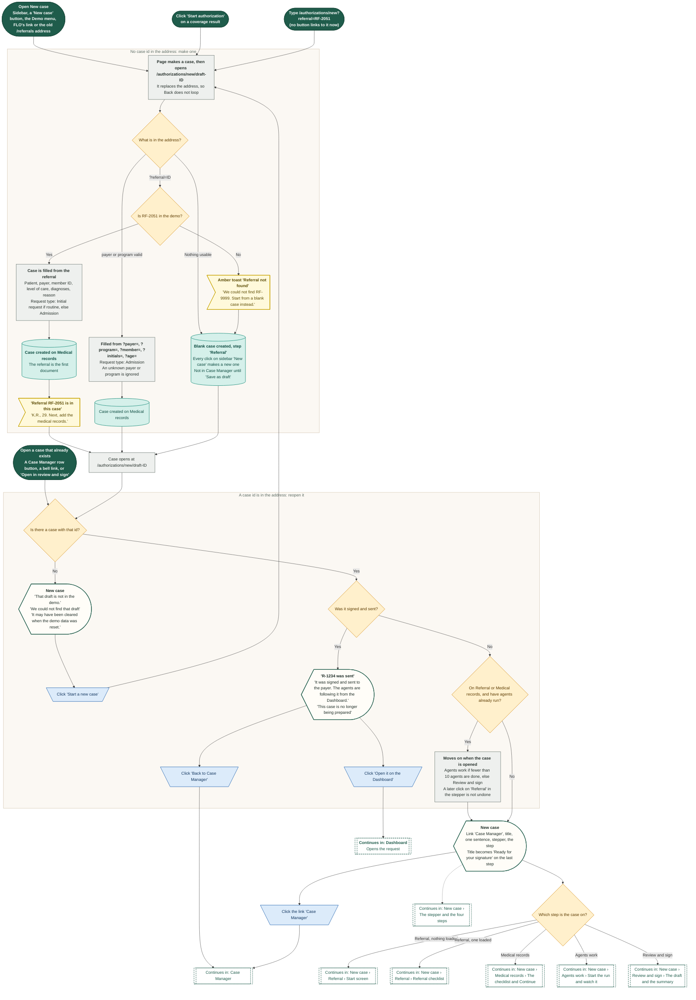

## Authorizations › New case › The stepper and the four steps

The strip at the top of New case: Referral, Medical records, Agents work, Review and sign. Earlier steps can be clicked to go back; later ones open only through the step's own button.

Route: `/authorizations/new/:draftId`

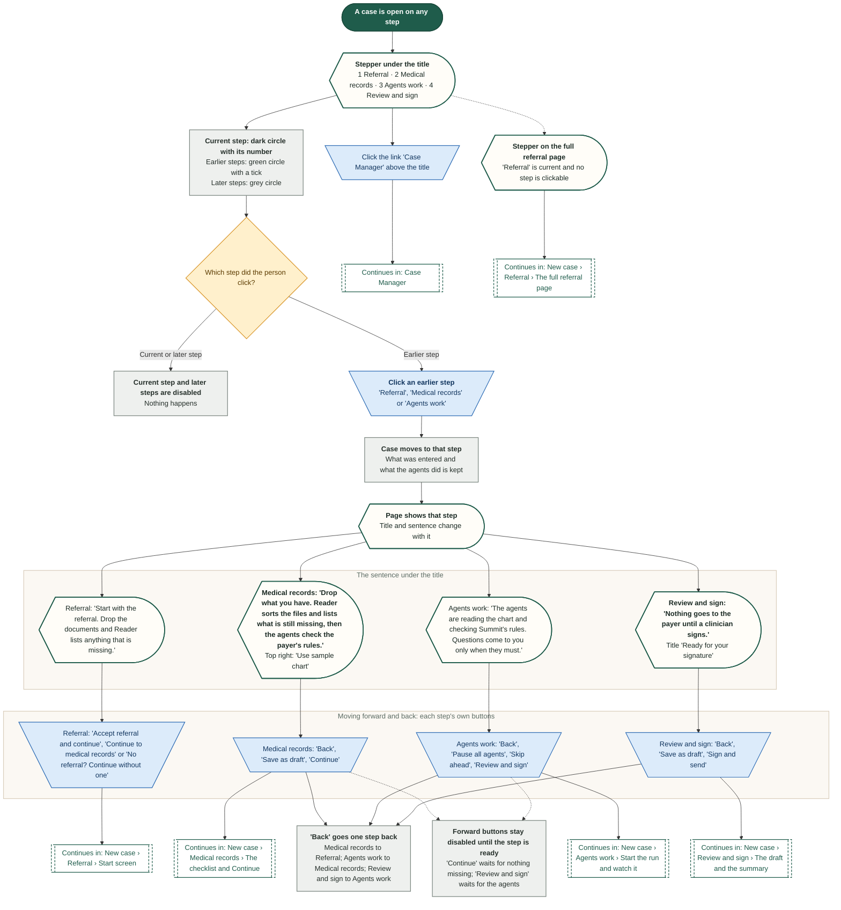

## Authorizations › New case › Referral › Start screen

What a person sees on step 1 before a referral is loaded. Drop documents (Reader reads them), use the sample, check a referral that already arrived, or go on without one.

Route: `/authorizations/new/:draftId (step 'Referral', no referral loaded yet)`

Demo only: Reader's reading is invented. The same file name always gives the same one of three sample referrals.

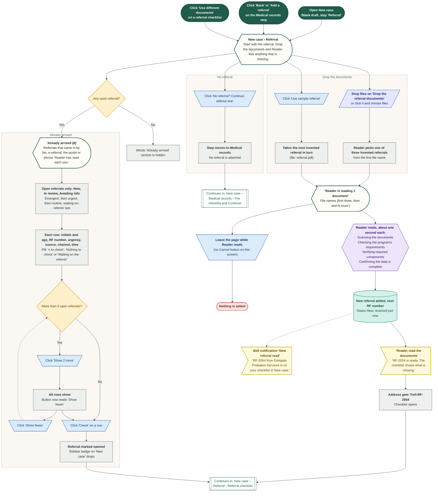

## Authorizations › New case › Referral › Referral checklist

One referral as a checklist of 11 items in four sections. Reader found each item or did not. This diagram covers the rows and their buttons; the buttons around the card are in 'Checklist buttons'.

Route: `/authorizations/new/:draftId?ref=RF-2053`

Demo only: Reader's findings are invented. Real world (PRD 03): a referral comes from a primary care home or hospital and intake collects the releases, signatures and records.

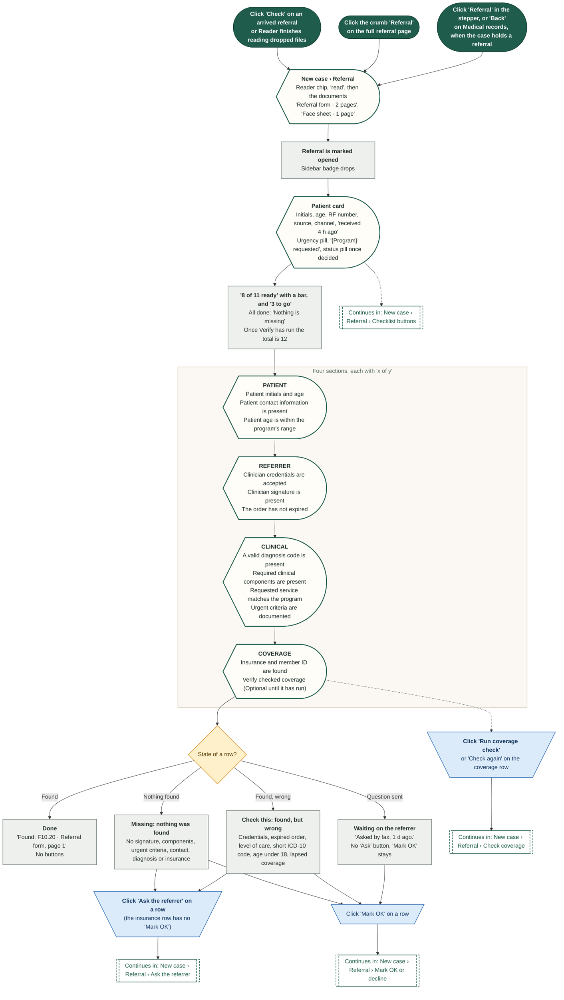

## Authorizations › New case › Referral › Ask the referrer

Ask the referrer for what is missing. The same dialog opens from the checklist and from the full referral page. In the demo nothing leaves the app.

Route: `/authorizations/new/:draftId?ref=RF-2053`

Demo only: nothing is sent. The referrer's answer is in the next diagram, 'The referrer replies'.

```mermaid
%%{init: {"theme":"base","themeVariables":{"fontFamily":"'DM Sans', 'Segoe UI', system-ui, sans-serif","fontSize":"15px","lineColor":"#5B6B63","primaryTextColor":"#1C2B25","clusterBkg":"#FBF8F3","clusterBorder":"#D9CDBB","edgeLabelBackground":"#FFFFFF"},"flowchart":{"curve":"basis","nodeSpacing":36,"rankSpacing":48,"padding":12,"htmlLabels":true,"useMaxWidth":false,"wrappingWidth":230}} }%%
flowchart TD
  classDef k_start fill:#1F5C4B,stroke:#174638,color:#FFFFFF,stroke-width:1.5px,font-weight:600
  classDef k_end fill:#DDEFE3,stroke:#2E7D4F,color:#14502F,stroke-width:1.5px,font-weight:600
  classDef k_endx fill:#FBE3E0,stroke:#C0392B,color:#7A1F16,stroke-width:1.5px,font-weight:600
  classDef k_screen fill:#FFFDF8,stroke:#1F5C4B,color:#1C2B25,stroke-width:2px
  classDef k_overlay fill:#F1F7F3,stroke:#1F5C4B,color:#1C2B25,stroke-width:2px,stroke-dasharray:5 3
  classDef k_click fill:#DCEBFA,stroke:#2F6DB5,color:#12365F,stroke-width:1.5px
  classDef k_input fill:#E4E7FF,stroke:#4C5FD5,color:#1D2670,stroke-width:1.5px
  classDef k_process fill:#EEF0EE,stroke:#7A857F,color:#26302B,stroke-width:1.5px
  classDef k_agent fill:#EEE5FA,stroke:#7A4FC2,color:#341A63,stroke-width:1.5px
  classDef k_decision fill:#FFF0CC,stroke:#D9962B,color:#5C3B00,stroke-width:1.5px
  classDef k_store fill:#D5F0EA,stroke:#1C8E7B,color:#0B4A3F,stroke-width:1.5px
  classDef k_doc fill:#F6E9DC,stroke:#B07A4C,color:#4A2E14,stroke-width:1.5px
  classDef k_ext fill:#FFE6D2,stroke:#E07B39,color:#6B2F06,stroke-width:1.5px
  classDef k_wait fill:#E4E8EE,stroke:#6B7C93,color:#26303D,stroke-width:1.5px
  classDef k_toast fill:#FFF9DB,stroke:#C9A400,color:#5A4A00,stroke-width:1.5px
  classDef k_goto fill:#FFFFFF,stroke:#1F5C4B,color:#1F5C4B,stroke-width:1.5px,stroke-dasharray:5 3
  s1@{ shape: stadium, label: "<b>Click 'Ask the referrer' on a row,</b><br/>or 'Ask the referrer for the 4 missing items'" }
  s2@{ shape: stadium, label: "<b>Full page: click 'Request information',</b><br/>'Request information for all open findings',<br/>or Resolve › 'Request information'" }
  o1@{ shape: win-pane, label: "<b>'Request more information'</b><br/>'To Crisis line 988 follow-up, fax (614) 555-0100'<br/>'The message comes from the 4 open items. The referral moves to Awaiting info until they reply.'" }
  p1@{ shape: rect, label: "<b>Message is written from the open items</b><br/>One numbered line each: signed copy, current order, credentials or cosigner, form parts, ICD-10 code, level of care, risk screening, phone number, insurance card" }
  p1b@{ shape: rect, label: "<b>No open items: 'The message comes from this referral'</b><br/>One line: 'Anything you can add that supports the request'" }
  i1@{ shape: lean-r, label: "<b>Pick 'Send by': Fax, E-referral, Email or Phone call</b><br/>Starts at the referral's own channel; phone and portal start at Email" }
  d1@{ shape: diam, label: "Message edited by hand?" }
  p2@{ shape: rect, label: "<b>Message is rewritten for the new channel</b><br/>'Please reply by email and Reader will pick it up'" }
  p3@{ shape: rect, label: "Message stays as typed" }
  i2@{ shape: lean-r, label: "Edit the 'Message'" }
  d2@{ shape: diam, label: "Message empty?" }
  p4@{ shape: rect, label: "'Send request' stays disabled" }
  cCancel@{ shape: trap-t, label: "<b>Click 'Cancel' or 'Close', press Escape,</b><br/>or click outside the dialog" }
  e1@{ shape: stadium, label: "<b>Nothing is sent</b><br/>The referral is unchanged" }
  cSend@{ shape: trap-t, label: "Click 'Send request'" }
  st1@{ shape: cyl, label: "<b>Referral is Awaiting info</b><br/>When and how it was asked, and the message, are saved" }
  p5@{ shape: rect, label: "<b>Timeline gets 'You asked Crisis line 988 follow-up for more information by email'</b><br/>and a pending 'Reader will read the reply when it arrives'" }
  x1@{ shape: st-rect, label: "<b>Referrer receives the request</b><br/>(demo: simulated, nothing is sent)" }
  t1@{ shape: odd, label: "<b>'Request sent'</b><br/>'Crisis line 988 follow-up was asked for more information. RF-2053 is Awaiting info.'" }
  sc1@{ shape: curv-trap, label: "<b>Checklist after sending</b><br/>Asked rows read 'Waiting on the referrer. Asked by email, just now.'<br/>No 'Ask' buttons, 'Mark OK' stays, button 'Demo: the referrer replies' appears" }
  g1@{ shape: subproc, label: "Continues in: New case › Referral › The referrer replies" }
  s1 --> o1
  s2 --> o1
  o1 --> p1 --> i1
  o1 -.-> p1b -.-> i1
  i1 --> d1
  d1 -->|"No"| p2 --> i2
  d1 -->|"Yes"| p3 --> i2
  i2 --> d2
  d2 -->|"Yes"| p4 --> cCancel
  d2 -->|"No"| cSend
  o1 --> cCancel --> e1
  cSend --> st1 --> p5 --> x1 --> t1 --> sc1 --> g1
  class s1,s2 k_start
  class o1 k_overlay
  class p1,p1b,p2,p3,p4,p5 k_process
  class i1,i2 k_input
  class d1,d2 k_decision
  class cCancel,cSend k_click
  class e1 k_endx
  class st1 k_store
  class x1 k_ext
  class t1 k_toast
  class sc1 k_screen
  class g1 k_goto
```

## Authorizations › New case › Referral › Accept a referral

Accepting a referral takes a bed or slot, records who owns it, and moves the case on to the medical records. Open findings never block it; they are listed and kept on the timeline.

Route: `/authorizations/new/:draftId?ref=RF-2048`

```mermaid
%%{init: {"theme":"base","themeVariables":{"fontFamily":"'DM Sans', 'Segoe UI', system-ui, sans-serif","fontSize":"15px","lineColor":"#5B6B63","primaryTextColor":"#1C2B25","clusterBkg":"#FBF8F3","clusterBorder":"#D9CDBB","edgeLabelBackground":"#FFFFFF"},"flowchart":{"curve":"basis","nodeSpacing":36,"rankSpacing":48,"padding":12,"htmlLabels":true,"useMaxWidth":false,"wrappingWidth":230}} }%%
flowchart TD
  classDef k_start fill:#1F5C4B,stroke:#174638,color:#FFFFFF,stroke-width:1.5px,font-weight:600
  classDef k_end fill:#DDEFE3,stroke:#2E7D4F,color:#14502F,stroke-width:1.5px,font-weight:600
  classDef k_endx fill:#FBE3E0,stroke:#C0392B,color:#7A1F16,stroke-width:1.5px,font-weight:600
  classDef k_screen fill:#FFFDF8,stroke:#1F5C4B,color:#1C2B25,stroke-width:2px
  classDef k_overlay fill:#F1F7F3,stroke:#1F5C4B,color:#1C2B25,stroke-width:2px,stroke-dasharray:5 3
  classDef k_click fill:#DCEBFA,stroke:#2F6DB5,color:#12365F,stroke-width:1.5px
  classDef k_input fill:#E4E7FF,stroke:#4C5FD5,color:#1D2670,stroke-width:1.5px
  classDef k_process fill:#EEF0EE,stroke:#7A857F,color:#26302B,stroke-width:1.5px
  classDef k_agent fill:#EEE5FA,stroke:#7A4FC2,color:#341A63,stroke-width:1.5px
  classDef k_decision fill:#FFF0CC,stroke:#D9962B,color:#5C3B00,stroke-width:1.5px
  classDef k_store fill:#D5F0EA,stroke:#1C8E7B,color:#0B4A3F,stroke-width:1.5px
  classDef k_doc fill:#F6E9DC,stroke:#B07A4C,color:#4A2E14,stroke-width:1.5px
  classDef k_ext fill:#FFE6D2,stroke:#E07B39,color:#6B2F06,stroke-width:1.5px
  classDef k_wait fill:#E4E8EE,stroke:#6B7C93,color:#26303D,stroke-width:1.5px
  classDef k_toast fill:#FFF9DB,stroke:#C9A400,color:#5A4A00,stroke-width:1.5px
  classDef k_goto fill:#FFFFFF,stroke:#1F5C4B,color:#1F5C4B,stroke-width:1.5px,stroke-dasharray:5 3
  s1@{ shape: stadium, label: "<b>Click 'Accept referral and continue'</b><br/>on the checklist" }
  s2@{ shape: stadium, label: "<b>Click 'Accept referral'</b><br/>on the full referral page" }
  o1@{ shape: win-pane, label: "<b>'Accept this referral?'</b><br/>'RF-2048 · A.P., 45 · Dr. Lindqvist, Family Medicine'" }
  d1@{ shape: diam, label: "Anything still open?" }
  t1@{ shape: odd, label: "<b>Amber banner '3 things are still open'</b><br/>Each open finding, 'Coverage has not been checked yet.' or the lapsed coverage<br/>'You can accept anyway. Each open item stays on the timeline.'" }
  t2@{ shape: odd, label: "<b>Green banner</b><br/>'All 9 checks are clear and coverage is confirmed.'" }
  subgraph gForm ["Three fields"]
  i1@{ shape: lean-r, label: "<b>Pick 'Owner'</b><br/>Jordan Perez, Taylor Brooks or Morgan Lee<br/>Starts as the referral's owner, else Jordan Perez" }
  i2@{ shape: lean-r, label: "<b>Pick 'Program'</b><br/>Residential 3.5, IOP, PHP or Detox, each with '2 open'<br/>Starts as the program requested" }
  p1@{ shape: rect, label: "<b>Hint under the date reads the program's room</b><br/>'Residential 3.5: 2 beds open this week, 1 after this.'<br/>None left: 'Accepting puts the referral on the waiting list.'" }
  i3@{ shape: lean-r, label: "<b>Set 'Target admission date'</b><br/>Starts at tomorrow" }
  end
  d2@{ shape: diam, label: "Is the date valid?" }
  p2@{ shape: rect, label: "'Accept referral' is disabled" }
  cX@{ shape: trap-t, label: "<b>Click 'Cancel' or 'Close', press Escape,</b><br/>or click outside the dialog" }
  e1@{ shape: stadium, label: "Nothing changes" }
  c1@{ shape: trap-t, label: "Click 'Accept referral'" }
  st1@{ shape: cyl, label: "<b>Referral is Accepted</b><br/>Owner, program, target date saved<br/>Timeline 'Accepted into IOP' with any open findings counted" }
  st2@{ shape: cyl, label: "<b>Program capacity drops by one bed or slot</b><br/>(never below zero)" }
  t3@{ shape: odd, label: "<b>'Referral accepted'</b><br/>'RF-2048 is accepted into IOP.'" }
  p3@{ shape: rect, label: "<b>Referral leaves 'Already arrived'</b><br/>(only open referrals are listed)" }
  d3@{ shape: diam, label: "Accepted from where?" }
  subgraph gCl ["Referral goes in"]
  p4@{ shape: rect, label: "<b>Copied into the case: patient, payer, member ID,</b><br/>level of care (the accepted program), diagnoses, reason<br/>Request type: Initial request if routine, else Admission" }
  p5@{ shape: rect, label: "<b>Referral becomes the first document</b><br/>'RF-2048 referral.pdf'" }
  d4@{ shape: diam, label: "Had the agents already run on this case?" }
  p6@{ shape: rect, label: "<b>Agents' results are cleared</b><br/>Because the patient and documents changed<br/>No warning is shown" }
  t4@{ shape: odd, label: "<b>'Referral RF-2048 is in this case'</b><br/>'A.P., 45. Next, add the medical records.'" }
  end
  g1@{ shape: subproc, label: "Continues in: New case › Medical records › The checklist and Continue" }
  subgraph gPg ["From the full referral page"]
  sc1@{ shape: curv-trap, label: "<b>Page stays open</b><br/>Green banner 'Accepted into IOP'<br/>'Target admission 10/21/2026. Owner Taylor Brooks.'" }
  c2@{ shape: trap-t, label: "<b>Click 'Continue to medical records'</b><br/>(or 'Open R-1042' when a request is linked)" }
  p7@{ shape: rect, label: "<b>Uses the case in the address (?draft=)</b><br/>Without one, a new blank case is made first" }
  end
  s1 --> o1
  s2 --> o1
  o1 --> d1
  d1 -->|"Yes"| t1 --> i1
  d1 -->|"No"| t2 --> i1
  i1 --> i2 --> p1 --> i3 --> d2
  d2 -->|"No"| p2 --> cX
  d2 -->|"Yes"| c1
  o1 --> cX --> e1
  c1 --> st1 --> st2 --> t3 --> p3 --> d3
  d3 -->|"Checklist, at once"| p4 --> p5 --> d4
  d4 -->|"Yes"| p6 --> t4
  d4 -->|"No"| t4
  t4 --> g1
  d3 -->|"Full page, later"| sc1 --> c2 --> p7 --> p4
  class s1,s2 k_start
  class o1 k_overlay
  class d1,d2,d3,d4 k_decision
  class t1,t2,t3,t4 k_toast
  class i1,i2,i3 k_input
  class p1,p2,p3,p4,p5,p6,p7 k_process
  class cX,c1,c2 k_click
  class e1 k_endx
  class st1,st2 k_store
  class g1 k_goto
  class sc1 k_screen
  style gForm fill:#FBF8F3,stroke:#D9CDBB,stroke-width:1.5px,color:#5B6B63
  style gCl fill:#FBF8F3,stroke:#D9CDBB,stroke-width:1.5px,color:#5B6B63
  style gPg fill:#FBF8F3,stroke:#D9CDBB,stroke-width:1.5px,color:#5B6B63
```

## Authorizations › New case › Referral › Mark OK or decline

Two ways to decide a referral without waiting for the referrer. 'Mark OK' accepts one finding with a written reason. 'Decline' closes the referral with a reason, and can be undone with 'Reopen referral'.

Route: `/authorizations/new/:draftId?ref=RF-2048`

```mermaid
%%{init: {"theme":"base","themeVariables":{"fontFamily":"'DM Sans', 'Segoe UI', system-ui, sans-serif","fontSize":"15px","lineColor":"#5B6B63","primaryTextColor":"#1C2B25","clusterBkg":"#FBF8F3","clusterBorder":"#D9CDBB","edgeLabelBackground":"#FFFFFF"},"flowchart":{"curve":"basis","nodeSpacing":36,"rankSpacing":48,"padding":12,"htmlLabels":true,"useMaxWidth":false,"wrappingWidth":230}} }%%
flowchart TD
  classDef k_start fill:#1F5C4B,stroke:#174638,color:#FFFFFF,stroke-width:1.5px,font-weight:600
  classDef k_end fill:#DDEFE3,stroke:#2E7D4F,color:#14502F,stroke-width:1.5px,font-weight:600
  classDef k_endx fill:#FBE3E0,stroke:#C0392B,color:#7A1F16,stroke-width:1.5px,font-weight:600
  classDef k_screen fill:#FFFDF8,stroke:#1F5C4B,color:#1C2B25,stroke-width:2px
  classDef k_overlay fill:#F1F7F3,stroke:#1F5C4B,color:#1C2B25,stroke-width:2px,stroke-dasharray:5 3
  classDef k_click fill:#DCEBFA,stroke:#2F6DB5,color:#12365F,stroke-width:1.5px
  classDef k_input fill:#E4E7FF,stroke:#4C5FD5,color:#1D2670,stroke-width:1.5px
  classDef k_process fill:#EEF0EE,stroke:#7A857F,color:#26302B,stroke-width:1.5px
  classDef k_agent fill:#EEE5FA,stroke:#7A4FC2,color:#341A63,stroke-width:1.5px
  classDef k_decision fill:#FFF0CC,stroke:#D9962B,color:#5C3B00,stroke-width:1.5px
  classDef k_store fill:#D5F0EA,stroke:#1C8E7B,color:#0B4A3F,stroke-width:1.5px
  classDef k_doc fill:#F6E9DC,stroke:#B07A4C,color:#4A2E14,stroke-width:1.5px
  classDef k_ext fill:#FFE6D2,stroke:#E07B39,color:#6B2F06,stroke-width:1.5px
  classDef k_wait fill:#E4E8EE,stroke:#6B7C93,color:#26303D,stroke-width:1.5px
  classDef k_toast fill:#FFF9DB,stroke:#C9A400,color:#5A4A00,stroke-width:1.5px
  classDef k_goto fill:#FFFFFF,stroke:#1F5C4B,color:#1F5C4B,stroke-width:1.5px,stroke-dasharray:5 3
  s1@{ shape: stadium, label: "Click 'Mark OK' on a checklist row" }
  s2@{ shape: stadium, label: "<b>Full page, Validation tab:</b><br/>Resolve › 'Mark OK with reason'" }
  s3@{ shape: stadium, label: "<b>Click 'Decline'</b><br/>Checklist, or the full page header" }
  subgraph gOk ["Mark OK"]
  o1@{ shape: win-pane, label: "<b>'Mark OK with a reason'</b><br/>Subtitle: the check, e.g. 'Clinician signature is present'<br/>'Reader found: The signature line is empty. Reader cannot confirm who ordered this.'" }
  i1@{ shape: lean-r, label: "<b>Type a 'Reason' (required)</b><br/>Hint 'Logged with your name on the activity timeline.'<br/>Placeholder 'Why is it fine to go ahead?'" }
  d1@{ shape: diam, label: "At least 5 characters?" }
  p1@{ shape: rect, label: "'Mark OK' stays disabled" }
  c1@{ shape: trap-t, label: "Click 'Mark OK'" }
  st1@{ shape: cyl, label: "<b>Finding is marked resolved with your reason</b><br/>The source document itself does not change" }
  p2@{ shape: rect, label: "Timeline 'You overrode: Clinician signature is present' with the reason" }
  t1@{ shape: odd, label: "<b>'Marked OK'</b><br/>'Your reason is on the activity timeline.'" }
  sc1@{ shape: curv-trap, label: "<b>Row turns Done</b><br/>'Marked OK by Jordan Perez: …'<br/>Progress goes up by one; Validation tab shows pill 'Marked OK'" }
  end
  cX1@{ shape: trap-t, label: "<b>Click 'Cancel' or 'Close', press Escape,</b><br/>or click outside the dialog" }
  e1@{ shape: stadium, label: "Nothing changes" }
  subgraph gDec ["Decline"]
  o2@{ shape: win-pane, label: "<b>'Decline RF-2048?'</b><br/>'The reason goes on the activity timeline. You can reopen a declined referral later.'" }
  p3@{ shape: rect, label: "<b>'Reason' starts as the likely one</b><br/>Outside age range if age failed; Coverage cannot be confirmed if coverage lapsed;<br/>Clinical criteria not met if a check failed; else Needs a higher level of care" }
  i2@{ shape: lean-r, label: "<b>Pick a 'Reason'</b><br/>Outside age range, Outside service area, Needs a higher level of care, No bed available, Coverage cannot be confirmed, Clinical criteria not met, Referrer withdrew" }
  i3@{ shape: lean-r, label: "<b>Type a 'Note' (optional)</b><br/>'Only your team sees this.'" }
  i4@{ shape: lean-r, label: "<b>Switch 'Send a courtesy reply to the referrer (by fax)'</b><br/>On to start with" }
  c2@{ shape: trap-t, label: "Click 'Decline referral'" }
  st2@{ shape: cyl, label: "<b>Referral is Declined</b><br/>Reason, note and courtesy choice saved<br/>Timeline 'Declined: Needs a higher level of care'" }
  d2@{ shape: diam, label: "Courtesy reply on?" }
  x1@{ shape: st-rect, label: "<b>Referrer gets a courtesy reply by fax, email or e-referral</b><br/>(demo: simulated)" }
  p4@{ shape: rect, label: "Timeline 'Courtesy reply sent to Dr. Lindqvist, Family Medicine by fax'" }
  t2@{ shape: odd, label: "<b>'Declined: Needs a higher level of care'</b><br/>'1 referral. Courtesy replies were sent.'" }
  sc2@{ shape: curv-trap, label: "<b>Checklist after declining</b><br/>Red banner 'Declined: …'<br/>Main button is 'Reopen referral'; no Accept, no Decline" }
  end
  cX2@{ shape: trap-t, label: "<b>Click 'Cancel' or 'Close', press Escape,</b><br/>or click outside the dialog" }
  e2@{ shape: stadium, label: "Nothing changes" }
  subgraph gRe ["Undo"]
  c3@{ shape: trap-t, label: "<b>Click 'Reopen referral'</b><br/>Checklist, header, or 'Reopen' on the red banner" }
  st3@{ shape: cyl, label: "<b>Referral is In review again</b><br/>Decline cleared; timeline 'You reopened the referral'" }
  t3@{ shape: odd, label: "<b>'Referral reopened'</b><br/>'RF-2048 is back In review.'" }
  end
  s1 --> o1
  s2 --> o1
  o1 --> i1 --> d1
  d1 -->|"No"| p1 --> cX1
  d1 -->|"Yes"| c1 --> st1 --> p2 --> t1 --> sc1
  o1 --> cX1 --> e1
  s3 --> o2 --> p3 --> i2 --> i3 --> i4 --> c2 --> st2 --> d2
  d2 -->|"Yes"| x1 --> p4 --> t2
  d2 -->|"No"| t2
  t2 --> sc2 --> c3 --> st3 --> t3
  o2 --> cX2 --> e2
  class s1,s2,s3 k_start
  class o1,o2 k_overlay
  class i1,i2,i3,i4 k_input
  class d1,d2 k_decision
  class p1,p2,p3,p4 k_process
  class c1,cX1,c2,cX2,c3 k_click
  class st1,st2,st3 k_store
  class t1,t2,t3 k_toast
  class sc1,sc2 k_screen
  class e1,e2 k_endx
  class x1 k_ext
  style gOk fill:#FBF8F3,stroke:#D9CDBB,stroke-width:1.5px,color:#5B6B63
  style gDec fill:#FBF8F3,stroke:#D9CDBB,stroke-width:1.5px,color:#5B6B63
  style gRe fill:#FBF8F3,stroke:#D9CDBB,stroke-width:1.5px,color:#5B6B63
```

## Authorizations › New case › Referral › Check coverage

Verify can check a referral's coverage from the checklist row or from the Coverage tab on the full page. For the full check, the Coverage tab hands off to Eligibility & Benefits.

Route: `/authorizations/new/:draftId?ref=RF-2053 (checklist) and /authorizations/new/referral/RF-2053 (Coverage tab)`

Demo only: Verify's answer is fixed for each referral (covered, authorization first, lapsed, or no insurance) and takes about three seconds. Real world (PRD 02): coverage is verified before the first appointment, and intakes without a card get insurance discovery.

```mermaid
%%{init: {"theme":"base","themeVariables":{"fontFamily":"'DM Sans', 'Segoe UI', system-ui, sans-serif","fontSize":"15px","lineColor":"#5B6B63","primaryTextColor":"#1C2B25","clusterBkg":"#FBF8F3","clusterBorder":"#D9CDBB","edgeLabelBackground":"#FFFFFF"},"flowchart":{"curve":"basis","nodeSpacing":36,"rankSpacing":48,"padding":12,"htmlLabels":true,"useMaxWidth":false,"wrappingWidth":230}} }%%
flowchart TD
  classDef k_start fill:#1F5C4B,stroke:#174638,color:#FFFFFF,stroke-width:1.5px,font-weight:600
  classDef k_end fill:#DDEFE3,stroke:#2E7D4F,color:#14502F,stroke-width:1.5px,font-weight:600
  classDef k_endx fill:#FBE3E0,stroke:#C0392B,color:#7A1F16,stroke-width:1.5px,font-weight:600
  classDef k_screen fill:#FFFDF8,stroke:#1F5C4B,color:#1C2B25,stroke-width:2px
  classDef k_overlay fill:#F1F7F3,stroke:#1F5C4B,color:#1C2B25,stroke-width:2px,stroke-dasharray:5 3
  classDef k_click fill:#DCEBFA,stroke:#2F6DB5,color:#12365F,stroke-width:1.5px
  classDef k_input fill:#E4E7FF,stroke:#4C5FD5,color:#1D2670,stroke-width:1.5px
  classDef k_process fill:#EEF0EE,stroke:#7A857F,color:#26302B,stroke-width:1.5px
  classDef k_agent fill:#EEE5FA,stroke:#7A4FC2,color:#341A63,stroke-width:1.5px
  classDef k_decision fill:#FFF0CC,stroke:#D9962B,color:#5C3B00,stroke-width:1.5px
  classDef k_store fill:#D5F0EA,stroke:#1C8E7B,color:#0B4A3F,stroke-width:1.5px
  classDef k_doc fill:#F6E9DC,stroke:#B07A4C,color:#4A2E14,stroke-width:1.5px
  classDef k_ext fill:#FFE6D2,stroke:#E07B39,color:#6B2F06,stroke-width:1.5px
  classDef k_wait fill:#E4E8EE,stroke:#6B7C93,color:#26303D,stroke-width:1.5px
  classDef k_toast fill:#FFF9DB,stroke:#C9A400,color:#5A4A00,stroke-width:1.5px
  classDef k_goto fill:#FFFFFF,stroke:#1F5C4B,color:#1F5C4B,stroke-width:1.5px,stroke-dasharray:5 3
  s1@{ shape: stadium, label: "<b>Checklist, Coverage section:</b><br/>'Verify checked coverage' row" }
  s2@{ shape: stadium, label: "Full page: open the 'Coverage' tab" }
  d1@{ shape: diam, label: "Does the referral list an insurance?" }
  p1@{ shape: rect, label: "<b>Row says 'Optional'</b><br/>'Verify needs the insurance and member ID first.'<br/>No button" }
  g1@{ shape: subproc, label: "Continues in: New case › Referral › Ask the referrer" }
  p2@{ shape: rect, label: "<b>Row says 'Optional'</b><br/>'Not checked yet. Verify looks up eligibility, the plan and whether an authorization is needed first.'" }
  c1@{ shape: trap-t, label: "Click 'Run coverage check'" }
  subgraph gTab ["Coverage tab"]
  sc1@{ shape: curv-trap, label: "<b>Card 'Coverage has not been checked'</b><br/>'Verify looks up eligibility, the plan, the authorization rule and the program's network status.'" }
  p3@{ shape: rect, label: "<b>No insurance on the referral:</b><br/>'Verify will report that it cannot confirm coverage'" }
  c2@{ shape: trap-t, label: "Click 'Run coverage check'" }
  o1@{ shape: win-pane, label: "<b>Card 'Verify is checking coverage'</b><br/>'This takes a few seconds.'<br/>Eligibility with Summit · Benefits and plan · Authorization rule and network status" }
  end
  st0@{ shape: cyl, label: "<b>Verify is running for this referral</b><br/>Row shows 'Verify is checking coverage.' with a spinner" }
  a1@{ shape: hex, label: "<b>Verify checks eligibility, benefits and plan,</b><br/>authorization rule and network status" }
  d2@{ shape: diam, label: "What does Verify find?" }
  st1@{ shape: cyl, label: "<b>Coverage saved on the referral</b><br/>Timeline 'Verify checked coverage: …'" }
  t1@{ shape: odd, label: "<b>'Verify checked coverage'</b><br/>'Covered and ready to admit'" }
  t2@{ shape: odd, label: "<b>'Verify checked coverage'</b><br/>'Covered, but you need an authorization first'" }
  t3@{ shape: odd, label: "<b>Amber toast 'Verify checked coverage'</b><br/>'Coverage has lapsed. Fix this before billing'" }
  p4@{ shape: rect, label: "<b>Checklist row turns Done</b><br/>Progress changes from 11 to 12 items" }
  p5@{ shape: rect, label: "<b>Row turns 'Check this' with 'Check again'</b><br/>Red banner on the full page 'Verify found that coverage has lapsed' with 'Open coverage'" }
  sc2@{ shape: curv-trap, label: "<b>Coverage tab result</b><br/>Banner with the headline, 'Check again'<br/>Card 'Payment checks' with six lines and 'Checked live at 10:42 am'" }
  c3@{ shape: trap-t, label: "Click 'Check again'" }
  c4@{ shape: trap-t, label: "Click 'Open full Eligibility & Benefits check'" }
  p6@{ shape: rect, label: "<b>Opens Verify a patient with the referral's payer,</b><br/>member ID, level of care and a made-up birth date filled in" }
  g2@{ shape: subproc, label: "Continues in: Eligibility & Benefits › Verify a patient" }
  s3@{ shape: stadium, label: "<b>Coming back: 'Start authorization'</b><br/>on the coverage result (authorization first)" }
  p7@{ shape: rect, label: "<b>Opens a NEW case with payer, level of care, member ID, initials and age</b><br/>It is not tied to the referral or its case" }
  g3@{ shape: subproc, label: "Continues in: New case › How a case starts and resumes" }
  s4@{ shape: stadium, label: "<b>Press the browser Back button</b><br/>on Verify a patient or its result" }
  p8@{ shape: rect, label: "<b>Returns to the referral page</b><br/>No button in Eligibility leads back to the referral" }
  s1 --> d1
  d1 -->|"No"| p1 --> g1
  d1 -->|"Yes"| p2 --> c1
  c1 --> st0
  s2 --> sc1
  sc1 -.-> p3
  sc1 --> c2 --> st0
  st0 --> o1
  st0 --> a1 --> d2
  d2 -->|"Covered"| st1
  d2 -->|"Authorization first"| st1
  d2 -->|"Lapsed"| st1
  st1 --> t1 --> p4
  st1 --> t2 --> p4
  st1 --> t3 --> p5
  p4 --> sc2
  p5 --> sc2
  p5 --> c3 --> st0
  sc2 --> c3
  sc2 --> c4 --> p6 --> g2
  s4 --> p8 --> sc2
  s3 --> p7 --> g3
  class s1,s2,s3,s4 k_start
  class d1,d2 k_decision
  class p1,p2,p3,p4,p5,p6,p7,p8 k_process
  class g1,g2,g3 k_goto
  class c1,c2,c3,c4 k_click
  class sc1,sc2 k_screen
  class o1 k_overlay
  class st0,st1 k_store
  class a1 k_agent
  class t1,t2,t3 k_toast
  style gTab fill:#FBF8F3,stroke:#D9CDBB,stroke-width:1.5px,color:#5B6B63
```

## Authorizations › New case › Referral › The full referral page

One referral in full: the header, the decision banners, the source document on the left and five tabs on the right. It is a page inside New case, so the breadcrumb leads back to the case.

Route: `/authorizations/new/referral/RF-2053?draft=draft-1001`

```mermaid
%%{init: {"theme":"base","themeVariables":{"fontFamily":"'DM Sans', 'Segoe UI', system-ui, sans-serif","fontSize":"15px","lineColor":"#5B6B63","primaryTextColor":"#1C2B25","clusterBkg":"#FBF8F3","clusterBorder":"#D9CDBB","edgeLabelBackground":"#FFFFFF"},"flowchart":{"curve":"basis","nodeSpacing":36,"rankSpacing":48,"padding":12,"htmlLabels":true,"useMaxWidth":false,"wrappingWidth":230}} }%%
flowchart TD
  classDef k_start fill:#1F5C4B,stroke:#174638,color:#FFFFFF,stroke-width:1.5px,font-weight:600
  classDef k_end fill:#DDEFE3,stroke:#2E7D4F,color:#14502F,stroke-width:1.5px,font-weight:600
  classDef k_endx fill:#FBE3E0,stroke:#C0392B,color:#7A1F16,stroke-width:1.5px,font-weight:600
  classDef k_screen fill:#FFFDF8,stroke:#1F5C4B,color:#1C2B25,stroke-width:2px
  classDef k_overlay fill:#F1F7F3,stroke:#1F5C4B,color:#1C2B25,stroke-width:2px,stroke-dasharray:5 3
  classDef k_click fill:#DCEBFA,stroke:#2F6DB5,color:#12365F,stroke-width:1.5px
  classDef k_input fill:#E4E7FF,stroke:#4C5FD5,color:#1D2670,stroke-width:1.5px
  classDef k_process fill:#EEF0EE,stroke:#7A857F,color:#26302B,stroke-width:1.5px
  classDef k_agent fill:#EEE5FA,stroke:#7A4FC2,color:#341A63,stroke-width:1.5px
  classDef k_decision fill:#FFF0CC,stroke:#D9962B,color:#5C3B00,stroke-width:1.5px
  classDef k_store fill:#D5F0EA,stroke:#1C8E7B,color:#0B4A3F,stroke-width:1.5px
  classDef k_doc fill:#F6E9DC,stroke:#B07A4C,color:#4A2E14,stroke-width:1.5px
  classDef k_ext fill:#FFE6D2,stroke:#E07B39,color:#6B2F06,stroke-width:1.5px
  classDef k_wait fill:#E4E8EE,stroke:#6B7C93,color:#26303D,stroke-width:1.5px
  classDef k_toast fill:#FFF9DB,stroke:#C9A400,color:#5A4A00,stroke-width:1.5px
  classDef k_goto fill:#FFFFFF,stroke:#1F5C4B,color:#1F5C4B,stroke-width:1.5px,stroke-dasharray:5 3
  s1@{ shape: stadium, label: "<b>Click 'Open the full referral'</b><br/>on the referral checklist" }
  s2@{ shape: stadium, label: "<b>Click 'View' on the 'Referral or admission order' row</b><br/>on the Medical records step" }
  s3@{ shape: stadium, label: "<b>Open an old link such as /referrals/RF-2053</b><br/>(no case in the address)" }
  p1@{ shape: rect, label: "<b>Address is /authorizations/new/referral/RF-2053?draft=…</b><br/>The case id rides along so the page can lead back to it" }
  d1@{ shape: diam, label: "Is that referral in the demo?" }
  sc0@{ shape: curv-trap, label: "<b>Crumbs 'New case › Referral › RF-9999'</b><br/>'That referral is not in the demo'<br/>'Referral RF-9999 does not exist. Go back to the referral step to drop the documents or pick one that arrived.'" }
  cBack@{ shape: trap-t, label: "Click 'Back to the referral step'" }
  gStart@{ shape: subproc, label: "Continues in: New case › Referral › Start screen" }
  st1@{ shape: cyl, label: "<b>Referral is marked opened</b><br/>Sidebar badge on 'New case' drops" }
  sc1@{ shape: curv-trap, label: "<b>Referral page</b><br/>Crumbs 'New case › Referral › RF-2053'<br/>Stepper: 'Referral' is current, nothing in it is clickable" }
  sH@{ shape: curv-trap, label: "<b>Header card</b><br/>Pill '{Program} requested', big RF number, status pill, urgency pill<br/>Patient · source · channel · received · payer<br/>Small stepper Received, Reviewed, Decided, Admitted" }
  pSla@{ shape: rect, label: "<b>Red pill 'Past response target' while New or In review</b><br/>after 1 hour (emergent), 4 hours (urgent) or 24 hours (routine)" }
  gHead@{ shape: subproc, label: "Continues in: New case › Referral › Header actions" }
  gBan@{ shape: subproc, label: "Continues in: New case › Referral › Decision banners" }
  sBan@{ shape: curv-trap, label: "<b>Banners under the header</b><br/>One per situation: declined, accepted, waiting on the referrer,<br/>Reader found N things to check, coverage lapsed" }
  subgraph gCr ["Breadcrumb"]
  cC1@{ shape: trap-t, label: "Click the crumb 'New case'" }
  cC2@{ shape: trap-t, label: "Click the crumb 'Referral'" }
  dC@{ shape: diam, label: "Was a case in the address?" }
  dD@{ shape: diam, label: "Was a case in the address?" }
  pC1@{ shape: rect, label: "Opens that case (its current step)" }
  pC2@{ shape: rect, label: "Opens the checklist for this referral: ?ref=RF-2053" }
  pC3@{ shape: rect, label: "<b>Opens New case with no case id</b><br/>A new blank case starts" }
  pC4@{ shape: rect, label: "'RF-2053' is plain text, not a link" }
  end
  gOv@{ shape: subproc, label: "Continues in: New case › How a case starts and resumes" }
  gChk@{ shape: subproc, label: "Continues in: New case › Referral › Referral checklist" }
  subgraph gTwo ["Two columns"]
  sDoc@{ shape: curv-trap, label: "<b>Left: 'Source document' card (stays in view while you scroll)</b><br/>'Fax from {referrer}, Mon 2:10 pm'<br/>'Referral form' and 'Face sheet', print, page buttons" }
  sTab@{ shape: curv-trap, label: "<b>Right: tabs</b><br/>Extracted · Validation (with the count of open findings) · Coverage · Fit · Activity" }
  end
  cT1@{ shape: trap-t, label: "Click 'Extracted' (the tab it opens on)" }
  cT2@{ shape: trap-t, label: "Click 'Validation'" }
  cT3@{ shape: trap-t, label: "Click 'Coverage'" }
  cT4@{ shape: trap-t, label: "Click 'Fit'" }
  cT5@{ shape: trap-t, label: "Click 'Activity'" }
  gT1@{ shape: subproc, label: "Continues in: New case › Referral › Full page: Extracted tab and document" }
  gT2@{ shape: subproc, label: "Continues in: New case › Referral › Full page: Validation tab" }
  gT3@{ shape: subproc, label: "Continues in: New case › Referral › Check coverage" }
  gT4@{ shape: subproc, label: "Continues in: New case › Referral › Full page: Fit, Activity and notes" }
  s1 --> p1
  s2 --> p1
  s3 --> p1
  p1 --> d1
  d1 -->|"No"| sc0 --> cBack --> gStart
  d1 -->|"Yes"| st1 --> sc1 --> sH --> pSla
  sH --> gHead
  sc1 --> sBan --> gBan
  sc1 --> cC1 --> dC
  sc1 --> cC2 --> dD
  dC -->|"Yes"| pC1 --> gOv
  dC -->|"No"| pC3 --> gOv
  dD -->|"Yes"| pC2 --> gChk
  dD -->|"No"| pC3
  sc1 -.-> pC4
  sc1 --> sDoc
  sc1 --> sTab
  sTab --> cT1 --> gT1
  sTab --> cT2 --> gT2
  sTab --> cT3 --> gT3
  sTab --> cT4 --> gT4
  sTab --> cT5 --> gT4
  sDoc -.-> gT1
  class s1,s2,s3 k_start
  class p1,pSla,pC1,pC2,pC3,pC4 k_process
  class d1,dC,dD k_decision
  class sc0,sc1,sH,sBan,sDoc,sTab k_screen
  class cBack,cC1,cC2,cT1,cT2,cT3,cT4,cT5 k_click
  class gStart,gHead,gBan,gOv,gChk,gT1,gT2,gT3,gT4 k_goto
  class st1 k_store
  style gCr fill:#FBF8F3,stroke:#D9CDBB,stroke-width:1.5px,color:#5B6B63
  style gTwo fill:#FBF8F3,stroke:#D9CDBB,stroke-width:1.5px,color:#5B6B63
```

## Authorizations › New case › Referral › Referral statuses

A referral is New, In review, Awaiting info, Accepted, Scheduled, Admitted or Declined. The first three are 'open' and appear in 'Already arrived'. Each box shows what the checklist and the full page allow; each arrow is the button that moves it.

Route: `/authorizations/new/:draftId?ref=RF-2053 and /authorizations/new/referral/RF-2053`

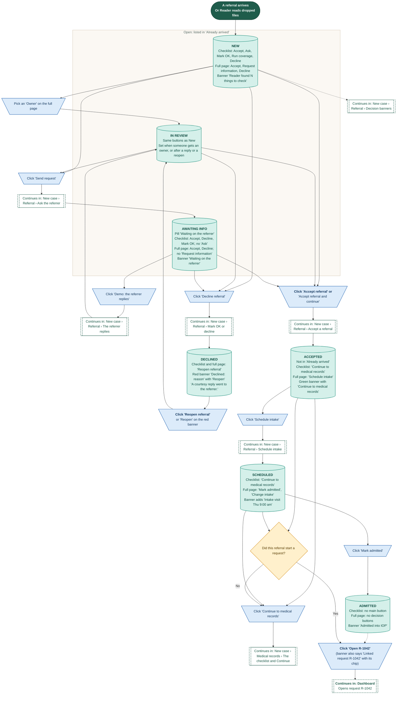

## Authorizations › New case › Referral › Full page: Extracted tab and document

What Reader pulled out of the documents, field by field, next to the source document. A person can see the evidence for each field, correct a value, and page through the original.

Route: `/authorizations/new/referral/RF-2053?draft=draft-1001`

Demo only: Print and the page buttons act on an invented document; nothing prints.

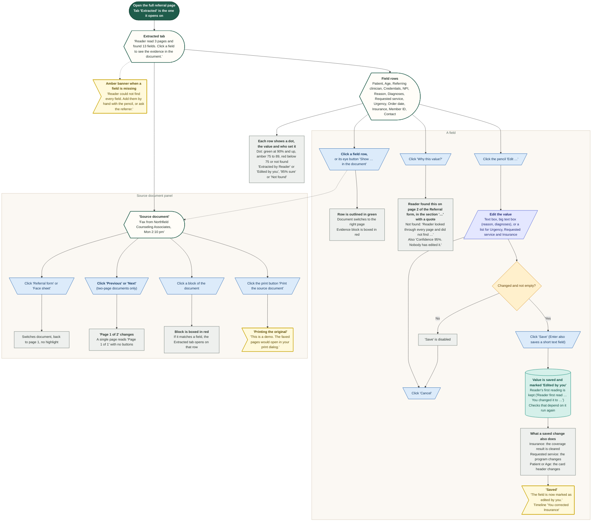

## Authorizations › New case › Referral › Full page: Validation tab

The nine checks Reader ran on the referral, split by document. Each open finding can be shown in the document, asked of the referrer, or marked OK with a reason.

Route: `/authorizations/new/referral/RF-2053?draft=draft-1001`

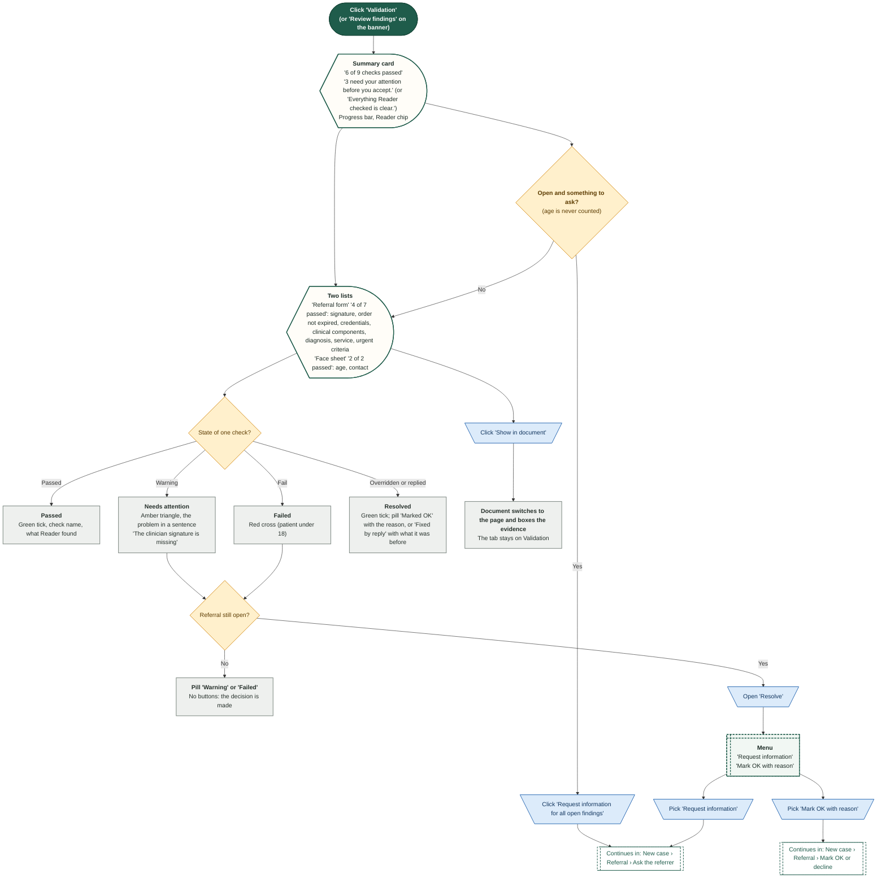

## Authorizations › New case › Referral › Full page: Fit, Activity and notes

The two read-mostly tabs, Fit (Placement's view of the level of care and the beds left) and Activity (what happened and private notes), plus the 'Add note' dialog from the header.

Route: `/authorizations/new/referral/RF-2053?draft=draft-1001`

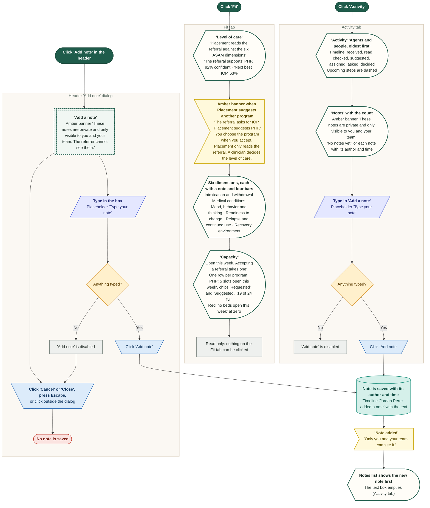

## Authorizations › New case › Referral › Checklist buttons

The buttons around the referral checklist: replace the documents, ask the referrer, decline, open the full page, and the main button, which changes with the referral's status.

Route: `/authorizations/new/:draftId?ref=RF-2053`

Demo only: 'Demo: the referrer replies' stands in for the referrer answering.

```mermaid
%%{init: {"theme":"base","themeVariables":{"fontFamily":"'DM Sans', 'Segoe UI', system-ui, sans-serif","fontSize":"15px","lineColor":"#5B6B63","primaryTextColor":"#1C2B25","clusterBkg":"#FBF8F3","clusterBorder":"#D9CDBB","edgeLabelBackground":"#FFFFFF"},"flowchart":{"curve":"basis","nodeSpacing":36,"rankSpacing":48,"padding":12,"htmlLabels":true,"useMaxWidth":false,"wrappingWidth":230}} }%%
flowchart TD
  classDef k_start fill:#1F5C4B,stroke:#174638,color:#FFFFFF,stroke-width:1.5px,font-weight:600
  classDef k_end fill:#DDEFE3,stroke:#2E7D4F,color:#14502F,stroke-width:1.5px,font-weight:600
  classDef k_endx fill:#FBE3E0,stroke:#C0392B,color:#7A1F16,stroke-width:1.5px,font-weight:600
  classDef k_screen fill:#FFFDF8,stroke:#1F5C4B,color:#1C2B25,stroke-width:2px
  classDef k_overlay fill:#F1F7F3,stroke:#1F5C4B,color:#1C2B25,stroke-width:2px,stroke-dasharray:5 3
  classDef k_click fill:#DCEBFA,stroke:#2F6DB5,color:#12365F,stroke-width:1.5px
  classDef k_input fill:#E4E7FF,stroke:#4C5FD5,color:#1D2670,stroke-width:1.5px
  classDef k_process fill:#EEF0EE,stroke:#7A857F,color:#26302B,stroke-width:1.5px
  classDef k_agent fill:#EEE5FA,stroke:#7A4FC2,color:#341A63,stroke-width:1.5px
  classDef k_decision fill:#FFF0CC,stroke:#D9962B,color:#5C3B00,stroke-width:1.5px
  classDef k_store fill:#D5F0EA,stroke:#1C8E7B,color:#0B4A3F,stroke-width:1.5px
  classDef k_doc fill:#F6E9DC,stroke:#B07A4C,color:#4A2E14,stroke-width:1.5px
  classDef k_ext fill:#FFE6D2,stroke:#E07B39,color:#6B2F06,stroke-width:1.5px
  classDef k_wait fill:#E4E8EE,stroke:#6B7C93,color:#26303D,stroke-width:1.5px
  classDef k_toast fill:#FFF9DB,stroke:#C9A400,color:#5A4A00,stroke-width:1.5px
  classDef k_goto fill:#FFFFFF,stroke:#1F5C4B,color:#1F5C4B,stroke-width:1.5px,stroke-dasharray:5 3
  s1@{ shape: stadium, label: "On the referral checklist" }
  sc1@{ shape: curv-trap, label: "<b>Referral checklist</b><br/>Patient card, four sections, buttons below" }
  subgraph gTop ["Above the card"]
  cDiff@{ shape: trap-t, label: "Click 'Use different documents'" }
  pDiff@{ shape: rect, label: "<b>Address becomes ?ref= (empty), so the start screen shows</b><br/>The case keeps its old referral until you continue" }
  end
  gStart@{ shape: subproc, label: "Continues in: New case › Referral › Start screen" }
  subgraph gFoot ["Under the sections"]
  dAsk@{ shape: diam, label: "<b>Open, not waiting, and something to ask?</b><br/>(age is never counted)" }
  cFoot@{ shape: trap-t, label: "<b>Click 'Ask the referrer for the missing item'</b><br/>or '…for the 4 missing items'" }
  cDec@{ shape: trap-t, label: "<b>Click 'Decline'</b><br/>(only while open)" }
  dWait@{ shape: diam, label: "Awaiting info?" }
  cDemo@{ shape: trap-t, label: "Click 'Demo: the referrer replies'" }
  cFull@{ shape: trap-t, label: "Click 'Open the full referral'" }
  end
  gAsk@{ shape: subproc, label: "Continues in: New case › Referral › Ask the referrer" }
  gOk@{ shape: subproc, label: "Continues in: New case › Referral › Mark OK or decline" }
  gFull@{ shape: subproc, label: "Continues in: New case › Referral › The full referral page" }
  dSt@{ shape: diam, label: "Referral status?" }
  cAcc@{ shape: trap-t, label: "<b>Click 'Accept referral and continue'</b><br/>Never disabled while the referral is open" }
  pAcc@{ shape: rect, label: "<b>Open items are only listed in the Accept dialog</b><br/>You can accept anyway" }
  gAcc@{ shape: subproc, label: "Continues in: New case › Referral › Accept a referral" }
  tAcc@{ shape: odd, label: "<b>Green banner</b><br/>'Accepted into IOP. Target admission 10/21/2026.'" }
  cCont@{ shape: trap-t, label: "Click 'Continue to medical records'" }
  pCont@{ shape: rect, label: "<b>Referral goes into the case</b><br/>Patient, payer, level of care, diagnoses, reason<br/>Referral becomes the first document" }
  tCont@{ shape: odd, label: "<b>'Referral RF-2054 is in this case'</b><br/>'V.C., 30. Next, add the medical records.'" }
  gMed@{ shape: subproc, label: "Continues in: New case › Medical records › The checklist and Continue" }
  tDec@{ shape: odd, label: "<b>Red banner</b><br/>'Declined: Needs a higher level of care.'" }
  cRe@{ shape: trap-t, label: "Click 'Reopen referral'" }
  stRe@{ shape: cyl, label: "<b>Referral is In review again</b><br/>Decision cleared" }
  tRe@{ shape: odd, label: "<b>'Referral reopened'</b><br/>'RF-2048 is back In review.'" }
  eAdm@{ shape: stadium, label: "Admitted: the card has no main button" }
  s1 --> sc1
  sc1 --> cDiff --> pDiff --> gStart
  sc1 --> dAsk
  dAsk -->|"Yes"| cFoot --> gAsk
  dAsk -->|"No"| cDec
  sc1 --> cDec --> gOk
  sc1 --> dWait
  dWait -->|"Yes"| cDemo --> gAsk
  dWait -->|"No"| cFull
  sc1 --> cFull --> gFull
  sc1 --> dSt
  dSt -->|"New, In review, Awaiting info"| cAcc --> pAcc --> gAcc
  dSt -->|"Accepted or Scheduled"| tAcc --> cCont --> pCont --> tCont --> gMed
  dSt -->|"Declined"| tDec --> cRe --> stRe --> tRe
  dSt -->|"Admitted"| eAdm
  class s1 k_start
  class sc1 k_screen
  class cDiff,cFoot,cDec,cDemo,cFull,cAcc,cCont,cRe k_click
  class pDiff,pAcc,pCont k_process
  class gStart,gAsk,gOk,gFull,gAcc,gMed k_goto
  class dAsk,dWait,dSt k_decision
  class tAcc,tCont,tDec,tRe k_toast
  class stRe k_store
  class eAdm k_endx
  style gTop fill:#FBF8F3,stroke:#D9CDBB,stroke-width:1.5px,color:#5B6B63
  style gFoot fill:#FBF8F3,stroke:#D9CDBB,stroke-width:1.5px,color:#5B6B63
```

## Authorizations › New case › Referral › The referrer replies

After a request goes out the referral waits. In the demo one button plays the referrer's answer; Reader reads it and the checklist updates.

Route: `/authorizations/new/:draftId?ref=RF-2053`

Demo only: the real referrer's answer (fax, e-referral, email or call) is simulated by 'Demo: the referrer replies' or More › 'Demo: simulate the referrer's reply'.

```mermaid
%%{init: {"theme":"base","themeVariables":{"fontFamily":"'DM Sans', 'Segoe UI', system-ui, sans-serif","fontSize":"15px","lineColor":"#5B6B63","primaryTextColor":"#1C2B25","clusterBkg":"#FBF8F3","clusterBorder":"#D9CDBB","edgeLabelBackground":"#FFFFFF"},"flowchart":{"curve":"basis","nodeSpacing":36,"rankSpacing":48,"padding":12,"htmlLabels":true,"useMaxWidth":false,"wrappingWidth":230}} }%%
flowchart TD
  classDef k_start fill:#1F5C4B,stroke:#174638,color:#FFFFFF,stroke-width:1.5px,font-weight:600
  classDef k_end fill:#DDEFE3,stroke:#2E7D4F,color:#14502F,stroke-width:1.5px,font-weight:600
  classDef k_endx fill:#FBE3E0,stroke:#C0392B,color:#7A1F16,stroke-width:1.5px,font-weight:600
  classDef k_screen fill:#FFFDF8,stroke:#1F5C4B,color:#1C2B25,stroke-width:2px
  classDef k_overlay fill:#F1F7F3,stroke:#1F5C4B,color:#1C2B25,stroke-width:2px,stroke-dasharray:5 3
  classDef k_click fill:#DCEBFA,stroke:#2F6DB5,color:#12365F,stroke-width:1.5px
  classDef k_input fill:#E4E7FF,stroke:#4C5FD5,color:#1D2670,stroke-width:1.5px
  classDef k_process fill:#EEF0EE,stroke:#7A857F,color:#26302B,stroke-width:1.5px
  classDef k_agent fill:#EEE5FA,stroke:#7A4FC2,color:#341A63,stroke-width:1.5px
  classDef k_decision fill:#FFF0CC,stroke:#D9962B,color:#5C3B00,stroke-width:1.5px
  classDef k_store fill:#D5F0EA,stroke:#1C8E7B,color:#0B4A3F,stroke-width:1.5px
  classDef k_doc fill:#F6E9DC,stroke:#B07A4C,color:#4A2E14,stroke-width:1.5px
  classDef k_ext fill:#FFE6D2,stroke:#E07B39,color:#6B2F06,stroke-width:1.5px
  classDef k_wait fill:#E4E8EE,stroke:#6B7C93,color:#26303D,stroke-width:1.5px
  classDef k_toast fill:#FFF9DB,stroke:#C9A400,color:#5A4A00,stroke-width:1.5px
  classDef k_goto fill:#FFFFFF,stroke:#1F5C4B,color:#1F5C4B,stroke-width:1.5px,stroke-dasharray:5 3
  s1@{ shape: stadium, label: "<b>Referral is Awaiting info</b><br/>after 'Send request'" }
  sc1@{ shape: curv-trap, label: "<b>Checklist while waiting</b><br/>Asked rows read 'Waiting on the referrer. Asked by email, just now.'<br/>Only 'Mark OK' stays on those rows" }
  w1@{ shape: delay, label: "<b>Time passes</b><br/>The referral stays Awaiting info" }
  x1@{ shape: st-rect, label: "<b>Referrer answers by fax, e-referral, email or phone</b><br/>(demo: simulated)" }
  subgraph gBtn ["The demo button"]
  c1@{ shape: trap-t, label: "Checklist: click 'Demo: the referrer replies'" }
  c2@{ shape: trap-t, label: "Full page: click More › 'Demo: simulate the referrer's reply'" }
  d1@{ shape: diam, label: "Is the referral Awaiting info?" }
  t1@{ shape: odd, label: "<b>'Nothing to answer yet'</b><br/>'Use Request information first. The demo reply answers an open request.'" }
  end
  a1@{ shape: hex, label: "Reader reads the reply and runs the nine checks again" }
  p1@{ shape: rect, label: "Fixed by the reply: signed order, current dates, a cosigning clinician, an ICD-10 code, missing form parts, level of care, phone number" }
  d2@{ shape: diam, label: "Did the referral have no insurance?" }
  p2@{ shape: rect, label: "<b>An insurance card arrives: Summit Medicaid HMO, member ID …4410</b><br/>Coverage has not been checked yet" }
  d3@{ shape: diam, label: "Is the patient under 18?" }
  p3@{ shape: rect, label: "<b>Age is not fixed by a reply</b><br/>The row stays 'Check this'" }
  st1@{ shape: cyl, label: "<b>Referral is In review again</b><br/>Fixed rows read 'Resolved by the referrer's reply'" }
  p4@{ shape: rect, label: "<b>Timeline: 'Reply received from … by email'</b><br/>'Reader read the reply and updated the extracted fields'<br/>'Validation ran again: 3 findings resolved, 9 of 9 checks passed' (fewer if age failed)" }
  t2@{ shape: odd, label: "<b>'The referrer replied'</b><br/>'3 findings resolved. RF-2053 is back In review.'" }
  t3@{ shape: odd, label: "<b>Bell 'The referrer replied'</b><br/>'Crisis line 988 follow-up answered RF-2053. Reader read the reply and 3 findings are resolved.'" }
  sc2@{ shape: curv-trap, label: "<b>Checklist after the reply</b><br/>'11 of 11 ready', 'Nothing is missing'<br/>'Run coverage check' is available" }
  g1@{ shape: subproc, label: "Continues in: New case › Referral › Accept a referral" }
  s1 --> sc1 --> w1 --> x1
  x1 --> c1 --> d1
  x1 --> c2 --> d1
  d1 -->|"No"| t1
  d1 -->|"Yes"| a1 --> p1 --> d2
  d2 -->|"Yes"| p2 --> d3
  d2 -->|"No"| d3
  d3 -->|"Yes"| p3 --> st1
  d3 -->|"No"| st1
  st1 --> p4 --> t2 --> sc2 --> g1
  p4 -.-> t3
  class s1 k_start
  class sc1,sc2 k_screen
  class w1 k_wait
  class x1 k_ext
  class c1,c2 k_click
  class d1,d2,d3 k_decision
  class t1,t2,t3 k_toast
  class a1 k_agent
  class p1,p2,p3,p4 k_process
  class st1 k_store
  class g1 k_goto
  style gBtn fill:#FBF8F3,stroke:#D9CDBB,stroke-width:1.5px,color:#5B6B63
```

## Authorizations › New case › Referral › Header actions

The buttons in the header card of the full referral page. The decision buttons open the same dialogs as the checklist. 'Owner', 'Add note' and 'More' are only here.

Route: `/authorizations/new/referral/RF-2053?draft=draft-1001`

Demo only: 'Demo: simulate the referrer's reply' plays the referrer. 'Download' and the print button save nothing.

```mermaid
%%{init: {"theme":"base","themeVariables":{"fontFamily":"'DM Sans', 'Segoe UI', system-ui, sans-serif","fontSize":"15px","lineColor":"#5B6B63","primaryTextColor":"#1C2B25","clusterBkg":"#FBF8F3","clusterBorder":"#D9CDBB","edgeLabelBackground":"#FFFFFF"},"flowchart":{"curve":"basis","nodeSpacing":36,"rankSpacing":48,"padding":12,"htmlLabels":true,"useMaxWidth":false,"wrappingWidth":230}} }%%
flowchart TD
  classDef k_start fill:#1F5C4B,stroke:#174638,color:#FFFFFF,stroke-width:1.5px,font-weight:600
  classDef k_end fill:#DDEFE3,stroke:#2E7D4F,color:#14502F,stroke-width:1.5px,font-weight:600
  classDef k_endx fill:#FBE3E0,stroke:#C0392B,color:#7A1F16,stroke-width:1.5px,font-weight:600
  classDef k_screen fill:#FFFDF8,stroke:#1F5C4B,color:#1C2B25,stroke-width:2px
  classDef k_overlay fill:#F1F7F3,stroke:#1F5C4B,color:#1C2B25,stroke-width:2px,stroke-dasharray:5 3
  classDef k_click fill:#DCEBFA,stroke:#2F6DB5,color:#12365F,stroke-width:1.5px
  classDef k_input fill:#E4E7FF,stroke:#4C5FD5,color:#1D2670,stroke-width:1.5px
  classDef k_process fill:#EEF0EE,stroke:#7A857F,color:#26302B,stroke-width:1.5px
  classDef k_agent fill:#EEE5FA,stroke:#7A4FC2,color:#341A63,stroke-width:1.5px
  classDef k_decision fill:#FFF0CC,stroke:#D9962B,color:#5C3B00,stroke-width:1.5px
  classDef k_store fill:#D5F0EA,stroke:#1C8E7B,color:#0B4A3F,stroke-width:1.5px
  classDef k_doc fill:#F6E9DC,stroke:#B07A4C,color:#4A2E14,stroke-width:1.5px
  classDef k_ext fill:#FFE6D2,stroke:#E07B39,color:#6B2F06,stroke-width:1.5px
  classDef k_wait fill:#E4E8EE,stroke:#6B7C93,color:#26303D,stroke-width:1.5px
  classDef k_toast fill:#FFF9DB,stroke:#C9A400,color:#5A4A00,stroke-width:1.5px
  classDef k_goto fill:#FFFFFF,stroke:#1F5C4B,color:#1F5C4B,stroke-width:1.5px,stroke-dasharray:5 3
  s1@{ shape: stadium, label: "<b>On the full referral page</b><br/>header card" }
  subgraph gDec ["Decision buttons (left)"]
  cAcc@{ shape: trap-t, label: "<b>Click 'Accept referral'</b><br/>While open" }
  cReq@{ shape: trap-t, label: "<b>Click 'Request information'</b><br/>Only while New or In review" }
  cDec@{ shape: trap-t, label: "<b>Click 'Decline'</b><br/>While open" }
  end
  gAcc@{ shape: subproc, label: "Continues in: New case › Referral › Accept a referral" }
  gAsk@{ shape: subproc, label: "Continues in: New case › Referral › Ask the referrer" }
  gOk@{ shape: subproc, label: "Continues in: New case › Referral › Mark OK or decline" }
  cSt@{ shape: trap-t, label: "<b>Click 'Schedule intake', 'Mark admitted'</b><br/>or 'Change intake'<br/>Accepted and Scheduled only" }
  gSt@{ shape: subproc, label: "Continues in: New case › Referral › Schedule intake" }
  cRe@{ shape: trap-t, label: "<b>Click 'Reopen referral'</b><br/>Declined only" }
  stRe@{ shape: cyl, label: "<b>Referral is In review again</b><br/>Timeline 'You reopened the referral'<br/>Toast 'Referral reopened'" }
  subgraph gOwn ["Owner"]
  cOwn@{ shape: trap-t, label: "<b>Open 'Owner' and pick a person</b><br/>Jordan Perez, Taylor Brooks, Morgan Lee or Unassigned" }
  stOwn@{ shape: cyl, label: "<b>Owner is saved</b><br/>A New referral moves to In review when it gets an owner<br/>Timeline 'Assigned to Taylor Brooks'" }
  tOwn@{ shape: odd, label: "<b>'Assigned to Taylor Brooks'</b><br/>'1 referral'<br/>Unassigned: 'Owner removed'" }
  end
  cNote@{ shape: trap-t, label: "Click 'Add note'" }
  gNote@{ shape: subproc, label: "Continues in: New case › Referral › Full page: Fit, Activity and notes" }
  subgraph gMore ["More"]
  cMore@{ shape: trap-t, label: "Click 'More'" }
  oMore@{ shape: win-pane, label: "<b>Menu</b><br/>'Demo: simulate the referrer's reply'<br/>'Download the source document'<br/>'Copy link to this referral'" }
  cReply@{ shape: trap-t, label: "Pick 'Demo: simulate the referrer's reply'" }
  cDown@{ shape: trap-t, label: "Pick 'Download the source document'" }
  cCopy@{ shape: trap-t, label: "Pick 'Copy link to this referral'" }
  dHost@{ shape: diam, label: "Is this the hosted preview?" }
  tHost@{ shape: odd, label: "<b>'Copy link is off in this preview'</b><br/>'Open the single-file version of the demo to use it.'" }
  pCopy@{ shape: rect, label: "Page address is copied to the clipboard" }
  tCopy@{ shape: odd, label: "<b>'Link copied'</b><br/>'It opens this referral for anyone on your team.'" }
  tDown@{ shape: odd, label: "<b>'Downloading the original'</b><br/>'RF-2053.pdf, 2 pages. This is a demo, so no file is saved.'" }
  end
  gReply@{ shape: subproc, label: "Continues in: New case › Referral › The referrer replies" }
  s1 --> cAcc --> gAcc
  s1 --> cReq --> gAsk
  s1 --> cDec --> gOk
  s1 --> cSt --> gSt
  s1 --> cRe --> stRe
  s1 --> cOwn --> stOwn --> tOwn
  s1 --> cNote --> gNote
  s1 --> cMore --> oMore
  oMore --> cReply --> gReply
  oMore --> cDown --> tDown
  oMore --> cCopy --> dHost
  dHost -->|"Yes"| tHost
  dHost -->|"No"| pCopy --> tCopy
  class s1 k_start
  class cAcc,cReq,cDec,cSt,cRe,cOwn,cNote,cMore,cReply,cDown,cCopy k_click
  class gAcc,gAsk,gOk,gSt,gNote,gReply k_goto
  class stRe,stOwn k_store
  class tOwn,tHost,tCopy,tDown k_toast
  class oMore k_overlay
  class dHost k_decision
  class pCopy k_process
  style gDec fill:#FBF8F3,stroke:#D9CDBB,stroke-width:1.5px,color:#5B6B63
  style gOwn fill:#FBF8F3,stroke:#D9CDBB,stroke-width:1.5px,color:#5B6B63
  style gMore fill:#FBF8F3,stroke:#D9CDBB,stroke-width:1.5px,color:#5B6B63
```

## Authorizations › New case › Referral › Decision banners

The banners between the header and the document. Each one says where the referral stands in words and offers the next step as a button. Several can show at once.

Route: `/authorizations/new/referral/RF-2053?draft=draft-1001`

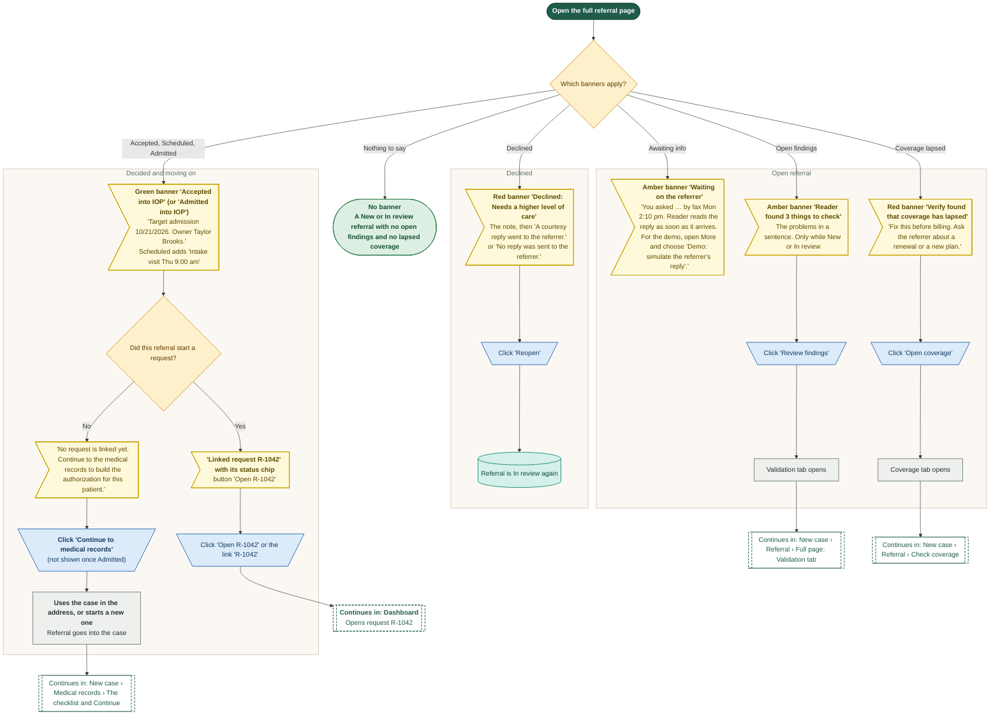

## Authorizations › New case › Referral › Schedule intake

After a referral is accepted, the full page books the intake visit and then marks the patient admitted. These two steps move a referral through Scheduled to Admitted.

Route: `/authorizations/new/referral/RF-2053?draft=draft-1001`

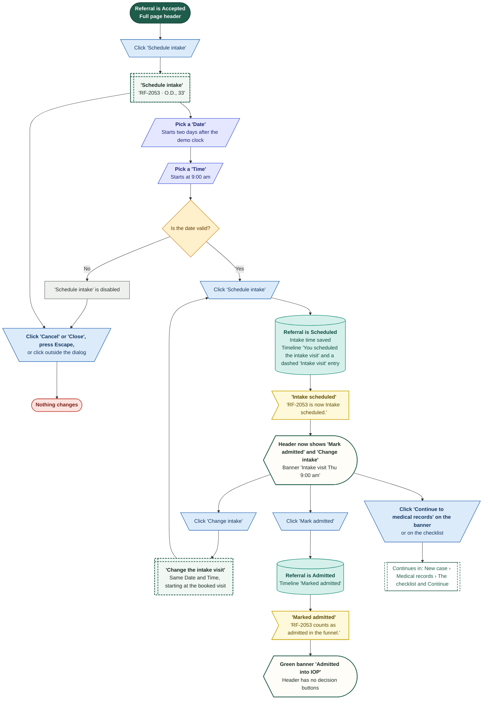

## Authorizations › New case › Medical records › The checklist and Continue

Step 2 is one page: a drop zone and one checklist card with four short lists. This diagram shows what is on it, what keeps 'Continue' switched off, and what each footer button does. The other diagrams in this step zoom into each part.

Route: `/authorizations/new/:draftId (step 2 of 4, 'Medical records')`

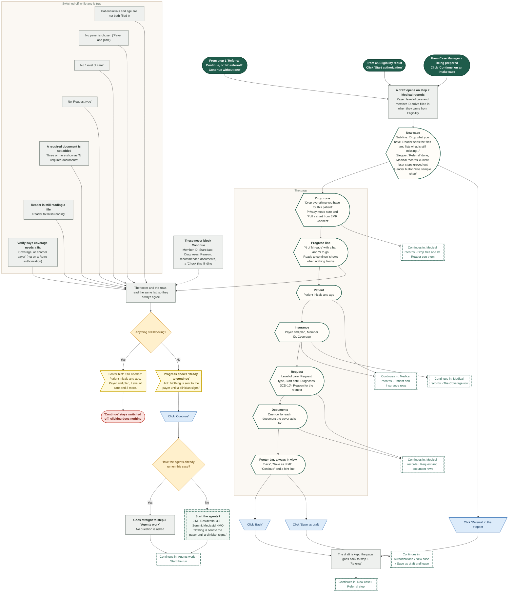

## Authorizations › New case › Medical records › Drop files and let Reader sort them

One drop zone takes the whole pile. Reader sorts files by what their names say, fills what is still blank, reads each file, and reports in one toast. 'Use sample chart' does the same job for J.M. in one click.

Route: `/authorizations/new/:draftId (step 2, the drop zone and 'Use sample chart')`

```mermaid
%%{init: {"theme":"base","themeVariables":{"fontFamily":"'DM Sans', 'Segoe UI', system-ui, sans-serif","fontSize":"15px","lineColor":"#5B6B63","primaryTextColor":"#1C2B25","clusterBkg":"#FBF8F3","clusterBorder":"#D9CDBB","edgeLabelBackground":"#FFFFFF"},"flowchart":{"curve":"basis","nodeSpacing":36,"rankSpacing":48,"padding":12,"htmlLabels":true,"useMaxWidth":false,"wrappingWidth":230}} }%%
flowchart TD
  classDef k_start fill:#1F5C4B,stroke:#174638,color:#FFFFFF,stroke-width:1.5px,font-weight:600
  classDef k_end fill:#DDEFE3,stroke:#2E7D4F,color:#14502F,stroke-width:1.5px,font-weight:600
  classDef k_endx fill:#FBE3E0,stroke:#C0392B,color:#7A1F16,stroke-width:1.5px,font-weight:600
  classDef k_screen fill:#FFFDF8,stroke:#1F5C4B,color:#1C2B25,stroke-width:2px
  classDef k_overlay fill:#F1F7F3,stroke:#1F5C4B,color:#1C2B25,stroke-width:2px,stroke-dasharray:5 3
  classDef k_click fill:#DCEBFA,stroke:#2F6DB5,color:#12365F,stroke-width:1.5px
  classDef k_input fill:#E4E7FF,stroke:#4C5FD5,color:#1D2670,stroke-width:1.5px
  classDef k_process fill:#EEF0EE,stroke:#7A857F,color:#26302B,stroke-width:1.5px
  classDef k_agent fill:#EEE5FA,stroke:#7A4FC2,color:#341A63,stroke-width:1.5px
  classDef k_decision fill:#FFF0CC,stroke:#D9962B,color:#5C3B00,stroke-width:1.5px
  classDef k_store fill:#D5F0EA,stroke:#1C8E7B,color:#0B4A3F,stroke-width:1.5px
  classDef k_doc fill:#F6E9DC,stroke:#B07A4C,color:#4A2E14,stroke-width:1.5px
  classDef k_ext fill:#FFE6D2,stroke:#E07B39,color:#6B2F06,stroke-width:1.5px
  classDef k_wait fill:#E4E8EE,stroke:#6B7C93,color:#26303D,stroke-width:1.5px
  classDef k_toast fill:#FFF9DB,stroke:#C9A400,color:#5A4A00,stroke-width:1.5px
  classDef k_goto fill:#FFFFFF,stroke:#1F5C4B,color:#1F5C4B,stroke-width:1.5px,stroke-dasharray:5 3
  s1@{ shape: stadium, label: "On step 2, give the drop zone some files" }
  i1@{ shape: lean-r, label: "<b>Drop files on 'Drop everything you have for this patient'</b><br/>Any names, any order, several at once" }
  c1@{ shape: trap-t, label: "Click the zone, or press Enter or Space" }
  p0@{ shape: rect, label: "<b>The file picker opens</b><br/>Several files can be chosen" }
  dNone@{ shape: diam, label: "Any file chosen?" }
  eNone@{ shape: stadium, label: "Nothing happens" }
  p1@{ shape: rect, label: "<b>Each file becomes a name and a size in KB</b><br/>Nothing is uploaded (demo)" }
  a1@{ shape: hex, label: "<b>Reader sorts the pile</b><br/>Insurance cards first, then everything else" }
  subgraph gCard ["1 · Card"]
  dCard@{ shape: diam, label: "<b>Is a file named like a card?</b><br/>Whole words: insurance, card, member, id" }
  pCard@{ shape: rect, label: "<b>The first card fills only what is blank:</b><br/>Payer and plan, Member ID" }
  pPayer@{ shape: rect, label: "<b>Payer comes from a payer name in the file name</b><br/>Otherwise Summit Medicaid HMO" }
  end
  subgraph gChart ["2 · Chart"]
  dChart@{ shape: diam, label: "Is there a file that is not a card?" }
  pFill@{ shape: rect, label: "<b>Fills only what is blank, from J.M.'s chart:</b><br/>Patient, Level of care, Request type, Diagnoses, Reason" }
  pKeep@{ shape: rect, label: "<b>Never overwrites what was typed</b><br/>or what a referral or EMR Connect gave" }
  end
  subgraph gSlot ["3 · Slots"]
  a2@{ shape: hex, label: "<b>Reader looks for document words in the file name</b><br/>asam, urine, nursing, medication, psychosocial, therapy..." }
  dName@{ shape: diam, label: "<b>Does the name match a document?</b><br/>The longest matching word wins" }
  dTaken@{ shape: diam, label: "Did an earlier file in this drop already take that slot?" }
  pDup@{ shape: rect, label: "Second file: 'Could not place'" }
  pPlace@{ shape: rect, label: "<b>File goes into its slot</b><br/>It replaces any file already in that slot" }
  dOpen@{ shape: diam, label: "No match: is a required slot still open?" }
  pGuess@{ shape: rect, label: "<b>Takes the first open required slot, referral last</b><br/>'Reader guessed this one. Check it.'" }
  pNone@{ shape: rect, label: "<b>'Could not place'</b><br/>Any file type is taken, but there is no slot left" }
  end
  st1@{ shape: cyl, label: "<b>Draft updated once</b><br/>Each filled row remembers its file: 'Read from FILE by Reader. Check it.'" }
  pReset@{ shape: rect, label: "<b>If the agents had already run, the run restarts</b><br/>Because the documents changed" }
  a3@{ shape: hex, label: "<b>Reader reads each placed file</b><br/>About 1 second each, one after another<br/>Row shows 'Reader is reading'" }
  dFind@{ shape: diam, label: "<b>Does the file get a finding?</b><br/>Sample files are scripted<br/>Other files: about 1 case in 5" }
  pOk@{ shape: rect, label: "Row: 'N checks passed'" }
  pWarn@{ shape: rect, label: "Row: 'Check this' with the finding text" }
  t1@{ shape: odd, label: "<b>'Reader sorted 6 files: 2 matched, 4 need a look'</b><br/>'Could not place: ... Check where Reader put: ... Findings in: ...'" }
  pTick@{ shape: rect, label: "<b>Checklist rows tick off</b><br/>Continue switches on when nothing blocks" }
  g30@{ shape: subproc, label: "Continues in: Medical records › The checklist and Continue" }
  subgraph gSample ["Use sample chart"]
  c2@{ shape: trap-t, label: "Click 'Use sample chart' (top right of step 2)" }
  dHas@{ shape: diam, label: "<b>Does the case already have a patient?</b><br/>From a referral, an EMR pull or typed initials" }
  stAll@{ shape: cyl, label: "<b>Fills J.M., 34 · Summit Medicaid HMO · …4821</b><br/>Residential 3.5 · Admission · F10.20, F33.2 · reason" }
  stKeep@{ shape: cyl, label: "<b>Keeps that patient and request</b><br/>Adds only a blank member ID, start date or type" }
  stDocs@{ shape: cyl, label: "<b>Adds 8 of the 9 Summit documents</b><br/>'Therapy note from the last 14 days' is left out on purpose" }
  t2@{ shape: odd, label: "<b>'Sample chart loaded'</b><br/>'J.M., 34. 8 of 9 documents are added and being checked.'" }
  end
  s1 --> i1
  s1 --> c1
  c1 --> p0 --> dNone
  dNone -->|"No"| eNone
  dNone -->|"Yes"| p1
  i1 --> p1
  p1 --> a1 --> dCard
  dCard -->|"Yes"| pCard --> pPayer --> dChart
  dCard -->|"No"| dChart
  dChart -->|"Yes"| pFill --> pKeep --> a2
  dChart -->|"No"| a2
  a2 --> dName
  dName -->|"Yes"| dTaken
  dName -->|"No"| dOpen
  dTaken -->|"Yes"| pDup --> st1
  dTaken -->|"No"| pPlace --> st1
  dOpen -->|"Yes"| pGuess --> st1
  dOpen -->|"No"| pNone --> st1
  st1 --> pReset --> a3 --> dFind
  dFind -->|"No"| pOk --> t1
  dFind -->|"Yes"| pWarn --> t1
  t1 --> pTick --> g30
  s1 --> c2
  c2 --> dHas
  dHas -->|"No"| stAll --> stDocs
  dHas -->|"Yes"| stKeep --> stDocs
  stDocs --> t2 --> a3
  class s1 k_start
  class i1 k_input
  class c1,c2 k_click
  class p0,p1,pCard,pPayer,pFill,pKeep,pDup,pPlace,pGuess,pNone,pReset,pOk,pWarn,pTick k_process
  class dNone,dCard,dChart,dName,dTaken,dOpen,dFind,dHas k_decision
  class eNone k_endx
  class a1,a2,a3 k_agent
  class st1,stAll,stKeep,stDocs k_store
  class t1,t2 k_toast
  class g30 k_goto
  style gCard fill:#FBF8F3,stroke:#D9CDBB,stroke-width:1.5px,color:#5B6B63
  style gChart fill:#FBF8F3,stroke:#D9CDBB,stroke-width:1.5px,color:#5B6B63
  style gSlot fill:#FBF8F3,stroke:#D9CDBB,stroke-width:1.5px,color:#5B6B63
  style gSample fill:#FBF8F3,stroke:#D9CDBB,stroke-width:1.5px,color:#5B6B63
```

## Authorizations › New case › Medical records › Patient and insurance rows

Each field row says where its value came from, and its button opens a small editor under the row. Edits go straight into the draft. This diagram also covers 'Pull a chart from EMR Connect'. The Coverage row has its own diagram.

Route: `/authorizations/new/:draftId (step 2, Patient and Insurance lists)`

```mermaid
%%{init: {"theme":"base","themeVariables":{"fontFamily":"'DM Sans', 'Segoe UI', system-ui, sans-serif","fontSize":"15px","lineColor":"#5B6B63","primaryTextColor":"#1C2B25","clusterBkg":"#FBF8F3","clusterBorder":"#D9CDBB","edgeLabelBackground":"#FFFFFF"},"flowchart":{"curve":"basis","nodeSpacing":36,"rankSpacing":48,"padding":12,"htmlLabels":true,"useMaxWidth":false,"wrappingWidth":230}} }%%
flowchart TD
  classDef k_start fill:#1F5C4B,stroke:#174638,color:#FFFFFF,stroke-width:1.5px,font-weight:600
  classDef k_end fill:#DDEFE3,stroke:#2E7D4F,color:#14502F,stroke-width:1.5px,font-weight:600
  classDef k_endx fill:#FBE3E0,stroke:#C0392B,color:#7A1F16,stroke-width:1.5px,font-weight:600
  classDef k_screen fill:#FFFDF8,stroke:#1F5C4B,color:#1C2B25,stroke-width:2px
  classDef k_overlay fill:#F1F7F3,stroke:#1F5C4B,color:#1C2B25,stroke-width:2px,stroke-dasharray:5 3
  classDef k_click fill:#DCEBFA,stroke:#2F6DB5,color:#12365F,stroke-width:1.5px
  classDef k_input fill:#E4E7FF,stroke:#4C5FD5,color:#1D2670,stroke-width:1.5px
  classDef k_process fill:#EEF0EE,stroke:#7A857F,color:#26302B,stroke-width:1.5px
  classDef k_agent fill:#EEE5FA,stroke:#7A4FC2,color:#341A63,stroke-width:1.5px
  classDef k_decision fill:#FFF0CC,stroke:#D9962B,color:#5C3B00,stroke-width:1.5px
  classDef k_store fill:#D5F0EA,stroke:#1C8E7B,color:#0B4A3F,stroke-width:1.5px
  classDef k_doc fill:#F6E9DC,stroke:#B07A4C,color:#4A2E14,stroke-width:1.5px
  classDef k_ext fill:#FFE6D2,stroke:#E07B39,color:#6B2F06,stroke-width:1.5px
  classDef k_wait fill:#E4E8EE,stroke:#6B7C93,color:#26303D,stroke-width:1.5px
  classDef k_toast fill:#FFF9DB,stroke:#C9A400,color:#5A4A00,stroke-width:1.5px
  classDef k_goto fill:#FFFFFF,stroke:#1F5C4B,color:#1F5C4B,stroke-width:1.5px,stroke-dasharray:5 3
  s1@{ shape: stadium, label: "On step 2, read the Patient and Insurance rows" }
  sc@{ shape: curv-trap, label: "<b>Patient: 'Patient initials and age'</b><br/>Insurance: 'Payer and plan', 'Member ID', 'Coverage'<br/>Each row: a box, a label, a detail line and one button" }
  subgraph gState ["What a row can say"]
  dSrc@{ shape: diam, label: "Does the row have a value?" }
  r1@{ shape: rect, label: "<b>Read from a file</b><br/>'Read from chart.pdf by Reader. Check it.'" }
  r3@{ shape: rect, label: "<b>From a referral</b><br/>'From referral RF-2054'" }
  r4@{ shape: rect, label: "<b>From EMR Connect</b><br/>'From EMR Connect'" }
  r2@{ shape: rect, label: "<b>Typed by a person</b><br/>The detail shows the value with no source note" }
  r5@{ shape: rect, label: "<b>Missing</b><br/>'Not found yet. Drop a chart above or add it here.'<br/>Row shaded, button 'Add'" }
  r6@{ shape: rect, label: "<b>Half filled</b><br/>'Found initials J.M.. The age is still needed.'" }
  rNote@{ shape: rect, label: "A source note goes quiet as soon as the value is edited" }
  end
  cEdit@{ shape: trap-t, label: "Click 'Add' (empty row) or 'Edit' (filled row)" }
  oEd@{ shape: win-pane, label: "<b>Editor opens under the row</b><br/>First box takes focus<br/>Only one editor is open at a time" }
  cAgain@{ shape: trap-t, label: "Click the same row button again" }
  pClose@{ shape: rect, label: "Editor closes" }
  subgraph gPatient ["Patient initials and age"]
  iInit@{ shape: lean-r, label: "<b>Type 'Patient initials'</b><br/>Up to 8 letters, shown in capitals, e.g. J.M." }
  iAge@{ shape: lean-r, label: "Type 'Age' (1 to 110)" }
  pName@{ shape: rect, label: "Hint: 'Initials and age only. A name never enters the app.'" }
  end
  subgraph gPayer ["Payer and plan"]
  iPayer@{ shape: lean-r, label: "<b>Pick 'Payer' (Choose a payer)</b><br/>Six payers" }
  pPlan@{ shape: rect, label: "<b>'Plan type' fills in for that payer</b><br/>HMO, PPO, Medicare Advantage..." }
  iPlan@{ shape: lean-r, label: "Optional: pick another 'Plan type'" }
  end
  subgraph gMember ["Member ID"]
  iMember@{ shape: lean-r, label: "Type 'Member ID'" }
  pMask@{ shape: rect, label: "<b>Detail shows only the last four, e.g. …4821</b><br/>'agents see only the last four'" }
  end
  cDone@{ shape: trap-t, label: "Click 'Done', or press Escape in a text box" }
  stLive@{ shape: cyl, label: "<b>Every keystroke is written to the draft</b><br/>Nothing to save" }
  pStale@{ shape: rect, label: "<b>If the agents had already run, the run restarts</b><br/>Answers and summary edits are cleared" }
  g40@{ shape: subproc, label: "Continues in: Medical records › The Coverage row" }
  subgraph gEmr ["EMR pull"]
  cPull@{ shape: trap-t, label: "<b>Click 'Pull a chart from EMR Connect'</b><br/>Clicking again closes the picker" }
  oPick@{ shape: win-pane, label: "<b>Chart from EMR Connect</b><br/>Picker with a chart list, 'Pull' and 'Cancel'" }
  iChart@{ shape: lean-r, label: "<b>Pick a chart</b><br/>J.M., 34 · Summit · Residential 3.5 · A.R. · S.T. · L.G." }
  cPullGo@{ shape: trap-t, label: "Click 'Pull'" }
  pPulling@{ shape: rect, label: "<b>Button reads 'Pulling' for about 1 second</b><br/>The list and 'Cancel' switch off" }
  xEmr@{ shape: st-rect, label: "<b>EMR Connect (demo: simulated)</b><br/>The chart's patient, payer, member ID, level of care, type, diagnoses and reason" }
  stEmr@{ shape: cyl, label: "<b>Draft filled, replacing those fields</b><br/>No documents come with it" }
  tEmr@{ shape: odd, label: "<b>'Pulled J.M., 34 from EMR Connect'</b><br/>'Everything below was filled in from the chart. You can still change it.'" }
  cCancelEmr@{ shape: trap-t, label: "Click 'Cancel'" }
  pCancelEmr@{ shape: rect, label: "Picker closes; nothing changes" }
  end
  s1 --> sc --> dSrc
  dSrc -->|"Read by Reader"| r1
  dSrc -->|"From a referral"| r3
  dSrc -->|"From the EMR"| r4
  dSrc -->|"Typed"| r2
  dSrc -->|"No"| r5
  dSrc -->|"Only one of two"| r6
  r1 --> rNote
  r3 --> rNote
  r4 --> rNote
  sc --> cEdit --> oEd
  oEd --> iInit
  iInit --> iAge --> pName
  oEd --> iPayer --> pPlan --> iPlan
  oEd --> iMember --> pMask
  r5 --> cEdit
  r6 --> cEdit
  pName --> cDone
  iPlan --> cDone
  pMask --> cDone
  cDone --> stLive --> pStale
  oEd --> cAgain --> pClose
  cDone --> pClose
  sc --> g40
  sc --> cPull --> oPick --> iChart --> cPullGo --> pPulling --> xEmr --> stEmr --> tEmr
  oPick --> cCancelEmr --> pCancelEmr
  stEmr -.-> pStale
  class s1 k_start
  class sc k_screen
  class dSrc k_decision
  class r1,r3,r4,r2,r5,r6,rNote,pClose,pName,pPlan,pMask,pStale,pPulling,pCancelEmr k_process
  class cEdit,cAgain,cDone,cPull,cPullGo,cCancelEmr k_click
  class oEd,oPick k_overlay
  class iInit,iAge,iPayer,iPlan,iMember,iChart k_input
  class stLive,stEmr k_store
  class g40 k_goto
  class xEmr k_ext
  class tEmr k_toast
  style gState fill:#FBF8F3,stroke:#D9CDBB,stroke-width:1.5px,color:#5B6B63
  style gPatient fill:#FBF8F3,stroke:#D9CDBB,stroke-width:1.5px,color:#5B6B63
  style gPayer fill:#FBF8F3,stroke:#D9CDBB,stroke-width:1.5px,color:#5B6B63
  style gMember fill:#FBF8F3,stroke:#D9CDBB,stroke-width:1.5px,color:#5B6B63
  style gEmr fill:#FBF8F3,stroke:#D9CDBB,stroke-width:1.5px,color:#5B6B63
```

## Authorizations › New case › Medical records › Request and document rows

Request rows are typed or picked in a small editor. Document rows list what the payer asks for, and each one is added, looked at or taken out with the buttons on the row. There is no 'Replace' or 'Mark not available' button in the demo.

Route: `/authorizations/new/:draftId (step 2, Request and Documents lists)`

```mermaid
%%{init: {"theme":"base","themeVariables":{"fontFamily":"'DM Sans', 'Segoe UI', system-ui, sans-serif","fontSize":"15px","lineColor":"#5B6B63","primaryTextColor":"#1C2B25","clusterBkg":"#FBF8F3","clusterBorder":"#D9CDBB","edgeLabelBackground":"#FFFFFF"},"flowchart":{"curve":"basis","nodeSpacing":36,"rankSpacing":48,"padding":12,"htmlLabels":true,"useMaxWidth":false,"wrappingWidth":230}} }%%
flowchart TD
  classDef k_start fill:#1F5C4B,stroke:#174638,color:#FFFFFF,stroke-width:1.5px,font-weight:600
  classDef k_end fill:#DDEFE3,stroke:#2E7D4F,color:#14502F,stroke-width:1.5px,font-weight:600
  classDef k_endx fill:#FBE3E0,stroke:#C0392B,color:#7A1F16,stroke-width:1.5px,font-weight:600
  classDef k_screen fill:#FFFDF8,stroke:#1F5C4B,color:#1C2B25,stroke-width:2px
  classDef k_overlay fill:#F1F7F3,stroke:#1F5C4B,color:#1C2B25,stroke-width:2px,stroke-dasharray:5 3
  classDef k_click fill:#DCEBFA,stroke:#2F6DB5,color:#12365F,stroke-width:1.5px
  classDef k_input fill:#E4E7FF,stroke:#4C5FD5,color:#1D2670,stroke-width:1.5px
  classDef k_process fill:#EEF0EE,stroke:#7A857F,color:#26302B,stroke-width:1.5px
  classDef k_agent fill:#EEE5FA,stroke:#7A4FC2,color:#341A63,stroke-width:1.5px
  classDef k_decision fill:#FFF0CC,stroke:#D9962B,color:#5C3B00,stroke-width:1.5px
  classDef k_store fill:#D5F0EA,stroke:#1C8E7B,color:#0B4A3F,stroke-width:1.5px
  classDef k_doc fill:#F6E9DC,stroke:#B07A4C,color:#4A2E14,stroke-width:1.5px
  classDef k_ext fill:#FFE6D2,stroke:#E07B39,color:#6B2F06,stroke-width:1.5px
  classDef k_wait fill:#E4E8EE,stroke:#6B7C93,color:#26303D,stroke-width:1.5px
  classDef k_toast fill:#FFF9DB,stroke:#C9A400,color:#5A4A00,stroke-width:1.5px
  classDef k_goto fill:#FFFFFF,stroke:#1F5C4B,color:#1F5C4B,stroke-width:1.5px,stroke-dasharray:5 3
  s1@{ shape: stadium, label: "On step 2, read the Request and Documents lists" }
  sc@{ shape: curv-trap, label: "<b>Request: Level of care, Request type, Start date, Diagnoses (ICD-10), Reason for the request</b><br/>Documents: one row for each document the payer asks for" }
  subgraph gReq ["Request rows"]
  cLvl@{ shape: trap-t, label: "Click 'Add' or 'Edit' on 'Level of care'" }
  iLvl@{ shape: lean-r, label: "<b>Pick 'Level of care'</b><br/>Residential 3.5, IOP, PHP or Detox" }
  pLvl@{ shape: rect, label: "<b>Editor closes at once, no 'Done'</b><br/>The document list is rebuilt for this payer and level of care" }
  cType@{ shape: trap-t, label: "Click 'Add' or 'Edit' on 'Request type'" }
  iType@{ shape: lean-r, label: "<b>Pick 'Request type'</b><br/>Initial request, Admission, Continued stay, Recertification, Retro-authorization" }
  pType@{ shape: rect, label: "<b>Editor closes at once</b><br/>Admission adds 'notice due in about 5 hours', Retro-authorization 'window closes in about 18 hours'" }
  cStart@{ shape: trap-t, label: "Click 'Edit' on 'Start date' (Recommended)" }
  iStart@{ shape: lean-r, label: "<b>Pick the 'Requested start date'</b><br/>Starts as today, Tue Oct 20, 2026" }
  cDx@{ shape: trap-t, label: "Click 'Add' on 'Diagnoses (ICD-10)' (Recommended)" }
  iDx@{ shape: lean-r, label: "<b>Type in 'Add a diagnosis'</b><br/>Example: F10 or alcohol" }
  pDx@{ shape: rect, label: "<b>Up to six matches from 13 codes</b><br/>Codes already added are hidden" }
  cPickDx@{ shape: trap-t, label: "Click a match" }
  pChip@{ shape: rect, label: "A chip with the code is added and the box clears" }
  cRemDx@{ shape: trap-t, label: "Click the x on a chip ('Remove F10.20')" }
  cReason@{ shape: trap-t, label: "Click 'Add' on 'Reason for the request' (Recommended)" }
  iReason@{ shape: lean-r, label: "<b>Type one or two plain sentences</b><br/>'Scribe uses it in the summary.'" }
  cDone@{ shape: trap-t, label: "Click 'Done', or press Escape in a text box" }
  stReq@{ shape: cyl, label: "<b>Draft updated as you type</b><br/>If the agents had already run, the run restarts" }
  end
  subgraph gDocs ["Document rows"]
  pList@{ shape: rect, label: "<b>The payer and level of care decide the list</b><br/>Summit Residential 3.5: 9 documents, 7 required<br/>No payer yet: only the referral and the diagnosis report" }
  dRow@{ shape: diam, label: "What does the row hold?" }
  rMiss@{ shape: rect, label: "<b>Required, empty: 'Not found yet. Drop it above or add it here.'</b><br/>Buttons 'Add file' and 'Use sample file'" }
  rOpt@{ shape: rect, label: "<b>Recommended, empty: 'You can continue without it.'</b><br/>Same two buttons" }
  rRef@{ shape: rect, label: "Referral row, empty: also 'Add a referral'" }
  rFile@{ shape: rect, label: "File in place: name, then 'N checks passed' or 'Check this' with the finding" }
  rExtra@{ shape: rect, label: "File the payer does not ask for: tagged 'Not on the list'" }
  cAdd@{ shape: trap-t, label: "Click 'Add file'" }
  iFile@{ shape: lean-r, label: "Choose one file in the picker" }
  cSample@{ shape: trap-t, label: "Click 'Use sample file'" }
  aRead@{ shape: hex, label: "<b>Reader reads the file for about 1 second</b><br/>Row shows 'Reader is reading'" }
  cEye@{ shape: trap-t, label: "Click the eye ('View FILE NAME')" }
  oView@{ shape: win-pane, label: "<b>Drawer: the document name, 'FILE NAME · 186 KB'</b><br/>Page 1 of 3 with Evidence and 'What Reader checked'" }
  cClose@{ shape: trap-t, label: "Press Escape or click the drawer's close button" }
  cX@{ shape: trap-t, label: "Click the x ('Remove FILE NAME')" }
  stDrop@{ shape: cyl, label: "<b>Document taken out</b><br/>The row goes back to missing or recommended" }
  pSwap@{ shape: rect, label: "<b>To swap a file: remove it and 'Add file'</b><br/>Or drop a file whose name fits the same slot, which replaces it" }
  cView@{ shape: trap-t, label: "Click 'View' on the referral that came with the case" }
  gRef@{ shape: subproc, label: "Continues in: New case › Referral step" }
  cAddRef@{ shape: trap-t, label: "Click 'Add a referral'" }
  end
  s1 --> sc
  sc --> cLvl --> iLvl --> pLvl
  sc --> cType --> iType --> pType
  sc --> cStart --> iStart --> cDone
  sc --> cDx --> iDx --> pDx --> cPickDx --> pChip
  pChip --> cRemDx
  sc --> cReason --> iReason --> cDone
  cRemDx --> stReq
  cDone --> stReq
  pLvl --> stReq
  pType --> stReq
  pChip --> cDone
  pLvl -.-> pList
  sc --> pList --> dRow
  dRow -->|"Required, no file"| rMiss
  dRow -->|"Recommended, no file"| rOpt
  dRow -->|"Referral, no file"| rRef
  dRow -->|"File in place"| rFile
  dRow -->|"Not on the payer's list"| rExtra
  rMiss --> cAdd
  rMiss --> cSample
  rOpt --> cAdd
  rRef --> cAddRef --> gRef
  cAdd --> iFile --> aRead
  cSample --> aRead
  aRead --> rFile
  rFile --> cEye --> oView --> cClose
  rFile --> cX --> stDrop --> pSwap
  rFile --> cView --> gRef
  stDrop -.-> stReq
  class s1 k_start
  class sc k_screen
  class cLvl,cType,cStart,cDx,cPickDx,cRemDx,cReason,cDone,cAdd,cSample,cEye,cClose,cX,cView,cAddRef k_click
  class iLvl,iType,iStart,iDx,iReason,iFile k_input
  class pLvl,pType,pDx,pChip,pList,rMiss,rOpt,rRef,rFile,rExtra,pSwap k_process
  class stReq,stDrop k_store
  class dRow k_decision
  class aRead k_agent
  class oView k_overlay
  class gRef k_goto
  style gReq fill:#FBF8F3,stroke:#D9CDBB,stroke-width:1.5px,color:#5B6B63
  style gDocs fill:#FBF8F3,stroke:#D9CDBB,stroke-width:1.5px,color:#5B6B63
```

## Authorizations › New case › Agents work › Start the run and watch it

'Continue' on step 2 asks once, then ten agents work in order for about 13 seconds. The page shows each agent's line, the approval chance climbing, two ways to raise it, and Pause and Skip ahead. All progress is written to the draft.

Route: `/authorizations/new/:draftId (step 3 of 4, 'Agents work')`

```mermaid
%%{init: {"theme":"base","themeVariables":{"fontFamily":"'DM Sans', 'Segoe UI', system-ui, sans-serif","fontSize":"15px","lineColor":"#5B6B63","primaryTextColor":"#1C2B25","clusterBkg":"#FBF8F3","clusterBorder":"#D9CDBB","edgeLabelBackground":"#FFFFFF"},"flowchart":{"curve":"basis","nodeSpacing":36,"rankSpacing":48,"padding":12,"htmlLabels":true,"useMaxWidth":false,"wrappingWidth":230}} }%%
flowchart TD
  classDef k_start fill:#1F5C4B,stroke:#174638,color:#FFFFFF,stroke-width:1.5px,font-weight:600
  classDef k_end fill:#DDEFE3,stroke:#2E7D4F,color:#14502F,stroke-width:1.5px,font-weight:600
  classDef k_endx fill:#FBE3E0,stroke:#C0392B,color:#7A1F16,stroke-width:1.5px,font-weight:600
  classDef k_screen fill:#FFFDF8,stroke:#1F5C4B,color:#1C2B25,stroke-width:2px
  classDef k_overlay fill:#F1F7F3,stroke:#1F5C4B,color:#1C2B25,stroke-width:2px,stroke-dasharray:5 3
  classDef k_click fill:#DCEBFA,stroke:#2F6DB5,color:#12365F,stroke-width:1.5px
  classDef k_input fill:#E4E7FF,stroke:#4C5FD5,color:#1D2670,stroke-width:1.5px
  classDef k_process fill:#EEF0EE,stroke:#7A857F,color:#26302B,stroke-width:1.5px
  classDef k_agent fill:#EEE5FA,stroke:#7A4FC2,color:#341A63,stroke-width:1.5px
  classDef k_decision fill:#FFF0CC,stroke:#D9962B,color:#5C3B00,stroke-width:1.5px
  classDef k_store fill:#D5F0EA,stroke:#1C8E7B,color:#0B4A3F,stroke-width:1.5px
  classDef k_doc fill:#F6E9DC,stroke:#B07A4C,color:#4A2E14,stroke-width:1.5px
  classDef k_ext fill:#FFE6D2,stroke:#E07B39,color:#6B2F06,stroke-width:1.5px
  classDef k_wait fill:#E4E8EE,stroke:#6B7C93,color:#26303D,stroke-width:1.5px
  classDef k_toast fill:#FFF9DB,stroke:#C9A400,color:#5A4A00,stroke-width:1.5px
  classDef k_goto fill:#FFFFFF,stroke:#1F5C4B,color:#1F5C4B,stroke-width:1.5px,stroke-dasharray:5 3
  s1@{ shape: stadium, label: "<b>On step 2, click 'Continue'</b><br/>Every required item is in" }
  o1@{ shape: win-pane, label: "<b>Start the agents?</b><br/>J.M., Residential 3.5 · Summit Medicaid HMO<br/>'Scribe drafts the case and may ask you up to three questions.'<br/>'Nothing is sent to the payer until a clinician signs.'" }
  cCancel@{ shape: trap-t, label: "Click 'Cancel', press Escape, or click outside" }
  eCancel@{ shape: stadium, label: "Back on step 2; nothing started" }
  cStart@{ shape: trap-t, label: "Click 'Start the agents'" }
  st1@{ shape: cyl, label: "<b>Draft saved as a case with an ID such as R-1701</b><br/>It now shows in Case Manager › Being prepared" }
  st2@{ shape: cyl, label: "<b>Run set up</b><br/>Chance range from the payer: 62% to 88% for Summit<br/>One question picked<br/>Clock set from the request type" }
  sc@{ shape: curv-trap, label: "<b>Step 3 'Agents work'</b><br/>'Agents at work on R-1701'<br/>'Residential 3.5 admission · Summit Medicaid HMO' and a clock chip that counts up" }
  pRow@{ shape: rect, label: "Each agent row goes 'Waiting', then 'Working' with a spinner, then a green tick with its time" }
  subgraph gRun ["Ten agents, in this order"]
  a1@{ shape: hex, label: "<b>Reader · 1.3 s</b><br/>'Read 8 files and found 214 facts. Identifiers are now codes'" }
  a2@{ shape: hex, label: "<b>Verify · 1.0 s</b><br/>'Coverage is active and prior authorization is required'" }
  a3@{ shape: hex, label: "<b>Criteria · 1.4 s</b><br/>'Matched the chart to Summit's criteria: 9 of 9 requirements met'" }
  a4@{ shape: hex, label: "<b>Historian · 1.3 s</b><br/>'Reviewed 1,248 similar Summit decisions: 212 your own, 806 network, 230 benchmark'" }
  a5@{ shape: hex, label: "<b>Placement · 1.0 s</b><br/>'The chart supports Residential 3.5 (ASAM 3.5)'" }
  a6@{ shape: hex, label: "<b>Forecaster · 1.1 s</b><br/>'Approval chance 88%, likely 83-92%'" }
  a7@{ shape: hex, label: "<b>Scribe · 2.2 s</b><br/>Stops to ask one question, then 'Drafted the medical-necessity summary'" }
  a8@{ shape: hex, label: "<b>Integrity · 1.4 s</b><br/>'Every sentence traces to the chart'" }
  a9@{ shape: hex, label: "<b>Packet · 1.3 s</b><br/>'Assembled Summit's form with 8 attachments'" }
  a10@{ shape: hex, label: "<b>Scrubber · 1.0 s</b><br/>'Checked the request for errors. None found'" }
  end
  subgraph gChance ["Approval chance panel"]
  pRing@{ shape: rect, label: "<b>Ring starts at 62% ('started at 62%')</b><br/>It climbs as Verify, Criteria, Historian and Placement finish: 65, 72, 78, 83" }
  pPill@{ shape: rect, label: "Pill: 'Moderate so far · likely 53-70%'" }
  pSettle@{ shape: rect, label: "<b>After Forecaster: 88%</b><br/>Pill: 'Strong · likely 83-92%'<br/>'Based on 1,248 similar cases'" }
  end
  subgraph gRaise ["To raise it further"]
  cTick1@{ shape: trap-t, label: "<b>Tick 'Name the step-down provider'</b><br/>+2-4" }
  cTick2@{ shape: trap-t, label: "<b>Tick 'Attach the 2025 IOP discharge summary'</b><br/>+1-3" }
  pBoost@{ shape: rect, label: "<b>Chance goes up 3 or 2 points, never above 97%</b><br/>The summary will be rebuilt with an extra line" }
  cUntick@{ shape: trap-t, label: "<b>Untick a box</b><br/>The points come off" }
  end
  subgraph gFoot ["Footer buttons"]
  cPause@{ shape: trap-t, label: "Click 'Pause all agents'" }
  tPause@{ shape: odd, label: "<b>'All agents are paused'</b><br/>'Nothing is read, checked or drafted until you resume them. Nothing has been sent to the payer.'" }
  cResume@{ shape: trap-t, label: "Click 'Resume agents'" }
  cSkip@{ shape: trap-t, label: "Click 'Skip ahead'" }
  pFast@{ shape: rect, label: "<b>Each step now takes about 0.14 s</b><br/>The button switches off<br/>A question still stops the run" }
  cBack@{ shape: trap-t, label: "Click 'Back'" }
  end
  pAway@{ shape: rect, label: "<b>Leave the page and progress is kept in the draft</b><br/>But the agents only move while this page is open<br/>Hint: 'The agents work on their own. You can leave and come back.'" }
  g35@{ shape: subproc, label: "Continues in: Agents work › An agent asks a question" }
  g36@{ shape: subproc, label: "Continues in: Agents work › Finished, paused or left" }
  s1 --> o1
  o1 --> cCancel --> eCancel
  o1 --> cStart --> st1 --> st2 --> sc --> pRow --> a1
  a1 --> a2 --> a3 --> a4 --> a5 --> a6 --> a7 --> a8 --> a9 --> a10 --> g36
  a7 -.->|"Stops once"| g35
  sc --> pRing --> pPill --> pSettle
  a6 -.-> pSettle
  sc --> cTick1 --> pBoost
  sc --> cTick2 --> pBoost
  pBoost --> cUntick
  sc --> cPause --> tPause --> cResume
  sc --> cSkip --> pFast
  sc --> cBack --> g36
  sc --> pAway --> g36
  class s1 k_start
  class o1 k_overlay
  class cCancel,cStart,cTick1,cTick2,cUntick,cPause,cResume,cSkip,cBack k_click
  class eCancel k_endx
  class st1,st2 k_store
  class sc k_screen
  class pRow,pRing,pPill,pSettle,pBoost,pFast,pAway k_process
  class a1,a2,a3,a4,a5,a6,a7,a8,a9,a10 k_agent
  class tPause k_toast
  class g35,g36 k_goto
  style gRun fill:#FBF8F3,stroke:#D9CDBB,stroke-width:1.5px,color:#5B6B63
  style gChance fill:#FBF8F3,stroke:#D9CDBB,stroke-width:1.5px,color:#5B6B63
  style gRaise fill:#FBF8F3,stroke:#D9CDBB,stroke-width:1.5px,color:#5B6B63
  style gFoot fill:#FBF8F3,stroke:#D9CDBB,stroke-width:1.5px,color:#5B6B63
```

## Authorizations › New case › Agents work › An agent asks a question

Scribe (or Packet) stops once to ask what the chart cannot say, and the agents wait. A question cannot be skipped: 'Answer later' only closes the pop-up. The answer goes into the draft and into the summary.

Route: `/authorizations/new/:draftId (step 3 of 4, the question pop-up)`

```mermaid
%%{init: {"theme":"base","themeVariables":{"fontFamily":"'DM Sans', 'Segoe UI', system-ui, sans-serif","fontSize":"15px","lineColor":"#5B6B63","primaryTextColor":"#1C2B25","clusterBkg":"#FBF8F3","clusterBorder":"#D9CDBB","edgeLabelBackground":"#FFFFFF"},"flowchart":{"curve":"basis","nodeSpacing":36,"rankSpacing":48,"padding":12,"htmlLabels":true,"useMaxWidth":false,"wrappingWidth":230}} }%%
flowchart TD
  classDef k_start fill:#1F5C4B,stroke:#174638,color:#FFFFFF,stroke-width:1.5px,font-weight:600
  classDef k_end fill:#DDEFE3,stroke:#2E7D4F,color:#14502F,stroke-width:1.5px,font-weight:600
  classDef k_endx fill:#FBE3E0,stroke:#C0392B,color:#7A1F16,stroke-width:1.5px,font-weight:600
  classDef k_screen fill:#FFFDF8,stroke:#1F5C4B,color:#1C2B25,stroke-width:2px
  classDef k_overlay fill:#F1F7F3,stroke:#1F5C4B,color:#1C2B25,stroke-width:2px,stroke-dasharray:5 3
  classDef k_click fill:#DCEBFA,stroke:#2F6DB5,color:#12365F,stroke-width:1.5px
  classDef k_input fill:#E4E7FF,stroke:#4C5FD5,color:#1D2670,stroke-width:1.5px
  classDef k_process fill:#EEF0EE,stroke:#7A857F,color:#26302B,stroke-width:1.5px
  classDef k_agent fill:#EEE5FA,stroke:#7A4FC2,color:#341A63,stroke-width:1.5px
  classDef k_decision fill:#FFF0CC,stroke:#D9962B,color:#5C3B00,stroke-width:1.5px
  classDef k_store fill:#D5F0EA,stroke:#1C8E7B,color:#0B4A3F,stroke-width:1.5px
  classDef k_doc fill:#F6E9DC,stroke:#B07A4C,color:#4A2E14,stroke-width:1.5px
  classDef k_ext fill:#FFE6D2,stroke:#E07B39,color:#6B2F06,stroke-width:1.5px
  classDef k_wait fill:#E4E8EE,stroke:#6B7C93,color:#26303D,stroke-width:1.5px
  classDef k_toast fill:#FFF9DB,stroke:#C9A400,color:#5A4A00,stroke-width:1.5px
  classDef k_goto fill:#FFFFFF,stroke:#1F5C4B,color:#1F5C4B,stroke-width:1.5px,stroke-dasharray:5 3
  s1@{ shape: stadium, label: "<b>The run reaches Scribe</b><br/>(Packet for IOP and PHP)" }
  p1@{ shape: rect, label: "The agent works about 45% of its step, then stops" }
  dKey@{ shape: diam, label: "Which question was picked when the agents started?" }
  q1@{ shape: rect, label: "<b>Sertraline</b><br/>'Sertraline starts 9/14 on the medication list and 9/21 in the psychiatric evaluation. Which is right?'<br/>Choices: '9/14 (the medication list)', '9/21 (the psychiatric evaluation)'" }
  q2@{ shape: rect, label: "<b>Step-down provider</b><br/>'Is a named step-down provider on file? Summit asks for one in residential continued stays.'<br/>Choices: 'Yes, a named provider is on file', 'Not yet. One will be named before day 10', 'Not applicable for this request'" }
  q3@{ shape: rect, label: "<b>Discharge date (Packet)</b><br/>'Is a discharge or step-down date planned in the next 30 days? The payer's form asks for it.'<br/>Choices: 'Yes, within 2 weeks', 'Yes, within 30 days', 'Not decided yet'" }
  sc@{ shape: curv-trap, label: "<b>Step 3 shows the question</b><br/>The asking row: 'Needs your answer' and a button 'Answer'<br/>Green banner: 'One question from Scribe.' and the text<br/>Hint: 'The agents are waiting for your answer.'" }
  oM@{ shape: win-pane, label: "<b>Scribe has a question</b><br/>'Question 1 of at most 3 for this case. The agents wait for you.'<br/>Choice cards, then 'Or add a note in your own words'" }
  pNoSkip@{ shape: rect, label: "'Pause all agents' and 'Skip ahead' do not get past the question" }
  iChoice@{ shape: lean-r, label: "<b>Click one choice card</b><br/>It highlights" }
  iNote@{ shape: lean-r, label: "<b>Type a note</b><br/>'Optional with a button above, or use it on its own.'" }
  dReady@{ shape: diam, label: "A choice or a note given?" }
  pOff@{ shape: rect, label: "'Send answer' stays switched off" }
  cSend@{ shape: trap-t, label: "Click 'Send answer'" }
  stAns@{ shape: cyl, label: "<b>Answer saved on the draft</b><br/>The choice's words without the bracket, or the typed note<br/>A note typed with a choice is kept beside it" }
  stClear@{ shape: cyl, label: "The summary draft is cleared so Scribe rebuilds it" }
  tYou@{ shape: odd, label: "<b>'You answered Scribe: ANSWER. It is in the draft.'</b><br/>With a typed note: 'ANSWER · NOTE. It is in the draft.'" }
  aGo@{ shape: hex, label: "<b>The agent finishes the other 55% of its step</b><br/>Then the remaining agents run" }
  pEffect@{ shape: rect, label: "<b>Sertraline answer: the Medication list finding becomes 'Sertraline start date confirmed by you: 9/14'</b><br/>Step-down 'Yes': the tick-box 'Name the step-down provider' disappears" }
  pSum@{ shape: rect, label: "<b>The draft summary uses the answer</b><br/>Clinical picture: 'Sertraline was started on 9/14.'<br/>Plan: 'A named step-down provider is on file.'" }
  cLater@{ shape: trap-t, label: "Click 'Answer later', press Escape, or click outside" }
  pLater@{ shape: rect, label: "<b>Pop-up closes; the agents stay stopped</b><br/>Banner stays; the row keeps 'Needs your answer'" }
  cAnswer@{ shape: trap-t, label: "Click 'Answer' on the agent's row" }
  pLeave@{ shape: rect, label: "Leave and come back: the pop-up opens again by itself" }
  gCM@{ shape: subproc, label: "Continues in: Case Manager › Being prepared" }
  g36@{ shape: subproc, label: "Continues in: Agents work › Finished, paused or left" }
  s1 --> p1 --> dKey
  dKey -->|"Medication list has the sertraline finding"| q1
  dKey -->|"Residential 3.5 or Detox"| q2
  dKey -->|"IOP or PHP"| q3
  q1 --> sc
  q2 --> sc
  q3 --> sc
  sc --> oM --> pNoSkip
  oM --> iChoice --> dReady
  oM --> iNote --> dReady
  dReady -->|"No"| pOff --> iChoice
  dReady -->|"Yes"| cSend --> stAns --> stClear --> tYou --> aGo --> pEffect --> pSum --> g36
  oM --> cLater --> pLater --> cAnswer --> oM
  pLater --> pLeave --> oM
  sc --> gCM
  class s1 k_start
  class p1,q1,q2,q3,pNoSkip,pOff,pEffect,pSum,pLater,pLeave k_process
  class dKey,dReady k_decision
  class sc k_screen
  class oM k_overlay
  class iChoice,iNote k_input
  class cSend,cLater,cAnswer k_click
  class stAns,stClear k_store
  class tYou k_toast
  class aGo k_agent
  class gCM,g36 k_goto
```

## Authorizations › New case › Agents work › Finished, paused or left

What the person can do when the ten agents are done, when the run stops, when they go Back, and when they reopen a draft that already ran. Changing the medical records after the agents ran throws their work away. The demo has no agent error or retry state.

Route: `/authorizations/new/:draftId (step 3 of 4, after the run)`

```mermaid
%%{init: {"theme":"base","themeVariables":{"fontFamily":"'DM Sans', 'Segoe UI', system-ui, sans-serif","fontSize":"15px","lineColor":"#5B6B63","primaryTextColor":"#1C2B25","clusterBkg":"#FBF8F3","clusterBorder":"#D9CDBB","edgeLabelBackground":"#FFFFFF"},"flowchart":{"curve":"basis","nodeSpacing":36,"rankSpacing":48,"padding":12,"htmlLabels":true,"useMaxWidth":false,"wrappingWidth":230}} }%%
flowchart TD
  classDef k_start fill:#1F5C4B,stroke:#174638,color:#FFFFFF,stroke-width:1.5px,font-weight:600
  classDef k_end fill:#DDEFE3,stroke:#2E7D4F,color:#14502F,stroke-width:1.5px,font-weight:600
  classDef k_endx fill:#FBE3E0,stroke:#C0392B,color:#7A1F16,stroke-width:1.5px,font-weight:600
  classDef k_screen fill:#FFFDF8,stroke:#1F5C4B,color:#1C2B25,stroke-width:2px
  classDef k_overlay fill:#F1F7F3,stroke:#1F5C4B,color:#1C2B25,stroke-width:2px,stroke-dasharray:5 3
  classDef k_click fill:#DCEBFA,stroke:#2F6DB5,color:#12365F,stroke-width:1.5px
  classDef k_input fill:#E4E7FF,stroke:#4C5FD5,color:#1D2670,stroke-width:1.5px
  classDef k_process fill:#EEF0EE,stroke:#7A857F,color:#26302B,stroke-width:1.5px
  classDef k_agent fill:#EEE5FA,stroke:#7A4FC2,color:#341A63,stroke-width:1.5px
  classDef k_decision fill:#FFF0CC,stroke:#D9962B,color:#5C3B00,stroke-width:1.5px
  classDef k_store fill:#D5F0EA,stroke:#1C8E7B,color:#0B4A3F,stroke-width:1.5px
  classDef k_doc fill:#F6E9DC,stroke:#B07A4C,color:#4A2E14,stroke-width:1.5px
  classDef k_ext fill:#FFE6D2,stroke:#E07B39,color:#6B2F06,stroke-width:1.5px
  classDef k_wait fill:#E4E8EE,stroke:#6B7C93,color:#26303D,stroke-width:1.5px
  classDef k_toast fill:#FFF9DB,stroke:#C9A400,color:#5A4A00,stroke-width:1.5px
  classDef k_goto fill:#FFFFFF,stroke:#1F5C4B,color:#1F5C4B,stroke-width:1.5px,stroke-dasharray:5 3
  s1@{ shape: stadium, label: "<b>Scrubber finishes</b><br/>The last of ten agents" }
  s2@{ shape: stadium, label: "<b>Click 'Back' on step 4</b><br/>'Review and sign'" }
  t1@{ shape: odd, label: "<b>Banner: 'All ten agents are done'</b><br/>'The draft and the four checks are ready. Nothing has been sent to the payer.'" }
  p1@{ shape: rect, label: "<b>Hint: 'Read the draft and sign it on the next step.'</b><br/>'Review and sign' switches on<br/>'Pause all agents' and 'Skip ahead' switch off" }
  pStop@{ shape: rect, label: "<b>The run only stops for a question, a pause, or when the page is closed</b><br/>There is no error or retry state" }
  dWhat@{ shape: diam, label: "What does the person do?" }
  cTick@{ shape: trap-t, label: "Tick or untick a 'To raise it further' box" }
  pTick@{ shape: rect, label: "Chance moves; the summary is rebuilt on the next step" }
  cReview@{ shape: trap-t, label: "Click 'Review and sign'" }
  gReview@{ shape: subproc, label: "Continues in: Review and sign › The draft and the summary" }
  cBack@{ shape: trap-t, label: "Click 'Back'" }
  cStep@{ shape: trap-t, label: "Click 'Medical records' or 'Referral' in the stepper" }
  pLock@{ shape: rect, label: "<b>The stepper's 'Review and sign' stays greyed out here</b><br/>Use the button instead" }
  sRec@{ shape: curv-trap, label: "<b>Step 2 'Medical records'</b><br/>Everything is as it was left" }
  dEdit@{ shape: diam, label: "Does the person change the records?" }
  pSame@{ shape: rect, label: "<b>Nothing changed</b><br/>The agents' work is kept" }
  cCont@{ shape: trap-t, label: "Click 'Continue'" }
  pDirect@{ shape: rect, label: "<b>Straight back to step 3 'Agents work'</b><br/>No 'Start the agents?' question" }
  stStale@{ shape: cyl, label: "<b>A change to the patient, payer, member ID, level of care, request type, start date, diagnoses, reason</b><br/>Or a document added, removed or replaced" }
  pReset@{ shape: rect, label: "<b>The run starts over: all ten agents back to 'Waiting'</b><br/>Answers, ticked boxes, summary edits and a send-back note are cleared<br/>No message is shown" }
  cCont2@{ shape: trap-t, label: "Click 'Continue'" }
  oConf@{ shape: win-pane, label: "Start the agents?" }
  gStart@{ shape: subproc, label: "Continues in: Agents work › Start the run and watch it" }
  gQ@{ shape: subproc, label: "Continues in: Agents work › An agent asks a question" }
  eBack@{ shape: stadium, label: "<b>Step 3 shows the run as it was</b><br/>Finished agents stay finished" }
  subgraph gResume ["Opening a draft that already ran"]
  s3@{ shape: stadium, label: "<b>Click 'Continue', 'Watch', 'Answer' or 'Review and sign'</b><br/>on a case in Case Manager › Being prepared" }
  pOpen@{ shape: rect, label: "<b>The page opens that draft from its address</b><br/>It is not reset" }
  dFar@{ shape: diam, label: "How far did the agents get?" }
  rNone@{ shape: rect, label: "<b>None yet</b><br/>Opens on step 2, or step 1 if it was left there" }
  rMid@{ shape: rect, label: "<b>Some of the ten</b><br/>Opens step 3; the run carries on with the next agent" }
  rAsk@{ shape: rect, label: "<b>Waiting on a question</b><br/>Opens step 3 and the question pop-up shows at once" }
  rAll@{ shape: rect, label: "<b>All ten</b><br/>Opens step 4 'Ready for your signature'" }
  end
  s1 --> t1 --> p1 --> pStop --> dWhat
  s2 --> p1
  dWhat --> cTick --> pTick
  dWhat --> cReview --> gReview
  dWhat --> cBack --> sRec
  dWhat --> cStep --> sRec
  cStep -.-> pLock
  sRec --> dEdit
  dEdit -->|"No"| pSame --> cCont --> pDirect --> eBack
  dEdit -->|"Yes"| stStale --> pReset --> cCont2 --> oConf --> gStart
  s3 --> pOpen --> dFar
  dFar -->|"0 of 10"| rNone
  dFar -->|"1 to 9, no question"| rMid
  dFar -->|"1 to 9, question open"| rAsk
  dFar -->|"10 of 10"| rAll
  rMid --> gStart
  rAsk --> gQ
  rAll --> gReview
  class s1,s2,s3 k_start
  class t1 k_toast
  class p1,pStop,pTick,pLock,pSame,pDirect,pReset,pOpen,rNone,rMid,rAsk,rAll k_process
  class dWhat,dEdit,dFar k_decision
  class cTick,cReview,cBack,cStep,cCont,cCont2 k_click
  class gReview,gStart,gQ k_goto
  class sRec k_screen
  class stStale k_store
  class oConf k_overlay
  class eBack k_end
  style gResume fill:#FBF8F3,stroke:#D9CDBB,stroke-width:1.5px,color:#5B6B63
```

## Authorizations › New case › Review and sign › The draft and the summary

Step 4 shows what the payer will read: the medical-necessity summary Scribe drafted, which can be edited, with a chip for every chart page it came from. The validation summary, the checks and the signing card are in the next two diagrams.

Route: `/authorizations/new/:draftId (step 4 of 4, 'Ready for your signature')`

```mermaid
%%{init: {"theme":"base","themeVariables":{"fontFamily":"'DM Sans', 'Segoe UI', system-ui, sans-serif","fontSize":"15px","lineColor":"#5B6B63","primaryTextColor":"#1C2B25","clusterBkg":"#FBF8F3","clusterBorder":"#D9CDBB","edgeLabelBackground":"#FFFFFF"},"flowchart":{"curve":"basis","nodeSpacing":36,"rankSpacing":48,"padding":12,"htmlLabels":true,"useMaxWidth":false,"wrappingWidth":230}} }%%
flowchart TD
  classDef k_start fill:#1F5C4B,stroke:#174638,color:#FFFFFF,stroke-width:1.5px,font-weight:600
  classDef k_end fill:#DDEFE3,stroke:#2E7D4F,color:#14502F,stroke-width:1.5px,font-weight:600
  classDef k_endx fill:#FBE3E0,stroke:#C0392B,color:#7A1F16,stroke-width:1.5px,font-weight:600
  classDef k_screen fill:#FFFDF8,stroke:#1F5C4B,color:#1C2B25,stroke-width:2px
  classDef k_overlay fill:#F1F7F3,stroke:#1F5C4B,color:#1C2B25,stroke-width:2px,stroke-dasharray:5 3
  classDef k_click fill:#DCEBFA,stroke:#2F6DB5,color:#12365F,stroke-width:1.5px
  classDef k_input fill:#E4E7FF,stroke:#4C5FD5,color:#1D2670,stroke-width:1.5px
  classDef k_process fill:#EEF0EE,stroke:#7A857F,color:#26302B,stroke-width:1.5px
  classDef k_agent fill:#EEE5FA,stroke:#7A4FC2,color:#341A63,stroke-width:1.5px
  classDef k_decision fill:#FFF0CC,stroke:#D9962B,color:#5C3B00,stroke-width:1.5px
  classDef k_store fill:#D5F0EA,stroke:#1C8E7B,color:#0B4A3F,stroke-width:1.5px
  classDef k_doc fill:#F6E9DC,stroke:#B07A4C,color:#4A2E14,stroke-width:1.5px
  classDef k_ext fill:#FFE6D2,stroke:#E07B39,color:#6B2F06,stroke-width:1.5px
  classDef k_wait fill:#E4E8EE,stroke:#6B7C93,color:#26303D,stroke-width:1.5px
  classDef k_toast fill:#FFF9DB,stroke:#C9A400,color:#5A4A00,stroke-width:1.5px
  classDef k_goto fill:#FFFFFF,stroke:#1F5C4B,color:#1F5C4B,stroke-width:1.5px,stroke-dasharray:5 3
  s1@{ shape: stadium, label: "<b>Click 'Review and sign' on step 3</b><br/>Or 'Review and sign' on a ready case in Case Manager" }
  sc@{ shape: curv-trap, label: "<b>Ready for your signature</b><br/>'Nothing goes to the payer until a clinician signs.'<br/>Stepper: 'Review and sign' current" }
  subgraph gLayout ["Layout"]
  sL@{ shape: curv-trap, label: "<b>Left column</b><br/>Medical-necessity summary, then Validation summary" }
  sR@{ shape: curv-trap, label: "<b>Right column</b><br/>Checks, Approval chance, Sign and send" }
  sF@{ shape: curv-trap, label: "<b>Footer bar</b><br/>'Back', 'Save as draft'" }
  end
  sNarr@{ shape: curv-trap, label: "<b>Medical-necessity summary</b><br/>'What Summit will read · every statement links to the chart'<br/>Four sections: Clinical picture, level of care reason, Current severity, Plan" }
  pHead@{ shape: rect, label: "<b>The second heading follows the level of care</b><br/>'Why a lower level of care is not safe' (Residential 3.5, PHP)<br/>'Why weekly outpatient care is not enough' (IOP)<br/>'Why withdrawal needs medical monitoring' (Detox)" }
  sChance@{ shape: curv-trap, label: "<b>Approval chance card</b><br/>Ring and 'Strong · likely 83-92%'<br/>'Summit usually decides in about 1.5 days. Based on 1,248 similar cases.'" }
  subgraph gChip ["Source chips"]
  cChip@{ shape: trap-t, label: "<b>Click a chip under a section</b><br/>For example 'Psychiatric eval p.3'" }
  pChips@{ shape: rect, label: "<b>Chips appear only for documents that are in the case</b><br/>The 'Medication list' chip needs a sertraline answer" }
  oSrc@{ shape: win-pane, label: "<b>Document drawer</b><br/>Title is the document's name, page 1 of 3<br/>The cited passage is boxed under 'Evidence'" }
  cCloseSrc@{ shape: trap-t, label: "Press Escape or close the drawer" }
  end
  subgraph gEdit ["Edit the summary"]
  cEdit@{ shape: trap-t, label: "Click 'Edit' on the summary card" }
  oEdit@{ shape: win-pane, label: "<b>Each section becomes a text box under its heading</b><br/>Header buttons 'Cancel' and 'Save changes'" }
  iText@{ shape: lean-r, label: "Change the text of any section" }
  cCancel@{ shape: trap-t, label: "Click 'Cancel'" }
  pCancel@{ shape: rect, label: "Edits dropped; the summary is shown again" }
  cSave@{ shape: trap-t, label: "Click 'Save changes'" }
  stNarr@{ shape: cyl, label: "Summary saved on the draft as edited" }
  aInt@{ shape: hex, label: "<b>Integrity re-checks the edits (demo: simulated)</b><br/>Checks show 'Re-checking' for about 1 second<br/>'Sign and send' is off meanwhile" }
  dEmpty@{ shape: diam, label: "Is any section empty?" }
  tOk@{ shape: odd, label: "<b>'Integrity re-checked your edits'</b><br/>'Every sentence still traces to the chart.'" }
  tEmpty@{ shape: odd, label: "<b>'Integrity re-checked your edits'</b><br/>'One section is empty, so signing is blocked.'" }
  pEmpty@{ shape: rect, label: "<b>The empty section reads 'This section is empty.' in red</b><br/>'Every sentence traced to the chart' turns Blocked" }
  end
  pLost@{ shape: rect, label: "<b>Edits are lost when the summary is rebuilt</b><br/>After a new answer, a tick in 'To raise it further', 'Send back to Scribe', or a change to the medical records" }
  cBack@{ shape: trap-t, label: "Click 'Back'" }
  pBack@{ shape: rect, label: "<b>Back to step 3 'Agents work'</b><br/>The finished agents are shown again; nothing re-runs" }
  cSaveD@{ shape: trap-t, label: "Click 'Save as draft'" }
  tSaved@{ shape: odd, label: "<b>'Draft saved'</b><br/>'R-1701 is in Case Manager, ready to sign.'" }
  gVal@{ shape: subproc, label: "Continues in: Review and sign › Validation summary and checks" }
  gSign@{ shape: subproc, label: "Continues in: Review and sign › Sign and send" }
  g36@{ shape: subproc, label: "Continues in: Agents work › Finished, paused or left" }
  g39@{ shape: subproc, label: "Continues in: New case › Save as draft and leave" }
  s1 --> sc
  sc --> sL & sR & sF
  sL --> sNarr --> pHead
  sL --> gVal
  sR --> sChance
  sR --> gVal
  sR --> gSign
  sNarr --> cChip --> pChips --> oSrc --> cCloseSrc
  sNarr --> cEdit --> oEdit --> iText
  iText --> cCancel --> pCancel
  iText --> cSave --> stNarr --> aInt --> dEmpty
  dEmpty -->|"No"| tOk
  dEmpty -->|"Yes"| tEmpty --> pEmpty
  stNarr -.-> pLost
  sF --> cBack --> pBack --> g36
  sF --> cSaveD --> tSaved --> g39
  class s1 k_start
  class sc,sL,sR,sF,sNarr,sChance k_screen
  class pHead,pChips,pCancel,pEmpty,pLost,pBack k_process
  class cChip,cCloseSrc,cEdit,cCancel,cSave,cBack,cSaveD k_click
  class oSrc,oEdit k_overlay
  class iText k_input
  class stNarr k_store
  class aInt k_agent
  class dEmpty k_decision
  class tOk,tEmpty,tSaved k_toast
  class gVal,gSign,g36,g39 k_goto
  style gLayout fill:#FBF8F3,stroke:#D9CDBB,stroke-width:1.5px,color:#5B6B63
  style gChip fill:#FBF8F3,stroke:#D9CDBB,stroke-width:1.5px,color:#5B6B63
  style gEdit fill:#FBF8F3,stroke:#D9CDBB,stroke-width:1.5px,color:#5B6B63
```

## Authorizations › New case › Review and sign › Sign and send

Only a licensed clinician can sign. The card opens signed in as Jordan Perez, a UR coordinator, so the first step is to switch to Dr. Rivera. Signing needs an attestation, and an acknowledgement when a check warns. After the confirm, Navigator sends the request and it lands on the Dashboard as Received.

Route: `/authorizations/new/:draftId (step 4 of 4, the 'Sign and send' card)`

```mermaid
%%{init: {"theme":"base","themeVariables":{"fontFamily":"'DM Sans', 'Segoe UI', system-ui, sans-serif","fontSize":"15px","lineColor":"#5B6B63","primaryTextColor":"#1C2B25","clusterBkg":"#FBF8F3","clusterBorder":"#D9CDBB","edgeLabelBackground":"#FFFFFF"},"flowchart":{"curve":"basis","nodeSpacing":36,"rankSpacing":48,"padding":12,"htmlLabels":true,"useMaxWidth":false,"wrappingWidth":230}} }%%
flowchart TD
  classDef k_start fill:#1F5C4B,stroke:#174638,color:#FFFFFF,stroke-width:1.5px,font-weight:600
  classDef k_end fill:#DDEFE3,stroke:#2E7D4F,color:#14502F,stroke-width:1.5px,font-weight:600
  classDef k_endx fill:#FBE3E0,stroke:#C0392B,color:#7A1F16,stroke-width:1.5px,font-weight:600
  classDef k_screen fill:#FFFDF8,stroke:#1F5C4B,color:#1C2B25,stroke-width:2px
  classDef k_overlay fill:#F1F7F3,stroke:#1F5C4B,color:#1C2B25,stroke-width:2px,stroke-dasharray:5 3
  classDef k_click fill:#DCEBFA,stroke:#2F6DB5,color:#12365F,stroke-width:1.5px
  classDef k_input fill:#E4E7FF,stroke:#4C5FD5,color:#1D2670,stroke-width:1.5px
  classDef k_process fill:#EEF0EE,stroke:#7A857F,color:#26302B,stroke-width:1.5px
  classDef k_agent fill:#EEE5FA,stroke:#7A4FC2,color:#341A63,stroke-width:1.5px
  classDef k_decision fill:#FFF0CC,stroke:#D9962B,color:#5C3B00,stroke-width:1.5px
  classDef k_store fill:#D5F0EA,stroke:#1C8E7B,color:#0B4A3F,stroke-width:1.5px
  classDef k_doc fill:#F6E9DC,stroke:#B07A4C,color:#4A2E14,stroke-width:1.5px
  classDef k_ext fill:#FFE6D2,stroke:#E07B39,color:#6B2F06,stroke-width:1.5px
  classDef k_wait fill:#E4E8EE,stroke:#6B7C93,color:#26303D,stroke-width:1.5px
  classDef k_toast fill:#FFF9DB,stroke:#C9A400,color:#5A4A00,stroke-width:1.5px
  classDef k_goto fill:#FFFFFF,stroke:#1F5C4B,color:#1F5C4B,stroke-width:1.5px,stroke-dasharray:5 3
  s1@{ shape: stadium, label: "<b>On step 4, find the 'Sign and send' card</b><br/>'Jordan Perez, UR coordinator · approval chance 88%'" }
  cWho@{ shape: trap-t, label: "Click the 'Signing as' dropdown" }
  oWho@{ shape: win-pane, label: "<b>Two names</b><br/>'Jordan Perez (UR coordinator)'<br/>'Dr. Rivera (clinician)'" }
  dWho@{ shape: diam, label: "Who is chosen?" }
  tUR@{ shape: odd, label: "'Jordan Perez is a UR coordinator. Only a licensed clinician can sign. Switch to Dr. Rivera to sign.'" }
  iRiv@{ shape: lean-r, label: "<b>Pick 'Dr. Rivera (clinician)'</b><br/>The card now reads 'Dr. Rivera, clinician'" }
  dWarn@{ shape: diam, label: "Does any check show a warning?" }
  iAck@{ shape: lean-r, label: "Tick 'I reviewed the warning above and want to sign anyway.'" }
  iAtt@{ shape: lean-r, label: "Tick 'I reviewed this summary and it reflects the record. The level of care is my clinical judgment.'" }
  dCan@{ shape: diam, label: "Clinician chosen, attestation ticked, no block or re-check, warnings acknowledged?" }
  eOff@{ shape: stadium, label: "'Sign and send' stays switched off" }
  cSign@{ shape: trap-t, label: "Click 'Sign and send'" }
  oConf@{ shape: win-pane, label: "<b>Sign and send?</b><br/>'Signing as Dr. Rivera, clinician'<br/>Patient, Payer, Level of care, Approval chance, Attachments<br/>'Navigator sends this to Summit through its portal and saves the receipt to the case. Nothing was sent before this.'" }
  cCancel@{ shape: trap-t, label: "Click 'Cancel', press Escape, or click outside" }
  eCancel@{ shape: stadium, label: "Pop-up closes; nothing is sent" }
  cConfirm@{ shape: trap-t, label: "Click 'Sign and send' in the pop-up" }
  dReady@{ shape: diam, label: "Are all ten agents done?" }
  tCould@{ shape: odd, label: "<b>'Could not sign yet'</b><br/>'All agents must finish before the request can be signed.'" }
  dOn@{ shape: diam, label: "Is the case already on the Dashboard as Preparing?" }
  stNew@{ shape: cyl, label: "<b>A new request is added to the Dashboard</b><br/>Stage 'Received', held by Navigator" }
  stMove@{ shape: cyl, label: "<b>That request moves from Preparing to Received</b><br/>The same ID is kept" }
  aNav@{ shape: hex, label: "Navigator files the request through the payer's portal (demo: simulated)" }
  xPortal@{ shape: st-rect, label: "<b>Payer portal</b><br/>Receives the request and gives a receipt" }
  stEv@{ shape: cyl, label: "<b>History: 'You signed and sent the request'</b><br/>'Navigator sent the request through the payer's portal'<br/>'Navigator saved the receipt to the case'<br/>Next: 'Navigator checks again' in 30 minutes" }
  stDraft@{ shape: cyl, label: "<b>The draft is marked sent</b><br/>'sent today' in Case Manager goes up by one" }
  tNotif@{ shape: odd, label: "<b>Notification: 'Sent to the payer'</b><br/>'R-1701 was sent. It now shows as Received on the Dashboard.'" }
  tSent@{ shape: odd, label: "<b>'Sent to the payer'</b><br/>'R-1701 is on the Dashboard as Received.'" }
  pNav@{ shape: rect, label: "The page moves to the Dashboard with that request open" }
  eStay@{ shape: stadium, label: "Stays on step 4; nothing is sent" }
  gDash@{ shape: subproc, label: "Continues in: Dashboard › Open a request" }
  gAfter@{ shape: subproc, label: "Continues in: Review and sign › After sending" }
  cBack@{ shape: trap-t, label: "Click 'Send back to Scribe'" }
  gSB@{ shape: subproc, label: "Continues in: Review and sign › Send back to Scribe" }
  s1 --> cWho --> oWho --> dWho
  dWho -->|"Jordan Perez"| tUR --> eOff
  dWho -->|"Dr. Rivera"| iRiv --> dWarn
  dWarn -->|"Yes"| iAck --> iAtt
  dWarn -->|"No"| iAtt
  iAtt --> dCan
  dCan -->|"No"| eOff
  dCan -->|"Yes"| cSign --> oConf
  oConf --> cCancel --> eCancel
  oConf --> cConfirm --> dReady
  dReady -->|"No"| tCould --> eStay
  dReady -->|"Yes"| dOn
  dOn -->|"No"| stNew
  dOn -->|"Yes"| stMove
  stNew --> aNav
  stMove --> aNav
  aNav --> xPortal --> stEv --> stDraft --> tNotif --> tSent --> pNav --> gDash
  pNav --> gAfter
  s1 --> cBack --> gSB
  class s1 k_start
  class cWho,cSign,cCancel,cConfirm,cBack k_click
  class oWho,oConf k_overlay
  class dWho,dWarn,dCan,dReady,dOn k_decision
  class tUR,tCould,tNotif,tSent k_toast
  class iRiv,iAck,iAtt k_input
  class eOff,eCancel,eStay k_endx
  class stNew,stMove,stEv,stDraft k_store
  class aNav k_agent
  class xPortal k_ext
  class pNav k_process
  class gDash,gAfter,gSB k_goto
```

## Authorizations › New case › Save as draft and leave

A case becomes a draft in Case Manager once it is saved, which happens on 'Save as draft' and also on 'Start the agents'. Leaving without saving leaves nothing in Case Manager. Opening a saved draft puts the person back where the case was.

Route: `/authorizations/new/:draftId, then /manager`

```mermaid
%%{init: {"theme":"base","themeVariables":{"fontFamily":"'DM Sans', 'Segoe UI', system-ui, sans-serif","fontSize":"15px","lineColor":"#5B6B63","primaryTextColor":"#1C2B25","clusterBkg":"#FBF8F3","clusterBorder":"#D9CDBB","edgeLabelBackground":"#FFFFFF"},"flowchart":{"curve":"basis","nodeSpacing":36,"rankSpacing":48,"padding":12,"htmlLabels":true,"useMaxWidth":false,"wrappingWidth":230}} }%%
flowchart TD
  classDef k_start fill:#1F5C4B,stroke:#174638,color:#FFFFFF,stroke-width:1.5px,font-weight:600
  classDef k_end fill:#DDEFE3,stroke:#2E7D4F,color:#14502F,stroke-width:1.5px,font-weight:600
  classDef k_endx fill:#FBE3E0,stroke:#C0392B,color:#7A1F16,stroke-width:1.5px,font-weight:600
  classDef k_screen fill:#FFFDF8,stroke:#1F5C4B,color:#1C2B25,stroke-width:2px
  classDef k_overlay fill:#F1F7F3,stroke:#1F5C4B,color:#1C2B25,stroke-width:2px,stroke-dasharray:5 3
  classDef k_click fill:#DCEBFA,stroke:#2F6DB5,color:#12365F,stroke-width:1.5px
  classDef k_input fill:#E4E7FF,stroke:#4C5FD5,color:#1D2670,stroke-width:1.5px
  classDef k_process fill:#EEF0EE,stroke:#7A857F,color:#26302B,stroke-width:1.5px
  classDef k_agent fill:#EEE5FA,stroke:#7A4FC2,color:#341A63,stroke-width:1.5px
  classDef k_decision fill:#FFF0CC,stroke:#D9962B,color:#5C3B00,stroke-width:1.5px
  classDef k_store fill:#D5F0EA,stroke:#1C8E7B,color:#0B4A3F,stroke-width:1.5px
  classDef k_doc fill:#F6E9DC,stroke:#B07A4C,color:#4A2E14,stroke-width:1.5px
  classDef k_ext fill:#FFE6D2,stroke:#E07B39,color:#6B2F06,stroke-width:1.5px
  classDef k_wait fill:#E4E8EE,stroke:#6B7C93,color:#26303D,stroke-width:1.5px
  classDef k_toast fill:#FFF9DB,stroke:#C9A400,color:#5A4A00,stroke-width:1.5px
  classDef k_goto fill:#FFFFFF,stroke:#1F5C4B,color:#1F5C4B,stroke-width:1.5px,stroke-dasharray:5 3
  s1@{ shape: stadium, label: "Working on a new case" }
  subgraph gSave ["Ways a draft gets saved"]
  c1@{ shape: trap-t, label: "Click 'Save as draft' on step 2 'Medical records'" }
  c2@{ shape: trap-t, label: "Click 'Save as draft' on step 4 'Review and sign'" }
  c3@{ shape: trap-t, label: "<b>Click 'Start the agents' on step 2</b><br/>No toast is shown" }
  pNo3@{ shape: rect, label: "<b>Step 3 'Agents work' has no 'Save as draft' button</b><br/>The run itself saved the case" }
  end
  dAlready@{ shape: diam, label: "Is the case already saved?" }
  st1@{ shape: cyl, label: "<b>Draft marked saved and given a case ID</b><br/>R- for Residential 3.5 and Detox, I- for IOP, P- for PHP<br/>Numbered from 1701" }
  pNoop@{ shape: rect, label: "Nothing changes; the toast still shows" }
  t1@{ shape: odd, label: "<b>Step 2: 'Draft saved'</b><br/>'R-1701 is in Case Manager. Pick it up whenever you like.'" }
  t2@{ shape: odd, label: "<b>Step 4: 'Draft saved'</b><br/>'R-1701 is in Case Manager, ready to sign.'" }
  cLeave@{ shape: trap-t, label: "Click 'Case Manager' at the top, a sidebar item, or close the tab" }
  dSaved@{ shape: diam, label: "Was the case saved?" }
  pUnsaved@{ shape: rect, label: "<b>Nothing appears in Case Manager</b><br/>The draft stays in this session and its address still opens it<br/>Opening New case again starts another blank draft" }
  pAway@{ shape: rect, label: "<b>A running case stops moving while the page is closed</b><br/>The row shows the agent that was working" }
  sCM@{ shape: curv-trap, label: "<b>Case Manager › Active cases › Being prepared</b><br/>'Most urgent first. Each case moves through eight steps; the agents do all but Ask and Sign.'<br/>Filter: 'All', 'Agents working', 'Needs your input', 'Ready to sign'" }
  sRow@{ shape: curv-trap, label: "<b>A row for the draft</b><br/>Level of care chip, case ID, 'J.M., 34 · Summit Medicaid HMO', request<br/>Eight-step bar: Read, Rules, Match, Ask, Draft, Check, Sign, Send<br/>Who has it, due chip, status pill, approval chance, one button" }
  dState@{ shape: diam, label: "What state is the draft in?" }
  rIntake@{ shape: rect, label: "<b>'Intake not finished'</b><br/>Button 'Continue'; chance shows 'Not started'" }
  rWork@{ shape: rect, label: "<b>'Agents working'</b><br/>Button 'Watch'" }
  rAsk@{ shape: rect, label: "<b>'Needs your input'</b><br/>Button 'Answer'" }
  rReady@{ shape: rect, label: "<b>'Ready to sign'</b><br/>Button 'Review and sign'" }
  pBadge@{ shape: rect, label: "<b>The sidebar badge on 'Case Manager' counts drafts that need a person</b><br/>Intake not finished, a question, or ready to sign" }
  pDash@{ shape: rect, label: "<b>The Dashboard shows nothing for a new draft until it is signed and sent</b><br/>Seeded cases such as R-1042 do show under 'Preparing'" }
  cOpen@{ shape: trap-t, label: "Click the case ID, or the row's button" }
  pResume@{ shape: rect, label: "<b>Opens /authorizations/new/DRAFT</b><br/>The page resumes where the draft was" }
  gResume@{ shape: subproc, label: "Continues in: Agents work › Finished, paused or left" }
  gStep2@{ shape: subproc, label: "Continues in: Medical records › The checklist and Continue" }
  sNF@{ shape: curv-trap, label: "<b>New case</b><br/>'That draft is not in the demo.'<br/>'We could not find that draft'<br/>'It may have been cleared when the demo data was reset.'" }
  cNew@{ shape: trap-t, label: "Click 'Start a new case'" }
  pNew@{ shape: rect, label: "A new blank draft opens on step 1" }
  gRef@{ shape: subproc, label: "Continues in: New case › Referral step" }
  s1 --> c1
  s1 --> c2
  s1 --> c3
  s1 --> pNo3
  c1 --> dAlready
  c2 --> dAlready
  c3 --> dAlready
  dAlready -->|"No"| st1
  dAlready -->|"Yes"| pNoop
  c1 --> t1
  c2 --> t2
  st1 --> sCM
  s1 --> cLeave --> dSaved
  dSaved -->|"No"| pUnsaved
  dSaved -->|"Yes"| sCM
  dSaved -->|"Yes, running"| pAway --> sCM
  pUnsaved -.-> sNF
  sCM --> sRow --> dState
  dState -->|"Intake not finished"| rIntake
  dState -->|"Agents working"| rWork
  dState -->|"Question open"| rAsk
  dState -->|"Signature needed"| rReady
  sCM --> pBadge
  sCM --> pDash
  rIntake --> cOpen
  rWork --> cOpen
  rAsk --> cOpen
  rReady --> cOpen
  cOpen --> pResume
  pResume --> gResume
  pResume --> gStep2
  sNF --> cNew --> pNew --> gRef
  class s1 k_start
  class c1,c2,c3,cLeave,cOpen,cNew k_click
  class pNo3,pNoop,pUnsaved,pAway,rIntake,rWork,rAsk,rReady,pBadge,pDash,pResume,pNew k_process
  class dAlready,dSaved,dState k_decision
  class st1 k_store
  class t1,t2 k_toast
  class sCM,sRow,sNF k_screen
  class gResume,gStep2,gRef k_goto
  style gSave fill:#FBF8F3,stroke:#D9CDBB,stroke-width:1.5px,color:#5B6B63
```

## Authorizations › New case › Medical records › The Coverage row

Verify checks coverage by itself as soon as the payer, level of care and member ID are in, and again when they change. A coverage problem keeps 'Continue' off, except on a Retro-authorization.

Route: `/authorizations/new/:draftId (step 2, Insurance list, 'Coverage')`

```mermaid
%%{init: {"theme":"base","themeVariables":{"fontFamily":"'DM Sans', 'Segoe UI', system-ui, sans-serif","fontSize":"15px","lineColor":"#5B6B63","primaryTextColor":"#1C2B25","clusterBkg":"#FBF8F3","clusterBorder":"#D9CDBB","edgeLabelBackground":"#FFFFFF"},"flowchart":{"curve":"basis","nodeSpacing":36,"rankSpacing":48,"padding":12,"htmlLabels":true,"useMaxWidth":false,"wrappingWidth":230}} }%%
flowchart TD
  classDef k_start fill:#1F5C4B,stroke:#174638,color:#FFFFFF,stroke-width:1.5px,font-weight:600
  classDef k_end fill:#DDEFE3,stroke:#2E7D4F,color:#14502F,stroke-width:1.5px,font-weight:600
  classDef k_endx fill:#FBE3E0,stroke:#C0392B,color:#7A1F16,stroke-width:1.5px,font-weight:600
  classDef k_screen fill:#FFFDF8,stroke:#1F5C4B,color:#1C2B25,stroke-width:2px
  classDef k_overlay fill:#F1F7F3,stroke:#1F5C4B,color:#1C2B25,stroke-width:2px,stroke-dasharray:5 3
  classDef k_click fill:#DCEBFA,stroke:#2F6DB5,color:#12365F,stroke-width:1.5px
  classDef k_input fill:#E4E7FF,stroke:#4C5FD5,color:#1D2670,stroke-width:1.5px
  classDef k_process fill:#EEF0EE,stroke:#7A857F,color:#26302B,stroke-width:1.5px
  classDef k_agent fill:#EEE5FA,stroke:#7A4FC2,color:#341A63,stroke-width:1.5px
  classDef k_decision fill:#FFF0CC,stroke:#D9962B,color:#5C3B00,stroke-width:1.5px
  classDef k_store fill:#D5F0EA,stroke:#1C8E7B,color:#0B4A3F,stroke-width:1.5px
  classDef k_doc fill:#F6E9DC,stroke:#B07A4C,color:#4A2E14,stroke-width:1.5px
  classDef k_ext fill:#FFE6D2,stroke:#E07B39,color:#6B2F06,stroke-width:1.5px
  classDef k_wait fill:#E4E8EE,stroke:#6B7C93,color:#26303D,stroke-width:1.5px
  classDef k_toast fill:#FFF9DB,stroke:#C9A400,color:#5A4A00,stroke-width:1.5px
  classDef k_goto fill:#FFFFFF,stroke:#1F5C4B,color:#1F5C4B,stroke-width:1.5px,stroke-dasharray:5 3
  s1@{ shape: stadium, label: "On step 2, read the 'Coverage' row" }
  sc@{ shape: curv-trap, label: "<b>Coverage (Insurance list)</b><br/>No button until Verify has answered" }
  dKey@{ shape: diam, label: "Are the payer, level of care and a member ID of 4 or more letters or digits in?" }
  pIdle@{ shape: rect, label: "<b>Row is optional (dashed box)</b><br/>'Verify checks it once the payer, level of care and member ID are in.'" }
  aV@{ shape: hex, label: "<b>Verify checks coverage with Summit (demo: simulated)</b><br/>About 1.2 seconds<br/>Row shows 'Verify is checking coverage with Summit'" }
  pRe@{ shape: rect, label: "Verify runs again by itself when the payer, level of care, the last four of the member ID, or the start date change" }
  dVer@{ shape: diam, label: "What did Verify find?" }
  pDemo@{ shape: rect, label: "<b>Demo answers are scripted</b><br/>Member ID ending 1012: lapsed. Ending 9999: not found.<br/>Evergreen with Detox: not in network" }
  vOk@{ shape: rect, label: "<b>Done</b><br/>'Coverage checked by Verify. Active, service covered, no authorization needed.'<br/>(Beacon IOP and PHP)" }
  vAuth@{ shape: rect, label: "<b>Done</b><br/>'Coverage checked by Verify. Active, service covered, authorization required.'" }
  vFix@{ shape: rect, label: "<b>'Check this'</b><br/>'Coverage needs a fix.' then the reason<br/>For example 'Coverage lapsed 10/12...'" }
  cView@{ shape: trap-t, label: "Click 'View checks'" }
  oView@{ shape: win-pane, label: "<b>Coverage checked</b><br/>Subtitle: payer name and the verdict<br/>The same seven checks as the Eligibility tab" }
  cAgain@{ shape: trap-t, label: "Click 'Check again'" }
  pAgain@{ shape: rect, label: "<b>The saved answer is cleared and the pop-up closes</b><br/>Verify checks again" }
  cClose@{ shape: trap-t, label: "Click 'Close', the X, or press Escape" }
  cOther@{ shape: trap-t, label: "Click 'Choose another payer' (only on a fix)" }
  pOther@{ shape: rect, label: "<b>Payer and plan type are cleared</b><br/>'Payer and plan' goes back to missing<br/>Coverage goes back to optional" }
  dRetro@{ shape: diam, label: "Is the request type 'Retro-authorization'?" }
  pBlock@{ shape: rect, label: "<b>'Continue' is switched off</b><br/>'Still needed: Coverage, or another payer'" }
  pPass@{ shape: rect, label: "<b>The fix does not block</b><br/>A retro-authorization exists to cover a gap" }
  gElig@{ shape: subproc, label: "Continues in: Eligibility & Benefits › Result" }
  gRows@{ shape: subproc, label: "Continues in: Medical records › Patient and insurance rows" }
  gAgents@{ shape: subproc, label: "Continues in: Agents work › Start the run and watch it" }
  s1 --> sc --> dKey
  dKey -->|"No"| pIdle
  dKey -->|"Yes"| aV --> dVer
  pRe -.-> aV
  pDemo -.-> dVer
  dVer -->|"Cleared"| vOk
  dVer -->|"Authorization needed"| vAuth
  dVer -->|"Problem"| vFix
  vOk --> cView
  vAuth --> cView
  vFix --> cView
  cView --> oView --> cAgain --> pAgain --> aV
  oView --> cClose
  oView -.-> gElig
  vFix --> cOther --> pOther --> pIdle
  vFix --> dRetro
  dRetro -->|"No"| pBlock
  dRetro -->|"Yes"| pPass --> gAgents
  pBlock --> cOther
  pIdle --> gRows
  class s1 k_start
  class sc k_screen
  class dKey,dVer,dRetro k_decision
  class pIdle,pRe,pDemo,vOk,vAuth,vFix,pAgain,pOther,pBlock,pPass k_process
  class aV k_agent
  class cView,cAgain,cClose,cOther k_click
  class oView k_overlay
  class gElig,gRows,gAgents k_goto
```

## Authorizations › New case › Review and sign › Validation summary and checks

The validation summary lists what Reader found in every document. The Checks card has four checks from four agents. A warning can be signed after an acknowledgement; a block or a re-check cannot be signed.

Route: `/authorizations/new/:draftId (step 4 of 4, Validation summary and Checks)`

```mermaid
%%{init: {"theme":"base","themeVariables":{"fontFamily":"'DM Sans', 'Segoe UI', system-ui, sans-serif","fontSize":"15px","lineColor":"#5B6B63","primaryTextColor":"#1C2B25","clusterBkg":"#FBF8F3","clusterBorder":"#D9CDBB","edgeLabelBackground":"#FFFFFF"},"flowchart":{"curve":"basis","nodeSpacing":36,"rankSpacing":48,"padding":12,"htmlLabels":true,"useMaxWidth":false,"wrappingWidth":230}} }%%
flowchart TD
  classDef k_start fill:#1F5C4B,stroke:#174638,color:#FFFFFF,stroke-width:1.5px,font-weight:600
  classDef k_end fill:#DDEFE3,stroke:#2E7D4F,color:#14502F,stroke-width:1.5px,font-weight:600
  classDef k_endx fill:#FBE3E0,stroke:#C0392B,color:#7A1F16,stroke-width:1.5px,font-weight:600
  classDef k_screen fill:#FFFDF8,stroke:#1F5C4B,color:#1C2B25,stroke-width:2px
  classDef k_overlay fill:#F1F7F3,stroke:#1F5C4B,color:#1C2B25,stroke-width:2px,stroke-dasharray:5 3
  classDef k_click fill:#DCEBFA,stroke:#2F6DB5,color:#12365F,stroke-width:1.5px
  classDef k_input fill:#E4E7FF,stroke:#4C5FD5,color:#1D2670,stroke-width:1.5px
  classDef k_process fill:#EEF0EE,stroke:#7A857F,color:#26302B,stroke-width:1.5px
  classDef k_agent fill:#EEE5FA,stroke:#7A4FC2,color:#341A63,stroke-width:1.5px
  classDef k_decision fill:#FFF0CC,stroke:#D9962B,color:#5C3B00,stroke-width:1.5px
  classDef k_store fill:#D5F0EA,stroke:#1C8E7B,color:#0B4A3F,stroke-width:1.5px
  classDef k_doc fill:#F6E9DC,stroke:#B07A4C,color:#4A2E14,stroke-width:1.5px
  classDef k_ext fill:#FFE6D2,stroke:#E07B39,color:#6B2F06,stroke-width:1.5px
  classDef k_wait fill:#E4E8EE,stroke:#6B7C93,color:#26303D,stroke-width:1.5px
  classDef k_toast fill:#FFF9DB,stroke:#C9A400,color:#5A4A00,stroke-width:1.5px
  classDef k_goto fill:#FFFFFF,stroke:#1F5C4B,color:#1F5C4B,stroke-width:1.5px,stroke-dasharray:5 3
  s1@{ shape: stadium, label: "On step 4, read the Validation summary and the Checks" }
  subgraph gVal ["Validation summary"]
  sV@{ shape: curv-trap, label: "<b>Validation summary</b><br/>'Reader checked every document against the payer's guidelines. Review the findings before you sign.'<br/>Pill: 'N to look at' or 'Nothing to look at'" }
  pRows@{ shape: rect, label: "One row for 'Start date', then one for each document on the payer's list, required or recommended" }
  pStart@{ shape: rect, label: "<b>'Start date' always shows a green tick</b><br/>'The start date 10/20/2026 is inside the notice window'" }
  dMiss@{ shape: diam, label: "Is the document in the case?" }
  pNotAdded@{ shape: rect, label: "<b>Required: 'This document was not added.'</b><br/>Recommended: 'Not added. Summit usually asks for one. You can sign without it.'" }
  dRow@{ shape: diam, label: "Does the document have an open finding?" }
  pAmber@{ shape: rect, label: "<b>Amber icon, row open</b><br/>Green ticks for checks passed, an amber line for the finding" }
  pGreen@{ shape: rect, label: "Green tick, row closed" }
  pSettled@{ shape: rect, label: "<b>A finding settled by an answer turns green</b><br/>'Sertraline start date confirmed by you: 9/14'" }
  cRow@{ shape: trap-t, label: "Click a document row" }
  pToggle@{ shape: rect, label: "Its findings open or close (the arrow turns)" }
  end
  subgraph gChecks ["Checks card"]
  sC@{ shape: curv-trap, label: "<b>Checks</b><br/>Pill: 'All clear', '1 warning', '2 warnings', 'Re-checking' or 'Blocked'" }
  c1@{ shape: hex, label: "<b>Integrity: 'Every sentence traced to the chart'</b><br/>Blocked when a section is empty<br/>Re-checking while edits are read" }
  c2@{ shape: hex, label: "<b>Scrubber: 'Request has no errors'</b><br/>Warning if coverage is not active, or a required document has an open finding" }
  c3@{ shape: hex, label: "<b>Criteria: 'All 9 Summit requirements covered'</b><br/>Always passes (7 for IOP, 8 for PHP, 6 for Detox)" }
  c4@{ shape: hex, label: "<b>Placement: 'Level of care matches the request'</b><br/>Always passes" }
  end
  dKind@{ shape: diam, label: "What state is a check in?" }
  kPass@{ shape: rect, label: "<b>Pass</b><br/>Green tick, nothing to do" }
  kWarn@{ shape: rect, label: "<b>Warning</b><br/>Amber, with a line of detail<br/>Signs after the person ticks an acknowledgement" }
  kBlock@{ shape: rect, label: "<b>Blocked</b><br/>Red cross, with a line of detail<br/>Cannot be signed until it is fixed" }
  kCheck@{ shape: rect, label: "<b>Re-checking</b><br/>Spinner for about 1 second<br/>Cannot be signed yet" }
  tW1@{ shape: odd, label: "'Coverage lapsed 10/12. A retro-eligibility request is needed before billing.'" }
  tW2@{ shape: odd, label: "<b>'1 required document has an open finding. See the validation summary.'</b><br/>A recommended document never raises it" }
  tB1@{ shape: odd, label: "<b>'The Current severity section is empty. Add the text or send the draft back to Scribe.'</b><br/>The quoted heading is the empty section's" }
  pHover@{ shape: rect, label: "Hover an agent badge to see the agent's name" }
  gSign@{ shape: subproc, label: "Continues in: Review and sign › Sign and send" }
  s1 --> sV --> pRows --> pStart
  pRows --> dMiss
  dMiss -->|"No"| pNotAdded
  dMiss -->|"Yes"| dRow
  dRow -->|"Yes"| pAmber
  dRow -->|"No"| pGreen
  pAmber -.-> pSettled
  pRows --> cRow --> pToggle
  s1 --> sC
  sC --> c1 & c2 & c3 & c4
  c1 & c2 & c3 & c4 --> dKind
  dKind -->|"Pass"| kPass
  dKind -->|"Open finding or lapsed coverage"| kWarn
  dKind -->|"Empty section"| kBlock
  dKind -->|"Edits being read"| kCheck
  c2 --> tW1
  c2 --> tW2
  c1 --> tB1
  sC -.-> pHover
  kWarn --> gSign
  kBlock --> gSign
  class s1 k_start
  class sV,sC k_screen
  class pRows,pStart,pNotAdded,pAmber,pGreen,pSettled,pToggle,kPass,kWarn,kBlock,kCheck,pHover k_process
  class dMiss,dRow,dKind k_decision
  class cRow k_click
  class c1,c2,c3,c4 k_agent
  class tW1,tW2,tB1 k_toast
  class gSign k_goto
  style gVal fill:#FBF8F3,stroke:#D9CDBB,stroke-width:1.5px,color:#5B6B63
  style gChecks fill:#FBF8F3,stroke:#D9CDBB,stroke-width:1.5px,color:#5B6B63
```

## Authorizations › New case › Review and sign › After sending

What changes once the request is signed and sent: the Dashboard shows it, the draft's own address turns into a 'was sent' page, and Case Manager stops listing it under Being prepared.

Route: `/dashboard?request=R-1701, then /authorizations/new/:draftId and /manager`

```mermaid
%%{init: {"theme":"base","themeVariables":{"fontFamily":"'DM Sans', 'Segoe UI', system-ui, sans-serif","fontSize":"15px","lineColor":"#5B6B63","primaryTextColor":"#1C2B25","clusterBkg":"#FBF8F3","clusterBorder":"#D9CDBB","edgeLabelBackground":"#FFFFFF"},"flowchart":{"curve":"basis","nodeSpacing":36,"rankSpacing":48,"padding":12,"htmlLabels":true,"useMaxWidth":false,"wrappingWidth":230}} }%%
flowchart TD
  classDef k_start fill:#1F5C4B,stroke:#174638,color:#FFFFFF,stroke-width:1.5px,font-weight:600
  classDef k_end fill:#DDEFE3,stroke:#2E7D4F,color:#14502F,stroke-width:1.5px,font-weight:600
  classDef k_endx fill:#FBE3E0,stroke:#C0392B,color:#7A1F16,stroke-width:1.5px,font-weight:600
  classDef k_screen fill:#FFFDF8,stroke:#1F5C4B,color:#1C2B25,stroke-width:2px
  classDef k_overlay fill:#F1F7F3,stroke:#1F5C4B,color:#1C2B25,stroke-width:2px,stroke-dasharray:5 3
  classDef k_click fill:#DCEBFA,stroke:#2F6DB5,color:#12365F,stroke-width:1.5px
  classDef k_input fill:#E4E7FF,stroke:#4C5FD5,color:#1D2670,stroke-width:1.5px
  classDef k_process fill:#EEF0EE,stroke:#7A857F,color:#26302B,stroke-width:1.5px
  classDef k_agent fill:#EEE5FA,stroke:#7A4FC2,color:#341A63,stroke-width:1.5px
  classDef k_decision fill:#FFF0CC,stroke:#D9962B,color:#5C3B00,stroke-width:1.5px
  classDef k_store fill:#D5F0EA,stroke:#1C8E7B,color:#0B4A3F,stroke-width:1.5px
  classDef k_doc fill:#F6E9DC,stroke:#B07A4C,color:#4A2E14,stroke-width:1.5px
  classDef k_ext fill:#FFE6D2,stroke:#E07B39,color:#6B2F06,stroke-width:1.5px
  classDef k_wait fill:#E4E8EE,stroke:#6B7C93,color:#26303D,stroke-width:1.5px
  classDef k_toast fill:#FFF9DB,stroke:#C9A400,color:#5A4A00,stroke-width:1.5px
  classDef k_goto fill:#FFFFFF,stroke:#1F5C4B,color:#1F5C4B,stroke-width:1.5px,stroke-dasharray:5 3
  s1@{ shape: stadium, label: "The request is signed and sent" }
  subgraph gDash ["Dashboard"]
  sDash@{ shape: curv-trap, label: "<b>Dashboard</b><br/>The request is open in the side drawer<br/>Chip 'Received', held by Navigator" }
  pCount@{ shape: rect, label: "<b>In the stage strip 'Received' goes up by one</b><br/>A brand-new case was never counted under 'Preparing'" }
  tToast@{ shape: odd, label: "<b>Toast: 'Sent to the payer'</b><br/>Bell notification: 'Sent to the payer'" }
  end
  gOpen@{ shape: subproc, label: "Continues in: Dashboard › Open a request" }
  subgraph gWas ["The draft's own address"]
  cBr@{ shape: trap-t, label: "Press the browser's Back button, or reopen the case's address" }
  sWas@{ shape: curv-trap, label: "<b>R-1701 was sent</b><br/>'It was signed and sent to the payer. The agents are following it from the Dashboard.'" }
  pNoSign@{ shape: rect, label: "<b>'This case is no longer being prepared'</b><br/>'Nothing more is needed here.'<br/>It cannot be signed a second time" }
  cOpenDash@{ shape: trap-t, label: "Click 'Open it on the Dashboard'" }
  cBackCM@{ shape: trap-t, label: "Click 'Back to Case Manager'" }
  end
  subgraph gCM ["Case Manager › Active cases"]
  sCM@{ shape: curv-trap, label: "<b>Case Manager</b><br/>'56 active cases.' and 'N are still being prepared.'" }
  pGone@{ shape: rect, label: "<b>The case leaves the 'Being prepared' card</b><br/>The 'still being prepared' count goes down by one" }
  pBadge@{ shape: rect, label: "The sidebar badge on 'Case Manager' no longer counts it" }
  cSent@{ shape: trap-t, label: "Click the 'N sent today' button" }
  pSentN@{ shape: rect, label: "The count is one higher (4 becomes 5)" }
  pLedger@{ shape: rect, label: "<b>The table of active cases gains no row</b><br/>The header still says '56 active cases.'" }
  end
  gDash2@{ shape: subproc, label: "Continues in: Dashboard › Stage strip and requests" }
  gCM2@{ shape: subproc, label: "Continues in: Case Manager › Active cases" }
  s1 --> sDash --> pCount
  sDash --> tToast
  sDash --> gOpen
  s1 --> cBr --> sWas --> pNoSign
  pNoSign --> cOpenDash --> sDash
  pNoSign --> cBackCM --> sCM
  s1 --> sCM --> pGone --> pBadge
  sCM --> cSent --> pSentN --> gDash2
  sCM --> pLedger
  pLedger -.-> gCM2
  class s1 k_start
  class sDash,sWas,sCM k_screen
  class pCount,pNoSign,pGone,pBadge,pSentN,pLedger k_process
  class tToast k_toast
  class gOpen,gDash2,gCM2 k_goto
  class cBr,cOpenDash,cBackCM,cSent k_click
  style gDash fill:#FBF8F3,stroke:#D9CDBB,stroke-width:1.5px,color:#5B6B63
  style gWas fill:#FBF8F3,stroke:#D9CDBB,stroke-width:1.5px,color:#5B6B63
  style gCM fill:#FBF8F3,stroke:#D9CDBB,stroke-width:1.5px,color:#5B6B63
```

## Authorizations › New case › Review and sign › Send back to Scribe

Anyone on the sign card can send the draft back, with or without a note. Scribe, Integrity, Packet and Scrubber run again in a few seconds and the person returns to review. The note is added to the Plan section.

Route: `/authorizations/new/:draftId (step 4 of 4, then step 3 and back)`

```mermaid
%%{init: {"theme":"base","themeVariables":{"fontFamily":"'DM Sans', 'Segoe UI', system-ui, sans-serif","fontSize":"15px","lineColor":"#5B6B63","primaryTextColor":"#1C2B25","clusterBkg":"#FBF8F3","clusterBorder":"#D9CDBB","edgeLabelBackground":"#FFFFFF"},"flowchart":{"curve":"basis","nodeSpacing":36,"rankSpacing":48,"padding":12,"htmlLabels":true,"useMaxWidth":false,"wrappingWidth":230}} }%%
flowchart TD
  classDef k_start fill:#1F5C4B,stroke:#174638,color:#FFFFFF,stroke-width:1.5px,font-weight:600
  classDef k_end fill:#DDEFE3,stroke:#2E7D4F,color:#14502F,stroke-width:1.5px,font-weight:600
  classDef k_endx fill:#FBE3E0,stroke:#C0392B,color:#7A1F16,stroke-width:1.5px,font-weight:600
  classDef k_screen fill:#FFFDF8,stroke:#1F5C4B,color:#1C2B25,stroke-width:2px
  classDef k_overlay fill:#F1F7F3,stroke:#1F5C4B,color:#1C2B25,stroke-width:2px,stroke-dasharray:5 3
  classDef k_click fill:#DCEBFA,stroke:#2F6DB5,color:#12365F,stroke-width:1.5px
  classDef k_input fill:#E4E7FF,stroke:#4C5FD5,color:#1D2670,stroke-width:1.5px
  classDef k_process fill:#EEF0EE,stroke:#7A857F,color:#26302B,stroke-width:1.5px
  classDef k_agent fill:#EEE5FA,stroke:#7A4FC2,color:#341A63,stroke-width:1.5px
  classDef k_decision fill:#FFF0CC,stroke:#D9962B,color:#5C3B00,stroke-width:1.5px
  classDef k_store fill:#D5F0EA,stroke:#1C8E7B,color:#0B4A3F,stroke-width:1.5px
  classDef k_doc fill:#F6E9DC,stroke:#B07A4C,color:#4A2E14,stroke-width:1.5px
  classDef k_ext fill:#FFE6D2,stroke:#E07B39,color:#6B2F06,stroke-width:1.5px
  classDef k_wait fill:#E4E8EE,stroke:#6B7C93,color:#26303D,stroke-width:1.5px
  classDef k_toast fill:#FFF9DB,stroke:#C9A400,color:#5A4A00,stroke-width:1.5px
  classDef k_goto fill:#FFFFFF,stroke:#1F5C4B,color:#1F5C4B,stroke-width:1.5px,stroke-dasharray:5 3
  s1@{ shape: stadium, label: "On step 4, click 'Send back to Scribe'" }
  o1@{ shape: win-pane, label: "<b>Send back to Scribe</b><br/>'Scribe, Integrity, Packet and Scrubber run again with your note. It takes a few seconds.'<br/>Box: 'What should Scribe change?'" }
  iNote@{ shape: lean-r, label: "<b>Type a note, or leave the box empty</b><br/>'Optional. Your note is added to the plan section.'" }
  cQ1@{ shape: trap-t, label: "Click 'Say more about the risk at home'" }
  cQ2@{ shape: trap-t, label: "Click 'Shorten the clinical picture'" }
  cQ3@{ shape: trap-t, label: "Click 'Mention the lower levels of care that were tried'" }
  pFill@{ shape: rect, label: "The chip's words fill the note box" }
  cCancel@{ shape: trap-t, label: "Click 'Cancel', press Escape, or click outside" }
  eCancel@{ shape: stadium, label: "Pop-up closes; nothing changes" }
  cSend@{ shape: trap-t, label: "Click 'Send back'" }
  st1@{ shape: cyl, label: "<b>The draft goes back to step 3 with six agents done</b><br/>The summary is cleared<br/>A revision count goes up by one<br/>The note is kept" }
  pReset@{ shape: rect, label: "Both tick-boxes on the sign card are unticked" }
  t1@{ shape: odd, label: "<b>'Sent back to Scribe'</b><br/>'The agents are re-drafting. You will see the new draft in a moment.'" }
  sRun@{ shape: curv-trap, label: "<b>Step 3 'Agents work'</b><br/>The first six agents stay done" }
  subgraph gRerun ["The four agents run again"]
  a1@{ shape: hex, label: "<b>Scribe · 2.2 s</b><br/>Writes the summary again" }
  a2@{ shape: hex, label: "<b>Integrity · 1.4 s</b><br/>Checks every sentence again" }
  a3@{ shape: hex, label: "<b>Packet · 1.3 s</b><br/>Assembles the form again" }
  a4@{ shape: hex, label: "<b>Scrubber · 1.0 s</b><br/>Checks the request for errors again" }
  end
  pNoQ@{ shape: rect, label: "<b>No new question is asked</b><br/>Earlier answers stay in the draft" }
  tDone@{ shape: odd, label: "Banner: 'All ten agents are done'" }
  cReview@{ shape: trap-t, label: "Click 'Review and sign'" }
  sRev@{ shape: curv-trap, label: "<b>Step 4 again</b><br/>The Plan section ends: 'Reviewer's note, addressed: YOUR NOTE'" }
  cStay@{ shape: trap-t, label: "Click the browser's Back, or leave" }
  pAway@{ shape: rect, label: "The run only moves while step 3 is open" }
  gSign@{ shape: subproc, label: "Continues in: Review and sign › Sign and send" }
  s1 --> o1
  o1 --> iNote
  o1 --> cQ1 & cQ2 & cQ3 --> pFill --> iNote
  o1 --> cCancel --> eCancel
  iNote --> cSend --> st1 --> pReset --> t1 --> sRun --> a1 --> a2 --> a3 --> a4 --> pNoQ --> tDone --> cReview --> sRev --> gSign
  sRun --> cStay --> pAway
  class s1 k_start
  class o1 k_overlay
  class iNote k_input
  class cQ1,cQ2,cQ3,cCancel,cSend,cReview,cStay k_click
  class pFill,pReset,pNoQ,pAway k_process
  class eCancel k_endx
  class st1 k_store
  class t1,tDone k_toast
  class sRun,sRev k_screen
  class a1,a2,a3,a4 k_agent
  class gSign k_goto
  style gRerun fill:#FBF8F3,stroke:#D9CDBB,stroke-width:1.5px,color:#5B6B63
```
