# Authorizations › Eligibility & Benefits

List with verdict figures, verify a patient (type, paste a screenshot or import), the live check and the verdict.

Shapes and colours: see `00-overview.md`. Source: `workflows/src/05-eligibility/`.

## Authorizations › Eligibility & Benefits › List › What the screen shows

The first page of Eligibility & Benefits. A slim title row with 'Verify a patient', four small verdict tiles that filter, a filter bar with the count, and one patient per two lines: the verdict and the chips behind it, then a quiet line with the rest. No headline card, no subtitles. The rows are the shared verification records, so a check made in New Case is a row here. Everything follows the site view, and the sidebar badge counts the patients who are not cleared to bill.

Route: `/authorizations/eligibility`

Demo only: the 37 patients are invented and every check is simulated (the sidebar says 'Demo data'). Re-check dates run on the Demo clock.

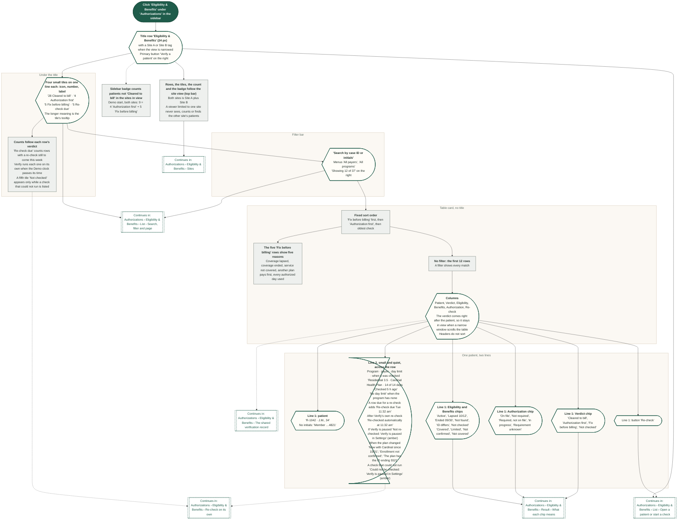

## Authorizations › Eligibility & Benefits › List › Search, filter and page

Search, two menus and the verdict tiles all narrow the same table, and they work together. The tiles are the verdict filter (there is no verdict menu). Every one of them starts from the patients inside the site view. Nothing is kept in the address, so leaving the page clears them.

Route: `/authorizations/eligibility`

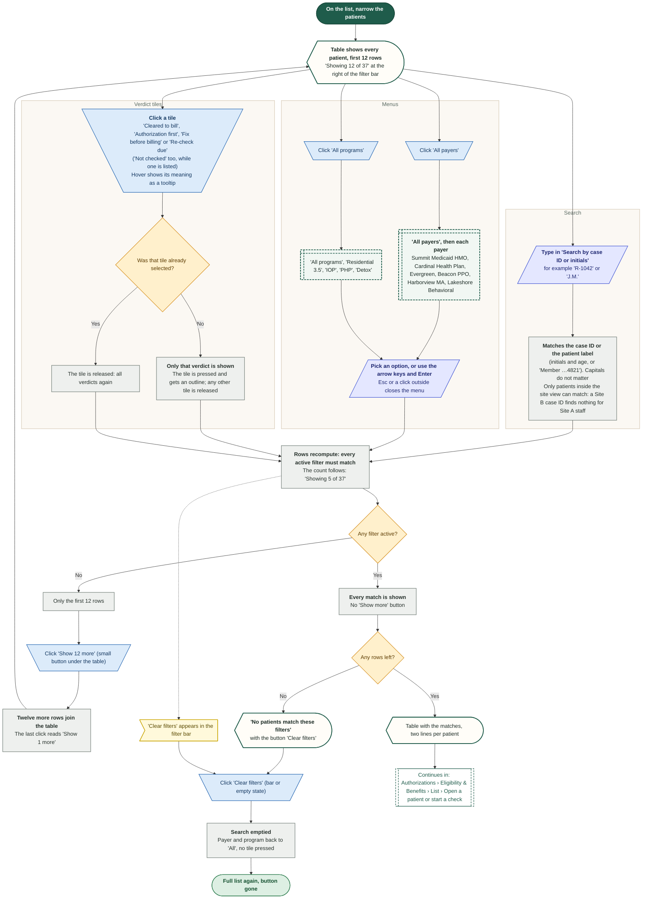

## Authorizations › Eligibility & Benefits › List › Open a patient or start a check

What a click on the list does. A row or its ID opens the result. 'Re-check' runs a check without leaving the list. 'Verify a patient' starts a new one.

Route: `/authorizations/eligibility`

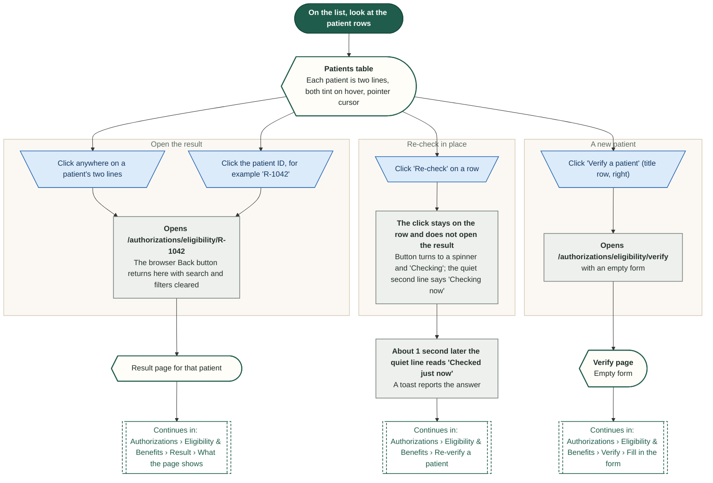

## Authorizations › Eligibility & Benefits › Verify › Ways in and pre-fill

Five places lead to the Verify page (no header box: the form and the live check open at once). Two open an empty form. Three carry a referral or a case in the address, and the form fills itself from it. A referral also gives a link back to where the person came from.

Route: `/authorizations/eligibility/verify?referral=RF-2040 or ?case=R-1101`

Date of birth is never stored. When only an age is known, the form makes up 01/15 of the matching year so it can be complete.

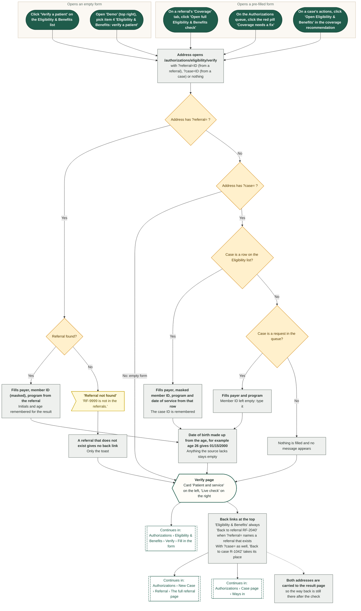

## Authorizations › Eligibility & Benefits › Verify › Fill in the form

The form on the left of the Verify page, card 'Patient and service'. No header box and no instructions: bring the card in with the import row, pick a sample, or type the details. 'Check now' stays off until the four required answers look complete.

Route: `/authorizations/eligibility/verify`

Demo only: the samples under the form fill made-up members. The import reads a screenshot or a file in the browser, and its reading is simulated.

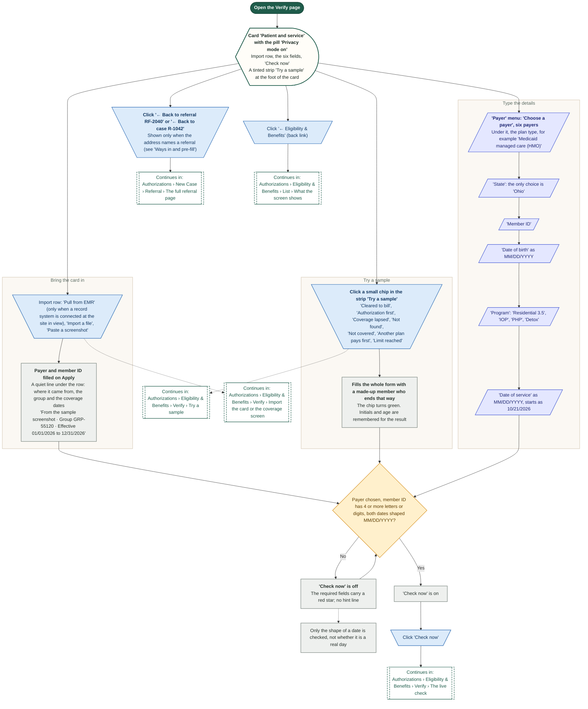

## Authorizations › Eligibility & Benefits › Verify › Try a sample

Seven small chips in a tinted strip at the foot of the form fill it with a member who ends in a different answer, so every verdict can be seen without a trick. The last four digits of the member ID script the answer. 'Authorization first' is J.M.'s card, the headline case R-1042. 'More samples' opens five more chips for the checks that need a look (next diagram).

Route: `/authorizations/eligibility/verify`

Demo only: the endings are scripted. Typing the same ending by hand gives the same answer, on Verify and on the Coverage row in New Case.

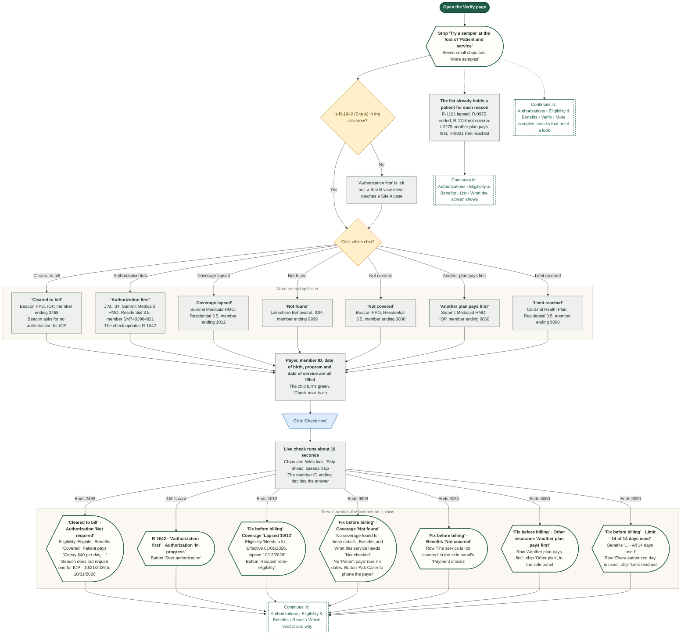

## Authorizations › Eligibility & Benefits › Verify › More samples: checks that need a look

'More samples' opens a second row, 'Needs a look', with five chips. Each fills the form with a made-up member whose check ends with a warning, so every exception can be seen without a trick. A sixth, a check that cannot run at all, happens when Verify is paused in Settings. The last four digits of the member ID script the answer, as for the first chips. On the result each finding is said once, in the verdict fact or a row, with its action.

Route: `/authorizations/eligibility/verify`

Demo only: the endings are scripted. The warnings are the same ones New Case shows in step 2, because both read the same verification record.

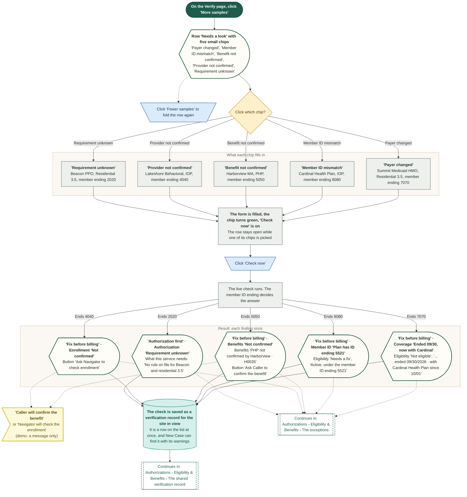

## Authorizations › Eligibility & Benefits › Verify › Import the card or the coverage screen

The small import row at the top of the Verify form is the shared import used wherever an EHR record is needed (target 'insurance'). Three ways in end in the same review, and nothing reaches the form until Apply. Apply fills the payer and the member ID; the plan type shows under the payer, and the card's group and coverage dates show in a quiet line. The live check then asks the plan.

Route: `/authorizations/eligibility/verify`

Demo only: FLO's reading of a screenshot or a PDF is simulated (the same image always reads the same), the sample screenshot and export are invented, and an EMR pull reads the demo charts of the site in view. Files never leave the browser.

```mermaid
%%{init: {"theme":"base","themeVariables":{"fontFamily":"'DM Sans', 'Segoe UI', system-ui, sans-serif","fontSize":"15px","lineColor":"#5B6B63","primaryTextColor":"#1C2B25","clusterBkg":"#FBF8F3","clusterBorder":"#D9CDBB","edgeLabelBackground":"#FFFFFF"},"flowchart":{"curve":"basis","nodeSpacing":36,"rankSpacing":48,"padding":12,"htmlLabels":true,"useMaxWidth":false,"wrappingWidth":230}} }%%
flowchart TD
  classDef k_start fill:#1F5C4B,stroke:#174638,color:#FFFFFF,stroke-width:1.5px,font-weight:600
  classDef k_end fill:#DDEFE3,stroke:#2E7D4F,color:#14502F,stroke-width:1.5px,font-weight:600
  classDef k_endx fill:#FBE3E0,stroke:#C0392B,color:#7A1F16,stroke-width:1.5px,font-weight:600
  classDef k_screen fill:#FFFDF8,stroke:#1F5C4B,color:#1C2B25,stroke-width:2px
  classDef k_overlay fill:#F1F7F3,stroke:#1F5C4B,color:#1C2B25,stroke-width:2px,stroke-dasharray:5 3
  classDef k_click fill:#DCEBFA,stroke:#2F6DB5,color:#12365F,stroke-width:1.5px
  classDef k_input fill:#E4E7FF,stroke:#4C5FD5,color:#1D2670,stroke-width:1.5px
  classDef k_process fill:#EEF0EE,stroke:#7A857F,color:#26302B,stroke-width:1.5px
  classDef k_agent fill:#EEE5FA,stroke:#7A4FC2,color:#341A63,stroke-width:1.5px
  classDef k_decision fill:#FFF0CC,stroke:#D9962B,color:#5C3B00,stroke-width:1.5px
  classDef k_store fill:#D5F0EA,stroke:#1C8E7B,color:#0B4A3F,stroke-width:1.5px
  classDef k_doc fill:#F6E9DC,stroke:#B07A4C,color:#4A2E14,stroke-width:1.5px
  classDef k_ext fill:#FFE6D2,stroke:#E07B39,color:#6B2F06,stroke-width:1.5px
  classDef k_wait fill:#E4E8EE,stroke:#6B7C93,color:#26303D,stroke-width:1.5px
  classDef k_toast fill:#FFF9DB,stroke:#C9A400,color:#5A4A00,stroke-width:1.5px
  classDef k_goto fill:#FFFFFF,stroke:#1F5C4B,color:#1F5C4B,stroke-width:1.5px,stroke-dasharray:5 3
  s1@{ shape: stadium, label: "On the Verify page, look at the import row above the fields" }
  q0@{ shape: diam, label: "Is a clinical record system connected at the site in view?" }
  r1@{ shape: curv-trap, label: "'Pull from EMR', 'Import a file', 'Paste a screenshot'" }
  r2@{ shape: curv-trap, label: "'Import a file', 'Paste a screenshot'" }
  subgraph gShot ["Paste a screenshot"]
  a1@{ shape: trap-t, label: "Click 'Paste a screenshot'" }
  a2@{ shape: lean-r, label: "<b>Press Ctrl+V (Cmd+V) with a screenshot of the card or the EMR coverage screen</b><br/>or drop or choose an image, or click 'Use a sample screenshot'" }
  a3@{ shape: hex, label: "<b>FLO reads the image</b><br/>'Reading…' with a thumbnail, about 1 second" }
  end
  subgraph gFile ["Import a file"]
  b1@{ shape: trap-t, label: "Click 'Import a file'" }
  b2@{ shape: lean-r, label: "Choose or drop a CSV, XLSX or PDF export, or click 'Use a sample export'" }
  b3@{ shape: win-pane, label: "<b>A CSV or XLSX opens the field mapping: each column to a Psyflo field</b><br/>Payer, Plan type, Member ID, Group number, Effective from, Effective to, Subscriber<br/>A PDF is read by FLO instead, like a screenshot" }
  b4@{ shape: trap-t, label: "Click 'Apply mapping'" }
  end
  subgraph gEmr ["Pull from EMR"]
  c1@{ shape: trap-t, label: "Click 'Pull from EMR'" }
  c2@{ shape: lean-r, label: "Pick the chart in 'Chart to pull', then click 'Pull'" }
  c3@{ shape: st-rect, label: "<b>The site's clinical record system</b><br/>(demo: simulated)" }
  end
  rv@{ shape: win-pane, label: "<b>Review: what was found, one box each, uncertain ones marked to check</b><br/>A value that differs from the form says 'replaces …'" }
  q1@{ shape: diam, label: "Apply or Cancel?" }
  ap@{ shape: trap-t, label: "Click 'Apply'" }
  cx@{ shape: trap-t, label: "Click 'Cancel', or the close button" }
  p1@{ shape: rect, label: "<b>Form: payer and member ID filled</b><br/>The live check's Reader row will read 'From the sample screenshot' (or the file, or the EMR)" }
  p2@{ shape: curv-trap, label: "<b>Quiet line under the import row</b><br/>'From the sample screenshot · Group GRP-55120 · Effective 01/01/2026 to 12/31/2026'" }
  p3@{ shape: rect, label: "Date of birth is not on a card: type it. Program and date of service stay as they were" }
  e1@{ shape: stadium, label: "Nothing changes on the form" }
  g1@{ shape: subproc, label: "Continues in: Authorizations › Eligibility & Benefits › Verify › Fill in the form" }
  g2@{ shape: subproc, label: "Continues in: Authorizations › Eligibility & Benefits › Verify › The live check" }
  s1 --> q0
  q0 -->|"Yes"| r1
  q0 -->|"No"| r2
  r1 --> a1 & b1 & c1
  r2 --> a1 & b1
  a1 --> a2 --> a3 --> rv
  b1 --> b2 --> b3 --> b4 --> rv
  b2 -.->|"PDF"| a3
  c1 --> c2 --> c3 --> rv
  rv --> q1
  q1 -->|"Apply"| ap --> p1 --> p2 --> p3 --> g1
  q1 -->|"Cancel"| cx --> e1
  p1 -.-> g2
  class s1 k_start
  class q0,q1 k_decision
  class r1,r2,p2 k_screen
  class a1,b1,b4,c1,ap,cx k_click
  class a2,b2,c2 k_input
  class a3 k_agent
  class b3,rv k_overlay
  class c3 k_ext
  class p1,p3 k_process
  class e1 k_endx
  class g1,g2 k_goto
  style gShot fill:#FBF8F3,stroke:#D9CDBB,stroke-width:1.5px,color:#5B6B63
  style gFile fill:#FBF8F3,stroke:#D9CDBB,stroke-width:1.5px,color:#5B6B63
  style gEmr fill:#FBF8F3,stroke:#D9CDBB,stroke-width:1.5px,color:#5B6B63
```

## Authorizations › Eligibility & Benefits › Verify › The live check

What the person sees after 'Check now'. The form locks and the 'Live check' card on the right ticks off one agent at a time, about 10 seconds in all. Each row names what is asked, then shows the answer. The questions themselves are in the next diagram.

Route: `/authorizations/eligibility/verify`

Demo only: the waiting is a timer. Nothing is sent to any payer.

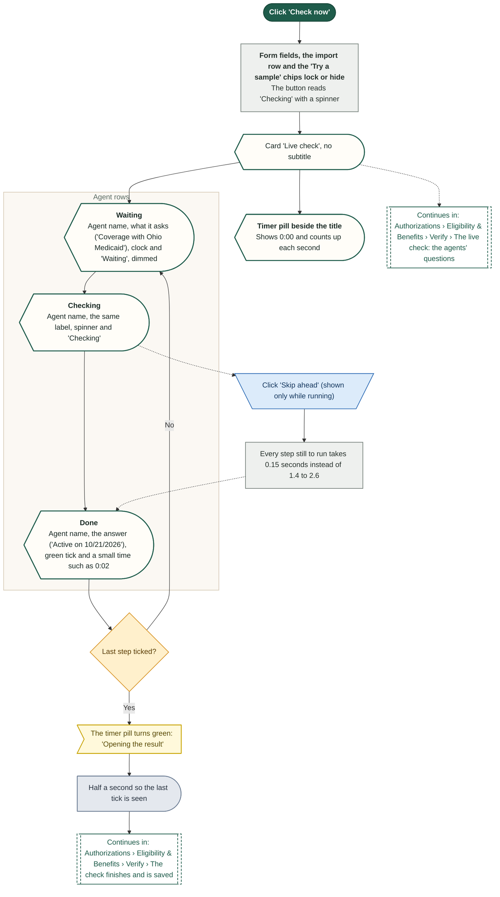

## Authorizations › Eligibility & Benefits › Verify › The live check: the agents' questions

The five questions, in order, and who answers each. Reader, Verify, Verify, Criteria, Navigator. Caller joins only for Evergreen. Each row shows a short label while it waits and works, and the answer as a value when it is done. The state and the plan are outside parties and are simulated in the demo.

Route: `/authorizations/eligibility/verify`

Demo only: the answers are scripted by the member ID ending (see 'Try a sample'). Before a payer is chosen the rows say 'the state' and 'the payer' instead of names.

```mermaid
%%{init: {"theme":"base","themeVariables":{"fontFamily":"'DM Sans', 'Segoe UI', system-ui, sans-serif","fontSize":"15px","lineColor":"#5B6B63","primaryTextColor":"#1C2B25","clusterBkg":"#FBF8F3","clusterBorder":"#D9CDBB","edgeLabelBackground":"#FFFFFF"},"flowchart":{"curve":"basis","nodeSpacing":36,"rankSpacing":48,"padding":12,"htmlLabels":true,"useMaxWidth":false,"wrappingWidth":230}} }%%
flowchart TD
  classDef k_start fill:#1F5C4B,stroke:#174638,color:#FFFFFF,stroke-width:1.5px,font-weight:600
  classDef k_end fill:#DDEFE3,stroke:#2E7D4F,color:#14502F,stroke-width:1.5px,font-weight:600
  classDef k_endx fill:#FBE3E0,stroke:#C0392B,color:#7A1F16,stroke-width:1.5px,font-weight:600
  classDef k_screen fill:#FFFDF8,stroke:#1F5C4B,color:#1C2B25,stroke-width:2px
  classDef k_overlay fill:#F1F7F3,stroke:#1F5C4B,color:#1C2B25,stroke-width:2px,stroke-dasharray:5 3
  classDef k_click fill:#DCEBFA,stroke:#2F6DB5,color:#12365F,stroke-width:1.5px
  classDef k_input fill:#E4E7FF,stroke:#4C5FD5,color:#1D2670,stroke-width:1.5px
  classDef k_process fill:#EEF0EE,stroke:#7A857F,color:#26302B,stroke-width:1.5px
  classDef k_agent fill:#EEE5FA,stroke:#7A4FC2,color:#341A63,stroke-width:1.5px
  classDef k_decision fill:#FFF0CC,stroke:#D9962B,color:#5C3B00,stroke-width:1.5px
  classDef k_store fill:#D5F0EA,stroke:#1C8E7B,color:#0B4A3F,stroke-width:1.5px
  classDef k_doc fill:#F6E9DC,stroke:#B07A4C,color:#4A2E14,stroke-width:1.5px
  classDef k_ext fill:#FFE6D2,stroke:#E07B39,color:#6B2F06,stroke-width:1.5px
  classDef k_wait fill:#E4E8EE,stroke:#6B7C93,color:#26303D,stroke-width:1.5px
  classDef k_toast fill:#FFF9DB,stroke:#C9A400,color:#5A4A00,stroke-width:1.5px
  classDef k_goto fill:#FFFFFF,stroke:#1F5C4B,color:#1F5C4B,stroke-width:1.5px,stroke-dasharray:5 3
  s1@{ shape: stadium, label: "<b>Live check starts</b><br/>Rows read 'Member details', 'Coverage with Ohio Medicaid' and so on" }
  a1@{ shape: hex, label: "1 Reader · 'Member details'" }
  w1@{ shape: delay, label: "About 1.4 seconds" }
  d1@{ shape: rect, label: "<b>Row ticks</b><br/>'As typed', or where an import came from: 'From the sample screenshot'" }
  a2@{ shape: hex, label: "2 Verify · 'Coverage with Ohio Medicaid'" }
  x2@{ shape: st-rect, label: "<b>Ohio Medicaid, or the plan for Beacon, Harborview, Lakeshore</b><br/>Real step: eligibility inquiry (demo: simulated)" }
  w2@{ shape: delay, label: "About 2.4 seconds" }
  d2@{ shape: rect, label: "<b>Row ticks</b><br/>'Active on 10/21/2026', 'Lapsed 10/12', 'Ended 09/30, with Cardinal Health Plan since 10/01'<br/>or 'No coverage found'<br/>Ending 6060 adds '. Another plan pays first'" }
  a3@{ shape: hex, label: "3 Verify · 'Residential 3.5 benefits with Summit'" }
  x3@{ shape: st-rect, label: "<b>The plan answers for the service codes</b><br/>Real step: benefit detail (demo: simulated)" }
  w3@{ shape: delay, label: "About 2.6 seconds" }
  d3@{ shape: rect, label: "<b>Row ticks</b><br/>'Covered (H0018 and H0019)'<br/>Ending 3030 'Not covered'; ending 5050 'Not confirmed by Harborview'<br/>Ending 9090 adds '. All 14 days used'<br/>No coverage found: 'Not asked: no coverage found'" }
  q1@{ shape: diam, label: "Is the payer Evergreen?" }
  a4@{ shape: hex, label: "<b>Caller · 'Phone call to Evergreen'</b><br/>The benefits row reads 'No answer online'" }
  a5@{ shape: hex, label: "4 Criteria · 'Authorization rule'" }
  w5@{ shape: delay, label: "About 1.6 seconds" }
  d5@{ shape: rect, label: "<b>Row ticks</b><br/>'Required before the first day', 'Not required',<br/>'On file with Cardinal' (ending 9090), or 'No rule on file. Nothing was assumed' (ending 2020)<br/>No coverage found: 'Not asked: no coverage found'" }
  a6@{ shape: hex, label: "5 Navigator · 'Enrollment with Summit'" }
  w6@{ shape: delay, label: "About 1.8 seconds" }
  d6@{ shape: rect, label: "<b>Row ticks</b><br/>'Enrolled, in network', 'Not enrolled for this program' or 'Not confirmed' (ending 4040)<br/>No coverage found: 'Not asked: no coverage found'" }
  pz@{ shape: rect, label: "<b>While Verify is paused in Settings every row after Reader ticks</b><br/>'Not asked: Verify is paused in Settings'" }
  g1@{ shape: subproc, label: "Continues in: Authorizations › Eligibility & Benefits › Verify › When a system does not answer" }
  g2@{ shape: subproc, label: "Continues in: Authorizations › Eligibility & Benefits › Verify › The check finishes and is saved" }
  s1 --> a1
  a1 --> w1 --> d1
  d1 --> a2
  a2 --> x2 --> d2
  a2 --> w2 --> d2
  d2 --> a3
  a3 --> x3 --> d3
  a3 --> w3 --> d3
  d3 --> q1
  q1 -->|"No"| a5
  q1 -->|"Yes"| a4 --> a5
  a4 -.-> g1
  a5 --> w5 --> d5 --> a6
  a6 --> w6 --> d6 --> g2
  s1 -.-> pz
  class s1 k_start
  class a1,a2,a3,a4,a5,a6 k_agent
  class w1,w2,w3,w5,w6 k_wait
  class d1,d2,d3,d5,d6,pz k_process
  class x2,x3 k_ext
  class q1 k_decision
  class g1,g2 k_goto
```

## Authorizations › Eligibility & Benefits › Verify › When a system does not answer

In real life a payer's system can be down, slow or silent. The demo shows one fallback only: for Evergreen, Caller phones the payer. It has no error screen, no retry button and no failed check. Bad answers become a 'Fix before billing' result.

Route: `/authorizations/eligibility/verify`

Demo only: the retry ladder on the right is how production works (from the product requirements). None of it is drawn on screen.

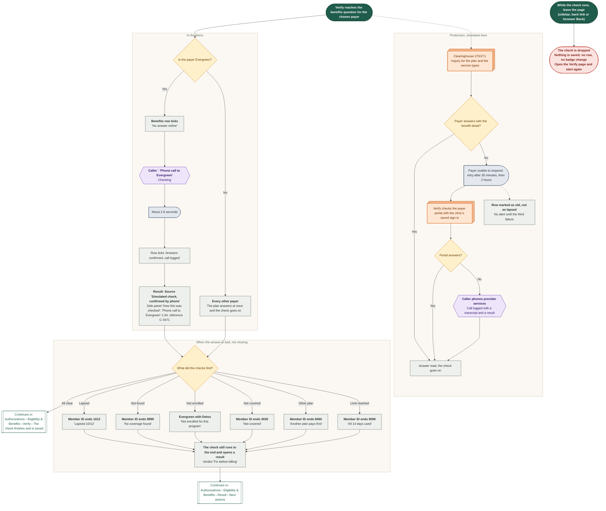

## Authorizations › Eligibility & Benefits › Verify › The check finishes and is saved

When the last step ticks, the demo saves the check as a verification record, then opens the result. A patient already on the list gets the record refreshed. Anyone else is added as a new check at the site in view. Scripted answers keep it predictable. If Verify is paused in Settings nothing could be asked, and the check is saved as 'Not checked'.

Route: `/authorizations/eligibility/verify`

Demo only: answers are scripted from the member ID and the plan. A known patient keeps the verdict it already had. The record is the same one New Case reads and writes.

```mermaid
%%{init: {"theme":"base","themeVariables":{"fontFamily":"'DM Sans', 'Segoe UI', system-ui, sans-serif","fontSize":"15px","lineColor":"#5B6B63","primaryTextColor":"#1C2B25","clusterBkg":"#FBF8F3","clusterBorder":"#D9CDBB","edgeLabelBackground":"#FFFFFF"},"flowchart":{"curve":"basis","nodeSpacing":36,"rankSpacing":48,"padding":12,"htmlLabels":true,"useMaxWidth":false,"wrappingWidth":230}} }%%
flowchart TD
  classDef k_start fill:#1F5C4B,stroke:#174638,color:#FFFFFF,stroke-width:1.5px,font-weight:600
  classDef k_end fill:#DDEFE3,stroke:#2E7D4F,color:#14502F,stroke-width:1.5px,font-weight:600
  classDef k_endx fill:#FBE3E0,stroke:#C0392B,color:#7A1F16,stroke-width:1.5px,font-weight:600
  classDef k_screen fill:#FFFDF8,stroke:#1F5C4B,color:#1C2B25,stroke-width:2px
  classDef k_overlay fill:#F1F7F3,stroke:#1F5C4B,color:#1C2B25,stroke-width:2px,stroke-dasharray:5 3
  classDef k_click fill:#DCEBFA,stroke:#2F6DB5,color:#12365F,stroke-width:1.5px
  classDef k_input fill:#E4E7FF,stroke:#4C5FD5,color:#1D2670,stroke-width:1.5px
  classDef k_process fill:#EEF0EE,stroke:#7A857F,color:#26302B,stroke-width:1.5px
  classDef k_agent fill:#EEE5FA,stroke:#7A4FC2,color:#341A63,stroke-width:1.5px
  classDef k_decision fill:#FFF0CC,stroke:#D9962B,color:#5C3B00,stroke-width:1.5px
  classDef k_store fill:#D5F0EA,stroke:#1C8E7B,color:#0B4A3F,stroke-width:1.5px
  classDef k_doc fill:#F6E9DC,stroke:#B07A4C,color:#4A2E14,stroke-width:1.5px
  classDef k_ext fill:#FFE6D2,stroke:#E07B39,color:#6B2F06,stroke-width:1.5px
  classDef k_wait fill:#E4E8EE,stroke:#6B7C93,color:#26303D,stroke-width:1.5px
  classDef k_toast fill:#FFF9DB,stroke:#C9A400,color:#5A4A00,stroke-width:1.5px
  classDef k_goto fill:#FFFFFF,stroke:#1F5C4B,color:#1F5C4B,stroke-width:1.5px,stroke-dasharray:5 3
  s1@{ shape: stadium, label: "Last step ticks, the timer pill reads 'Opening the result'" }
  w1@{ shape: delay, label: "Half a second" }
  qp@{ shape: diam, label: "Is Verify paused in Settings?" }
  q1@{ shape: diam, label: "Opened from a case that is a row on the list?" }
  q2@{ shape: diam, label: "J.M.'s card (sample 'Authorization first' or the referral): Summit, Residential 3.5, member ID ending 4821?" }
  st1@{ shape: cyl, label: "<b>Existing record updated</b><br/>'Checked just now', its re-check time cleared, date of service as typed" }
  p1@{ shape: rect, label: "The card matches J.M., case R-1042" }
  p2@{ shape: rect, label: "<b>Answers are not asked again</b><br/>The row keeps its verdict" }
  subgraph gPaused ["Verify is paused"]
  sp1@{ shape: cyl, label: "<b>Known patient: the last result is kept with the warning</b><br/>'Verification service unavailable', check time unchanged" }
  sp2@{ shape: cyl, label: "<b>Anyone else: a new check with no answers</b><br/>Eligibility, benefits and authorization 'Not checked'<br/>Warning 'Verification service unavailable'" }
  sp3@{ shape: rect, label: "<b>Verdict 'Not checked' · Coverage 'Not checked'</b><br/>Buttons 'Open Settings' and 'Re-check'" }
  end
  subgraph gNew ["A new patient"]
  n1@{ shape: rect, label: "<b>Check gets the next ID: V-1001, V-1002 ...</b><br/>The ID is picked so it belongs to the site in view<br/>(Site A when both are in view). Initials and age only if known from a referral or a case" }
  n2@{ shape: rect, label: "<b>Member ID kept as '…1234' (last four)</b><br/>Scripted answers from the member ID and plan" }
  n3@{ shape: diam, label: "Which scripted answer?" }
  n4@{ shape: rect, label: "<b>ID ends 1012</b><br/>Eligibility 'Lapsed 10/12'" }
  n5@{ shape: rect, label: "<b>ID ends 9999</b><br/>Eligibility 'Not found'" }
  n6@{ shape: rect, label: "<b>Evergreen with Detox</b><br/>Clinic not enrolled" }
  n7@{ shape: rect, label: "<b>Beacon with IOP or PHP</b><br/>Authorization 'Not required'" }
  n8@{ shape: rect, label: "<b>Harborview with PHP</b><br/>Benefits 'Limited'" }
  n10@{ shape: rect, label: "<b>ID ends 3030</b><br/>Benefits 'Not covered', authorization 'Not required'" }
  n11@{ shape: rect, label: "<b>ID ends 6060</b><br/>Another plan found: it pays first" }
  n12@{ shape: rect, label: "<b>ID ends 9090</b><br/>Authorization 'On file' with every day or unit used<br/>for example '14 of 14 days'" }
  n13@{ shape: rect, label: "<b>ID ends 7070</b><br/>Coverage ended 09/30, the member is with another plan since 10/01" }
  n14@{ shape: rect, label: "<b>ID ends 8080</b><br/>Coverage active, but the plan has the member under another ID" }
  n15@{ shape: rect, label: "<b>ID ends 5050</b><br/>Coverage active, the service was not confirmed" }
  n16@{ shape: rect, label: "<b>ID ends 4040</b><br/>The clinic's enrollment could not be confirmed" }
  n17@{ shape: rect, label: "<b>ID ends 2020</b><br/>No rule on file for the authorization" }
  n9@{ shape: rect, label: "<b>Anything else</b><br/>Active, covered, authorization 'Required'" }
  st2@{ shape: cyl, label: "<b>New verification record added for the site in view</b><br/>It is a row at once on the Eligibility list" }
  end
  p3@{ shape: rect, label: "List counts, tiles and sidebar badge recompute from the records inside the site view" }
  p7@{ shape: rect, label: "<b>Counts, tiles and badge stay as they were</b><br/>Only the check time and date of service changed" }
  q3@{ shape: diam, label: "Is the verdict 'Cleared to bill'?" }
  p4@{ shape: rect, label: "Badge unchanged" }
  p5@{ shape: rect, label: "Badge goes up by one" }
  p6@{ shape: rect, label: "<b>Opens /authorizations/eligibility/V-1001</b><br/>or the existing case ID<br/>If the check began from a referral, ?referral= (and ?case=) go along, so the result has its back link" }
  g1@{ shape: subproc, label: "Continues in: Authorizations › Eligibility & Benefits › Result › What the page shows" }
  g2@{ shape: subproc, label: "Continues in: Authorizations › Eligibility & Benefits › The shared verification record" }
  s1 --> w1 --> qp
  qp -->|"Yes, known patient"| sp1 --> sp3
  qp -->|"Yes, anyone else"| sp2 --> sp3
  qp -->|"No"| q1
  sp3 --> p6
  q1 -->|"Yes"| st1
  q1 -->|"No"| q2
  q2 -->|"Yes"| p1 --> st1
  q2 -->|"No"| n1 --> n2 --> n3
  st1 --> p2 --> p7 --> p6
  n3 -->|"Lapsed"| n4 --> st2
  n3 -->|"Not found"| n5 --> st2
  n3 -->|"Not enrolled"| n6 --> st2
  n3 -->|"No authorization"| n7 --> st2
  n3 -->|"Limited"| n8 --> st2
  n3 -->|"Not covered"| n10 --> st2
  n3 -->|"Other plan"| n11 --> st2
  n3 -->|"Limit reached"| n12 --> st2
  n3 -->|"Payer changed"| n13 --> st2
  n3 -->|"ID mismatch"| n14 --> st2
  n3 -->|"Benefit not confirmed"| n15 --> st2
  n3 -->|"Provider not confirmed"| n16 --> st2
  n3 -->|"Requirement unknown"| n17 --> st2
  n3 -->|"Otherwise"| n9 --> st2
  st2 --> p3
  p3 --> q3
  q3 -->|"Yes"| p4 --> p6
  q3 -->|"No"| p5 --> p6
  p6 --> g1
  st2 -.-> g2
  class s1 k_start
  class w1 k_wait
  class qp,q1,q2,n3,q3 k_decision
  class st1,sp1,sp2,st2 k_store
  class p1,p2,sp3,n1,n2,n4,n5,n6,n7,n8,n10,n11,n12,n13,n14,n15,n16,n17,n9,p3,p7,p4,p5,p6 k_process
  class g1,g2 k_goto
  style gPaused fill:#FBF8F3,stroke:#D9CDBB,stroke-width:1.5px,color:#5B6B63
  style gNew fill:#FBF8F3,stroke:#D9CDBB,stroke-width:1.5px,color:#5B6B63
```

## Authorizations › Eligibility & Benefits › Result › What the page shows

One result, said once. A slim title row (the patient), then one card: the verdict band with the one fact that decides it and the actions, then Eligibility, Plan type and routing, Benefits, Patient pays (only when there is a cost share) and What this service needs as label and value rows, then a warning only when no row already says it, and one quiet facts line. The payment checks, how it was checked and History are behind one button, in a side panel. Reached by a row on the list, or when a live check finishes. A check at a site the viewer cannot see shows a notice instead.

Route: `/authorizations/eligibility/R-1042`

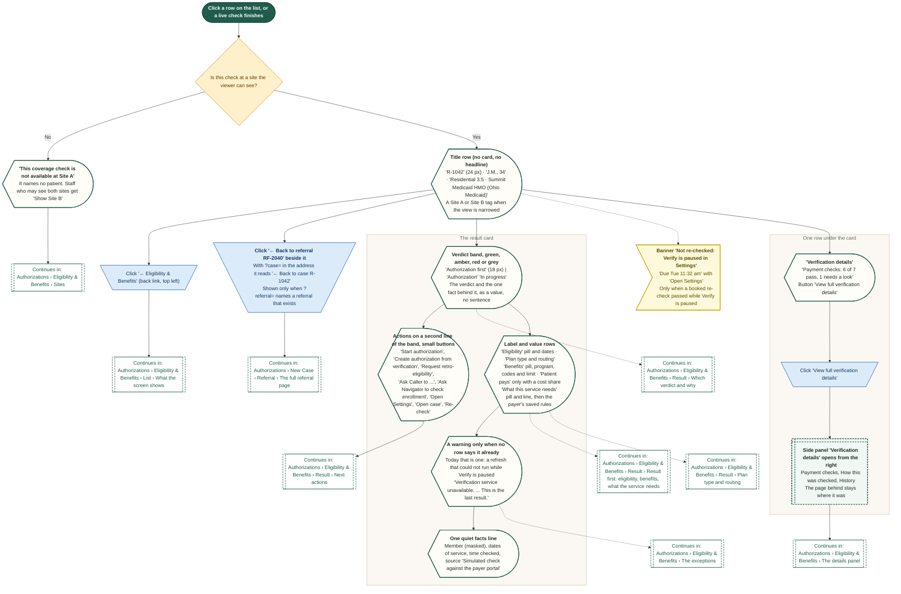

## Authorizations › Eligibility & Benefits › Result › Which verdict and why

The verdict is worked out from the patient's row, top question first. A check that could not run is 'Not checked'. Any failed or unconfirmed question gives 'Fix before billing'. If all pass, a missing or unknown authorization gives 'Authorization first'. Otherwise 'Cleared to bill'. The band shows the verdict and the one fact that decides it, as a label and a value. There is no headline and no reason sentence: the rows under the band carry the detail.

Route: `/authorizations/eligibility/R-1042`

Demo only: the first five failures have a seeded patient on the list (R-1101, R-0975, R-1118, I-2275, R-0921) and every one has a chip under 'Try a sample' or 'More samples' on Verify.

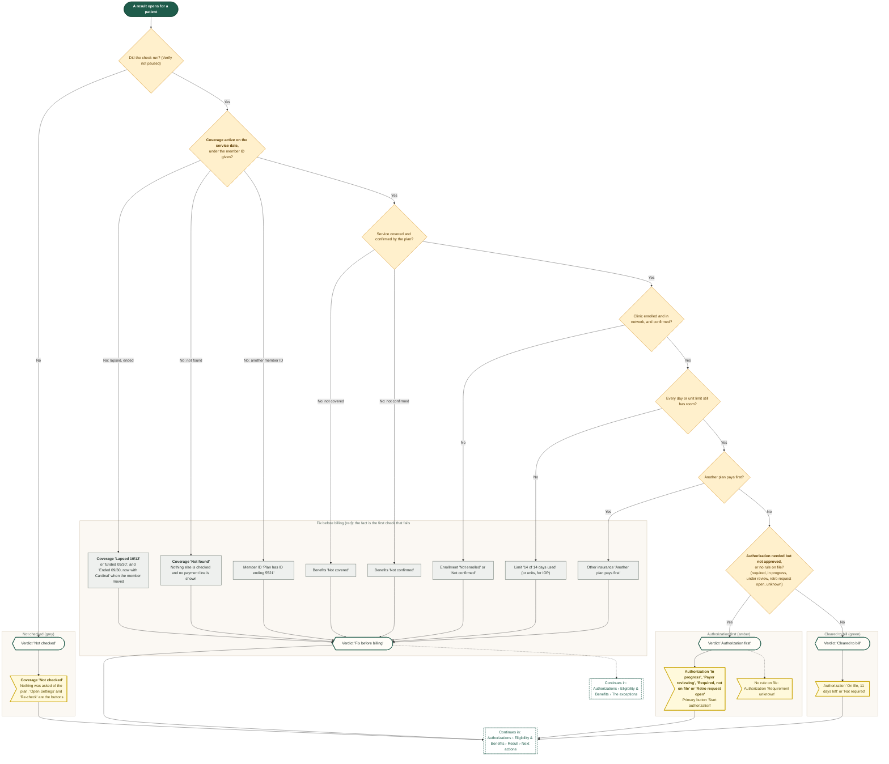

## Authorizations › Eligibility & Benefits › Result › Payment checks: coverage, plan, service

The first three of the seven rows in 'Payment checks', in the side panel 'Verification details' (click 'View full verification details' on the result). Each row has a title, a chip and, when it adds something, one line of fact. If coverage is not found, the other six rows give way to one grey row, 'Nothing else could be checked'. The result page already says eligible, covered and what the service needs.

Route: `/authorizations/eligibility/R-1042`

Demo only: 'The service is not covered' has a seeded patient (R-1118, Beacon PPO) and a chip under 'Try a sample' on Verify.

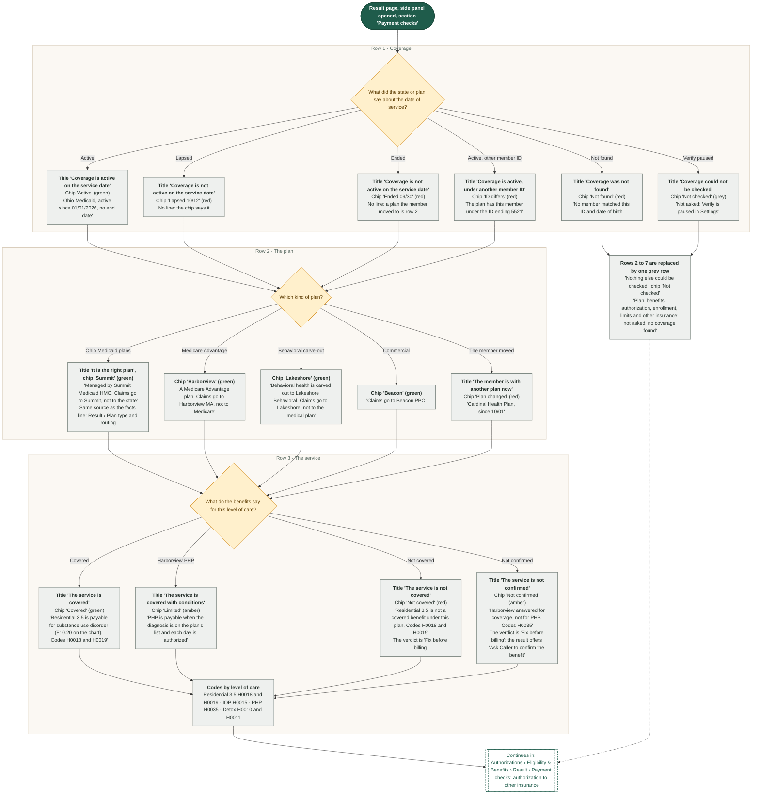

## Authorizations › Eligibility & Benefits › Result › Payment checks: authorization to other insurance

Rows 4 to 7 of 'Payment checks' (in the side panel 'Verification details'). What the patient pays is not in this list: it is its own row, 'Patient pays', on the result (and in the panel's summary when opened from New Case). Authorization is the only row that can turn the verdict amber. The others turn it red.

Route: `/authorizations/eligibility/R-1042`

Demo only: 'Limit reached' has a seeded patient (R-0921) and 'Another plan pays first' has one (I-2275). Both have a chip under 'Try a sample' on Verify.

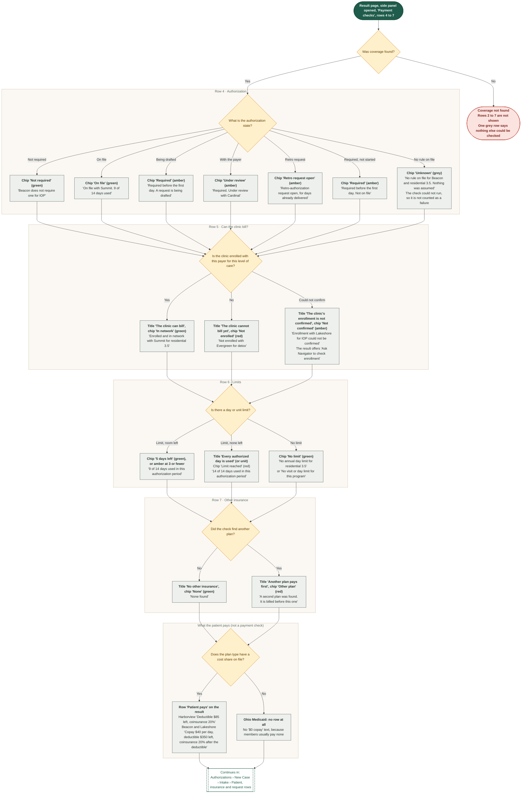

## Authorizations › Eligibility & Benefits › Result › What each chip means

The coloured chips in the list columns and in the 'Payment checks' rows (in the side panel). Green is fine, amber needs a step, red blocks billing, grey is neutral. A chip always carries a word, never colour alone.

Route: `/authorizations/eligibility`

```mermaid
%%{init: {"theme":"base","themeVariables":{"fontFamily":"'DM Sans', 'Segoe UI', system-ui, sans-serif","fontSize":"15px","lineColor":"#5B6B63","primaryTextColor":"#1C2B25","clusterBkg":"#FBF8F3","clusterBorder":"#D9CDBB","edgeLabelBackground":"#FFFFFF"},"flowchart":{"curve":"basis","nodeSpacing":36,"rankSpacing":48,"padding":12,"htmlLabels":true,"useMaxWidth":false,"wrappingWidth":230}} }%%
flowchart LR
  classDef k_start fill:#1F5C4B,stroke:#174638,color:#FFFFFF,stroke-width:1.5px,font-weight:600
  classDef k_end fill:#DDEFE3,stroke:#2E7D4F,color:#14502F,stroke-width:1.5px,font-weight:600
  classDef k_endx fill:#FBE3E0,stroke:#C0392B,color:#7A1F16,stroke-width:1.5px,font-weight:600
  classDef k_screen fill:#FFFDF8,stroke:#1F5C4B,color:#1C2B25,stroke-width:2px
  classDef k_overlay fill:#F1F7F3,stroke:#1F5C4B,color:#1C2B25,stroke-width:2px,stroke-dasharray:5 3
  classDef k_click fill:#DCEBFA,stroke:#2F6DB5,color:#12365F,stroke-width:1.5px
  classDef k_input fill:#E4E7FF,stroke:#4C5FD5,color:#1D2670,stroke-width:1.5px
  classDef k_process fill:#EEF0EE,stroke:#7A857F,color:#26302B,stroke-width:1.5px
  classDef k_agent fill:#EEE5FA,stroke:#7A4FC2,color:#341A63,stroke-width:1.5px
  classDef k_decision fill:#FFF0CC,stroke:#D9962B,color:#5C3B00,stroke-width:1.5px
  classDef k_store fill:#D5F0EA,stroke:#1C8E7B,color:#0B4A3F,stroke-width:1.5px
  classDef k_doc fill:#F6E9DC,stroke:#B07A4C,color:#4A2E14,stroke-width:1.5px
  classDef k_ext fill:#FFE6D2,stroke:#E07B39,color:#6B2F06,stroke-width:1.5px
  classDef k_wait fill:#E4E8EE,stroke:#6B7C93,color:#26303D,stroke-width:1.5px
  classDef k_toast fill:#FFF9DB,stroke:#C9A400,color:#5A4A00,stroke-width:1.5px
  classDef k_goto fill:#FFFFFF,stroke:#1F5C4B,color:#1F5C4B,stroke-width:1.5px,stroke-dasharray:5 3
  s1@{ shape: stadium, label: "A coloured chip on the list or the result page" }
  subgraph gE ["Column 'Eligibility'"]
  e0@{ shape: curv-trap, label: "'Eligibility' chip" }
  e1@{ shape: rect, label: "<b>'Active' (green)</b><br/>The state or plan says coverage is on for the date of service" }
  e2@{ shape: rect, label: "<b>'Lapsed 10/12' (red)</b><br/>Coverage dropped on that date. Later days are not payable until it is restored" }
  e3@{ shape: rect, label: "<b>'Ended 09/30' (red)</b><br/>Coverage ended. The patient may have a new plan: ask the payer" }
  e4@{ shape: rect, label: "<b>'Not found' (red)</b><br/>No member matched the ID and date of birth" }
  e5@{ shape: rect, label: "<b>'ID differs' (amber)</b><br/>Coverage is active, but the plan has the member under another ID" }
  e6@{ shape: rect, label: "<b>'Not checked' (grey)</b><br/>Verify was paused, so nothing was asked" }
  end
  subgraph gB ["Column 'Benefits'"]
  b0@{ shape: curv-trap, label: "'Benefits' chip" }
  b1@{ shape: rect, label: "<b>'Covered' (green)</b><br/>The plan pays for this level of care" }
  b2@{ shape: rect, label: "<b>'Limited' (amber)</b><br/>Paid with conditions: diagnosis on the plan's list, each day authorized" }
  b3@{ shape: rect, label: "<b>'Not covered' (red)</b><br/>The plan does not pay for this level of care<br/>For example R-1118" }
  b4@{ shape: rect, label: "<b>'Not confirmed' (amber)</b><br/>The plan answered for coverage but not for this service<br/>The result offers 'Ask Caller to confirm the benefit'" }
  end
  subgraph gA ["Column 'Authorization'"]
  a0@{ shape: curv-trap, label: "'Authorization' chip (the day or unit usage is on the quiet second line of the row)" }
  a1@{ shape: rect, label: "<b>'Not required' (grey)</b><br/>The payer needs none for this level of care" }
  a2@{ shape: rect, label: "<b>'On file' (green)</b><br/>Approved. Days or units used so far, such as '9 of 14 days', are on the second line" }
  a3@{ shape: rect, label: "<b>'In progress' (grey)</b><br/>A request is being drafted" }
  a4@{ shape: rect, label: "<b>'Payer reviewing' (grey)</b><br/>A request is with the payer" }
  a5@{ shape: rect, label: "<b>'Retro request open' (amber)</b><br/>A request for days already delivered is open" }
  a6@{ shape: rect, label: "<b>'Required, not on file' (amber)</b><br/>Needed before the first day. Not started" }
  a7@{ shape: rect, label: "<b>'Requirement unknown' (grey)</b><br/>No rule on file for this payer and level of care. Check with the payer" }
  end
  subgraph gV ["Column 'Verdict'"]
  v0@{ shape: curv-trap, label: "'Verdict' chip, right after the patient, with 'Checked 3 h ago' on the quiet second line" }
  v1@{ shape: rect, label: "<b>'Cleared to bill' (green)</b><br/>Everything passes" }
  v2@{ shape: rect, label: "<b>'Authorization first' (amber)</b><br/>Only the authorization is missing" }
  v3@{ shape: rect, label: "<b>'Fix before billing' (red)</b><br/>Coverage, plan, network, another plan, a limit or the member ID failed,<br/>or a benefit or enrollment could not be confirmed" }
  v5@{ shape: rect, label: "<b>'Not checked' (grey)</b><br/>The check did not run: Verify is paused in Settings" }
  v4@{ shape: rect, label: "<b>Second line: 'Checked 3 h ago' or 'Checking now'</b><br/>Time since the last check, or a re-check running<br/>'Re-check due Tue 11:32 am': Verify will run it<br/>'Re-checked automatically at 11:32 am': it did<br/>'Not re-checked: Verify is paused in Settings'" }
  end
  g1@{ shape: subproc, label: "Continues in: Authorizations › Eligibility & Benefits › Result › Which verdict and why" }
  s1 --> e0 & b0 & a0 & v0
  e0 --> e1 & e2 & e3 & e4 & e5 & e6
  b0 --> b1 & b2 & b3 & b4
  a0 --> a1 & a2 & a3 & a4 & a5 & a6 & a7
  v0 --> v1 & v2 & v3 & v4 & v5
  v1 & v2 & v3 & v5 --> g1
  class s1 k_start
  class e0,b0,a0,v0 k_screen
  class e1,e2,e3,e4,e5,e6,b1,b2,b3,b4,a1,a2,a3,a4,a5,a6,a7,v1,v2,v3,v5,v4 k_process
  class g1 k_goto
  style gE fill:#FBF8F3,stroke:#D9CDBB,stroke-width:1.5px,color:#5B6B63
  style gB fill:#FBF8F3,stroke:#D9CDBB,stroke-width:1.5px,color:#5B6B63
  style gA fill:#FBF8F3,stroke:#D9CDBB,stroke-width:1.5px,color:#5B6B63
  style gV fill:#FBF8F3,stroke:#D9CDBB,stroke-width:1.5px,color:#5B6B63
```

## Authorizations › Eligibility & Benefits › Result › Next actions

The small buttons on the second line of the verdict band, and where each one leads. Which buttons show depends on the verdict, on whether the patient has a case, and on what the check found. 'Create authorization from verification' shows on every result and carries the stored verification to New Case. A finding that used to be a sentence ('Caller can confirm...', 'Navigator can check...') is now a button.

Route: `/authorizations/eligibility/R-1042`

Demo only: 'Request retro-eligibility' and the 'Ask Caller' and 'Ask Navigator' buttons raise a message and change nothing. No call is made and no request is sent.

```mermaid
%%{init: {"theme":"base","themeVariables":{"fontFamily":"'DM Sans', 'Segoe UI', system-ui, sans-serif","fontSize":"15px","lineColor":"#5B6B63","primaryTextColor":"#1C2B25","clusterBkg":"#FBF8F3","clusterBorder":"#D9CDBB","edgeLabelBackground":"#FFFFFF"},"flowchart":{"curve":"basis","nodeSpacing":36,"rankSpacing":48,"padding":12,"htmlLabels":true,"useMaxWidth":false,"wrappingWidth":230}} }%%
flowchart TD
  classDef k_start fill:#1F5C4B,stroke:#174638,color:#FFFFFF,stroke-width:1.5px,font-weight:600
  classDef k_end fill:#DDEFE3,stroke:#2E7D4F,color:#14502F,stroke-width:1.5px,font-weight:600
  classDef k_endx fill:#FBE3E0,stroke:#C0392B,color:#7A1F16,stroke-width:1.5px,font-weight:600
  classDef k_screen fill:#FFFDF8,stroke:#1F5C4B,color:#1C2B25,stroke-width:2px
  classDef k_overlay fill:#F1F7F3,stroke:#1F5C4B,color:#1C2B25,stroke-width:2px,stroke-dasharray:5 3
  classDef k_click fill:#DCEBFA,stroke:#2F6DB5,color:#12365F,stroke-width:1.5px
  classDef k_input fill:#E4E7FF,stroke:#4C5FD5,color:#1D2670,stroke-width:1.5px
  classDef k_process fill:#EEF0EE,stroke:#7A857F,color:#26302B,stroke-width:1.5px
  classDef k_agent fill:#EEE5FA,stroke:#7A4FC2,color:#341A63,stroke-width:1.5px
  classDef k_decision fill:#FFF0CC,stroke:#D9962B,color:#5C3B00,stroke-width:1.5px
  classDef k_store fill:#D5F0EA,stroke:#1C8E7B,color:#0B4A3F,stroke-width:1.5px
  classDef k_doc fill:#F6E9DC,stroke:#B07A4C,color:#4A2E14,stroke-width:1.5px
  classDef k_ext fill:#FFE6D2,stroke:#E07B39,color:#6B2F06,stroke-width:1.5px
  classDef k_wait fill:#E4E8EE,stroke:#6B7C93,color:#26303D,stroke-width:1.5px
  classDef k_toast fill:#FFF9DB,stroke:#C9A400,color:#5A4A00,stroke-width:1.5px
  classDef k_goto fill:#FFFFFF,stroke:#1F5C4B,color:#1F5C4B,stroke-width:1.5px,stroke-dasharray:5 3
  s1@{ shape: stadium, label: "On a result page, read the buttons on the verdict band" }
  q1@{ shape: diam, label: "Verdict is 'Authorization first'?" }
  c1@{ shape: trap-t, label: "Click 'Start authorization' (primary)" }
  p1@{ shape: rect, label: "<b>Opens /authorizations/new?verification=R-1042&type=initial</b><br/>New Case reads the stored verification: payer, level of care, member, initials, age and the check itself<br/>Authorization type is already 'Initial'" }
  g1@{ shape: subproc, label: "Continues in: Authorizations › New Case › Clinical documentation › The checklist and Continue" }
  q2@{ shape: diam, label: "Is there a request with this ID?" }
  c2@{ shape: trap-t, label: "Click 'Open case'" }
  g2@{ shape: subproc, label: "Continues in: Authorizations › Case page › Ways in" }
  q3@{ shape: diam, label: "ID starts with 'V-' (a new check, no case yet)?" }
  c3@{ shape: trap-t, label: "Click 'Open in Case Manager'" }
  g3@{ shape: subproc, label: "Continues in: Case Manager" }
  n1@{ shape: rect, label: "No 'Start authorization' button" }
  p2@{ shape: rect, label: "<b>No case button is shown</b><br/>The check has no case yet" }
  q4@{ shape: diam, label: "What did the check find?" }
  c4@{ shape: trap-t, label: "Click 'Request retro-eligibility' (coverage lapsed)" }
  t1@{ shape: odd, label: "<b>'Retro-eligibility requested'</b><br/>'Navigator will ask Ohio Medicaid to restore coverage from 10/12. You will be told when it answers.'" }
  x1@{ shape: st-rect, label: "<b>Ohio Medicaid restores the dates</b><br/>(demo: simulated, nothing is sent)" }
  c5@{ shape: trap-t, label: "Click 'Ask Caller to phone the payer' (coverage ended or not found)" }
  t2@{ shape: odd, label: "<b>'Caller will phone the payer'</b><br/>'Caller will ask Evergreen about this member and log the call to the case.'" }
  c9@{ shape: trap-t, label: "Click 'Ask Caller to confirm the benefit' (benefit not confirmed)" }
  t9@{ shape: odd, label: "<b>'Caller will confirm the benefit'</b><br/>'Caller will confirm the PHP benefit with Harborview and log the call.'" }
  c10@{ shape: trap-t, label: "Click 'Ask Navigator to check enrollment' (enrollment not confirmed)" }
  t10@{ shape: odd, label: "<b>'Navigator will check the enrollment'</b><br/>'Navigator will check the clinic's enrollment record with Lakeshore.'" }
  x2@{ shape: st-rect, label: "<b>The payer's provider line or enrollment record</b><br/>(demo: simulated, nothing is dialled)" }
  e1@{ shape: stadium, label: "<b>Coverage and enrollment fine: no extra button</b><br/>Other failures are fixed in the case or by 'Re-check'" }
  cv@{ shape: trap-t, label: "<b>Click 'Create authorization from verification'</b><br/>(every result, every verdict)" }
  gv@{ shape: subproc, label: "Continues in: Authorizations › Eligibility & Benefits › Create an authorization from a verification" }
  ce@{ shape: trap-t, label: "<b>Click 'Open Settings'</b><br/>(only when the check did not run)" }
  ge@{ shape: subproc, label: "Continues in: Settings" }
  c6@{ shape: trap-t, label: "Click 'Re-check'" }
  g4@{ shape: subproc, label: "Continues in: Authorizations › Eligibility & Benefits › Re-verify a patient" }
  c7@{ shape: trap-t, label: "Click '← Eligibility & Benefits'" }
  g5@{ shape: subproc, label: "Continues in: Authorizations › Eligibility & Benefits › List › What the screen shows" }
  c8@{ shape: trap-t, label: "<b>Click '← Back to referral RF-2040'</b><br/>With ?case= in the address it reads '← Back to case R-1042'<br/>Shown only when the check began from a referral" }
  g6@{ shape: subproc, label: "Continues in: Authorizations › New Case › Referral › The full referral page" }
  s1 --> q1 & q2 & q4 & c6 & c7 & c8 & cv & ce
  cv --> gv
  ce --> ge
  c8 --> g6
  q1 -->|"Yes"| c1 --> p1 --> g1
  q1 -->|"No"| n1
  q2 -->|"Yes"| c2 --> g2
  q2 -->|"No"| q3
  q3 -->|"Yes"| p2
  q3 -->|"No"| c3 --> g3
  q4 -->|"Lapsed"| c4 --> t1 --> x1
  q4 -->|"Ended or not found"| c5 --> t2 --> x2
  q4 -->|"Benefit not confirmed"| c9 --> t9 --> x2
  q4 -->|"Enrollment not confirmed"| c10 --> t10 --> x2
  q4 -->|"Nothing of these"| e1
  c6 --> g4
  c7 --> g5
  class s1 k_start
  class q1,q2,q3,q4 k_decision
  class c1,c2,c3,c4,c5,c9,c10,cv,ce,c6,c7,c8 k_click
  class p1,n1,p2 k_process
  class g1,g2,g3,gv,ge,g4,g5,g6 k_goto
  class t1,t2,t9,t10 k_toast
  class x1,x2 k_ext
  class e1 k_endx
```

## Authorizations › Eligibility & Benefits › Result › Plan type and routing

The row 'Plan type and routing' under Eligibility says which plan type the payer is and where claims go. It is derived from the payer record and the plan type New Case would pre-fill, so a payer added on Payers gets it too. A payer with no plan type has no such row. The check row 'It is the right plan' in 'Payment checks' and the hint under 'Payer' on the Verify form read from the same place.

Route: `/authorizations/eligibility/R-1042`

Demo only: no built-in payer is fee for service. The branch exists for a payer added later.

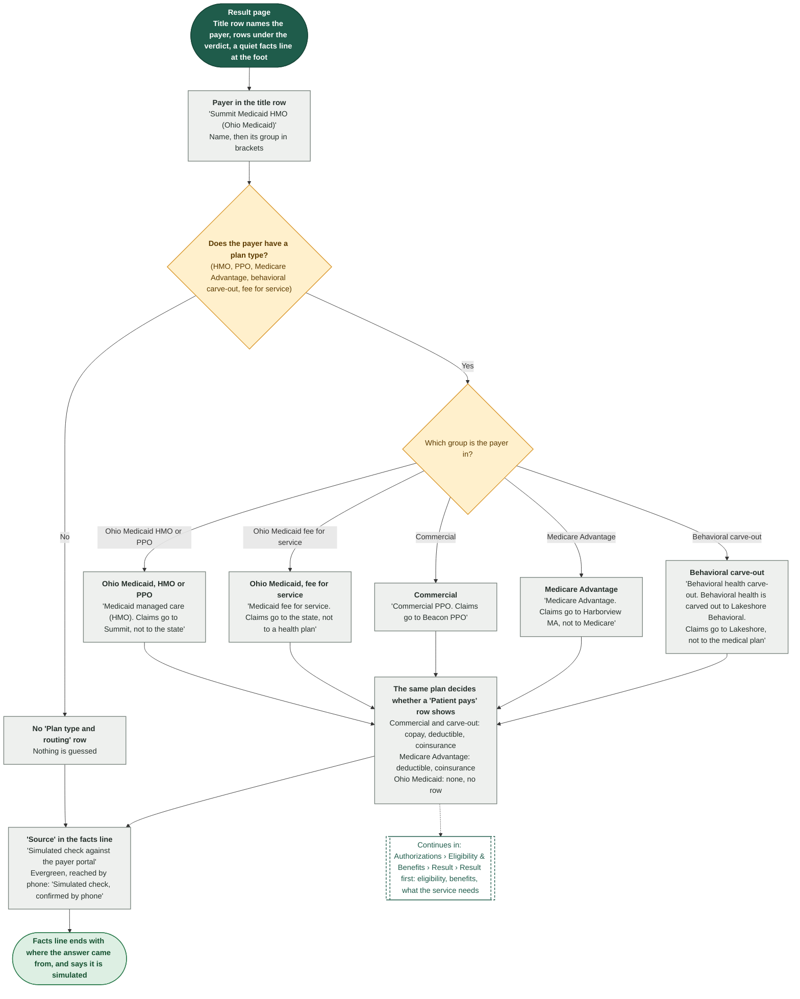

## Authorizations › Eligibility & Benefits › Result › Result first: eligibility, benefits, what the service needs

How the label and value rows under the verdict are worked out from the patient's row and from the saved Payers configuration. Eligibility says eligible, not eligible or needs a fix, with the dates. Benefits says covered or not, with the codes and the service limit; Patient pays follows only when the plan has a cost share. What this service needs says whether an authorization is required, on file or not required, and shows the payer's saved rules, read only. Values, not sentences.

Route: `/authorizations/eligibility/R-1042`

Demo only: effective dates, limits and cost share are sample data, and the check is simulated.

```mermaid
%%{init: {"theme":"base","themeVariables":{"fontFamily":"'DM Sans', 'Segoe UI', system-ui, sans-serif","fontSize":"15px","lineColor":"#5B6B63","primaryTextColor":"#1C2B25","clusterBkg":"#FBF8F3","clusterBorder":"#D9CDBB","edgeLabelBackground":"#FFFFFF"},"flowchart":{"curve":"basis","nodeSpacing":36,"rankSpacing":48,"padding":12,"htmlLabels":true,"useMaxWidth":false,"wrappingWidth":230}} }%%
flowchart TD
  classDef k_start fill:#1F5C4B,stroke:#174638,color:#FFFFFF,stroke-width:1.5px,font-weight:600
  classDef k_end fill:#DDEFE3,stroke:#2E7D4F,color:#14502F,stroke-width:1.5px,font-weight:600
  classDef k_endx fill:#FBE3E0,stroke:#C0392B,color:#7A1F16,stroke-width:1.5px,font-weight:600
  classDef k_screen fill:#FFFDF8,stroke:#1F5C4B,color:#1C2B25,stroke-width:2px
  classDef k_overlay fill:#F1F7F3,stroke:#1F5C4B,color:#1C2B25,stroke-width:2px,stroke-dasharray:5 3
  classDef k_click fill:#DCEBFA,stroke:#2F6DB5,color:#12365F,stroke-width:1.5px
  classDef k_input fill:#E4E7FF,stroke:#4C5FD5,color:#1D2670,stroke-width:1.5px
  classDef k_process fill:#EEF0EE,stroke:#7A857F,color:#26302B,stroke-width:1.5px
  classDef k_agent fill:#EEE5FA,stroke:#7A4FC2,color:#341A63,stroke-width:1.5px
  classDef k_decision fill:#FFF0CC,stroke:#D9962B,color:#5C3B00,stroke-width:1.5px
  classDef k_store fill:#D5F0EA,stroke:#1C8E7B,color:#0B4A3F,stroke-width:1.5px
  classDef k_doc fill:#F6E9DC,stroke:#B07A4C,color:#4A2E14,stroke-width:1.5px
  classDef k_ext fill:#FFE6D2,stroke:#E07B39,color:#6B2F06,stroke-width:1.5px
  classDef k_wait fill:#E4E8EE,stroke:#6B7C93,color:#26303D,stroke-width:1.5px
  classDef k_toast fill:#FFF9DB,stroke:#C9A400,color:#5A4A00,stroke-width:1.5px
  classDef k_goto fill:#FFFFFF,stroke:#1F5C4B,color:#1F5C4B,stroke-width:1.5px,stroke-dasharray:5 3
  s1@{ shape: stadium, label: "Result page, rows under the verdict band" }
  subgraph gE ["Row 'Eligibility'"]
  e0@{ shape: diam, label: "What did the state or plan say?" }
  e1@{ shape: rect, label: "<b>Pill 'Eligible' (green)</b><br/>'Effective 01/01/2026, no end date'" }
  e2@{ shape: rect, label: "<b>Pill 'Not eligible' (red)</b><br/>'Effective 01/01/2026, ended 09/30/2026'<br/>and '· with Cardinal Health Plan since 10/01' when the member moved" }
  e3@{ shape: rect, label: "<b>Pill 'Needs a fix' (red)</b><br/>'Effective 01/01/2026, lapsed 10/12/2026'<br/>Button 'Request retro-eligibility' on the band" }
  e4@{ shape: rect, label: "<b>Pill 'Needs a fix' (red)</b><br/>'No coverage found for these details'<br/>No dates" }
  e5@{ shape: rect, label: "<b>Pill 'Needs a fix' (red)</b><br/>'Active, under the member ID ending 5521'" }
  e6@{ shape: rect, label: "<b>Pill 'Not checked' (grey)</b><br/>'Not asked: Verify is paused in Settings'" }
  end
  nf@{ shape: rect, label: "<b>Benefits and What this service needs say 'Not checked' (grey), 'Not asked'</b><br/>No limit, no cost share, no Payers rules" }
  subgraph gB ["Rows 'Benefits' and 'Patient pays'"]
  b0@{ shape: diam, label: "What do the benefits say?" }
  b1@{ shape: rect, label: "<b>Pill 'Covered' (green)</b><br/>'Residential 3.5 · H0018 and H0019'" }
  b2@{ shape: rect, label: "<b>Pill 'Limited' (amber)</b><br/>'PHP, with conditions · H0035'" }
  b3@{ shape: rect, label: "<b>Pill 'Not covered' (red)</b><br/>'Residential 3.5 not covered · H0018 and H0019'" }
  b10@{ shape: rect, label: "<b>Pill 'Not confirmed' (amber)</b><br/>'PHP not confirmed by Harborview · H0035'" }
  b4@{ shape: diam, label: "Is a service limit on file?" }
  b5@{ shape: rect, label: "<b>Added to the row: '· 9 of 14 days used, 5 left'</b><br/>(or '· 38 of 48 units used, 10 left'), '· All 14 days used' when none is left" }
  b6@{ shape: rect, label: "<b>Added to the row: '· No annual day limit' (Summit residential)</b><br/>Otherwise nothing" }
  b7@{ shape: diam, label: "Does this plan type have a cost share on file?" }
  b8@{ shape: rect, label: "<b>Row 'Patient pays'</b><br/>'Copay $40 per day, deductible $350 left, coinsurance 20% after the deductible'<br/>Medicare Advantage: 'Deductible $85 left, coinsurance 20%'" }
  b9@{ shape: rect, label: "<b>No 'Patient pays' row</b><br/>Ohio Medicaid members usually pay none, so there is no '$0'" }
  end
  subgraph gN ["Row 'What this service needs'"]
  n0@{ shape: diam, label: "What is the authorization state?" }
  n1@{ shape: rect, label: "<b>Pill 'Not required' (grey)</b><br/>'Beacon does not require one for IOP · 10/21/2026 to 10/31/2026'<br/>Also when the payer's saved rule 'No authorization needed' names this level of care" }
  n7@{ shape: rect, label: "<b>Pill 'Requirement unknown' (grey)</b><br/>'No rule on file for Beacon and residential 3.5'<br/>Also for a payer added on Payers that does not cover this level of care" }
  n2@{ shape: rect, label: "<b>Pill 'On file' (green)</b><br/>'On file with Summit'" }
  n3@{ shape: rect, label: "<b>Pill 'Required, not on file' (amber)</b><br/>'Before the first day'" }
  n4@{ shape: rect, label: "<b>Pills 'In progress', 'Payer reviewing' or 'Retro request open'</b><br/>'Before the first day · request being drafted', 'Under review with Cardinal', 'For days already delivered'" }
  n5@{ shape: rect, label: "<b>Quiet second line from the Payers config, read live</b><br/>'Summit rules: Notice within 24 hours of admission · 9 documents on the Residential 3.5 list'<br/>Edit the rule or the list on Payers and this line follows" }
  n6@{ shape: trap-t, label: "Click 'Open Summit's rules'" }
  end
  g1@{ shape: subproc, label: "Continues in: Payers › Rules & Instructions › Read the rules" }
  g2@{ shape: subproc, label: "Continues in: Authorizations › Eligibility & Benefits › Result › Next actions" }
  g3@{ shape: subproc, label: "Continues in: Authorizations › Eligibility & Benefits › Result › Which verdict and why" }
  s1 --> e0
  e0 -->|"Active"| e1 --> b0
  e0 -->|"Ended"| e2 --> b0
  e0 -->|"Lapsed"| e3 --> b0
  e0 -->|"Not found"| e4 --> nf --> g3
  e0 -->|"Other member ID"| e5 --> b0
  e0 -->|"Verify paused"| e6 --> nf
  b0 -->|"Covered"| b1 --> b4
  b0 -->|"Limited"| b2 --> b4
  b0 -->|"Not covered"| b3 --> b4
  b0 -->|"Not confirmed"| b10 --> b4
  b4 -->|"Yes"| b5 --> b7
  b4 -->|"No"| b6 --> b7
  b7 -->|"Yes"| b8 --> n0
  b7 -->|"No"| b9 --> n0
  n0 -->|"Not required"| n1 --> n5
  n0 -->|"Unknown"| n7
  n0 -->|"On file"| n2 --> n5
  n0 -->|"Required"| n3 --> n5
  n0 -->|"Drafted, reviewing, retro"| n4 --> n5
  n5 --> n6 --> g1
  n5 --> g3
  n7 --> g3
  e3 -.-> g2
  class s1 k_start
  class e0,b0,b4,b7,n0 k_decision
  class e1,e2,e3,e4,e5,e6,nf,b1,b2,b3,b10,b5,b6,b8,b9,n1,n7,n2,n3,n4,n5 k_process
  class n6 k_click
  class g1,g2,g3 k_goto
  style gE fill:#FBF8F3,stroke:#D9CDBB,stroke-width:1.5px,color:#5B6B63
  style gB fill:#FBF8F3,stroke:#D9CDBB,stroke-width:1.5px,color:#5B6B63
  style gN fill:#FBF8F3,stroke:#D9CDBB,stroke-width:1.5px,color:#5B6B63
```

## Authorizations › Eligibility & Benefits › Re-verify a patient

Three ways to check a patient again. A row's 'Re-check' and the result's 'Re-check' run the same quick re-check, and so does 'Refresh verification' in New Case: all three refresh the one shared verification record. Opening the Verify page from a case runs the full live check again.

Route: `/authorizations/eligibility (and /authorizations/eligibility/R-1042)`

Demo only: a re-check never changes the answer. R-1101 stays lapsed. The re-checks Verify runs on its own, when the Demo clock passes a booked time, are in 'Re-check on its own'.

```mermaid
%%{init: {"theme":"base","themeVariables":{"fontFamily":"'DM Sans', 'Segoe UI', system-ui, sans-serif","fontSize":"15px","lineColor":"#5B6B63","primaryTextColor":"#1C2B25","clusterBkg":"#FBF8F3","clusterBorder":"#D9CDBB","edgeLabelBackground":"#FFFFFF"},"flowchart":{"curve":"basis","nodeSpacing":36,"rankSpacing":48,"padding":12,"htmlLabels":true,"useMaxWidth":false,"wrappingWidth":230}} }%%
flowchart TD
  classDef k_start fill:#1F5C4B,stroke:#174638,color:#FFFFFF,stroke-width:1.5px,font-weight:600
  classDef k_end fill:#DDEFE3,stroke:#2E7D4F,color:#14502F,stroke-width:1.5px,font-weight:600
  classDef k_endx fill:#FBE3E0,stroke:#C0392B,color:#7A1F16,stroke-width:1.5px,font-weight:600
  classDef k_screen fill:#FFFDF8,stroke:#1F5C4B,color:#1C2B25,stroke-width:2px
  classDef k_overlay fill:#F1F7F3,stroke:#1F5C4B,color:#1C2B25,stroke-width:2px,stroke-dasharray:5 3
  classDef k_click fill:#DCEBFA,stroke:#2F6DB5,color:#12365F,stroke-width:1.5px
  classDef k_input fill:#E4E7FF,stroke:#4C5FD5,color:#1D2670,stroke-width:1.5px
  classDef k_process fill:#EEF0EE,stroke:#7A857F,color:#26302B,stroke-width:1.5px
  classDef k_agent fill:#EEE5FA,stroke:#7A4FC2,color:#341A63,stroke-width:1.5px
  classDef k_decision fill:#FFF0CC,stroke:#D9962B,color:#5C3B00,stroke-width:1.5px
  classDef k_store fill:#D5F0EA,stroke:#1C8E7B,color:#0B4A3F,stroke-width:1.5px
  classDef k_doc fill:#F6E9DC,stroke:#B07A4C,color:#4A2E14,stroke-width:1.5px
  classDef k_ext fill:#FFE6D2,stroke:#E07B39,color:#6B2F06,stroke-width:1.5px
  classDef k_wait fill:#E4E8EE,stroke:#6B7C93,color:#26303D,stroke-width:1.5px
  classDef k_toast fill:#FFF9DB,stroke:#C9A400,color:#5A4A00,stroke-width:1.5px
  classDef k_goto fill:#FFFFFF,stroke:#1F5C4B,color:#1F5C4B,stroke-width:1.5px,stroke-dasharray:5 3
  a1@{ shape: stadium, label: "On the list, click 'Re-check' on a row" }
  a2@{ shape: stadium, label: "On a result, click 'Re-check' on the verdict band" }
  a3@{ shape: stadium, label: "Open the Verify page from a case and click 'Check now'" }
  a4@{ shape: stadium, label: "In New Case, step 2, click 'Refresh verification'" }
  q1@{ shape: diam, label: "Is a re-check already running for this patient?" }
  p1@{ shape: rect, label: "<b>The click is ignored</b><br/>The button is off with a spinner" }
  p2@{ shape: rect, label: "<b>Patient marked as checking</b><br/>List: button reads 'Checking' with a spinner, the quiet second line says 'Checking now'<br/>Result: 'Re-check' shows a spinner" }
  g0@{ shape: hex, label: "Verify and the other agents ask again" }
  x1@{ shape: st-rect, label: "<b>The state and the plan</b><br/>(demo: simulated, same answer as before)" }
  w1@{ shape: delay, label: "About 1.1 seconds" }
  qv@{ shape: diam, label: "Is Verify paused in Settings?" }
  st1@{ shape: cyl, label: "<b>Verification record replaced</b><br/>Checked time is now, any booked re-check cleared, verdict unchanged<br/>A check that never ran ('Not checked') is asked again for real" }
  st3@{ shape: cyl, label: "<b>Record kept as it was, with the warning</b><br/>'Verification service unavailable'<br/>Checked time unchanged" }
  t3@{ shape: odd, label: "<b>'Could not re-check R-1042'</b><br/>'Verify is paused in Settings, so nothing was asked. The last result is still shown.'" }
  q2@{ shape: diam, label: "Does the payer need a phone call? (Evergreen)" }
  t1@{ shape: odd, label: "<b>'R-1042 re-checked'</b><br/>'Still Authorization first.' ('Now Cleared to bill.' when a check that never ran has answered)" }
  t2@{ shape: odd, label: "<b>'R-0975 re-checked'</b><br/>'The plan's system did not answer, so Caller phoned. Still Fix before billing.'" }
  subgraph gAfter ["What changes on screen"]
  r1@{ shape: rect, label: "List: 'Checked 3 h ago' becomes 'Checked just now'" }
  r2@{ shape: rect, label: "List: tile 'Re-check due' goes down by one if this row had a re-check booked" }
  r3@{ shape: rect, label: "<b>Result: 'Time checked' in the facts line, 'Sat 10:40 am, 3 d ago', becomes '10:42 am, live'</b><br/>History in the side panel: 'Checked coverage and benefits: ...' at the new time" }
  r4@{ shape: rect, label: "Verdict, sidebar badge and the other tiles do not change" }
  end
  v1@{ shape: rect, label: "<b>Opens the verify form pre-filled from the case</b><br/>Then the full live check (about 10 seconds)" }
  g1@{ shape: subproc, label: "Continues in: Authorizations › Eligibility & Benefits › Verify › The check finishes and is saved" }
  g2@{ shape: subproc, label: "Continues in: Authorizations › Eligibility & Benefits › Re-check on its own" }
  e1@{ shape: stadium, label: "Patient is up to date" }
  a1 --> q1
  a2 --> q1
  a4 --> q1
  q1 -->|"Yes"| p1
  q1 -->|"No"| p2 --> w1 --> qv
  qv -->|"No"| g0 --> x1 --> st1 --> q2
  qv -->|"Yes"| st3 --> t3 --> e1
  q2 -->|"No"| t1
  q2 -->|"Yes"| t2
  t1 --> r1 & r3 & r4
  t2 --> r1 & r3 & r4
  r1 --> r2 --> e1
  r3 --> e1
  r4 --> e1
  r2 -.-> g2
  a3 --> v1 --> g1
  class a1,a2,a3,a4 k_start
  class q1,qv,q2 k_decision
  class p1,p2,r1,r2,r3,r4,v1 k_process
  class g0 k_agent
  class x1 k_ext
  class w1 k_wait
  class st1,st3 k_store
  class t3,t1,t2 k_toast
  class g1,g2 k_goto
  class e1 k_end
  style gAfter fill:#FBF8F3,stroke:#D9CDBB,stroke-width:1.5px,color:#5B6B63
```

## Authorizations › Eligibility & Benefits › Errors and empty states

Everything that can go wrong or come up empty in this module. There are no error pages and no retry buttons. A missing check shows an empty state, a bad link shows a toast or nothing, and bad coverage shows up as a result.

Route: `/authorizations/eligibility/ZZ-9`

```mermaid
%%{init: {"theme":"base","themeVariables":{"fontFamily":"'DM Sans', 'Segoe UI', system-ui, sans-serif","fontSize":"15px","lineColor":"#5B6B63","primaryTextColor":"#1C2B25","clusterBkg":"#FBF8F3","clusterBorder":"#D9CDBB","edgeLabelBackground":"#FFFFFF"},"flowchart":{"curve":"basis","nodeSpacing":36,"rankSpacing":48,"padding":12,"htmlLabels":true,"useMaxWidth":false,"wrappingWidth":230}} }%%
flowchart TD
  classDef k_start fill:#1F5C4B,stroke:#174638,color:#FFFFFF,stroke-width:1.5px,font-weight:600
  classDef k_end fill:#DDEFE3,stroke:#2E7D4F,color:#14502F,stroke-width:1.5px,font-weight:600
  classDef k_endx fill:#FBE3E0,stroke:#C0392B,color:#7A1F16,stroke-width:1.5px,font-weight:600
  classDef k_screen fill:#FFFDF8,stroke:#1F5C4B,color:#1C2B25,stroke-width:2px
  classDef k_overlay fill:#F1F7F3,stroke:#1F5C4B,color:#1C2B25,stroke-width:2px,stroke-dasharray:5 3
  classDef k_click fill:#DCEBFA,stroke:#2F6DB5,color:#12365F,stroke-width:1.5px
  classDef k_input fill:#E4E7FF,stroke:#4C5FD5,color:#1D2670,stroke-width:1.5px
  classDef k_process fill:#EEF0EE,stroke:#7A857F,color:#26302B,stroke-width:1.5px
  classDef k_agent fill:#EEE5FA,stroke:#7A4FC2,color:#341A63,stroke-width:1.5px
  classDef k_decision fill:#FFF0CC,stroke:#D9962B,color:#5C3B00,stroke-width:1.5px
  classDef k_store fill:#D5F0EA,stroke:#1C8E7B,color:#0B4A3F,stroke-width:1.5px
  classDef k_doc fill:#F6E9DC,stroke:#B07A4C,color:#4A2E14,stroke-width:1.5px
  classDef k_ext fill:#FFE6D2,stroke:#E07B39,color:#6B2F06,stroke-width:1.5px
  classDef k_wait fill:#E4E8EE,stroke:#6B7C93,color:#26303D,stroke-width:1.5px
  classDef k_toast fill:#FFF9DB,stroke:#C9A400,color:#5A4A00,stroke-width:1.5px
  classDef k_goto fill:#FFFFFF,stroke:#1F5C4B,color:#1F5C4B,stroke-width:1.5px,stroke-dasharray:5 3
  s1@{ shape: stadium, label: "<b>A check cannot be found</b><br/>Old link, typed address, or after 'Reset demo data' in the Demo menu" }
  e1@{ shape: curv-trap, label: "Back link '← Eligibility & Benefits', no title" }
  e2@{ shape: curv-trap, label: "<b>Empty state 'We could not find that check'</b><br/>'It may have been cleared when the demo data was reset.'" }
  c1@{ shape: trap-t, label: "Click 'Back to Eligibility & Benefits'" }
  g1@{ shape: subproc, label: "Continues in: Authorizations › Eligibility & Benefits › List › What the screen shows" }
  s2@{ shape: stadium, label: "Open the Verify page with a referral that does not exist" }
  t1@{ shape: odd, label: "<b>'Referral not found'</b><br/>'RF-9999 is not in the referrals.'" }
  p1@{ shape: rect, label: "<b>The form stays empty</b><br/>No 'Back to referral' link either" }
  s3@{ shape: stadium, label: "Open the Verify page with a case that is neither on the list nor in the queue" }
  p2@{ shape: rect, label: "<b>The form stays empty</b><br/>No message appears" }
  s4@{ shape: stadium, label: "Type in the form but leave something out or in the wrong shape" }
  q1@{ shape: diam, label: "Payer, a member ID of 4 or more characters and two MM/DD/YYYY dates?" }
  p3@{ shape: rect, label: "<b>'Check now' is off; the required fields carry a red star</b><br/>No hint line and no red error text" }
  c2@{ shape: trap-t, label: "Click 'Check now'" }
  g2@{ shape: subproc, label: "Continues in: Authorizations › Eligibility & Benefits › Verify › The live check" }
  s5@{ shape: stadium, label: "Search or filters on the list match nobody" }
  e3@{ shape: curv-trap, label: "<b>'No patients match these filters' with 'Clear filters'</b><br/>No explanation line" }
  c3@{ shape: trap-t, label: "Click 'Clear filters'" }
  e4@{ shape: stadium, label: "All patients are back" }
  s6@{ shape: stadium, label: "<b>The check finds a coverage problem</b><br/>Member ID ends 1012, 9999, 3030, 6060 or 9090, or Evergreen with Detox" }
  e5@{ shape: curv-trap, label: "<b>A normal result page with a red verdict 'Fix before billing'</b><br/>If coverage is not found: Coverage 'Not found', benefits and what the service needs 'Not checked', no 'Patient pays' row" }
  g3@{ shape: subproc, label: "Continues in: Authorizations › Eligibility & Benefits › Result › Next actions" }
  g5@{ shape: subproc, label: "Continues in: Dashboard" }
  s7@{ shape: stadium, label: "Leave the Verify page while the live check runs" }
  e6@{ shape: stadium, label: "<b>The check is dropped</b><br/>Nothing is saved and no row is added" }
  s8@{ shape: stadium, label: "<b>Open a result at a site the viewer cannot see</b><br/>A link, or a sign-in as Dr. Rivera (Site A) or Sam Okafor (Site B)" }
  e7@{ shape: curv-trap, label: "<b>'This coverage check is not available at Site A'</b><br/>It names the case and its site, never a patient or a payer<br/>Staff who may see both sites also get 'Show Site B'" }
  c4@{ shape: trap-t, label: "Click 'Back to the Dashboard'" }
  s9@{ shape: stadium, label: "Verify is paused in Settings and a check is started or asked again" }
  e8@{ shape: curv-trap, label: "<b>Verify page banner 'Verify is paused in Settings' with 'Open Settings'</b><br/>The check still runs its steps, each saying 'Not asked: Verify is paused in Settings'" }
  e9@{ shape: curv-trap, label: "<b>A result with the verdict 'Not checked' · Coverage 'Not checked'</b><br/>Eligibility 'Not asked: Verify is paused in Settings'<br/>'Open Settings' and 'Re-check'" }
  g4@{ shape: subproc, label: "Continues in: Authorizations › Eligibility & Benefits › The exceptions" }
  s1 --> e1 --> e2 --> c1 --> g1
  s2 --> t1 --> p1
  s3 --> p2
  s4 --> q1
  q1 -->|"No"| p3
  q1 -->|"Yes"| c2 --> g2
  p3 -.-> q1
  s5 --> e3 --> c3 --> e4
  s6 --> e5 --> g3
  s7 --> e6
  s8 --> e7 --> c4
  c4 --> g5
  s9 --> e8 --> e9 --> g4
  class s1,s2,s3,s4,s5,s6,s7,s8,s9 k_start
  class e1,e2,e3,e5,e7,e8,e9 k_screen
  class c1,c2,c3,c4 k_click
  class g1,g2,g3,g5,g4 k_goto
  class t1 k_toast
  class p1,p2,p3 k_process
  class q1 k_decision
  class e4 k_end
  class e6 k_endx
```

## Authorizations › Eligibility & Benefits › Re-check on its own

Five patients have a re-check booked this week. Verify runs each one by itself when the Demo clock passes its time, wherever the person is in the app. If Verify is paused in Settings it waits, and catches up when Verify is resumed.

Route: `/authorizations/eligibility`

Demo only: the Demo clock moves only from the Demo menu. A re-check never changes the verdict. Booked times from the start: I-2207 Tue 11:32 am, I-2144 Tue 3:42 pm, I-2102 Wed 1:42 pm, R-0866 Thu 10:42 am, R-0871 Sat 10:42 am.

```mermaid
%%{init: {"theme":"base","themeVariables":{"fontFamily":"'DM Sans', 'Segoe UI', system-ui, sans-serif","fontSize":"15px","lineColor":"#5B6B63","primaryTextColor":"#1C2B25","clusterBkg":"#FBF8F3","clusterBorder":"#D9CDBB","edgeLabelBackground":"#FFFFFF"},"flowchart":{"curve":"basis","nodeSpacing":36,"rankSpacing":48,"padding":12,"htmlLabels":true,"useMaxWidth":false,"wrappingWidth":230}} }%%
flowchart TD
  classDef k_start fill:#1F5C4B,stroke:#174638,color:#FFFFFF,stroke-width:1.5px,font-weight:600
  classDef k_end fill:#DDEFE3,stroke:#2E7D4F,color:#14502F,stroke-width:1.5px,font-weight:600
  classDef k_endx fill:#FBE3E0,stroke:#C0392B,color:#7A1F16,stroke-width:1.5px,font-weight:600
  classDef k_screen fill:#FFFDF8,stroke:#1F5C4B,color:#1C2B25,stroke-width:2px
  classDef k_overlay fill:#F1F7F3,stroke:#1F5C4B,color:#1C2B25,stroke-width:2px,stroke-dasharray:5 3
  classDef k_click fill:#DCEBFA,stroke:#2F6DB5,color:#12365F,stroke-width:1.5px
  classDef k_input fill:#E4E7FF,stroke:#4C5FD5,color:#1D2670,stroke-width:1.5px
  classDef k_process fill:#EEF0EE,stroke:#7A857F,color:#26302B,stroke-width:1.5px
  classDef k_agent fill:#EEE5FA,stroke:#7A4FC2,color:#341A63,stroke-width:1.5px
  classDef k_decision fill:#FFF0CC,stroke:#D9962B,color:#5C3B00,stroke-width:1.5px
  classDef k_store fill:#D5F0EA,stroke:#1C8E7B,color:#0B4A3F,stroke-width:1.5px
  classDef k_doc fill:#F6E9DC,stroke:#B07A4C,color:#4A2E14,stroke-width:1.5px
  classDef k_ext fill:#FFE6D2,stroke:#E07B39,color:#6B2F06,stroke-width:1.5px
  classDef k_wait fill:#E4E8EE,stroke:#6B7C93,color:#26303D,stroke-width:1.5px
  classDef k_toast fill:#FFF9DB,stroke:#C9A400,color:#5A4A00,stroke-width:1.5px
  classDef k_goto fill:#FFFFFF,stroke:#1F5C4B,color:#1F5C4B,stroke-width:1.5px,stroke-dasharray:5 3
  s1@{ shape: stadium, label: "<b>On the list, five rows read 'Re-check due Tue 11:32 am' and so on</b><br/>Tile 'Re-check due' counts 5" }
  c1@{ shape: trap-t, label: "Open 'Demo' (top right) and click 'Fast-forward 1 hour' or 'Fast-forward 1 day'" }
  p1@{ shape: rect, label: "<b>The Demo clock moves</b><br/>Toast 'Clock moved forward 1 hour'" }
  q1@{ shape: diam, label: "Has a booked re-check time passed?" }
  e0@{ shape: stadium, label: "<b>Nothing is due yet</b><br/>Rows keep 'Re-check due Tue 11:32 am' on the quiet second line<br/>The result's 'Time checked' says it too: '..., 3 d ago. Re-check due Tue 11:32 am'" }
  q2@{ shape: diam, label: "Is Verify paused in Settings?" }
  subgraph gRun ["Verify re-checks"]
  a1@{ shape: hex, label: "<b>Verify re-checks every patient that came due</b><br/>Asks the state and the plan again (demo: simulated, same answer as before)" }
  st1@{ shape: cyl, label: "<b>Each row updated</b><br/>Checked time is the booked time, booking cleared<br/>Verdict unchanged, sidebar badge unchanged" }
  r1@{ shape: rect, label: "<b>List: second line reads 'Re-checked automatically at 11:32 am'</b><br/>Tile 'Re-check due' goes down by the rows done" }
  r2@{ shape: rect, label: "<b>Result: 'Time checked' reads 'Re-checked automatically at 11:32 am'</b><br/>History in the side panel: 'Re-checked automatically: Cleared to bill' (Agent) and no 'Re-check' (Scheduled) any more" }
  q3@{ shape: diam, label: "How many came due at once?" }
  n1@{ shape: odd, label: "<b>Bell: 'Re-checked automatically'</b><br/>'I-2207 is still Cleared to bill. Verify re-checked it at 11:32 am.'<br/>Click opens that result" }
  n2@{ shape: odd, label: "<b>Bell: 'Re-checked 2 patients automatically'</b><br/>'I-2144, I-2102 came due. None of the verdicts changed.'<br/>Click opens the list" }
  end
  subgraph gPaused ["Verify is paused"]
  w1@{ shape: rect, label: "<b>Nothing runs</b><br/>Row reads 'Not re-checked: Verify is paused in Settings'<br/>Tile 'Re-check due' keeps its count" }
  w2@{ shape: curv-trap, label: "<b>Result shows a banner 'Not re-checked: Verify is paused in Settings'</b><br/>'Due Tue 11:32 am' with 'Open Settings'<br/>History: 'Re-check, waiting for Verify to be resumed' (Scheduled)" }
  c2@{ shape: trap-t, label: "In Settings, switch Verify back on, or click 'Resume all agents'" }
  w3@{ shape: rect, label: "<b>Verify catches up at once</b><br/>Checked time is now, then the same rows and bell messages as above" }
  end
  m1@{ shape: trap-t, label: "Meanwhile the person clicks 'Re-check' on a row or on a result" }
  m2@{ shape: rect, label: "That booking is cleared: the person got there first" }
  g1@{ shape: subproc, label: "Continues in: Authorizations › Eligibility & Benefits › Re-verify a patient" }
  g2@{ shape: subproc, label: "Continues in: Settings › Pause › What the rest of the app shows" }
  g3@{ shape: subproc, label: "Continues in: Global shell › Demo menu › Fast-forward the demo clock" }
  e1@{ shape: stadium, label: "Rows and tile are up to date" }
  s1 --> c1 --> p1 --> q1
  c1 -.-> g3
  q1 -->|"No"| e0
  q1 -->|"Yes"| q2
  q2 -->|"No"| a1 --> st1 --> r1 & r2
  st1 --> q3
  q3 -->|"One"| n1 --> e1
  q3 -->|"Several"| n2 --> e1
  r1 & r2 -.-> e1
  q2 -->|"Yes"| w1 --> w2 --> c2 --> w3 --> a1
  w1 -.-> g2
  s1 -.-> m1 --> m2 --> g1
  class s1 k_start
  class c1,c2,m1 k_click
  class p1,r1,r2,w1,w3,m2 k_process
  class q1,q2,q3 k_decision
  class e0 k_endx
  class a1 k_agent
  class st1 k_store
  class n1,n2 k_toast
  class w2 k_screen
  class g1,g2,g3 k_goto
  class e1 k_end
  style gRun fill:#FBF8F3,stroke:#D9CDBB,stroke-width:1.5px,color:#5B6B63
  style gPaused fill:#FBF8F3,stroke:#D9CDBB,stroke-width:1.5px,color:#5B6B63
```

## Authorizations › Eligibility & Benefits › The shared verification record

One check of coverage and benefits for a patient, a payer, a program and dates of service is one stored record. Eligibility & Benefits and step 2 of New Case read and write the same record, so a check made in either place is the one the other finds. A record is reused when it is still fresh, and refreshed when it is not. Everything is simulated.

Route: `/authorizations/eligibility`

Demo only: the record is built from the demo's own data (the seeded patients, the scripted live check, the payer's plan type and cost share, the saved Payers rules and the Case Manager ledger). Nothing is sent to a payer.

```mermaid
%%{init: {"theme":"base","themeVariables":{"fontFamily":"'DM Sans', 'Segoe UI', system-ui, sans-serif","fontSize":"15px","lineColor":"#5B6B63","primaryTextColor":"#1C2B25","clusterBkg":"#FBF8F3","clusterBorder":"#D9CDBB","edgeLabelBackground":"#FFFFFF"},"flowchart":{"curve":"basis","nodeSpacing":36,"rankSpacing":48,"padding":12,"htmlLabels":true,"useMaxWidth":false,"wrappingWidth":230}} }%%
flowchart TD
  classDef k_start fill:#1F5C4B,stroke:#174638,color:#FFFFFF,stroke-width:1.5px,font-weight:600
  classDef k_end fill:#DDEFE3,stroke:#2E7D4F,color:#14502F,stroke-width:1.5px,font-weight:600
  classDef k_endx fill:#FBE3E0,stroke:#C0392B,color:#7A1F16,stroke-width:1.5px,font-weight:600
  classDef k_screen fill:#FFFDF8,stroke:#1F5C4B,color:#1C2B25,stroke-width:2px
  classDef k_overlay fill:#F1F7F3,stroke:#1F5C4B,color:#1C2B25,stroke-width:2px,stroke-dasharray:5 3
  classDef k_click fill:#DCEBFA,stroke:#2F6DB5,color:#12365F,stroke-width:1.5px
  classDef k_input fill:#E4E7FF,stroke:#4C5FD5,color:#1D2670,stroke-width:1.5px
  classDef k_process fill:#EEF0EE,stroke:#7A857F,color:#26302B,stroke-width:1.5px
  classDef k_agent fill:#EEE5FA,stroke:#7A4FC2,color:#341A63,stroke-width:1.5px
  classDef k_decision fill:#FFF0CC,stroke:#D9962B,color:#5C3B00,stroke-width:1.5px
  classDef k_store fill:#D5F0EA,stroke:#1C8E7B,color:#0B4A3F,stroke-width:1.5px
  classDef k_doc fill:#F6E9DC,stroke:#B07A4C,color:#4A2E14,stroke-width:1.5px
  classDef k_ext fill:#FFE6D2,stroke:#E07B39,color:#6B2F06,stroke-width:1.5px
  classDef k_wait fill:#E4E8EE,stroke:#6B7C93,color:#26303D,stroke-width:1.5px
  classDef k_toast fill:#FFF9DB,stroke:#C9A400,color:#5A4A00,stroke-width:1.5px
  classDef k_goto fill:#FFFFFF,stroke:#1F5C4B,color:#1F5C4B,stroke-width:1.5px,stroke-dasharray:5 3
  s1@{ shape: stadium, label: "A check is made" }
  s2@{ shape: stadium, label: "New Case needs coverage for a patient" }
  subgraph gWrite ["Where a record is written"]
  w1@{ shape: trap-t, label: "Verify page: 'Check now' finishes" }
  w2@{ shape: trap-t, label: "Eligibility list or result: 'Re-check'" }
  w3@{ shape: delay, label: "The Demo clock passes a booked re-check time" }
  w4@{ shape: trap-t, label: "New Case step 2: run a check, or 'Refresh verification'" }
  end
  v1@{ shape: hex, label: "<b>Verify (and Criteria, Navigator, Caller) run the check</b><br/>The same rules everywhere: the seeded patient, or the scripted answer from the member ID" }
  qp@{ shape: diam, label: "Is Verify paused in Settings?" }
  r1@{ shape: cyl, label: "<b>One record per case, or per V-xxxx check made on the Verify form</b><br/>Patient (initials, age, masked member), payer, program, dates of service,<br/>checked time, 'simulated' source, coverage, plan type and routing, benefits,<br/>authorization requirement, provider, existing authorization, cost share, warnings" }
  r2@{ shape: rect, label: "<b>Dates of service are kept as the days the check covers</b><br/>A check made for 10/21 covers through 10/31, the end of the month" }
  r3@{ shape: rect, label: "<b>Authorization requirement is read from the payer's saved rules on Payers</b><br/>Required, concurrent review (an authorization is on file), not required, or unknown" }
  r4@{ shape: rect, label: "<b>Existing authorization comes from the Case Manager ledger or the limit on the row</b><br/>Reference, level of care, dates, approved, used, status" }
  r5@{ shape: cyl, label: "<b>A check at no case yet is filed under one site</b><br/>the site in view (Site A when both are in view)" }
  r6@{ shape: cyl, label: "<b>Paused: nothing is asked</b><br/>A patient already known keeps the last result with the warning 'Verification service unavailable'<br/>Anyone else is saved as 'Not checked'" }
  subgraph gRead ["Where a record is read"]
  a1@{ shape: curv-trap, label: "Eligibility list: a row, the verdict tiles, the count, the sidebar badge" }
  a2@{ shape: curv-trap, label: "Eligibility result: the verdict and its fact, the rows, a warning no row says, History" }
  a3@{ shape: curv-trap, label: "New Case step 2: the summary and 'View full verification details'" }
  end
  q1@{ shape: diam, label: "New Case: is there a record for this patient, payer and program?" }
  q2@{ shape: diam, label: "Do the dates asked for fall inside the dates the record covers?" }
  q3@{ shape: diam, label: "Was it checked within the last 24 demo hours?" }
  q4@{ shape: diam, label: "Did the check actually run? (not 'Not checked')" }
  u1@{ shape: rect, label: "<b>Reuse the record</b><br/>Step 2 shows it with 'Last verified Tue 10:44 am, 2 min ago. Simulated source.'" }
  u2@{ shape: rect, label: "<b>Do not reuse: the step offers 'Refresh verification'</b><br/>A refresh runs the check on the demo clock and replaces the record" }
  u3@{ shape: trap-t, label: "Click 'Refresh verification'" }
  u4@{ shape: odd, label: "<b>'R-1042 re-checked'</b><br/>'Still Authorization first.'<br/>or 'Could not re-check R-1042' while Verify is paused" }
  g1@{ shape: subproc, label: "Continues in: Authorizations › Eligibility & Benefits › Re-verify a patient" }
  g2@{ shape: subproc, label: "Continues in: Authorizations › New Case › How a case starts and resumes" }
  g3@{ shape: subproc, label: "Continues in: Authorizations › Eligibility & Benefits › The exceptions" }
  g4@{ shape: subproc, label: "Continues in: Authorizations › Eligibility & Benefits › Sites" }
  s1 --> w1 & w2 & w3
  s2 --> w4
  w1 & w2 & w3 & w4 --> v1 --> qp
  qp -->|"No"| r1
  qp -->|"Yes"| r6 --> r1
  r1 --> r2 --> r3 --> r4
  r1 -.-> r5 --> g4
  r4 --> a1 & a2 & a3
  s2 --> q1
  q1 -->|"No"| u2
  q1 -->|"Yes"| q2
  q2 -->|"No"| u2
  q2 -->|"Yes"| q3
  q3 -->|"No"| u2
  q3 -->|"Yes"| q4
  q4 -->|"No"| u2
  q4 -->|"Yes"| u1 --> a3
  u2 --> u3 --> w4
  u3 --> u4 --> g1
  a3 --> g2
  r6 -.-> g3
  class s1,s2 k_start
  class w1,w2,w4,u3 k_click
  class w3 k_wait
  class v1 k_agent
  class qp,q1,q2,q3,q4 k_decision
  class r1,r5,r6 k_store
  class r2,r3,r4,u1,u2 k_process
  class a1,a2,a3 k_screen
  class u4 k_toast
  class g1,g2,g3,g4 k_goto
  style gWrite fill:#FBF8F3,stroke:#D9CDBB,stroke-width:1.5px,color:#5B6B63
  style gRead fill:#FBF8F3,stroke:#D9CDBB,stroke-width:1.5px,color:#5B6B63
```

## Authorizations › Eligibility & Benefits › The exceptions

A check can end with a warning that needs a look. There are eight, kept on the shared record. In step 2 of New Case they sit in one quiet block under the summary. On the Eligibility result each is said once: in the verdict fact or a row, with a button where the old sentence named an action, and the block shows only what no row says (today: a refresh that could not run while Verify is paused). A warning never forces anyone to abandon a case, and none of them is a payer decision.

Route: `/authorizations/eligibility/V-1001`

Demo only: every one can be reached. Three have a seeded patient on the list (R-1101, R-0975, R-1118) and each has a chip on Verify, under 'Try a sample' or 'More samples'. 'Verification service unavailable' happens when Verify is paused in Settings.

```mermaid
%%{init: {"theme":"base","themeVariables":{"fontFamily":"'DM Sans', 'Segoe UI', system-ui, sans-serif","fontSize":"15px","lineColor":"#5B6B63","primaryTextColor":"#1C2B25","clusterBkg":"#FBF8F3","clusterBorder":"#D9CDBB","edgeLabelBackground":"#FFFFFF"},"flowchart":{"curve":"basis","nodeSpacing":36,"rankSpacing":48,"padding":12,"htmlLabels":true,"useMaxWidth":false,"wrappingWidth":230}} }%%
flowchart TD
  classDef k_start fill:#1F5C4B,stroke:#174638,color:#FFFFFF,stroke-width:1.5px,font-weight:600
  classDef k_end fill:#DDEFE3,stroke:#2E7D4F,color:#14502F,stroke-width:1.5px,font-weight:600
  classDef k_endx fill:#FBE3E0,stroke:#C0392B,color:#7A1F16,stroke-width:1.5px,font-weight:600
  classDef k_screen fill:#FFFDF8,stroke:#1F5C4B,color:#1C2B25,stroke-width:2px
  classDef k_overlay fill:#F1F7F3,stroke:#1F5C4B,color:#1C2B25,stroke-width:2px,stroke-dasharray:5 3
  classDef k_click fill:#DCEBFA,stroke:#2F6DB5,color:#12365F,stroke-width:1.5px
  classDef k_input fill:#E4E7FF,stroke:#4C5FD5,color:#1D2670,stroke-width:1.5px
  classDef k_process fill:#EEF0EE,stroke:#7A857F,color:#26302B,stroke-width:1.5px
  classDef k_agent fill:#EEE5FA,stroke:#7A4FC2,color:#341A63,stroke-width:1.5px
  classDef k_decision fill:#FFF0CC,stroke:#D9962B,color:#5C3B00,stroke-width:1.5px
  classDef k_store fill:#D5F0EA,stroke:#1C8E7B,color:#0B4A3F,stroke-width:1.5px
  classDef k_doc fill:#F6E9DC,stroke:#B07A4C,color:#4A2E14,stroke-width:1.5px
  classDef k_ext fill:#FFE6D2,stroke:#E07B39,color:#6B2F06,stroke-width:1.5px
  classDef k_wait fill:#E4E8EE,stroke:#6B7C93,color:#26303D,stroke-width:1.5px
  classDef k_toast fill:#FFF9DB,stroke:#C9A400,color:#5A4A00,stroke-width:1.5px
  classDef k_goto fill:#FFFFFF,stroke:#1F5C4B,color:#1F5C4B,stroke-width:1.5px,stroke-dasharray:5 3
  s1@{ shape: stadium, label: "A check finishes with something to look at" }
  q0@{ shape: diam, label: "Which warning?" }
  subgraph gW ["The eight warnings"]
  x1@{ shape: rect, label: "<b>Coverage is not active</b><br/>Coverage lapsed or ended on a date before the service<br/>Next: ask the payer, or request retro-eligibility<br/>Seeded: R-1101 (lapsed), R-0975 (ended)" }
  x2@{ shape: rect, label: "<b>The payer changed</b><br/>The member is with another plan since a date. Start the request with the new plan<br/>Seeded: R-0975 (now Cardinal since 10/01)<br/>Chip: 'Payer changed'" }
  x3@{ shape: rect, label: "<b>Member ID does not match</b><br/>No member matched, or the plan has the member under another ID. Read the card again<br/>Chips: 'Not found', 'Member ID mismatch'" }
  x4@{ shape: rect, label: "<b>Benefit not confirmed</b><br/>The plan answered for coverage but not for this service. Caller can confirm by phone<br/>Chip: 'Benefit not confirmed'" }
  x5@{ shape: rect, label: "<b>Service not covered</b><br/>The plan does not cover this level of care. Ask which program it pays for<br/>Seeded: R-1118. Chip: 'Not covered'" }
  x6@{ shape: rect, label: "<b>Provider participation not confirmed</b><br/>The clinic's enrollment could not be confirmed. Navigator can check the enrollment record<br/>Chip: 'Provider not confirmed'" }
  x7@{ shape: rect, label: "<b>Verification service unavailable</b><br/>Verify is paused in Settings, so nothing was asked. Resume Verify, then refresh" }
  x8@{ shape: rect, label: "<b>Authorization requirement unknown</b><br/>No rule on file for this payer and level of care. Check with the payer. Nothing was assumed<br/>Chip: 'Requirement unknown'" }
  end
  sc@{ shape: curv-trap, label: "<b>Eligibility result: said once</b><br/>Coverage, payer changed, member ID, service, benefit and requirement are the verdict fact or a row<br/>Provider not confirmed is the verdict fact, with 'Ask Navigator to check enrollment'<br/>Benefit not confirmed adds 'Ask Caller to confirm the benefit'" }
  sn@{ shape: curv-trap, label: "<b>New Case step 2 shows the same block in its summary, and the case can go on</b><br/>Warnings are saved with the draft" }
  q1@{ shape: diam, label: "Is the warning 'Verification service unavailable'?" }
  p1@{ shape: rect, label: "<b>A known patient keeps the last result with the one warning block on the result</b><br/>'Verification service unavailable. The refresh at ... could not run ... This is the last result.'<br/>Anyone else shows 'Not checked' everywhere, said in the rows" }
  c1@{ shape: trap-t, label: "Click 'Re-check' (result) or 'Refresh verification' (New Case)" }
  p2@{ shape: rect, label: "<b>Still paused: toast 'Could not re-check ...' and the last result stays</b><br/>Resumed: the check runs and the warning goes" }
  p3@{ shape: rect, label: "<b>The verdict follows: 'Fix before billing', 'Authorization first' or 'Not checked'</b><br/>The sidebar badge counts it until it is cleared" }
  g1@{ shape: subproc, label: "Continues in: Authorizations › Eligibility & Benefits › Result › Which verdict and why" }
  g2@{ shape: subproc, label: "Continues in: Authorizations › Eligibility & Benefits › Verify › More samples: checks that need a look" }
  g3@{ shape: subproc, label: "Continues in: Authorizations › New Case › How a case starts and resumes" }
  g4@{ shape: subproc, label: "Continues in: Settings" }
  s1 --> q0
  q0 -->|"Any of the eight"| x1 & x2 & x3 & x4 & x5 & x6 & x7 & x8
  x1 & x2 & x3 & x4 & x5 & x6 & x8 --> sc
  x7 --> q1
  q1 -->|"Yes"| p1 --> c1 --> p2
  x7 -.-> g4
  sc --> p3 --> g1
  sc --> sn --> g3
  q0 -.-> g2
  class s1 k_start
  class q0,q1 k_decision
  class x1,x2,x3,x4,x5,x6,x7,x8,p1,p2,p3 k_process
  class sc,sn k_screen
  class c1 k_click
  class g1,g2,g3,g4 k_goto
  style gW fill:#FBF8F3,stroke:#D9CDBB,stroke-width:1.5px,color:#5B6B63
```

## Authorizations › Eligibility & Benefits › Create an authorization from a verification

A coverage check often ends with "now we need an authorization". Two buttons on the result carry the stored verification to New Case, so nothing is typed twice: 'Start authorization' (the type is Initial) and 'Create authorization from verification' (the type is still to choose).

Route: `/authorizations/eligibility/R-1042`

Demo only: nothing is sent to a payer. New Case reads the stored verification and shows it in step 2 with 'Last verified' and 'Refresh verification'.

```mermaid
%%{init: {"theme":"base","themeVariables":{"fontFamily":"'DM Sans', 'Segoe UI', system-ui, sans-serif","fontSize":"15px","lineColor":"#5B6B63","primaryTextColor":"#1C2B25","clusterBkg":"#FBF8F3","clusterBorder":"#D9CDBB","edgeLabelBackground":"#FFFFFF"},"flowchart":{"curve":"basis","nodeSpacing":36,"rankSpacing":48,"padding":12,"htmlLabels":true,"useMaxWidth":false,"wrappingWidth":230}} }%%
flowchart TD
  classDef k_start fill:#1F5C4B,stroke:#174638,color:#FFFFFF,stroke-width:1.5px,font-weight:600
  classDef k_end fill:#DDEFE3,stroke:#2E7D4F,color:#14502F,stroke-width:1.5px,font-weight:600
  classDef k_endx fill:#FBE3E0,stroke:#C0392B,color:#7A1F16,stroke-width:1.5px,font-weight:600
  classDef k_screen fill:#FFFDF8,stroke:#1F5C4B,color:#1C2B25,stroke-width:2px
  classDef k_overlay fill:#F1F7F3,stroke:#1F5C4B,color:#1C2B25,stroke-width:2px,stroke-dasharray:5 3
  classDef k_click fill:#DCEBFA,stroke:#2F6DB5,color:#12365F,stroke-width:1.5px
  classDef k_input fill:#E4E7FF,stroke:#4C5FD5,color:#1D2670,stroke-width:1.5px
  classDef k_process fill:#EEF0EE,stroke:#7A857F,color:#26302B,stroke-width:1.5px
  classDef k_agent fill:#EEE5FA,stroke:#7A4FC2,color:#341A63,stroke-width:1.5px
  classDef k_decision fill:#FFF0CC,stroke:#D9962B,color:#5C3B00,stroke-width:1.5px
  classDef k_store fill:#D5F0EA,stroke:#1C8E7B,color:#0B4A3F,stroke-width:1.5px
  classDef k_doc fill:#F6E9DC,stroke:#B07A4C,color:#4A2E14,stroke-width:1.5px
  classDef k_ext fill:#FFE6D2,stroke:#E07B39,color:#6B2F06,stroke-width:1.5px
  classDef k_wait fill:#E4E8EE,stroke:#6B7C93,color:#26303D,stroke-width:1.5px
  classDef k_toast fill:#FFF9DB,stroke:#C9A400,color:#5A4A00,stroke-width:1.5px
  classDef k_goto fill:#FFFFFF,stroke:#1F5C4B,color:#1F5C4B,stroke-width:1.5px,stroke-dasharray:5 3
  s1@{ shape: stadium, label: "On a result, read the buttons on the verdict band" }
  q1@{ shape: diam, label: "Is the verdict 'Authorization first'?" }
  c1@{ shape: trap-t, label: "Click 'Start authorization'" }
  p1@{ shape: rect, label: "<b>Opens /authorizations/new?verification=R-1042&type=initial</b><br/>Authorization type is already Initial" }
  c2@{ shape: trap-t, label: "<b>Click 'Create authorization from verification'</b><br/>(on every result, whatever the verdict)" }
  p2@{ shape: rect, label: "<b>Opens /authorizations/new?verification=R-1042</b><br/>The authorization type is still to be chosen" }
  p3@{ shape: rect, label: "<b>New Case reads the stored verification</b><br/>Patient (initials, age), payer, program, member (masked), dates of service<br/>and the check itself, with its warnings" }
  q2@{ shape: diam, label: "Is the verification still fresh, 24 demo hours or less?" }
  p4@{ shape: rect, label: "<b>Step 2 shows it as the verification for this case</b><br/>'Last verified Tue 10:44 am, 2 min ago. Simulated source.'" }
  p5@{ shape: rect, label: "Step 2 offers 'Refresh verification' before going on" }
  q3@{ shape: diam, label: "Is the check at a site the viewer can see?" }
  o1@{ shape: curv-trap, label: "<b>A notice: not available at this site</b><br/>Nothing is carried over" }
  sc@{ shape: curv-trap, label: "<b>New Case</b><br/>Authorization type, the four steps" }
  g1@{ shape: subproc, label: "Continues in: Authorizations › New Case › How a case starts and resumes" }
  g2@{ shape: subproc, label: "Continues in: Authorizations › Eligibility & Benefits › The shared verification record" }
  g3@{ shape: subproc, label: "Continues in: Authorizations › Eligibility & Benefits › Result › Next actions" }
  s1 --> q1
  q1 -->|"Yes"| c1 --> p1 --> q3
  q1 -->|"No"| c2
  c2 --> p2 --> q3
  q3 -->|"No"| o1
  q3 -->|"Yes"| p3 --> q2
  q2 -->|"Yes"| p4 --> sc
  q2 -->|"No"| p5 --> sc
  sc --> g1
  p3 -.-> g2
  s1 -.-> g3
  class s1 k_start
  class q1,q2,q3 k_decision
  class c1,c2 k_click
  class p1,p2,p3,p4,p5 k_process
  class o1,sc k_screen
  class g1,g2,g3 k_goto
```

## Authorizations › Eligibility & Benefits › The details panel

The payment checks, how a check was done and its History are secondary, so they sit in a side panel, 'Verification details', instead of the page. The same panel opens from the result and from step 2 of New Case ('View full verification details'). On the result the panel holds only those three sections, because the rows and facts are already on the page. From New Case it starts with the rows and the facts, then any warnings, and ends with a button to open the full result.

Route: `/authorizations/eligibility/R-0988`

```mermaid
%%{init: {"theme":"base","themeVariables":{"fontFamily":"'DM Sans', 'Segoe UI', system-ui, sans-serif","fontSize":"15px","lineColor":"#5B6B63","primaryTextColor":"#1C2B25","clusterBkg":"#FBF8F3","clusterBorder":"#D9CDBB","edgeLabelBackground":"#FFFFFF"},"flowchart":{"curve":"basis","nodeSpacing":36,"rankSpacing":48,"padding":12,"htmlLabels":true,"useMaxWidth":false,"wrappingWidth":230}} }%%
flowchart TD
  classDef k_start fill:#1F5C4B,stroke:#174638,color:#FFFFFF,stroke-width:1.5px,font-weight:600
  classDef k_end fill:#DDEFE3,stroke:#2E7D4F,color:#14502F,stroke-width:1.5px,font-weight:600
  classDef k_endx fill:#FBE3E0,stroke:#C0392B,color:#7A1F16,stroke-width:1.5px,font-weight:600
  classDef k_screen fill:#FFFDF8,stroke:#1F5C4B,color:#1C2B25,stroke-width:2px
  classDef k_overlay fill:#F1F7F3,stroke:#1F5C4B,color:#1C2B25,stroke-width:2px,stroke-dasharray:5 3
  classDef k_click fill:#DCEBFA,stroke:#2F6DB5,color:#12365F,stroke-width:1.5px
  classDef k_input fill:#E4E7FF,stroke:#4C5FD5,color:#1D2670,stroke-width:1.5px
  classDef k_process fill:#EEF0EE,stroke:#7A857F,color:#26302B,stroke-width:1.5px
  classDef k_agent fill:#EEE5FA,stroke:#7A4FC2,color:#341A63,stroke-width:1.5px
  classDef k_decision fill:#FFF0CC,stroke:#D9962B,color:#5C3B00,stroke-width:1.5px
  classDef k_store fill:#D5F0EA,stroke:#1C8E7B,color:#0B4A3F,stroke-width:1.5px
  classDef k_doc fill:#F6E9DC,stroke:#B07A4C,color:#4A2E14,stroke-width:1.5px
  classDef k_ext fill:#FFE6D2,stroke:#E07B39,color:#6B2F06,stroke-width:1.5px
  classDef k_wait fill:#E4E8EE,stroke:#6B7C93,color:#26303D,stroke-width:1.5px
  classDef k_toast fill:#FFF9DB,stroke:#C9A400,color:#5A4A00,stroke-width:1.5px
  classDef k_goto fill:#FFFFFF,stroke:#1F5C4B,color:#1F5C4B,stroke-width:1.5px,stroke-dasharray:5 3
  s1@{ shape: stadium, label: "On a result, click 'View full verification details'" }
  s2@{ shape: stadium, label: "In New Case step 2, click 'View full verification details'" }
  o1@{ shape: win-pane, label: "<b>Side panel 'Verification details' slides in from the right</b><br/>Sub line: initials, age, payer, level of care" }
  q1@{ shape: diam, label: "Opened from the result page itself?" }
  a1@{ shape: curv-trap, label: "<b>From New Case: label and value rows first</b><br/>'Eligibility', 'Benefits', 'Patient pays' (only with a cost share), 'What this service needs',<br/>'Existing authorization', plan type and routing, member, dates of service, last verified, source<br/>then any warnings" }
  b1@{ shape: curv-trap, label: "<b>'Payment checks' · '6 of 7 pass, 1 needs a look'</b><br/>Seven rows, one chip each, a line only when it adds a fact" }
  b2@{ shape: curv-trap, label: "<b>'How this was checked' · 'Verify, Criteria, Navigator · 0:12'</b><br/>One row per agent, with the time it took" }
  k1@{ shape: trap-t, label: "Click an agent row" }
  q2@{ shape: diam, label: "Was that row already open?" }
  p1@{ shape: rect, label: "Row closes" }
  p2@{ shape: rect, label: "<b>Its answer opens under it</b><br/>Any other open row closes" }
  b3@{ shape: curv-trap, label: "<b>'History', newest first, one flag on the right</b><br/>'Coverage check, then monthly' (Scheduled, the 1st of next month)<br/>'Re-check' (Scheduled, when one is booked) or 'Re-check, waiting for Verify to be resumed'<br/>'Refresh could not run: Verify is paused in Settings' (Psyflo)<br/>'Checked coverage and benefits: Cleared to bill' or 'Re-checked automatically: ...' (Agent)" }
  f1@{ shape: trap-t, label: "Click 'Open the full result' (footer, only from New Case)" }
  p3@{ shape: rect, label: "Opens /authorizations/eligibility/R-0988" }
  e1@{ shape: trap-t, label: "Press Escape, click the dimmed area or click the close button" }
  p4@{ shape: rect, label: "<b>The panel closes, one layer at a time</b><br/>The page and its place on the page are as they were" }
  g1@{ shape: subproc, label: "Continues in: Authorizations › Eligibility & Benefits › Result › What the page shows" }
  g2@{ shape: subproc, label: "Continues in: Authorizations › New Case › How a case starts and resumes" }
  s1 --> o1
  s2 --> o1
  o1 --> q1
  q1 -->|"Yes"| b1
  q1 -->|"No"| a1 --> b1
  b1 --> b2 --> k1 --> q2
  q2 -->|"Yes"| p1
  q2 -->|"No"| p2
  b2 --> b3
  b3 -.-> f1
  a1 -.-> f1
  f1 --> p3 --> g1
  b3 --> e1 --> p4
  p4 -.-> g2
  class s1,s2 k_start
  class o1 k_overlay
  class q1,q2 k_decision
  class a1,b1,b2,b3 k_screen
  class k1,f1,e1 k_click
  class p1,p2,p3,p4 k_process
  class g1,g2 k_goto
```

## Authorizations › Eligibility & Benefits › Sites

A clinic can run more than one site, and staff at one site must not see the other's patients. Every list, count, search, result and notice in Eligibility & Benefits follows the site in view. A check belongs to the site of its case, and a check made on the Verify form before any case exists belongs to the site in view when it was made.

Route: `/authorizations/eligibility`

Demo only: sites are placed by case ID in the demo. Both sites is Site A plus Site B. Dr. Rivera sees Site A only and Sam Okafor Site B only (Demo menu, 'Viewing as').

```mermaid
%%{init: {"theme":"base","themeVariables":{"fontFamily":"'DM Sans', 'Segoe UI', system-ui, sans-serif","fontSize":"15px","lineColor":"#5B6B63","primaryTextColor":"#1C2B25","clusterBkg":"#FBF8F3","clusterBorder":"#D9CDBB","edgeLabelBackground":"#FFFFFF"},"flowchart":{"curve":"basis","nodeSpacing":36,"rankSpacing":48,"padding":12,"htmlLabels":true,"useMaxWidth":false,"wrappingWidth":230}} }%%
flowchart TD
  classDef k_start fill:#1F5C4B,stroke:#174638,color:#FFFFFF,stroke-width:1.5px,font-weight:600
  classDef k_end fill:#DDEFE3,stroke:#2E7D4F,color:#14502F,stroke-width:1.5px,font-weight:600
  classDef k_endx fill:#FBE3E0,stroke:#C0392B,color:#7A1F16,stroke-width:1.5px,font-weight:600
  classDef k_screen fill:#FFFDF8,stroke:#1F5C4B,color:#1C2B25,stroke-width:2px
  classDef k_overlay fill:#F1F7F3,stroke:#1F5C4B,color:#1C2B25,stroke-width:2px,stroke-dasharray:5 3
  classDef k_click fill:#DCEBFA,stroke:#2F6DB5,color:#12365F,stroke-width:1.5px
  classDef k_input fill:#E4E7FF,stroke:#4C5FD5,color:#1D2670,stroke-width:1.5px
  classDef k_process fill:#EEF0EE,stroke:#7A857F,color:#26302B,stroke-width:1.5px
  classDef k_agent fill:#EEE5FA,stroke:#7A4FC2,color:#341A63,stroke-width:1.5px
  classDef k_decision fill:#FFF0CC,stroke:#D9962B,color:#5C3B00,stroke-width:1.5px
  classDef k_store fill:#D5F0EA,stroke:#1C8E7B,color:#0B4A3F,stroke-width:1.5px
  classDef k_doc fill:#F6E9DC,stroke:#B07A4C,color:#4A2E14,stroke-width:1.5px
  classDef k_ext fill:#FFE6D2,stroke:#E07B39,color:#6B2F06,stroke-width:1.5px
  classDef k_wait fill:#E4E8EE,stroke:#6B7C93,color:#26303D,stroke-width:1.5px
  classDef k_toast fill:#FFF9DB,stroke:#C9A400,color:#5A4A00,stroke-width:1.5px
  classDef k_goto fill:#FFFFFF,stroke:#1F5C4B,color:#1F5C4B,stroke-width:1.5px,stroke-dasharray:5 3
  s1@{ shape: stadium, label: "Open Eligibility & Benefits" }
  q1@{ shape: diam, label: "Who is looking?" }
  p1@{ shape: rect, label: "<b>Jordan Perez or Alex Morgan, both sites</b><br/>The top bar offers Both sites, Site A and Site B" }
  p2@{ shape: rect, label: "<b>Dr. Rivera (Site A) or Sam Okafor (Site B)</b><br/>The top bar says 'Site A only' or 'Site B only', with no switch<br/>'Both sites' is not offered" }
  c1@{ shape: trap-t, label: "Click 'Site A' or 'Site B' in the top bar" }
  p3@{ shape: rect, label: "<b>Rows, the verdict tiles, the count, search, menus and the sidebar badge</b><br/>are worked out from the checks inside the sites in view<br/>The title gets a 'Site A' tag when the view is narrowed" }
  p4@{ shape: rect, label: "<b>Totals add up: Both sites = Site A + Site B</b><br/>for patients, cleared, authorization first, fix before billing, re-checks due and the badge" }
  c2@{ shape: trap-t, label: "Open a result, or a link to one" }
  q2@{ shape: diam, label: "Does the check belong to a site in view?" }
  sc@{ shape: curv-trap, label: "The result" }
  o1@{ shape: curv-trap, label: "<b>'This coverage check is not available at Site A'</b><br/>It names the case and its site, never a patient or a payer<br/>Both-site staff get 'Show Site B'" }
  c3@{ shape: trap-t, label: "<b>Click 'Check now' on the Verify form</b><br/>The sample 'Authorization first' (J.M.'s card, R-1042 at Site A) is offered only when Site A is in view" }
  st1@{ shape: cyl, label: "<b>The new check is filed under the site in view</b><br/>(Site A when both are in view)<br/>Its ID, V-1001 and on, resolves to that site on every screen" }
  q3@{ shape: diam, label: "Verify re-checks on its own (the Demo clock passes a time)" }
  t1@{ shape: odd, label: "<b>One bell message per site</b><br/>A message never names a patient at a site the viewer cannot see" }
  g1@{ shape: subproc, label: "Continues in: Authorizations › Eligibility & Benefits › List › What the screen shows" }
  g2@{ shape: subproc, label: "Continues in: Authorizations › Eligibility & Benefits › The shared verification record" }
  g3@{ shape: subproc, label: "Continues in: Authorizations › Eligibility & Benefits › Re-check on its own" }
  s1 --> q1
  q1 -->|"Both sites"| p1 --> c1 --> p3
  q1 -->|"One site"| p2 --> p3
  p3 --> p4 --> g1
  p3 --> c2 --> q2
  q2 -->|"Yes"| sc
  q2 -->|"No"| o1
  p3 --> c3 --> st1 --> g2
  p3 -.-> q3
  q3 -->|"Yes"| t1 --> g3
  class s1 k_start
  class q1,q2,q3 k_decision
  class p1,p2,p3,p4 k_process
  class c1,c2,c3 k_click
  class sc,o1 k_screen
  class st1 k_store
  class t1 k_toast
  class g1,g2,g3 k_goto
```
