# Denial Intelligence

Open denials, where each is weak, the options with chances, the peer-to-peer brief, the appeal, accept.

Shapes and colours: see `00-overview.md`. Source: `workflows/src/06-denials/`.

## Denial Intelligence › Ways in

Every way a person lands on Denial Intelligence, how the address picks the denial that opens first, and how the sidebar badge counts open denials.

Route: `/denials`

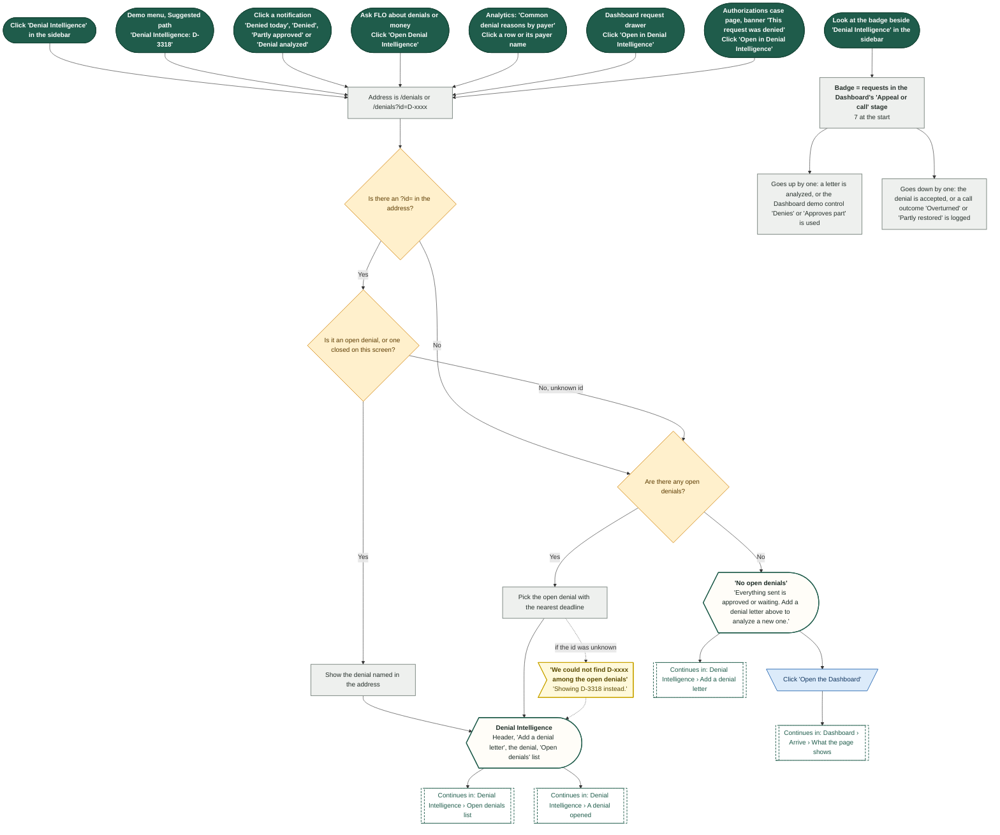

## Denial Intelligence › Open denials list

The 'Open denials' card on the right of the page: which denials are listed, how they are ordered, what each row says, the 'Closed' section, and what a click on a row does.

Route: `/denials?id=D-3318`

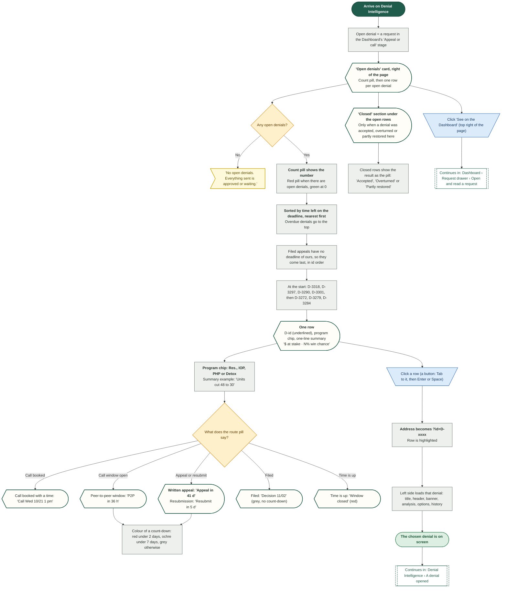

## Denial Intelligence › A denial opened

The page for one denial, top to bottom: title, header card with 'Our read', the status banner, the analysis cards, the options and the history. Each card is described once here and detailed in its own diagram.

Route: `/denials?id=D-3318`

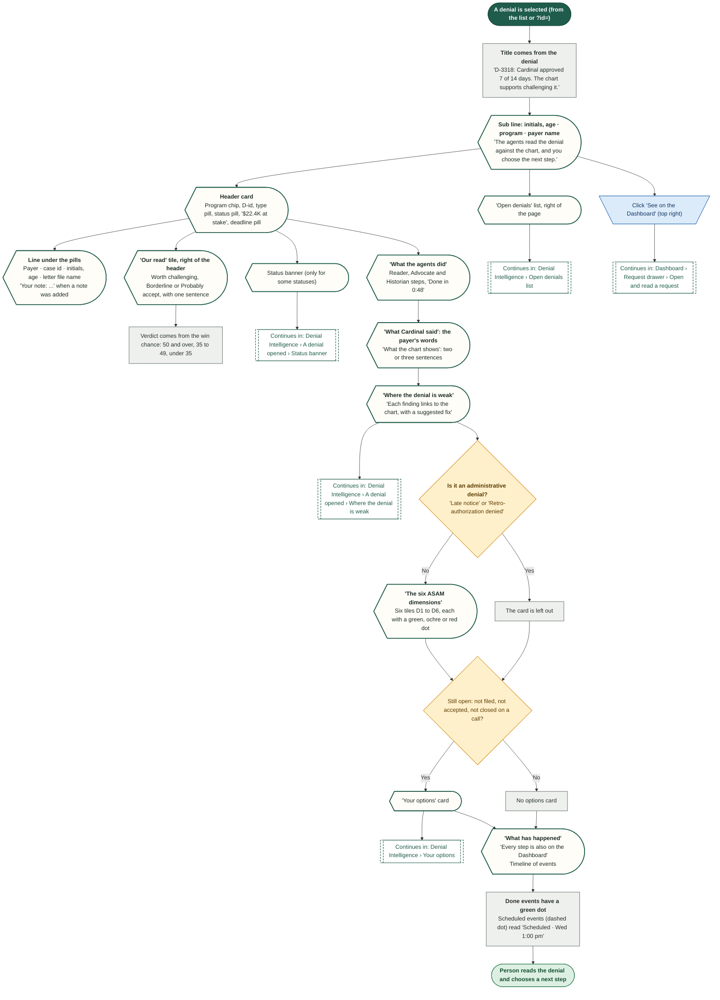

## Denial Intelligence › A denial opened › Status banner

One banner under the header says where the denial stands. The code checks the statuses in this order and shows the first that fits.

Route: `/denials?id=D-3318`

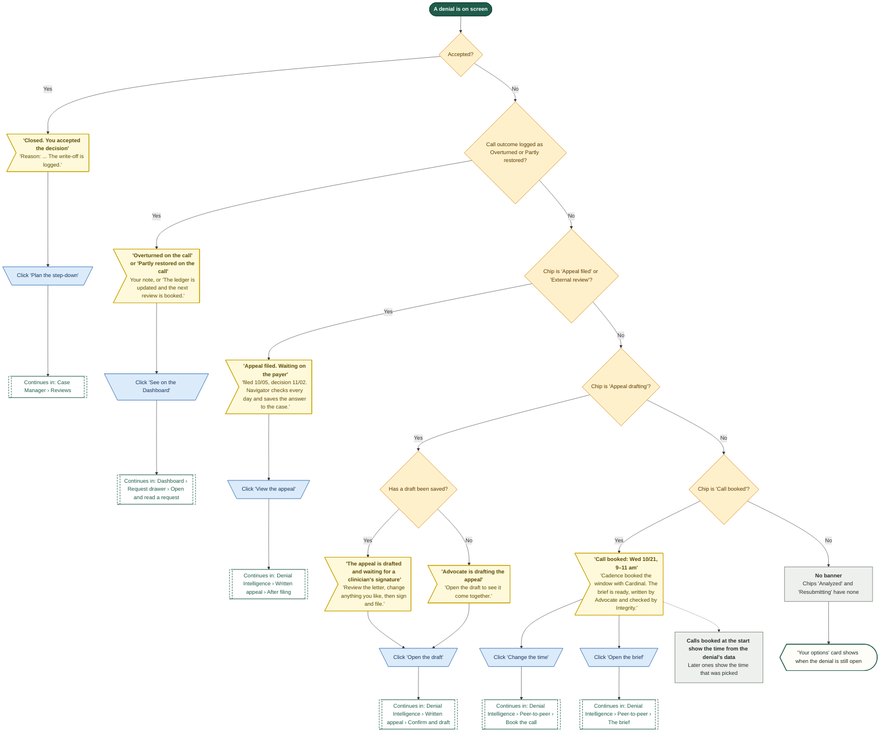

## Denial Intelligence › A denial opened › Where the denial is weak

The findings card: each finding has a severity, a source chip that opens the chart excerpt, and a suggested fix that can be added to the evidence for the brief and the appeal.

Route: `/denials?id=D-3318`

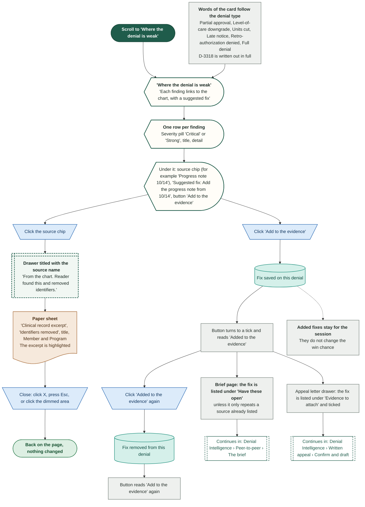

## Denial Intelligence › Add a denial letter

The 'Add a denial letter' card at the top of the page: drop or pick a letter, add a note, 'Analyze the denial', watch four agents work, and land on the new denial. In the demo the letter is not really read; a sample letter's facts fill the new denial.

Route: `/denials`

Demo only: any file type is accepted and only its name and size are kept. Which of the three sample letters (Beacon, Summit, Harborview) is used depends on the file name length, or on how many letters were added before when 'Use sample letter' is clicked.

```mermaid
%%{init: {"theme":"base","themeVariables":{"fontFamily":"'DM Sans', 'Segoe UI', system-ui, sans-serif","fontSize":"15px","lineColor":"#5B6B63","primaryTextColor":"#1C2B25","clusterBkg":"#FBF8F3","clusterBorder":"#D9CDBB","edgeLabelBackground":"#FFFFFF"},"flowchart":{"curve":"basis","nodeSpacing":36,"rankSpacing":48,"padding":12,"htmlLabels":true,"useMaxWidth":false,"wrappingWidth":230}} }%%
flowchart TD
  classDef k_start fill:#1F5C4B,stroke:#174638,color:#FFFFFF,stroke-width:1.5px,font-weight:600
  classDef k_end fill:#DDEFE3,stroke:#2E7D4F,color:#14502F,stroke-width:1.5px,font-weight:600
  classDef k_endx fill:#FBE3E0,stroke:#C0392B,color:#7A1F16,stroke-width:1.5px,font-weight:600
  classDef k_screen fill:#FFFDF8,stroke:#1F5C4B,color:#1C2B25,stroke-width:2px
  classDef k_overlay fill:#F1F7F3,stroke:#1F5C4B,color:#1C2B25,stroke-width:2px,stroke-dasharray:5 3
  classDef k_click fill:#DCEBFA,stroke:#2F6DB5,color:#12365F,stroke-width:1.5px
  classDef k_input fill:#E4E7FF,stroke:#4C5FD5,color:#1D2670,stroke-width:1.5px
  classDef k_process fill:#EEF0EE,stroke:#7A857F,color:#26302B,stroke-width:1.5px
  classDef k_agent fill:#EEE5FA,stroke:#7A4FC2,color:#341A63,stroke-width:1.5px
  classDef k_decision fill:#FFF0CC,stroke:#D9962B,color:#5C3B00,stroke-width:1.5px
  classDef k_store fill:#D5F0EA,stroke:#1C8E7B,color:#0B4A3F,stroke-width:1.5px
  classDef k_doc fill:#F6E9DC,stroke:#B07A4C,color:#4A2E14,stroke-width:1.5px
  classDef k_ext fill:#FFE6D2,stroke:#E07B39,color:#6B2F06,stroke-width:1.5px
  classDef k_wait fill:#E4E8EE,stroke:#6B7C93,color:#26303D,stroke-width:1.5px
  classDef k_toast fill:#FFF9DB,stroke:#C9A400,color:#5A4A00,stroke-width:1.5px
  classDef k_goto fill:#FFFFFF,stroke:#1F5C4B,color:#1F5C4B,stroke-width:1.5px,stroke-dasharray:5 3
  s1@{ shape: stadium, label: "Look at 'Add a denial letter' at the top of the page" }
  sc1@{ shape: curv-trap, label: "<b>'Add a denial letter'</b><br/>'The agents read it, check it against your chart and past appeals, and lay out your options'<br/>Two columns: letter, then note and button" }
  i1@{ shape: lean-r, label: "<b>Drop a file on the area, or click it (or press Enter or Space) to choose a file</b><br/>'Drop the denial letter here, or click to choose a PDF or DOCX'" }
  c1@{ shape: trap-t, label: "Click 'Use sample letter'" }
  p1@{ shape: rect, label: "Next sample letter in turn: Beacon, Summit, then Harborview" }
  fr@{ shape: curv-trap, label: "<b>File row: file name and size</b><br/>A small X removes it" }
  c2@{ shape: trap-t, label: "Click the X on the file row" }
  p2@{ shape: rect, label: "<b>Drop area comes back</b><br/>The note is kept" }
  p3@{ shape: rect, label: "'Identifiers are removed on upload.' is shown beside the area" }
  i2@{ shape: lean-r, label: "<b>Type a note (optional)</b><br/>'Add anything not in the letter, such as a payer call note'" }
  c3@{ shape: trap-t, label: "Click 'Analyze the denial'" }
  d1@{ shape: diam, label: "Is a letter chosen?" }
  t1@{ shape: odd, label: "'Add the letter first, or use the sample letter.'" }
  sc2@{ shape: curv-trap, label: "<b>Progress list replaces the form</b><br/>One line per agent, a spinner on the one working, a tick when done" }
  a1@{ shape: hex, label: "Reader is reading the letter and removing identifiers" }
  a2@{ shape: hex, label: "Advocate is checking the notice, the deadline and the payer's own criteria" }
  a3@{ shape: hex, label: "Historian is comparing similar decisions and appeals" }
  a4@{ shape: hex, label: "Integrity is checking every statement against the chart" }
  w1@{ shape: delay, label: "About 1.25 seconds per step, 5 seconds in all (demo: simulated)" }
  d2@{ shape: diam, label: "Is the person still on this page?" }
  e1@{ shape: stadium, label: "Work is dropped and no denial is added" }
  p4@{ shape: rect, label: "Facts of the sample fill the denial: initials, age, payer, program, '$ at stake', win chance, denial type, similar decisions, call window" }
  st1@{ shape: cyl, label: "<b>New open denial created, the next free number from D-3340</b><br/>Chip 'Analyzed', route 'Peer-to-peer', file name and note saved" }
  st2@{ shape: cyl, label: "History lines: Reader read the letter and removed identifiers; Advocate checked the notice, the deadline and how the payer applied its own criteria; Historian compared N similar decisions" }
  t2@{ shape: odd, label: "<b>'The analysis is ready'</b><br/>'D-3340 was added to Open denials.'" }
  t3@{ shape: odd, label: "<b>Notification 'Denial analyzed' from Advocate</b><br/>Links to the new denial" }
  p5@{ shape: rect, label: "<b>Form clears: file, sample and note</b><br/>New denial is selected, address becomes ?id=D-3340<br/>Badge goes up by one" }
  g1@{ shape: subproc, label: "Continues in: Denial Intelligence › A denial opened" }
  g2@{ shape: subproc, label: "Continues in: Denial Intelligence › Your options" }
  g3@{ shape: subproc, label: "Continues in: Dashboard › Arrive › What the page shows" }
  s1 --> sc1
  sc1 --> i1 --> fr
  sc1 --> c1 --> p1 --> fr
  fr --> c2 --> p2 --> i1
  sc1 --> p3
  sc1 --> i2 --> c3
  fr --> c3
  c3 --> d1
  d1 -->|"No"| t1 --> sc1
  d1 -->|"Yes"| sc2 --> a1 --> a2 --> a3 --> a4
  sc2 --> w1
  a4 --> d2
  d2 -->|"No, left the page"| e1
  d2 -->|"Yes"| p4 --> st1 --> st2 --> t2 --> p5
  st1 --> t3
  p5 --> g1 & g2
  st1 --> g3
  class s1 k_start
  class sc1,fr,sc2 k_screen
  class i1,i2 k_input
  class c1,c2,c3 k_click
  class p1,p2,p3,p4,p5 k_process
  class d1,d2 k_decision
  class t1,t2,t3 k_toast
  class a1,a2,a3,a4 k_agent
  class w1 k_wait
  class e1 k_endx
  class st1,st2 k_store
  class g1,g2,g3 k_goto
```

## Denial Intelligence › Your options

The 'Your options' card: three next steps as radio cards, how each chance is worked out, how 'Recommended' is chosen, and what the button under the cards opens.

Route: `/denials?id=D-3318`

```mermaid
%%{init: {"theme":"base","themeVariables":{"fontFamily":"'DM Sans', 'Segoe UI', system-ui, sans-serif","fontSize":"15px","lineColor":"#5B6B63","primaryTextColor":"#1C2B25","clusterBkg":"#FBF8F3","clusterBorder":"#D9CDBB","edgeLabelBackground":"#FFFFFF"},"flowchart":{"curve":"basis","nodeSpacing":36,"rankSpacing":48,"padding":12,"htmlLabels":true,"useMaxWidth":false,"wrappingWidth":230}} }%%
flowchart TD
  classDef k_start fill:#1F5C4B,stroke:#174638,color:#FFFFFF,stroke-width:1.5px,font-weight:600
  classDef k_end fill:#DDEFE3,stroke:#2E7D4F,color:#14502F,stroke-width:1.5px,font-weight:600
  classDef k_endx fill:#FBE3E0,stroke:#C0392B,color:#7A1F16,stroke-width:1.5px,font-weight:600
  classDef k_screen fill:#FFFDF8,stroke:#1F5C4B,color:#1C2B25,stroke-width:2px
  classDef k_overlay fill:#F1F7F3,stroke:#1F5C4B,color:#1C2B25,stroke-width:2px,stroke-dasharray:5 3
  classDef k_click fill:#DCEBFA,stroke:#2F6DB5,color:#12365F,stroke-width:1.5px
  classDef k_input fill:#E4E7FF,stroke:#4C5FD5,color:#1D2670,stroke-width:1.5px
  classDef k_process fill:#EEF0EE,stroke:#7A857F,color:#26302B,stroke-width:1.5px
  classDef k_agent fill:#EEE5FA,stroke:#7A4FC2,color:#341A63,stroke-width:1.5px
  classDef k_decision fill:#FFF0CC,stroke:#D9962B,color:#5C3B00,stroke-width:1.5px
  classDef k_store fill:#D5F0EA,stroke:#1C8E7B,color:#0B4A3F,stroke-width:1.5px
  classDef k_doc fill:#F6E9DC,stroke:#B07A4C,color:#4A2E14,stroke-width:1.5px
  classDef k_ext fill:#FFE6D2,stroke:#E07B39,color:#6B2F06,stroke-width:1.5px
  classDef k_wait fill:#E4E8EE,stroke:#6B7C93,color:#26303D,stroke-width:1.5px
  classDef k_toast fill:#FFF9DB,stroke:#C9A400,color:#5A4A00,stroke-width:1.5px
  classDef k_goto fill:#FFFFFF,stroke:#1F5C4B,color:#1F5C4B,stroke-width:1.5px,stroke-dasharray:5 3
  s1@{ shape: stadium, label: "A denial that is not filed, accepted or closed is on screen" }
  sc1@{ shape: curv-trap, label: "<b>'Your options'</b><br/>'Chance of overturning, from 312 similar Cardinal decisions'<br/>Three radio cards, then one button" }
  p0@{ shape: rect, label: "Subtitle reads ', a benchmark estimate' instead when fewer than 60 similar decisions" }
  p1@{ shape: rect, label: "Starting point: the denial's win chance (55 when none is set)" }
  d1@{ shape: diam, label: "What is the win chance?" }
  v1@{ shape: rect, label: "<b>'Worth challenging'</b><br/>50 and over" }
  v2@{ shape: rect, label: "<b>'Borderline'</b><br/>35 to 49" }
  v3@{ shape: rect, label: "<b>'Probably accept'</b><br/>under 35" }
  p2@{ shape: rect, label: "Seed denials sit between 38 and 64, so 'Probably accept' does not show at the start" }
  o1@{ shape: curv-trap, label: "<b>Card 'Peer-to-peer call'</b><br/>'30 to 45 minutes of clinician time · 5 to 7 days regained'<br/>Chance = the win chance" }
  o2@{ shape: curv-trap, label: "<b>Card 'Written appeal'</b><br/>'60 days to file · 5 to 7 days regained'<br/>Chance = win chance minus 6, never under 5" }
  o3@{ shape: curv-trap, label: "<b>Card 'Accept the decision and plan the next step'</b><br/>'Accept 7 days and plan the step-down' on a partial approval<br/>'Fastest. Nothing regained.' No chance shown" }
  p3@{ shape: rect, label: "Each chance reads 'likely 55–72%' (9 below to 8 above) and '312 similar decisions' or 'Benchmark estimate'" }
  p4@{ shape: rect, label: "Each card ends with 'Needs: ...' (who, what, and the evidence that would be attached)" }
  r1@{ shape: diam, label: "Which card is 'Recommended'?" }
  rec1@{ shape: curv-trap, label: "'Accept...' card gets the green 'Recommended' pill" }
  rec2@{ shape: curv-trap, label: "'Written appeal' gets the pill" }
  rec3@{ shape: curv-trap, label: "'Peer-to-peer call' gets the pill" }
  p5@{ shape: rect, label: "That card is selected when the page opens" }
  c1@{ shape: trap-t, label: "Click a card (it is a radio button)" }
  d2@{ shape: diam, label: "Is it 'Peer-to-peer call' and the call window has closed?" }
  t1@{ shape: odd, label: "<b>'The peer-to-peer window has closed'</b><br/>'A written appeal is still open.'" }
  p6@{ shape: rect, label: "<b>Card is selected</b><br/>The button label changes to match" }
  b1@{ shape: curv-trap, label: "<b>Button under the cards</b><br/>'Choose a time and prepare the brief', 'Draft the appeal letter' or 'Accept the decision and plan the step-down'" }
  t2@{ shape: odd, label: "'A call is already booked. Choosing again changes it.' (when the chip is 'Call booked')" }
  c2@{ shape: trap-t, label: "Click the button" }
  d3@{ shape: diam, label: "Which card is selected?" }
  d4@{ shape: diam, label: "Is the chip already 'Appeal drafting'?" }
  g1@{ shape: subproc, label: "Continues in: Denial Intelligence › Peer-to-peer › Book the call" }
  g2@{ shape: subproc, label: "Continues in: Denial Intelligence › Written appeal › Confirm and draft" }
  g3@{ shape: subproc, label: "Continues in: Denial Intelligence › Accept the denial" }
  p7@{ shape: rect, label: "Selection resets to the recommended card whenever the chip changes" }
  s1 --> sc1 --> p0
  sc1 --> p1 --> d1
  d1 -->|"50 and over"| v1
  d1 -->|"35 to 49"| v2
  d1 -->|"Under 35"| v3
  v1 --> p2
  v2 --> p2
  v3 --> p2
  sc1 --> o1 --> o2 --> o3
  o3 --> p3 --> p4
  p4 --> r1
  r1 -->|"Verdict is 'Probably accept'"| rec1
  r1 -->|"Deadline is to file or resubmit, window closed, or 'Late notice'"| rec2
  r1 -->|"Anything else"| rec3
  rec1 --> p5
  rec2 --> p5
  rec3 --> p5
  p5 --> c1
  c1 --> d2
  d2 -->|"Yes"| t1
  d2 -->|"No"| p6 --> b1
  b1 -.-> t2
  b1 --> c2 --> d3
  d3 -->|"Peer-to-peer call"| g1
  d3 -->|"Written appeal"| d4
  d4 -->|"Yes: drawer opens at once"| g2
  d4 -->|"No: confirm first"| g2
  d3 -->|"Accept"| g3
  c1 -.-> p7
  class s1 k_start
  class sc1,o1,o2,o3,rec1,rec2,rec3,b1 k_screen
  class p0,p1,v1,v2,v3,p2,p3,p4,p5,p6,p7 k_process
  class d1,r1,d2,d3,d4 k_decision
  class c1,c2 k_click
  class t1,t2 k_toast
  class g1,g2,g3 k_goto
```

## Denial Intelligence › Peer-to-peer › Book the call

The confirm gate for the peer-to-peer route: pick one of three call windows, confirm, and Cadence books it. The same modal opens from the options card, from 'Change the time' and from the brief page.

Route: `/denials?id=D-3318`

Demo only: the three times are counted from the demo's first day (Tue 10/20), not from the demo clock, so after a fast-forward they can already be in the past. The payer holding the slot is simulated.

```mermaid
%%{init: {"theme":"base","themeVariables":{"fontFamily":"'DM Sans', 'Segoe UI', system-ui, sans-serif","fontSize":"15px","lineColor":"#5B6B63","primaryTextColor":"#1C2B25","clusterBkg":"#FBF8F3","clusterBorder":"#D9CDBB","edgeLabelBackground":"#FFFFFF"},"flowchart":{"curve":"basis","nodeSpacing":36,"rankSpacing":48,"padding":12,"htmlLabels":true,"useMaxWidth":false,"wrappingWidth":230}} }%%
flowchart TD
  classDef k_start fill:#1F5C4B,stroke:#174638,color:#FFFFFF,stroke-width:1.5px,font-weight:600
  classDef k_end fill:#DDEFE3,stroke:#2E7D4F,color:#14502F,stroke-width:1.5px,font-weight:600
  classDef k_endx fill:#FBE3E0,stroke:#C0392B,color:#7A1F16,stroke-width:1.5px,font-weight:600
  classDef k_screen fill:#FFFDF8,stroke:#1F5C4B,color:#1C2B25,stroke-width:2px
  classDef k_overlay fill:#F1F7F3,stroke:#1F5C4B,color:#1C2B25,stroke-width:2px,stroke-dasharray:5 3
  classDef k_click fill:#DCEBFA,stroke:#2F6DB5,color:#12365F,stroke-width:1.5px
  classDef k_input fill:#E4E7FF,stroke:#4C5FD5,color:#1D2670,stroke-width:1.5px
  classDef k_process fill:#EEF0EE,stroke:#7A857F,color:#26302B,stroke-width:1.5px
  classDef k_agent fill:#EEE5FA,stroke:#7A4FC2,color:#341A63,stroke-width:1.5px
  classDef k_decision fill:#FFF0CC,stroke:#D9962B,color:#5C3B00,stroke-width:1.5px
  classDef k_store fill:#D5F0EA,stroke:#1C8E7B,color:#0B4A3F,stroke-width:1.5px
  classDef k_doc fill:#F6E9DC,stroke:#B07A4C,color:#4A2E14,stroke-width:1.5px
  classDef k_ext fill:#FFE6D2,stroke:#E07B39,color:#6B2F06,stroke-width:1.5px
  classDef k_wait fill:#E4E8EE,stroke:#6B7C93,color:#26303D,stroke-width:1.5px
  classDef k_toast fill:#FFF9DB,stroke:#C9A400,color:#5A4A00,stroke-width:1.5px
  classDef k_goto fill:#FFFFFF,stroke:#1F5C4B,color:#1F5C4B,stroke-width:1.5px,stroke-dasharray:5 3
  s1@{ shape: stadium, label: "Click 'Choose a time and prepare the brief' (Your options)" }
  s2@{ shape: stadium, label: "Click 'Change the time' (call-booked banner)" }
  s3@{ shape: stadium, label: "Brief page: click 'Book the call' or 'Change the call time'" }
  o1@{ shape: win-pane, label: "<b>Modal 'Confirm the next step: peer-to-peer call'</b><br/>'The agents stop here until you say go.'" }
  l1@{ shape: curv-trap, label: "<b>'What happens when you confirm'</b><br/>Cadence books the window with the payer and adds it to the clinician's calendar<br/>Advocate finishes the brief with three points and the likely pushback<br/>Integrity checks every sentence against the chart" }
  l2@{ shape: curv-trap, label: "'Pick a time. Chance of overturning is 64% (likely 55–72%).'" }
  p1@{ shape: rect, label: "<b>Up to three windows on the next working days: 9–11 am, 1–3 pm, 4–5 pm</b><br/>Only times before the payer's window closes" }
  d1@{ shape: diam, label: "Is any call time left?" }
  t1@{ shape: odd, label: "<b>'No call time is left inside the payer's window. Choose a written appeal instead.'</b><br/>'Confirm and book the call' is greyed out" }
  i1@{ shape: lean-r, label: "<b>Pick a call time (radio cards)</b><br/>First is chosen, or the one already booked" }
  p2@{ shape: rect, label: "Card text: 'Booked now' on the booked time, 'Open with the payer's reviewer' on the others" }
  c1@{ shape: trap-t, label: "Click 'Confirm and book the call'" }
  c2@{ shape: trap-t, label: "Click 'Cancel', the X, press Esc, or click the dimmed area" }
  e1@{ shape: stadium, label: "Nothing changes" }
  st1@{ shape: cyl, label: "<b>Call time saved on the denial</b><br/>Chip 'Call booked', list pill 'Call Wed 10/21 1 pm'" }
  x1@{ shape: st-rect, label: "Payer's reviewer holds the window (demo: simulated)" }
  a1@{ shape: hex, label: "Cadence books the window and adds it to the clinician's calendar" }
  a2@{ shape: hex, label: "Advocate writes the brief, Integrity checks it against the chart" }
  st2@{ shape: cyl, label: "History: 'Cadence booked the peer-to-peer call for ...', 'Advocate wrote the brief and Integrity checked it against the chart', and a scheduled 'Peer-to-peer call with Cardinal'" }
  t2@{ shape: odd, label: "<b>'Call booked'</b><br/>'Wed 10/21, 1–3 pm. The brief is ready.'" }
  d2@{ shape: diam, label: "Booked from which page?" }
  p3@{ shape: rect, label: "Modal closes and the app opens the brief page" }
  p4@{ shape: rect, label: "<b>Modal closes, the brief stays open</b><br/>'Call details' shows the new window" }
  g1@{ shape: subproc, label: "Continues in: Denial Intelligence › Peer-to-peer › The brief" }
  e2@{ shape: stadium, label: "Call is booked, brief is ready" }
  s1 --> o1
  s2 --> o1
  s3 --> o1
  o1 --> l1 --> l2 --> p1 --> d1
  d1 -->|"No"| t1 --> c2
  d1 -->|"Yes"| i1 --> p2
  p2 --> c1
  p2 --> c2 --> e1
  c1 --> st1 --> x1 --> a1 --> a2 --> st2 --> t2 --> d2
  d2 -->|"Denial page"| p3 --> g1
  d2 -->|"Brief page"| p4 --> e2
  class s1,s2,s3 k_start
  class o1 k_overlay
  class l1,l2 k_screen
  class p1,p2,p3,p4 k_process
  class d1,d2 k_decision
  class t1,t2 k_toast
  class i1 k_input
  class c1,c2 k_click
  class e1 k_endx
  class st1,st2 k_store
  class x1 k_ext
  class a1,a2 k_agent
  class g1 k_goto
  class e2 k_end
```

## Denial Intelligence › Peer-to-peer › The brief

The one-page brief a clinician keeps open during the call: opening, three points, what the payer may say, the ask, dates and numbers on the left, call details and tools on the right.

Route: `/denials/D-3318/brief`

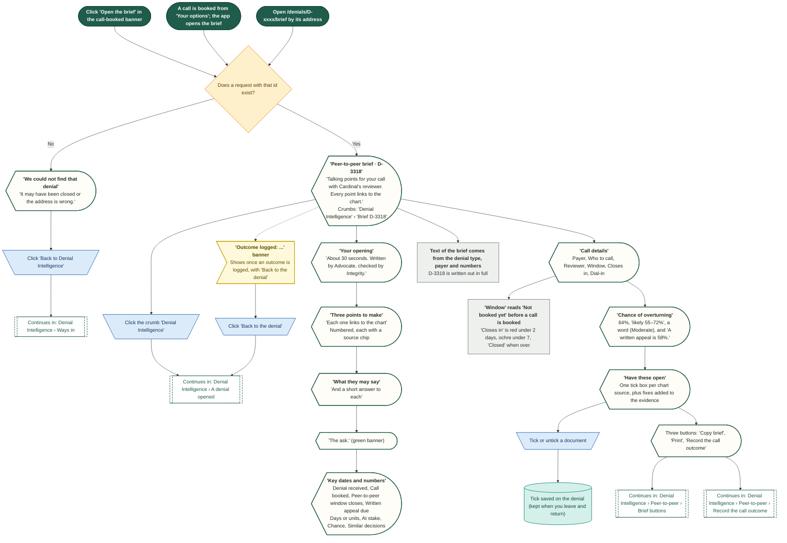

## Denial Intelligence › Peer-to-peer › Brief buttons

The buttons on the brief page: 'Copy brief' and 'Print' (off in the hosted preview), and the call-time button. Recording the outcome has its own diagram.

Route: `/denials/D-3318/brief`

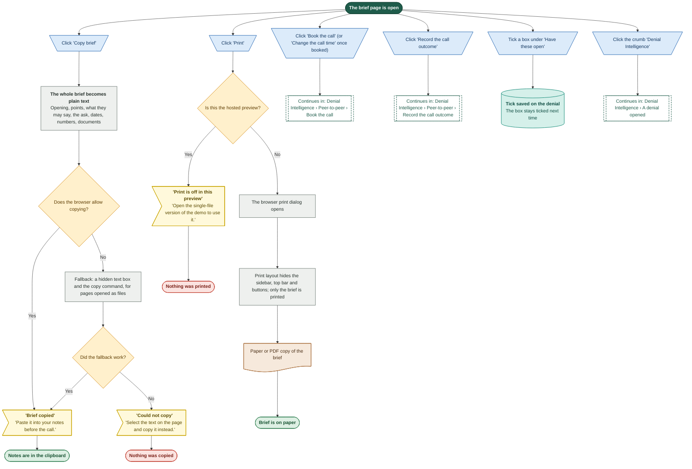

## Denial Intelligence › Peer-to-peer › Record the call outcome

After the call, the person logs how it went. 'Overturned' and 'Partly restored' close the denial; 'Upheld' starts a written appeal from the call notes.

Route: `/denials/D-3318/brief`

Demo only: the call itself is not simulated. The clinician holds it outside the app and logs the result here.

```mermaid
%%{init: {"theme":"base","themeVariables":{"fontFamily":"'DM Sans', 'Segoe UI', system-ui, sans-serif","fontSize":"15px","lineColor":"#5B6B63","primaryTextColor":"#1C2B25","clusterBkg":"#FBF8F3","clusterBorder":"#D9CDBB","edgeLabelBackground":"#FFFFFF"},"flowchart":{"curve":"basis","nodeSpacing":36,"rankSpacing":48,"padding":12,"htmlLabels":true,"useMaxWidth":false,"wrappingWidth":230}} }%%
flowchart TD
  classDef k_start fill:#1F5C4B,stroke:#174638,color:#FFFFFF,stroke-width:1.5px,font-weight:600
  classDef k_end fill:#DDEFE3,stroke:#2E7D4F,color:#14502F,stroke-width:1.5px,font-weight:600
  classDef k_endx fill:#FBE3E0,stroke:#C0392B,color:#7A1F16,stroke-width:1.5px,font-weight:600
  classDef k_screen fill:#FFFDF8,stroke:#1F5C4B,color:#1C2B25,stroke-width:2px
  classDef k_overlay fill:#F1F7F3,stroke:#1F5C4B,color:#1C2B25,stroke-width:2px,stroke-dasharray:5 3
  classDef k_click fill:#DCEBFA,stroke:#2F6DB5,color:#12365F,stroke-width:1.5px
  classDef k_input fill:#E4E7FF,stroke:#4C5FD5,color:#1D2670,stroke-width:1.5px
  classDef k_process fill:#EEF0EE,stroke:#7A857F,color:#26302B,stroke-width:1.5px
  classDef k_agent fill:#EEE5FA,stroke:#7A4FC2,color:#341A63,stroke-width:1.5px
  classDef k_decision fill:#FFF0CC,stroke:#D9962B,color:#5C3B00,stroke-width:1.5px
  classDef k_store fill:#D5F0EA,stroke:#1C8E7B,color:#0B4A3F,stroke-width:1.5px
  classDef k_doc fill:#F6E9DC,stroke:#B07A4C,color:#4A2E14,stroke-width:1.5px
  classDef k_ext fill:#FFE6D2,stroke:#E07B39,color:#6B2F06,stroke-width:1.5px
  classDef k_wait fill:#E4E8EE,stroke:#6B7C93,color:#26303D,stroke-width:1.5px
  classDef k_toast fill:#FFF9DB,stroke:#C9A400,color:#5A4A00,stroke-width:1.5px
  classDef k_goto fill:#FFFFFF,stroke:#1F5C4B,color:#1F5C4B,stroke-width:1.5px,stroke-dasharray:5 3
  s1@{ shape: stadium, label: "Click 'Record the call outcome' on the brief page" }
  x1@{ shape: st-rect, label: "Clinician holds the peer-to-peer call with the payer's reviewer" }
  o1@{ shape: win-pane, label: "<b>Modal 'Record the call outcome'</b><br/>D-3318 · Cardinal Health Plan" }
  i1@{ shape: lean-r, label: "<b>Pick one (radio cards)</b><br/>'Overturned' (chosen at first), 'Partly restored' or 'Upheld'" }
  p1@{ shape: rect, label: "<b>Card texts</b><br/>Overturned: the payer restored the requested days, the denial closes<br/>Partly restored: closes with a new end date<br/>Upheld: Advocate starts a written appeal from your call notes" }
  i2@{ shape: lean-r, label: "<b>Note (optional)</b><br/>'Who you spoke to and what was agreed.'" }
  c1@{ shape: trap-t, label: "Click 'Log the outcome'" }
  c2@{ shape: trap-t, label: "Click 'Cancel', the X, press Esc, or click the dimmed area" }
  e1@{ shape: stadium, label: "Nothing is logged" }
  st0@{ shape: cyl, label: "<b>Outcome saved on the denial: kind, note, time</b><br/>History: 'You logged the call outcome: ...' with the note" }
  d1@{ shape: diam, label: "Which outcome?" }
  st1@{ shape: cyl, label: "<b>Request settled: leaves 'Appeal or call' (Dashboard stage 'Decided')</b><br/>Chip 'Overturned' or 'Partly restored'<br/>Ledger result approved or partly approved" }
  x2@{ shape: st-rect, label: "Payer restores the requested days, or part of them, on the call" }
  a1@{ shape: hex, label: "Cadence updates the ledger and books the next review" }
  t1@{ shape: odd, label: "<b>'Overturned' or 'Partly restored'</b><br/>'The ledger is updated and the next review is booked.'" }
  p2@{ shape: rect, label: "<b>Sidebar badge goes down by one</b><br/>The denial moves to 'Closed' in the open denials list<br/>Banner 'Overturned on the call' or 'Partly restored on the call'" }
  st2@{ shape: cyl, label: "<b>Chip 'Appeal drafting'</b><br/>Clock becomes 'to file': 60 days from the denial date" }
  a2@{ shape: hex, label: "Advocate starts a written appeal from the call notes" }
  t2@{ shape: odd, label: "<b>'Outcome logged: upheld'</b><br/>'Advocate started the written appeal. Open it from the denial.'" }
  p3@{ shape: rect, label: "Denial page shows 'Advocate is drafting the appeal' with 'Open the draft'" }
  t3@{ shape: odd, label: "Brief page banner 'Outcome logged: overturned, partly restored or upheld' with 'Back to the denial'" }
  t4@{ shape: odd, label: "<b>Notification 'Call outcome: ...' from Advocate</b><br/>Opens the request on the Dashboard" }
  c3@{ shape: trap-t, label: "Click 'Back to the denial'" }
  p4@{ shape: rect, label: "<b>The button 'Record the call outcome' stays on the brief</b><br/>Logging again runs these steps again (demo does not stop it)" }
  g1@{ shape: subproc, label: "Continues in: Denial Intelligence › A denial opened" }
  g2@{ shape: subproc, label: "Continues in: Denial Intelligence › Written appeal › Confirm and draft" }
  g3@{ shape: subproc, label: "Continues in: Dashboard › Request drawer › Open and read a request" }
  e2@{ shape: stadium, label: "Denial is closed with the call result" }
  e3@{ shape: stadium, label: "Written appeal is under way" }
  s1 --> x1 --> o1
  o1 --> i1 --> p1
  o1 --> i2
  p1 --> c1
  i2 --> c1
  o1 --> c2 --> e1
  c1 --> st0 --> d1
  d1 -->|"Overturned or Partly restored"| x2 --> st1 --> a1 --> t1 --> p2 --> e2
  d1 -->|"Upheld"| st2 --> a2 --> t2 --> p3 --> e3
  st0 --> t3 --> c3 --> g1
  st0 --> t4 --> g3
  e3 --> g2
  e2 --> g1
  t3 --> p4
  class s1 k_start
  class x1,x2 k_ext
  class o1 k_overlay
  class i1,i2 k_input
  class p1,p2,p3,p4 k_process
  class c1,c2,c3 k_click
  class e1 k_endx
  class st0,st1,st2 k_store
  class d1 k_decision
  class a1,a2 k_agent
  class t1,t2,t3,t4 k_toast
  class g1,g2,g3 k_goto
  class e2,e3 k_end
```

## Denial Intelligence › Written appeal › Confirm and draft

The written-appeal route starts with a confirm gate, then Advocate drafts the letter in a side drawer. The same drawer opens straight away when the appeal is already being drafted (for example after a call was upheld).

Route: `/denials?id=D-3318`

Demo only: the drafting takes about two seconds and is simulated. The letter is built from the findings of the denial.

```mermaid
%%{init: {"theme":"base","themeVariables":{"fontFamily":"'DM Sans', 'Segoe UI', system-ui, sans-serif","fontSize":"15px","lineColor":"#5B6B63","primaryTextColor":"#1C2B25","clusterBkg":"#FBF8F3","clusterBorder":"#D9CDBB","edgeLabelBackground":"#FFFFFF"},"flowchart":{"curve":"basis","nodeSpacing":36,"rankSpacing":48,"padding":12,"htmlLabels":true,"useMaxWidth":false,"wrappingWidth":230}} }%%
flowchart TD
  classDef k_start fill:#1F5C4B,stroke:#174638,color:#FFFFFF,stroke-width:1.5px,font-weight:600
  classDef k_end fill:#DDEFE3,stroke:#2E7D4F,color:#14502F,stroke-width:1.5px,font-weight:600
  classDef k_endx fill:#FBE3E0,stroke:#C0392B,color:#7A1F16,stroke-width:1.5px,font-weight:600
  classDef k_screen fill:#FFFDF8,stroke:#1F5C4B,color:#1C2B25,stroke-width:2px
  classDef k_overlay fill:#F1F7F3,stroke:#1F5C4B,color:#1C2B25,stroke-width:2px,stroke-dasharray:5 3
  classDef k_click fill:#DCEBFA,stroke:#2F6DB5,color:#12365F,stroke-width:1.5px
  classDef k_input fill:#E4E7FF,stroke:#4C5FD5,color:#1D2670,stroke-width:1.5px
  classDef k_process fill:#EEF0EE,stroke:#7A857F,color:#26302B,stroke-width:1.5px
  classDef k_agent fill:#EEE5FA,stroke:#7A4FC2,color:#341A63,stroke-width:1.5px
  classDef k_decision fill:#FFF0CC,stroke:#D9962B,color:#5C3B00,stroke-width:1.5px
  classDef k_store fill:#D5F0EA,stroke:#1C8E7B,color:#0B4A3F,stroke-width:1.5px
  classDef k_doc fill:#F6E9DC,stroke:#B07A4C,color:#4A2E14,stroke-width:1.5px
  classDef k_ext fill:#FFE6D2,stroke:#E07B39,color:#6B2F06,stroke-width:1.5px
  classDef k_wait fill:#E4E8EE,stroke:#6B7C93,color:#26303D,stroke-width:1.5px
  classDef k_toast fill:#FFF9DB,stroke:#C9A400,color:#5A4A00,stroke-width:1.5px
  classDef k_goto fill:#FFFFFF,stroke:#1F5C4B,color:#1F5C4B,stroke-width:1.5px,stroke-dasharray:5 3
  s1@{ shape: stadium, label: "Select 'Written appeal' and click 'Draft the appeal letter' (Your options)" }
  s2@{ shape: stadium, label: "Click 'Open the draft' (banner: 'Advocate is drafting the appeal')" }
  d1@{ shape: diam, label: "Is the chip already 'Appeal drafting'?" }
  o1@{ shape: win-pane, label: "<b>Modal 'Confirm the next step: written appeal'</b><br/>'The agents stop here until you say go.'" }
  l1@{ shape: curv-trap, label: "<b>What happens next</b><br/>Advocate drafts the letter from the findings and the evidence list<br/>Integrity checks every sentence against the chart<br/>Navigator files it through the payer's portal after a clinician signs" }
  l2@{ shape: curv-trap, label: "'Chance of overturning is 58% (likely 49–66%). You can edit the letter before it goes. Nothing leaves without a clinician's signature.'" }
  c1@{ shape: trap-t, label: "Click 'Draft the appeal'" }
  c2@{ shape: trap-t, label: "Click 'Cancel', the X, press Esc, or click the dimmed area" }
  e1@{ shape: stadium, label: "Nothing changes" }
  st1@{ shape: cyl, label: "<b>Chip 'Appeal drafting'</b><br/>'Advocate is drafting the appeal'" }
  d2@{ shape: diam, label: "Is the clock already 'to file' or 'to resubmit'?" }
  st2@{ shape: cyl, label: "<b>Clock set: appeal due 60 days after the denial</b><br/>List pill 'Appeal in 59 d'" }
  p1@{ shape: rect, label: "Keep the existing deadline" }
  st3@{ shape: cyl, label: "History: 'You chose a written appeal', 'Advocate started the appeal letter'" }
  o2@{ shape: win-pane, label: "<b>Drawer 'Appeal letter · D-3318' (wide, right side)</b><br/>Sub line: 'Cardinal Health Plan. Due 12/18.'" }
  d3@{ shape: diam, label: "Is a draft already saved?" }
  w1@{ shape: delay, label: "<b>Spinner: 'Advocate is drafting the letter from the findings. Integrity is checking each sentence.'</b><br/>About 2 seconds; 'Save draft' and 'Sign and file' are greyed out" }
  a1@{ shape: hex, label: "Advocate drafts the letter and Integrity checks every sentence (demo: simulated)" }
  dc1@{ shape: doc, label: "<b>Letter text</b><br/>Payer, 'Appeals Department', date, Re: line, the payer's words, what the chart shows, numbered reasons with evidence, the ask, availability for the reviewing physician" }
  l3@{ shape: curv-trap, label: "<b>'Evidence to attach'</b><br/>One ticked box per chart source, plus fixes added to the evidence" }
  st4@{ shape: cyl, label: "<b>First draft saved on the denial</b><br/>'Appeal drafted. Waiting for a clinician's signature'<br/>History: 'Advocate drafted the appeal and Integrity checked every sentence against the chart'" }
  l4@{ shape: curv-trap, label: "<b>Banner 'Drafted by Advocate, checked by Integrity'</b><br/>'Edit anything. A clinician signs before it is filed.'" }
  c3@{ shape: trap-t, label: "Close the drawer: click X, press Esc, or click the dimmed area" }
  p2@{ shape: rect, label: "<b>Edits not saved with 'Save draft' are lost</b><br/>The saved draft loads again next time" }
  g1@{ shape: subproc, label: "Continues in: Denial Intelligence › Written appeal › Edit, sign and file" }
  s1 --> d1
  s2 --> o2
  d1 -->|"No"| o1 --> l1 --> l2
  l2 --> c1
  l2 --> c2 --> e1
  d1 -->|"Yes"| o2
  c1 --> st1 --> d2
  d2 -->|"No"| st2 --> st3
  d2 -->|"Yes"| p1 --> st3
  st3 --> o2
  o2 --> d3
  d3 -->|"No"| w1 --> a1 --> dc1
  d3 -->|"Yes"| dc1
  dc1 --> l3 --> l4
  a1 --> st4
  l4 --> g1
  l4 --> c3 --> p2
  class s1,s2 k_start
  class d1,d2,d3 k_decision
  class o1,o2 k_overlay
  class l1,l2,l3,l4 k_screen
  class c1,c2,c3 k_click
  class e1 k_endx
  class st1,st2,st3,st4 k_store
  class p1,p2 k_process
  class w1 k_wait
  class a1 k_agent
  class dc1 k_doc
  class g1 k_goto
```

## Denial Intelligence › Written appeal › Edit, sign and file

With the letter drafted, the person edits it, picks the evidence, saves a draft, and a licensed clinician signs. Navigator files only after the signature.

Route: `/denials?id=D-3318`

Demo only: Navigator's filing through the payer's portal is simulated (about one second).

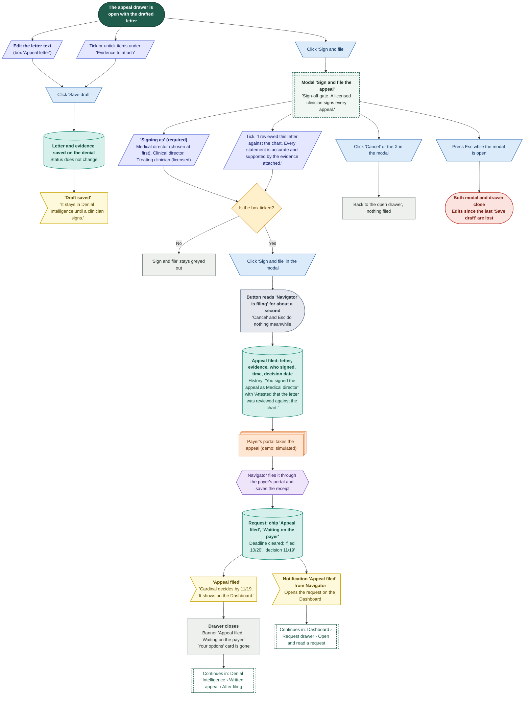

## Denial Intelligence › Written appeal › After filing

A filed appeal (new, or seeded like D-3279, D-3284 and D-3272) shows a waiting banner and a read-only letter. The demo has no control that records the payer's decision; the boxes marked PRD show what happens in production.

Route: `/denials?id=D-3318`

Demo only: the 30-day decision date is fixed, the receipt is saved at filing, and fast-forwarding changes nothing on a filed appeal.

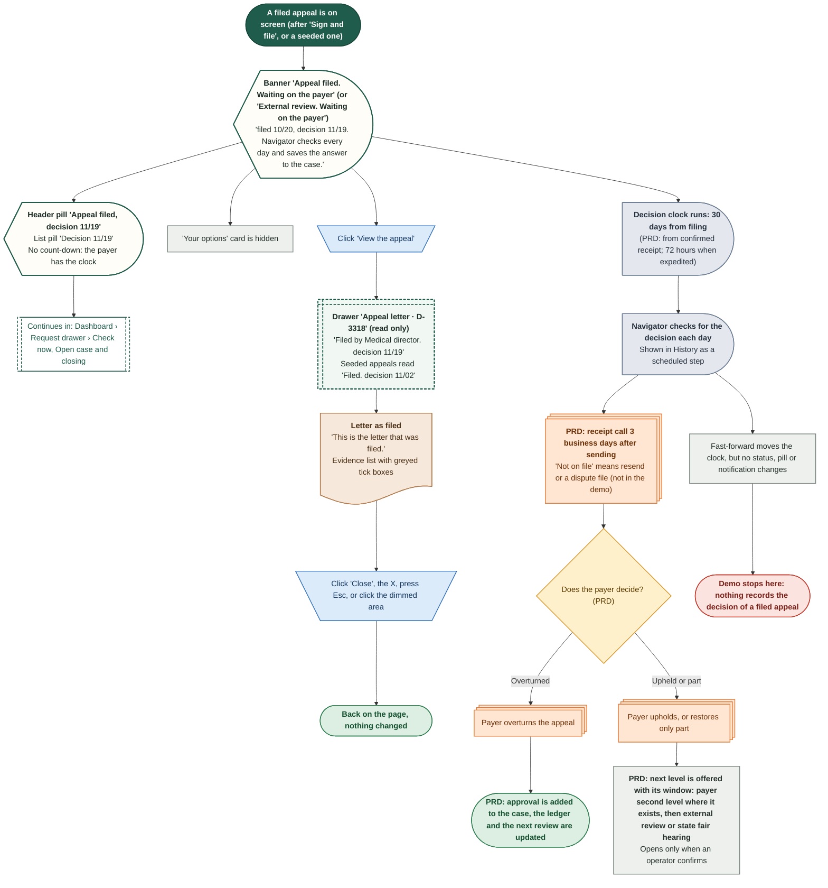

## Denial Intelligence › Accept the denial

Accepting closes the denial and logs a write-off. A reason goes on the record first. Accepting is always the person's choice and is never the only option.

Route: `/denials?id=D-3297`

Demo only: the write-off and the step-down plan are written as History lines and a notification. Nothing is added to Case Manager's list or to Analytics.

```mermaid
%%{init: {"theme":"base","themeVariables":{"fontFamily":"'DM Sans', 'Segoe UI', system-ui, sans-serif","fontSize":"15px","lineColor":"#5B6B63","primaryTextColor":"#1C2B25","clusterBkg":"#FBF8F3","clusterBorder":"#D9CDBB","edgeLabelBackground":"#FFFFFF"},"flowchart":{"curve":"basis","nodeSpacing":36,"rankSpacing":48,"padding":12,"htmlLabels":true,"useMaxWidth":false,"wrappingWidth":230}} }%%
flowchart TD
  classDef k_start fill:#1F5C4B,stroke:#174638,color:#FFFFFF,stroke-width:1.5px,font-weight:600
  classDef k_end fill:#DDEFE3,stroke:#2E7D4F,color:#14502F,stroke-width:1.5px,font-weight:600
  classDef k_endx fill:#FBE3E0,stroke:#C0392B,color:#7A1F16,stroke-width:1.5px,font-weight:600
  classDef k_screen fill:#FFFDF8,stroke:#1F5C4B,color:#1C2B25,stroke-width:2px
  classDef k_overlay fill:#F1F7F3,stroke:#1F5C4B,color:#1C2B25,stroke-width:2px,stroke-dasharray:5 3
  classDef k_click fill:#DCEBFA,stroke:#2F6DB5,color:#12365F,stroke-width:1.5px
  classDef k_input fill:#E4E7FF,stroke:#4C5FD5,color:#1D2670,stroke-width:1.5px
  classDef k_process fill:#EEF0EE,stroke:#7A857F,color:#26302B,stroke-width:1.5px
  classDef k_agent fill:#EEE5FA,stroke:#7A4FC2,color:#341A63,stroke-width:1.5px
  classDef k_decision fill:#FFF0CC,stroke:#D9962B,color:#5C3B00,stroke-width:1.5px
  classDef k_store fill:#D5F0EA,stroke:#1C8E7B,color:#0B4A3F,stroke-width:1.5px
  classDef k_doc fill:#F6E9DC,stroke:#B07A4C,color:#4A2E14,stroke-width:1.5px
  classDef k_ext fill:#FFE6D2,stroke:#E07B39,color:#6B2F06,stroke-width:1.5px
  classDef k_wait fill:#E4E8EE,stroke:#6B7C93,color:#26303D,stroke-width:1.5px
  classDef k_toast fill:#FFF9DB,stroke:#C9A400,color:#5A4A00,stroke-width:1.5px
  classDef k_goto fill:#FFFFFF,stroke:#1F5C4B,color:#1F5C4B,stroke-width:1.5px,stroke-dasharray:5 3
  s1@{ shape: stadium, label: "Select the 'Accept...' card in 'Your options'" }
  c1@{ shape: trap-t, label: "Click 'Accept the decision and plan the step-down'" }
  o1@{ shape: win-pane, label: "<b>Modal 'Accept the decision?'</b><br/>'Nothing is regained. This closes the denial.'" }
  l1@{ shape: curv-trap, label: "<b>Three bullets</b><br/>'Cadence logs the write-off of $6.2K.'<br/>'Case Manager starts the step-down plan.'<br/>'D-3297 leaves Appeal or call on the Dashboard.'" }
  i1@{ shape: lean-r, label: "'Reason for the record' (required): open the menu and pick one" }
  l2@{ shape: curv-trap, label: "<b>Menu choices</b><br/>'The chart does not yet support a challenge' (chosen at first)<br/>'The clinical team agrees with the payer's reasoning'<br/>'The member and family chose to step down'<br/>'The cost of an appeal outweighs the amount'" }
  i2@{ shape: lean-r, label: "<b>Note (optional)</b><br/>'Anything the team should know'" }
  c2@{ shape: trap-t, label: "Click 'Accept and close'" }
  c3@{ shape: trap-t, label: "Click 'Cancel', the X, press Esc (this also closes an open menu), or click the dimmed area" }
  e1@{ shape: stadium, label: "<b>Nothing recorded</b><br/>The denial stays open" }
  st1@{ shape: cyl, label: "Accepted: reason (with the note after it) and time saved on the denial" }
  st2@{ shape: cyl, label: "<b>Request settled: leaves 'Appeal or call' for 'Decided'</b><br/>Chip 'Accepted', 'Closed. Write-off logged'<br/>Deadline cleared; held by Cadence" }
  a1@{ shape: hex, label: "Cadence logs the write-off of the at-stake amount" }
  st3@{ shape: cyl, label: "<b>History: 'You accepted the decision' with 'Reason: ...'</b><br/>'Cadence logged the write-off of $6.2K and started the step-down plan in Case Manager'" }
  t1@{ shape: odd, label: "<b>'Decision accepted'</b><br/>'The write-off is logged. Case Manager has the step-down plan.'" }
  t2@{ shape: odd, label: "<b>Notification 'Denial closed' from Cadence</b><br/>Opens Case Manager, Reviews" }
  sc1@{ shape: curv-trap, label: "<b>Denial page now shows banner 'Closed. You accepted the decision'</b><br/>'Reason: ... The write-off is logged.'" }
  p1@{ shape: rect, label: "<b>'Your options' card is gone</b><br/>Denial moves to 'Closed' in the open denials list with the pill 'Accepted'<br/>Sidebar badge goes down by one" }
  c4@{ shape: trap-t, label: "Click 'Plan the step-down'" }
  c5@{ shape: trap-t, label: "Click 'See on the Dashboard' (top right)" }
  g1@{ shape: subproc, label: "Continues in: Case Manager › Reviews" }
  g2@{ shape: subproc, label: "Continues in: Dashboard › Request drawer › Open and read a request" }
  p2@{ shape: rect, label: "<b>PRD guardrail: the agents never accept a write-off</b><br/>A person gives the reason, and the dollars are shown first" }
  s1 --> c1 --> o1 --> l1
  l1 --> i1 --> l2
  l1 --> i2
  l2 --> c2
  i2 --> c2
  o1 --> c3 --> e1
  c2 --> st1 --> st2 --> a1 --> st3 --> t1 --> sc1
  st3 --> t2 --> g1
  sc1 --> p1
  sc1 --> c4 --> g1
  sc1 --> c5 --> g2
  o1 -.-> p2
  class s1 k_start
  class c1,c2,c3,c4,c5 k_click
  class o1 k_overlay
  class l1,l2,sc1 k_screen
  class i1,i2 k_input
  class e1 k_endx
  class st1,st2,st3 k_store
  class a1 k_agent
  class t1,t2 k_toast
  class p1,p2 k_process
  class g1,g2 k_goto
```

## Denial Intelligence › Deadlines › Fast-forward the clock

The demo clock only moves when the Demo menu moves it. Every time-left text, colour and sort order on Denial Intelligence follows the clock; nothing else happens by itself.

Route: `/denials`

Demo only: the Demo menu is not part of the product. In production the clocks run in real time and alert at 14, 7 and 3 days (PRD 04).

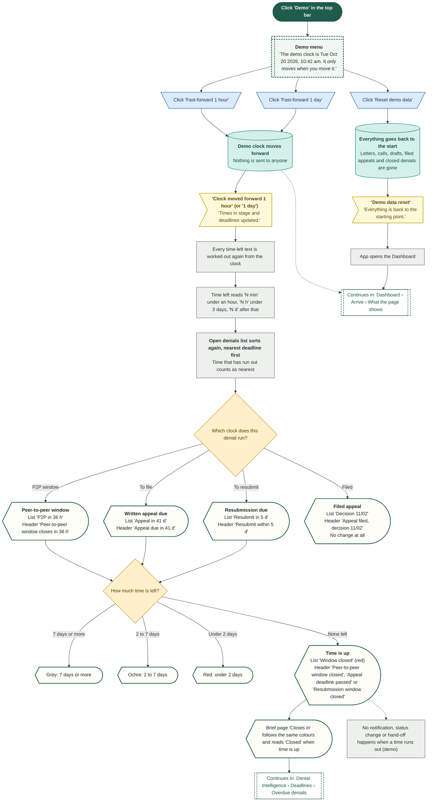

## Denial Intelligence › Deadlines › Overdue denials

What changes, and what still works, once a window has run out. Example: D-3318's peer-to-peer window after fast-forwarding 2 days, then a written-appeal deadline that has passed.

Route: `/denials?id=D-3318`

Demo only: nothing blocks an action after a deadline. Times offered in 'Change the time' are counted from the demo's first day, so past times are still offered.

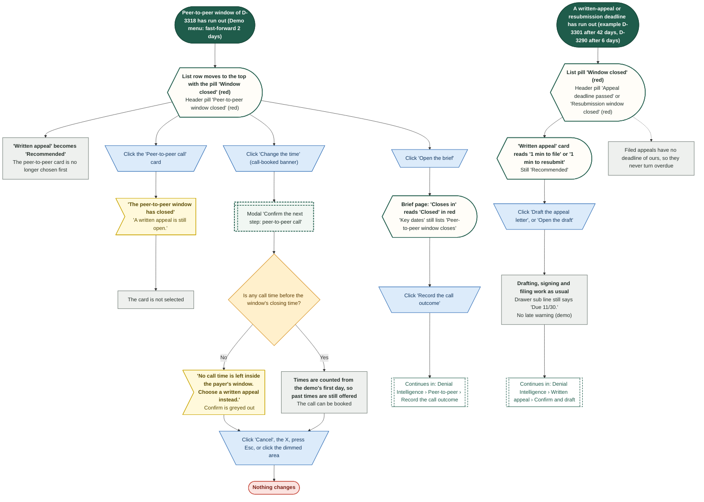

## Denial Intelligence › Hand-offs

Every link that leaves Denial Intelligence for the Dashboard or Case Manager, and the links from other screens that arrive here. There is no link from Denial Intelligence to Analytics.

Route: `/denials`

Demo only: accepting a denial says Case Manager starts a step-down plan and Cadence logs a write-off, but the code only writes History lines and a notification. No row is added to Case Manager and Analytics does not change.

```mermaid
%%{init: {"theme":"base","themeVariables":{"fontFamily":"'DM Sans', 'Segoe UI', system-ui, sans-serif","fontSize":"15px","lineColor":"#5B6B63","primaryTextColor":"#1C2B25","clusterBkg":"#FBF8F3","clusterBorder":"#D9CDBB","edgeLabelBackground":"#FFFFFF"},"flowchart":{"curve":"basis","nodeSpacing":36,"rankSpacing":48,"padding":12,"htmlLabels":true,"useMaxWidth":false,"wrappingWidth":230}} }%%
flowchart TD
  classDef k_start fill:#1F5C4B,stroke:#174638,color:#FFFFFF,stroke-width:1.5px,font-weight:600
  classDef k_end fill:#DDEFE3,stroke:#2E7D4F,color:#14502F,stroke-width:1.5px,font-weight:600
  classDef k_endx fill:#FBE3E0,stroke:#C0392B,color:#7A1F16,stroke-width:1.5px,font-weight:600
  classDef k_screen fill:#FFFDF8,stroke:#1F5C4B,color:#1C2B25,stroke-width:2px
  classDef k_overlay fill:#F1F7F3,stroke:#1F5C4B,color:#1C2B25,stroke-width:2px,stroke-dasharray:5 3
  classDef k_click fill:#DCEBFA,stroke:#2F6DB5,color:#12365F,stroke-width:1.5px
  classDef k_input fill:#E4E7FF,stroke:#4C5FD5,color:#1D2670,stroke-width:1.5px
  classDef k_process fill:#EEF0EE,stroke:#7A857F,color:#26302B,stroke-width:1.5px
  classDef k_agent fill:#EEE5FA,stroke:#7A4FC2,color:#341A63,stroke-width:1.5px
  classDef k_decision fill:#FFF0CC,stroke:#D9962B,color:#5C3B00,stroke-width:1.5px
  classDef k_store fill:#D5F0EA,stroke:#1C8E7B,color:#0B4A3F,stroke-width:1.5px
  classDef k_doc fill:#F6E9DC,stroke:#B07A4C,color:#4A2E14,stroke-width:1.5px
  classDef k_ext fill:#FFE6D2,stroke:#E07B39,color:#6B2F06,stroke-width:1.5px
  classDef k_wait fill:#E4E8EE,stroke:#6B7C93,color:#26303D,stroke-width:1.5px
  classDef k_toast fill:#FFF9DB,stroke:#C9A400,color:#5A4A00,stroke-width:1.5px
  classDef k_goto fill:#FFFFFF,stroke:#1F5C4B,color:#1F5C4B,stroke-width:1.5px,stroke-dasharray:5 3
  sc1@{ shape: curv-trap, label: "<b>Denial Intelligence</b><br/>A denial is on screen" }
  subgraph gOut ["Links out"]
  c1@{ shape: trap-t, label: "Click 'See on the Dashboard' (top right of the page)" }
  c2@{ shape: trap-t, label: "Click 'See on the Dashboard' (banner on a call that was overturned or partly restored)" }
  c3@{ shape: trap-t, label: "Click 'Open the Dashboard' (no open denials)" }
  c4@{ shape: trap-t, label: "Click 'Plan the step-down' (banner after accepting)" }
  p1@{ shape: rect, label: "Address opens /dashboard?request=D-3318" }
  p2@{ shape: rect, label: "Address opens /dashboard" }
  p3@{ shape: rect, label: "Address opens /manager?tab=reviews" }
  g1@{ shape: subproc, label: "Continues in: Dashboard › Request drawer › Open and read a request" }
  g2@{ shape: subproc, label: "Continues in: Dashboard › Arrive › What the page shows" }
  g3@{ shape: subproc, label: "Continues in: Case Manager › Reviews" }
  end
  subgraph gBell ["Notifications"]
  c5@{ shape: trap-t, label: "Click the bell 'Notifications', then a row" }
  n1@{ shape: odd, label: "<b>'Appeal filed' or 'Call outcome: ...'</b><br/>From Navigator or Advocate" }
  n2@{ shape: odd, label: "<b>'Denial closed'</b><br/>From Cadence, after an accept" }
  n3@{ shape: odd, label: "<b>'Denial analyzed', 'Denied today', 'Denied' or 'Partly approved'</b><br/>From Advocate" }
  end
  subgraph gIn ["Links in from other screens"]
  a1@{ shape: stadium, label: "<b>Analytics: 'Common denial reasons by payer'</b><br/>Click a row or its payer name" }
  a2@{ shape: stadium, label: "<b>Authorizations case page: 'This request was denied'</b><br/>Click 'Open in Denial Intelligence'" }
  a3@{ shape: stadium, label: "<b>Dashboard request drawer</b><br/>Click 'Open in Denial Intelligence'" }
  g4@{ shape: subproc, label: "Continues in: Denial Intelligence › Ways in" }
  end
  p4@{ shape: rect, label: "<b>The timeline says 'Every step is also on the Dashboard'</b><br/>This is text, not a link" }
  p5@{ shape: rect, label: "No link to Analytics from this screen" }
  e1@{ shape: stadium, label: "Person is on the other screen" }
  sc1 --> c1 --> p1 --> g1 --> e1
  sc1 --> c2 --> p1
  sc1 --> c3 --> p2 --> g2
  sc1 --> c4 --> p3 --> g3
  sc1 --> c5
  c5 --> n1 --> p1
  c5 --> n2 --> p3
  c5 --> n3 --> g4
  sc1 -.-> p4
  sc1 -.-> p5
  a1 --> g4
  a2 --> g4
  a3 --> g4
  class sc1 k_screen
  class c1,c2,c3,c4,c5 k_click
  class p1,p2,p3,p4,p5 k_process
  class g1,g2,g3,g4 k_goto
  class n1,n2,n3 k_toast
  class a1,a2,a3 k_start
  class e1 k_end
  style gOut fill:#FBF8F3,stroke:#D9CDBB,stroke-width:1.5px,color:#5B6B63
  style gBell fill:#FBF8F3,stroke:#D9CDBB,stroke-width:1.5px,color:#5B6B63
  style gIn fill:#FBF8F3,stroke:#D9CDBB,stroke-width:1.5px,color:#5B6B63
```
