# Denial Intelligence

The open denials dashboard, a denial's page with its options first, where it is weak, the framework, History, the peer-to-peer brief, the appeal, accept.

Shapes and colours: see `00-overview.md`. Source: `workflows/src/06-denials/`.

## Denial Intelligence › Ways in

Every way a person lands on Denial Intelligence. The sidebar and Analytics land on the dashboard of open denials (/denials); every link that names a denial lands on that denial's own page (/denials/D-xxxx). An older link with ?id= goes to the page too. Only denials at the sites in view count. How the sidebar badge counts open denials.

Route: `/denials`

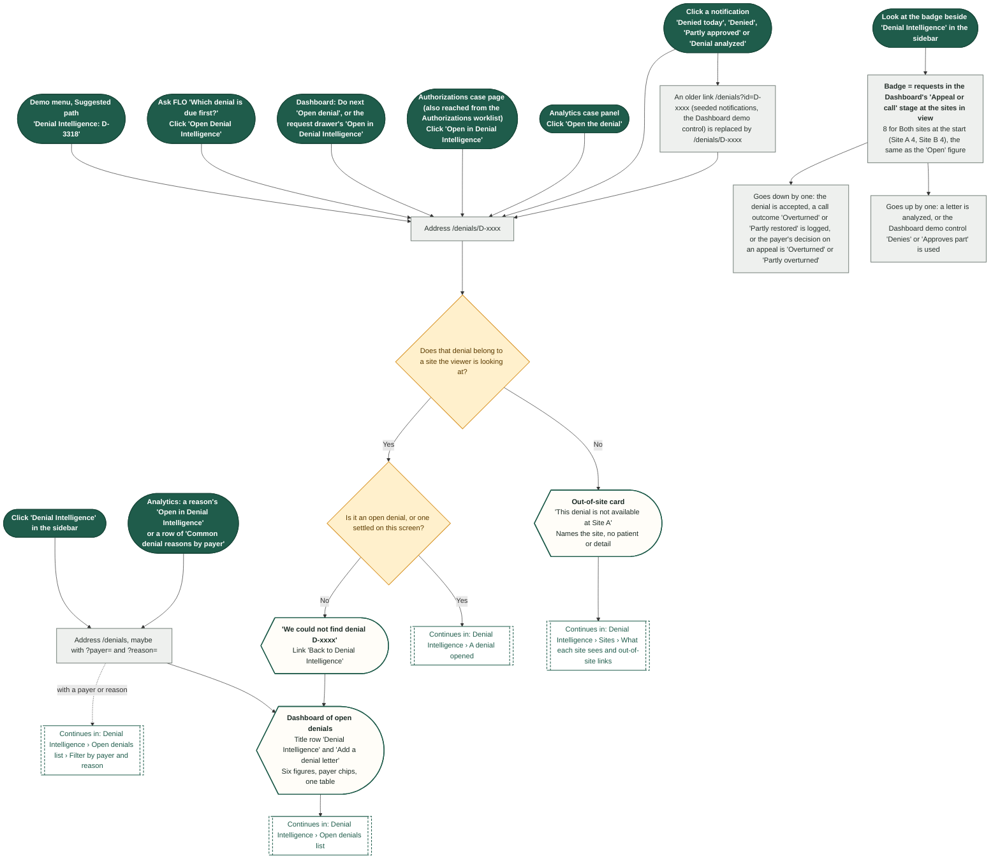

## Denial Intelligence › Open denials list

The dashboard of open denials, the first thing Denial Intelligence shows. A slim title row, six small figures that filter the table, payer chips, and one table of denials at the sites in view, soonest deadline first. A row opens the denial's own page. Settled denials are behind the 'Closed' figure. The figure and the sort live in the address, so Back from a denial returns to the same view.

Route: `/denials`

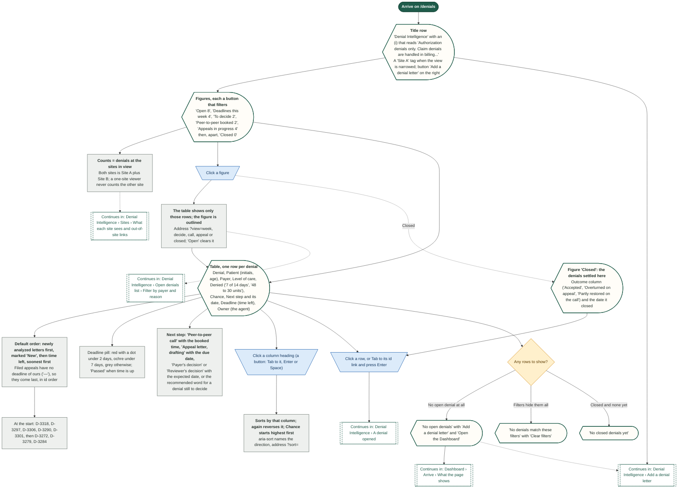

## Denial Intelligence › A denial opened

The page of one denial, top to bottom: the header card, Your options (the route under way says where it stands inside its own choice), what the payer said, where the denial is weak, the framework's six dimensions, then History. No headline card above the header and no separate next-step block. Each part is detailed in its own diagram.

Route: `/denials/D-3318`

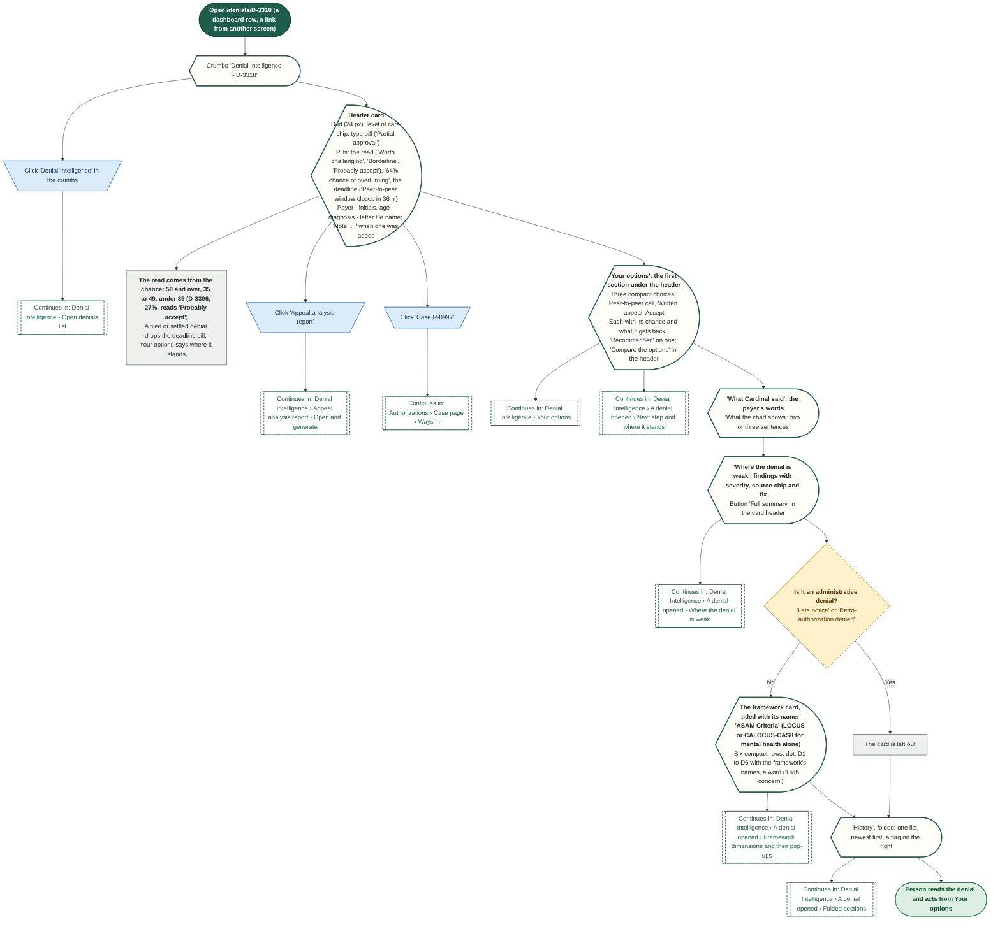

## Denial Intelligence › A denial opened › Next step and where it stands

There is no separate next-step block. The route under way, or the one that settled the denial, says where it stands inside its own choice in Your options, with its buttons, primary first. The code checks the states in this order and shows the first that fits. The other choices keep their chance; a route that is no longer open shows dimmed, with a reason when there is one.

Route: `/denials/D-3318`

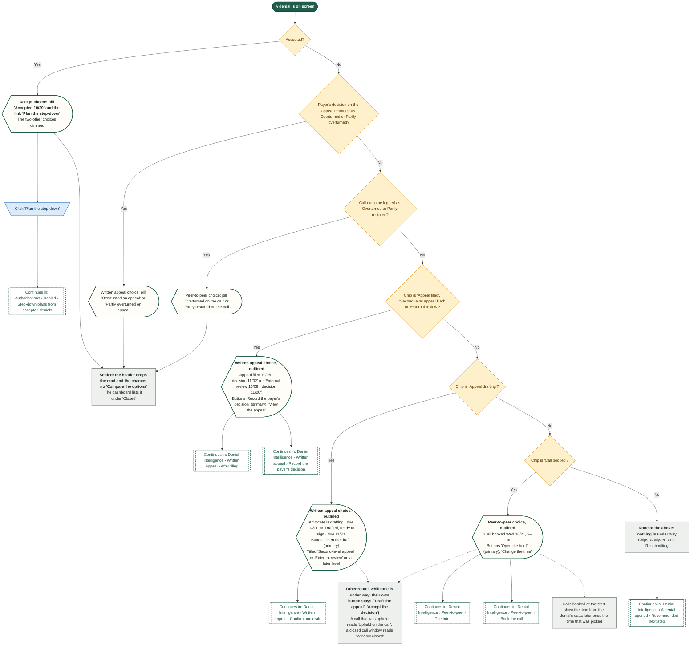

## Denial Intelligence › A denial opened › Where the denial is weak

The findings card: each finding has a severity, a source chip that opens the chart excerpt, and a suggested fix that can be added to the evidence for the brief and the appeal.

Route: `/denials/D-3318`

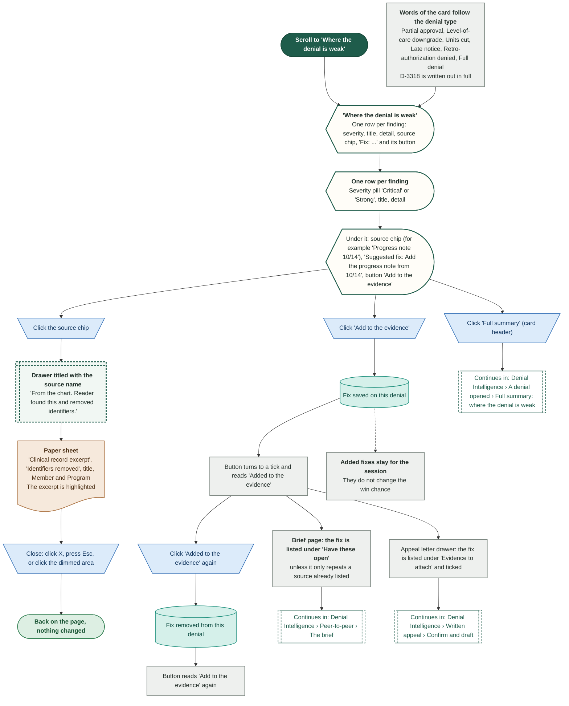

## Denial Intelligence › Add a denial letter

'Add a denial letter' is on the right of the dashboard's title row (and in the empty state when no denial is open). It opens a right-hand panel: drop a letter, import a file or paste a screenshot of it, or use a sample; add a note; 'Analyze the denial'; four agents work; the new denial is listed first on the dashboard and belongs to the site in view. Closing the panel does not stop the agents. In the demo a letter is not really read: a sample letter's facts fill the new denial, with what an import read put over them.

Route: `/denials`

Demo only: any dropped file is accepted and only its name and size are kept. The sample used depends on the file name length, or on how many letters were added before.

```mermaid
%%{init: {"theme":"base","themeVariables":{"fontFamily":"'DM Sans', 'Segoe UI', system-ui, sans-serif","fontSize":"15px","lineColor":"#5B6B63","primaryTextColor":"#1C2B25","clusterBkg":"#FBF8F3","clusterBorder":"#D9CDBB","edgeLabelBackground":"#FFFFFF"},"flowchart":{"curve":"basis","nodeSpacing":36,"rankSpacing":48,"padding":12,"htmlLabels":true,"useMaxWidth":false,"wrappingWidth":230}} }%%
flowchart TD
  classDef k_start fill:#1F5C4B,stroke:#174638,color:#FFFFFF,stroke-width:1.5px,font-weight:600
  classDef k_end fill:#DDEFE3,stroke:#2E7D4F,color:#14502F,stroke-width:1.5px,font-weight:600
  classDef k_endx fill:#FBE3E0,stroke:#C0392B,color:#7A1F16,stroke-width:1.5px,font-weight:600
  classDef k_screen fill:#FFFDF8,stroke:#1F5C4B,color:#1C2B25,stroke-width:2px
  classDef k_overlay fill:#F1F7F3,stroke:#1F5C4B,color:#1C2B25,stroke-width:2px,stroke-dasharray:5 3
  classDef k_click fill:#DCEBFA,stroke:#2F6DB5,color:#12365F,stroke-width:1.5px
  classDef k_input fill:#E4E7FF,stroke:#4C5FD5,color:#1D2670,stroke-width:1.5px
  classDef k_process fill:#EEF0EE,stroke:#7A857F,color:#26302B,stroke-width:1.5px
  classDef k_agent fill:#EEE5FA,stroke:#7A4FC2,color:#341A63,stroke-width:1.5px
  classDef k_decision fill:#FFF0CC,stroke:#D9962B,color:#5C3B00,stroke-width:1.5px
  classDef k_store fill:#D5F0EA,stroke:#1C8E7B,color:#0B4A3F,stroke-width:1.5px
  classDef k_doc fill:#F6E9DC,stroke:#B07A4C,color:#4A2E14,stroke-width:1.5px
  classDef k_ext fill:#FFE6D2,stroke:#E07B39,color:#6B2F06,stroke-width:1.5px
  classDef k_wait fill:#E4E8EE,stroke:#6B7C93,color:#26303D,stroke-width:1.5px
  classDef k_toast fill:#FFF9DB,stroke:#C9A400,color:#5A4A00,stroke-width:1.5px
  classDef k_goto fill:#FFFFFF,stroke:#1F5C4B,color:#1F5C4B,stroke-width:1.5px,stroke-dasharray:5 3
  s1@{ shape: stadium, label: "Dashboard title row: click 'Add a denial letter'" }
  s1b@{ shape: stadium, label: "Empty state 'No open denials': click 'Add a denial letter'" }
  sc1@{ shape: win-pane, label: "<b>Right-hand panel 'Add a denial letter'</b><br/>Drop area, the import's 'Import a file' and 'Paste a screenshot'<br/>Pill 'Identifiers removed on upload', 'Use sample letter', a note box, 'Analyze the denial'" }
  pk@{ shape: rect, label: "The state lives on the page, not in the panel: a typed note, a chosen letter and a running analysis survive closing the panel" }
  i1@{ shape: lean-r, label: "<b>Drop a file on the area, or click it (Enter or Space) to choose one</b><br/>'Drop the denial letter, or click to choose a PDF or DOCX'" }
  c1@{ shape: trap-t, label: "Click 'Use sample letter'" }
  p1@{ shape: rect, label: "Next sample letter in turn: Beacon, Summit, then Harborview" }
  ci@{ shape: trap-t, label: "Click 'Paste a screenshot' and press Ctrl or Cmd V, or 'Import a file' (CSV with a field mapping, or a PDF)" }
  pr@{ shape: rect, label: "<b>The shared import (the same one New Case and Eligibility use): FLO reads the screenshot or the file (demo: simulated)</b><br/>what it found is listed for review, nothing is applied until 'Apply'" }
  pi@{ shape: rect, label: "<b>After the person reviews what was read and clicks 'Apply': payer, dates, days or units requested and approved, and the reason</b><br/>show as pills under the letter row; the reason picks the kind of denial" }
  fr@{ shape: curv-trap, label: "<b>Letter row: the file name, or 'From a pasted screenshot'</b><br/>A small X removes it and brings the choices back" }
  i2@{ shape: lean-r, label: "Type a note (optional) 'Note, such as a payer call'" }
  c3@{ shape: trap-t, label: "Click 'Analyze the denial'" }
  d1@{ shape: diam, label: "Is a letter chosen?" }
  t1@{ shape: odd, label: "'Add the letter first, or use the sample letter.'" }
  sc2@{ shape: curv-trap, label: "<b>Progress list replaces the form</b><br/>One line per agent, a spinner on the one working, a tick when done" }
  a1@{ shape: hex, label: "Reader is reading the letter and removing identifiers" }
  a2@{ shape: hex, label: "Advocate is checking the notice, the deadline and the payer's own criteria" }
  a3@{ shape: hex, label: "Historian is comparing similar decisions and appeals" }
  a4@{ shape: hex, label: "Integrity is checking every statement against the chart" }
  w1@{ shape: delay, label: "About 1.25 seconds per step, 5 seconds in all (demo: simulated)" }
  cx@{ shape: trap-t, label: "Press Escape, click X or the dimmed area while the agents work" }
  px@{ shape: rect, label: "Panel closes, focus returns to 'Add a denial letter'; the agents keep going" }
  d2@{ shape: diam, label: "Is the person still on the dashboard?" }
  e1@{ shape: stadium, label: "Work is dropped and no denial is added" }
  st1@{ shape: cyl, label: "<b>New open denial created</b><br/>Site = the site in view (Site A when both are in view)<br/>Id = the next free number from D-3340 that the site rule places at that site<br/>Chip 'Analyzed', letter name and note saved" }
  t2@{ shape: odd, label: "<b>'The analysis is ready'</b><br/>'D-3340 was added to Open denials.'" }
  t3@{ shape: odd, label: "Notification 'Denial analyzed' from Advocate, linking to /denials/D-3340" }
  p5@{ shape: rect, label: "<b>Panel closes, filters and the figure are cleared</b><br/>The new row is listed first, highlighted, with the pill 'New', and its id link has focus<br/>The badge and 'Open' go up by one, for that site and for Both sites" }
  g5@{ shape: subproc, label: "Continues in: Denial Intelligence › Open denials list" }
  g2@{ shape: subproc, label: "Continues in: Denial Intelligence › A denial opened › Recommended next step" }
  g4@{ shape: subproc, label: "Continues in: Denial Intelligence › Sites › What each site sees and out-of-site links" }
  s1 --> sc1
  s1b --> sc1
  sc1 -.-> pk
  sc1 --> i1 --> fr
  sc1 --> c1 --> p1 --> fr
  sc1 --> ci --> pr --> pi --> fr
  sc1 --> i2 --> c3
  fr --> c3
  c3 --> d1
  d1 -->|"No"| t1 --> sc1
  d1 -->|"Yes"| sc2 --> a1 --> a2 --> a3 --> a4
  sc2 --> w1
  sc2 --> cx --> px
  a4 --> d2
  d2 -->|"No, left the page"| e1
  d2 -->|"Yes"| st1 --> t2 --> p5 --> g5
  st1 --> t3
  p5 --> g2
  st1 -.-> g4
  class s1,s1b k_start
  class sc1 k_overlay
  class pk,p1,pr,pi,px,p5 k_process
  class i1,i2 k_input
  class c1,ci,c3,cx k_click
  class fr,sc2 k_screen
  class d1,d2 k_decision
  class t1,t2,t3 k_toast
  class a1,a2,a3,a4 k_agent
  class w1 k_wait
  class e1 k_endx
  class st1 k_store
  class g5,g2,g4 k_goto
```

## Denial Intelligence › Your options

'Your options' is the first section under the header: three compact choices side by side (stacked on a narrow window), each with its chance, what it gets back and its own button. The recommended route carries 'Recommended' and, while nothing is under way, the primary button. 'Compare the options' opens a right-hand panel with the radio cards, what each route needs and the reasons for the recommendation.

Route: `/denials/D-3318`

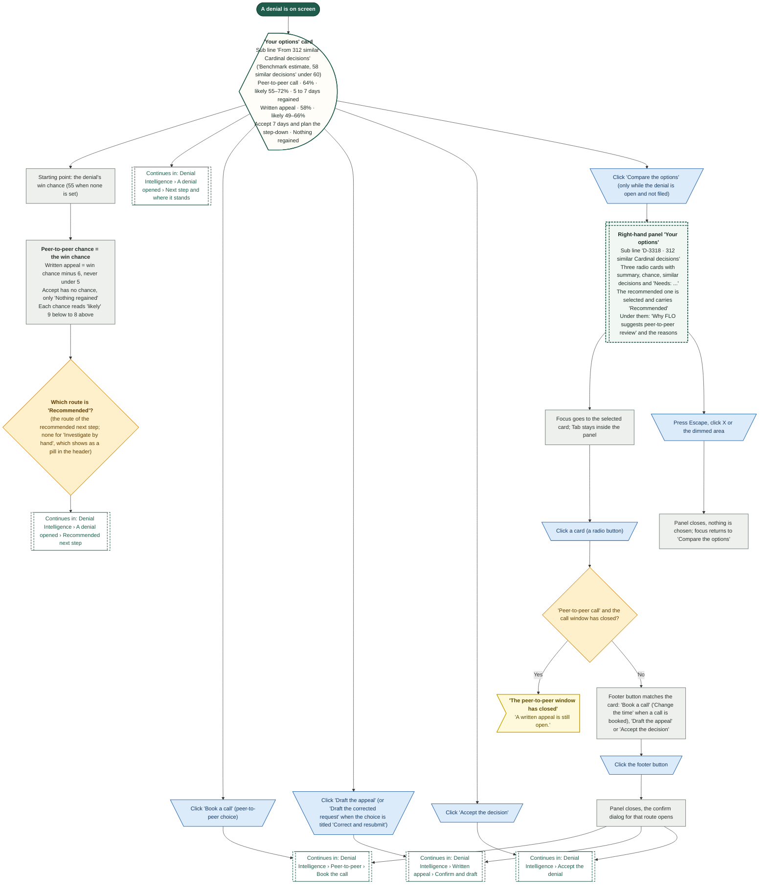

## Denial Intelligence › Open denials list › Filter by payer and reason

Three ways to narrow the dashboard table, all kept in the address: the figures (which also switch to Closed), one payer chip, and a reason that arrives from Analytics. They combine. The figures keep counting the whole view, so 'Open 8' stays 8 while a payer is picked.

Route: `/denials?payer=cardinal&reason=Late notice`

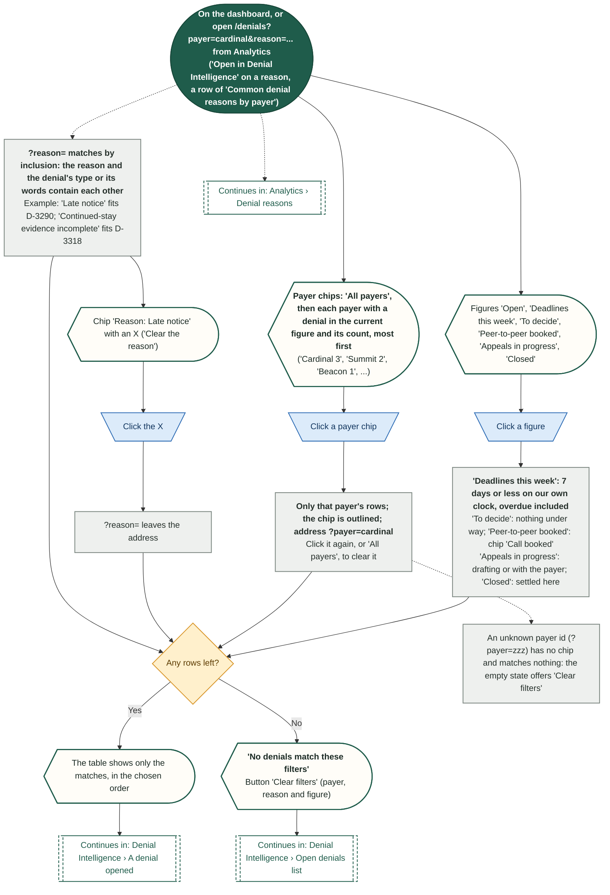

## Denial Intelligence › A denial opened › Full summary: where the denial is weak

The short findings stay on the page. 'Full summary' in the card header opens the long version in a pop-up, as plain text that can be selected and copied: the whole thing, or one recommendation at a time.

Route: `/denials/D-3318`


## Denial Intelligence › A denial opened › Framework dimensions and their pop-ups

The card is titled with the denial's level-of-care framework and lists its six dimensions as compact rows, with no sentence under each. A row opens a pop-up with what the chart shows on it, the long text and its source. 'Full summary' in the card header opens all six long paragraphs to copy.

Route: `/denials/D-3297`

The card, and so the button, is left out for Late notice and Retro-authorization denied, which have no dimensions.

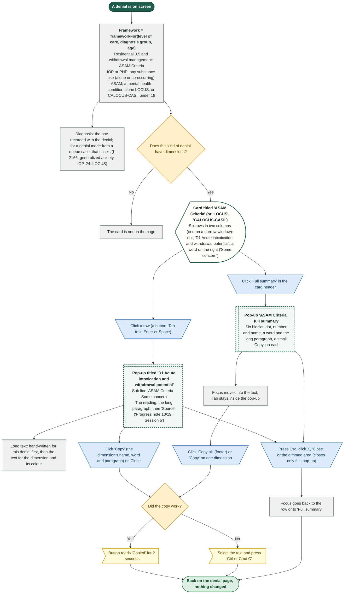

## Denial Intelligence › Peer-to-peer › Book the call

The confirm gate for the peer-to-peer route: pick one of three call windows, confirm, and Cadence books it. The same modal opens from the 'Your options' panel, from 'Change the time' and from the brief page.

Route: `/denials/D-3318`

Demo only: the payer holding the slot is simulated. Times follow the demo clock: fast-forwarding in the Demo menu uses them up, and with none left the message 'No call time is left' shows.

```mermaid
%%{init: {"theme":"base","themeVariables":{"fontFamily":"'DM Sans', 'Segoe UI', system-ui, sans-serif","fontSize":"15px","lineColor":"#5B6B63","primaryTextColor":"#1C2B25","clusterBkg":"#FBF8F3","clusterBorder":"#D9CDBB","edgeLabelBackground":"#FFFFFF"},"flowchart":{"curve":"basis","nodeSpacing":36,"rankSpacing":48,"padding":12,"htmlLabels":true,"useMaxWidth":false,"wrappingWidth":230}} }%%
flowchart TD
  classDef k_start fill:#1F5C4B,stroke:#174638,color:#FFFFFF,stroke-width:1.5px,font-weight:600
  classDef k_end fill:#DDEFE3,stroke:#2E7D4F,color:#14502F,stroke-width:1.5px,font-weight:600
  classDef k_endx fill:#FBE3E0,stroke:#C0392B,color:#7A1F16,stroke-width:1.5px,font-weight:600
  classDef k_screen fill:#FFFDF8,stroke:#1F5C4B,color:#1C2B25,stroke-width:2px
  classDef k_overlay fill:#F1F7F3,stroke:#1F5C4B,color:#1C2B25,stroke-width:2px,stroke-dasharray:5 3
  classDef k_click fill:#DCEBFA,stroke:#2F6DB5,color:#12365F,stroke-width:1.5px
  classDef k_input fill:#E4E7FF,stroke:#4C5FD5,color:#1D2670,stroke-width:1.5px
  classDef k_process fill:#EEF0EE,stroke:#7A857F,color:#26302B,stroke-width:1.5px
  classDef k_agent fill:#EEE5FA,stroke:#7A4FC2,color:#341A63,stroke-width:1.5px
  classDef k_decision fill:#FFF0CC,stroke:#D9962B,color:#5C3B00,stroke-width:1.5px
  classDef k_store fill:#D5F0EA,stroke:#1C8E7B,color:#0B4A3F,stroke-width:1.5px
  classDef k_doc fill:#F6E9DC,stroke:#B07A4C,color:#4A2E14,stroke-width:1.5px
  classDef k_ext fill:#FFE6D2,stroke:#E07B39,color:#6B2F06,stroke-width:1.5px
  classDef k_wait fill:#E4E8EE,stroke:#6B7C93,color:#26303D,stroke-width:1.5px
  classDef k_toast fill:#FFF9DB,stroke:#C9A400,color:#5A4A00,stroke-width:1.5px
  classDef k_goto fill:#FFFFFF,stroke:#1F5C4B,color:#1F5C4B,stroke-width:1.5px,stroke-dasharray:5 3
  s1@{ shape: stadium, label: "Click 'Book a call' in the peer-to-peer choice of Your options, or pick it in 'Compare the options'" }
  s2@{ shape: stadium, label: "Click 'Change the time' (the peer-to-peer choice in Your options, call booked)" }
  s3@{ shape: stadium, label: "Brief page: click 'Book the call' or 'Change the call time'" }
  o1@{ shape: win-pane, label: "<b>Modal 'Confirm the next step: peer-to-peer call'</b><br/>Sub line 'D-3318 · Cardinal Health Plan'" }
  l1@{ shape: hex, label: "On confirm: Cadence books the window with the payer, Advocate finishes the brief, Integrity checks it (demo: simulated)" }
  l2@{ shape: curv-trap, label: "Radio cards 'Call time', one per window" }
  p1@{ shape: rect, label: "<b>Up to three windows on working days: 9–11 am, 1–3 pm, 4–5 pm</b><br/>Only windows that start after the demo clock and before the payer's window closes<br/>At the start of D-3318: Tue 1–3 pm, Tue 4–5 pm, Wed 9–11 am" }
  d1@{ shape: diam, label: "<b>Is any call time left?</b><br/>(starts after the demo clock, before the window closes)" }
  t1@{ shape: odd, label: "<b>'No call time is left inside the payer's window. A written appeal is still open.'</b><br/>'Confirm and book the call' is greyed out<br/>Example: D-3318 after fast-forwarding 1 day and 6 hours, or once the window has closed" }
  i1@{ shape: lean-r, label: "<b>Pick a call time (radio cards)</b><br/>The time already booked is chosen (if it is still ahead of the clock), otherwise the first" }
  p2@{ shape: rect, label: "A pill 'Booked' on the booked time (also a time booked before the demo started, such as D-3318's Wed 9–11 am)" }
  c1@{ shape: trap-t, label: "Click 'Confirm and book the call'" }
  c2@{ shape: trap-t, label: "Click 'Cancel', the X, press Esc, or click the dimmed area" }
  e1@{ shape: stadium, label: "Nothing changes" }
  st1@{ shape: cyl, label: "<b>Call time saved on the denial</b><br/>Chip 'Call booked', list pill 'Call Wed 10/21 1 pm'" }
  x1@{ shape: st-rect, label: "Payer's reviewer holds the window (demo: simulated)" }
  a1@{ shape: hex, label: "Cadence books the window and adds it to the clinician's calendar" }
  a2@{ shape: hex, label: "Advocate writes the brief, Integrity checks it against the chart" }
  st2@{ shape: cyl, label: "History: 'Cadence booked the peer-to-peer call for ...', 'Advocate wrote the brief and Integrity checked it against the chart', and a scheduled 'Peer-to-peer call with Cardinal'" }
  t2@{ shape: odd, label: "<b>'Call booked'</b><br/>'Wed 10/21, 1–3 pm. The brief is ready.'" }
  d2@{ shape: diam, label: "Booked from which page?" }
  p3@{ shape: rect, label: "Modal closes and the app opens the brief page" }
  p4@{ shape: rect, label: "<b>Modal closes, the brief stays open</b><br/>'Call details' shows the new window" }
  g1@{ shape: subproc, label: "Continues in: Denial Intelligence › Peer-to-peer › The brief" }
  e2@{ shape: stadium, label: "Call is booked, brief is ready" }
  s1 --> o1
  s2 --> o1
  s3 --> o1
  o1 --> l1 --> l2 --> p1 --> d1
  d1 -->|"No"| t1 --> c2
  d1 -->|"Yes"| i1 --> p2
  p2 --> c1
  p2 --> c2 --> e1
  c1 --> st1 --> x1 --> a1 --> a2 --> st2 --> t2 --> d2
  d2 -->|"Denial page"| p3 --> g1
  d2 -->|"Brief page"| p4 --> e2
  class s1,s2,s3 k_start
  class o1 k_overlay
  class l1,a1,a2 k_agent
  class l2 k_screen
  class p1,p2,p3,p4 k_process
  class d1,d2 k_decision
  class t1,t2 k_toast
  class i1 k_input
  class c1,c2 k_click
  class e1 k_endx
  class st1,st2 k_store
  class x1 k_ext
  class g1 k_goto
  class e2 k_end
```

## Denial Intelligence › Peer-to-peer › The brief

The one-page brief a clinician keeps open during the call: opening, three points, what the payer may say and the ask on the left, call details and tools on the right. 'Key dates and numbers' and 'Have these open' are folded sections that stay in the page, and open on paper when the brief is printed.

Route: `/denials/D-3318/brief`

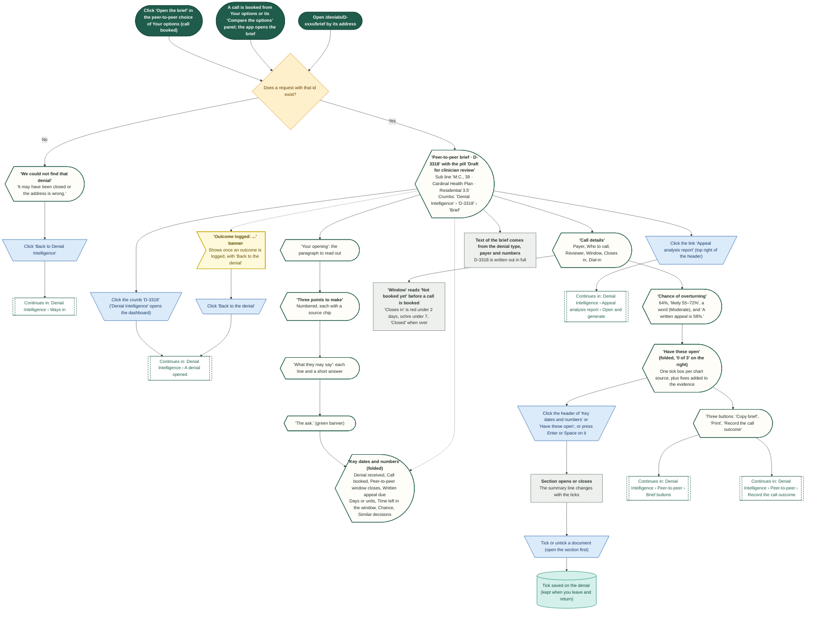

## Denial Intelligence › Peer-to-peer › Brief buttons

The buttons on the brief page: 'Copy brief' and 'Print' (off in the hosted preview), and the call-time button. Recording the outcome has its own diagram.

Route: `/denials/D-3318/brief`

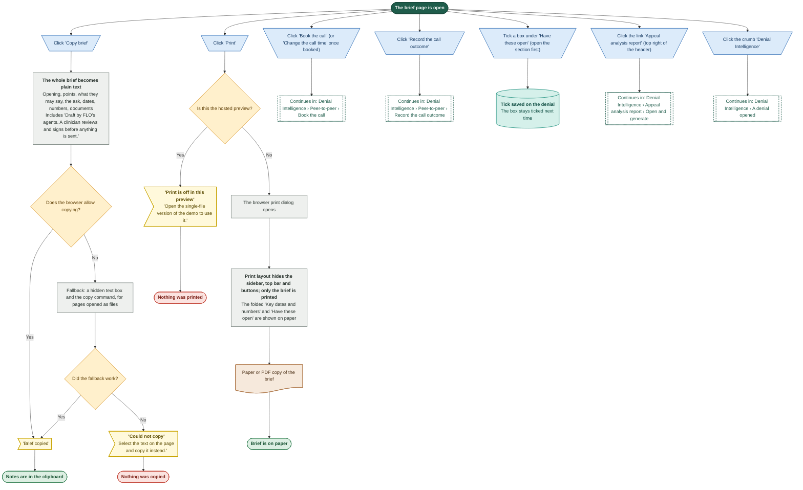

## Denial Intelligence › Peer-to-peer › Record the call outcome

After the call, the person logs how it went. 'Overturned' and 'Partly restored' close the denial; 'Upheld' starts a written appeal from the call notes.

Route: `/denials/D-3318/brief`

Demo only: the call itself is not simulated. The clinician holds it outside the app and logs the result here.

```mermaid
%%{init: {"theme":"base","themeVariables":{"fontFamily":"'DM Sans', 'Segoe UI', system-ui, sans-serif","fontSize":"15px","lineColor":"#5B6B63","primaryTextColor":"#1C2B25","clusterBkg":"#FBF8F3","clusterBorder":"#D9CDBB","edgeLabelBackground":"#FFFFFF"},"flowchart":{"curve":"basis","nodeSpacing":36,"rankSpacing":48,"padding":12,"htmlLabels":true,"useMaxWidth":false,"wrappingWidth":230}} }%%
flowchart TD
  classDef k_start fill:#1F5C4B,stroke:#174638,color:#FFFFFF,stroke-width:1.5px,font-weight:600
  classDef k_end fill:#DDEFE3,stroke:#2E7D4F,color:#14502F,stroke-width:1.5px,font-weight:600
  classDef k_endx fill:#FBE3E0,stroke:#C0392B,color:#7A1F16,stroke-width:1.5px,font-weight:600
  classDef k_screen fill:#FFFDF8,stroke:#1F5C4B,color:#1C2B25,stroke-width:2px
  classDef k_overlay fill:#F1F7F3,stroke:#1F5C4B,color:#1C2B25,stroke-width:2px,stroke-dasharray:5 3
  classDef k_click fill:#DCEBFA,stroke:#2F6DB5,color:#12365F,stroke-width:1.5px
  classDef k_input fill:#E4E7FF,stroke:#4C5FD5,color:#1D2670,stroke-width:1.5px
  classDef k_process fill:#EEF0EE,stroke:#7A857F,color:#26302B,stroke-width:1.5px
  classDef k_agent fill:#EEE5FA,stroke:#7A4FC2,color:#341A63,stroke-width:1.5px
  classDef k_decision fill:#FFF0CC,stroke:#D9962B,color:#5C3B00,stroke-width:1.5px
  classDef k_store fill:#D5F0EA,stroke:#1C8E7B,color:#0B4A3F,stroke-width:1.5px
  classDef k_doc fill:#F6E9DC,stroke:#B07A4C,color:#4A2E14,stroke-width:1.5px
  classDef k_ext fill:#FFE6D2,stroke:#E07B39,color:#6B2F06,stroke-width:1.5px
  classDef k_wait fill:#E4E8EE,stroke:#6B7C93,color:#26303D,stroke-width:1.5px
  classDef k_toast fill:#FFF9DB,stroke:#C9A400,color:#5A4A00,stroke-width:1.5px
  classDef k_goto fill:#FFFFFF,stroke:#1F5C4B,color:#1F5C4B,stroke-width:1.5px,stroke-dasharray:5 3
  s1@{ shape: stadium, label: "Click 'Record the call outcome' on the brief page" }
  x1@{ shape: st-rect, label: "Clinician holds the peer-to-peer call with the payer's reviewer" }
  o1@{ shape: win-pane, label: "<b>Modal 'Record the call outcome'</b><br/>D-3318 · Cardinal Health Plan" }
  i1@{ shape: lean-r, label: "<b>Pick one (radio cards)</b><br/>'Overturned' (chosen at first), 'Partly restored' or 'Upheld'" }
  p1@{ shape: rect, label: "<b>Card texts</b><br/>Overturned: 'Closes the denial'<br/>Partly restored: 'Closes with a new end date'<br/>Upheld: 'Starts the written appeal'" }
  i2@{ shape: lean-r, label: "Note (optional)" }
  c1@{ shape: trap-t, label: "Click 'Log the outcome'" }
  c2@{ shape: trap-t, label: "Click 'Cancel', the X, press Esc, or click the dimmed area" }
  e1@{ shape: stadium, label: "Nothing is logged" }
  st0@{ shape: cyl, label: "<b>Outcome saved on the denial: kind, note, time</b><br/>The scheduled 'Peer-to-peer call' line leaves the History<br/>History: 'You logged the call outcome: ...' with the note" }
  d1@{ shape: diam, label: "Which outcome?" }
  st1@{ shape: cyl, label: "<b>Request settled: leaves 'Appeal or call' (Dashboard stage 'Decided')</b><br/>Chip 'Overturned' or 'Partly restored'<br/>Ledger result approved or partly approved" }
  x2@{ shape: st-rect, label: "Payer restores the requested days, or part of them, on the call" }
  a1@{ shape: hex, label: "Cadence updates the ledger and books the next review" }
  t1@{ shape: odd, label: "<b>'Overturned' or 'Partly restored'</b><br/>'The ledger is updated and the next review is booked.'" }
  p2@{ shape: rect, label: "<b>Sidebar badge goes down by one</b><br/>The denial moves under 'Closed' on the dashboard<br/>The peer-to-peer choice reads 'Overturned on the call' or 'Partly restored on the call'" }
  st2@{ shape: cyl, label: "<b>Chip 'Appeal drafting'</b><br/>Clock becomes 'to file': 60 days from the denial date" }
  a2@{ shape: hex, label: "Advocate starts a written appeal from the call notes" }
  t2@{ shape: odd, label: "<b>'Outcome logged: upheld'</b><br/>'Advocate started the written appeal. Open it from the denial.'" }
  p3@{ shape: rect, label: "Denial page shows 'Advocate is drafting the appeal' with 'Open the draft'" }
  t3@{ shape: odd, label: "Brief page banner 'Outcome logged: overturned, partly restored or upheld' with 'Back to the denial'" }
  t4@{ shape: odd, label: "<b>Notification 'Call outcome: ...' from Advocate</b><br/>Opens the request on the Dashboard" }
  c3@{ shape: trap-t, label: "Click 'Back to the denial'" }
  p4@{ shape: rect, label: "<b>The button 'Record the call outcome' stays on the brief</b><br/>Logging again runs these steps again (demo does not stop it)" }
  g1@{ shape: subproc, label: "Continues in: Denial Intelligence › A denial opened" }
  g2@{ shape: subproc, label: "Continues in: Denial Intelligence › Written appeal › Confirm and draft" }
  g3@{ shape: subproc, label: "Continues in: Dashboard › Request drawer › Open and read a request" }
  e2@{ shape: stadium, label: "Denial is closed with the call result" }
  e3@{ shape: stadium, label: "Written appeal is under way" }
  s1 --> x1 --> o1
  o1 --> i1 --> p1
  o1 --> i2
  p1 --> c1
  i2 --> c1
  o1 --> c2 --> e1
  c1 --> st0 --> d1
  d1 -->|"Overturned or Partly restored"| x2 --> st1 --> a1 --> t1 --> p2 --> e2
  d1 -->|"Upheld"| st2 --> a2 --> t2 --> p3 --> e3
  st0 --> t3 --> c3 --> g1
  st0 --> t4 --> g3
  e3 --> g2
  e2 --> g1
  t3 --> p4
  class s1 k_start
  class x1,x2 k_ext
  class o1 k_overlay
  class i1,i2 k_input
  class p1,p2,p3,p4 k_process
  class c1,c2,c3 k_click
  class e1 k_endx
  class st0,st1,st2 k_store
  class d1 k_decision
  class a1,a2 k_agent
  class t1,t2,t3,t4 k_toast
  class g1,g2,g3 k_goto
  class e2,e3 k_end
```

## Denial Intelligence › A denial opened › Recommended next step

FLO recommends ONE step, from a fixed list of six, worked out from the denial type, what the request itself shows and the route the analysis already prefers. It shows as the 'Recommended' pill on that route in Your options (and its button is the primary one while nothing is under way), as the next step of a row still to decide on the dashboard, and, with its reasons, in the 'Compare the options' panel. It is a recommendation for a person to review, never a payer rule.

Route: `/denials/D-3290`

The mapping lives in one function (lib/step.ts, recommendedStep). 'Ask for reconsideration' is on the list but no demo denial maps to it: the demo has no payer rule that names it, and none is invented.

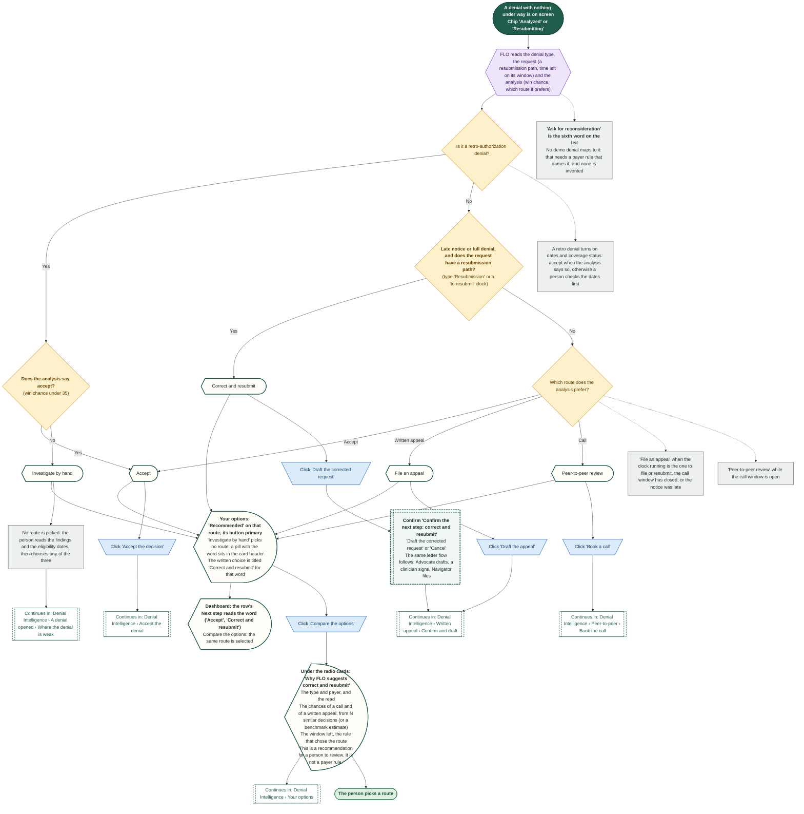

## Denial Intelligence › A denial opened › Folded sections

The one folded section on a denial is History: everything on the denial in one list, newest first, with one standard flag on the right. It replaces 'What the agents did' and 'What has happened', and has no summary line under its title. The brief folds 'Key dates and numbers' and 'Have these open'. Longer detail that is not a section is in pop-ups and right-hand panels.

Route: `/denials/D-3318`

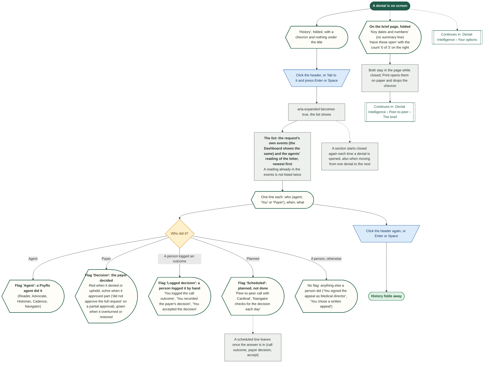

## Denial Intelligence › Sites › What each site sees and out-of-site links

Every denial belongs to one site. The dashboard (figures, payer chips, table, Closed), the sidebar badge, the step-down plans and the links follow the site view. A viewer limited to one site never sees, counts, lists or links to the other site's denials, and a direct link to one shows an out-of-site card. Totals for Both sites equal Site A plus Site B.

Route: `/denials`

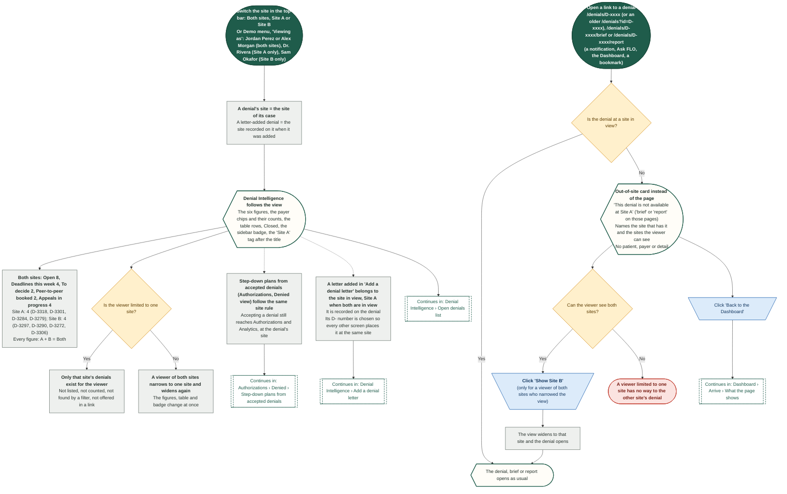

## Denial Intelligence › Written appeal › Confirm and draft

The written-appeal route starts with a confirm gate, then Advocate drafts the letter in a side drawer. The same drawer opens straight away when the appeal is already being drafted (for example after a call was upheld, or after the payer upheld an appeal and the next level was chosen).

Route: `/denials/D-3318`

Demo only: the drafting takes about two seconds and is simulated. The letter is built from the findings of the denial.

```mermaid
%%{init: {"theme":"base","themeVariables":{"fontFamily":"'DM Sans', 'Segoe UI', system-ui, sans-serif","fontSize":"15px","lineColor":"#5B6B63","primaryTextColor":"#1C2B25","clusterBkg":"#FBF8F3","clusterBorder":"#D9CDBB","edgeLabelBackground":"#FFFFFF"},"flowchart":{"curve":"basis","nodeSpacing":36,"rankSpacing":48,"padding":12,"htmlLabels":true,"useMaxWidth":false,"wrappingWidth":230}} }%%
flowchart TD
  classDef k_start fill:#1F5C4B,stroke:#174638,color:#FFFFFF,stroke-width:1.5px,font-weight:600
  classDef k_end fill:#DDEFE3,stroke:#2E7D4F,color:#14502F,stroke-width:1.5px,font-weight:600
  classDef k_endx fill:#FBE3E0,stroke:#C0392B,color:#7A1F16,stroke-width:1.5px,font-weight:600
  classDef k_screen fill:#FFFDF8,stroke:#1F5C4B,color:#1C2B25,stroke-width:2px
  classDef k_overlay fill:#F1F7F3,stroke:#1F5C4B,color:#1C2B25,stroke-width:2px,stroke-dasharray:5 3
  classDef k_click fill:#DCEBFA,stroke:#2F6DB5,color:#12365F,stroke-width:1.5px
  classDef k_input fill:#E4E7FF,stroke:#4C5FD5,color:#1D2670,stroke-width:1.5px
  classDef k_process fill:#EEF0EE,stroke:#7A857F,color:#26302B,stroke-width:1.5px
  classDef k_agent fill:#EEE5FA,stroke:#7A4FC2,color:#341A63,stroke-width:1.5px
  classDef k_decision fill:#FFF0CC,stroke:#D9962B,color:#5C3B00,stroke-width:1.5px
  classDef k_store fill:#D5F0EA,stroke:#1C8E7B,color:#0B4A3F,stroke-width:1.5px
  classDef k_doc fill:#F6E9DC,stroke:#B07A4C,color:#4A2E14,stroke-width:1.5px
  classDef k_ext fill:#FFE6D2,stroke:#E07B39,color:#6B2F06,stroke-width:1.5px
  classDef k_wait fill:#E4E8EE,stroke:#6B7C93,color:#26303D,stroke-width:1.5px
  classDef k_toast fill:#FFF9DB,stroke:#C9A400,color:#5A4A00,stroke-width:1.5px
  classDef k_goto fill:#FFFFFF,stroke:#1F5C4B,color:#1F5C4B,stroke-width:1.5px,stroke-dasharray:5 3
  s1@{ shape: stadium, label: "Click 'Draft the appeal' (the written appeal choice), or 'Draft the corrected request' (Correct and resubmit), or open 'Compare the options', select 'Written appeal' and click its button" }
  s2@{ shape: stadium, label: "Click 'Open the draft' (the written appeal choice: 'Advocate is drafting')" }
  s3@{ shape: stadium, label: "<b>Next level chosen after an upheld decision</b><br/>('Record and start the second-level appeal')" }
  d1@{ shape: diam, label: "Is the chip already 'Appeal drafting'?" }
  o1@{ shape: win-pane, label: "<b>Modal 'Confirm the next step: written appeal'</b><br/>Sub line 'D-3318 · Cardinal Health Plan'" }
  l1@{ shape: hex, label: "On confirm: Advocate drafts the letter, Integrity checks it, Navigator files it once a clinician signs" }
  l2@{ shape: curv-trap, label: "Four facts: 'Chance 58% · likely 49–66%', 'Gets back', 'Due' (when a filing clock runs), 'Sign-off: A clinician signs before it is filed'" }
  c1@{ shape: trap-t, label: "Click 'Draft the appeal'" }
  c2@{ shape: trap-t, label: "Click 'Cancel', the X, press Esc, or click the dimmed area" }
  e1@{ shape: stadium, label: "Nothing changes" }
  st1@{ shape: cyl, label: "<b>Chip 'Appeal drafting'</b><br/>'Advocate is drafting the appeal'" }
  d2@{ shape: diam, label: "Is the clock already 'to file' or 'to resubmit'?" }
  st2@{ shape: cyl, label: "<b>Clock set: appeal due 60 days after the denial</b><br/>List pill 'Appeal in 59 d'" }
  p1@{ shape: rect, label: "Keep the existing deadline" }
  st3@{ shape: cyl, label: "History: 'You chose a written appeal', 'Advocate started the appeal letter'" }
  o2@{ shape: win-pane, label: "<b>Drawer 'Appeal letter · D-3318' (wide, right side)</b><br/>Sub line: 'Cardinal Health Plan. Due 12/18.'" }
  d3@{ shape: diam, label: "Is a draft already saved?" }
  w1@{ shape: delay, label: "<b>Spinner: 'Advocate is drafting the letter'</b><br/>About 2 seconds; 'Save draft' and 'Sign and file' are greyed out" }
  a1@{ shape: hex, label: "Advocate drafts the letter and Integrity checks every sentence (demo: simulated)" }
  dc1@{ shape: doc, label: "<b>Letter text</b><br/>Payer, 'Appeals Department', date, Re: line (reconsideration, second-level appeal or external review), the payer's words, what the chart shows, numbered reasons with evidence, the ask, availability for the reviewing physician" }
  l3@{ shape: curv-trap, label: "<b>'Evidence to attach'</b><br/>One ticked box per chart source, plus fixes added to the evidence" }
  st4@{ shape: cyl, label: "<b>First draft saved on the denial</b><br/>'Appeal drafted. Waiting for a clinician's signature'<br/>History: 'Advocate drafted the appeal and Integrity checked every sentence against the chart'" }
  l4@{ shape: curv-trap, label: "Chips 'Advocate', 'Integrity' and the pill 'Draft · a clinician signs before filing'" }
  c3@{ shape: trap-t, label: "<b>Close the drawer: click X, press Esc, or click the dimmed area</b><br/>(Esc closes only the top layer: see the sign step)" }
  p2@{ shape: rect, label: "<b>Edits not saved with 'Save draft' are lost</b><br/>The saved draft loads again next time" }
  g1@{ shape: subproc, label: "Continues in: Denial Intelligence › Written appeal › Edit, sign and file" }
  s1 --> d1
  s2 --> o2
  s3 --> o2
  d1 -->|"No"| o1 --> l1 --> l2
  l2 --> c1
  l2 --> c2 --> e1
  d1 -->|"Yes"| o2
  c1 --> st1 --> d2
  d2 -->|"No"| st2 --> st3
  d2 -->|"Yes"| p1 --> st3
  st3 --> o2
  o2 --> d3
  d3 -->|"No"| w1 --> a1 --> dc1
  d3 -->|"Yes"| dc1
  dc1 --> l3 --> l4
  a1 --> st4
  l4 --> g1
  l4 --> c3 --> p2
  class s1,s2,s3 k_start
  class d1,d2,d3 k_decision
  class o1,o2 k_overlay
  class l1,a1 k_agent
  class l2,l3,l4 k_screen
  class c1,c2,c3 k_click
  class e1 k_endx
  class st1,st2,st3,st4 k_store
  class p1,p2 k_process
  class w1 k_wait
  class dc1 k_doc
  class g1 k_goto
```

## Denial Intelligence › Written appeal › Edit, sign and file

With the letter drafted, the person edits it, picks the evidence, saves a draft, and a licensed clinician signs. Navigator files only after the signature.

Route: `/denials/D-3318`

Demo only: Navigator's filing through the payer's portal is simulated (about one second).

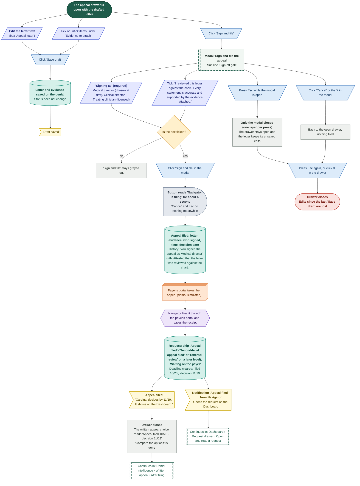

## Denial Intelligence › Written appeal › After filing

A filed appeal (new, or seeded like D-3279, D-3284 and D-3272) shows a waiting block, a read-only letter and the button 'Record the payer's decision'. The payer's answer is recorded by a person, in its own diagram.

Route: `/denials/D-3318`

Demo only: the 30-day decision date is fixed, the receipt is saved at filing, and fast-forwarding changes nothing on a filed appeal. Nobody plays the payer, so the person records its decision. In production Navigator finds the answer in its daily check.

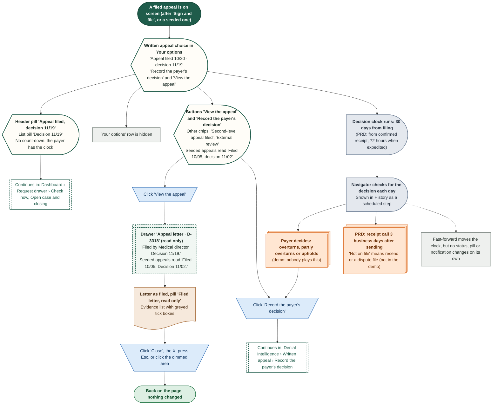

## Denial Intelligence › Written appeal › Record the payer's decision

Once the payer answers a filed appeal, the person records what it decided. 'Overturned' and 'Partly overturned' close the denial. 'Upheld' goes on to the next appeal level, with a new deadline, or to accepting the denial.

Route: `/denials/D-3279`

Demo only: nobody plays the payer's reply, so the person records it here. In production Navigator saves the answer it finds in its daily check. The ladder is Appeal, Second-level appeal, External review.

```mermaid
%%{init: {"theme":"base","themeVariables":{"fontFamily":"'DM Sans', 'Segoe UI', system-ui, sans-serif","fontSize":"15px","lineColor":"#5B6B63","primaryTextColor":"#1C2B25","clusterBkg":"#FBF8F3","clusterBorder":"#D9CDBB","edgeLabelBackground":"#FFFFFF"},"flowchart":{"curve":"basis","nodeSpacing":36,"rankSpacing":48,"padding":12,"htmlLabels":true,"useMaxWidth":false,"wrappingWidth":230}} }%%
flowchart TD
  classDef k_start fill:#1F5C4B,stroke:#174638,color:#FFFFFF,stroke-width:1.5px,font-weight:600
  classDef k_end fill:#DDEFE3,stroke:#2E7D4F,color:#14502F,stroke-width:1.5px,font-weight:600
  classDef k_endx fill:#FBE3E0,stroke:#C0392B,color:#7A1F16,stroke-width:1.5px,font-weight:600
  classDef k_screen fill:#FFFDF8,stroke:#1F5C4B,color:#1C2B25,stroke-width:2px
  classDef k_overlay fill:#F1F7F3,stroke:#1F5C4B,color:#1C2B25,stroke-width:2px,stroke-dasharray:5 3
  classDef k_click fill:#DCEBFA,stroke:#2F6DB5,color:#12365F,stroke-width:1.5px
  classDef k_input fill:#E4E7FF,stroke:#4C5FD5,color:#1D2670,stroke-width:1.5px
  classDef k_process fill:#EEF0EE,stroke:#7A857F,color:#26302B,stroke-width:1.5px
  classDef k_agent fill:#EEE5FA,stroke:#7A4FC2,color:#341A63,stroke-width:1.5px
  classDef k_decision fill:#FFF0CC,stroke:#D9962B,color:#5C3B00,stroke-width:1.5px
  classDef k_store fill:#D5F0EA,stroke:#1C8E7B,color:#0B4A3F,stroke-width:1.5px
  classDef k_doc fill:#F6E9DC,stroke:#B07A4C,color:#4A2E14,stroke-width:1.5px
  classDef k_ext fill:#FFE6D2,stroke:#E07B39,color:#6B2F06,stroke-width:1.5px
  classDef k_wait fill:#E4E8EE,stroke:#6B7C93,color:#26303D,stroke-width:1.5px
  classDef k_toast fill:#FFF9DB,stroke:#C9A400,color:#5A4A00,stroke-width:1.5px
  classDef k_goto fill:#FFFFFF,stroke:#1F5C4B,color:#1F5C4B,stroke-width:1.5px,stroke-dasharray:5 3
  s1@{ shape: stadium, label: "<b>A filed appeal is on screen</b><br/>Written appeal choice 'Appeal filed 10/05 · decision 11/02'" }
  c1@{ shape: trap-t, label: "Click 'Record the payer's decision'" }
  o1@{ shape: win-pane, label: "<b>Modal 'Record the payer's decision'</b><br/>D-3279 · Beacon PPO" }
  i1@{ shape: lean-r, label: "<b>Pick one (radio cards)</b><br/>'Overturned' (chosen at first), 'Partly overturned' or 'Upheld'" }
  i2@{ shape: lean-r, label: "Note (optional)" }
  c2@{ shape: trap-t, label: "Click 'Cancel', the X, press Esc, or click the dimmed area" }
  e1@{ shape: stadium, label: "<b>Nothing is recorded</b><br/>The appeal stays filed" }
  d1@{ shape: diam, label: "Which decision?" }
  subgraph gWin ["Overturned or partly overturned"]
  c3@{ shape: trap-t, label: "Click 'Record the decision'" }
  st1@{ shape: cyl, label: "<b>Decision saved on the denial: result, note, time</b><br/>History: 'You recorded the payer's decision: overturned' with the note, then 'Beacon overturned the denial on the appeal'<br/>The scheduled daily check is dropped" }
  st2@{ shape: cyl, label: "<b>Request settled: leaves 'Appeal or call' (Dashboard stage 'Decided today')</b><br/>Chip 'Overturned' or 'Partly overturned'<br/>Ledger result approved or partly approved" }
  a1@{ shape: hex, label: "Cadence updates the ledger and books the next review" }
  t1@{ shape: odd, label: "<b>'Overturned' or 'Partly overturned'</b><br/>'The ledger is updated and the next review is booked.'" }
  sc1@{ shape: curv-trap, label: "<b>Written appeal choice: pill 'Overturned on appeal' or 'Partly overturned on appeal'</b><br/>Badge goes down by one<br/>The dashboard lists it under 'Closed'" }
  e2@{ shape: stadium, label: "Denial is closed with the appeal's result" }
  end
  subgraph gUp ["Upheld"]
  u1@{ shape: curv-trap, label: "'Next step' appears under the cards" }
  u2@{ shape: lean-r, label: "<b>Pick one</b><br/>'Appeal to the next level: Second-level appeal' (chosen at first)<br/>or 'Accept the denial'" }
  u3@{ shape: rect, label: "<b>Next level shows its new deadline and window</b><br/>Second-level appeal: 60 days to file<br/>External review: 120 days to file" }
  u4@{ shape: rect, label: "<b>External review is the last level</b><br/>Only 'Accept the denial' is offered" }
  c4@{ shape: trap-t, label: "Click 'Record and start the second-level appeal'" }
  st3@{ shape: cyl, label: "<b>Decision saved with the next level</b><br/>History: 'You recorded the payer's decision: upheld', 'Beacon upheld its decision on the appeal'" }
  st4@{ shape: cyl, label: "<b>Chip 'Appeal drafting', clock 'to file' with the new deadline</b><br/>The filed letter and the old draft are cleared<br/>Rung on the ladder moves up by one" }
  a2@{ shape: hex, label: "Advocate starts the next-level letter" }
  o2@{ shape: win-pane, label: "Appeal drawer opens at once and drafts the letter" }
  u5@{ shape: lean-r, label: "<b>'Reason for the record' (required)</b><br/>Shows when 'Accept the denial' is picked" }
  c5@{ shape: trap-t, label: "Click 'Record and accept the denial'" }
  st5@{ shape: cyl, label: "Decision saved: upheld, no next level" }
  end
  r1@{ shape: cyl, label: "<b>Every decision is also logged for other screens</b><br/>Denial, request, payer, result and next level<br/>Analytics reads the appeal rulings" }
  c6@{ shape: trap-t, label: "Open the Dashboard from the sidebar" }
  g1@{ shape: subproc, label: "Continues in: Dashboard › Request drawer › Open and read a request" }
  g2@{ shape: subproc, label: "Continues in: Denial Intelligence › Written appeal › Confirm and draft" }
  g3@{ shape: subproc, label: "Continues in: Denial Intelligence › Accept the denial" }
  s1 --> c1 --> o1
  o1 --> i1 & i2
  o1 --> c2 --> e1
  i1 --> d1
  i2 --> d1
  d1 -->|"Overturned or Partly overturned"| c3 --> st1 --> r1
  st1 --> st2 --> a1 --> t1 --> sc1 --> e2
  sc1 --> c6 --> g1
  d1 -->|"Upheld"| u1 --> u2
  u2 --> u3 --> c4 --> st3 --> r1
  st3 --> st4 --> a2 --> o2 --> g2
  u2 --> u4
  u2 --> u5 --> c5 --> st5 --> r1
  st5 --> g3
  class s1 k_start
  class c1,c2,c3,c4,c5,c6 k_click
  class o1,o2 k_overlay
  class i1,i2,u2,u5 k_input
  class e1 k_endx
  class d1 k_decision
  class st1,st2,st3,st4,st5,r1 k_store
  class a1,a2 k_agent
  class t1 k_toast
  class sc1,u1 k_screen
  class e2 k_end
  class u3,u4 k_process
  class g1,g2,g3 k_goto
  style gWin fill:#FBF8F3,stroke:#D9CDBB,stroke-width:1.5px,color:#5B6B63
  style gUp fill:#FBF8F3,stroke:#D9CDBB,stroke-width:1.5px,color:#5B6B63
```

## Denial Intelligence › Accept the denial

Accepting closes the denial and logs it as accepted. A reason goes on the record first. Accepting is always the person's choice and is never the only option. It also reaches Authorizations and Analytics.

Route: `/denials/D-3297`

The denial's row in Authorizations reads Accepted with 'Plan the step-down', and Analytics logs it as an accepted denial. The same steps run when an upheld appeal is accepted from 'Record the payer's decision'.

```mermaid
%%{init: {"theme":"base","themeVariables":{"fontFamily":"'DM Sans', 'Segoe UI', system-ui, sans-serif","fontSize":"15px","lineColor":"#5B6B63","primaryTextColor":"#1C2B25","clusterBkg":"#FBF8F3","clusterBorder":"#D9CDBB","edgeLabelBackground":"#FFFFFF"},"flowchart":{"curve":"basis","nodeSpacing":36,"rankSpacing":48,"padding":12,"htmlLabels":true,"useMaxWidth":false,"wrappingWidth":230}} }%%
flowchart TD
  classDef k_start fill:#1F5C4B,stroke:#174638,color:#FFFFFF,stroke-width:1.5px,font-weight:600
  classDef k_end fill:#DDEFE3,stroke:#2E7D4F,color:#14502F,stroke-width:1.5px,font-weight:600
  classDef k_endx fill:#FBE3E0,stroke:#C0392B,color:#7A1F16,stroke-width:1.5px,font-weight:600
  classDef k_screen fill:#FFFDF8,stroke:#1F5C4B,color:#1C2B25,stroke-width:2px
  classDef k_overlay fill:#F1F7F3,stroke:#1F5C4B,color:#1C2B25,stroke-width:2px,stroke-dasharray:5 3
  classDef k_click fill:#DCEBFA,stroke:#2F6DB5,color:#12365F,stroke-width:1.5px
  classDef k_input fill:#E4E7FF,stroke:#4C5FD5,color:#1D2670,stroke-width:1.5px
  classDef k_process fill:#EEF0EE,stroke:#7A857F,color:#26302B,stroke-width:1.5px
  classDef k_agent fill:#EEE5FA,stroke:#7A4FC2,color:#341A63,stroke-width:1.5px
  classDef k_decision fill:#FFF0CC,stroke:#D9962B,color:#5C3B00,stroke-width:1.5px
  classDef k_store fill:#D5F0EA,stroke:#1C8E7B,color:#0B4A3F,stroke-width:1.5px
  classDef k_doc fill:#F6E9DC,stroke:#B07A4C,color:#4A2E14,stroke-width:1.5px
  classDef k_ext fill:#FFE6D2,stroke:#E07B39,color:#6B2F06,stroke-width:1.5px
  classDef k_wait fill:#E4E8EE,stroke:#6B7C93,color:#26303D,stroke-width:1.5px
  classDef k_toast fill:#FFF9DB,stroke:#C9A400,color:#5A4A00,stroke-width:1.5px
  classDef k_goto fill:#FFFFFF,stroke:#1F5C4B,color:#1F5C4B,stroke-width:1.5px,stroke-dasharray:5 3
  s1@{ shape: stadium, label: "Click 'Accept the decision' in the accept choice of Your options (primary when it is recommended), or open 'Compare the options', select the 'Accept...' card and click its button" }
  c1@{ shape: trap-t, label: "Click 'Accept the decision'" }
  o1@{ shape: win-pane, label: "Modal 'Accept the decision?'" }
  l1@{ shape: curv-trap, label: "Sub line 'D-3297 · closes the denial, nothing regained'" }
  i1@{ shape: lean-r, label: "'Reason for the record' (required): open the menu and pick one" }
  l2@{ shape: curv-trap, label: "<b>Menu choices</b><br/>'The chart does not yet support a challenge' (chosen at first)<br/>'The clinical team agrees with the payer's reasoning'<br/>'The member and family chose to step down'<br/>'The effort of an appeal outweighs the likely gain'" }
  i2@{ shape: lean-r, label: "<b>Note (optional)</b><br/>'Anything the team should know'" }
  c2@{ shape: trap-t, label: "Click 'Accept and close'" }
  c3@{ shape: trap-t, label: "Click 'Cancel', the X, press Esc (this also closes an open menu first), or click the dimmed area" }
  e1@{ shape: stadium, label: "<b>Nothing recorded</b><br/>The denial stays open" }
  st1@{ shape: cyl, label: "Accepted: reason (with the note after it) and time saved on the denial" }
  st2@{ shape: cyl, label: "<b>Request settled: leaves 'Appeal or call' for 'Decided'</b><br/>Chip 'Accepted', 'Closed. Logged as an accepted denial'<br/>Deadline cleared; held by Cadence<br/>Scheduled lines (a booked call, the daily check) leave the History" }
  a1@{ shape: hex, label: "Cadence logs the accepted denial for Analytics" }
  st3@{ shape: cyl, label: "<b>History: 'You accepted the decision' with 'Reason: ...'</b><br/>'Cadence logged the accepted denial for Analytics and added a step-down plan to Case Manager'" }
  st4@{ shape: cyl, label: "<b>Shared with other screens: denial, case and payer</b><br/>Authorizations: the denial's row reads Accepted with 'Plan the step-down'<br/>Analytics logs the accepted denial" }
  t1@{ shape: odd, label: "<b>'Decision accepted'</b><br/>'Analytics logs it as an accepted denial. Case Manager has a step-down plan.'" }
  t2@{ shape: odd, label: "<b>Notification 'Denial closed' from Cadence</b><br/>Opens Authorizations, All view" }
  sc1@{ shape: curv-trap, label: "<b>The accept choice in Your options reads 'Accepted 10/20' with the link 'Plan the step-down'</b><br/>History: 'You accepted the decision' flagged 'Logged decision'" }
  p1@{ shape: rect, label: "<b>The accept choice reads 'Accepted 10/20' with 'Plan the step-down'; 'Compare the options' is gone</b><br/>The dashboard lists it under 'Closed' with the outcome 'Accepted'<br/>Sidebar badge goes down by one" }
  c4@{ shape: trap-t, label: "Click 'Plan the step-down'" }
  c5@{ shape: trap-t, label: "Open the Dashboard from the sidebar" }
  g1@{ shape: subproc, label: "Continues in: Authorizations › Denied › Step-down plans from accepted denials" }
  g2@{ shape: subproc, label: "Continues in: Dashboard › Request drawer › Open and read a request" }
  p2@{ shape: rect, label: "<b>PRD guardrail: the agents never accept a denial</b><br/>A person gives the reason first" }
  s1 --> c1 --> o1 --> l1
  l1 --> i1 --> l2
  l1 --> i2
  l2 --> c2
  i2 --> c2
  o1 --> c3 --> e1
  c2 --> st1 --> st2 --> a1 --> st3 --> st4 --> t1 --> sc1
  st4 --> t2 --> g1
  sc1 --> p1
  sc1 --> c4 --> g1
  sc1 --> c5 --> g2
  o1 -.-> p2
  class s1 k_start
  class c1,c2,c3,c4,c5 k_click
  class o1 k_overlay
  class l1,l2,sc1 k_screen
  class i1,i2 k_input
  class e1 k_endx
  class st1,st2,st3,st4 k_store
  class a1 k_agent
  class t1,t2 k_toast
  class p1,p2 k_process
  class g1,g2 k_goto
```

## Denial Intelligence › Deadlines › Fast-forward the clock

The demo clock only moves when the Demo menu moves it. Every time-left text, colour and sort order on Denial Intelligence follows the clock, and so do the call times offered for booking; nothing else happens by itself.

Route: `/denials`

Demo only: the Demo menu is not part of the product. In production the clocks run in real time and alert at 14, 7 and 3 days (PRD 04).

```mermaid
%%{init: {"theme":"base","themeVariables":{"fontFamily":"'DM Sans', 'Segoe UI', system-ui, sans-serif","fontSize":"15px","lineColor":"#5B6B63","primaryTextColor":"#1C2B25","clusterBkg":"#FBF8F3","clusterBorder":"#D9CDBB","edgeLabelBackground":"#FFFFFF"},"flowchart":{"curve":"basis","nodeSpacing":36,"rankSpacing":48,"padding":12,"htmlLabels":true,"useMaxWidth":false,"wrappingWidth":230}} }%%
flowchart TD
  classDef k_start fill:#1F5C4B,stroke:#174638,color:#FFFFFF,stroke-width:1.5px,font-weight:600
  classDef k_end fill:#DDEFE3,stroke:#2E7D4F,color:#14502F,stroke-width:1.5px,font-weight:600
  classDef k_endx fill:#FBE3E0,stroke:#C0392B,color:#7A1F16,stroke-width:1.5px,font-weight:600
  classDef k_screen fill:#FFFDF8,stroke:#1F5C4B,color:#1C2B25,stroke-width:2px
  classDef k_overlay fill:#F1F7F3,stroke:#1F5C4B,color:#1C2B25,stroke-width:2px,stroke-dasharray:5 3
  classDef k_click fill:#DCEBFA,stroke:#2F6DB5,color:#12365F,stroke-width:1.5px
  classDef k_input fill:#E4E7FF,stroke:#4C5FD5,color:#1D2670,stroke-width:1.5px
  classDef k_process fill:#EEF0EE,stroke:#7A857F,color:#26302B,stroke-width:1.5px
  classDef k_agent fill:#EEE5FA,stroke:#7A4FC2,color:#341A63,stroke-width:1.5px
  classDef k_decision fill:#FFF0CC,stroke:#D9962B,color:#5C3B00,stroke-width:1.5px
  classDef k_store fill:#D5F0EA,stroke:#1C8E7B,color:#0B4A3F,stroke-width:1.5px
  classDef k_doc fill:#F6E9DC,stroke:#B07A4C,color:#4A2E14,stroke-width:1.5px
  classDef k_ext fill:#FFE6D2,stroke:#E07B39,color:#6B2F06,stroke-width:1.5px
  classDef k_wait fill:#E4E8EE,stroke:#6B7C93,color:#26303D,stroke-width:1.5px
  classDef k_toast fill:#FFF9DB,stroke:#C9A400,color:#5A4A00,stroke-width:1.5px
  classDef k_goto fill:#FFFFFF,stroke:#1F5C4B,color:#1F5C4B,stroke-width:1.5px,stroke-dasharray:5 3
  s1@{ shape: stadium, label: "Click 'Demo' in the top bar" }
  o1@{ shape: win-pane, label: "<b>Demo menu</b><br/>'The demo clock is Tue Oct 20 2026, 10:42 am. It only moves when you move it.'" }
  c1@{ shape: trap-t, label: "Click 'Fast-forward 1 hour'" }
  c2@{ shape: trap-t, label: "Click 'Fast-forward 1 day'" }
  st1@{ shape: cyl, label: "<b>Demo clock moves forward</b><br/>Nothing is sent to anyone" }
  t1@{ shape: odd, label: "<b>'Clock moved forward 1 hour' (or '1 day')</b><br/>'Times in stage and deadlines updated.'" }
  p1@{ shape: rect, label: "Every time-left text is worked out again from the clock" }
  p2@{ shape: rect, label: "Time left reads 'N min' under an hour, 'N h' under 3 days, 'N d' after that" }
  p3@{ shape: rect, label: "<b>The dashboard table sorts again, nearest deadline first, and 'Deadlines this week' recounts</b><br/>Time that has run out reads 'Passed' and counts as nearest" }
  d1@{ shape: diam, label: "Which clock does this denial run?" }
  k1@{ shape: curv-trap, label: "<b>Peer-to-peer window</b><br/>List 'P2P in 36 h'<br/>Header 'Peer-to-peer window closes in 36 h'" }
  k2@{ shape: curv-trap, label: "<b>Written appeal due</b><br/>List 'Appeal in 41 d'<br/>Header 'Appeal due in 41 d'" }
  k3@{ shape: curv-trap, label: "<b>Resubmission due</b><br/>List 'Resubmit in 5 d'<br/>Header 'Resubmit within 5 d'" }
  k4@{ shape: curv-trap, label: "<b>Filed appeal</b><br/>List 'Decision 11/02'<br/>Header 'Appeal filed, decision 11/02'<br/>No change at all (the person records the payer's decision)" }
  d2@{ shape: diam, label: "How much time is left?" }
  m1@{ shape: curv-trap, label: "Grey: 7 days or more" }
  m2@{ shape: curv-trap, label: "Ochre: 2 to 7 days" }
  m3@{ shape: curv-trap, label: "Red: under 2 days" }
  m4@{ shape: curv-trap, label: "<b>Time is up</b><br/>List 'Window closed' (red)<br/>Header 'Peer-to-peer window closed', 'Appeal deadline passed' or 'Resubmission window closed'" }
  m5@{ shape: curv-trap, label: "Brief page 'Closes in' follows the same colours and reads 'Closed' when time is up" }
  g1@{ shape: subproc, label: "Continues in: Denial Intelligence › Deadlines › Overdue denials" }
  p6@{ shape: rect, label: "<b>Call times are offered again from the new clock</b><br/>Only windows that start after the clock and before the payer's window closes<br/>When none is left: 'No call time is left inside the payer's window'" }
  g3@{ shape: subproc, label: "Continues in: Denial Intelligence › Peer-to-peer › Book the call" }
  g2@{ shape: subproc, label: "Continues in: Dashboard › Arrive › What the page shows" }
  p4@{ shape: rect, label: "No notification, status change or hand-off happens when a time runs out (demo)" }
  c3@{ shape: trap-t, label: "Click 'Reset demo data'" }
  st2@{ shape: cyl, label: "<b>Everything goes back to the start</b><br/>Letters, calls, drafts, filed appeals and closed denials are gone" }
  t2@{ shape: odd, label: "<b>'Demo data reset'</b><br/>'Everything is back to the starting point.'" }
  p5@{ shape: rect, label: "App opens the Dashboard" }
  s1 --> o1 --> c1
  o1 --> c2
  c1 --> st1
  c2 --> st1
  st1 --> t1 --> p1 --> p2 --> p3
  p3 --> d1
  d1 -->|"P2P window"| k1
  d1 -->|"To file"| k2
  d1 -->|"To resubmit"| k3
  d1 -->|"Filed"| k4
  k1 --> d2
  k2 --> d2
  k3 --> d2
  d2 -->|"7 days or more"| m1
  d2 -->|"2 to 7 days"| m2
  d2 -->|"Under 2 days"| m3
  d2 -->|"None left"| m4
  m4 --> m5 --> g1
  m4 -.-> p4
  st1 -.-> g2
  p3 --> p6 --> g3
  o1 --> c3 --> st2 --> t2 --> p5 --> g2
  class s1 k_start
  class o1 k_overlay
  class c1,c2,c3 k_click
  class st1,st2 k_store
  class t1,t2 k_toast
  class p1,p2,p3,p6,p4,p5 k_process
  class d1,d2 k_decision
  class k1,k2,k3,k4,m1,m2,m3,m4,m5 k_screen
  class g1,g3,g2 k_goto
```

## Denial Intelligence › Deadlines › Overdue denials

What changes, and what still works, once a window has run out. Example: D-3318's peer-to-peer window after fast-forwarding 2 days, then a written-appeal deadline that has passed.

Route: `/denials/D-3318`

Demo only: nothing blocks filing after a deadline. Call times are offered only after the demo clock, so once the window has run out there is none to book.

```mermaid
%%{init: {"theme":"base","themeVariables":{"fontFamily":"'DM Sans', 'Segoe UI', system-ui, sans-serif","fontSize":"15px","lineColor":"#5B6B63","primaryTextColor":"#1C2B25","clusterBkg":"#FBF8F3","clusterBorder":"#D9CDBB","edgeLabelBackground":"#FFFFFF"},"flowchart":{"curve":"basis","nodeSpacing":36,"rankSpacing":48,"padding":12,"htmlLabels":true,"useMaxWidth":false,"wrappingWidth":230}} }%%
flowchart TD
  classDef k_start fill:#1F5C4B,stroke:#174638,color:#FFFFFF,stroke-width:1.5px,font-weight:600
  classDef k_end fill:#DDEFE3,stroke:#2E7D4F,color:#14502F,stroke-width:1.5px,font-weight:600
  classDef k_endx fill:#FBE3E0,stroke:#C0392B,color:#7A1F16,stroke-width:1.5px,font-weight:600
  classDef k_screen fill:#FFFDF8,stroke:#1F5C4B,color:#1C2B25,stroke-width:2px
  classDef k_overlay fill:#F1F7F3,stroke:#1F5C4B,color:#1C2B25,stroke-width:2px,stroke-dasharray:5 3
  classDef k_click fill:#DCEBFA,stroke:#2F6DB5,color:#12365F,stroke-width:1.5px
  classDef k_input fill:#E4E7FF,stroke:#4C5FD5,color:#1D2670,stroke-width:1.5px
  classDef k_process fill:#EEF0EE,stroke:#7A857F,color:#26302B,stroke-width:1.5px
  classDef k_agent fill:#EEE5FA,stroke:#7A4FC2,color:#341A63,stroke-width:1.5px
  classDef k_decision fill:#FFF0CC,stroke:#D9962B,color:#5C3B00,stroke-width:1.5px
  classDef k_store fill:#D5F0EA,stroke:#1C8E7B,color:#0B4A3F,stroke-width:1.5px
  classDef k_doc fill:#F6E9DC,stroke:#B07A4C,color:#4A2E14,stroke-width:1.5px
  classDef k_ext fill:#FFE6D2,stroke:#E07B39,color:#6B2F06,stroke-width:1.5px
  classDef k_wait fill:#E4E8EE,stroke:#6B7C93,color:#26303D,stroke-width:1.5px
  classDef k_toast fill:#FFF9DB,stroke:#C9A400,color:#5A4A00,stroke-width:1.5px
  classDef k_goto fill:#FFFFFF,stroke:#1F5C4B,color:#1F5C4B,stroke-width:1.5px,stroke-dasharray:5 3
  s1@{ shape: stadium, label: "Peer-to-peer window of D-3318 has run out (Demo menu: fast-forward 2 days)" }
  sc1@{ shape: curv-trap, label: "<b>List row moves to the top with the pill 'Window closed' (red)</b><br/>Header pill 'Peer-to-peer window closed' (red)" }
  p1@{ shape: rect, label: "<b>'Written appeal' becomes 'Recommended'</b><br/>The peer-to-peer card is no longer chosen first" }
  c1@{ shape: trap-t, label: "Click the 'Peer-to-peer call' card" }
  t1@{ shape: odd, label: "<b>'The peer-to-peer window has closed'</b><br/>'A written appeal is still open.'" }
  p2@{ shape: rect, label: "The card is not selected" }
  c2@{ shape: trap-t, label: "Click 'Change the time' (the peer-to-peer choice)" }
  o1@{ shape: win-pane, label: "Modal 'Confirm the next step: peer-to-peer call'" }
  d1@{ shape: diam, label: "Is any call time left? (starts after the demo clock, before the window closes)" }
  t2@{ shape: odd, label: "<b>'No call time is left inside the payer's window. Choose a written appeal instead.'</b><br/>Confirm is greyed out" }
  p3@{ shape: rect, label: "<b>Only while the window is still open: the times offered are ahead of the clock</b><br/>The call can be booked" }
  c3@{ shape: trap-t, label: "Click 'Cancel', the X, press Esc, or click the dimmed area" }
  e1@{ shape: stadium, label: "Nothing changes" }
  c4@{ shape: trap-t, label: "Click 'Open the brief'" }
  b1@{ shape: curv-trap, label: "<b>Brief page: 'Closes in' reads 'Closed' in red</b><br/>'Key dates' still lists 'Peer-to-peer window closes'" }
  c5@{ shape: trap-t, label: "Click 'Record the call outcome'" }
  g1@{ shape: subproc, label: "Continues in: Denial Intelligence › Peer-to-peer › Record the call outcome" }
  s2@{ shape: stadium, label: "A written-appeal or resubmission deadline has run out (example D-3301 after 42 days, D-3290 after 6 days)" }
  sc2@{ shape: curv-trap, label: "<b>List pill 'Window closed' (red)</b><br/>Header pill 'Appeal deadline passed' or 'Resubmission window closed' (red)" }
  o2@{ shape: curv-trap, label: "<b>'Written appeal' card reads 'Deadline passed' in place of the time to file or resubmit</b><br/>Still 'Recommended'" }
  c6@{ shape: trap-t, label: "Click 'Draft the appeal', or 'Open the draft'" }
  p4@{ shape: rect, label: "<b>Drafting, signing and filing work as usual</b><br/>Drawer sub line still says 'Due 11/30.'<br/>No late warning (demo)" }
  g2@{ shape: subproc, label: "Continues in: Denial Intelligence › Written appeal › Confirm and draft" }
  p5@{ shape: rect, label: "Filed appeals have no deadline of ours, so they never turn overdue" }
  s1 --> sc1 --> p1
  sc1 --> c1 --> t1 --> p2
  sc1 --> c2 --> o1 --> d1
  d1 -->|"No"| t2 --> c3
  d1 -->|"Yes"| p3 --> c3
  c3 --> e1
  sc1 --> c4 --> b1 --> c5 --> g1
  s2 --> sc2 --> o2 --> c6 --> p4 --> g2
  sc2 -.-> p5
  class s1,s2 k_start
  class sc1,b1,sc2,o2 k_screen
  class p1,p2,p3,p4,p5 k_process
  class c1,c2,c3,c4,c5,c6 k_click
  class t1,t2 k_toast
  class o1 k_overlay
  class d1 k_decision
  class e1 k_endx
  class g1,g2 k_goto
```

## Denial Intelligence › Hand-offs

Every link that leaves Denial Intelligence for the Dashboard or Authorizations, what accepting or deciding an appeal passes on to other screens, and the links from other screens that arrive here. There is no link from Denial Intelligence to Analytics.

Route: `/denials`

Accepting a denial (directly, or after an upheld appeal) makes the denial's row in Authorizations read Accepted with 'Plan the step-down', and logs the accepted denial in Analytics. Every recorded appeal decision is also logged for other screens.

```mermaid
%%{init: {"theme":"base","themeVariables":{"fontFamily":"'DM Sans', 'Segoe UI', system-ui, sans-serif","fontSize":"15px","lineColor":"#5B6B63","primaryTextColor":"#1C2B25","clusterBkg":"#FBF8F3","clusterBorder":"#D9CDBB","edgeLabelBackground":"#FFFFFF"},"flowchart":{"curve":"basis","nodeSpacing":36,"rankSpacing":48,"padding":12,"htmlLabels":true,"useMaxWidth":false,"wrappingWidth":230}} }%%
flowchart TD
  classDef k_start fill:#1F5C4B,stroke:#174638,color:#FFFFFF,stroke-width:1.5px,font-weight:600
  classDef k_end fill:#DDEFE3,stroke:#2E7D4F,color:#14502F,stroke-width:1.5px,font-weight:600
  classDef k_endx fill:#FBE3E0,stroke:#C0392B,color:#7A1F16,stroke-width:1.5px,font-weight:600
  classDef k_screen fill:#FFFDF8,stroke:#1F5C4B,color:#1C2B25,stroke-width:2px
  classDef k_overlay fill:#F1F7F3,stroke:#1F5C4B,color:#1C2B25,stroke-width:2px,stroke-dasharray:5 3
  classDef k_click fill:#DCEBFA,stroke:#2F6DB5,color:#12365F,stroke-width:1.5px
  classDef k_input fill:#E4E7FF,stroke:#4C5FD5,color:#1D2670,stroke-width:1.5px
  classDef k_process fill:#EEF0EE,stroke:#7A857F,color:#26302B,stroke-width:1.5px
  classDef k_agent fill:#EEE5FA,stroke:#7A4FC2,color:#341A63,stroke-width:1.5px
  classDef k_decision fill:#FFF0CC,stroke:#D9962B,color:#5C3B00,stroke-width:1.5px
  classDef k_store fill:#D5F0EA,stroke:#1C8E7B,color:#0B4A3F,stroke-width:1.5px
  classDef k_doc fill:#F6E9DC,stroke:#B07A4C,color:#4A2E14,stroke-width:1.5px
  classDef k_ext fill:#FFE6D2,stroke:#E07B39,color:#6B2F06,stroke-width:1.5px
  classDef k_wait fill:#E4E8EE,stroke:#6B7C93,color:#26303D,stroke-width:1.5px
  classDef k_toast fill:#FFF9DB,stroke:#C9A400,color:#5A4A00,stroke-width:1.5px
  classDef k_goto fill:#FFFFFF,stroke:#1F5C4B,color:#1F5C4B,stroke-width:1.5px,stroke-dasharray:5 3
  sc1@{ shape: curv-trap, label: "<b>Denial Intelligence</b><br/>A denial is on screen" }
  subgraph gOut ["Links out"]
  c1@{ shape: trap-t, label: "Click 'Case R-0997' (header card)" }
  c2@{ shape: trap-t, label: "Open the Dashboard from the sidebar (after a call was overturned or partly restored)" }
  c3@{ shape: trap-t, label: "Click 'Open the Dashboard' (no open denials)" }
  c4@{ shape: trap-t, label: "Click 'Plan the step-down' (the accept choice after accepting)" }
  p1@{ shape: rect, label: "Address opens /dashboard?request=D-3318" }
  p2@{ shape: rect, label: "Address opens /dashboard" }
  p3@{ shape: rect, label: "<b>Address opens /authorizations?view=all</b><br/>The denial's row reads Accepted with 'Plan the step-down'" }
  g1@{ shape: subproc, label: "Continues in: Dashboard › Request drawer › Open and read a request" }
  g2@{ shape: subproc, label: "Continues in: Dashboard › Arrive › What the page shows" }
  g3@{ shape: subproc, label: "Continues in: Authorizations › Denied › Step-down plans from accepted denials" }
  end
  subgraph gShare ["Shared with other screens"]
  c6@{ shape: trap-t, label: "Click 'Record the payer's decision' (the written appeal choice on a filed appeal)" }
  z1@{ shape: cyl, label: "On accept: the denial's row in Authorizations gets a step-down plan (Accepted), Analytics logs the accepted denial" }
  z2@{ shape: cyl, label: "<b>On a recorded appeal decision: the result and next level are logged</b><br/>Analytics reads the appeal rulings" }
  end
  subgraph gBell ["Notifications"]
  c5@{ shape: trap-t, label: "Click the bell 'Notifications', then a row" }
  n1@{ shape: odd, label: "<b>'Appeal filed', 'Appeal decision: ...' or 'Call outcome: ...'</b><br/>From Navigator or Advocate" }
  n2@{ shape: odd, label: "<b>'Denial closed'</b><br/>From Cadence, after an accept" }
  n3@{ shape: odd, label: "<b>'Denial analyzed', 'Denied today', 'Denied' or 'Partly approved'</b><br/>From Advocate" }
  end
  subgraph gIn ["Links in from other screens"]
  a1@{ shape: stadium, label: "<b>Analytics: 'Common denial reasons by payer'</b><br/>Click a row or its payer name<br/>(opens with that payer and reason as filters)" }
  a2@{ shape: stadium, label: "<b>Authorizations case page: 'This request was denied'</b><br/>Click 'Open in Denial Intelligence'" }
  a3@{ shape: stadium, label: "<b>Dashboard request drawer</b><br/>Click 'Open in Denial Intelligence'" }
  g4@{ shape: subproc, label: "Continues in: Denial Intelligence › Ways in" }
  end
  p4@{ shape: rect, label: "<b>The timeline says 'Every step is also on the Dashboard'</b><br/>This is text, not a link" }
  p5@{ shape: rect, label: "No link to Analytics from this screen" }
  e1@{ shape: stadium, label: "Person is on the other screen" }
  sc1 --> c1 --> p1 --> g1 --> e1
  sc1 --> c2 --> p1
  sc1 --> c3 --> p2 --> g2
  sc1 --> c4 --> p3 --> g3
  sc1 --> c6 --> z2
  c4 -.-> z1
  sc1 --> c5
  c5 --> n1 --> p1
  c5 --> n2 --> p3
  c5 --> n3 --> g4
  sc1 -.-> p4
  sc1 -.-> p5
  a1 --> g4
  a2 --> g4
  a3 --> g4
  class sc1 k_screen
  class c1,c2,c3,c4,c6,c5 k_click
  class p1,p2,p3,p4,p5 k_process
  class g1,g2,g3,g4 k_goto
  class z1,z2 k_store
  class n1,n2,n3 k_toast
  class a1,a2,a3 k_start
  class e1 k_end
  style gOut fill:#FBF8F3,stroke:#D9CDBB,stroke-width:1.5px,color:#5B6B63
  style gShare fill:#FBF8F3,stroke:#D9CDBB,stroke-width:1.5px,color:#5B6B63
  style gBell fill:#FBF8F3,stroke:#D9CDBB,stroke-width:1.5px,color:#5B6B63
  style gIn fill:#FBF8F3,stroke:#D9CDBB,stroke-width:1.5px,color:#5B6B63
```

## Denial Intelligence › Appeal analysis report › Open and generate

Every denial has an appeal analysis report: seeded, added from a letter, or created on the Dashboard. The first time in a session the three agents put it together for a moment, then it opens. Reopening is instant until it is regenerated.

Route: `/denials/D-3297/report`

The report is built for any denial type. D-3297 is the paraphrased worked example and carries a 'Worked example' tag.

```mermaid
%%{init: {"theme":"base","themeVariables":{"fontFamily":"'DM Sans', 'Segoe UI', system-ui, sans-serif","fontSize":"15px","lineColor":"#5B6B63","primaryTextColor":"#1C2B25","clusterBkg":"#FBF8F3","clusterBorder":"#D9CDBB","edgeLabelBackground":"#FFFFFF"},"flowchart":{"curve":"basis","nodeSpacing":36,"rankSpacing":48,"padding":12,"htmlLabels":true,"useMaxWidth":false,"wrappingWidth":230}} }%%
flowchart TD
  classDef k_start fill:#1F5C4B,stroke:#174638,color:#FFFFFF,stroke-width:1.5px,font-weight:600
  classDef k_end fill:#DDEFE3,stroke:#2E7D4F,color:#14502F,stroke-width:1.5px,font-weight:600
  classDef k_endx fill:#FBE3E0,stroke:#C0392B,color:#7A1F16,stroke-width:1.5px,font-weight:600
  classDef k_screen fill:#FFFDF8,stroke:#1F5C4B,color:#1C2B25,stroke-width:2px
  classDef k_overlay fill:#F1F7F3,stroke:#1F5C4B,color:#1C2B25,stroke-width:2px,stroke-dasharray:5 3
  classDef k_click fill:#DCEBFA,stroke:#2F6DB5,color:#12365F,stroke-width:1.5px
  classDef k_input fill:#E4E7FF,stroke:#4C5FD5,color:#1D2670,stroke-width:1.5px
  classDef k_process fill:#EEF0EE,stroke:#7A857F,color:#26302B,stroke-width:1.5px
  classDef k_agent fill:#EEE5FA,stroke:#7A4FC2,color:#341A63,stroke-width:1.5px
  classDef k_decision fill:#FFF0CC,stroke:#D9962B,color:#5C3B00,stroke-width:1.5px
  classDef k_store fill:#D5F0EA,stroke:#1C8E7B,color:#0B4A3F,stroke-width:1.5px
  classDef k_doc fill:#F6E9DC,stroke:#B07A4C,color:#4A2E14,stroke-width:1.5px
  classDef k_ext fill:#FFE6D2,stroke:#E07B39,color:#6B2F06,stroke-width:1.5px
  classDef k_wait fill:#E4E8EE,stroke:#6B7C93,color:#26303D,stroke-width:1.5px
  classDef k_toast fill:#FFF9DB,stroke:#C9A400,color:#5A4A00,stroke-width:1.5px
  classDef k_goto fill:#FFFFFF,stroke:#1F5C4B,color:#1F5C4B,stroke-width:1.5px,stroke-dasharray:5 3
  s1@{ shape: stadium, label: "Click 'Appeal analysis report' in the header card of a denial" }
  s2@{ shape: stadium, label: "Click 'Appeal analysis report' on the brief page" }
  s3@{ shape: stadium, label: "Click 'Appeal analysis report' at the top right of the brief page" }
  s4@{ shape: stadium, label: "Open /denials/D-xxxx/report by its address" }
  d1@{ shape: diam, label: "Does a request with that id exist?" }
  e1@{ shape: curv-trap, label: "<b>'We could not find that denial'</b><br/>'It may have been closed or the address is wrong.'" }
  c0@{ shape: trap-t, label: "Click 'Back to Denial Intelligence'" }
  g0@{ shape: subproc, label: "Continues in: Denial Intelligence › Ways in" }
  d2@{ shape: diam, label: "Was the report already generated for this denial in this session?" }
  sc1@{ shape: curv-trap, label: "<b>Crumbs: 'Denial Intelligence' › D-id › 'Appeal analysis report'</b><br/>Panel 'Generating appeal analysis'<br/>'D-id · initials, age · payer. A clinician reviews the report before anything is sent.'" }
  a1@{ shape: hex, label: "Reader is reading the letter and the chart, and removing identifiers" }
  a2@{ shape: hex, label: "Advocate is checking the notice, the deadline and how the payer applied its own criteria" }
  a3@{ shape: hex, label: "Historian is comparing N similar decisions and appeals" }
  w1@{ shape: delay, label: "<b>About 2.5 seconds in all: one step per agent, each ticked off in turn</b><br/>With reduced motion the spinner does not turn and the steps are quicker" }
  st1@{ shape: cyl, label: "Time of the report saved on the denial (this session only)" }
  sc2@{ shape: curv-trap, label: "<b>The report opens</b><br/>Buttons: 'Copy report', 'Download PDF', 'Print', 'Regenerate'<br/>Link: 'Back to the denial'" }
  g1@{ shape: subproc, label: "Continues in: Denial Intelligence › Appeal analysis report › What the report says" }
  g2@{ shape: subproc, label: "Continues in: Denial Intelligence › Appeal analysis report › Copy, PDF and print" }
  c1@{ shape: trap-t, label: "Click 'Regenerate'" }
  st2@{ shape: cyl, label: "Saved time is cleared, so the panel runs again" }
  c2@{ shape: trap-t, label: "Click 'Back to the denial'" }
  c3@{ shape: trap-t, label: "Click the crumb 'Denial Intelligence' or the crumb with the D-id" }
  p1@{ shape: rect, label: "Address opens /denials/D-xxxx (the crumb 'Denial Intelligence' opens the dashboard)" }
  g3@{ shape: subproc, label: "Continues in: Denial Intelligence › A denial opened" }
  p2@{ shape: rect, label: "Leave the page while it is generating: nothing is saved, the next visit generates again" }
  p3@{ shape: rect, label: "<b>Demo menu, 'Reset demo data' clears the saved times</b><br/>Every report generates again" }
  e2@{ shape: stadium, label: "The person reads the report" }
  s1 --> d1
  s2 --> d1
  s3 --> d1
  s4 --> d1
  d1 -->|"No"| e1 --> c0 --> g0
  d1 -->|"Yes"| d2
  d2 -->|"No"| sc1 --> a1 --> a2 --> a3 --> w1 --> st1 --> sc2
  d2 -->|"Yes, opens at once"| sc2
  sc1 -.-> p2
  sc2 --> g1 & g2
  sc2 --> e2
  sc2 --> c1 --> st2 --> sc1
  sc2 --> c2 --> p1 --> g3
  sc2 --> c3 --> p1
  sc2 -.-> p3
  class s1,s2,s3,s4 k_start
  class d1,d2 k_decision
  class e1,sc1,sc2 k_screen
  class c0,c1,c2,c3 k_click
  class g0,g1,g2,g3 k_goto
  class a1,a2,a3 k_agent
  class w1 k_wait
  class st1,st2 k_store
  class p1,p2,p3 k_process
  class e2 k_end
```

## Denial Intelligence › Appeal analysis report › What the report says

One page, about 860 pixels wide, top to bottom. The same words go to Copy report and to the PDF. It is built from the analysis, the long text and what the person has done on the denial.

Route: `/denials/D-3297/report`

Late notice and Retro-authorization denied have no framework dimensions, so that section is left out for them. Everything else appears for every denial.

```mermaid
%%{init: {"theme":"base","themeVariables":{"fontFamily":"'DM Sans', 'Segoe UI', system-ui, sans-serif","fontSize":"15px","lineColor":"#5B6B63","primaryTextColor":"#1C2B25","clusterBkg":"#FBF8F3","clusterBorder":"#D9CDBB","edgeLabelBackground":"#FFFFFF"},"flowchart":{"curve":"basis","nodeSpacing":36,"rankSpacing":48,"padding":12,"htmlLabels":true,"useMaxWidth":false,"wrappingWidth":230}} }%%
flowchart TD
  classDef k_start fill:#1F5C4B,stroke:#174638,color:#FFFFFF,stroke-width:1.5px,font-weight:600
  classDef k_end fill:#DDEFE3,stroke:#2E7D4F,color:#14502F,stroke-width:1.5px,font-weight:600
  classDef k_endx fill:#FBE3E0,stroke:#C0392B,color:#7A1F16,stroke-width:1.5px,font-weight:600
  classDef k_screen fill:#FFFDF8,stroke:#1F5C4B,color:#1C2B25,stroke-width:2px
  classDef k_overlay fill:#F1F7F3,stroke:#1F5C4B,color:#1C2B25,stroke-width:2px,stroke-dasharray:5 3
  classDef k_click fill:#DCEBFA,stroke:#2F6DB5,color:#12365F,stroke-width:1.5px
  classDef k_input fill:#E4E7FF,stroke:#4C5FD5,color:#1D2670,stroke-width:1.5px
  classDef k_process fill:#EEF0EE,stroke:#7A857F,color:#26302B,stroke-width:1.5px
  classDef k_agent fill:#EEE5FA,stroke:#7A4FC2,color:#341A63,stroke-width:1.5px
  classDef k_decision fill:#FFF0CC,stroke:#D9962B,color:#5C3B00,stroke-width:1.5px
  classDef k_store fill:#D5F0EA,stroke:#1C8E7B,color:#0B4A3F,stroke-width:1.5px
  classDef k_doc fill:#F6E9DC,stroke:#B07A4C,color:#4A2E14,stroke-width:1.5px
  classDef k_ext fill:#FFE6D2,stroke:#E07B39,color:#6B2F06,stroke-width:1.5px
  classDef k_wait fill:#E4E8EE,stroke:#6B7C93,color:#26303D,stroke-width:1.5px
  classDef k_toast fill:#FFF9DB,stroke:#C9A400,color:#5A4A00,stroke-width:1.5px
  classDef k_goto fill:#FFFFFF,stroke:#1F5C4B,color:#1F5C4B,stroke-width:1.5px,stroke-dasharray:5 3
  s1@{ shape: stadium, label: "The report is on screen" }
  t1@{ shape: curv-trap, label: "<b>Title block</b><br/>'Appeal analysis report', D-id, initials and age, payer<br/>Tag 'Worked example' on D-3297 only<br/>'Our read' tile: Worth challenging, Borderline or Probably accept<br/>Under the title line: 'Draft by FLO's agents. A clinician reviews and signs before anything is sent.'" }
  t2@{ shape: curv-trap, label: "<b>Facts</b><br/>Denial, Patient, Payer, Program, Denial type, Report date (the demo clock), Deadline, Similar decisions<br/>Chance of overturning on a call and on a written appeal, with the likely range" }
  d0@{ shape: diam, label: "Fewer than 60 similar decisions?" }
  n1@{ shape: odd, label: "<b>Note under the chances</b><br/>'Benchmark estimate: only N similar decisions, so the range is wider than usual.'" }
  r1@{ shape: curv-trap, label: "<b>'The payer's reasoning'</b><br/>Their words in a red-edged box, then 'Where it parts from the chart'" }
  r2@{ shape: curv-trap, label: "<b>'What the chart shows as a whole'</b><br/>Two short paragraphs" }
  r3@{ shape: curv-trap, label: "<b>'Where the denial is weak'</b><br/>Numbered findings: severity pill, title, long paragraph, 'Source:' with the chart excerpt, 'Suggested fix:'" }
  d1@{ shape: diam, label: "Did the person click 'Add to the evidence' on this finding?" }
  r3a@{ shape: curv-trap, label: "Pill 'Added to the evidence'" }
  r3b@{ shape: curv-trap, label: "Pill 'Not added yet'" }
  d2@{ shape: diam, label: "Does the denial have framework dimensions?" }
  r4@{ shape: curv-trap, label: "<b>'ASAM Criteria dimensions' ('LOCUS dimensions' for a mental health denial)</b><br/>Dot, 'D1 Acute intoxication and withdrawal potential', a word and the long paragraph for D1 to D6" }
  p4@{ shape: rect, label: "Section left out (Late notice, Retro-authorization denied)" }
  r5@{ shape: curv-trap, label: "<b>'What we would do'</b><br/>Numbered recommendations with a bold title and a long paragraph" }
  r6@{ shape: curv-trap, label: "<b>'Your options compared'</b><br/>Table: Peer-to-peer call, Written appeal, Accept the decision<br/>Chance, Time, Gets back, Needs; 'Recommended' on one" }
  r7@{ shape: curv-trap, label: "<b>'Criteria to cite'</b><br/>'Documents to attach': a list, then 'Fixes from the findings' with a tick for each fix added" }
  r8@{ shape: curv-trap, label: "<b>'Likely pushback and replies'</b><br/>'The ask'<br/>'Outlook'" }
  r9@{ shape: curv-trap, label: "<b>'Timeline and deadlines'</b><br/>Denial received, Peer-to-peer window, Peer-to-peer call (booked or not), Written appeal due<br/>Later: appeal drafted, filed, call outcome, payer's decision, accepted<br/>'Where it stands'" }
  r10@{ shape: curv-trap, label: "<b>'How this report was made'</b><br/>Reader, Advocate, Historian, the count of similar decisions<br/>A clinician reviews and signs before anything is sent<br/>Initials and age only, no other identifiers" }
  f1@{ shape: curv-trap, label: "<b>Footer line</b><br/>'Draft by FLO's agents. A clinician reviews and signs before anything is sent. Generated 10/20/2026.'" }
  c1@{ shape: trap-t, label: "Click 'Add to the evidence' on the denial page, then reopen the report" }
  p1@{ shape: rect, label: "The finding's fix shows as added, and so does its tick under 'Documents to attach'" }
  c2@{ shape: trap-t, label: "Book a call or file an appeal on the denial page, then reopen the report" }
  p2@{ shape: rect, label: "The timeline lists the booked call or the filing, and 'Where it stands' follows the status" }
  g1@{ shape: subproc, label: "Continues in: Denial Intelligence › A denial opened › Where the denial is weak" }
  g2@{ shape: subproc, label: "Continues in: Denial Intelligence › Appeal analysis report › Copy, PDF and print" }
  e1@{ shape: stadium, label: "The person has read the whole report" }
  s1 --> t1 --> t2 --> d0
  d0 -->|"Yes"| n1 --> r1
  d0 -->|"No"| r1
  r1 --> r2 --> r3 --> d1
  d1 -->|"Yes"| r3a --> d2
  d1 -->|"No"| r3b --> d2
  d2 -->|"Yes"| r4 --> r5
  d2 -->|"No"| p4 --> r5
  r5 --> r6 --> r7 --> r8 --> r9 --> r10 --> f1 --> e1
  r3 -.-> c1 --> p1 --> g1
  r9 -.-> c2 --> p2
  f1 --> g2
  class s1 k_start
  class t1,t2,r1,r2,r3,r3a,r3b,r4,r5,r6,r7,r8,r9,r10,f1 k_screen
  class d0,d1,d2 k_decision
  class n1 k_toast
  class p4,p1,p2 k_process
  class c1,c2 k_click
  class g1,g2 k_goto
  class e1 k_end
```

## Denial Intelligence › Appeal analysis report › Copy, PDF and print

Three ways to take the report with you. In the hosted preview the PDF and Print are switched off, because the host page blocks downloads and printing; copying still works.

Route: `/denials/D-3297/report`

Demo only: the PDF is made in the browser. In production the report would also be saved to the case.

```mermaid
%%{init: {"theme":"base","themeVariables":{"fontFamily":"'DM Sans', 'Segoe UI', system-ui, sans-serif","fontSize":"15px","lineColor":"#5B6B63","primaryTextColor":"#1C2B25","clusterBkg":"#FBF8F3","clusterBorder":"#D9CDBB","edgeLabelBackground":"#FFFFFF"},"flowchart":{"curve":"basis","nodeSpacing":36,"rankSpacing":48,"padding":12,"htmlLabels":true,"useMaxWidth":false,"wrappingWidth":230}} }%%
flowchart TD
  classDef k_start fill:#1F5C4B,stroke:#174638,color:#FFFFFF,stroke-width:1.5px,font-weight:600
  classDef k_end fill:#DDEFE3,stroke:#2E7D4F,color:#14502F,stroke-width:1.5px,font-weight:600
  classDef k_endx fill:#FBE3E0,stroke:#C0392B,color:#7A1F16,stroke-width:1.5px,font-weight:600
  classDef k_screen fill:#FFFDF8,stroke:#1F5C4B,color:#1C2B25,stroke-width:2px
  classDef k_overlay fill:#F1F7F3,stroke:#1F5C4B,color:#1C2B25,stroke-width:2px,stroke-dasharray:5 3
  classDef k_click fill:#DCEBFA,stroke:#2F6DB5,color:#12365F,stroke-width:1.5px
  classDef k_input fill:#E4E7FF,stroke:#4C5FD5,color:#1D2670,stroke-width:1.5px
  classDef k_process fill:#EEF0EE,stroke:#7A857F,color:#26302B,stroke-width:1.5px
  classDef k_agent fill:#EEE5FA,stroke:#7A4FC2,color:#341A63,stroke-width:1.5px
  classDef k_decision fill:#FFF0CC,stroke:#D9962B,color:#5C3B00,stroke-width:1.5px
  classDef k_store fill:#D5F0EA,stroke:#1C8E7B,color:#0B4A3F,stroke-width:1.5px
  classDef k_doc fill:#F6E9DC,stroke:#B07A4C,color:#4A2E14,stroke-width:1.5px
  classDef k_ext fill:#FFE6D2,stroke:#E07B39,color:#6B2F06,stroke-width:1.5px
  classDef k_wait fill:#E4E8EE,stroke:#6B7C93,color:#26303D,stroke-width:1.5px
  classDef k_toast fill:#FFF9DB,stroke:#C9A400,color:#5A4A00,stroke-width:1.5px
  classDef k_goto fill:#FFFFFF,stroke:#1F5C4B,color:#1F5C4B,stroke-width:1.5px,stroke-dasharray:5 3
  s1@{ shape: stadium, label: "The report is on screen" }
  c1@{ shape: trap-t, label: "Click 'Copy report'" }
  p1@{ shape: rect, label: "<b>The whole report becomes plain text</b><br/>Capital headings, numbered findings and recommendations" }
  d1@{ shape: diam, label: "Does the browser allow copying?" }
  p2@{ shape: rect, label: "Fallback: a hidden text box and the copy command" }
  d2@{ shape: diam, label: "Did the fallback work?" }
  t1@{ shape: odd, label: "Button reads 'Copied' for 2 seconds" }
  t2@{ shape: odd, label: "'Select the text and press Ctrl or Cmd C'" }
  e1@{ shape: stadium, label: "Report text is in the clipboard" }
  e2@{ shape: stadium, label: "Nothing was copied" }
  c2@{ shape: trap-t, label: "Click 'Download PDF'" }
  d3@{ shape: diam, label: "Is this the hosted preview?" }
  t3@{ shape: odd, label: "<b>'Download PDF is off in this preview'</b><br/>'Open the single-file version of the demo to use it.'" }
  p3@{ shape: rect, label: "<b>Button shows a spinner</b><br/>The PDF library loads now, not before" }
  p4@{ shape: rect, label: "<b>US Letter, 0.75 inch margins, built-in fonts</b><br/>Title band, facts, every section, numbered recommendations, options table<br/>Heading never alone at the bottom of a page" }
  p5@{ shape: rect, label: "<b>Running header on each page after the first</b><br/>Footer: 'Draft by FLO's agents. A clinician reviews and signs before anything is sent.' and 'Page x of y'" }
  dc1@{ shape: doc, label: "<b>Psyflo-appeal-analysis-D-3297.pdf</b><br/>Title, subject and author 'Psyflo' are set" }
  d4@{ shape: diam, label: "Did it work?" }
  t4@{ shape: odd, label: "<b>'PDF downloaded'</b><br/>'Psyflo-appeal-analysis-D-3297.pdf has the whole report.'" }
  t5@{ shape: odd, label: "<b>'Could not make the PDF'</b><br/>'Copy the report instead and paste it into a document.'" }
  e3@{ shape: stadium, label: "PDF is in the downloads folder" }
  e4@{ shape: stadium, label: "No file" }
  c3@{ shape: trap-t, label: "Click 'Print'" }
  d5@{ shape: diam, label: "Is this the hosted preview?" }
  t6@{ shape: odd, label: "<b>'Print is off in this preview'</b><br/>'Open the single-file version of the demo to use it.'" }
  p6@{ shape: rect, label: "The browser print dialog opens" }
  p7@{ shape: rect, label: "<b>Print layout: sidebar, top bar and buttons hidden</b><br/>'What we would do' starts a new page<br/>A heading stays with its text; findings and recommendations are not split" }
  dc2@{ shape: doc, label: "Paper or PDF copy of the report" }
  e5@{ shape: stadium, label: "Report is on paper" }
  e6@{ shape: stadium, label: "Nothing printed" }
  c4@{ shape: trap-t, label: "Click 'Back to the denial'" }
  g1@{ shape: subproc, label: "Continues in: Denial Intelligence › A denial opened" }
  c5@{ shape: trap-t, label: "Click 'Regenerate'" }
  g2@{ shape: subproc, label: "Continues in: Denial Intelligence › Appeal analysis report › Open and generate" }
  s1 --> c1 & c2 & c3 & c4 & c5
  c1 --> p1 --> d1
  d1 -->|"Yes"| t1 --> e1
  d1 -->|"No"| p2 --> d2
  d2 -->|"Yes"| t1
  d2 -->|"No"| t2 --> e2
  c2 --> d3
  d3 -->|"Yes"| t3 --> e4
  d3 -->|"No"| p3 --> p4 --> p5 --> d4
  d4 -->|"Yes"| dc1 --> t4 --> e3
  d4 -->|"No"| t5 --> e4
  c3 --> d5
  d5 -->|"Yes"| t6 --> e6
  d5 -->|"No"| p6 --> p7 --> dc2 --> e5
  c4 --> g1
  c5 --> g2
  class s1 k_start
  class c1,c2,c3,c4,c5 k_click
  class p1,p2,p3,p4,p5,p6,p7 k_process
  class d1,d2,d3,d4,d5 k_decision
  class t1,t2,t3,t4,t5,t6 k_toast
  class e1,e3,e5 k_end
  class e2,e4,e6 k_endx
  class dc1,dc2 k_doc
  class g1,g2 k_goto
```
