# Denial Intelligence

Open denials, where each is weak, the options with chances, the peer-to-peer brief, the appeal, accept.

Shapes and colours: see `00-overview.md`. Source: `workflows/src/06-denials/`.

## Denial Intelligence › Ways in

Every way a person lands on Denial Intelligence, how the address picks the denial that opens first, and how the sidebar badge counts open denials.

Route: `/denials`

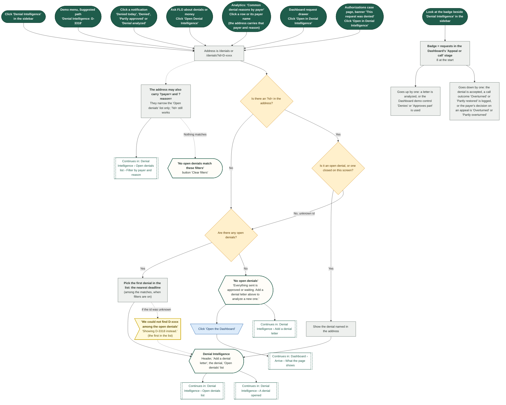

## Denial Intelligence › Open denials list

The 'Open denials' card on the right of the page: which denials are listed, how they are ordered, what each row says, the 'Closed' section, and what a click on a row does. A payer or reason in the address can narrow it.

Route: `/denials?id=D-3318`

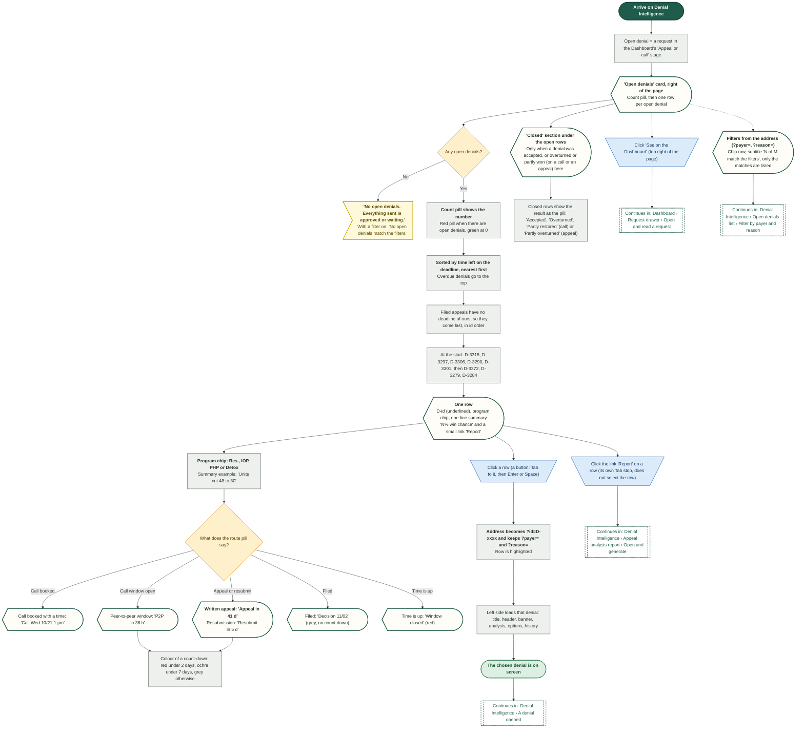

## Denial Intelligence › A denial opened

The page for one denial, top to bottom: title, header card with 'Our read', the status banner, the analysis cards, the options and the history. Each card is described once here and detailed in its own diagram.

Route: `/denials?id=D-3318`

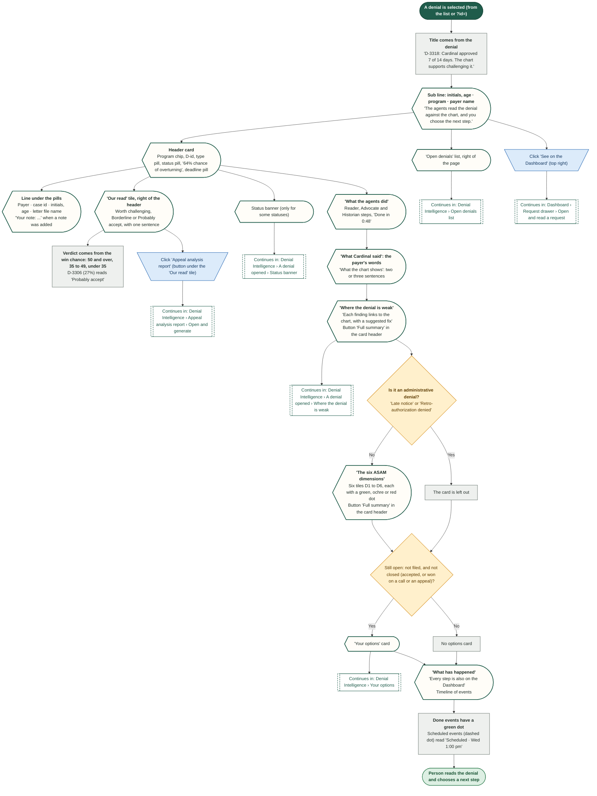

## Denial Intelligence › A denial opened › Status banner

One banner under the header says where the denial stands. The code checks the statuses in this order and shows the first that fits. A filed appeal has a button to record the payer's decision.

Route: `/denials?id=D-3318`

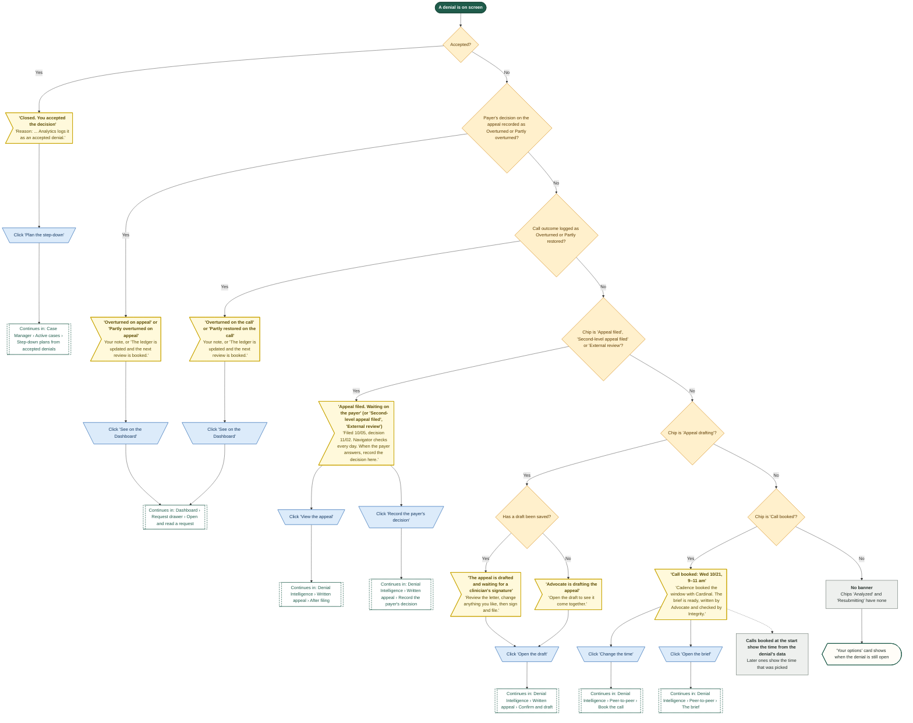

## Denial Intelligence › A denial opened › Where the denial is weak

The findings card: each finding has a severity, a source chip that opens the chart excerpt, and a suggested fix that can be added to the evidence for the brief and the appeal.

Route: `/denials?id=D-3318`

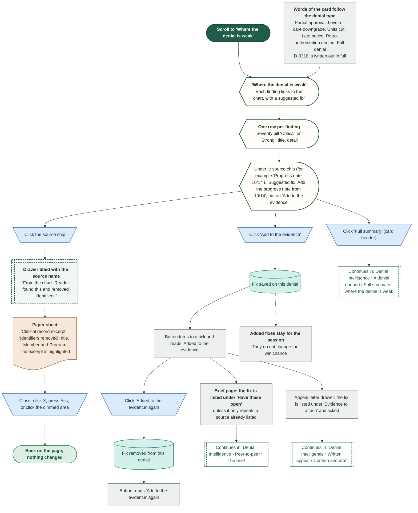

## Denial Intelligence › Add a denial letter

The 'Add a denial letter' card at the top of the page: drop or pick a letter, add a note, 'Analyze the denial', watch four agents work, and land on the new denial. In the demo the letter is not really read; a sample letter's facts fill the new denial.

Route: `/denials`

Demo only: any file type is accepted and only its name and size are kept. Which of the three sample letters (Beacon, Summit, Harborview) is used depends on the file name length, or on how many letters were added before when 'Use sample letter' is clicked.

```mermaid
%%{init: {"theme":"base","themeVariables":{"fontFamily":"'DM Sans', 'Segoe UI', system-ui, sans-serif","fontSize":"15px","lineColor":"#5B6B63","primaryTextColor":"#1C2B25","clusterBkg":"#FBF8F3","clusterBorder":"#D9CDBB","edgeLabelBackground":"#FFFFFF"},"flowchart":{"curve":"basis","nodeSpacing":36,"rankSpacing":48,"padding":12,"htmlLabels":true,"useMaxWidth":false,"wrappingWidth":230}} }%%
flowchart TD
  classDef k_start fill:#1F5C4B,stroke:#174638,color:#FFFFFF,stroke-width:1.5px,font-weight:600
  classDef k_end fill:#DDEFE3,stroke:#2E7D4F,color:#14502F,stroke-width:1.5px,font-weight:600
  classDef k_endx fill:#FBE3E0,stroke:#C0392B,color:#7A1F16,stroke-width:1.5px,font-weight:600
  classDef k_screen fill:#FFFDF8,stroke:#1F5C4B,color:#1C2B25,stroke-width:2px
  classDef k_overlay fill:#F1F7F3,stroke:#1F5C4B,color:#1C2B25,stroke-width:2px,stroke-dasharray:5 3
  classDef k_click fill:#DCEBFA,stroke:#2F6DB5,color:#12365F,stroke-width:1.5px
  classDef k_input fill:#E4E7FF,stroke:#4C5FD5,color:#1D2670,stroke-width:1.5px
  classDef k_process fill:#EEF0EE,stroke:#7A857F,color:#26302B,stroke-width:1.5px
  classDef k_agent fill:#EEE5FA,stroke:#7A4FC2,color:#341A63,stroke-width:1.5px
  classDef k_decision fill:#FFF0CC,stroke:#D9962B,color:#5C3B00,stroke-width:1.5px
  classDef k_store fill:#D5F0EA,stroke:#1C8E7B,color:#0B4A3F,stroke-width:1.5px
  classDef k_doc fill:#F6E9DC,stroke:#B07A4C,color:#4A2E14,stroke-width:1.5px
  classDef k_ext fill:#FFE6D2,stroke:#E07B39,color:#6B2F06,stroke-width:1.5px
  classDef k_wait fill:#E4E8EE,stroke:#6B7C93,color:#26303D,stroke-width:1.5px
  classDef k_toast fill:#FFF9DB,stroke:#C9A400,color:#5A4A00,stroke-width:1.5px
  classDef k_goto fill:#FFFFFF,stroke:#1F5C4B,color:#1F5C4B,stroke-width:1.5px,stroke-dasharray:5 3
  s1@{ shape: stadium, label: "Look at 'Add a denial letter' at the top of the page" }
  sc1@{ shape: curv-trap, label: "<b>'Add a denial letter'</b><br/>'The agents read it, check it against your chart and past appeals, and lay out your options'<br/>Two columns: letter, then note and button" }
  i1@{ shape: lean-r, label: "<b>Drop a file on the area, or click it (or press Enter or Space) to choose a file</b><br/>'Drop the denial letter here, or click to choose a PDF or DOCX'" }
  c1@{ shape: trap-t, label: "Click 'Use sample letter'" }
  p1@{ shape: rect, label: "Next sample letter in turn: Beacon, Summit, then Harborview" }
  fr@{ shape: curv-trap, label: "<b>File row: file name and size</b><br/>A small X removes it" }
  c2@{ shape: trap-t, label: "Click the X on the file row" }
  p2@{ shape: rect, label: "<b>Drop area comes back</b><br/>The note is kept" }
  p3@{ shape: rect, label: "'Identifiers are removed on upload.' is shown beside the area" }
  i2@{ shape: lean-r, label: "<b>Type a note (optional)</b><br/>'Add anything not in the letter, such as a payer call note'" }
  c3@{ shape: trap-t, label: "Click 'Analyze the denial'" }
  d1@{ shape: diam, label: "Is a letter chosen?" }
  t1@{ shape: odd, label: "'Add the letter first, or use the sample letter.'" }
  sc2@{ shape: curv-trap, label: "<b>Progress list replaces the form</b><br/>One line per agent, a spinner on the one working, a tick when done" }
  a1@{ shape: hex, label: "Reader is reading the letter and removing identifiers" }
  a2@{ shape: hex, label: "Advocate is checking the notice, the deadline and the payer's own criteria" }
  a3@{ shape: hex, label: "Historian is comparing similar decisions and appeals" }
  a4@{ shape: hex, label: "Integrity is checking every statement against the chart" }
  w1@{ shape: delay, label: "About 1.25 seconds per step, 5 seconds in all (demo: simulated)" }
  d2@{ shape: diam, label: "Is the person still on this page?" }
  e1@{ shape: stadium, label: "Work is dropped and no denial is added" }
  p4@{ shape: rect, label: "Facts of the sample fill the denial: initials, age, payer, program, win chance, denial type, similar decisions, call window" }
  st1@{ shape: cyl, label: "<b>New open denial created, the next free number from D-3340</b><br/>Chip 'Analyzed', route 'Peer-to-peer', file name and note saved" }
  st2@{ shape: cyl, label: "History lines: Reader read the letter and removed identifiers; Advocate checked the notice, the deadline and how the payer applied its own criteria; Historian compared N similar decisions" }
  t2@{ shape: odd, label: "<b>'The analysis is ready'</b><br/>'D-3340 was added to Open denials.'" }
  t3@{ shape: odd, label: "<b>Notification 'Denial analyzed' from Advocate</b><br/>Links to the new denial" }
  p5@{ shape: rect, label: "<b>Form clears: file, sample and note</b><br/>New denial is selected, address becomes ?id=D-3340 only (any ?payer= or ?reason= filter is cleared so it shows in the list)<br/>Badge goes up by one" }
  g1@{ shape: subproc, label: "Continues in: Denial Intelligence › A denial opened" }
  g2@{ shape: subproc, label: "Continues in: Denial Intelligence › Your options" }
  g3@{ shape: subproc, label: "Continues in: Dashboard › Arrive › What the page shows" }
  s1 --> sc1
  sc1 --> i1 --> fr
  sc1 --> c1 --> p1 --> fr
  fr --> c2 --> p2 --> i1
  sc1 --> p3
  sc1 --> i2 --> c3
  fr --> c3
  c3 --> d1
  d1 -->|"No"| t1 --> sc1
  d1 -->|"Yes"| sc2 --> a1 --> a2 --> a3 --> a4
  sc2 --> w1
  a4 --> d2
  d2 -->|"No, left the page"| e1
  d2 -->|"Yes"| p4 --> st1 --> st2 --> t2 --> p5
  st1 --> t3
  p5 --> g1 & g2
  st1 --> g3
  class s1 k_start
  class sc1,fr,sc2 k_screen
  class i1,i2 k_input
  class c1,c2,c3 k_click
  class p1,p2,p3,p4,p5 k_process
  class d1,d2 k_decision
  class t1,t2,t3 k_toast
  class a1,a2,a3,a4 k_agent
  class w1 k_wait
  class e1 k_endx
  class st1,st2 k_store
  class g1,g2,g3 k_goto
```

## Denial Intelligence › Your options

The 'Your options' card: three next steps as radio cards, how each chance is worked out, how 'Recommended' is chosen, and what the button under the cards opens.

Route: `/denials?id=D-3318`

```mermaid
%%{init: {"theme":"base","themeVariables":{"fontFamily":"'DM Sans', 'Segoe UI', system-ui, sans-serif","fontSize":"15px","lineColor":"#5B6B63","primaryTextColor":"#1C2B25","clusterBkg":"#FBF8F3","clusterBorder":"#D9CDBB","edgeLabelBackground":"#FFFFFF"},"flowchart":{"curve":"basis","nodeSpacing":36,"rankSpacing":48,"padding":12,"htmlLabels":true,"useMaxWidth":false,"wrappingWidth":230}} }%%
flowchart TD
  classDef k_start fill:#1F5C4B,stroke:#174638,color:#FFFFFF,stroke-width:1.5px,font-weight:600
  classDef k_end fill:#DDEFE3,stroke:#2E7D4F,color:#14502F,stroke-width:1.5px,font-weight:600
  classDef k_endx fill:#FBE3E0,stroke:#C0392B,color:#7A1F16,stroke-width:1.5px,font-weight:600
  classDef k_screen fill:#FFFDF8,stroke:#1F5C4B,color:#1C2B25,stroke-width:2px
  classDef k_overlay fill:#F1F7F3,stroke:#1F5C4B,color:#1C2B25,stroke-width:2px,stroke-dasharray:5 3
  classDef k_click fill:#DCEBFA,stroke:#2F6DB5,color:#12365F,stroke-width:1.5px
  classDef k_input fill:#E4E7FF,stroke:#4C5FD5,color:#1D2670,stroke-width:1.5px
  classDef k_process fill:#EEF0EE,stroke:#7A857F,color:#26302B,stroke-width:1.5px
  classDef k_agent fill:#EEE5FA,stroke:#7A4FC2,color:#341A63,stroke-width:1.5px
  classDef k_decision fill:#FFF0CC,stroke:#D9962B,color:#5C3B00,stroke-width:1.5px
  classDef k_store fill:#D5F0EA,stroke:#1C8E7B,color:#0B4A3F,stroke-width:1.5px
  classDef k_doc fill:#F6E9DC,stroke:#B07A4C,color:#4A2E14,stroke-width:1.5px
  classDef k_ext fill:#FFE6D2,stroke:#E07B39,color:#6B2F06,stroke-width:1.5px
  classDef k_wait fill:#E4E8EE,stroke:#6B7C93,color:#26303D,stroke-width:1.5px
  classDef k_toast fill:#FFF9DB,stroke:#C9A400,color:#5A4A00,stroke-width:1.5px
  classDef k_goto fill:#FFFFFF,stroke:#1F5C4B,color:#1F5C4B,stroke-width:1.5px,stroke-dasharray:5 3
  s1@{ shape: stadium, label: "A denial that is not filed, accepted or closed is on screen" }
  sc1@{ shape: curv-trap, label: "<b>'Your options'</b><br/>'Chance of overturning, from 312 similar Cardinal decisions'<br/>Three radio cards, then one button" }
  p0@{ shape: rect, label: "Subtitle reads ', a benchmark estimate' instead when fewer than 60 similar decisions" }
  p1@{ shape: rect, label: "Starting point: the denial's win chance (55 when none is set)" }
  d1@{ shape: diam, label: "What is the win chance?" }
  v1@{ shape: rect, label: "<b>'Worth challenging'</b><br/>50 and over" }
  v2@{ shape: rect, label: "<b>'Borderline'</b><br/>35 to 49" }
  v3@{ shape: rect, label: "<b>'Probably accept'</b><br/>under 35" }
  p2@{ shape: rect, label: "<b>Seed denials sit between 27 and 64</b><br/>D-3306 (27%) reads 'Probably accept' and recommends 'Accept' at the start" }
  o1@{ shape: curv-trap, label: "<b>Card 'Peer-to-peer call'</b><br/>'30 to 45 minutes of clinician time · 5 to 7 days regained'<br/>Chance = the win chance" }
  o2@{ shape: curv-trap, label: "<b>Card 'Written appeal'</b><br/>'60 days to file · 5 to 7 days regained'<br/>Chance = win chance minus 6, never under 5" }
  o3@{ shape: curv-trap, label: "<b>Card 'Accept the decision and plan the next step'</b><br/>'Accept 7 days and plan the step-down' on a partial approval<br/>'Fastest. Nothing regained.' No chance shown<br/>Needs: a reason for the record, Analytics logs the denial as accepted, Case Manager adds a step-down plan" }
  p3@{ shape: rect, label: "Each chance reads 'likely 55–72%' (9 below to 8 above) and '312 similar decisions' or 'Benchmark estimate'" }
  p4@{ shape: rect, label: "Each card ends with 'Needs: ...' (who, what, and the evidence that would be attached)" }
  r1@{ shape: diam, label: "Which card is 'Recommended'?" }
  rec1@{ shape: curv-trap, label: "'Accept...' card gets the green 'Recommended' pill" }
  rec2@{ shape: curv-trap, label: "'Written appeal' gets the pill" }
  rec3@{ shape: curv-trap, label: "'Peer-to-peer call' gets the pill" }
  p5@{ shape: rect, label: "That card is selected when the page opens" }
  c1@{ shape: trap-t, label: "Click a card (it is a radio button)" }
  d2@{ shape: diam, label: "Is it 'Peer-to-peer call' and the call window has closed?" }
  t1@{ shape: odd, label: "<b>'The peer-to-peer window has closed'</b><br/>'A written appeal is still open.'" }
  p6@{ shape: rect, label: "<b>Card is selected</b><br/>The button label changes to match" }
  b1@{ shape: curv-trap, label: "<b>Button under the cards</b><br/>'Choose a time and prepare the brief', 'Draft the appeal letter' or 'Accept the decision and plan the step-down'" }
  t2@{ shape: odd, label: "'A call is already booked. Choosing again changes it.' (when the chip is 'Call booked')" }
  c2@{ shape: trap-t, label: "Click the button" }
  d3@{ shape: diam, label: "Which card is selected?" }
  d4@{ shape: diam, label: "Is the chip already 'Appeal drafting'?" }
  g1@{ shape: subproc, label: "Continues in: Denial Intelligence › Peer-to-peer › Book the call" }
  g2@{ shape: subproc, label: "Continues in: Denial Intelligence › Written appeal › Confirm and draft" }
  g3@{ shape: subproc, label: "Continues in: Denial Intelligence › Accept the denial" }
  p7@{ shape: rect, label: "Selection resets to the recommended card whenever the chip changes" }
  s1 --> sc1 --> p0
  sc1 --> p1 --> d1
  d1 -->|"50 and over"| v1
  d1 -->|"35 to 49"| v2
  d1 -->|"Under 35"| v3
  v1 --> p2
  v2 --> p2
  v3 --> p2
  sc1 --> o1 --> o2 --> o3
  o3 --> p3 --> p4
  p4 --> r1
  r1 -->|"Verdict is 'Probably accept'"| rec1
  r1 -->|"Deadline is to file or resubmit, window closed, or 'Late notice'"| rec2
  r1 -->|"Anything else"| rec3
  rec1 --> p5
  rec2 --> p5
  rec3 --> p5
  p5 --> c1
  c1 --> d2
  d2 -->|"Yes"| t1
  d2 -->|"No"| p6 --> b1
  b1 -.-> t2
  b1 --> c2 --> d3
  d3 -->|"Peer-to-peer call"| g1
  d3 -->|"Written appeal"| d4
  d4 -->|"Yes: drawer opens at once"| g2
  d4 -->|"No: confirm first"| g2
  d3 -->|"Accept"| g3
  c1 -.-> p7
  class s1 k_start
  class sc1,o1,o2,o3,rec1,rec2,rec3,b1 k_screen
  class p0,p1,v1,v2,v3,p2,p3,p4,p5,p6,p7 k_process
  class d1,r1,d2,d3,d4 k_decision
  class c1,c2 k_click
  class t1,t2 k_toast
  class g1,g2,g3 k_goto
```

## Denial Intelligence › Open denials list › Filter by payer and reason

The address can narrow the 'Open denials' list to one payer and one reason, for example from a row on Analytics. A small row of removable chips shows what is on, and 'Clear' takes both off. ?id= keeps working beside them.

Route: `/denials?payer=cardinal&reason=Missing documentation`

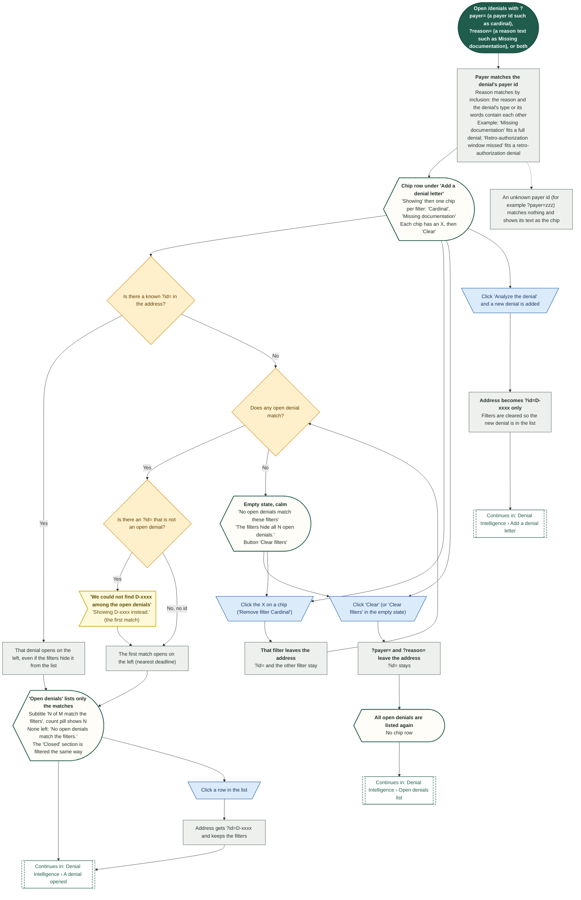

## Denial Intelligence › A denial opened › Full summary: where the denial is weak

The short findings stay on the page. 'Full summary' in the card header opens the long version in a pop-up, as plain text that can be selected and copied: the whole thing, or one recommendation at a time.

Route: `/denials?id=D-3318`

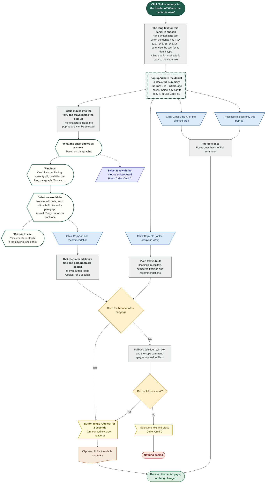

## Denial Intelligence › A denial opened › Full summary: the six ASAM dimensions

The six tiles stay as they are. 'Full summary' in the card header opens one long paragraph for each dimension, with the same Copy all and Copy one controls as the findings pop-up.

Route: `/denials?id=D-3318`

The card, and so the button, is left out for Late notice and Retro-authorization denied, which have no dimensions.

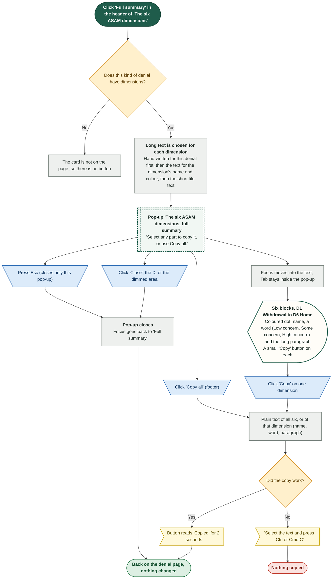

## Denial Intelligence › Peer-to-peer › Book the call

The confirm gate for the peer-to-peer route: pick one of three call windows, confirm, and Cadence books it. The same modal opens from the options card, from 'Change the time' and from the brief page.

Route: `/denials?id=D-3318`

Demo only: the payer holding the slot is simulated. Times follow the demo clock: fast-forwarding in the Demo menu uses them up, and with none left the message 'No call time is left' shows.

```mermaid
%%{init: {"theme":"base","themeVariables":{"fontFamily":"'DM Sans', 'Segoe UI', system-ui, sans-serif","fontSize":"15px","lineColor":"#5B6B63","primaryTextColor":"#1C2B25","clusterBkg":"#FBF8F3","clusterBorder":"#D9CDBB","edgeLabelBackground":"#FFFFFF"},"flowchart":{"curve":"basis","nodeSpacing":36,"rankSpacing":48,"padding":12,"htmlLabels":true,"useMaxWidth":false,"wrappingWidth":230}} }%%
flowchart TD
  classDef k_start fill:#1F5C4B,stroke:#174638,color:#FFFFFF,stroke-width:1.5px,font-weight:600
  classDef k_end fill:#DDEFE3,stroke:#2E7D4F,color:#14502F,stroke-width:1.5px,font-weight:600
  classDef k_endx fill:#FBE3E0,stroke:#C0392B,color:#7A1F16,stroke-width:1.5px,font-weight:600
  classDef k_screen fill:#FFFDF8,stroke:#1F5C4B,color:#1C2B25,stroke-width:2px
  classDef k_overlay fill:#F1F7F3,stroke:#1F5C4B,color:#1C2B25,stroke-width:2px,stroke-dasharray:5 3
  classDef k_click fill:#DCEBFA,stroke:#2F6DB5,color:#12365F,stroke-width:1.5px
  classDef k_input fill:#E4E7FF,stroke:#4C5FD5,color:#1D2670,stroke-width:1.5px
  classDef k_process fill:#EEF0EE,stroke:#7A857F,color:#26302B,stroke-width:1.5px
  classDef k_agent fill:#EEE5FA,stroke:#7A4FC2,color:#341A63,stroke-width:1.5px
  classDef k_decision fill:#FFF0CC,stroke:#D9962B,color:#5C3B00,stroke-width:1.5px
  classDef k_store fill:#D5F0EA,stroke:#1C8E7B,color:#0B4A3F,stroke-width:1.5px
  classDef k_doc fill:#F6E9DC,stroke:#B07A4C,color:#4A2E14,stroke-width:1.5px
  classDef k_ext fill:#FFE6D2,stroke:#E07B39,color:#6B2F06,stroke-width:1.5px
  classDef k_wait fill:#E4E8EE,stroke:#6B7C93,color:#26303D,stroke-width:1.5px
  classDef k_toast fill:#FFF9DB,stroke:#C9A400,color:#5A4A00,stroke-width:1.5px
  classDef k_goto fill:#FFFFFF,stroke:#1F5C4B,color:#1F5C4B,stroke-width:1.5px,stroke-dasharray:5 3
  s1@{ shape: stadium, label: "Click 'Choose a time and prepare the brief' (Your options)" }
  s2@{ shape: stadium, label: "Click 'Change the time' (call-booked banner)" }
  s3@{ shape: stadium, label: "Brief page: click 'Book the call' or 'Change the call time'" }
  o1@{ shape: win-pane, label: "<b>Modal 'Confirm the next step: peer-to-peer call'</b><br/>'The agents stop here until you say go.'" }
  l1@{ shape: curv-trap, label: "<b>'What happens when you confirm'</b><br/>Cadence books the window with the payer and adds it to the clinician's calendar<br/>Advocate finishes the brief with three points and the likely pushback<br/>Integrity checks every sentence against the chart" }
  l2@{ shape: curv-trap, label: "'Pick a time. Chance of overturning is 64% (likely 55–72%).'" }
  p1@{ shape: rect, label: "<b>Up to three windows on working days: 9–11 am, 1–3 pm, 4–5 pm</b><br/>Only windows that start after the demo clock and before the payer's window closes<br/>At the start of D-3318: Tue 1–3 pm, Tue 4–5 pm, Wed 9–11 am" }
  d1@{ shape: diam, label: "<b>Is any call time left?</b><br/>(starts after the demo clock, before the window closes)" }
  t1@{ shape: odd, label: "<b>'No call time is left inside the payer's window. Choose a written appeal instead.'</b><br/>'Confirm and book the call' is greyed out<br/>Example: D-3318 after fast-forwarding 1 day and 6 hours, or once the window has closed" }
  i1@{ shape: lean-r, label: "<b>Pick a call time (radio cards)</b><br/>The time already booked is chosen (if it is still ahead of the clock), otherwise the first" }
  p2@{ shape: rect, label: "Card text: 'Booked now' on the booked time (also a time booked before the demo started, such as D-3318's Wed 9–11 am), 'Open with the payer's reviewer' on the others" }
  c1@{ shape: trap-t, label: "Click 'Confirm and book the call'" }
  c2@{ shape: trap-t, label: "Click 'Cancel', the X, press Esc, or click the dimmed area" }
  e1@{ shape: stadium, label: "Nothing changes" }
  st1@{ shape: cyl, label: "<b>Call time saved on the denial</b><br/>Chip 'Call booked', list pill 'Call Wed 10/21 1 pm'" }
  x1@{ shape: st-rect, label: "Payer's reviewer holds the window (demo: simulated)" }
  a1@{ shape: hex, label: "Cadence books the window and adds it to the clinician's calendar" }
  a2@{ shape: hex, label: "Advocate writes the brief, Integrity checks it against the chart" }
  st2@{ shape: cyl, label: "History: 'Cadence booked the peer-to-peer call for ...', 'Advocate wrote the brief and Integrity checked it against the chart', and a scheduled 'Peer-to-peer call with Cardinal'" }
  t2@{ shape: odd, label: "<b>'Call booked'</b><br/>'Wed 10/21, 1–3 pm. The brief is ready.'" }
  d2@{ shape: diam, label: "Booked from which page?" }
  p3@{ shape: rect, label: "Modal closes and the app opens the brief page" }
  p4@{ shape: rect, label: "<b>Modal closes, the brief stays open</b><br/>'Call details' shows the new window" }
  g1@{ shape: subproc, label: "Continues in: Denial Intelligence › Peer-to-peer › The brief" }
  e2@{ shape: stadium, label: "Call is booked, brief is ready" }
  s1 --> o1
  s2 --> o1
  s3 --> o1
  o1 --> l1 --> l2 --> p1 --> d1
  d1 -->|"No"| t1 --> c2
  d1 -->|"Yes"| i1 --> p2
  p2 --> c1
  p2 --> c2 --> e1
  c1 --> st1 --> x1 --> a1 --> a2 --> st2 --> t2 --> d2
  d2 -->|"Denial page"| p3 --> g1
  d2 -->|"Brief page"| p4 --> e2
  class s1,s2,s3 k_start
  class o1 k_overlay
  class l1,l2 k_screen
  class p1,p2,p3,p4 k_process
  class d1,d2 k_decision
  class t1,t2 k_toast
  class i1 k_input
  class c1,c2 k_click
  class e1 k_endx
  class st1,st2 k_store
  class x1 k_ext
  class a1,a2 k_agent
  class g1 k_goto
  class e2 k_end
```

## Denial Intelligence › Peer-to-peer › The brief

The one-page brief a clinician keeps open during the call: opening, three points, what the payer may say, the ask, dates and numbers on the left, call details and tools on the right.

Route: `/denials/D-3318/brief`

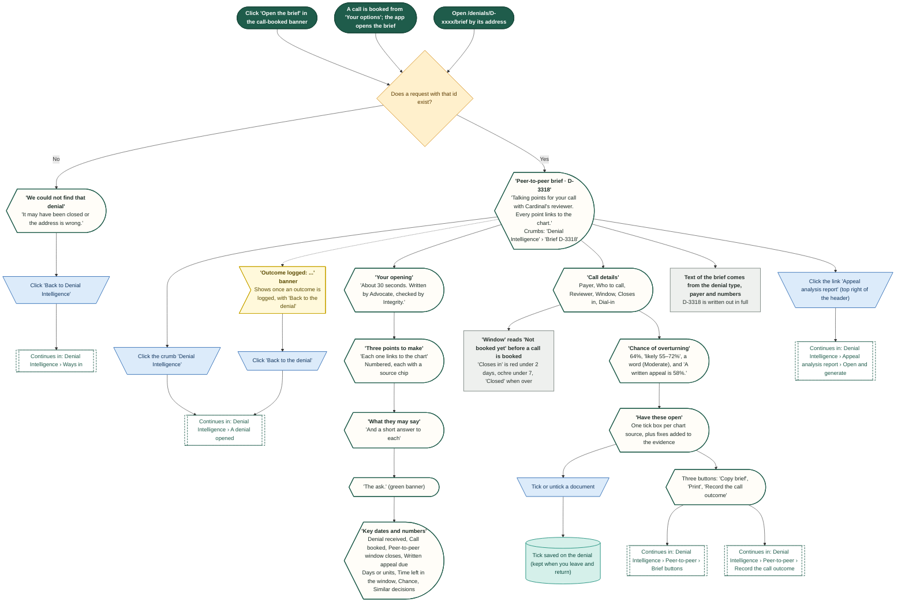

## Denial Intelligence › Peer-to-peer › Brief buttons

The buttons on the brief page: 'Copy brief' and 'Print' (off in the hosted preview), and the call-time button. Recording the outcome has its own diagram.

Route: `/denials/D-3318/brief`

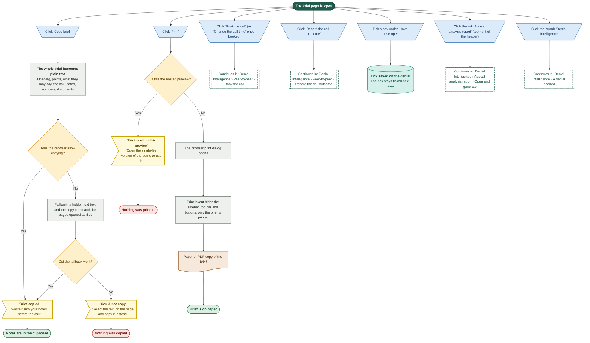

## Denial Intelligence › Peer-to-peer › Record the call outcome

After the call, the person logs how it went. 'Overturned' and 'Partly restored' close the denial; 'Upheld' starts a written appeal from the call notes.

Route: `/denials/D-3318/brief`

Demo only: the call itself is not simulated. The clinician holds it outside the app and logs the result here.

```mermaid
%%{init: {"theme":"base","themeVariables":{"fontFamily":"'DM Sans', 'Segoe UI', system-ui, sans-serif","fontSize":"15px","lineColor":"#5B6B63","primaryTextColor":"#1C2B25","clusterBkg":"#FBF8F3","clusterBorder":"#D9CDBB","edgeLabelBackground":"#FFFFFF"},"flowchart":{"curve":"basis","nodeSpacing":36,"rankSpacing":48,"padding":12,"htmlLabels":true,"useMaxWidth":false,"wrappingWidth":230}} }%%
flowchart TD
  classDef k_start fill:#1F5C4B,stroke:#174638,color:#FFFFFF,stroke-width:1.5px,font-weight:600
  classDef k_end fill:#DDEFE3,stroke:#2E7D4F,color:#14502F,stroke-width:1.5px,font-weight:600
  classDef k_endx fill:#FBE3E0,stroke:#C0392B,color:#7A1F16,stroke-width:1.5px,font-weight:600
  classDef k_screen fill:#FFFDF8,stroke:#1F5C4B,color:#1C2B25,stroke-width:2px
  classDef k_overlay fill:#F1F7F3,stroke:#1F5C4B,color:#1C2B25,stroke-width:2px,stroke-dasharray:5 3
  classDef k_click fill:#DCEBFA,stroke:#2F6DB5,color:#12365F,stroke-width:1.5px
  classDef k_input fill:#E4E7FF,stroke:#4C5FD5,color:#1D2670,stroke-width:1.5px
  classDef k_process fill:#EEF0EE,stroke:#7A857F,color:#26302B,stroke-width:1.5px
  classDef k_agent fill:#EEE5FA,stroke:#7A4FC2,color:#341A63,stroke-width:1.5px
  classDef k_decision fill:#FFF0CC,stroke:#D9962B,color:#5C3B00,stroke-width:1.5px
  classDef k_store fill:#D5F0EA,stroke:#1C8E7B,color:#0B4A3F,stroke-width:1.5px
  classDef k_doc fill:#F6E9DC,stroke:#B07A4C,color:#4A2E14,stroke-width:1.5px
  classDef k_ext fill:#FFE6D2,stroke:#E07B39,color:#6B2F06,stroke-width:1.5px
  classDef k_wait fill:#E4E8EE,stroke:#6B7C93,color:#26303D,stroke-width:1.5px
  classDef k_toast fill:#FFF9DB,stroke:#C9A400,color:#5A4A00,stroke-width:1.5px
  classDef k_goto fill:#FFFFFF,stroke:#1F5C4B,color:#1F5C4B,stroke-width:1.5px,stroke-dasharray:5 3
  s1@{ shape: stadium, label: "Click 'Record the call outcome' on the brief page" }
  x1@{ shape: st-rect, label: "Clinician holds the peer-to-peer call with the payer's reviewer" }
  o1@{ shape: win-pane, label: "<b>Modal 'Record the call outcome'</b><br/>D-3318 · Cardinal Health Plan" }
  i1@{ shape: lean-r, label: "<b>Pick one (radio cards)</b><br/>'Overturned' (chosen at first), 'Partly restored' or 'Upheld'" }
  p1@{ shape: rect, label: "<b>Card texts</b><br/>Overturned: the payer restored the requested days, the denial closes<br/>Partly restored: closes with a new end date<br/>Upheld: Advocate starts a written appeal from your call notes" }
  i2@{ shape: lean-r, label: "<b>Note (optional)</b><br/>'Who you spoke to and what was agreed.'" }
  c1@{ shape: trap-t, label: "Click 'Log the outcome'" }
  c2@{ shape: trap-t, label: "Click 'Cancel', the X, press Esc, or click the dimmed area" }
  e1@{ shape: stadium, label: "Nothing is logged" }
  st0@{ shape: cyl, label: "<b>Outcome saved on the denial: kind, note, time</b><br/>The scheduled 'Peer-to-peer call' line leaves the History<br/>History: 'You logged the call outcome: ...' with the note" }
  d1@{ shape: diam, label: "Which outcome?" }
  st1@{ shape: cyl, label: "<b>Request settled: leaves 'Appeal or call' (Dashboard stage 'Decided')</b><br/>Chip 'Overturned' or 'Partly restored'<br/>Ledger result approved or partly approved" }
  x2@{ shape: st-rect, label: "Payer restores the requested days, or part of them, on the call" }
  a1@{ shape: hex, label: "Cadence updates the ledger and books the next review" }
  t1@{ shape: odd, label: "<b>'Overturned' or 'Partly restored'</b><br/>'The ledger is updated and the next review is booked.'" }
  p2@{ shape: rect, label: "<b>Sidebar badge goes down by one</b><br/>The denial moves to 'Closed' in the open denials list<br/>Banner 'Overturned on the call' or 'Partly restored on the call'" }
  st2@{ shape: cyl, label: "<b>Chip 'Appeal drafting'</b><br/>Clock becomes 'to file': 60 days from the denial date" }
  a2@{ shape: hex, label: "Advocate starts a written appeal from the call notes" }
  t2@{ shape: odd, label: "<b>'Outcome logged: upheld'</b><br/>'Advocate started the written appeal. Open it from the denial.'" }
  p3@{ shape: rect, label: "Denial page shows 'Advocate is drafting the appeal' with 'Open the draft'" }
  t3@{ shape: odd, label: "Brief page banner 'Outcome logged: overturned, partly restored or upheld' with 'Back to the denial'" }
  t4@{ shape: odd, label: "<b>Notification 'Call outcome: ...' from Advocate</b><br/>Opens the request on the Dashboard" }
  c3@{ shape: trap-t, label: "Click 'Back to the denial'" }
  p4@{ shape: rect, label: "<b>The button 'Record the call outcome' stays on the brief</b><br/>Logging again runs these steps again (demo does not stop it)" }
  g1@{ shape: subproc, label: "Continues in: Denial Intelligence › A denial opened" }
  g2@{ shape: subproc, label: "Continues in: Denial Intelligence › Written appeal › Confirm and draft" }
  g3@{ shape: subproc, label: "Continues in: Dashboard › Request drawer › Open and read a request" }
  e2@{ shape: stadium, label: "Denial is closed with the call result" }
  e3@{ shape: stadium, label: "Written appeal is under way" }
  s1 --> x1 --> o1
  o1 --> i1 --> p1
  o1 --> i2
  p1 --> c1
  i2 --> c1
  o1 --> c2 --> e1
  c1 --> st0 --> d1
  d1 -->|"Overturned or Partly restored"| x2 --> st1 --> a1 --> t1 --> p2 --> e2
  d1 -->|"Upheld"| st2 --> a2 --> t2 --> p3 --> e3
  st0 --> t3 --> c3 --> g1
  st0 --> t4 --> g3
  e3 --> g2
  e2 --> g1
  t3 --> p4
  class s1 k_start
  class x1,x2 k_ext
  class o1 k_overlay
  class i1,i2 k_input
  class p1,p2,p3,p4 k_process
  class c1,c2,c3 k_click
  class e1 k_endx
  class st0,st1,st2 k_store
  class d1 k_decision
  class a1,a2 k_agent
  class t1,t2,t3,t4 k_toast
  class g1,g2,g3 k_goto
  class e2,e3 k_end
```

## Denial Intelligence › Written appeal › Confirm and draft

The written-appeal route starts with a confirm gate, then Advocate drafts the letter in a side drawer. The same drawer opens straight away when the appeal is already being drafted (for example after a call was upheld, or after the payer upheld an appeal and the next level was chosen).

Route: `/denials?id=D-3318`

Demo only: the drafting takes about two seconds and is simulated. The letter is built from the findings of the denial.

```mermaid
%%{init: {"theme":"base","themeVariables":{"fontFamily":"'DM Sans', 'Segoe UI', system-ui, sans-serif","fontSize":"15px","lineColor":"#5B6B63","primaryTextColor":"#1C2B25","clusterBkg":"#FBF8F3","clusterBorder":"#D9CDBB","edgeLabelBackground":"#FFFFFF"},"flowchart":{"curve":"basis","nodeSpacing":36,"rankSpacing":48,"padding":12,"htmlLabels":true,"useMaxWidth":false,"wrappingWidth":230}} }%%
flowchart TD
  classDef k_start fill:#1F5C4B,stroke:#174638,color:#FFFFFF,stroke-width:1.5px,font-weight:600
  classDef k_end fill:#DDEFE3,stroke:#2E7D4F,color:#14502F,stroke-width:1.5px,font-weight:600
  classDef k_endx fill:#FBE3E0,stroke:#C0392B,color:#7A1F16,stroke-width:1.5px,font-weight:600
  classDef k_screen fill:#FFFDF8,stroke:#1F5C4B,color:#1C2B25,stroke-width:2px
  classDef k_overlay fill:#F1F7F3,stroke:#1F5C4B,color:#1C2B25,stroke-width:2px,stroke-dasharray:5 3
  classDef k_click fill:#DCEBFA,stroke:#2F6DB5,color:#12365F,stroke-width:1.5px
  classDef k_input fill:#E4E7FF,stroke:#4C5FD5,color:#1D2670,stroke-width:1.5px
  classDef k_process fill:#EEF0EE,stroke:#7A857F,color:#26302B,stroke-width:1.5px
  classDef k_agent fill:#EEE5FA,stroke:#7A4FC2,color:#341A63,stroke-width:1.5px
  classDef k_decision fill:#FFF0CC,stroke:#D9962B,color:#5C3B00,stroke-width:1.5px
  classDef k_store fill:#D5F0EA,stroke:#1C8E7B,color:#0B4A3F,stroke-width:1.5px
  classDef k_doc fill:#F6E9DC,stroke:#B07A4C,color:#4A2E14,stroke-width:1.5px
  classDef k_ext fill:#FFE6D2,stroke:#E07B39,color:#6B2F06,stroke-width:1.5px
  classDef k_wait fill:#E4E8EE,stroke:#6B7C93,color:#26303D,stroke-width:1.5px
  classDef k_toast fill:#FFF9DB,stroke:#C9A400,color:#5A4A00,stroke-width:1.5px
  classDef k_goto fill:#FFFFFF,stroke:#1F5C4B,color:#1F5C4B,stroke-width:1.5px,stroke-dasharray:5 3
  s1@{ shape: stadium, label: "Select 'Written appeal' and click 'Draft the appeal letter' (Your options)" }
  s2@{ shape: stadium, label: "Click 'Open the draft' (banner: 'Advocate is drafting the appeal')" }
  s3@{ shape: stadium, label: "<b>Next level chosen after an upheld decision</b><br/>('Record and start the second-level appeal')" }
  d1@{ shape: diam, label: "Is the chip already 'Appeal drafting'?" }
  o1@{ shape: win-pane, label: "<b>Modal 'Confirm the next step: written appeal'</b><br/>'The agents stop here until you say go.'" }
  l1@{ shape: curv-trap, label: "<b>What happens next</b><br/>Advocate drafts the letter from the findings and the evidence list<br/>Integrity checks every sentence against the chart<br/>Navigator files it through the payer's portal after a clinician signs" }
  l2@{ shape: curv-trap, label: "'Chance of overturning is 58% (likely 49–66%). You can edit the letter before it goes. Nothing leaves without a clinician's signature.'" }
  c1@{ shape: trap-t, label: "Click 'Draft the appeal'" }
  c2@{ shape: trap-t, label: "Click 'Cancel', the X, press Esc, or click the dimmed area" }
  e1@{ shape: stadium, label: "Nothing changes" }
  st1@{ shape: cyl, label: "<b>Chip 'Appeal drafting'</b><br/>'Advocate is drafting the appeal'" }
  d2@{ shape: diam, label: "Is the clock already 'to file' or 'to resubmit'?" }
  st2@{ shape: cyl, label: "<b>Clock set: appeal due 60 days after the denial</b><br/>List pill 'Appeal in 59 d'" }
  p1@{ shape: rect, label: "Keep the existing deadline" }
  st3@{ shape: cyl, label: "History: 'You chose a written appeal', 'Advocate started the appeal letter'" }
  o2@{ shape: win-pane, label: "<b>Drawer 'Appeal letter · D-3318' (wide, right side)</b><br/>Sub line: 'Cardinal Health Plan. Due 12/18.'" }
  d3@{ shape: diam, label: "Is a draft already saved?" }
  w1@{ shape: delay, label: "<b>Spinner: 'Advocate is drafting the letter from the findings. Integrity is checking each sentence.'</b><br/>About 2 seconds; 'Save draft' and 'Sign and file' are greyed out" }
  a1@{ shape: hex, label: "Advocate drafts the letter and Integrity checks every sentence (demo: simulated)" }
  dc1@{ shape: doc, label: "<b>Letter text</b><br/>Payer, 'Appeals Department', date, Re: line (reconsideration, second-level appeal or external review), the payer's words, what the chart shows, numbered reasons with evidence, the ask, availability for the reviewing physician" }
  l3@{ shape: curv-trap, label: "<b>'Evidence to attach'</b><br/>One ticked box per chart source, plus fixes added to the evidence" }
  st4@{ shape: cyl, label: "<b>First draft saved on the denial</b><br/>'Appeal drafted. Waiting for a clinician's signature'<br/>History: 'Advocate drafted the appeal and Integrity checked every sentence against the chart'" }
  l4@{ shape: curv-trap, label: "<b>Banner 'Drafted by Advocate, checked by Integrity'</b><br/>'Edit anything. A clinician signs before it is filed.'" }
  c3@{ shape: trap-t, label: "<b>Close the drawer: click X, press Esc, or click the dimmed area</b><br/>(Esc closes only the top layer: see the sign step)" }
  p2@{ shape: rect, label: "<b>Edits not saved with 'Save draft' are lost</b><br/>The saved draft loads again next time" }
  g1@{ shape: subproc, label: "Continues in: Denial Intelligence › Written appeal › Edit, sign and file" }
  s1 --> d1
  s2 --> o2
  s3 --> o2
  d1 -->|"No"| o1 --> l1 --> l2
  l2 --> c1
  l2 --> c2 --> e1
  d1 -->|"Yes"| o2
  c1 --> st1 --> d2
  d2 -->|"No"| st2 --> st3
  d2 -->|"Yes"| p1 --> st3
  st3 --> o2
  o2 --> d3
  d3 -->|"No"| w1 --> a1 --> dc1
  d3 -->|"Yes"| dc1
  dc1 --> l3 --> l4
  a1 --> st4
  l4 --> g1
  l4 --> c3 --> p2
  class s1,s2,s3 k_start
  class d1,d2,d3 k_decision
  class o1,o2 k_overlay
  class l1,l2,l3,l4 k_screen
  class c1,c2,c3 k_click
  class e1 k_endx
  class st1,st2,st3,st4 k_store
  class p1,p2 k_process
  class w1 k_wait
  class a1 k_agent
  class dc1 k_doc
  class g1 k_goto
```

## Denial Intelligence › Written appeal › Edit, sign and file

With the letter drafted, the person edits it, picks the evidence, saves a draft, and a licensed clinician signs. Navigator files only after the signature.

Route: `/denials?id=D-3318`

Demo only: Navigator's filing through the payer's portal is simulated (about one second).

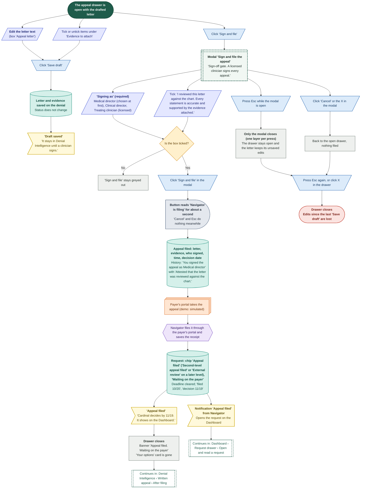

## Denial Intelligence › Written appeal › After filing

A filed appeal (new, or seeded like D-3279, D-3284 and D-3272) shows a waiting banner, a read-only letter and the button 'Record the payer's decision'. The payer's answer is recorded by a person, in its own diagram.

Route: `/denials?id=D-3318`

Demo only: the 30-day decision date is fixed, the receipt is saved at filing, and fast-forwarding changes nothing on a filed appeal. Nobody plays the payer, so the person records its decision. In production Navigator finds the answer in its daily check.

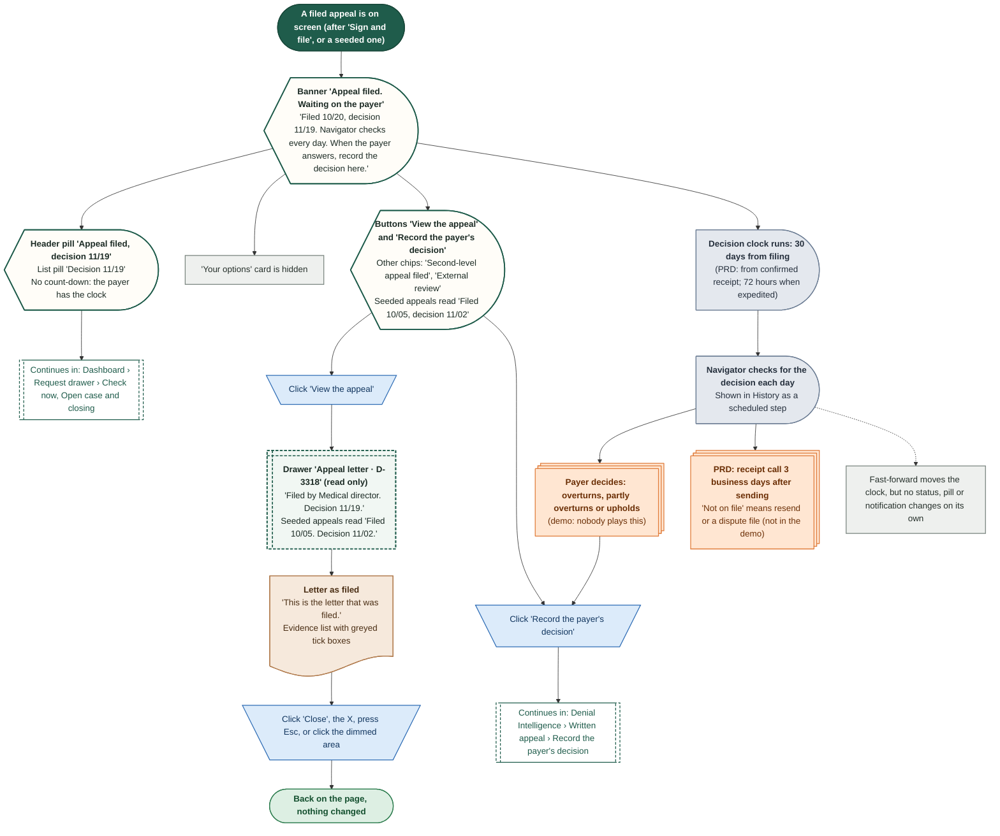

## Denial Intelligence › Written appeal › Record the payer's decision

Once the payer answers a filed appeal, the person records what it decided. 'Overturned' and 'Partly overturned' close the denial. 'Upheld' goes on to the next appeal level, with a new deadline, or to accepting the denial.

Route: `/denials?id=D-3279`

Demo only: nobody plays the payer's reply, so the person records it here. In production Navigator saves the answer it finds in its daily check. The ladder is Appeal, Second-level appeal, External review.

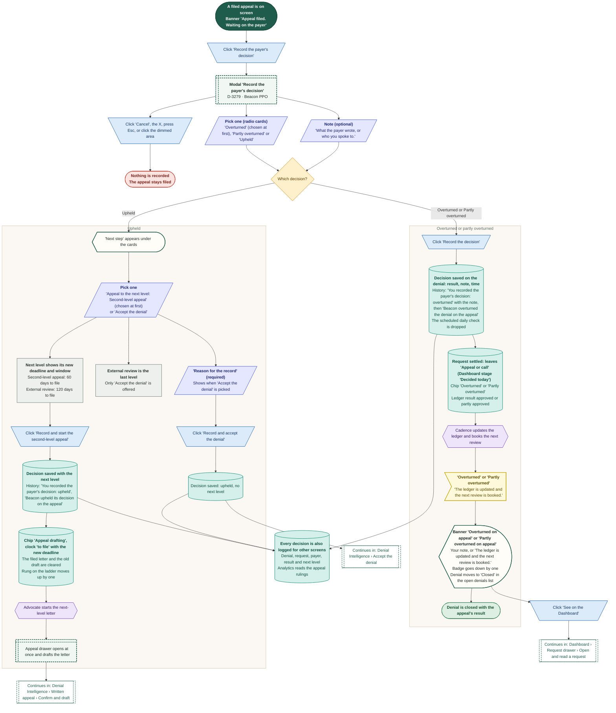

## Denial Intelligence › Accept the denial

Accepting closes the denial and logs it as accepted. A reason goes on the record first. Accepting is always the person's choice and is never the only option. It also reaches Case Manager and Analytics.

Route: `/denials?id=D-3297`

Case Manager adds a step-down plan for the patient, and Analytics logs it as an accepted denial. The same steps run when an upheld appeal is accepted from 'Record the payer's decision'.

```mermaid
%%{init: {"theme":"base","themeVariables":{"fontFamily":"'DM Sans', 'Segoe UI', system-ui, sans-serif","fontSize":"15px","lineColor":"#5B6B63","primaryTextColor":"#1C2B25","clusterBkg":"#FBF8F3","clusterBorder":"#D9CDBB","edgeLabelBackground":"#FFFFFF"},"flowchart":{"curve":"basis","nodeSpacing":36,"rankSpacing":48,"padding":12,"htmlLabels":true,"useMaxWidth":false,"wrappingWidth":230}} }%%
flowchart TD
  classDef k_start fill:#1F5C4B,stroke:#174638,color:#FFFFFF,stroke-width:1.5px,font-weight:600
  classDef k_end fill:#DDEFE3,stroke:#2E7D4F,color:#14502F,stroke-width:1.5px,font-weight:600
  classDef k_endx fill:#FBE3E0,stroke:#C0392B,color:#7A1F16,stroke-width:1.5px,font-weight:600
  classDef k_screen fill:#FFFDF8,stroke:#1F5C4B,color:#1C2B25,stroke-width:2px
  classDef k_overlay fill:#F1F7F3,stroke:#1F5C4B,color:#1C2B25,stroke-width:2px,stroke-dasharray:5 3
  classDef k_click fill:#DCEBFA,stroke:#2F6DB5,color:#12365F,stroke-width:1.5px
  classDef k_input fill:#E4E7FF,stroke:#4C5FD5,color:#1D2670,stroke-width:1.5px
  classDef k_process fill:#EEF0EE,stroke:#7A857F,color:#26302B,stroke-width:1.5px
  classDef k_agent fill:#EEE5FA,stroke:#7A4FC2,color:#341A63,stroke-width:1.5px
  classDef k_decision fill:#FFF0CC,stroke:#D9962B,color:#5C3B00,stroke-width:1.5px
  classDef k_store fill:#D5F0EA,stroke:#1C8E7B,color:#0B4A3F,stroke-width:1.5px
  classDef k_doc fill:#F6E9DC,stroke:#B07A4C,color:#4A2E14,stroke-width:1.5px
  classDef k_ext fill:#FFE6D2,stroke:#E07B39,color:#6B2F06,stroke-width:1.5px
  classDef k_wait fill:#E4E8EE,stroke:#6B7C93,color:#26303D,stroke-width:1.5px
  classDef k_toast fill:#FFF9DB,stroke:#C9A400,color:#5A4A00,stroke-width:1.5px
  classDef k_goto fill:#FFFFFF,stroke:#1F5C4B,color:#1F5C4B,stroke-width:1.5px,stroke-dasharray:5 3
  s1@{ shape: stadium, label: "Select the 'Accept...' card in 'Your options'" }
  c1@{ shape: trap-t, label: "Click 'Accept the decision and plan the step-down'" }
  o1@{ shape: win-pane, label: "<b>Modal 'Accept the decision?'</b><br/>'Nothing is regained. This closes the denial.'" }
  l1@{ shape: curv-trap, label: "<b>Three bullets</b><br/>'Analytics logs D-3297 as an accepted denial.'<br/>'Case Manager adds a step-down plan.'<br/>'D-3297 leaves Appeal or call on the Dashboard.'" }
  i1@{ shape: lean-r, label: "'Reason for the record' (required): open the menu and pick one" }
  l2@{ shape: curv-trap, label: "<b>Menu choices</b><br/>'The chart does not yet support a challenge' (chosen at first)<br/>'The clinical team agrees with the payer's reasoning'<br/>'The member and family chose to step down'<br/>'The effort of an appeal outweighs the likely gain'" }
  i2@{ shape: lean-r, label: "<b>Note (optional)</b><br/>'Anything the team should know'" }
  c2@{ shape: trap-t, label: "Click 'Accept and close'" }
  c3@{ shape: trap-t, label: "Click 'Cancel', the X, press Esc (this also closes an open menu first), or click the dimmed area" }
  e1@{ shape: stadium, label: "<b>Nothing recorded</b><br/>The denial stays open" }
  st1@{ shape: cyl, label: "Accepted: reason (with the note after it) and time saved on the denial" }
  st2@{ shape: cyl, label: "<b>Request settled: leaves 'Appeal or call' for 'Decided'</b><br/>Chip 'Accepted', 'Closed. Logged as an accepted denial'<br/>Deadline cleared; held by Cadence<br/>Scheduled lines (a booked call, the daily check) leave the History" }
  a1@{ shape: hex, label: "Cadence logs the accepted denial for Analytics" }
  st3@{ shape: cyl, label: "<b>History: 'You accepted the decision' with 'Reason: ...'</b><br/>'Cadence logged the accepted denial for Analytics and added a step-down plan to Case Manager'" }
  st4@{ shape: cyl, label: "<b>Shared with other screens: denial, case and payer</b><br/>Case Manager adds a step-down plan<br/>Analytics logs the accepted denial" }
  t1@{ shape: odd, label: "<b>'Decision accepted'</b><br/>'Analytics logs it as an accepted denial. Case Manager has a step-down plan.'" }
  t2@{ shape: odd, label: "<b>Notification 'Denial closed' from Cadence</b><br/>Opens Case Manager, Active cases" }
  sc1@{ shape: curv-trap, label: "<b>Denial page now shows banner 'Closed. You accepted the decision'</b><br/>'Reason: ... Analytics logs it as an accepted denial.'" }
  p1@{ shape: rect, label: "<b>'Your options' card is gone</b><br/>Denial moves to 'Closed' in the open denials list with the pill 'Accepted'<br/>Sidebar badge goes down by one" }
  c4@{ shape: trap-t, label: "Click 'Plan the step-down'" }
  c5@{ shape: trap-t, label: "Click 'See on the Dashboard' (top right)" }
  g1@{ shape: subproc, label: "Continues in: Case Manager › Active cases › Step-down plans from accepted denials" }
  g2@{ shape: subproc, label: "Continues in: Dashboard › Request drawer › Open and read a request" }
  p2@{ shape: rect, label: "<b>PRD guardrail: the agents never accept a denial</b><br/>A person gives the reason first" }
  s1 --> c1 --> o1 --> l1
  l1 --> i1 --> l2
  l1 --> i2
  l2 --> c2
  i2 --> c2
  o1 --> c3 --> e1
  c2 --> st1 --> st2 --> a1 --> st3 --> st4 --> t1 --> sc1
  st4 --> t2 --> g1
  sc1 --> p1
  sc1 --> c4 --> g1
  sc1 --> c5 --> g2
  o1 -.-> p2
  class s1 k_start
  class c1,c2,c3,c4,c5 k_click
  class o1 k_overlay
  class l1,l2,sc1 k_screen
  class i1,i2 k_input
  class e1 k_endx
  class st1,st2,st3,st4 k_store
  class a1 k_agent
  class t1,t2 k_toast
  class p1,p2 k_process
  class g1,g2 k_goto
```

## Denial Intelligence › Deadlines › Fast-forward the clock

The demo clock only moves when the Demo menu moves it. Every time-left text, colour and sort order on Denial Intelligence follows the clock, and so do the call times offered for booking; nothing else happens by itself.

Route: `/denials`

Demo only: the Demo menu is not part of the product. In production the clocks run in real time and alert at 14, 7 and 3 days (PRD 04).

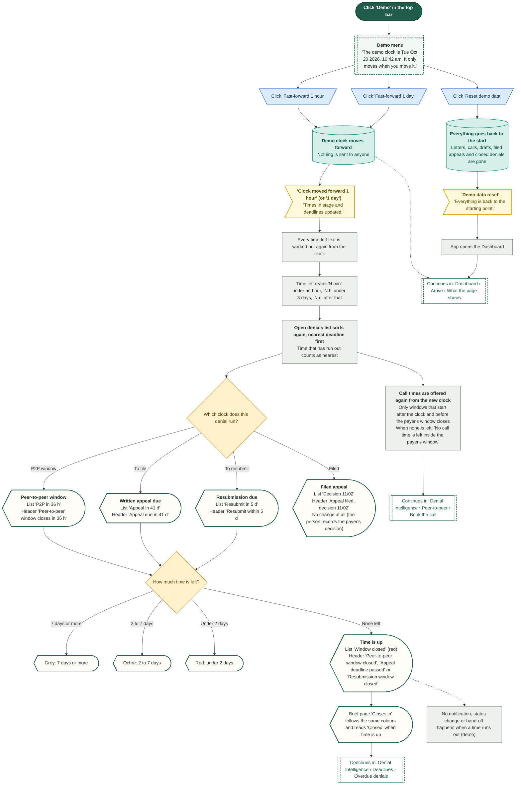

## Denial Intelligence › Deadlines › Overdue denials

What changes, and what still works, once a window has run out. Example: D-3318's peer-to-peer window after fast-forwarding 2 days, then a written-appeal deadline that has passed.

Route: `/denials?id=D-3318`

Demo only: nothing blocks filing after a deadline. Call times are offered only after the demo clock, so once the window has run out there is none to book.

```mermaid
%%{init: {"theme":"base","themeVariables":{"fontFamily":"'DM Sans', 'Segoe UI', system-ui, sans-serif","fontSize":"15px","lineColor":"#5B6B63","primaryTextColor":"#1C2B25","clusterBkg":"#FBF8F3","clusterBorder":"#D9CDBB","edgeLabelBackground":"#FFFFFF"},"flowchart":{"curve":"basis","nodeSpacing":36,"rankSpacing":48,"padding":12,"htmlLabels":true,"useMaxWidth":false,"wrappingWidth":230}} }%%
flowchart TD
  classDef k_start fill:#1F5C4B,stroke:#174638,color:#FFFFFF,stroke-width:1.5px,font-weight:600
  classDef k_end fill:#DDEFE3,stroke:#2E7D4F,color:#14502F,stroke-width:1.5px,font-weight:600
  classDef k_endx fill:#FBE3E0,stroke:#C0392B,color:#7A1F16,stroke-width:1.5px,font-weight:600
  classDef k_screen fill:#FFFDF8,stroke:#1F5C4B,color:#1C2B25,stroke-width:2px
  classDef k_overlay fill:#F1F7F3,stroke:#1F5C4B,color:#1C2B25,stroke-width:2px,stroke-dasharray:5 3
  classDef k_click fill:#DCEBFA,stroke:#2F6DB5,color:#12365F,stroke-width:1.5px
  classDef k_input fill:#E4E7FF,stroke:#4C5FD5,color:#1D2670,stroke-width:1.5px
  classDef k_process fill:#EEF0EE,stroke:#7A857F,color:#26302B,stroke-width:1.5px
  classDef k_agent fill:#EEE5FA,stroke:#7A4FC2,color:#341A63,stroke-width:1.5px
  classDef k_decision fill:#FFF0CC,stroke:#D9962B,color:#5C3B00,stroke-width:1.5px
  classDef k_store fill:#D5F0EA,stroke:#1C8E7B,color:#0B4A3F,stroke-width:1.5px
  classDef k_doc fill:#F6E9DC,stroke:#B07A4C,color:#4A2E14,stroke-width:1.5px
  classDef k_ext fill:#FFE6D2,stroke:#E07B39,color:#6B2F06,stroke-width:1.5px
  classDef k_wait fill:#E4E8EE,stroke:#6B7C93,color:#26303D,stroke-width:1.5px
  classDef k_toast fill:#FFF9DB,stroke:#C9A400,color:#5A4A00,stroke-width:1.5px
  classDef k_goto fill:#FFFFFF,stroke:#1F5C4B,color:#1F5C4B,stroke-width:1.5px,stroke-dasharray:5 3
  s1@{ shape: stadium, label: "Peer-to-peer window of D-3318 has run out (Demo menu: fast-forward 2 days)" }
  sc1@{ shape: curv-trap, label: "<b>List row moves to the top with the pill 'Window closed' (red)</b><br/>Header pill 'Peer-to-peer window closed' (red)" }
  p1@{ shape: rect, label: "<b>'Written appeal' becomes 'Recommended'</b><br/>The peer-to-peer card is no longer chosen first" }
  c1@{ shape: trap-t, label: "Click the 'Peer-to-peer call' card" }
  t1@{ shape: odd, label: "<b>'The peer-to-peer window has closed'</b><br/>'A written appeal is still open.'" }
  p2@{ shape: rect, label: "The card is not selected" }
  c2@{ shape: trap-t, label: "Click 'Change the time' (call-booked banner)" }
  o1@{ shape: win-pane, label: "Modal 'Confirm the next step: peer-to-peer call'" }
  d1@{ shape: diam, label: "Is any call time left? (starts after the demo clock, before the window closes)" }
  t2@{ shape: odd, label: "<b>'No call time is left inside the payer's window. Choose a written appeal instead.'</b><br/>Confirm is greyed out" }
  p3@{ shape: rect, label: "<b>Only while the window is still open: the times offered are ahead of the clock</b><br/>The call can be booked" }
  c3@{ shape: trap-t, label: "Click 'Cancel', the X, press Esc, or click the dimmed area" }
  e1@{ shape: stadium, label: "Nothing changes" }
  c4@{ shape: trap-t, label: "Click 'Open the brief'" }
  b1@{ shape: curv-trap, label: "<b>Brief page: 'Closes in' reads 'Closed' in red</b><br/>'Key dates' still lists 'Peer-to-peer window closes'" }
  c5@{ shape: trap-t, label: "Click 'Record the call outcome'" }
  g1@{ shape: subproc, label: "Continues in: Denial Intelligence › Peer-to-peer › Record the call outcome" }
  s2@{ shape: stadium, label: "A written-appeal or resubmission deadline has run out (example D-3301 after 42 days, D-3290 after 6 days)" }
  sc2@{ shape: curv-trap, label: "<b>List pill 'Window closed' (red)</b><br/>Header pill 'Appeal deadline passed' or 'Resubmission window closed' (red)" }
  o2@{ shape: curv-trap, label: "<b>'Written appeal' card reads 'Deadline passed' in place of the time to file or resubmit</b><br/>Still 'Recommended'" }
  c6@{ shape: trap-t, label: "Click 'Draft the appeal letter', or 'Open the draft'" }
  p4@{ shape: rect, label: "<b>Drafting, signing and filing work as usual</b><br/>Drawer sub line still says 'Due 11/30.'<br/>No late warning (demo)" }
  g2@{ shape: subproc, label: "Continues in: Denial Intelligence › Written appeal › Confirm and draft" }
  p5@{ shape: rect, label: "Filed appeals have no deadline of ours, so they never turn overdue" }
  s1 --> sc1 --> p1
  sc1 --> c1 --> t1 --> p2
  sc1 --> c2 --> o1 --> d1
  d1 -->|"No"| t2 --> c3
  d1 -->|"Yes"| p3 --> c3
  c3 --> e1
  sc1 --> c4 --> b1 --> c5 --> g1
  s2 --> sc2 --> o2 --> c6 --> p4 --> g2
  sc2 -.-> p5
  class s1,s2 k_start
  class sc1,b1,sc2,o2 k_screen
  class p1,p2,p3,p4,p5 k_process
  class c1,c2,c3,c4,c5,c6 k_click
  class t1,t2 k_toast
  class o1 k_overlay
  class d1 k_decision
  class e1 k_endx
  class g1,g2 k_goto
```

## Denial Intelligence › Hand-offs

Every link that leaves Denial Intelligence for the Dashboard or Case Manager, what accepting or deciding an appeal passes on to other screens, and the links from other screens that arrive here. There is no link from Denial Intelligence to Analytics.

Route: `/denials`

Accepting a denial (directly, or after an upheld appeal) adds a step-down plan to Case Manager and logs the accepted denial in Analytics. Every recorded appeal decision is also logged for other screens.

```mermaid
%%{init: {"theme":"base","themeVariables":{"fontFamily":"'DM Sans', 'Segoe UI', system-ui, sans-serif","fontSize":"15px","lineColor":"#5B6B63","primaryTextColor":"#1C2B25","clusterBkg":"#FBF8F3","clusterBorder":"#D9CDBB","edgeLabelBackground":"#FFFFFF"},"flowchart":{"curve":"basis","nodeSpacing":36,"rankSpacing":48,"padding":12,"htmlLabels":true,"useMaxWidth":false,"wrappingWidth":230}} }%%
flowchart TD
  classDef k_start fill:#1F5C4B,stroke:#174638,color:#FFFFFF,stroke-width:1.5px,font-weight:600
  classDef k_end fill:#DDEFE3,stroke:#2E7D4F,color:#14502F,stroke-width:1.5px,font-weight:600
  classDef k_endx fill:#FBE3E0,stroke:#C0392B,color:#7A1F16,stroke-width:1.5px,font-weight:600
  classDef k_screen fill:#FFFDF8,stroke:#1F5C4B,color:#1C2B25,stroke-width:2px
  classDef k_overlay fill:#F1F7F3,stroke:#1F5C4B,color:#1C2B25,stroke-width:2px,stroke-dasharray:5 3
  classDef k_click fill:#DCEBFA,stroke:#2F6DB5,color:#12365F,stroke-width:1.5px
  classDef k_input fill:#E4E7FF,stroke:#4C5FD5,color:#1D2670,stroke-width:1.5px
  classDef k_process fill:#EEF0EE,stroke:#7A857F,color:#26302B,stroke-width:1.5px
  classDef k_agent fill:#EEE5FA,stroke:#7A4FC2,color:#341A63,stroke-width:1.5px
  classDef k_decision fill:#FFF0CC,stroke:#D9962B,color:#5C3B00,stroke-width:1.5px
  classDef k_store fill:#D5F0EA,stroke:#1C8E7B,color:#0B4A3F,stroke-width:1.5px
  classDef k_doc fill:#F6E9DC,stroke:#B07A4C,color:#4A2E14,stroke-width:1.5px
  classDef k_ext fill:#FFE6D2,stroke:#E07B39,color:#6B2F06,stroke-width:1.5px
  classDef k_wait fill:#E4E8EE,stroke:#6B7C93,color:#26303D,stroke-width:1.5px
  classDef k_toast fill:#FFF9DB,stroke:#C9A400,color:#5A4A00,stroke-width:1.5px
  classDef k_goto fill:#FFFFFF,stroke:#1F5C4B,color:#1F5C4B,stroke-width:1.5px,stroke-dasharray:5 3
  sc1@{ shape: curv-trap, label: "<b>Denial Intelligence</b><br/>A denial is on screen" }
  subgraph gOut ["Links out"]
  c1@{ shape: trap-t, label: "Click 'See on the Dashboard' (top right of the page)" }
  c2@{ shape: trap-t, label: "Click 'See on the Dashboard' (banner on a call that was overturned or partly restored)" }
  c3@{ shape: trap-t, label: "Click 'Open the Dashboard' (no open denials)" }
  c4@{ shape: trap-t, label: "Click 'Plan the step-down' (banner after accepting)" }
  p1@{ shape: rect, label: "Address opens /dashboard?request=D-3318" }
  p2@{ shape: rect, label: "Address opens /dashboard" }
  p3@{ shape: rect, label: "Address opens /manager?tab=cases" }
  g1@{ shape: subproc, label: "Continues in: Dashboard › Request drawer › Open and read a request" }
  g2@{ shape: subproc, label: "Continues in: Dashboard › Arrive › What the page shows" }
  g3@{ shape: subproc, label: "Continues in: Case Manager › Active cases › Step-down plans from accepted denials" }
  end
  subgraph gShare ["Shared with other screens"]
  c6@{ shape: trap-t, label: "Click 'Record the payer's decision' (banner on a filed appeal)" }
  z1@{ shape: cyl, label: "On accept: Case Manager gets a step-down plan, Analytics logs the accepted denial" }
  z2@{ shape: cyl, label: "<b>On a recorded appeal decision: the result and next level are logged</b><br/>Analytics reads the appeal rulings" }
  end
  subgraph gBell ["Notifications"]
  c5@{ shape: trap-t, label: "Click the bell 'Notifications', then a row" }
  n1@{ shape: odd, label: "<b>'Appeal filed', 'Appeal decision: ...' or 'Call outcome: ...'</b><br/>From Navigator or Advocate" }
  n2@{ shape: odd, label: "<b>'Denial closed'</b><br/>From Cadence, after an accept" }
  n3@{ shape: odd, label: "<b>'Denial analyzed', 'Denied today', 'Denied' or 'Partly approved'</b><br/>From Advocate" }
  end
  subgraph gIn ["Links in from other screens"]
  a1@{ shape: stadium, label: "<b>Analytics: 'Common denial reasons by payer'</b><br/>Click a row or its payer name<br/>(opens with that payer and reason as filters)" }
  a2@{ shape: stadium, label: "<b>Authorizations case page: 'This request was denied'</b><br/>Click 'Open in Denial Intelligence'" }
  a3@{ shape: stadium, label: "<b>Dashboard request drawer</b><br/>Click 'Open in Denial Intelligence'" }
  g4@{ shape: subproc, label: "Continues in: Denial Intelligence › Ways in" }
  end
  p4@{ shape: rect, label: "<b>The timeline says 'Every step is also on the Dashboard'</b><br/>This is text, not a link" }
  p5@{ shape: rect, label: "No link to Analytics from this screen" }
  e1@{ shape: stadium, label: "Person is on the other screen" }
  sc1 --> c1 --> p1 --> g1 --> e1
  sc1 --> c2 --> p1
  sc1 --> c3 --> p2 --> g2
  sc1 --> c4 --> p3 --> g3
  sc1 --> c6 --> z2
  c4 -.-> z1
  sc1 --> c5
  c5 --> n1 --> p1
  c5 --> n2 --> p3
  c5 --> n3 --> g4
  sc1 -.-> p4
  sc1 -.-> p5
  a1 --> g4
  a2 --> g4
  a3 --> g4
  class sc1 k_screen
  class c1,c2,c3,c4,c6,c5 k_click
  class p1,p2,p3,p4,p5 k_process
  class g1,g2,g3,g4 k_goto
  class z1,z2 k_store
  class n1,n2,n3 k_toast
  class a1,a2,a3 k_start
  class e1 k_end
  style gOut fill:#FBF8F3,stroke:#D9CDBB,stroke-width:1.5px,color:#5B6B63
  style gShare fill:#FBF8F3,stroke:#D9CDBB,stroke-width:1.5px,color:#5B6B63
  style gBell fill:#FBF8F3,stroke:#D9CDBB,stroke-width:1.5px,color:#5B6B63
  style gIn fill:#FBF8F3,stroke:#D9CDBB,stroke-width:1.5px,color:#5B6B63
```

## Denial Intelligence › Appeal analysis report › Open and generate

Every denial has an appeal analysis report: seeded, added from a letter, or created on the Dashboard. The first time in a session the three agents put it together for a moment, then it opens. Reopening is instant until it is regenerated.

Route: `/denials/D-3297/report`

The report is built for any denial type. D-3297 is the paraphrased worked example and carries a 'Worked example' tag.

```mermaid
%%{init: {"theme":"base","themeVariables":{"fontFamily":"'DM Sans', 'Segoe UI', system-ui, sans-serif","fontSize":"15px","lineColor":"#5B6B63","primaryTextColor":"#1C2B25","clusterBkg":"#FBF8F3","clusterBorder":"#D9CDBB","edgeLabelBackground":"#FFFFFF"},"flowchart":{"curve":"basis","nodeSpacing":36,"rankSpacing":48,"padding":12,"htmlLabels":true,"useMaxWidth":false,"wrappingWidth":230}} }%%
flowchart TD
  classDef k_start fill:#1F5C4B,stroke:#174638,color:#FFFFFF,stroke-width:1.5px,font-weight:600
  classDef k_end fill:#DDEFE3,stroke:#2E7D4F,color:#14502F,stroke-width:1.5px,font-weight:600
  classDef k_endx fill:#FBE3E0,stroke:#C0392B,color:#7A1F16,stroke-width:1.5px,font-weight:600
  classDef k_screen fill:#FFFDF8,stroke:#1F5C4B,color:#1C2B25,stroke-width:2px
  classDef k_overlay fill:#F1F7F3,stroke:#1F5C4B,color:#1C2B25,stroke-width:2px,stroke-dasharray:5 3
  classDef k_click fill:#DCEBFA,stroke:#2F6DB5,color:#12365F,stroke-width:1.5px
  classDef k_input fill:#E4E7FF,stroke:#4C5FD5,color:#1D2670,stroke-width:1.5px
  classDef k_process fill:#EEF0EE,stroke:#7A857F,color:#26302B,stroke-width:1.5px
  classDef k_agent fill:#EEE5FA,stroke:#7A4FC2,color:#341A63,stroke-width:1.5px
  classDef k_decision fill:#FFF0CC,stroke:#D9962B,color:#5C3B00,stroke-width:1.5px
  classDef k_store fill:#D5F0EA,stroke:#1C8E7B,color:#0B4A3F,stroke-width:1.5px
  classDef k_doc fill:#F6E9DC,stroke:#B07A4C,color:#4A2E14,stroke-width:1.5px
  classDef k_ext fill:#FFE6D2,stroke:#E07B39,color:#6B2F06,stroke-width:1.5px
  classDef k_wait fill:#E4E8EE,stroke:#6B7C93,color:#26303D,stroke-width:1.5px
  classDef k_toast fill:#FFF9DB,stroke:#C9A400,color:#5A4A00,stroke-width:1.5px
  classDef k_goto fill:#FFFFFF,stroke:#1F5C4B,color:#1F5C4B,stroke-width:1.5px,stroke-dasharray:5 3
  s1@{ shape: stadium, label: "Click 'Appeal analysis report' under the 'Our read' tile of a denial" }
  s2@{ shape: stadium, label: "Click 'Report' on a row of 'Open denials'" }
  s3@{ shape: stadium, label: "Click 'Appeal analysis report' at the top right of the brief page" }
  s4@{ shape: stadium, label: "Open /denials/D-xxxx/report by its address" }
  d1@{ shape: diam, label: "Does a request with that id exist?" }
  e1@{ shape: curv-trap, label: "<b>'We could not find that denial'</b><br/>'It may have been closed or the address is wrong.'" }
  c0@{ shape: trap-t, label: "Click 'Back to Denial Intelligence'" }
  g0@{ shape: subproc, label: "Continues in: Denial Intelligence › Ways in" }
  d2@{ shape: diam, label: "Was the report already generated for this denial in this session?" }
  sc1@{ shape: curv-trap, label: "<b>Crumbs: 'Denial Intelligence' › D-id › 'Appeal analysis report'</b><br/>Panel 'Generating appeal analysis'<br/>'D-id · initials, age · payer. A clinician reviews the report before anything is sent.'" }
  a1@{ shape: hex, label: "Reader is reading the letter and the chart, and removing identifiers" }
  a2@{ shape: hex, label: "Advocate is checking the notice, the deadline and how the payer applied its own criteria" }
  a3@{ shape: hex, label: "Historian is comparing N similar decisions and appeals" }
  w1@{ shape: delay, label: "<b>About 2.5 seconds in all: one step per agent, each ticked off in turn</b><br/>With reduced motion the spinner does not turn and the steps are quicker" }
  st1@{ shape: cyl, label: "Time of the report saved on the denial (this session only)" }
  sc2@{ shape: curv-trap, label: "<b>The report opens</b><br/>Buttons: 'Copy report', 'Download PDF', 'Print', 'Regenerate'<br/>Link: 'Back to the denial'" }
  g1@{ shape: subproc, label: "Continues in: Denial Intelligence › Appeal analysis report › What the report says" }
  g2@{ shape: subproc, label: "Continues in: Denial Intelligence › Appeal analysis report › Copy, PDF and print" }
  c1@{ shape: trap-t, label: "Click 'Regenerate'" }
  st2@{ shape: cyl, label: "Saved time is cleared, so the panel runs again" }
  c2@{ shape: trap-t, label: "Click 'Back to the denial'" }
  c3@{ shape: trap-t, label: "Click the crumb 'Denial Intelligence' or the crumb with the D-id" }
  p1@{ shape: rect, label: "Address opens /denials?id=D-xxxx (the crumb 'Denial Intelligence' opens /denials)" }
  g3@{ shape: subproc, label: "Continues in: Denial Intelligence › A denial opened" }
  p2@{ shape: rect, label: "Leave the page while it is generating: nothing is saved, the next visit generates again" }
  p3@{ shape: rect, label: "<b>Demo menu, 'Reset demo data' clears the saved times</b><br/>Every report generates again" }
  e2@{ shape: stadium, label: "The person reads the report" }
  s1 --> d1
  s2 --> d1
  s3 --> d1
  s4 --> d1
  d1 -->|"No"| e1 --> c0 --> g0
  d1 -->|"Yes"| d2
  d2 -->|"No"| sc1 --> a1 --> a2 --> a3 --> w1 --> st1 --> sc2
  d2 -->|"Yes, opens at once"| sc2
  sc1 -.-> p2
  sc2 --> g1 & g2
  sc2 --> e2
  sc2 --> c1 --> st2 --> sc1
  sc2 --> c2 --> p1 --> g3
  sc2 --> c3 --> p1
  sc2 -.-> p3
  class s1,s2,s3,s4 k_start
  class d1,d2 k_decision
  class e1,sc1,sc2 k_screen
  class c0,c1,c2,c3 k_click
  class g0,g1,g2,g3 k_goto
  class a1,a2,a3 k_agent
  class w1 k_wait
  class st1,st2 k_store
  class p1,p2,p3 k_process
  class e2 k_end
```

## Denial Intelligence › Appeal analysis report › What the report says

One page, about 860 pixels wide, top to bottom. The same words go to Copy report and to the PDF. It is built from the analysis, the long text and what the person has done on the denial.

Route: `/denials/D-3297/report`

Late notice and Retro-authorization denied have no ASAM dimensions, so that section is left out for them. Everything else appears for every denial.

```mermaid
%%{init: {"theme":"base","themeVariables":{"fontFamily":"'DM Sans', 'Segoe UI', system-ui, sans-serif","fontSize":"15px","lineColor":"#5B6B63","primaryTextColor":"#1C2B25","clusterBkg":"#FBF8F3","clusterBorder":"#D9CDBB","edgeLabelBackground":"#FFFFFF"},"flowchart":{"curve":"basis","nodeSpacing":36,"rankSpacing":48,"padding":12,"htmlLabels":true,"useMaxWidth":false,"wrappingWidth":230}} }%%
flowchart TD
  classDef k_start fill:#1F5C4B,stroke:#174638,color:#FFFFFF,stroke-width:1.5px,font-weight:600
  classDef k_end fill:#DDEFE3,stroke:#2E7D4F,color:#14502F,stroke-width:1.5px,font-weight:600
  classDef k_endx fill:#FBE3E0,stroke:#C0392B,color:#7A1F16,stroke-width:1.5px,font-weight:600
  classDef k_screen fill:#FFFDF8,stroke:#1F5C4B,color:#1C2B25,stroke-width:2px
  classDef k_overlay fill:#F1F7F3,stroke:#1F5C4B,color:#1C2B25,stroke-width:2px,stroke-dasharray:5 3
  classDef k_click fill:#DCEBFA,stroke:#2F6DB5,color:#12365F,stroke-width:1.5px
  classDef k_input fill:#E4E7FF,stroke:#4C5FD5,color:#1D2670,stroke-width:1.5px
  classDef k_process fill:#EEF0EE,stroke:#7A857F,color:#26302B,stroke-width:1.5px
  classDef k_agent fill:#EEE5FA,stroke:#7A4FC2,color:#341A63,stroke-width:1.5px
  classDef k_decision fill:#FFF0CC,stroke:#D9962B,color:#5C3B00,stroke-width:1.5px
  classDef k_store fill:#D5F0EA,stroke:#1C8E7B,color:#0B4A3F,stroke-width:1.5px
  classDef k_doc fill:#F6E9DC,stroke:#B07A4C,color:#4A2E14,stroke-width:1.5px
  classDef k_ext fill:#FFE6D2,stroke:#E07B39,color:#6B2F06,stroke-width:1.5px
  classDef k_wait fill:#E4E8EE,stroke:#6B7C93,color:#26303D,stroke-width:1.5px
  classDef k_toast fill:#FFF9DB,stroke:#C9A400,color:#5A4A00,stroke-width:1.5px
  classDef k_goto fill:#FFFFFF,stroke:#1F5C4B,color:#1F5C4B,stroke-width:1.5px,stroke-dasharray:5 3
  s1@{ shape: stadium, label: "The report is on screen" }
  t1@{ shape: curv-trap, label: "<b>Title block</b><br/>'Appeal analysis report', D-id, initials and age, payer<br/>Tag 'Worked example' on D-3297 only<br/>'Our read' tile: Worth challenging, Borderline or Probably accept" }
  t2@{ shape: curv-trap, label: "<b>Facts</b><br/>Denial, Patient, Payer, Program, Denial type, Report date (the demo clock), Deadline, Similar decisions<br/>Chance of overturning on a call and on a written appeal, with the likely range" }
  d0@{ shape: diam, label: "Fewer than 60 similar decisions?" }
  n1@{ shape: odd, label: "<b>Note under the chances</b><br/>'Benchmark estimate: only N similar decisions, so the range is wider than usual.'" }
  r1@{ shape: curv-trap, label: "<b>'The payer's reasoning'</b><br/>Their words in a red-edged box, then 'Where it parts from the chart'" }
  r2@{ shape: curv-trap, label: "<b>'What the chart shows as a whole'</b><br/>Two short paragraphs" }
  r3@{ shape: curv-trap, label: "<b>'Where the denial is weak'</b><br/>Numbered findings: severity pill, title, long paragraph, 'Source:' with the chart excerpt, 'Suggested fix:'" }
  d1@{ shape: diam, label: "Did the person click 'Add to the evidence' on this finding?" }
  r3a@{ shape: curv-trap, label: "Pill 'Added to the evidence'" }
  r3b@{ shape: curv-trap, label: "Pill 'Not added yet'" }
  d2@{ shape: diam, label: "Does the denial have ASAM dimensions?" }
  r4@{ shape: curv-trap, label: "<b>'The six ASAM dimensions'</b><br/>Dot, name, a word and the long paragraph for D1 to D6" }
  p4@{ shape: rect, label: "Section left out (Late notice, Retro-authorization denied)" }
  r5@{ shape: curv-trap, label: "<b>'What we would do'</b><br/>Numbered recommendations with a bold title and a long paragraph" }
  r6@{ shape: curv-trap, label: "<b>'Your options compared'</b><br/>Table: Peer-to-peer call, Written appeal, Accept the decision<br/>Chance, Time, Gets back, Needs; 'Recommended' on one" }
  r7@{ shape: curv-trap, label: "<b>'Criteria to cite'</b><br/>'Documents to attach': a list, then 'Fixes from the findings' with a tick for each fix added" }
  r8@{ shape: curv-trap, label: "<b>'Likely pushback and replies'</b><br/>'The ask'<br/>'Outlook'" }
  r9@{ shape: curv-trap, label: "<b>'Timeline and deadlines'</b><br/>Denial received, Peer-to-peer window, Peer-to-peer call (booked or not), Written appeal due<br/>Later: appeal drafted, filed, call outcome, payer's decision, accepted<br/>'Where it stands'" }
  r10@{ shape: curv-trap, label: "<b>'How this report was made'</b><br/>Reader, Advocate, Historian, the count of similar decisions<br/>A clinician reviews and signs before anything is sent<br/>Initials and age only, no other identifiers" }
  f1@{ shape: curv-trap, label: "<b>Footer line</b><br/>'Prepared by FLO agents, for clinician review. Generated 10/20/2026.'" }
  c1@{ shape: trap-t, label: "Click 'Add to the evidence' on the denial page, then reopen the report" }
  p1@{ shape: rect, label: "The finding's fix shows as added, and so does its tick under 'Documents to attach'" }
  c2@{ shape: trap-t, label: "Book a call or file an appeal on the denial page, then reopen the report" }
  p2@{ shape: rect, label: "The timeline lists the booked call or the filing, and 'Where it stands' follows the status" }
  g1@{ shape: subproc, label: "Continues in: Denial Intelligence › A denial opened › Where the denial is weak" }
  g2@{ shape: subproc, label: "Continues in: Denial Intelligence › Appeal analysis report › Copy, PDF and print" }
  e1@{ shape: stadium, label: "The person has read the whole report" }
  s1 --> t1 --> t2 --> d0
  d0 -->|"Yes"| n1 --> r1
  d0 -->|"No"| r1
  r1 --> r2 --> r3 --> d1
  d1 -->|"Yes"| r3a --> d2
  d1 -->|"No"| r3b --> d2
  d2 -->|"Yes"| r4 --> r5
  d2 -->|"No"| p4 --> r5
  r5 --> r6 --> r7 --> r8 --> r9 --> r10 --> f1 --> e1
  r3 -.-> c1 --> p1 --> g1
  r9 -.-> c2 --> p2
  f1 --> g2
  class s1 k_start
  class t1,t2,r1,r2,r3,r3a,r3b,r4,r5,r6,r7,r8,r9,r10,f1 k_screen
  class d0,d1,d2 k_decision
  class n1 k_toast
  class p4,p1,p2 k_process
  class c1,c2 k_click
  class g1,g2 k_goto
  class e1 k_end
```

## Denial Intelligence › Appeal analysis report › Copy, PDF and print

Three ways to take the report with you. In the hosted preview the PDF and Print are switched off, because the host page blocks downloads and printing; copying still works.

Route: `/denials/D-3297/report`

Demo only: the PDF is made in the browser. In production the report would also be saved to the case.

```mermaid
%%{init: {"theme":"base","themeVariables":{"fontFamily":"'DM Sans', 'Segoe UI', system-ui, sans-serif","fontSize":"15px","lineColor":"#5B6B63","primaryTextColor":"#1C2B25","clusterBkg":"#FBF8F3","clusterBorder":"#D9CDBB","edgeLabelBackground":"#FFFFFF"},"flowchart":{"curve":"basis","nodeSpacing":36,"rankSpacing":48,"padding":12,"htmlLabels":true,"useMaxWidth":false,"wrappingWidth":230}} }%%
flowchart TD
  classDef k_start fill:#1F5C4B,stroke:#174638,color:#FFFFFF,stroke-width:1.5px,font-weight:600
  classDef k_end fill:#DDEFE3,stroke:#2E7D4F,color:#14502F,stroke-width:1.5px,font-weight:600
  classDef k_endx fill:#FBE3E0,stroke:#C0392B,color:#7A1F16,stroke-width:1.5px,font-weight:600
  classDef k_screen fill:#FFFDF8,stroke:#1F5C4B,color:#1C2B25,stroke-width:2px
  classDef k_overlay fill:#F1F7F3,stroke:#1F5C4B,color:#1C2B25,stroke-width:2px,stroke-dasharray:5 3
  classDef k_click fill:#DCEBFA,stroke:#2F6DB5,color:#12365F,stroke-width:1.5px
  classDef k_input fill:#E4E7FF,stroke:#4C5FD5,color:#1D2670,stroke-width:1.5px
  classDef k_process fill:#EEF0EE,stroke:#7A857F,color:#26302B,stroke-width:1.5px
  classDef k_agent fill:#EEE5FA,stroke:#7A4FC2,color:#341A63,stroke-width:1.5px
  classDef k_decision fill:#FFF0CC,stroke:#D9962B,color:#5C3B00,stroke-width:1.5px
  classDef k_store fill:#D5F0EA,stroke:#1C8E7B,color:#0B4A3F,stroke-width:1.5px
  classDef k_doc fill:#F6E9DC,stroke:#B07A4C,color:#4A2E14,stroke-width:1.5px
  classDef k_ext fill:#FFE6D2,stroke:#E07B39,color:#6B2F06,stroke-width:1.5px
  classDef k_wait fill:#E4E8EE,stroke:#6B7C93,color:#26303D,stroke-width:1.5px
  classDef k_toast fill:#FFF9DB,stroke:#C9A400,color:#5A4A00,stroke-width:1.5px
  classDef k_goto fill:#FFFFFF,stroke:#1F5C4B,color:#1F5C4B,stroke-width:1.5px,stroke-dasharray:5 3
  s1@{ shape: stadium, label: "The report is on screen" }
  c1@{ shape: trap-t, label: "Click 'Copy report'" }
  p1@{ shape: rect, label: "<b>The whole report becomes plain text</b><br/>Capital headings, numbered findings and recommendations" }
  d1@{ shape: diam, label: "Does the browser allow copying?" }
  p2@{ shape: rect, label: "Fallback: a hidden text box and the copy command" }
  d2@{ shape: diam, label: "Did the fallback work?" }
  t1@{ shape: odd, label: "Button reads 'Copied' for 2 seconds" }
  t2@{ shape: odd, label: "'Select the text and press Ctrl or Cmd C'" }
  e1@{ shape: stadium, label: "Report text is in the clipboard" }
  e2@{ shape: stadium, label: "Nothing was copied" }
  c2@{ shape: trap-t, label: "Click 'Download PDF'" }
  d3@{ shape: diam, label: "Is this the hosted preview?" }
  t3@{ shape: odd, label: "<b>'Download PDF is off in this preview'</b><br/>'Open the single-file version of the demo to use it.'" }
  p3@{ shape: rect, label: "<b>Button shows a spinner</b><br/>The PDF library loads now, not before" }
  p4@{ shape: rect, label: "<b>US Letter, 0.75 inch margins, built-in fonts</b><br/>Title band, facts, every section, numbered recommendations, options table<br/>Heading never alone at the bottom of a page" }
  p5@{ shape: rect, label: "<b>Running header on each page after the first</b><br/>Footer: 'Prepared by FLO agents, for clinician review' and 'Page x of y'" }
  dc1@{ shape: doc, label: "<b>Psyflo-appeal-analysis-D-3297.pdf</b><br/>Title, subject and author 'Psyflo' are set" }
  d4@{ shape: diam, label: "Did it work?" }
  t4@{ shape: odd, label: "<b>'PDF downloaded'</b><br/>'Psyflo-appeal-analysis-D-3297.pdf has the whole report.'" }
  t5@{ shape: odd, label: "<b>'Could not make the PDF'</b><br/>'Copy the report instead and paste it into a document.'" }
  e3@{ shape: stadium, label: "PDF is in the downloads folder" }
  e4@{ shape: stadium, label: "No file" }
  c3@{ shape: trap-t, label: "Click 'Print'" }
  d5@{ shape: diam, label: "Is this the hosted preview?" }
  t6@{ shape: odd, label: "<b>'Print is off in this preview'</b><br/>'Open the single-file version of the demo to use it.'" }
  p6@{ shape: rect, label: "The browser print dialog opens" }
  p7@{ shape: rect, label: "<b>Print layout: sidebar, top bar and buttons hidden</b><br/>'What we would do' starts a new page<br/>A heading stays with its text; findings and recommendations are not split" }
  dc2@{ shape: doc, label: "Paper or PDF copy of the report" }
  e5@{ shape: stadium, label: "Report is on paper" }
  e6@{ shape: stadium, label: "Nothing printed" }
  c4@{ shape: trap-t, label: "Click 'Back to the denial'" }
  g1@{ shape: subproc, label: "Continues in: Denial Intelligence › A denial opened" }
  c5@{ shape: trap-t, label: "Click 'Regenerate'" }
  g2@{ shape: subproc, label: "Continues in: Denial Intelligence › Appeal analysis report › Open and generate" }
  s1 --> c1 & c2 & c3 & c4 & c5
  c1 --> p1 --> d1
  d1 -->|"Yes"| t1 --> e1
  d1 -->|"No"| p2 --> d2
  d2 -->|"Yes"| t1
  d2 -->|"No"| t2 --> e2
  c2 --> d3
  d3 -->|"Yes"| t3 --> e4
  d3 -->|"No"| p3 --> p4 --> p5 --> d4
  d4 -->|"Yes"| dc1 --> t4 --> e3
  d4 -->|"No"| t5 --> e4
  c3 --> d5
  d5 -->|"Yes"| t6 --> e6
  d5 -->|"No"| p6 --> p7 --> dc2 --> e5
  c4 --> g1
  c5 --> g2
  class s1 k_start
  class c1,c2,c3,c4,c5 k_click
  class p1,p2,p3,p4,p5,p6,p7 k_process
  class d1,d2,d3,d4,d5 k_decision
  class t1,t2,t3,t4,t5,t6 k_toast
  class e1,e3,e5 k_end
  class e2,e4,e6 k_endx
  class dc1,dc2 k_doc
  class g1,g2 k_goto
```
