# Case Manager

Active cases (being prepared, and the tracker) and Reviews this week.

Shapes and colours: see `00-overview.md`. Source: `workflows/src/07-case-manager/`.

## Case Manager › Page › Arrive and read the header

Case Manager has two tabs, 'Active cases' and 'Reviews this week'. The address decides which one opens. Each tab has its own header with live counts, and both share one filter bar.

Route: `/manager (Active cases) and /manager?tab=reviews`

The tab is the only thing kept in the address. Search text and filters are not, so a reload or leaving the page clears them.

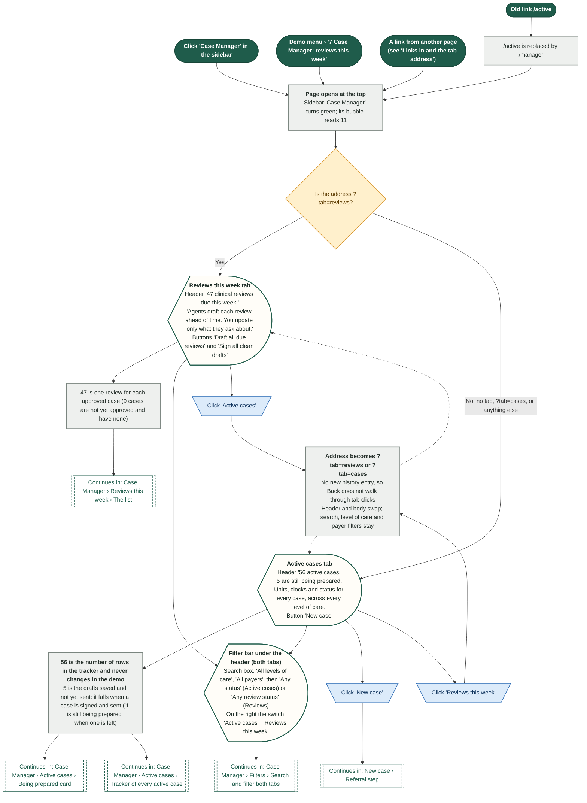

## Case Manager › Filters › Search and filter both tabs

One filter bar serves both tabs. Search, level of care and payer apply to the 'Being prepared' list, the tracker and the review list. The last dropdown changes with the tab. Every filter narrows the list at once and all of them combine.

Route: `/manager and /manager?tab=reviews`

Filters are not kept in the address. They survive switching tabs, and are cleared by leaving the page or reloading.

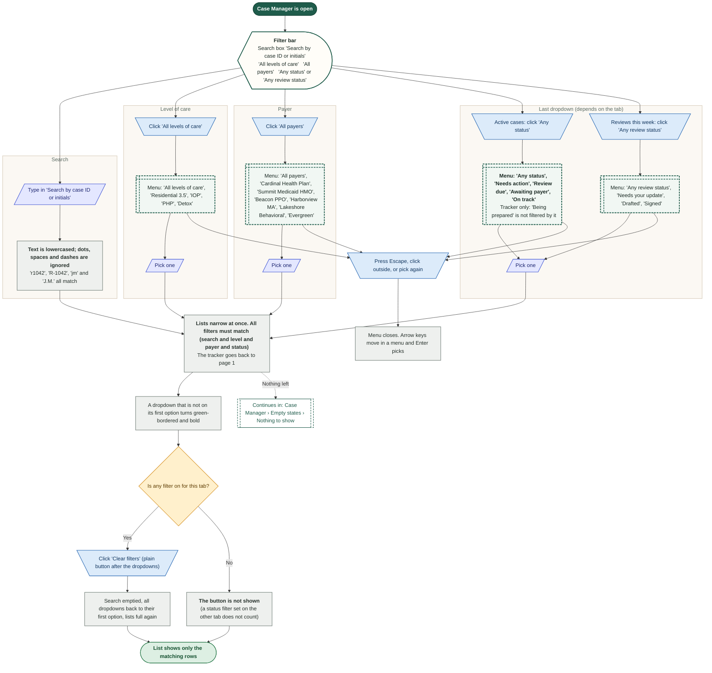

## Case Manager › Active cases › Being prepared card

The card at the top of Active cases lists the cases the agents are still preparing, most urgent first. Four chips narrow it by who has the next move, and 'sent today' jumps to the Dashboard. Each row is explained in the next diagram.

Route: `/manager`

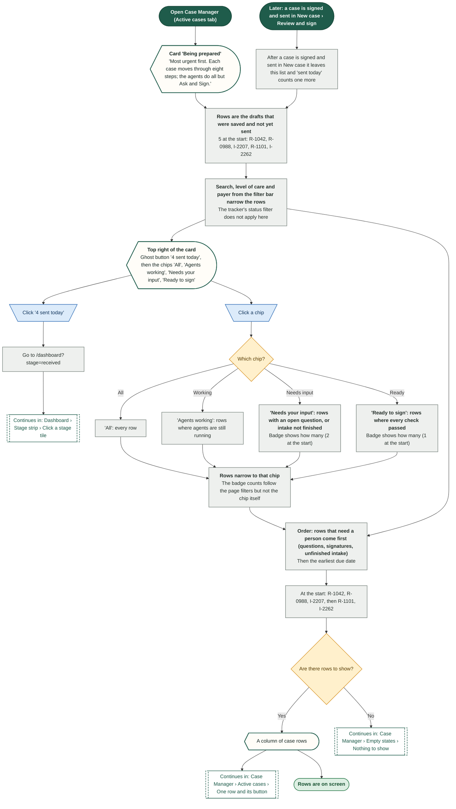

## Case Manager › Active cases › One row and its button

One row of 'Being prepared' shows a case, where it is on the eight steps, who has it and the one thing to do next. Only the case ID and the button on the right are clickable, and both lead to the same place in New case. The button's wording depends on the row's state.

Route: `/manager`

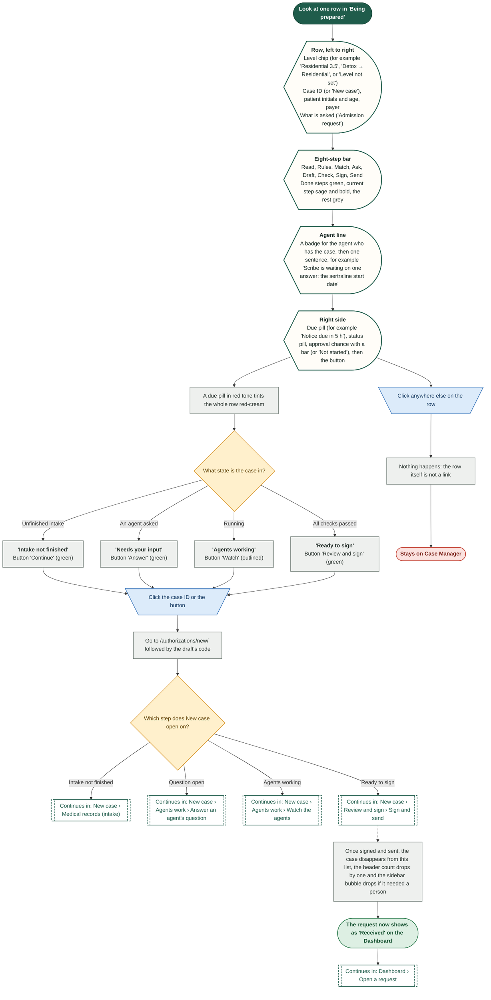

## Case Manager › Active cases › How a row's status and due pill are decided

Each row's status, step bar, agent line and button come from how far the agents have got. The due pill comes from the kind of request. Both follow the demo clock, so Fast-forward turns 'Notice due in 5 h' into 'Overdue'.

Route: `/manager`

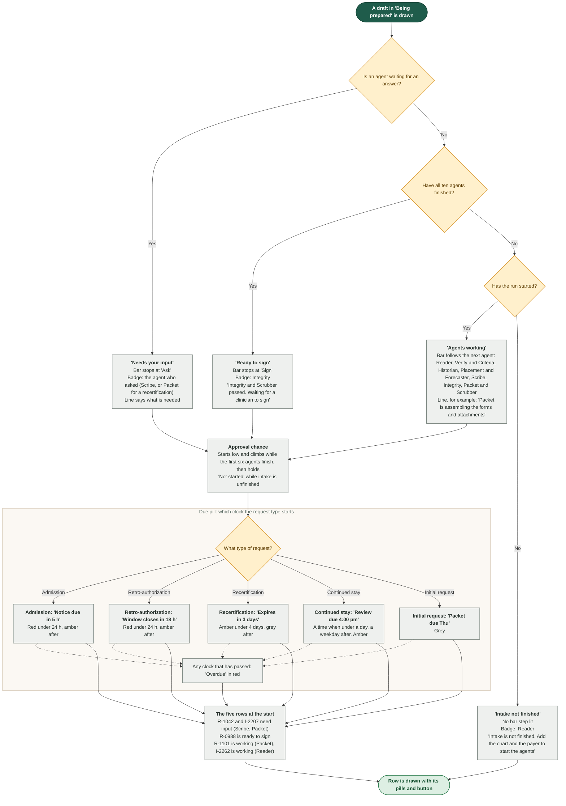

## Case Manager › Active cases › Tracker of every active case

Under 'Being prepared', the tracker lists all 56 active cases across every level of care. Four tiles count them by status and filter the table when clicked. The table is sorted soonest-first, ten rows a page.

Route: `/manager`

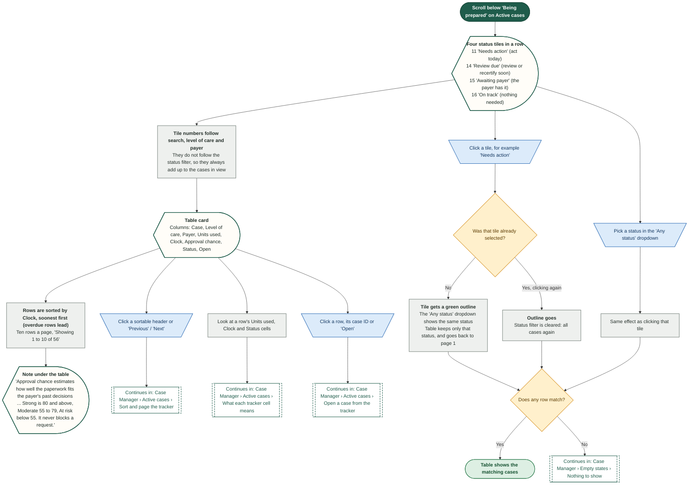

## Case Manager › Active cases › Sort and page the tracker

Six of the eight table headers sort. A second click on the same header flips the order. The table shows ten rows at a time with 'Previous' and 'Next'. Changing a sort or any filter always returns to page 1.

Route: `/manager`

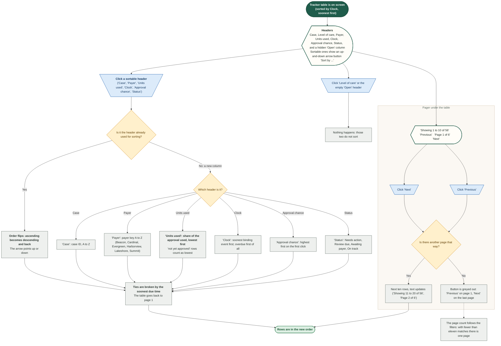

## Case Manager › Active cases › What each tracker cell means

Every tracker row answers two questions: how much of the approval is left (Units used) and how long until the next thing that binds (Clock). The Clock wording depends on what kind of event is next, and it turns red when time is short. All of it moves with the demo clock.

Route: `/manager`

The dates and hours are measured from the demo clock, so Fast-forward changes them. Status and Approval chance are stored on the row and do not move.

```mermaid
%%{init: {"theme":"base","themeVariables":{"fontFamily":"'DM Sans', 'Segoe UI', system-ui, sans-serif","fontSize":"15px","lineColor":"#5B6B63","primaryTextColor":"#1C2B25","clusterBkg":"#FBF8F3","clusterBorder":"#D9CDBB","edgeLabelBackground":"#FFFFFF"},"flowchart":{"curve":"basis","nodeSpacing":36,"rankSpacing":48,"padding":12,"htmlLabels":true,"useMaxWidth":false,"wrappingWidth":230}} }%%
flowchart LR
  classDef k_start fill:#1F5C4B,stroke:#174638,color:#FFFFFF,stroke-width:1.5px,font-weight:600
  classDef k_end fill:#DDEFE3,stroke:#2E7D4F,color:#14502F,stroke-width:1.5px,font-weight:600
  classDef k_endx fill:#FBE3E0,stroke:#C0392B,color:#7A1F16,stroke-width:1.5px,font-weight:600
  classDef k_screen fill:#FFFDF8,stroke:#1F5C4B,color:#1C2B25,stroke-width:2px
  classDef k_overlay fill:#F1F7F3,stroke:#1F5C4B,color:#1C2B25,stroke-width:2px,stroke-dasharray:5 3
  classDef k_click fill:#DCEBFA,stroke:#2F6DB5,color:#12365F,stroke-width:1.5px
  classDef k_input fill:#E4E7FF,stroke:#4C5FD5,color:#1D2670,stroke-width:1.5px
  classDef k_process fill:#EEF0EE,stroke:#7A857F,color:#26302B,stroke-width:1.5px
  classDef k_agent fill:#EEE5FA,stroke:#7A4FC2,color:#341A63,stroke-width:1.5px
  classDef k_decision fill:#FFF0CC,stroke:#D9962B,color:#5C3B00,stroke-width:1.5px
  classDef k_store fill:#D5F0EA,stroke:#1C8E7B,color:#0B4A3F,stroke-width:1.5px
  classDef k_doc fill:#F6E9DC,stroke:#B07A4C,color:#4A2E14,stroke-width:1.5px
  classDef k_ext fill:#FFE6D2,stroke:#E07B39,color:#6B2F06,stroke-width:1.5px
  classDef k_wait fill:#E4E8EE,stroke:#6B7C93,color:#26303D,stroke-width:1.5px
  classDef k_toast fill:#FFF9DB,stroke:#C9A400,color:#5A4A00,stroke-width:1.5px
  classDef k_goto fill:#FFFFFF,stroke:#1F5C4B,color:#1F5C4B,stroke-width:1.5px,stroke-dasharray:5 3
  s1@{ shape: stadium, label: "Read one tracker row" }
  r1@{ shape: curv-trap, label: "<b>Case: ID, then initials and age</b><br/>Level of care: chip, then a short note ('Continued stay 3', 'Recertification')<br/>Payer: short name ('Summit Medicaid', 'Cardinal')" }
  u0@{ shape: diam, label: "Units used: is the case approved yet?" }
  u1@{ shape: rect, label: "<b>'not yet approved' in grey</b><br/>(admissions, retro-authorizations and first requests: 9 cases)" }
  u2@{ shape: rect, label: "<b>A bar and '10 of 21 days' (or 'units' for IOP)</b><br/>Bar turns terracotta at 75 percent used or more" }
  k0@{ shape: diam, label: "Clock: what is the next event that binds?" }
  k1@{ shape: rect, label: "<b>Notice</b><br/>'Notice due in 5 h' or 'Notice overdue'<br/>Red under 2 days" }
  k2@{ shape: rect, label: "<b>Retro window</b><br/>'Window closes 18 h' or 'Window closed'<br/>Red under 2 days" }
  k3@{ shape: rect, label: "<b>Peer-to-peer</b><br/>'P2P in 36 h' or 'P2P window closed'<br/>Red under 2 days" }
  k4@{ shape: rect, label: "<b>Payer question</b><br/>'Answer due in 20 h' or 'Answer overdue'<br/>Red under 1 day" }
  k5@{ shape: rect, label: "<b>Approval ends</b><br/>'3 days left', '14 h left' or 'Approval ended'<br/>Red under 1 day" }
  k6@{ shape: rect, label: "<b>Clinical review</b><br/>'Review in 2 days', 'Review tomorrow', 'Review today', 'Review due'<br/>Red only when overdue" }
  k7@{ shape: rect, label: "<b>Decision from the payer</b><br/>'Decision Thu', 'Decision in 5 h' or 'Decision overdue'<br/>Red only when overdue" }
  k8@{ shape: rect, label: "<b>Units only</b><br/>'32 units left'<br/>Never red" }
  k9@{ shape: rect, label: "Times under two days show hours ('5 h'). Longer ones show days ('3 days')" }
  s1p@{ shape: rect, label: "<b>Approval chance: percent with a bar, coloured by band</b><br/>Strong 80 and above, Moderate 55 to 79, At risk below 55" }
  s2p@{ shape: rect, label: "<b>Status pill: 'Needs action' (red), 'Review due' (amber), 'Awaiting payer' (grey), 'On track' (green)</b><br/>The four tiles count these" }
  s3p@{ shape: rect, label: "'Open' button at the end of the row" }
  g1@{ shape: subproc, label: "Continues in: Case Manager › Active cases › Open a case from the tracker" }
  e1@{ shape: stadium, label: "Row is read" }
  s1 --> r1 --> u0
  u0 -->|"No"| u1
  u0 -->|"Yes"| u2
  u1 --> k0
  u2 --> k0
  k0 -->|"Notice"| k1
  k0 -->|"Retro window"| k2
  k0 -->|"P2P call"| k3
  k0 -->|"Payer question"| k4
  k0 -->|"Approval end"| k5
  k0 -->|"Review"| k6
  k0 -->|"Decision"| k7
  k0 -->|"Units"| k8
  k1 & k2 & k3 & k4 & k5 & k6 & k7 & k8 --> k9
  k9 --> s1p --> s2p --> s3p --> g1
  s3p -.-> e1
  class s1 k_start
  class r1 k_screen
  class u0,k0 k_decision
  class u1,u2,k1,k2,k3,k4,k5,k6,k7,k8,k9,s1p,s2p,s3p k_process
  class g1 k_goto
  class e1 k_end
```

## Case Manager › Active cases › Open a case from the tracker

A tracker row opens the case page in Authorizations. Three clicks do the same thing: the row, the case ID and the 'Open' button. Not every tracker case has a case page in the demo: some rows land on 'Request not found'.

Route: `/manager → /authorizations/case/ID`

Reviews have the same issue: 'Open case' in the review drawer uses the same case pages.

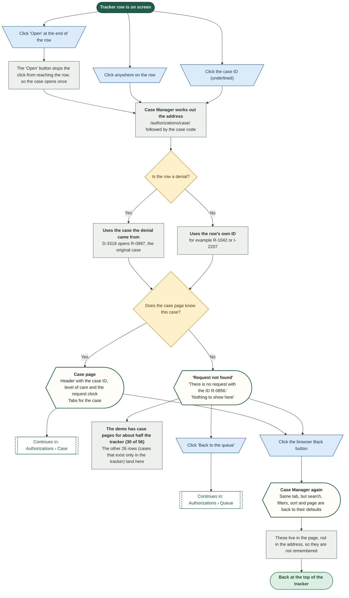

## Case Manager › Reviews this week › The list

The second tab lists every clinical review due this week, one card per day, with three tiles on top. Agents have already drafted most of them. A row opens the review drawer. A side card nudges the team to look at cases that may be ready for a lower level of care.

Route: `/manager?tab=reviews`

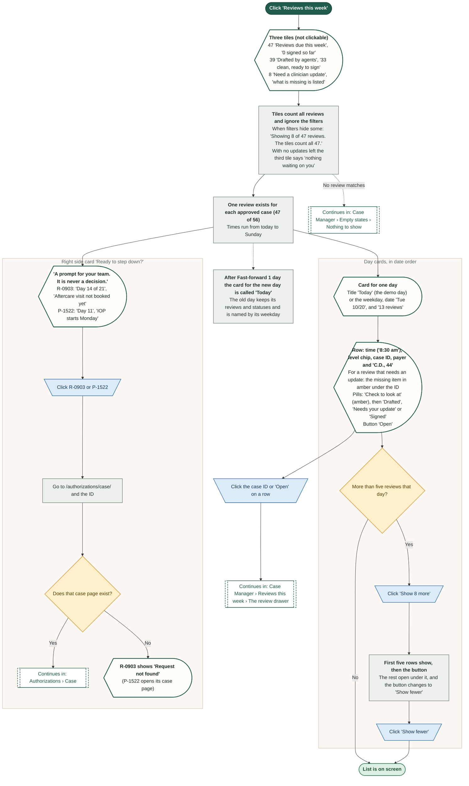

## Case Manager › Reviews this week › The review drawer

Opening a review shows the draft an agent wrote, the four Integrity checks and the buttons to sign or open the case. What the clinician can do depends on the review's status: a clean draft, a draft with one check to look at, a review that needs an update, or one already signed.

Route: `/manager?tab=reviews (drawer over the list)`

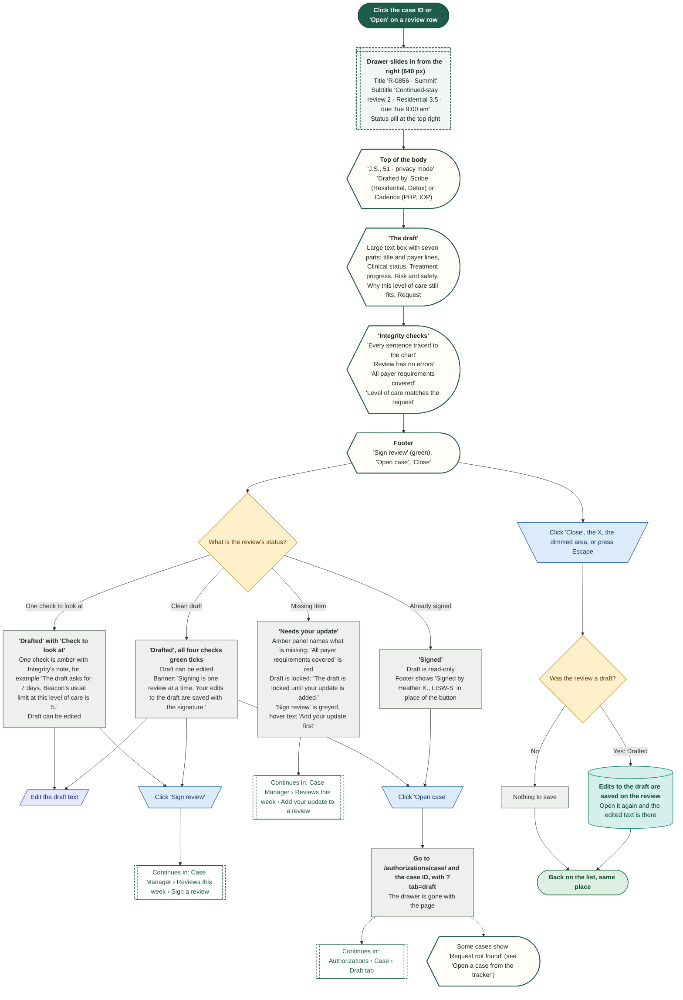

## Case Manager › Reviews this week › Add your update to a review

Eight reviews could not be finished by the agents because the chart lacks one item. The clinician says what applies, in their own words, and Integrity checks the draft again. The review then becomes an ordinary draft that can be signed. This is the 'answer' gate: agents stop and ask a person.

Route: `/manager?tab=reviews (review drawer)`

```mermaid
%%{init: {"theme":"base","themeVariables":{"fontFamily":"'DM Sans', 'Segoe UI', system-ui, sans-serif","fontSize":"15px","lineColor":"#5B6B63","primaryTextColor":"#1C2B25","clusterBkg":"#FBF8F3","clusterBorder":"#D9CDBB","edgeLabelBackground":"#FFFFFF"},"flowchart":{"curve":"basis","nodeSpacing":36,"rankSpacing":48,"padding":12,"htmlLabels":true,"useMaxWidth":false,"wrappingWidth":230}} }%%
flowchart TD
  classDef k_start fill:#1F5C4B,stroke:#174638,color:#FFFFFF,stroke-width:1.5px,font-weight:600
  classDef k_end fill:#DDEFE3,stroke:#2E7D4F,color:#14502F,stroke-width:1.5px,font-weight:600
  classDef k_endx fill:#FBE3E0,stroke:#C0392B,color:#7A1F16,stroke-width:1.5px,font-weight:600
  classDef k_screen fill:#FFFDF8,stroke:#1F5C4B,color:#1C2B25,stroke-width:2px
  classDef k_overlay fill:#F1F7F3,stroke:#1F5C4B,color:#1C2B25,stroke-width:2px,stroke-dasharray:5 3
  classDef k_click fill:#DCEBFA,stroke:#2F6DB5,color:#12365F,stroke-width:1.5px
  classDef k_input fill:#E4E7FF,stroke:#4C5FD5,color:#1D2670,stroke-width:1.5px
  classDef k_process fill:#EEF0EE,stroke:#7A857F,color:#26302B,stroke-width:1.5px
  classDef k_agent fill:#EEE5FA,stroke:#7A4FC2,color:#341A63,stroke-width:1.5px
  classDef k_decision fill:#FFF0CC,stroke:#D9962B,color:#5C3B00,stroke-width:1.5px
  classDef k_store fill:#D5F0EA,stroke:#1C8E7B,color:#0B4A3F,stroke-width:1.5px
  classDef k_doc fill:#F6E9DC,stroke:#B07A4C,color:#4A2E14,stroke-width:1.5px
  classDef k_ext fill:#FFE6D2,stroke:#E07B39,color:#6B2F06,stroke-width:1.5px
  classDef k_wait fill:#E4E8EE,stroke:#6B7C93,color:#26303D,stroke-width:1.5px
  classDef k_toast fill:#FFF9DB,stroke:#C9A400,color:#5A4A00,stroke-width:1.5px
  classDef k_goto fill:#FFFFFF,stroke:#1F5C4B,color:#1F5C4B,stroke-width:1.5px,stroke-dasharray:5 3
  s1@{ shape: stadium, label: "<b>Open a review marked 'Needs your update'</b><br/>(for example R-0912)" }
  o1@{ shape: win-pane, label: "<b>Review drawer</b><br/>Status pill 'Needs your update'" }
  b1@{ shape: curv-trap, label: "<b>Amber panel 'Needs your update'</b><br/>What is missing, for example 'Evergreen has not answered in 4 days. Confirm the current risk assessment before Caller resends the review.'" }
  b2@{ shape: curv-trap, label: "<b>Box 'Your update' (required)</b><br/>Hint: 'This goes into the draft under Clinician update. Integrity checks the draft again.'<br/>Button 'Add to the draft' (greyed while the box is empty)" }
  b3@{ shape: curv-trap, label: "<b>The draft is read-only: 'The draft is locked until your update is added.'</b><br/>Integrity checks: 'All payer requirements covered' is red with 'A required item is missing. See what the review needs from you.'<br/>'Sign review' is greyed: 'Add your update first'" }
  i1@{ shape: lean-r, label: "Type the update in 'Your update'" }
  d1@{ shape: diam, label: "Is there text (not just spaces)?" }
  p0@{ shape: rect, label: "'Add to the draft' stays greyed. Nothing can be sent" }
  c1@{ shape: trap-t, label: "Click 'Add to the draft'" }
  p1@{ shape: rect, label: "Button shows a spinner for about 1.3 seconds" }
  a1@{ shape: hex, label: "Integrity checks the draft again with the update" }
  st1@{ shape: cyl, label: "<b>Review is saved as 'Drafted'</b><br/>The missing item is cleared<br/>Your text is saved as the note and added to the draft under 'Clinician update'<br/>All four checks turn green" }
  t1@{ shape: odd, label: "<b>'Review updated'</b><br/>'Integrity checked R-0912 again. It is a draft now and ready to sign.'" }
  p2@{ shape: rect, label: "<b>Drawer redraws in place:</b><br/>Amber panel gone, draft unlocked and longer, checks green, 'Sign review' ready" }
  p3@{ shape: rect, label: "<b>Sidebar 'Case Manager' bubble drops by one (11 becomes 10)</b><br/>Tile 'Need a clinician update' drops, 'Drafted by agents' rises, and the review counts as 'clean' for 'Sign all clean drafts'" }
  g1@{ shape: subproc, label: "Continues in: Case Manager › Reviews this week › Sign a review" }
  c2@{ shape: trap-t, label: "Close the drawer without adding anything" }
  p4@{ shape: rect, label: "Nothing is saved: the review stays 'Needs your update'" }
  c3@{ shape: trap-t, label: "Click 'Open case'" }
  g2@{ shape: subproc, label: "Continues in: Authorizations › Case › Draft tab" }
  e1@{ shape: stadium, label: "Review is ready to sign" }
  e2@{ shape: stadium, label: "Still waiting on the clinician" }
  s1 --> o1 --> b1 --> b2 --> b3 --> i1 --> d1
  d1 -->|"No"| p0 --> e2
  d1 -->|"Yes"| c1 --> p1 --> a1 --> st1
  st1 --> t1 --> p2 --> p3 --> g1
  p3 --> e1
  b3 --> c2 --> p4 --> e2
  b3 --> c3 --> g2
  p0 -.-> i1
  class s1 k_start
  class o1 k_overlay
  class b1,b2,b3 k_screen
  class i1 k_input
  class d1 k_decision
  class p0,p1,p2,p3,p4 k_process
  class c1,c2,c3 k_click
  class a1 k_agent
  class st1 k_store
  class t1 k_toast
  class g1,g2 k_goto
  class e1 k_end
  class e2 k_endx
```

## Case Manager › Reviews this week › Sign a review

Signing is the gate where agents stop. Only a licensed clinician signs, so the coordinator picks who is signing and ticks an attestation. When Integrity left one amber check, the signer must also read and accept it. Signing is one review at a time.

Route: `/manager?tab=reviews (review drawer › sign dialog)`

PRD 03 (sign-off gate) says nothing goes out without a clinician signature carrying signer identity and a timestamp. The demo records the signer and the demo-clock time.

```mermaid
%%{init: {"theme":"base","themeVariables":{"fontFamily":"'DM Sans', 'Segoe UI', system-ui, sans-serif","fontSize":"15px","lineColor":"#5B6B63","primaryTextColor":"#1C2B25","clusterBkg":"#FBF8F3","clusterBorder":"#D9CDBB","edgeLabelBackground":"#FFFFFF"},"flowchart":{"curve":"basis","nodeSpacing":36,"rankSpacing":48,"padding":12,"htmlLabels":true,"useMaxWidth":false,"wrappingWidth":230}} }%%
flowchart TD
  classDef k_start fill:#1F5C4B,stroke:#174638,color:#FFFFFF,stroke-width:1.5px,font-weight:600
  classDef k_end fill:#DDEFE3,stroke:#2E7D4F,color:#14502F,stroke-width:1.5px,font-weight:600
  classDef k_endx fill:#FBE3E0,stroke:#C0392B,color:#7A1F16,stroke-width:1.5px,font-weight:600
  classDef k_screen fill:#FFFDF8,stroke:#1F5C4B,color:#1C2B25,stroke-width:2px
  classDef k_overlay fill:#F1F7F3,stroke:#1F5C4B,color:#1C2B25,stroke-width:2px,stroke-dasharray:5 3
  classDef k_click fill:#DCEBFA,stroke:#2F6DB5,color:#12365F,stroke-width:1.5px
  classDef k_input fill:#E4E7FF,stroke:#4C5FD5,color:#1D2670,stroke-width:1.5px
  classDef k_process fill:#EEF0EE,stroke:#7A857F,color:#26302B,stroke-width:1.5px
  classDef k_agent fill:#EEE5FA,stroke:#7A4FC2,color:#341A63,stroke-width:1.5px
  classDef k_decision fill:#FFF0CC,stroke:#D9962B,color:#5C3B00,stroke-width:1.5px
  classDef k_store fill:#D5F0EA,stroke:#1C8E7B,color:#0B4A3F,stroke-width:1.5px
  classDef k_doc fill:#F6E9DC,stroke:#B07A4C,color:#4A2E14,stroke-width:1.5px
  classDef k_ext fill:#FFE6D2,stroke:#E07B39,color:#6B2F06,stroke-width:1.5px
  classDef k_wait fill:#E4E8EE,stroke:#6B7C93,color:#26303D,stroke-width:1.5px
  classDef k_toast fill:#FFF9DB,stroke:#C9A400,color:#5A4A00,stroke-width:1.5px
  classDef k_goto fill:#FFFFFF,stroke:#1F5C4B,color:#1F5C4B,stroke-width:1.5px,stroke-dasharray:5 3
  s1@{ shape: stadium, label: "Open a drafted review, then click 'Sign review'" }
  o1@{ shape: win-pane, label: "<b>Dialog 'Sign this review'</b><br/>Subtitle 'R-0856 · Summit Medicaid HMO · Residential 3.5'" }
  b1@{ shape: curv-trap, label: "<b>Banner 'Only a licensed clinician signs'</b><br/>'You are signed in as Jordan Perez, a UR coordinator. Choose the clinician who is signing. Agents never sign for a person.'" }
  i1@{ shape: lean-r, label: "<b>'Signing clinician' dropdown</b><br/>'Heather K., LISW-S' (Clinical director)<br/>'Dr. R. Lindqvist, MD' (Medical director)" }
  d1@{ shape: diam, label: "Did Integrity leave one amber check?" }
  w1@{ shape: curv-trap, label: "<b>Amber box 'One check needs a look'</b><br/>Integrity's note, for example 'The draft asks for 7 days. Beacon's usual limit at this level of care is 5.'<br/>Tick box 'I read this and I accept it'" }
  i2@{ shape: lean-r, label: "Tick 'I read this and I accept it'" }
  i3@{ shape: lean-r, label: "<b>Tick the attestation</b><br/>'I reviewed this continued-stay review and it reflects the record. The level of care is my clinical judgment.'" }
  d2@{ shape: diam, label: "Are the attestation (and the acceptance, if shown) ticked?" }
  x1@{ shape: rect, label: "Button 'Sign review' stays greyed" }
  c1@{ shape: trap-t, label: "Click 'Sign review' in the dialog" }
  st1@{ shape: cyl, label: "<b>Review is saved as 'Signed'</b><br/>Signed by the chosen clinician, stamped with the demo clock<br/>The draft text, with any edits made in the drawer, is kept" }
  t1@{ shape: odd, label: "<b>'Review signed'</b><br/>'R-0856 was signed by Heather K., LISW-S. Cadence books the next review.'" }
  p1@{ shape: rect, label: "Dialog closes. The drawer stays open and now shows 'Signed by Heather K., LISW-S' with a read-only draft" }
  g1@{ shape: subproc, label: "Continues in: Case Manager › Reviews this week › After a review is signed" }
  c2@{ shape: trap-t, label: "Click 'Cancel', the X, the dimmed area, or press Escape" }
  p2@{ shape: rect, label: "<b>Only the dialog closes. The drawer and the draft stay as they were</b><br/>Nothing is signed" }
  e1@{ shape: stadium, label: "Not signed" }
  e2@{ shape: stadium, label: "Review signed" }
  s1 --> o1 --> b1 --> i1 --> d1
  d1 -->|"Yes"| w1 --> i2 --> i3
  d1 -->|"No"| i3
  i3 --> d2
  d2 -->|"No"| x1 -.-> i3
  d2 -->|"Yes"| c1 --> st1 --> t1 --> p1 --> e2
  p1 --> g1
  o1 --> c2 --> p2 --> e1
  class s1 k_start
  class o1 k_overlay
  class b1,w1 k_screen
  class i1,i2,i3 k_input
  class d1,d2 k_decision
  class x1,p1,p2 k_process
  class c1,c2 k_click
  class st1 k_store
  class t1 k_toast
  class g1 k_goto
  class e1 k_endx
  class e2 k_end
```

## Case Manager › Reviews this week › Draft all due reviews and sign all clean drafts

Two buttons in the header work on the whole week. 'Draft all due reviews' asks Cadence to check for missing drafts. 'Sign all clean drafts' signs every draft whose four Integrity checks passed, in one step, and leaves out anything that needs a closer look.

Route: `/manager?tab=reviews (the two header buttons)`

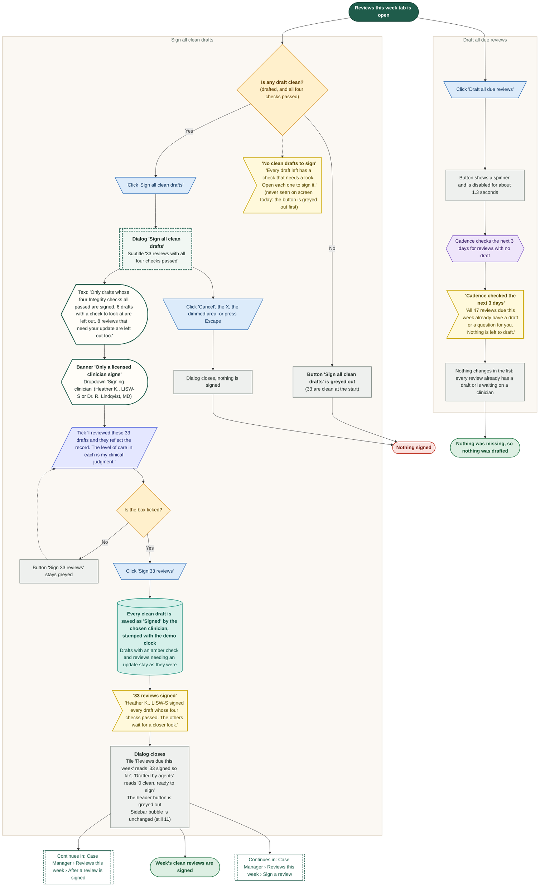

## Case Manager › Reviews this week › After a review is signed

What the demo does once a clinician signs, and what the real product would do next. In the demo a signature changes the review's status and a few counts. The next review is only announced in the toast: no new row is added.

Route: `/manager?tab=reviews`

The PRD (03, Prior Authorization Lifecycle) treats each signed request as a version that is kept, and times renewals from the binding date and the payer's lead time. The demo shows only the signature and the counts.

```mermaid
%%{init: {"theme":"base","themeVariables":{"fontFamily":"'DM Sans', 'Segoe UI', system-ui, sans-serif","fontSize":"15px","lineColor":"#5B6B63","primaryTextColor":"#1C2B25","clusterBkg":"#FBF8F3","clusterBorder":"#D9CDBB","edgeLabelBackground":"#FFFFFF"},"flowchart":{"curve":"basis","nodeSpacing":36,"rankSpacing":48,"padding":12,"htmlLabels":true,"useMaxWidth":false,"wrappingWidth":230}} }%%
flowchart TD
  classDef k_start fill:#1F5C4B,stroke:#174638,color:#FFFFFF,stroke-width:1.5px,font-weight:600
  classDef k_end fill:#DDEFE3,stroke:#2E7D4F,color:#14502F,stroke-width:1.5px,font-weight:600
  classDef k_endx fill:#FBE3E0,stroke:#C0392B,color:#7A1F16,stroke-width:1.5px,font-weight:600
  classDef k_screen fill:#FFFDF8,stroke:#1F5C4B,color:#1C2B25,stroke-width:2px
  classDef k_overlay fill:#F1F7F3,stroke:#1F5C4B,color:#1C2B25,stroke-width:2px,stroke-dasharray:5 3
  classDef k_click fill:#DCEBFA,stroke:#2F6DB5,color:#12365F,stroke-width:1.5px
  classDef k_input fill:#E4E7FF,stroke:#4C5FD5,color:#1D2670,stroke-width:1.5px
  classDef k_process fill:#EEF0EE,stroke:#7A857F,color:#26302B,stroke-width:1.5px
  classDef k_agent fill:#EEE5FA,stroke:#7A4FC2,color:#341A63,stroke-width:1.5px
  classDef k_decision fill:#FFF0CC,stroke:#D9962B,color:#5C3B00,stroke-width:1.5px
  classDef k_store fill:#D5F0EA,stroke:#1C8E7B,color:#0B4A3F,stroke-width:1.5px
  classDef k_doc fill:#F6E9DC,stroke:#B07A4C,color:#4A2E14,stroke-width:1.5px
  classDef k_ext fill:#FFE6D2,stroke:#E07B39,color:#6B2F06,stroke-width:1.5px
  classDef k_wait fill:#E4E8EE,stroke:#6B7C93,color:#26303D,stroke-width:1.5px
  classDef k_toast fill:#FFF9DB,stroke:#C9A400,color:#5A4A00,stroke-width:1.5px
  classDef k_goto fill:#FFFFFF,stroke:#1F5C4B,color:#1F5C4B,stroke-width:1.5px,stroke-dasharray:5 3
  s1@{ shape: stadium, label: "<b>A clinician signature is saved</b><br/>(one review, or 'Sign all clean drafts')" }
  st1@{ shape: cyl, label: "The review keeps: status 'Signed', who signed, the demo-clock time, and the draft text as signed" }
  subgraph gScreen ["What changes on screen"]
  a1@{ shape: rect, label: "<b>Row pill changes from 'Drafted' to 'Signed'</b><br/>'Check to look at' goes away on a signed row" }
  a2@{ shape: rect, label: "Drawer, if open: footer reads 'Signed by Heather K., LISW-S', draft is read-only, the banner is gone" }
  a3@{ shape: rect, label: "Tile 'Reviews due this week' sub line counts up: '1 signed so far'" }
  a4@{ shape: rect, label: "<b>Tile 'Drafted by agents' sub line counts down: '32 clean, ready to sign'</b><br/>The tile number itself still counts signed ones" }
  a5@{ shape: rect, label: "'Sign all clean drafts' is greyed out once none are left" }
  a6@{ shape: rect, label: "Filter 'Signed' in 'Any review status' now lists it" }
  a7@{ shape: rect, label: "Sidebar 'Case Manager' bubble does not change: it counts reviews that need an update, not drafts waiting to be signed" }
  end
  subgraph gNext ["The next review"]
  t1@{ shape: odd, label: "Toast says 'Cadence books the next review.'" }
  g1@{ shape: hex, label: "Cadence books the next continued-stay review from the payer's lead time (real product)" }
  n1@{ shape: rect, label: "<b>Demo: no new row, no new date and no new notification appears</b><br/>The week's list keeps its 47 reviews" }
  x1@{ shape: st-rect, label: "Payer receives the signed review through its portal or by fax (real product, not drawn in the demo)" }
  end
  subgraph gCase ["Case record"]
  c1@{ shape: trap-t, label: "Click 'Open case' in the drawer" }
  g2@{ shape: subproc, label: "Continues in: Authorizations › Case › Draft tab" }
  end
  st2@{ shape: cyl, label: "'Reset demo data' puts every review back to its starting state and clears signatures" }
  e1@{ shape: stadium, label: "Review is signed and counted" }
  s1 --> st1
  st1 --> a1 & a2 & a3 & a4 & a5 & a6 & a7
  st1 --> t1 --> n1
  t1 -.-> g1 -.-> x1
  a2 --> c1 --> g2
  a1 & a3 & a4 & a5 & a6 & a7 --> e1
  n1 --> e1
  e1 -.-> st2
  class s1 k_start
  class st1,st2 k_store
  class a1,a2,a3,a4,a5,a6,a7,n1 k_process
  class t1 k_toast
  class g1 k_agent
  class x1 k_ext
  class c1 k_click
  class g2 k_goto
  class e1 k_end
  style gScreen fill:#FBF8F3,stroke:#D9CDBB,stroke-width:1.5px,color:#5B6B63
  style gNext fill:#FBF8F3,stroke:#D9CDBB,stroke-width:1.5px,color:#5B6B63
  style gCase fill:#FBF8F3,stroke:#D9CDBB,stroke-width:1.5px,color:#5B6B63
```

## Case Manager › Empty states › Nothing to show

Four places can run out of rows: the 'Being prepared' card, the tracker, the review list and the review-update tile. Each says why and offers one way out. Filters cause three of them. The fourth happens when every draft has been signed and sent.

Route: `/manager and /manager?tab=reviews`

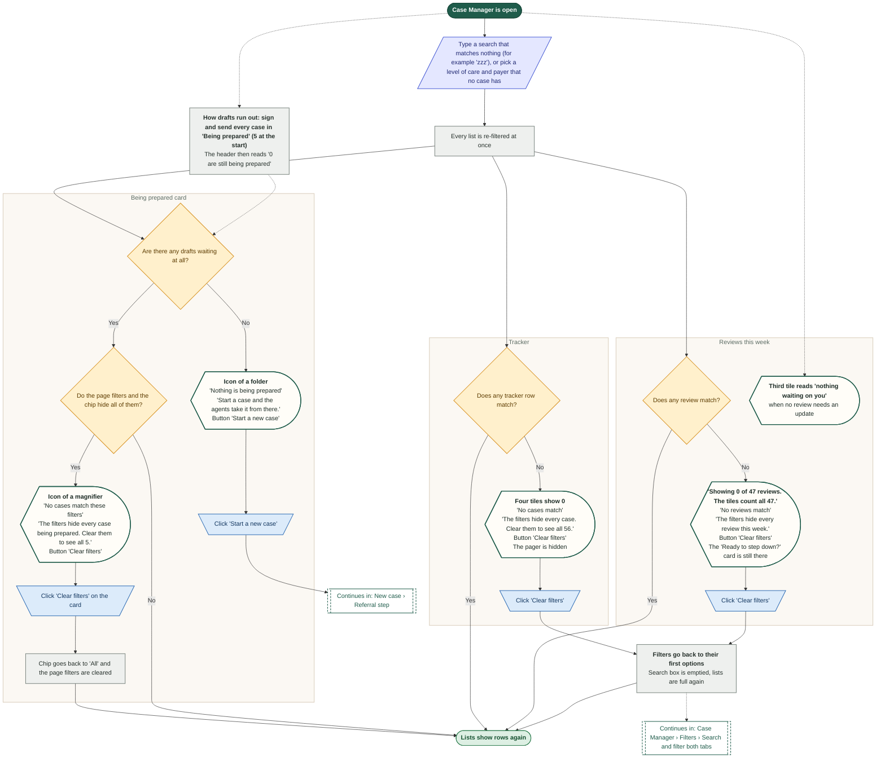

## Case Manager › Page › Links in and the tab address

Nine routes lead to Case Manager. Four of them name a tab in the address. Anything that is not '?tab=reviews' opens Active cases. This diagram lists each source, the address it uses and which tab opens.

Route: `/manager, /manager?tab=cases, /manager?tab=reviews, /active`

Links never carry a case, a filter or a page number. Case Manager always opens at the top with filters cleared.

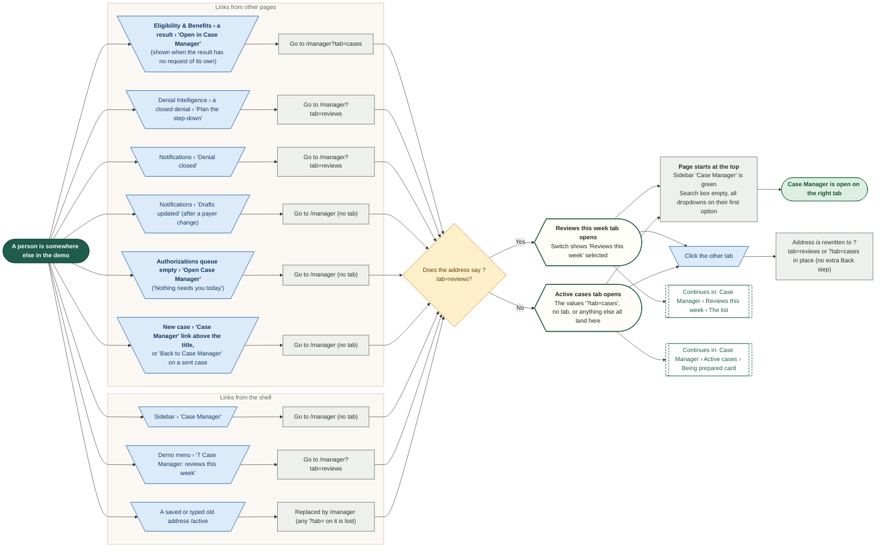
