# Authorizations › Approved, reviews and tracked cases

What Case Manager did, now inside Authorizations: saved drafts, requests sent today, approved authorizations with their units and the tracked quick view, step-down plans, payer-change notes, Reviews this week with the review drawer and bulk signing, the ledger case page, sites, and where old Case Manager links land.

Shapes and colours: see `00-overview.md`. Source: `workflows/src/07-case-manager/`.

## Authorizations › Old links › Case Manager addresses and links from other tabs

Case Manager is no longer a page. Its old addresses redirect to the matching Authorizations view, and the links other tabs still make to it land there too: Active cases is All, Reviews this week is its own view. The sidebar has no Case Manager row.

Route: `/manager, /active (both redirect to /authorizations)`

The redirect replaces the entry, so Back does not return to /manager. It always names the view, so an old link opens All or Reviews this week, never the last view used. Only ?tab=, ?show= and ?review= carry over; search and filters on an old address are dropped. Some text in other tabs still says Case Manager (the Dashboard's 'Open Active cases', the 'Decision accepted' and 'Drafts updated' messages).

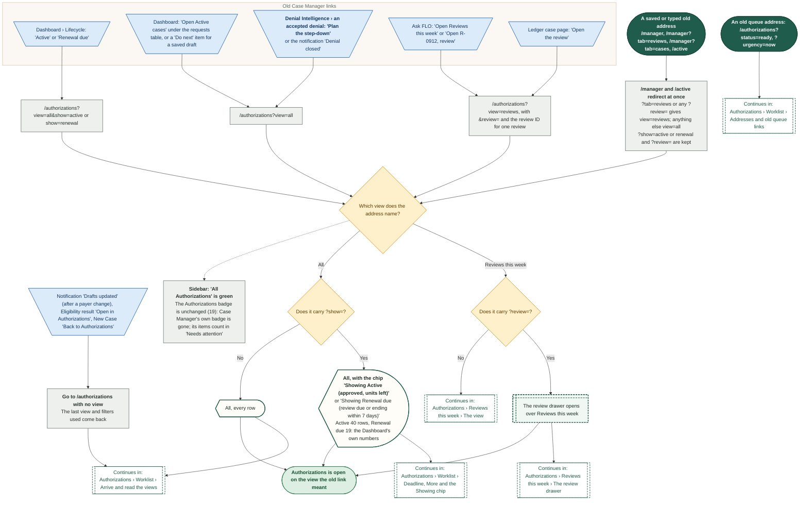

## Authorizations › In progress › Drafts being prepared

A case saved in New Case and not sent yet is a row of In progress. When the draft belongs to a request already in the list, it stays on that request's row and the row offers 'Open the draft in New Case'. Otherwise the draft is a row of its own, with its status, the agent line, its due pill and one button: Continue, Answer, Watch or Review and sign. Both lead back into New Case.

Route: `/authorizations?view=progress`

Demo only: the five drafts at the start (R-1042, R-0988, I-2207, R-1101, I-2262) all belong to queue requests, so none is a row of its own until a person saves a new case. Case Manager's 'Being prepared' card, its chips and its eight-step bar are gone: the status chip, the next-action line and the owner carry the same facts.

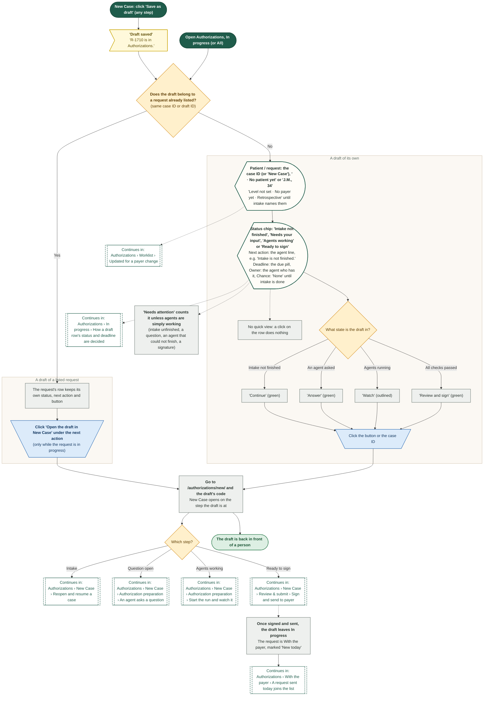

## Authorizations › In progress › How a draft row's status and deadline are decided

A saved draft's row is worked out from how far the agents have got and from the kind of request. The status chip, the next-action line, the owner and the button follow the agents; the due pill follows the request type. All of it follows the demo clock, so Fast-forward turns 'Notice due in 5 h' into 'Overdue'.

Route: `/authorizations?view=progress`

The next-action cell shows the first sentence of the agent line. A red due pill puts the row in Act now, whatever else it says.

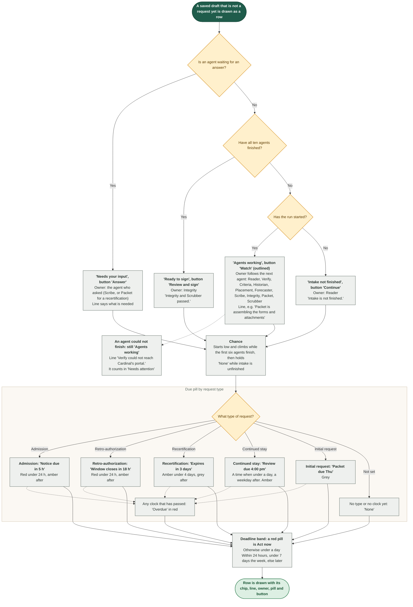

## Authorizations › Denied › Step-down plans from accepted denials

When the clinic accepts a denial in Denial Intelligence, the denial's row in Authorizations becomes its step-down plan: status 'Accepted', the next action 'Plan the step-down', and one button that opens the case. It stays in Denied and counts in Needs attention. Separately, two cases carry a 'Consider a step-down' note, a prompt and never a decision.

Route: `/authorizations?view=denied`

Demo only: Reset demo data clears the accepted denials. Case Manager's folded 'Step-down plans' row and its 'Ready to step down?' card are gone; the row and the note carry them. Denial Intelligence's toast still says 'Case Manager has a step-down plan'.

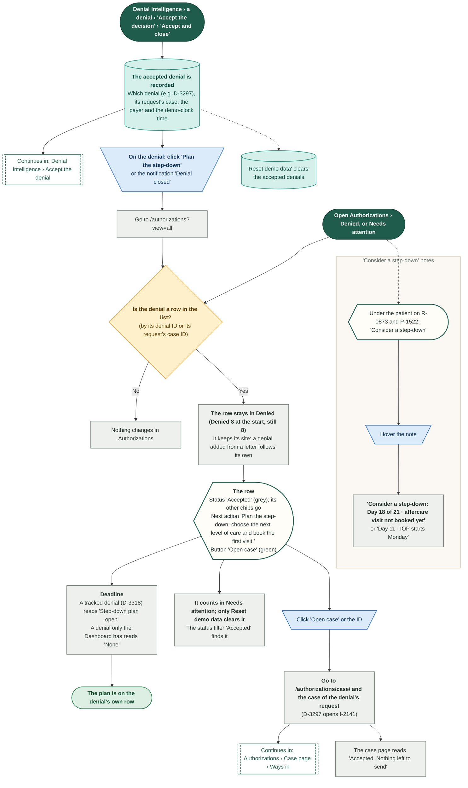

## Authorizations › Worklist › Updated for a payer change

When Payers updates open drafts after a rule change or saved edits, the rows of the cases it redrafted carry a small note 'Updated for a payer change' with the date, under the patient. The note shows the latest update for the case. Rows that no update lists carry no note.

Route: `/authorizations`

Only drafts not sent yet are redrafted; a request the payer already has is never rewritten. Reset demo data clears the notes. The Payers toast and the 'Drafts updated' notification still say Case Manager; the notification opens plain /authorizations, which brings back the last view used.

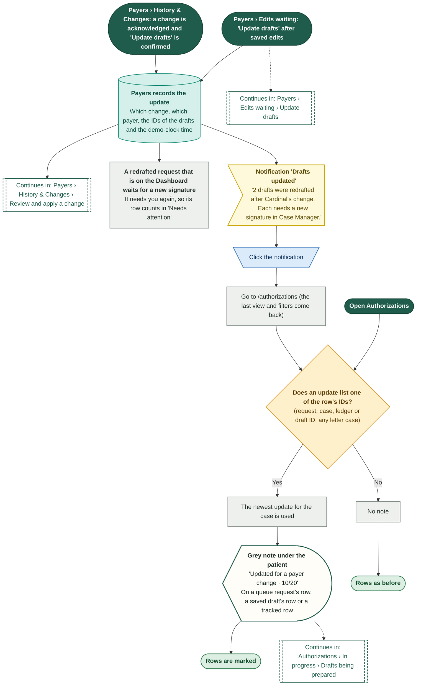

## Authorizations › Approved › Approved authorizations and their units

The Approved view is what Case Manager's tracker was for: every approved authorization at the sites in view, with how much of the approval is used, what is due next and the one thing to do. It is a view of the same table, so search, filters, sort, pages and the quick view work as on every other view.

Route: `/authorizations?view=approved`

Demo only, at the start: 32 approved authorizations (Site A 17, Site B 15), all from the ledger. A request approved since (on the Dashboard or after it was sent today) joins them as 'Approved' or 'Partial approval'. The tracker's four status tiles (Needs action, Review due, Awaiting payer, On track) are gone: Needs action and Review due are chips on the row, and the quick view keeps the ledger status.

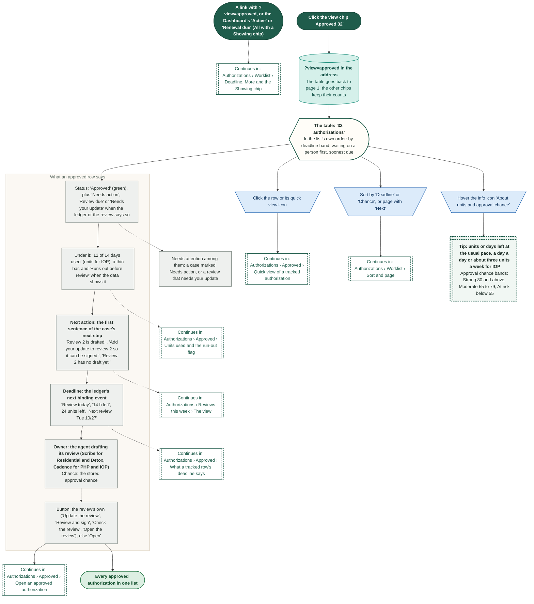

## Authorizations › Approved › Open an approved authorization

The ways out of a ledger row (an approved authorization, or a request sent today that the ledger now tracks): the ID opens the full case, the row or its icon opens the tracked quick view, and the button does the one thing due. A case that is a request gets the Authorizations case page; one that only the ledger has gets the ledger case page; a case at a site the viewer is not looking at gets the out-of-site card.

Route: `/authorizations?view=approved → /authorizations/case/ID`

Demo only: 26 of the 32 approved authorizations at the start have no request of their own and open the ledger case page; the other 6 are also requests, so they open the Authorizations case page. 'Start reauthorization' shows only for an approval ending within 7 days with no review open or booked. Every approved row at the start has a review this week, and signing books the next one, so it appears for a request sent today and approved, once Fast-forward brings its end within 7 days.

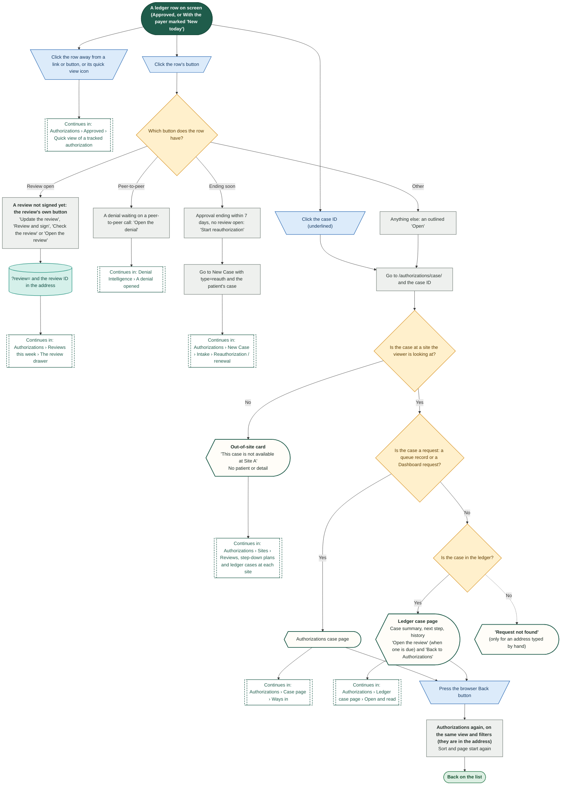

## Authorizations › Approved › What a tracked row's deadline says

The Deadline cell of a row that comes from the ledger says how long until the next thing that binds. When the case is also a request with a due time on its case page, it says exactly what the case page says. Otherwise the wording depends on the kind of event. It turns red when time is short, and it moves with the demo clock.

Route: `/authorizations?view=approved`

A ledger record that joins a queue request's row does not change that row's Deadline: the request's own due time stays. Times under two days show hours ('5 h'), longer ones days ('3 days'). Approval chance and the ledger status are stored and do not move, except that a booked next review sets 'On track'.

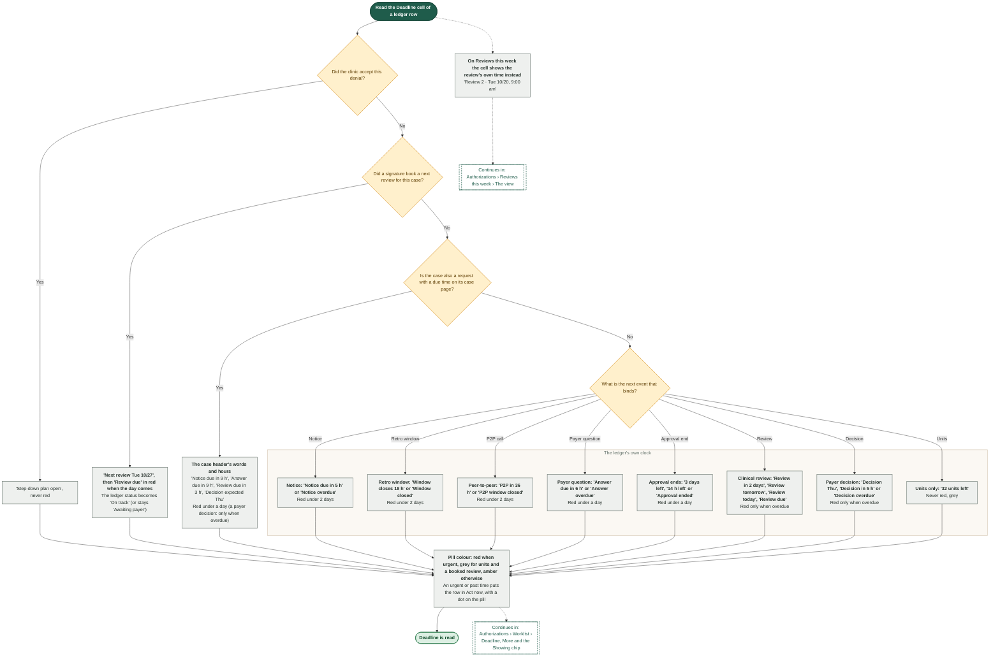

## Authorizations › With the payer › A request sent today joins the list

A case signed and sent in New Case leaves In progress and becomes a request with the payer. The ledger starts tracking it as 'New today' unless it already had the case, so the list still has one row for it, now in With the payer, with the tracked quick view. The With the payer view counts what was sent today in its header button.

Route: `/authorizations?view=payer`

Demo only: four requests count as sent today at the start (I-2231, R-1088, P-1611, P-1637), so the button reads '4 sent today'. The new row follows its request: Fast-forward moves its clock and Reset demo data removes it.

```mermaid
%%{init: {"theme":"base","themeVariables":{"fontFamily":"'DM Sans', 'Segoe UI', system-ui, sans-serif","fontSize":"15px","lineColor":"#5B6B63","primaryTextColor":"#1C2B25","clusterBkg":"#FBF8F3","clusterBorder":"#D9CDBB","edgeLabelBackground":"#FFFFFF"},"flowchart":{"curve":"basis","nodeSpacing":36,"rankSpacing":48,"padding":12,"htmlLabels":true,"useMaxWidth":false,"wrappingWidth":230}} }%%
flowchart TD
  classDef k_start fill:#1F5C4B,stroke:#174638,color:#FFFFFF,stroke-width:1.5px,font-weight:600
  classDef k_end fill:#DDEFE3,stroke:#2E7D4F,color:#14502F,stroke-width:1.5px,font-weight:600
  classDef k_endx fill:#FBE3E0,stroke:#C0392B,color:#7A1F16,stroke-width:1.5px,font-weight:600
  classDef k_screen fill:#FFFDF8,stroke:#1F5C4B,color:#1C2B25,stroke-width:2px
  classDef k_overlay fill:#F1F7F3,stroke:#1F5C4B,color:#1C2B25,stroke-width:2px,stroke-dasharray:5 3
  classDef k_click fill:#DCEBFA,stroke:#2F6DB5,color:#12365F,stroke-width:1.5px
  classDef k_input fill:#E4E7FF,stroke:#4C5FD5,color:#1D2670,stroke-width:1.5px
  classDef k_process fill:#EEF0EE,stroke:#7A857F,color:#26302B,stroke-width:1.5px
  classDef k_agent fill:#EEE5FA,stroke:#7A4FC2,color:#341A63,stroke-width:1.5px
  classDef k_decision fill:#FFF0CC,stroke:#D9962B,color:#5C3B00,stroke-width:1.5px
  classDef k_store fill:#D5F0EA,stroke:#1C8E7B,color:#0B4A3F,stroke-width:1.5px
  classDef k_doc fill:#F6E9DC,stroke:#B07A4C,color:#4A2E14,stroke-width:1.5px
  classDef k_ext fill:#FFE6D2,stroke:#E07B39,color:#6B2F06,stroke-width:1.5px
  classDef k_wait fill:#E4E8EE,stroke:#6B7C93,color:#26303D,stroke-width:1.5px
  classDef k_toast fill:#FFF9DB,stroke:#C9A400,color:#5A4A00,stroke-width:1.5px
  classDef k_goto fill:#FFFFFF,stroke:#1F5C4B,color:#1F5C4B,stroke-width:1.5px,stroke-dasharray:5 3
  s1@{ shape: stadium, label: "New Case › Review & submit › 'Sign and send to payer (demo)'" }
  g1@{ shape: subproc, label: "Continues in: Authorizations › New Case › Review & submit › Sign and send to payer" }
  st1@{ shape: cyl, label: "<b>The request is on the Dashboard as 'Received'</b><br/>Its ID is added to 'sent today'" }
  d0@{ shape: diam, label: "Was it already a queue request (sent from its row's 'Send to payer')?" }
  p0@{ shape: rect, label: "Its queue record is done: the In progress row it had leaves" }
  p0b@{ shape: rect, label: "A new case: a queue record is added, with the payer" }
  d1@{ shape: diam, label: "<b>Did the ledger already have the case, or is it one of the demo's own requests?</b><br/>(R-0988, I-2207 and the seed requests are)" }
  p1@{ shape: rect, label: "<b>No new record: the case shows its ledger row or its Dashboard request as before</b><br/>e.g. R-0988 reads Approved, its review still due" }
  p2@{ shape: cyl, label: "<b>The ledger adds a record for it, marked 'New today'</b><br/>Initials and age, level of care, request type, approval chance from the draft, not yet approved" }
  r1@{ shape: curv-trap, label: "<b>One row in With the payer</b><br/>'New today' in green under the patient<br/>Status 'With the payer', next action 'Wait for Lakeshore.' (or '... to decide')<br/>Button 'Open' (or 'Open on Dashboard'); the row opens the tracked quick view" }
  p3@{ shape: rect, label: "<b>The row follows the request</b><br/>With the payer: 'Decision expected' and 'Awaiting payer' in the quick view<br/>Info requested: 'Answer due', Needs action<br/>Approved: Approved, '0 of 14 days used' (PHP 10, Detox 5, IOP 24 units)<br/>Denied: Denial route with a peer-to-peer clock, in Denied" }
  p4@{ shape: rect, label: "<b>Counts move together: In progress one fewer, the view it is in now one more</b><br/>The sidebar badge drops if the request was due now or within 24 hours" }
  subgraph gH ["'N sent today'"]
  h1@{ shape: curv-trap, label: "'5 sent today' before 'New Case' (only on With the payer, only when something was sent)" }
  h2@{ shape: trap-t, label: "Click '5 sent today'" }
  h3@{ shape: rect, label: "Go to /dashboard?stage=received" }
  end
  g2@{ shape: subproc, label: "Continues in: Dashboard › Lifecycle › Click a state to filter the table" }
  g3@{ shape: subproc, label: "Continues in: Authorizations › Approved › Quick view of a tracked authorization" }
  g4@{ shape: subproc, label: "Continues in: Authorizations › Approved › Open an approved authorization" }
  e1@{ shape: stadium, label: "The sent request is one row, with the payer" }
  s1 --> g1
  s1 --> st1 --> d0
  d0 -->|"Yes"| p0 --> d1
  d0 -->|"No"| p0b --> d1
  d1 -->|"Yes"| p1 --> p4
  d1 -->|"No"| p2 --> r1 --> p3 --> p4 --> e1
  r1 -.-> g3
  r1 -.-> g4
  st1 --> h1 --> h2 --> h3 --> g2
  class s1 k_start
  class g1,g2,g3,g4 k_goto
  class st1,p2 k_store
  class d0,d1 k_decision
  class p0,p0b,p1,p3,p4,h3 k_process
  class r1,h1 k_screen
  class h2 k_click
  class e1 k_end
  style gH fill:#FBF8F3,stroke:#D9CDBB,stroke-width:1.5px,color:#5B6B63
```

## Authorizations › Approved › Units used and the run-out flag

Under the status chip of a row whose approval the ledger holds: how much of the approval is used, a thin bar and, only when the data shows it, that the approval runs out before the next review. The tracked quick view and the ledger case page say the same with how much is left.

Route: `/authorizations?view=approved`

The pace is the demo's own: one day of care a day, and about three units a week for IOP (the case page dates the approval with the same pace). A real payer's day or unit count would replace it. The tracker's 'Units or days' column and its sort are gone; the line sits in the Status cell, or under the patient below 1100 px.

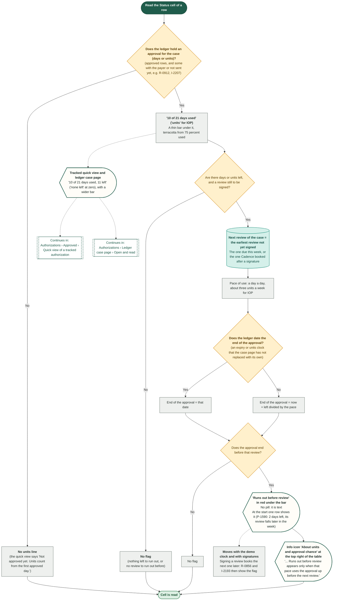

## Authorizations › Approved › Quick view of a tracked authorization

A row the ledger tracks opens this right-hand quick view when it is approved or with the payer: the summary first (what is due next, units used and left, the approved window, level of care, payer, site, approval chance, the next review, documents and the three newest lines of history), then 'Open case' and, where it applies, 'Draft review' or 'Open review'. Requests still in progress and denials open the other quick views.

Route: `/authorizations?view=approved&quick=R-0856`

Demo only, at the start: 50 rows open it (the 32 approved authorizations and 18 requests with the payer). The status pill at the top is the ledger's own (Needs action, Review due, Awaiting payer, On track), which the row shows as chips.

```mermaid
%%{init: {"theme":"base","themeVariables":{"fontFamily":"'DM Sans', 'Segoe UI', system-ui, sans-serif","fontSize":"15px","lineColor":"#5B6B63","primaryTextColor":"#1C2B25","clusterBkg":"#FBF8F3","clusterBorder":"#D9CDBB","edgeLabelBackground":"#FFFFFF"},"flowchart":{"curve":"basis","nodeSpacing":36,"rankSpacing":48,"padding":12,"htmlLabels":true,"useMaxWidth":false,"wrappingWidth":230}} }%%
flowchart TD
  classDef k_start fill:#1F5C4B,stroke:#174638,color:#FFFFFF,stroke-width:1.5px,font-weight:600
  classDef k_end fill:#DDEFE3,stroke:#2E7D4F,color:#14502F,stroke-width:1.5px,font-weight:600
  classDef k_endx fill:#FBE3E0,stroke:#C0392B,color:#7A1F16,stroke-width:1.5px,font-weight:600
  classDef k_screen fill:#FFFDF8,stroke:#1F5C4B,color:#1C2B25,stroke-width:2px
  classDef k_overlay fill:#F1F7F3,stroke:#1F5C4B,color:#1C2B25,stroke-width:2px,stroke-dasharray:5 3
  classDef k_click fill:#DCEBFA,stroke:#2F6DB5,color:#12365F,stroke-width:1.5px
  classDef k_input fill:#E4E7FF,stroke:#4C5FD5,color:#1D2670,stroke-width:1.5px
  classDef k_process fill:#EEF0EE,stroke:#7A857F,color:#26302B,stroke-width:1.5px
  classDef k_agent fill:#EEE5FA,stroke:#7A4FC2,color:#341A63,stroke-width:1.5px
  classDef k_decision fill:#FFF0CC,stroke:#D9962B,color:#5C3B00,stroke-width:1.5px
  classDef k_store fill:#D5F0EA,stroke:#1C8E7B,color:#0B4A3F,stroke-width:1.5px
  classDef k_doc fill:#F6E9DC,stroke:#B07A4C,color:#4A2E14,stroke-width:1.5px
  classDef k_ext fill:#FFE6D2,stroke:#E07B39,color:#6B2F06,stroke-width:1.5px
  classDef k_wait fill:#E4E8EE,stroke:#6B7C93,color:#26303D,stroke-width:1.5px
  classDef k_toast fill:#FFF9DB,stroke:#C9A400,color:#5A4A00,stroke-width:1.5px
  classDef k_goto fill:#FFFFFF,stroke:#1F5C4B,color:#1F5C4B,stroke-width:1.5px,stroke-dasharray:5 3
  s1@{ shape: stadium, label: "A tracked row is on screen (Approved, or With the payer with a ledger record)" }
  c1@{ shape: trap-t, label: "Click the row (any part that is not a link or button)" }
  c2@{ shape: trap-t, label: "<b>Click the small icon 'Quick view R-0856' beside the patient</b><br/>(Tab to it, then Enter or Space)" }
  ad@{ shape: cyl, label: "<b>?quick=R-0856 in the address (replaces the entry)</b><br/>The row is highlighted" }
  ov@{ shape: win-pane, label: "<b>Right-hand panel 'R-0856 · Summit'</b><br/>Subtitle 'J.S., 51 · Residential 3.5 · Continued stay 2', ledger status pill 'Review due' at the right<br/>Big line 'Next due': 'Review today', red when urgent, and the next step: 'Review 2 is drafted. Read it, then sign it. ...'" }
  pf@{ shape: rect, label: "<b>Focus goes to 'Open case'</b><br/>Tab stays inside the panel" }
  kv@{ shape: curv-trap, label: "<b>Facts, one line each</b><br/>Units or days: '12 of 14 days used, 2 left' with a bar, and 'Runs out before review' when it applies<br/>Approved window: 'Thu 10/8 to Thu 10/22'<br/>Level of care, Payer, Workflow (when the case follows one), Site ('Site B · Second campus')<br/>Approval chance with its band, range and how many similar decisions" }
  kr@{ shape: curv-trap, label: "<b>Next review: 'Review 2, Tue 10/20, 9:00 am' with its pill (Not drafted yet, Drafted, Needs your update)</b><br/>Not approved yet: 'None until the request is approved'; approved with no review open: 'None booked'" }
  dd@{ shape: diam, label: "Does the case have a case page of its own (a request)?" }
  dc@{ shape: curv-trap, label: "<b>Documents: 'Complete, all 10 in the packet' or '8 of 9. Missing: ...'</b><br/>Counted the way the case page counts them" }
  dn@{ shape: rect, label: "No Documents line" }
  hh@{ shape: curv-trap, label: "<b>Latest history: the three newest lines, each with who did it and the time</b><br/>e.g. 'Review 2 is due', 'Scribe drafted review 2', 'Summit approved 14 days'<br/>A case that is also a request shows the request's own events" }
  dr@{ shape: diam, label: "What state is the next review in?" }
  cd@{ shape: trap-t, label: "Click 'Draft review'" }
  ag@{ shape: hex, label: "<b>Cadence drafts the review (demo: simulated, about 1.3 seconds)</b><br/>A paused Cadence says so at once: toast 'Cadence is paused in Settings'" }
  tg@{ shape: odd, label: "'Cadence drafted 1 review'" }
  pu@{ shape: rect, label: "The panel updates in place: the pill reads 'Drafted' and 'Draft review' becomes 'Open review'" }
  co@{ shape: trap-t, label: "Click 'Open review'" }
  po@{ shape: rect, label: "<b>The quick view closes and the review drawer opens</b><br/>The address swaps ?quick= for ?review=" }
  g3@{ shape: subproc, label: "Continues in: Authorizations › Reviews this week › The review drawer" }
  g5@{ shape: subproc, label: "Continues in: Authorizations › Ledger case page › Workflow line and history" }
  pn2@{ shape: rect, label: "No review button: the next review is not this week, or the case is not approved" }
  cc@{ shape: trap-t, label: "Click 'Open case'" }
  g1@{ shape: subproc, label: "Continues in: Authorizations › Approved › Open an approved authorization" }
  cx@{ shape: trap-t, label: "Press Escape, click X or the dimmed area" }
  px@{ shape: rect, label: "<b>The panel closes and ?quick= leaves the address</b><br/>Focus returns to the row's quick view icon" }
  ps@{ shape: rect, label: "<b>The panel shows only rows at the sites in view</b><br/>If the view changes so the case is out of site, it closes" }
  e1@{ shape: stadium, label: "Back on the list" }
  s1 --> c1 --> ad
  s1 --> c2 --> ad
  ad --> ov --> pf --> kv --> kr --> dd
  kv -.-> g5
  dd -->|"Yes"| dc --> hh
  dd -->|"No"| dn --> hh
  hh --> dr
  dr -->|"Not drafted yet, due this week"| cd --> ag --> tg --> pu --> co
  dr -->|"Drafted or needs your update"| co
  dr -->|"None, or later than this week"| pn2
  co --> po --> g3
  ov --> cc --> g1
  ov --> cx --> px --> e1
  ov -.-> ps
  class s1 k_start
  class c1,c2,cd,co,cc,cx k_click
  class ad k_store
  class ov k_overlay
  class pf,dn,pu,po,pn2,px,ps k_process
  class kv,kr,dc,hh k_screen
  class dd,dr k_decision
  class ag k_agent
  class tg k_toast
  class g3,g5,g1 k_goto
  class e1 k_end
```

## Authorizations › Reviews this week › The view

Reviews this week is a view of the same table: every row whose continued-stay review is due before the end of Sunday, in review-time order. The Next action and Deadline columns become the review's status and time, each row's button becomes the review's own, and the header gains 'Draft all due reviews' and 'Sign all clean drafts'. Agents have already drafted most reviews.

Route: `/authorizations?view=reviews`

Demo only, at the start: 47 rows (Site A 26, Site B 21): 35 drafted (29 clean, 6 with a check to look at), 8 that need a clinician's update, 4 weekend reviews not drafted yet. One row per request, so a signed review stays on its row as 'Signed' and the count stays 47. Case Manager's day cards, its three tiles, 'Show N more' and the 'Ready to step down?' card are gone; the step-down prompt is a note on the row.

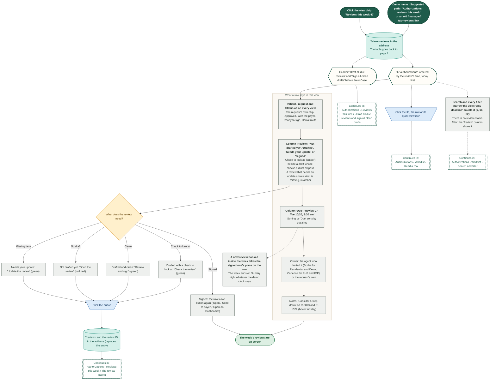

## Authorizations › Reviews this week › The review drawer

Opening a review shows the draft an agent wrote, the four Integrity checks and the buttons to sign or open the case. It opens from a row's review button on any view, from the tracked quick view's 'Open review' (the quick view closes first), and from a ?review= link (the ledger case page's 'Open the review', Ask FLO, an old /manager?review= address). What the clinician can do depends on the review's status.

Route: `/authorizations?view=reviews&review=rv-R-0856 (drawer over the list)`

```mermaid
%%{init: {"theme":"base","themeVariables":{"fontFamily":"'DM Sans', 'Segoe UI', system-ui, sans-serif","fontSize":"15px","lineColor":"#5B6B63","primaryTextColor":"#1C2B25","clusterBkg":"#FBF8F3","clusterBorder":"#D9CDBB","edgeLabelBackground":"#FFFFFF"},"flowchart":{"curve":"basis","nodeSpacing":36,"rankSpacing":48,"padding":12,"htmlLabels":true,"useMaxWidth":false,"wrappingWidth":230}} }%%
flowchart TD
  classDef k_start fill:#1F5C4B,stroke:#174638,color:#FFFFFF,stroke-width:1.5px,font-weight:600
  classDef k_end fill:#DDEFE3,stroke:#2E7D4F,color:#14502F,stroke-width:1.5px,font-weight:600
  classDef k_endx fill:#FBE3E0,stroke:#C0392B,color:#7A1F16,stroke-width:1.5px,font-weight:600
  classDef k_screen fill:#FFFDF8,stroke:#1F5C4B,color:#1C2B25,stroke-width:2px
  classDef k_overlay fill:#F1F7F3,stroke:#1F5C4B,color:#1C2B25,stroke-width:2px,stroke-dasharray:5 3
  classDef k_click fill:#DCEBFA,stroke:#2F6DB5,color:#12365F,stroke-width:1.5px
  classDef k_input fill:#E4E7FF,stroke:#4C5FD5,color:#1D2670,stroke-width:1.5px
  classDef k_process fill:#EEF0EE,stroke:#7A857F,color:#26302B,stroke-width:1.5px
  classDef k_agent fill:#EEE5FA,stroke:#7A4FC2,color:#341A63,stroke-width:1.5px
  classDef k_decision fill:#FFF0CC,stroke:#D9962B,color:#5C3B00,stroke-width:1.5px
  classDef k_store fill:#D5F0EA,stroke:#1C8E7B,color:#0B4A3F,stroke-width:1.5px
  classDef k_doc fill:#F6E9DC,stroke:#B07A4C,color:#4A2E14,stroke-width:1.5px
  classDef k_ext fill:#FFE6D2,stroke:#E07B39,color:#6B2F06,stroke-width:1.5px
  classDef k_wait fill:#E4E8EE,stroke:#6B7C93,color:#26303D,stroke-width:1.5px
  classDef k_toast fill:#FFF9DB,stroke:#C9A400,color:#5A4A00,stroke-width:1.5px
  classDef k_goto fill:#FFFFFF,stroke:#1F5C4B,color:#1F5C4B,stroke-width:1.5px,stroke-dasharray:5 3
  s1@{ shape: stadium, label: "Click a row's 'Update the review', 'Review and sign', 'Check the review' or 'Open the review'" }
  o1@{ shape: win-pane, label: "<b>Drawer slides in from the right (640 px); ?review= is in the address</b><br/>Title 'R-0856 · Summit'<br/>Subtitle 'Continued-stay review 2 · Residential 3.5 · due Tue 10/20, 9:00 am'<br/>Status pill at the top right" }
  b1@{ shape: curv-trap, label: "<b>Top of the body</b><br/>'J.S., 51 · privacy mode'   'Drafted by' Scribe (Residential, Detox) or Cadence (PHP, IOP)<br/>Once drafted: 'Draft by FLO's agents. A clinician reviews and signs before anything is sent.'" }
  b2@{ shape: curv-trap, label: "<b>'The draft'</b><br/>Large text box with seven parts: title and payer lines, Clinical status, Treatment progress, Risk and safety, Why this level of care still fits, Request" }
  b3@{ shape: curv-trap, label: "<b>'Integrity checks'</b><br/>'Every sentence traced to the chart'<br/>'Review has no errors'<br/>'All payer requirements covered'<br/>'Level of care matches the request'" }
  b4@{ shape: curv-trap, label: "<b>Footer</b><br/>'Sign review' (green), 'Open case', 'Close'" }
  d1@{ shape: diam, label: "What is the review's status?" }
  t1@{ shape: rect, label: "<b>'Drafted', all four checks green ticks</b><br/>Draft can be edited<br/>Banner: 'Signing is one review at a time. Your edits to the draft are saved with the signature.'" }
  t2@{ shape: rect, label: "<b>'Drafted' with 'Check to look at'</b><br/>One check is amber with Integrity's note, for example 'The draft asks for 7 days. Beacon's usual limit at this level of care is 5.'<br/>Draft can be edited" }
  t3@{ shape: rect, label: "<b>'Needs your update'</b><br/>Amber panel names what is missing; 'All payer requirements covered' is red<br/>Draft is locked: 'The draft is locked until your update is added.'<br/>'Sign review' is greyed, hover text 'Add your update first'" }
  t4@{ shape: rect, label: "<b>'Signed'</b><br/>Draft is read-only<br/>Footer shows 'Signed by Heather K., LISW-S' in place of the button<br/>Green banner 'Next review: Tue 10/27, 9:00 am' with 'Cadence booked it.' and either 'It is on this week's list.' or 'It falls after this week, so it is not on the list yet.'" }
  t5@{ shape: rect, label: "<b>'Not drafted yet'</b><br/>Grey panel 'Not drafted yet': 'Cadence drafts each review a few days ahead. This one is not due until Sat 10/24, 9:00 am, so it has no draft and no Integrity checks yet.'<br/>The line above reads 'To be drafted by' Cadence<br/>No draft box and no checks<br/>'Sign review' is greyed, hover text 'Draft the review first'" }
  c4@{ shape: trap-t, label: "Click 'Draft this review'" }
  dp@{ shape: diam, label: "Is Cadence paused in Settings?" }
  tp@{ shape: odd, label: "<b>'Cadence is paused in Settings'</b><br/>'It drafts no reviews until you resume it there.'" }
  pd@{ shape: rect, label: "Button shows a spinner for about 1.3 seconds" }
  sd@{ shape: cyl, label: "Review becomes 'Drafted': the seven-part text and four green Integrity checks appear" }
  td@{ shape: odd, label: "'Cadence drafted 1 review'" }
  i1@{ shape: lean-r, label: "Edit the draft text" }
  c1@{ shape: trap-t, label: "Click 'Sign review'" }
  g1@{ shape: subproc, label: "Continues in: Authorizations › Reviews this week › Sign a review" }
  g2@{ shape: subproc, label: "Continues in: Authorizations › Reviews this week › Add your update to a review" }
  c2@{ shape: trap-t, label: "Click 'Open case'" }
  p1@{ shape: rect, label: "<b>Go to /authorizations/case/ and the case ID, with ?tab=draft</b><br/>The drawer is gone with the page" }
  d3@{ shape: diam, label: "Is the case a request (a queue record or a Dashboard request)?" }
  g3@{ shape: subproc, label: "Continues in: Authorizations › Case page › Draft › Read and edit" }
  g4@{ shape: subproc, label: "Continues in: Authorizations › Ledger case page › Open and read" }
  c3@{ shape: trap-t, label: "<b>Click 'Close', the X, the dimmed area, or press Escape</b><br/>(Escape closes one layer at a time: an open sign dialog first, the drawer next)" }
  d2@{ shape: diam, label: "Was the review a draft?" }
  st1@{ shape: cyl, label: "<b>Edits to the draft are saved on the review</b><br/>Open it again and the edited text is there" }
  p2@{ shape: rect, label: "Nothing to save" }
  e1@{ shape: stadium, label: "Back on the list, same view and page; ?review= leaves the address" }
  s1 --> o1 --> b1 --> b2 --> b3 --> b4 --> d1
  d1 -->|"Clean draft"| t1
  d1 -->|"One check to look at"| t2
  d1 -->|"Missing item"| t3
  d1 -->|"Already signed"| t4
  d1 -->|"No draft yet"| t5
  t1 --> i1
  t2 --> i1
  t1 --> c1 --> g1
  t2 --> c1
  t3 --> g2
  t4 --> c2
  t1 --> c2
  c2 --> p1 --> d3
  d3 -->|"Yes"| g3
  d3 -->|"No: only the ledger has it"| g4
  t5 --> c4 --> dp
  dp -->|"Yes"| tp
  dp -->|"No"| pd --> sd --> td --> t1
  b4 --> c3 --> d2
  d2 -->|"Yes: Drafted"| st1 --> e1
  d2 -->|"No"| p2 --> e1
  class s1 k_start
  class o1 k_overlay
  class b1,b2,b3,b4 k_screen
  class d1,dp,d3,d2 k_decision
  class t1,t2,t3,t4,t5,pd,p1,p2 k_process
  class c4,c1,c2,c3 k_click
  class tp,td k_toast
  class sd,st1 k_store
  class i1 k_input
  class g1,g2,g3,g4 k_goto
  class e1 k_end
```

## Authorizations › Reviews this week › Add your update to a review

Eight reviews could not be finished by the agents because the chart lacks one item. The clinician says what applies, in their own words, and Integrity checks the draft again. The review then becomes an ordinary draft that can be signed. This is the 'answer' gate: agents stop and ask a person.

Route: `/authorizations?view=reviews&review=rv-R-0912 (review drawer)`

```mermaid
%%{init: {"theme":"base","themeVariables":{"fontFamily":"'DM Sans', 'Segoe UI', system-ui, sans-serif","fontSize":"15px","lineColor":"#5B6B63","primaryTextColor":"#1C2B25","clusterBkg":"#FBF8F3","clusterBorder":"#D9CDBB","edgeLabelBackground":"#FFFFFF"},"flowchart":{"curve":"basis","nodeSpacing":36,"rankSpacing":48,"padding":12,"htmlLabels":true,"useMaxWidth":false,"wrappingWidth":230}} }%%
flowchart TD
  classDef k_start fill:#1F5C4B,stroke:#174638,color:#FFFFFF,stroke-width:1.5px,font-weight:600
  classDef k_end fill:#DDEFE3,stroke:#2E7D4F,color:#14502F,stroke-width:1.5px,font-weight:600
  classDef k_endx fill:#FBE3E0,stroke:#C0392B,color:#7A1F16,stroke-width:1.5px,font-weight:600
  classDef k_screen fill:#FFFDF8,stroke:#1F5C4B,color:#1C2B25,stroke-width:2px
  classDef k_overlay fill:#F1F7F3,stroke:#1F5C4B,color:#1C2B25,stroke-width:2px,stroke-dasharray:5 3
  classDef k_click fill:#DCEBFA,stroke:#2F6DB5,color:#12365F,stroke-width:1.5px
  classDef k_input fill:#E4E7FF,stroke:#4C5FD5,color:#1D2670,stroke-width:1.5px
  classDef k_process fill:#EEF0EE,stroke:#7A857F,color:#26302B,stroke-width:1.5px
  classDef k_agent fill:#EEE5FA,stroke:#7A4FC2,color:#341A63,stroke-width:1.5px
  classDef k_decision fill:#FFF0CC,stroke:#D9962B,color:#5C3B00,stroke-width:1.5px
  classDef k_store fill:#D5F0EA,stroke:#1C8E7B,color:#0B4A3F,stroke-width:1.5px
  classDef k_doc fill:#F6E9DC,stroke:#B07A4C,color:#4A2E14,stroke-width:1.5px
  classDef k_ext fill:#FFE6D2,stroke:#E07B39,color:#6B2F06,stroke-width:1.5px
  classDef k_wait fill:#E4E8EE,stroke:#6B7C93,color:#26303D,stroke-width:1.5px
  classDef k_toast fill:#FFF9DB,stroke:#C9A400,color:#5A4A00,stroke-width:1.5px
  classDef k_goto fill:#FFFFFF,stroke:#1F5C4B,color:#1F5C4B,stroke-width:1.5px,stroke-dasharray:5 3
  s1@{ shape: stadium, label: "<b>Click 'Update the review' on a row whose review needs your update</b><br/>(for example R-0912)" }
  o1@{ shape: win-pane, label: "<b>Review drawer</b><br/>Status pill 'Needs your update'" }
  b1@{ shape: curv-trap, label: "<b>Amber panel 'Needs your update'</b><br/>What is missing, for example 'Evergreen has not answered in 4 days. Confirm the current risk assessment before Caller resends the review.'" }
  b2@{ shape: curv-trap, label: "<b>Box 'Your update' (required)</b><br/>Hint: 'This goes into the draft under Clinician update. Integrity checks the draft again.'<br/>Button 'Add to the draft' (greyed while the box is empty)" }
  b3@{ shape: curv-trap, label: "<b>The draft is read-only: 'The draft is locked until your update is added.'</b><br/>Integrity checks: 'All payer requirements covered' is red with 'A required item is missing. See what the review needs from you.'<br/>'Sign review' is greyed: 'Add your update first'" }
  i1@{ shape: lean-r, label: "Type the update in 'Your update'" }
  d1@{ shape: diam, label: "Is there text (not just spaces)?" }
  p0@{ shape: rect, label: "'Add to the draft' stays greyed. Nothing can be sent" }
  c1@{ shape: trap-t, label: "Click 'Add to the draft'" }
  p1@{ shape: rect, label: "Button shows a spinner for about 1.3 seconds" }
  a1@{ shape: hex, label: "Integrity checks the draft again with the update" }
  st1@{ shape: cyl, label: "<b>Review is saved as 'Drafted'</b><br/>The missing item is cleared<br/>Your text is saved as the note and added to the draft under 'Clinician update'<br/>All four checks turn green" }
  t1@{ shape: odd, label: "<b>'Review updated'</b><br/>'Integrity checked R-0912 again. It is a draft now and ready to sign.'" }
  p2@{ shape: rect, label: "<b>Drawer redraws in place:</b><br/>Amber panel gone, draft unlocked and longer, checks green, 'Sign review' ready" }
  p3@{ shape: rect, label: "<b>On the row: 'Review' reads 'Drafted' and the button 'Review and sign'</b><br/>The review counts as clean for 'Sign all clean drafts'<br/>A tracked case with no other reason leaves 'Needs attention'; the sidebar badge does not change" }
  g1@{ shape: subproc, label: "Continues in: Authorizations › Reviews this week › Sign a review" }
  c2@{ shape: trap-t, label: "Close the drawer without adding anything" }
  p4@{ shape: rect, label: "Nothing is saved: the review stays 'Needs your update'" }
  c3@{ shape: trap-t, label: "Click 'Open case'" }
  g2@{ shape: subproc, label: "Continues in: Authorizations › Case page › Draft › Read and edit" }
  e1@{ shape: stadium, label: "Review is ready to sign" }
  e2@{ shape: stadium, label: "Still waiting on the clinician" }
  s1 --> o1 --> b1 --> b2 --> b3 --> i1 --> d1
  d1 -->|"No"| p0 --> e2
  d1 -->|"Yes"| c1 --> p1 --> a1 --> st1
  st1 --> t1 --> p2 --> p3 --> g1
  p3 --> e1
  b3 --> c2 --> p4 --> e2
  b3 --> c3 --> g2
  p0 -.-> i1
  class s1 k_start
  class o1 k_overlay
  class b1,b2,b3 k_screen
  class i1 k_input
  class d1 k_decision
  class p0,p1,p2,p3,p4 k_process
  class c1,c2,c3 k_click
  class a1 k_agent
  class st1 k_store
  class t1 k_toast
  class g1,g2 k_goto
  class e1 k_end
  class e2 k_endx
```

## Authorizations › Reviews this week › Sign a review

Signing is the gate where agents stop. Only a licensed clinician signs, so the coordinator picks who is signing and ticks an attestation. When Integrity left one amber check, the signer must also read and accept it. Signing is one review at a time.

Route: `/authorizations?view=reviews&review=rv-R-0856 (review drawer › sign dialog)`

PRD 03 (sign-off gate) says nothing goes out without a clinician signature carrying signer identity and a timestamp. The demo records the signer and the demo-clock time.

```mermaid
%%{init: {"theme":"base","themeVariables":{"fontFamily":"'DM Sans', 'Segoe UI', system-ui, sans-serif","fontSize":"15px","lineColor":"#5B6B63","primaryTextColor":"#1C2B25","clusterBkg":"#FBF8F3","clusterBorder":"#D9CDBB","edgeLabelBackground":"#FFFFFF"},"flowchart":{"curve":"basis","nodeSpacing":36,"rankSpacing":48,"padding":12,"htmlLabels":true,"useMaxWidth":false,"wrappingWidth":230}} }%%
flowchart TD
  classDef k_start fill:#1F5C4B,stroke:#174638,color:#FFFFFF,stroke-width:1.5px,font-weight:600
  classDef k_end fill:#DDEFE3,stroke:#2E7D4F,color:#14502F,stroke-width:1.5px,font-weight:600
  classDef k_endx fill:#FBE3E0,stroke:#C0392B,color:#7A1F16,stroke-width:1.5px,font-weight:600
  classDef k_screen fill:#FFFDF8,stroke:#1F5C4B,color:#1C2B25,stroke-width:2px
  classDef k_overlay fill:#F1F7F3,stroke:#1F5C4B,color:#1C2B25,stroke-width:2px,stroke-dasharray:5 3
  classDef k_click fill:#DCEBFA,stroke:#2F6DB5,color:#12365F,stroke-width:1.5px
  classDef k_input fill:#E4E7FF,stroke:#4C5FD5,color:#1D2670,stroke-width:1.5px
  classDef k_process fill:#EEF0EE,stroke:#7A857F,color:#26302B,stroke-width:1.5px
  classDef k_agent fill:#EEE5FA,stroke:#7A4FC2,color:#341A63,stroke-width:1.5px
  classDef k_decision fill:#FFF0CC,stroke:#D9962B,color:#5C3B00,stroke-width:1.5px
  classDef k_store fill:#D5F0EA,stroke:#1C8E7B,color:#0B4A3F,stroke-width:1.5px
  classDef k_doc fill:#F6E9DC,stroke:#B07A4C,color:#4A2E14,stroke-width:1.5px
  classDef k_ext fill:#FFE6D2,stroke:#E07B39,color:#6B2F06,stroke-width:1.5px
  classDef k_wait fill:#E4E8EE,stroke:#6B7C93,color:#26303D,stroke-width:1.5px
  classDef k_toast fill:#FFF9DB,stroke:#C9A400,color:#5A4A00,stroke-width:1.5px
  classDef k_goto fill:#FFFFFF,stroke:#1F5C4B,color:#1F5C4B,stroke-width:1.5px,stroke-dasharray:5 3
  s1@{ shape: stadium, label: "Open a drafted review, then click 'Sign review'" }
  o1@{ shape: win-pane, label: "<b>Dialog 'Sign this review'</b><br/>Subtitle 'R-0856 · Summit Medicaid HMO · Residential 3.5'" }
  b1@{ shape: curv-trap, label: "<b>Banner 'Only a licensed clinician signs'</b><br/>'You are signed in as Jordan Perez, UR coordinator. Choose the clinician who is signing. Agents never sign for a person.'" }
  i1@{ shape: lean-r, label: "<b>'Signing clinician' dropdown</b><br/>'Heather K., LISW-S' (Clinical director)<br/>'Dr. R. Lindqvist, MD' (Medical director)" }
  d1@{ shape: diam, label: "Did Integrity leave one amber check?" }
  w1@{ shape: curv-trap, label: "<b>Amber box 'One check needs a look'</b><br/>Integrity's note, for example 'The draft asks for 7 days. Beacon's usual limit at this level of care is 5.'<br/>Tick box 'I read this and I accept it'" }
  i2@{ shape: lean-r, label: "Tick 'I read this and I accept it'" }
  i3@{ shape: lean-r, label: "<b>Tick the attestation</b><br/>'I reviewed this continued-stay review and it reflects the record. The level of care is my clinical judgment.'" }
  d2@{ shape: diam, label: "Are the attestation (and the acceptance, if shown) ticked?" }
  x1@{ shape: rect, label: "Button 'Sign review' stays greyed" }
  c1@{ shape: trap-t, label: "Click 'Sign review' in the dialog" }
  st1@{ shape: cyl, label: "<b>Review is saved as 'Signed'</b><br/>Signed by the chosen clinician, stamped with the demo clock<br/>The draft text, with any edits made in the drawer, is kept<br/>Cadence books the next review (see the next diagram)" }
  t1@{ shape: odd, label: "<b>'Review signed'</b><br/>'R-0856 was signed by Heather K., LISW-S. Cadence booked the next review for Tue 10/27, 9:00 am.'" }
  p1@{ shape: rect, label: "Dialog closes. The drawer stays open and now shows 'Signed by Heather K., LISW-S' with a read-only draft and the banner 'Next review: Tue 10/27, 9:00 am'" }
  g1@{ shape: subproc, label: "Continues in: Authorizations › Reviews this week › After a review is signed" }
  c2@{ shape: trap-t, label: "Click 'Cancel', the X, the dimmed area, or press Escape" }
  p2@{ shape: rect, label: "<b>Only the dialog closes. The drawer and the draft stay as they were</b><br/>Nothing is signed" }
  e1@{ shape: stadium, label: "Not signed" }
  e2@{ shape: stadium, label: "Review signed" }
  s1 --> o1 --> b1 --> i1 --> d1
  d1 -->|"Yes"| w1 --> i2 --> i3
  d1 -->|"No"| i3
  i3 --> d2
  d2 -->|"No"| x1 -.-> i3
  d2 -->|"Yes"| c1 --> st1 --> t1 --> p1 --> e2
  p1 --> g1
  o1 --> c2 --> p2 --> e1
  class s1 k_start
  class o1 k_overlay
  class b1,w1 k_screen
  class i1,i2,i3 k_input
  class d1,d2 k_decision
  class x1,p1,p2 k_process
  class c1,c2 k_click
  class st1 k_store
  class t1 k_toast
  class g1 k_goto
  class e1 k_endx
  class e2 k_end
```

## Authorizations › Reviews this week › Draft all due reviews and sign all clean drafts

Two buttons in the header of Reviews this week work on the whole week at the sites in view (a one-site viewer never drafts or signs the other site's reviews). 'Draft all due reviews' makes Cadence draft every review that has no draft yet, unless Cadence is paused in Settings. 'Sign all clean drafts' signs every draft whose four Integrity checks passed, in one step, and leaves out anything that needs a closer look.

Route: `/authorizations?view=reviews (the two header buttons)`

Both buttons work on the same set: every review due this week at the sites in view, whatever the search and filters show. The dialog's number is the number signed (with Payer set to Cardinal it says 29 and signs 29; 33 once 'Draft all due reviews' has run). The buttons show only on this view.

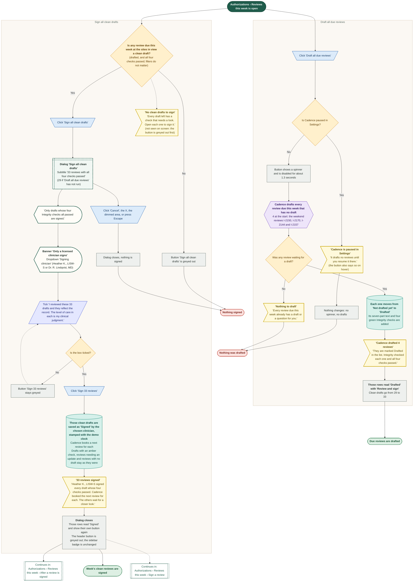

## Authorizations › Reviews this week › After a review is signed

What the demo does once a clinician signs. The review changes status, its row changes, and Cadence books the next review: the review's own date plus the interval. When the next review falls before the end of Sunday it takes the signed one's place on the row; otherwise the row stays 'Signed' and the drawer says when the next one is.

Route: `/authorizations?view=reviews`

The PRD (03, Prior Authorization Lifecycle) treats each signed request as a version that is kept, and times renewals from the binding date and the payer's lead time. The demo books the next review from the interval alone and does not send the signed review anywhere.

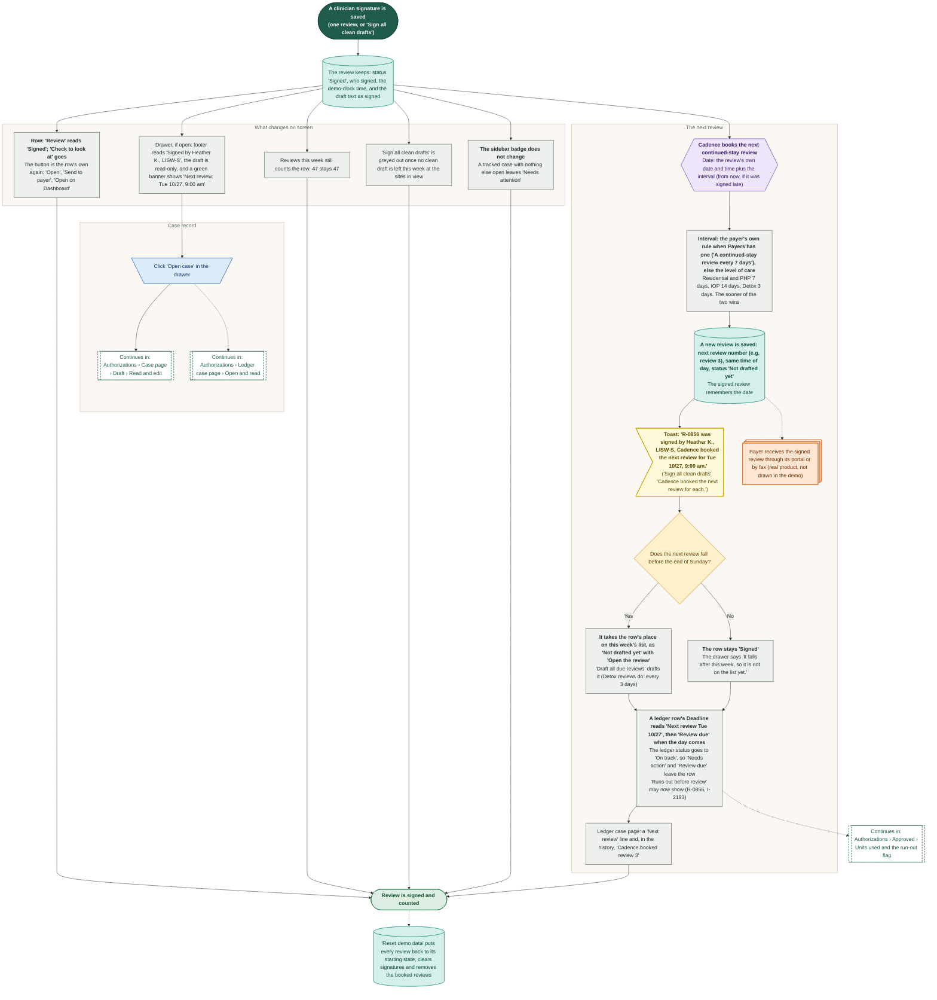

## Authorizations › Sites › Reviews, step-down plans and ledger cases at each site

What Case Manager's site rules became. Every tracked case, review and accepted denial belongs to one site, the same site on every screen. The Approved and Reviews this week views, the review buttons, the bulk review actions, the step-down rows, the tracked quick view and the ledger case page all follow the site view. A viewer limited to one site never sees, counts, drafts or signs the other site's cases, and a direct link to one shows an out-of-site card.

Route: `/authorizations?view=reviews`

Demo only, Both sites at the start: Approved 32 = Site A 17 + Site B 15; Reviews this week 47 = 26 + 21. Case Manager's own sidebar bubble is gone; the Authorizations badge follows the site the same way (19 = 11 + 8).

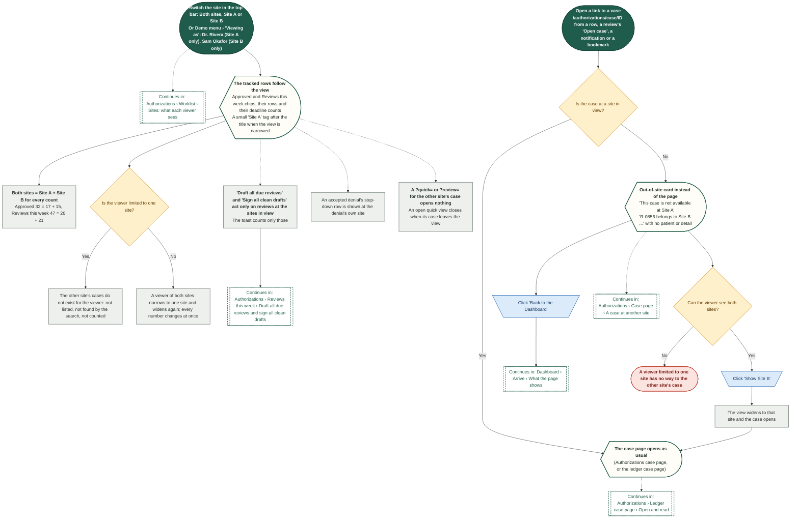

## Authorizations › Ledger case page › Open and read

26 of the 32 approved authorizations have no request of their own (no queue record, no Dashboard request). Their ID opens a calm summary built from the ledger record, so a row, its quick view and its review never end at 'Request not found'. It says who, which payer and service, how much of the approval is used, what is due and the next step. A case at a site the viewer is not looking at shows an out-of-site card instead.

Route: `/authorizations/case/ID (a case the ledger has that is not a request)`

Patient shows initials and age only, with a 'Privacy mode on' pill, as everywhere in the demo. Authorization dates are worked out from the units used and the demo clock, or taken from the ledger's own end date when it has one.

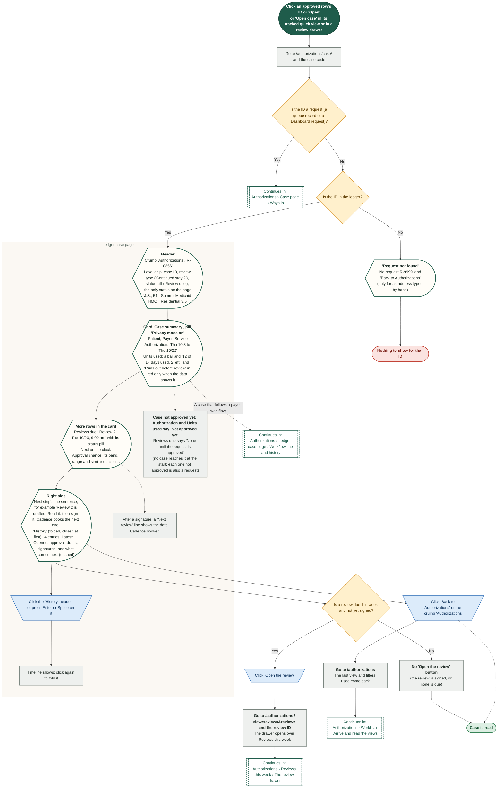

## Authorizations › Ledger case page › Workflow line and history

A case that was prepared or reviewed in New Case follows a payer workflow, pinned by version. The ledger case page shows one row, 'Workflow', in the case summary, and the lines the workflow wrote appear in its folded History. The tracked quick view in Authorizations shows the same row and the three newest history lines. A case with no workflow shows neither. Workflows are clinic-wide; the case stays at its site.

Route: `/authorizations/case/ID (a ledger case) and the tracked quick view on /authorizations`

A case that is also a request opens the Authorizations case page instead (its facts row has 'Workflow', and its History holds the same lines). Those are drawn in New Case › Workflow › What the workflow adds to the history.

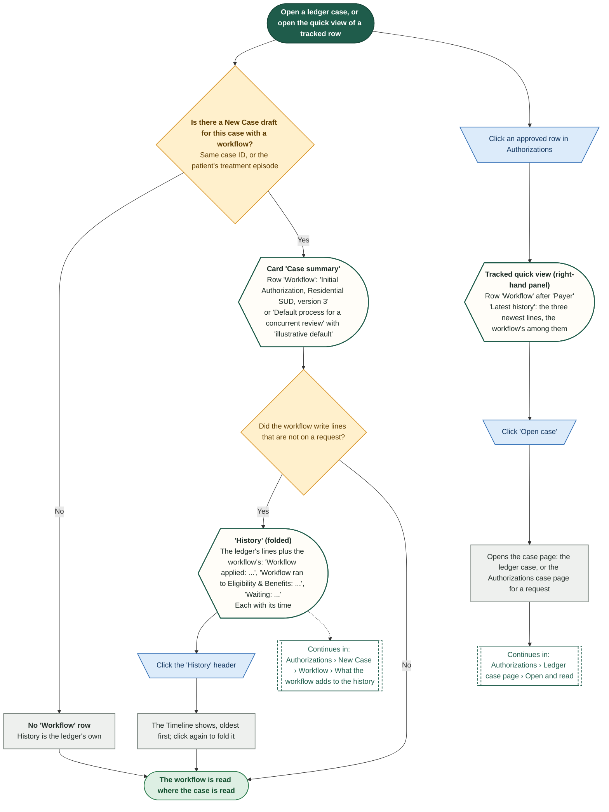
