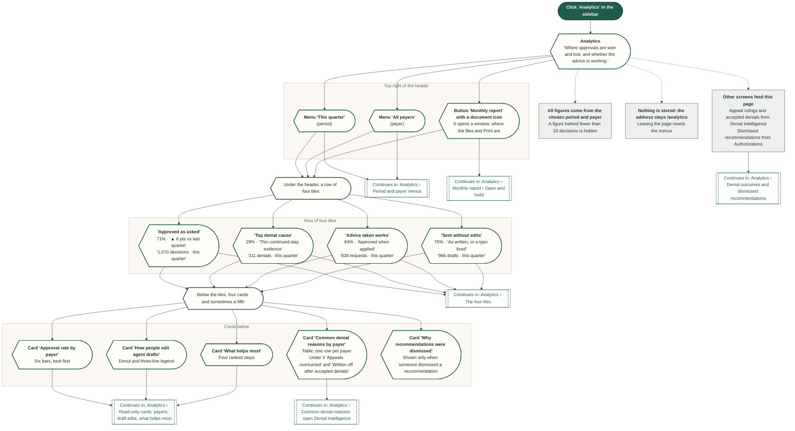
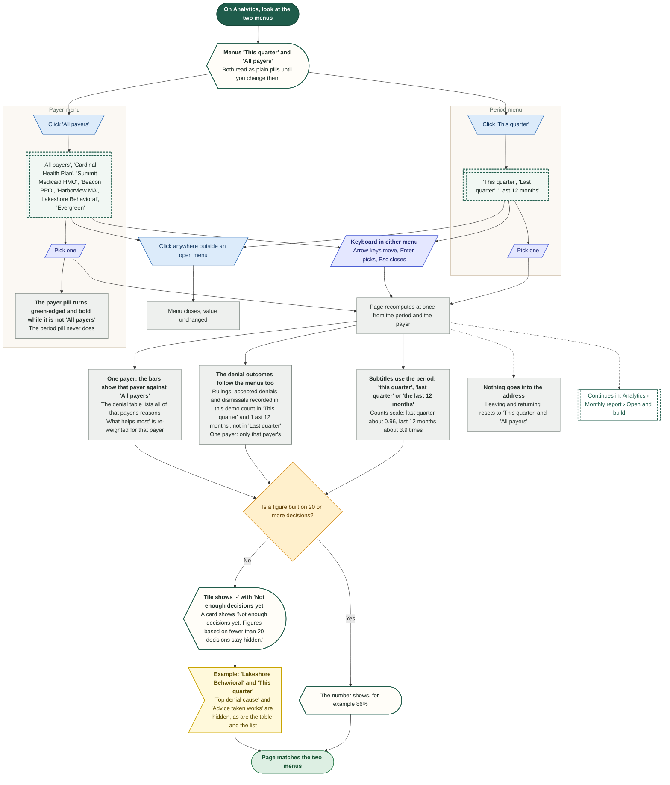
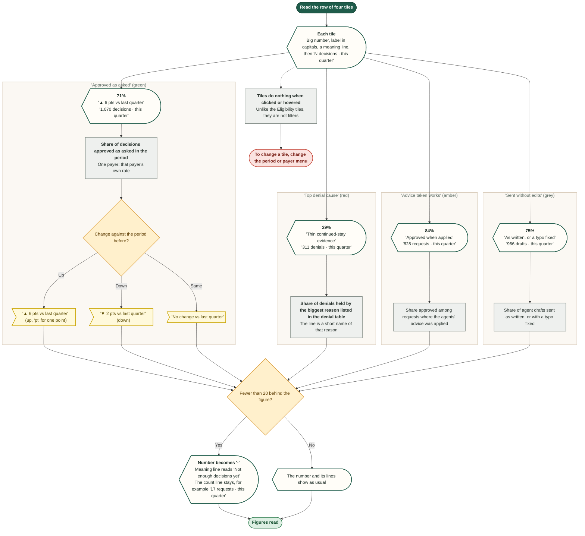
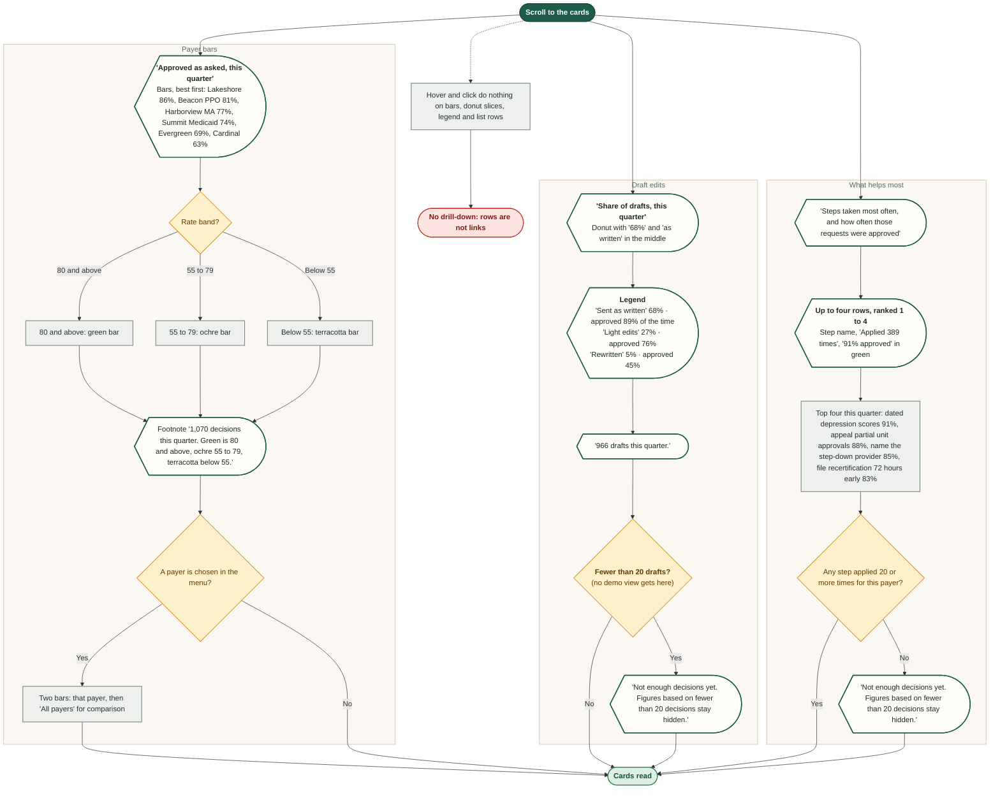
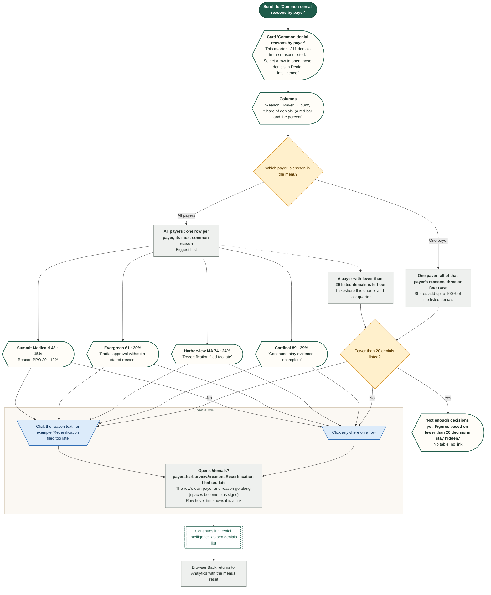
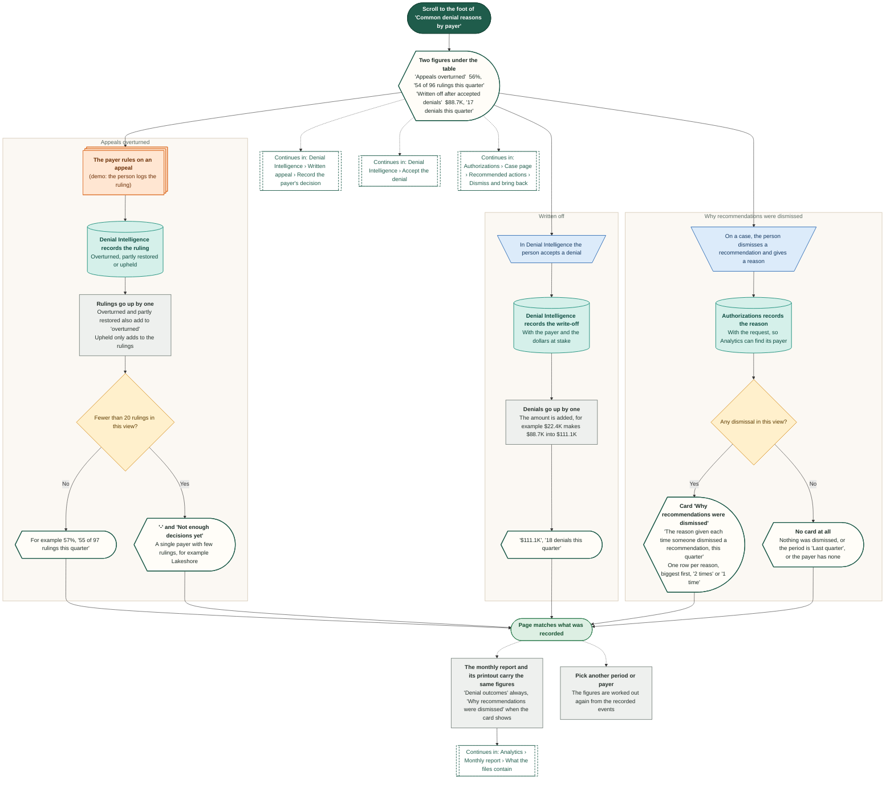
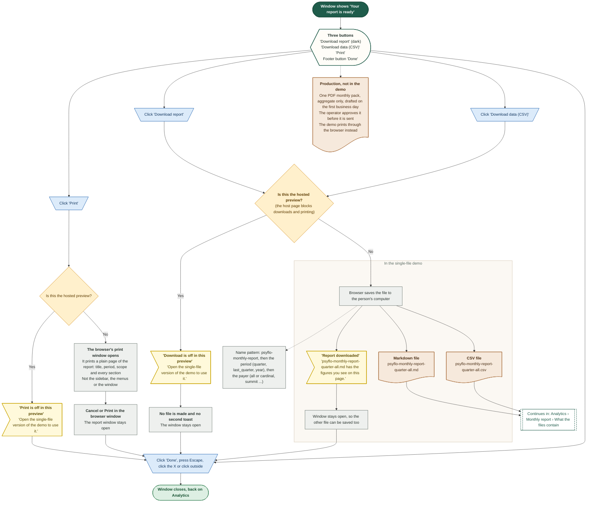

# Analytics

Performance, and the monthly report.

Shapes and colours: see `00-overview.md`. Source: `workflows/src/08-analytics/`.

## Analytics › Arrive and read the page

One page with two menus and a report button on top, four tiles, then four cards, and a fifth when recommendations were dismissed. It opens on 'This quarter' and 'All payers'. Everything is read-only except the menus, the 'Monthly report' button and the rows of the denial table.

Route: `/analytics`

Demo only: the figures are invented tables. 'This quarter, all payers' is the fixed starting set (71% approved as asked, 1,070 decisions).

## Analytics › Period and payer menus

The two menus at the top right change every figure on the page and in the monthly report. They are the only filters. There is no date picker and no search.

Route: `/analytics`

Demo only: other periods and payers are worked out from the same invented tables, so they drift a little from this quarter.

## Analytics › The four tiles

Four tinted tiles, each with a big number, a label and two small lines: what the number means, and how many decisions, denials, requests or drafts are behind it. The tiles are not buttons.

Route: `/analytics`

## Analytics › Read-only cards: payers, draft edits, what helps most

Three cards you read but cannot click: the payer bars, the draft-edit donut and the ranked list of what helps most. There are no tooltips on hover and nothing opens on a click. They change only with the period and payer menus.

Route: `/analytics`

Demo only: 'not enough decisions' on the bars and the donut cannot happen with the demo's numbers. On 'What helps most' it can, for one payer.

## Analytics › Common denial reasons: open Denial Intelligence

The table of common denial reasons. Every row is a link to Denial Intelligence, by the row or by the reason text. The link carries the row's payer and its reason, so the denial list opens already narrowed to those denials.

Route: `/analytics`

## Analytics › Denial outcomes and dismissed recommendations

What other screens write back to Analytics. Two figures sit under the denial table and move when a denial is accepted or an appeal is ruled on. A card of dismissal reasons appears once a recommendation has been dismissed. Each event moves the numbers only a little.

Route: `/analytics`

Demo only: the starting figures (96 rulings, 56% overturned, 17 accepted denials, $88.7K) are invented. Everything recorded in the demo counts in 'This quarter' and 'Last 12 months', never in 'Last quarter', and follows the payer menu.

## Analytics › Monthly report › Open and build

'Monthly report' opens a small window where the Analyst agent builds the report in four short steps, about 3 seconds. Cancel, Close, Escape and a click outside all stop it. Closing throws the build away.

Route: `/analytics`

Demo only: the steps are a timer, 0.75 seconds each. The report is built from the period and payer chosen when the window opened. Escape closes the window, and a menu opened beforehand closes first, one press each.

## Analytics › Monthly report › Download the files

When the report is ready the window offers two real files, a written report and the figures as a table, and a Print button. In the hosted preview, where the host page blocks downloads and printing, the buttons only explain why nothing happens. There is no PDF file: Print hands the page to the browser's own print window.

Route: `/analytics`

Demo only: the files hold exactly the figures on the page, and are named from the period and payer, for example psyflo-monthly-report-quarter-all.md.

## Analytics › Monthly report › What the files contain

The two downloaded files and the printed page are built from the same numbers as the page, for the period and payer chosen when the window opened. A figure behind fewer than 20 decisions is written as 'Not enough decisions yet', never as a number.

Route: `/analytics`

Demo only: the real monthly pack in the product requirements is one PDF, aggregate only, approved by the operator before it is sent. The demo has no PDF file. The printed page holds the same sections as the written report.

```mermaid
%%{init: {"theme":"base","themeVariables":{"fontFamily":"'DM Sans', 'Segoe UI', system-ui, sans-serif","fontSize":"15px","lineColor":"#5B6B63","primaryTextColor":"#1C2B25","clusterBkg":"#FBF8F3","clusterBorder":"#D9CDBB","edgeLabelBackground":"#FFFFFF"},"flowchart":{"curve":"basis","nodeSpacing":36,"rankSpacing":48,"padding":12,"htmlLabels":true,"useMaxWidth":false,"wrappingWidth":230}} }%%
flowchart TD
  classDef k_start fill:#1F5C4B,stroke:#174638,color:#FFFFFF,stroke-width:1.5px,font-weight:600
  classDef k_end fill:#DDEFE3,stroke:#2E7D4F,color:#14502F,stroke-width:1.5px,font-weight:600
  classDef k_endx fill:#FBE3E0,stroke:#C0392B,color:#7A1F16,stroke-width:1.5px,font-weight:600
  classDef k_screen fill:#FFFDF8,stroke:#1F5C4B,color:#1C2B25,stroke-width:2px
  classDef k_overlay fill:#F1F7F3,stroke:#1F5C4B,color:#1C2B25,stroke-width:2px,stroke-dasharray:5 3
  classDef k_click fill:#DCEBFA,stroke:#2F6DB5,color:#12365F,stroke-width:1.5px
  classDef k_input fill:#E4E7FF,stroke:#4C5FD5,color:#1D2670,stroke-width:1.5px
  classDef k_process fill:#EEF0EE,stroke:#7A857F,color:#26302B,stroke-width:1.5px
  classDef k_agent fill:#EEE5FA,stroke:#7A4FC2,color:#341A63,stroke-width:1.5px
  classDef k_decision fill:#FFF0CC,stroke:#D9962B,color:#5C3B00,stroke-width:1.5px
  classDef k_store fill:#D5F0EA,stroke:#1C8E7B,color:#0B4A3F,stroke-width:1.5px
  classDef k_doc fill:#F6E9DC,stroke:#B07A4C,color:#4A2E14,stroke-width:1.5px
  classDef k_ext fill:#FFE6D2,stroke:#E07B39,color:#6B2F06,stroke-width:1.5px
  classDef k_wait fill:#E4E8EE,stroke:#6B7C93,color:#26303D,stroke-width:1.5px
  classDef k_toast fill:#FFF9DB,stroke:#C9A400,color:#5A4A00,stroke-width:1.5px
  classDef k_goto fill:#FFFFFF,stroke:#1F5C4B,color:#1F5C4B,stroke-width:1.5px,stroke-dasharray:5 3
  s1@{ shape: stadium, label: "A download button is clicked in the report window" }
  subgraph gMd ["Written report (.md)"]
  m1@{ shape: doc, label: "<b>'# Psyflo monthly report'</b><br/>'Period: This quarter' and 'Scope: All payers'<br/>'Built by Analyst from demo data. A figure based on fewer than 20 decisions is left out.'" }
  m2@{ shape: doc, label: "<b>'## Headline figures'</b><br/>Four bullets: approved as asked with the trend line, top denial cause, advice taken works, sent without edits" }
  m3@{ shape: doc, label: "<b>'## Approval rate by payer'</b><br/>One bullet per bar with its decisions" }
  m4@{ shape: doc, label: "<b>'## How people edit agent drafts'</b><br/>Three bullets, then 'Drafts counted'" }
  m5@{ shape: doc, label: "<b>'## Common denial reasons'</b><br/>Table: Reason, Payer, Count, Share of denials" }
  m7@{ shape: doc, label: "<b>'## Denial outcomes'</b><br/>'Appeals overturned: 56% (54 of 96 rulings, partly restored counts as overturned)'<br/>'Written off after accepted denials: $88.7K (17 denials)'" }
  m6@{ shape: doc, label: "<b>'## What helps most'</b><br/>Numbered list: step, times applied, percent approved" }
  m8@{ shape: doc, label: "<b>'## Why recommendations were dismissed'</b><br/>One bullet per reason with its count<br/>Left out when nobody dismissed one" }
  end
  subgraph gCsv ["Figures as a table (.csv)"]
  v1@{ shape: doc, label: "<b>One header row</b><br/>period, scope, section, label, value_percent, count" }
  v2@{ shape: doc, label: "<b>Rows by section</b><br/>headline, approval by payer, draft edits, denial reasons, denial outcomes, what helps most<br/>and 'dismissed recommendations' when there are any" }
  v3@{ shape: doc, label: "<b>Commas and quotes inside a value are wrapped in quotes</b><br/>Opens in a spreadsheet" }
  end
  q1@{ shape: diam, label: "Is the figure behind 20 or more decisions?" }
  p1@{ shape: rect, label: "The number is written" }
  p2@{ shape: rect, label: "<b>'Not enough decisions yet' is written in its place</b><br/>The count is kept" }
  p3@{ shape: rect, label: "Same view as the page: the same period and payer, the same hidden figures" }
  e1@{ shape: stadium, label: "File matches the screen" }
  s1 --> m1 & v1
  m1 --> m2 --> m3 --> m4 --> m5 --> m7 --> m6 --> m8
  v1 --> v2 --> v3
  m8 --> q1
  v3 --> q1
  q1 -->|"Yes"| p1 --> e1
  q1 -->|"No"| p2 --> e1
  s1 -.-> p3
  p3 -.-> e1
  class s1 k_start
  class m1,m2,m3,m4,m5,m7,m6,m8,v1,v2,v3 k_doc
  class q1 k_decision
  class p1,p2,p3 k_process
  class e1 k_end
  style gMd fill:#FBF8F3,stroke:#D9CDBB,stroke-width:1.5px,color:#5B6B63
  style gCsv fill:#FBF8F3,stroke:#D9CDBB,stroke-width:1.5px,color:#5B6B63
```

