# Analytics

Owner view: approval and denial trends, the payer scorecard, payer by case-mix, denial reasons, case-level drill-down and the monthly report.

Shapes and colours: see `00-overview.md`. Source: `workflows/src/08-analytics/`.

## Analytics › Arrive and read the page

One page for the clinic owner. It opens on 'This quarter', 'All payers', 'All programs', 'All diagnosis groups' and the site view chosen in the top bar. From the top it shows six headline figures, the trend by month, the payer scorecard, the payer by case mix grid, the denial reasons and, for someone who sees both sites, the Site A and Site B comparison. Detail is folded under 'Detailed breakdowns'. Every number opens the cases behind it in a right-hand panel.

Route: `/analytics`

Demo only: this is sample data. The records are generated, the same every time. This quarter, Both sites, all payers is the fixed starting set (1,070 decisions, 71% approved as requested, 311 denials, 207 preventable, 2.4 days, 56% of 96 appeals overturned). No figure is a dollar amount.

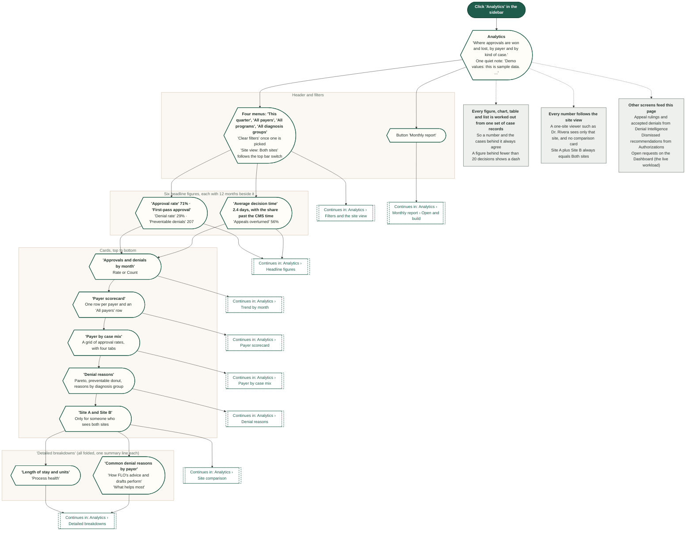

## Analytics › Filters and the site view

Four menus (Period, Payer, Program, Diagnosis group) and the site view narrow every figure, chart, table and panel at once. The site view is not a menu here: it is the Both sites, Site A, Site B switch in the top bar, shown on the page as a label.

Route: `/analytics`

The choices are not kept in the address, so a refresh or Back resets them. The menus and the site switch never change the starting numbers: with the defaults, the page is the fixed set of 1,070 decisions.

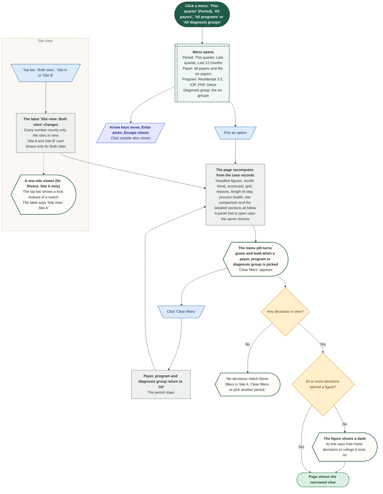

## Analytics › Headline figures

Six figures sit under the filters. Each one has a label, the number, the change against the earlier period in words and an arrow, a line that says what it counts, twelve months of sparkline, and an info button. The figure is a button: it opens the cases it counts.

Route: `/analytics`

Demo only: average decision time is sample data. The change for 'Last 12 months' compares the last 6 months with the 6 before, and the figure says so.

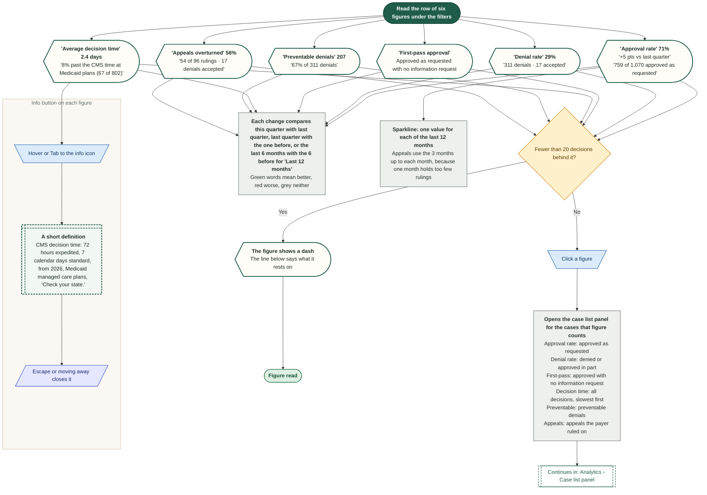

## Analytics › Trend by month

'Approvals and denials by month' draws the last twelve months. A month runs from the 21st to the 20th, so the last one ends on 20 Oct 2026. Hover for exact values, Tab into the chart and use the arrow keys, click a month to list its cases.

Route: `/analytics`

The chart has a fixed height, so the tooltip never moves the page. The months of the chosen period are shaded.

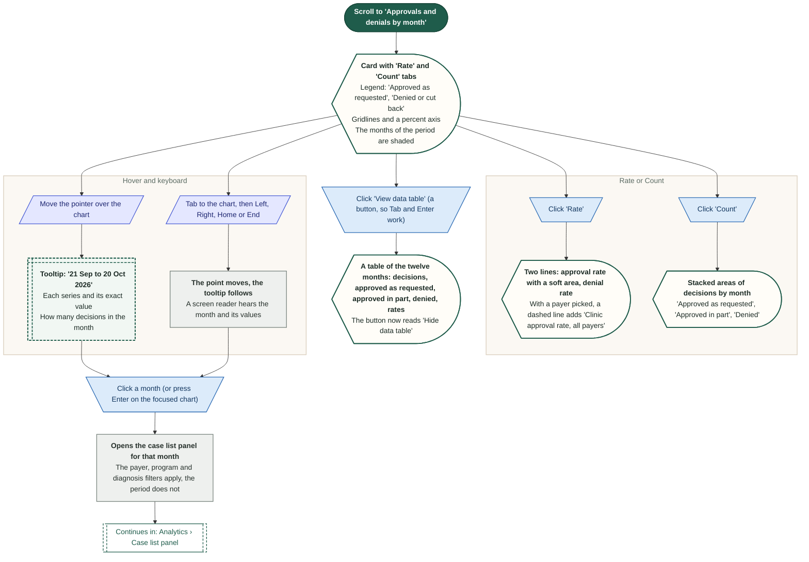

## Analytics › Payer scorecard

One row per payer for the chosen period, and an 'All payers' row at the bottom to compare with. A payer row opens the Payer analysis panel; a count inside a row opens its cases.

Route: `/analytics`

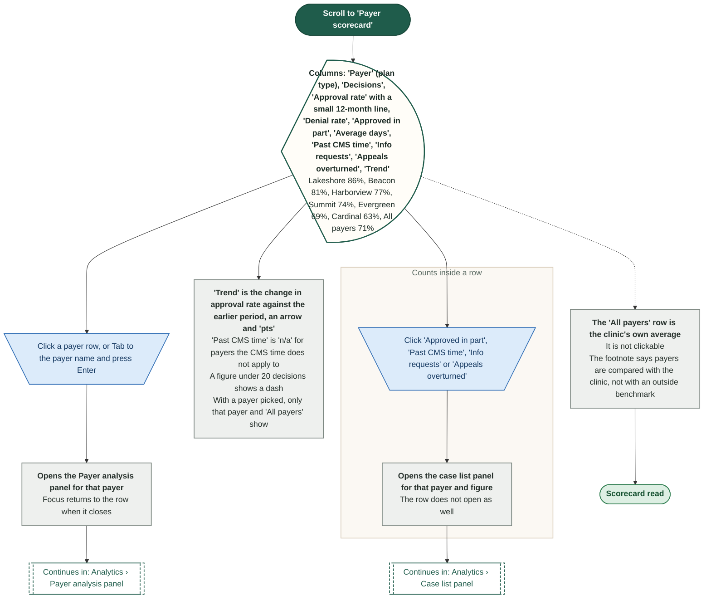

## Analytics › Payer analysis panel

A right-hand panel for one payer. It follows the period, program, diagnosis group and site view on the page, and every number in it is counted from that payer's own decisions. Top to bottom: six figures against the clinic, what the payer tends to do, its twelve months, where it approves and where it does not, why it denies, and the cases behind the numbers.

Route: `/analytics`

The panel stacks. A case list opens on top of it, and a case summary on top of that. Escape closes the top layer only.

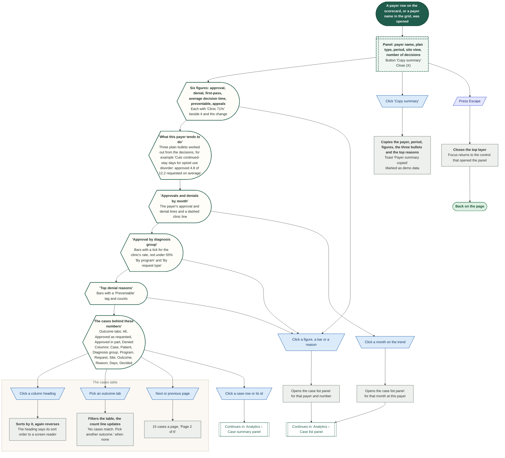

## Analytics › Payer by case mix

A grid with payers down and a kind of case across. Each cell is how often that payer approves that kind of case as requested, with how many decisions stand behind it. Four tabs change the columns. A cell opens its cases; a payer name opens the payer analysis.

Route: `/analytics`

A cell with fewer than 10 decisions is drawn grey with a dashed edge and the word 'few', so a small number is not read as a pattern. Color is never the only signal: a cell under 55% is striped with a down mark, a cell from 80% has an up mark, and every rate is printed.

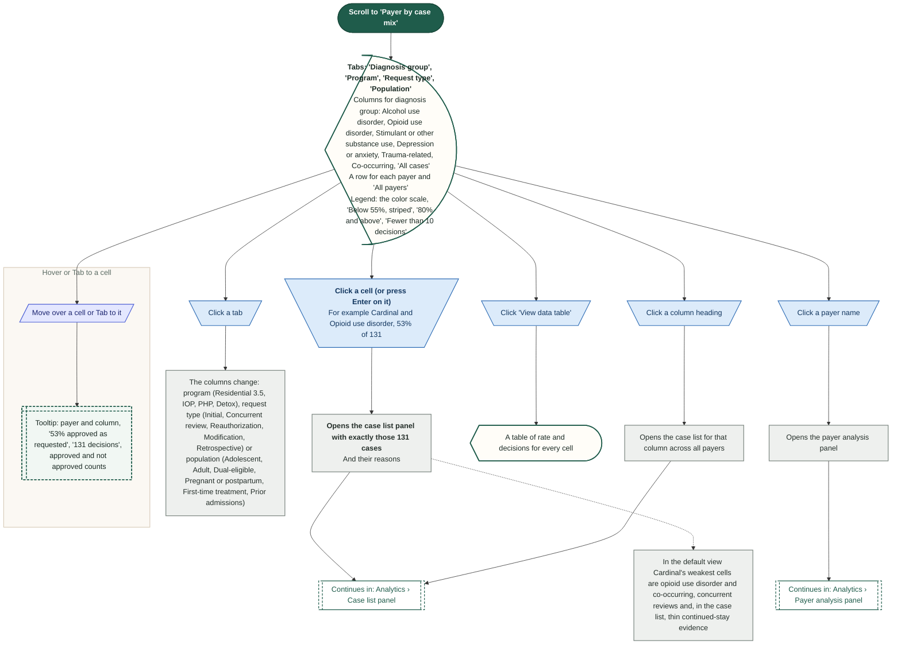

## Analytics › Denial reasons

Why decisions were not approved as requested. A Pareto of the most common reasons with the preventable ones marked, a donut of preventable against not, the preventable denials by payer, and the reasons behind each diagnosis group. Every row, slice and bar opens its cases.

Route: `/analytics`

A denial is anything not approved as requested, so a cut in days or units counts. Preventable means the team could have fixed the documentation or the timing before sending: thin or missing documentation, late notice, an incomplete certification, a duplicate request.

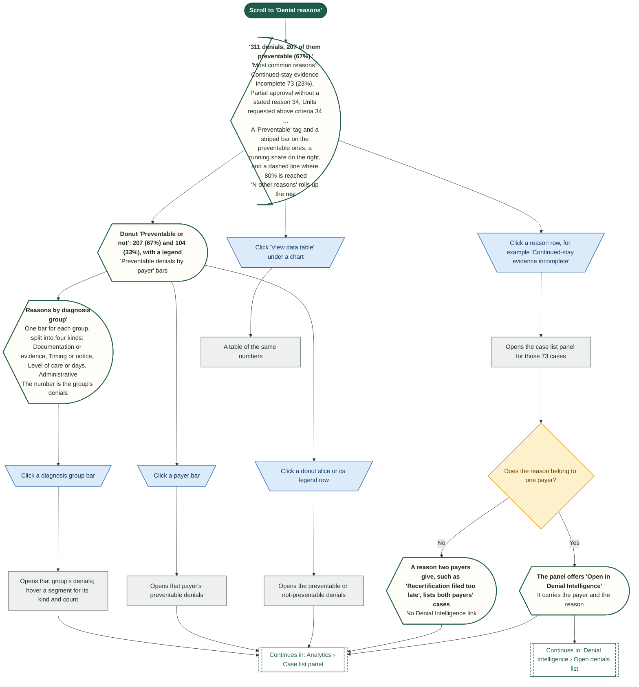

## Analytics › Case summary panel

One payer decision in plain words, opened from a case table row. It shows who and what was asked, what the payer decided and why, what was done about it, and a short neutral timeline. Initials and age only.

Route: `/analytics`

Most cases are past cases with no page in the demo. The real ones link to their pages: the open denials (for example D-3318, D-3297, D-3306) and the approvals behind the Case Manager ledger. R-1042's earlier intensive outpatient authorization opens R-1042.

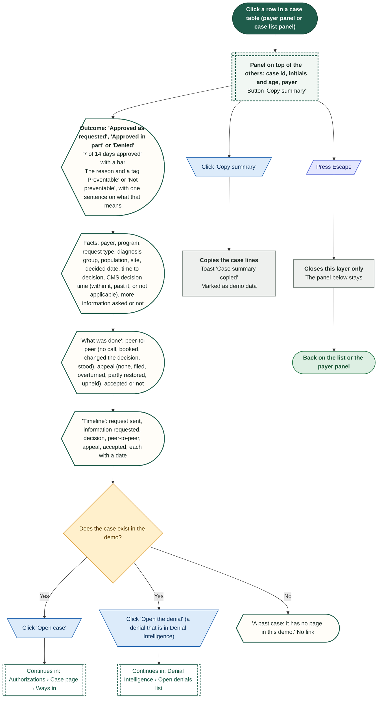

## Analytics › Case list panel

The cases behind one number. The same rows were counted to make the number, so the count in the panel always equals the number you clicked. Opened from a headline figure, a month on the trend, a grid cell, a reason, a scorecard count, a length of stay row, a process month or a site cell.

Route: `/analytics`

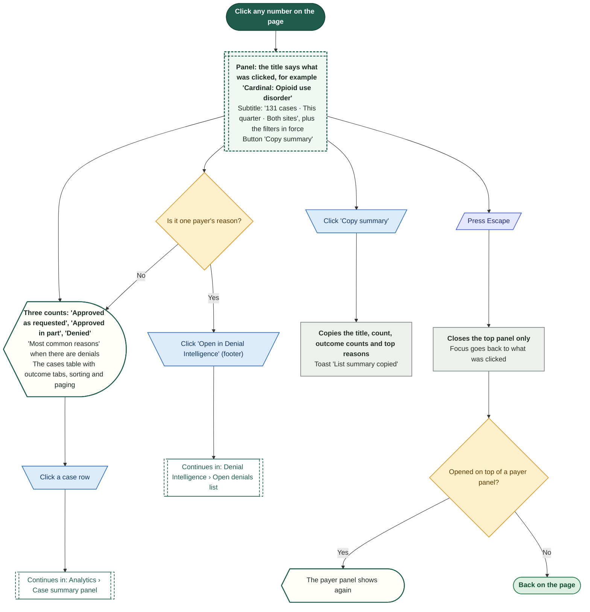

## Analytics › Length of stay and units

Days or units asked for against days or units approved, by payer and by level of care. It sits in a folded section under 'Detailed breakdowns'. A cut is an approval for less than was asked, so denied requests are not in the averages.

Route: `/analytics`

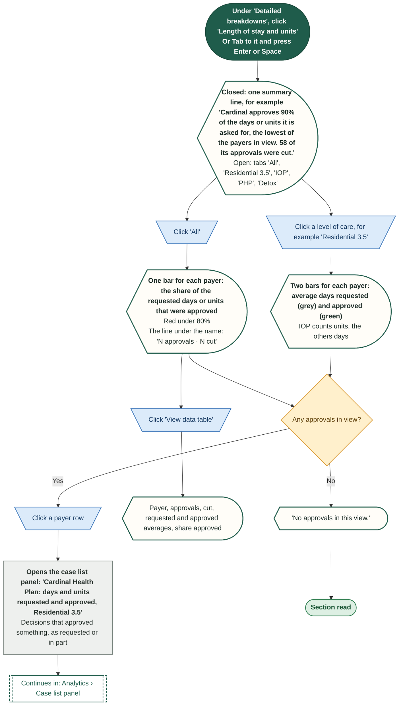

## Analytics › Process health

Four small charts and the live workload, in a folded section under 'Detailed breakdowns'. They show whether authorizations are being missed (retro-authorizations), how long a first request takes from referral to approval, how many decisions the payers make each month, and how peer-to-peer calls and appeals ended.

Route: `/analytics`

The charts follow the payer, program, diagnosis group, site view and period. The live workload card follows the site view, payer and program only, and changes when you answer a payer or accept a denial.

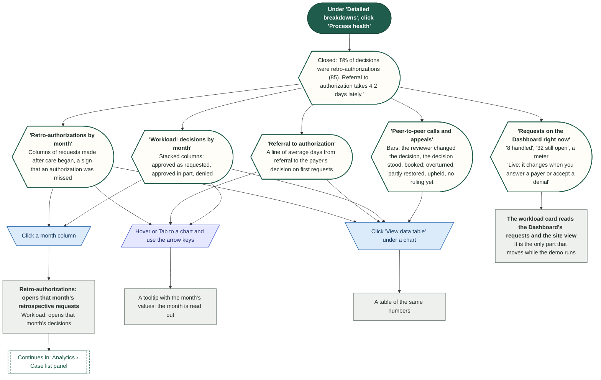

## Analytics › Site comparison

'Site A and Site B' puts the headline figures of the two sites side by side, for the same period and filters. It shows only when the viewer sees both sites and the site view is Both sites.

Route: `/analytics`

Counts add up: Site A plus Site B equals Both sites on every count. A one-site viewer (Dr. Rivera: Site A only, Sam Okafor: Site B only) never sees the card, and every number on the page counts that site only.

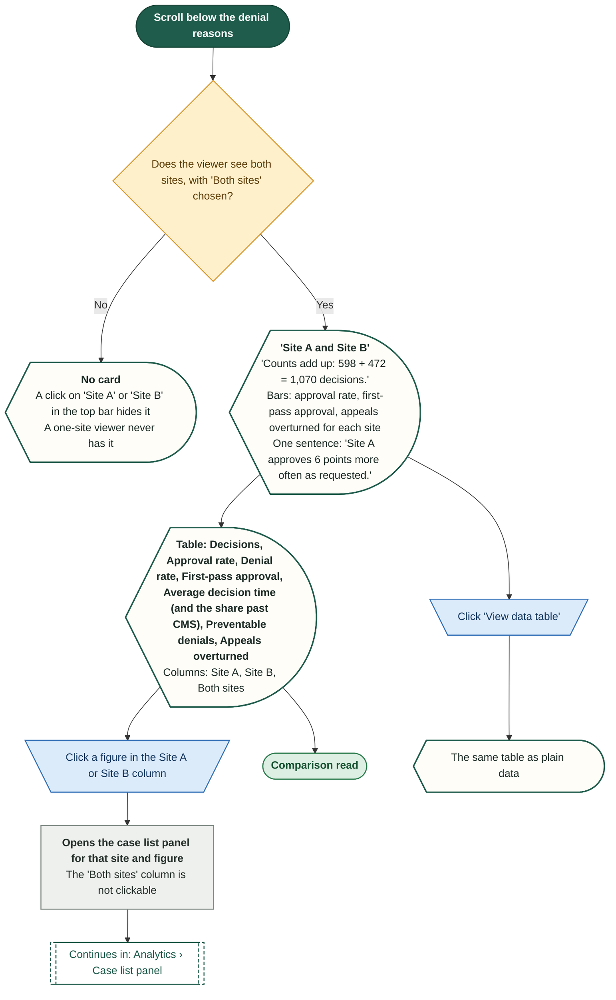

## Analytics › Common denial reasons: open Denial Intelligence

The table of common denial reasons sits in a folded section under 'Detailed breakdowns'. Every row is a link to Denial Intelligence, by the row or by the reason text. The link carries the row's payer and its reason, so the denial list opens already narrowed to those denials. Under the table are how appeals ended and how many denials were accepted.

Route: `/analytics`

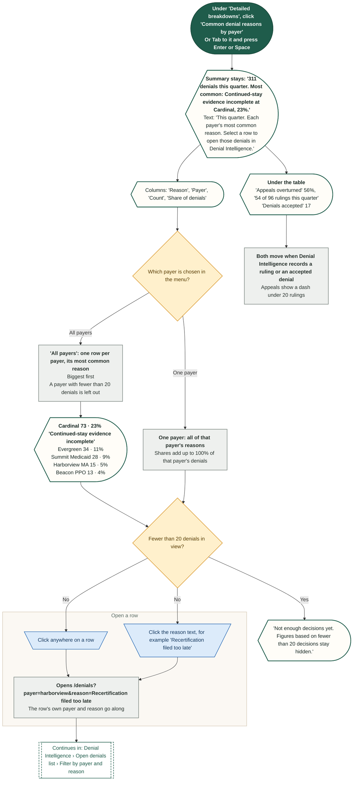

## Analytics › Detailed breakdowns

Under the heading 'Detailed breakdowns' five sections are folded. Each is a real button that shows its title and one summary line, and opens in place. Open by click, Enter or Space. Everything inside follows the period, payer, program, diagnosis group and site view.

Route: `/analytics`

The summary lines are worked out from the records, so they change with the menus. A section starts closed every time the page opens.

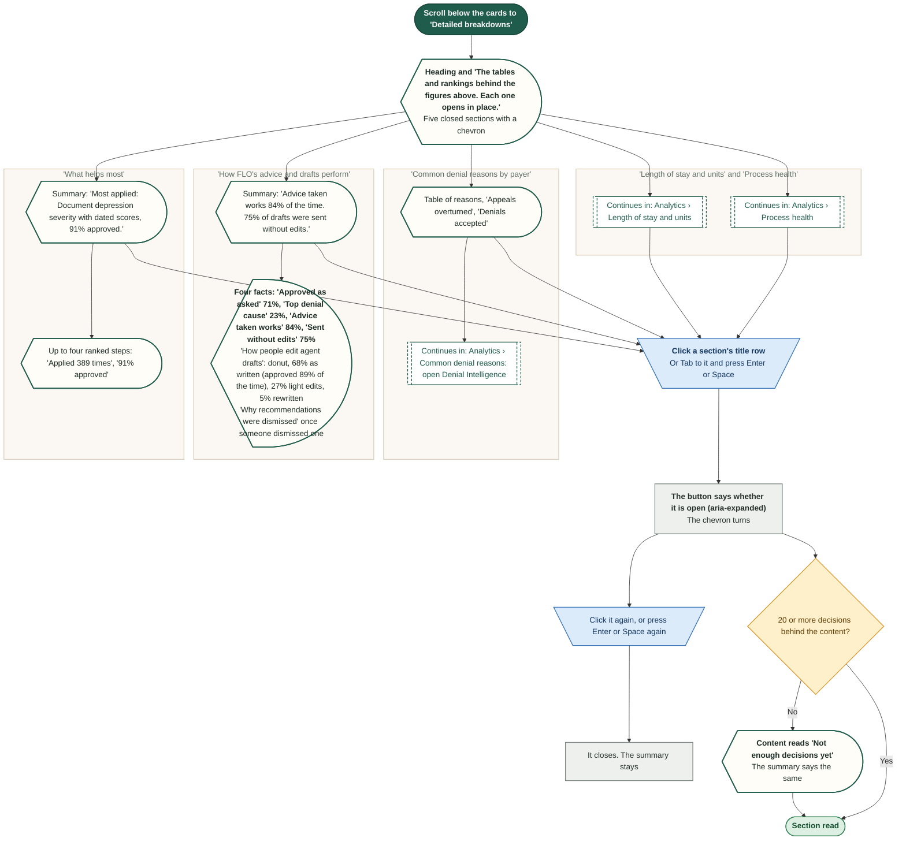

## Analytics › Monthly report › Open and build

'Monthly report' opens a small window where the Analyst agent builds the report in four short steps, about 3 seconds. Cancel, Close, Escape and a click outside all stop it. Closing throws the build away.

Route: `/analytics`

Demo only: the steps are a timer, 0.75 seconds each. The report is built from the period, payer, program, diagnosis group and site view chosen when the window opened. Escape closes the window, and a menu opened beforehand closes first, one press each.

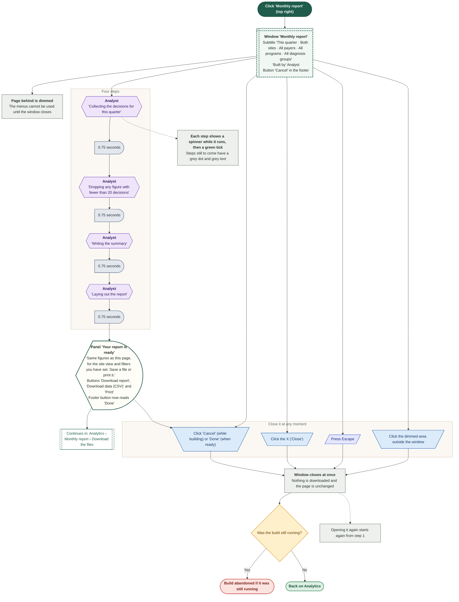

## Analytics › Monthly report › Download the files

When the report is ready the window offers two real files, a written report and the figures as a table, and a Print button. In the hosted preview, where the host page blocks downloads and printing, the buttons only explain why nothing happens. There is no PDF file: Print hands the page to the browser's own print window.

Route: `/analytics`

Demo only: the files hold exactly the figures on the page, and are named from the period, payer, program, diagnosis group and site view, for example psyflo-monthly-report-quarter-all-all-all-both.md.

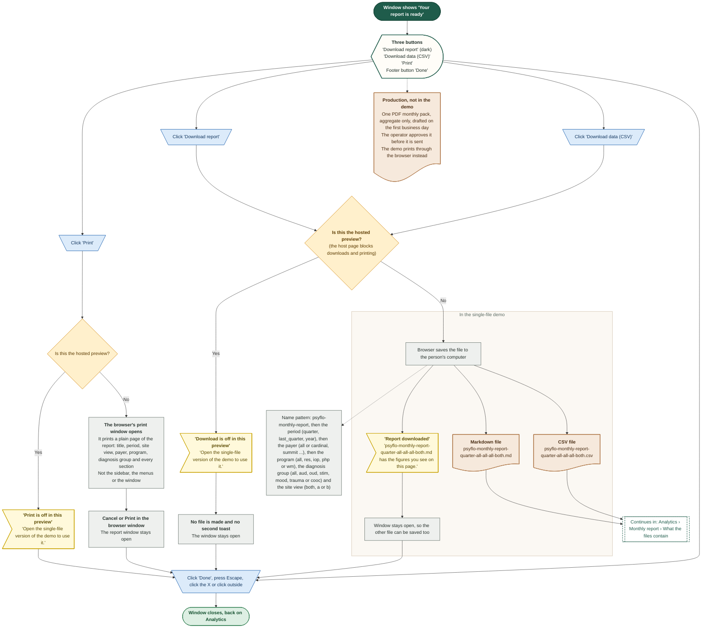

## Analytics › Monthly report › What the files contain

The two downloaded files and the printed page are built from the same numbers as the page, for the period, payer, program, diagnosis group and site view chosen when the window opened. A figure behind fewer than 20 decisions is written as 'Not enough decisions yet', never as a number.

Route: `/analytics`

Demo only: the real monthly pack in the product requirements is one PDF, aggregate only, approved by the operator before it is sent. The demo has no PDF file. The printed page holds the same sections as the written report. A one-site viewer's report names the site and has no Site A and Site B section.

```mermaid
%%{init: {"theme":"base","themeVariables":{"fontFamily":"'DM Sans', 'Segoe UI', system-ui, sans-serif","fontSize":"15px","lineColor":"#5B6B63","primaryTextColor":"#1C2B25","clusterBkg":"#FBF8F3","clusterBorder":"#D9CDBB","edgeLabelBackground":"#FFFFFF"},"flowchart":{"curve":"basis","nodeSpacing":36,"rankSpacing":48,"padding":12,"htmlLabels":true,"useMaxWidth":false,"wrappingWidth":230}} }%%
flowchart TD
  classDef k_start fill:#1F5C4B,stroke:#174638,color:#FFFFFF,stroke-width:1.5px,font-weight:600
  classDef k_end fill:#DDEFE3,stroke:#2E7D4F,color:#14502F,stroke-width:1.5px,font-weight:600
  classDef k_endx fill:#FBE3E0,stroke:#C0392B,color:#7A1F16,stroke-width:1.5px,font-weight:600
  classDef k_screen fill:#FFFDF8,stroke:#1F5C4B,color:#1C2B25,stroke-width:2px
  classDef k_overlay fill:#F1F7F3,stroke:#1F5C4B,color:#1C2B25,stroke-width:2px,stroke-dasharray:5 3
  classDef k_click fill:#DCEBFA,stroke:#2F6DB5,color:#12365F,stroke-width:1.5px
  classDef k_input fill:#E4E7FF,stroke:#4C5FD5,color:#1D2670,stroke-width:1.5px
  classDef k_process fill:#EEF0EE,stroke:#7A857F,color:#26302B,stroke-width:1.5px
  classDef k_agent fill:#EEE5FA,stroke:#7A4FC2,color:#341A63,stroke-width:1.5px
  classDef k_decision fill:#FFF0CC,stroke:#D9962B,color:#5C3B00,stroke-width:1.5px
  classDef k_store fill:#D5F0EA,stroke:#1C8E7B,color:#0B4A3F,stroke-width:1.5px
  classDef k_doc fill:#F6E9DC,stroke:#B07A4C,color:#4A2E14,stroke-width:1.5px
  classDef k_ext fill:#FFE6D2,stroke:#E07B39,color:#6B2F06,stroke-width:1.5px
  classDef k_wait fill:#E4E8EE,stroke:#6B7C93,color:#26303D,stroke-width:1.5px
  classDef k_toast fill:#FFF9DB,stroke:#C9A400,color:#5A4A00,stroke-width:1.5px
  classDef k_goto fill:#FFFFFF,stroke:#1F5C4B,color:#1F5C4B,stroke-width:1.5px,stroke-dasharray:5 3
  s1@{ shape: stadium, label: "A download button is clicked in the report window" }
  subgraph gMd ["Written report (.md)"]
  m1@{ shape: doc, label: "<b>'# Psyflo monthly report'</b><br/>'Period', 'Site view', 'Payer', 'Program' and 'Diagnosis group'<br/>'Built by Analyst from demo data. Demo values: this is sample data. A figure based on fewer than 20 decisions is left out.' and the CMS decision time note" }
  m2@{ shape: doc, label: "<b>'## Headline figures'</b><br/>Nine bullets: approval rate, denial rate, first-pass approval, average decision time (demo values, share past the CMS time), preventable denials, appeals overturned, top denial cause, advice taken works, sent without edits<br/>Each with its change against the earlier period" }
  m3@{ shape: doc, label: "<b>'## Approvals and denials by month'</b><br/>Table of the twelve months: decisions, approved as requested, approved in part, denied, approval rate, denial rate" }
  m4@{ shape: doc, label: "<b>'## Payer scorecard'</b><br/>Table: one row per payer and 'All payers', with the same columns as the page" }
  m5@{ shape: doc, label: "<b>'## Payer by diagnosis group (approved as requested)'</b><br/>Table of rate and decisions for each cell" }
  m6@{ shape: doc, label: "<b>'## Denial reasons'</b><br/>Table: Reason, Denials, Share of denials, Running share, Preventable" }
  m7@{ shape: doc, label: "<b>'## Length of stay and units'</b><br/>'## Process health'<br/>Bullets for retro-authorizations by month, referral to authorization, peer-to-peer calls, appeals and the live workload" }
  m8@{ shape: doc, label: "<b>'## Site A and Site B'</b><br/>Table with Site A, Site B and Both sites<br/>Left out for a one-site viewer or when one site is chosen" }
  m9@{ shape: doc, label: "<b>'## How people edit agent drafts', '## Denial outcomes', '## What helps most'</b><br/>And '## Why recommendations were dismissed' when someone dismissed one" }
  end
  subgraph gCsv ["Figures as a table (.csv)"]
  v1@{ shape: doc, label: "<b>One header row</b><br/>period, site_view, payer, program, diagnosis, section, label, value, count, unit<br/>Unit says percent, days or count" }
  v2@{ shape: doc, label: "<b>Rows by section</b><br/>headline, trend, payer scorecard, payer by diagnosis group, program, request type and population, denial reasons, length of stay, process health, sites, draft edits, what helps most<br/>and 'dismissed recommendations' when there are any" }
  v3@{ shape: doc, label: "<b>Commas and quotes inside a value are wrapped in quotes</b><br/>Opens in a spreadsheet" }
  end
  q1@{ shape: diam, label: "Is the figure behind 20 or more decisions?" }
  p1@{ shape: rect, label: "The number is written" }
  p2@{ shape: rect, label: "<b>'Not enough decisions yet' is written in its place</b><br/>The count is kept" }
  p3@{ shape: rect, label: "<b>Same view as the page: the same period, filters and site view, the same hidden figures</b><br/>No dollar figures anywhere" }
  e1@{ shape: stadium, label: "File matches the screen" }
  s1 --> m1 & v1
  m1 --> m2 --> m3 --> m4 --> m5 --> m6 --> m7 --> m8 --> m9
  v1 --> v2 --> v3
  m9 --> q1
  v3 --> q1
  q1 -->|"Yes"| p1 --> e1
  q1 -->|"No"| p2 --> e1
  s1 -.-> p3
  p3 -.-> e1
  class s1 k_start
  class m1,m2,m3,m4,m5,m6,m7,m8,m9,v1,v2,v3 k_doc
  class q1 k_decision
  class p1,p2,p3 k_process
  class e1 k_end
  style gMd fill:#FBF8F3,stroke:#D9CDBB,stroke-width:1.5px,color:#5B6B63
  style gCsv fill:#FBF8F3,stroke:#D9CDBB,stroke-width:1.5px,color:#5B6B63
```
