# Analytics

Performance, and the monthly report.

Shapes and colours: see `00-overview.md`. Source: `workflows/src/08-analytics/`.

## Analytics › Arrive and read the page

One page. A header with the report button and one quiet note, a row of three filters, four key figures, four cards (three charts and the workload), then a heading 'Detailed breakdowns' over three folded sections. It opens on 'This quarter', 'All payers' and 'All programs'. Everything is read-only except the filters, the 'Monthly report' button and the rows of the denial table.

Route: `/analytics`

Demo only: the figures are modeled from invented tables. 'This quarter, all payers, all programs' is the fixed starting set (71% approval rate, 29% denial rate, 2.4 days turnaround, 207 preventable denials, 1,070 decisions). No figure on the page is a dollar amount.

```mermaid
%%{init: {"theme":"base","themeVariables":{"fontFamily":"'DM Sans', 'Segoe UI', system-ui, sans-serif","fontSize":"15px","lineColor":"#5B6B63","primaryTextColor":"#1C2B25","clusterBkg":"#FBF8F3","clusterBorder":"#D9CDBB","edgeLabelBackground":"#FFFFFF"},"flowchart":{"curve":"basis","nodeSpacing":36,"rankSpacing":48,"padding":12,"htmlLabels":true,"useMaxWidth":false,"wrappingWidth":230}} }%%
flowchart TD
  classDef k_start fill:#1F5C4B,stroke:#174638,color:#FFFFFF,stroke-width:1.5px,font-weight:600
  classDef k_end fill:#DDEFE3,stroke:#2E7D4F,color:#14502F,stroke-width:1.5px,font-weight:600
  classDef k_endx fill:#FBE3E0,stroke:#C0392B,color:#7A1F16,stroke-width:1.5px,font-weight:600
  classDef k_screen fill:#FFFDF8,stroke:#1F5C4B,color:#1C2B25,stroke-width:2px
  classDef k_overlay fill:#F1F7F3,stroke:#1F5C4B,color:#1C2B25,stroke-width:2px,stroke-dasharray:5 3
  classDef k_click fill:#DCEBFA,stroke:#2F6DB5,color:#12365F,stroke-width:1.5px
  classDef k_input fill:#E4E7FF,stroke:#4C5FD5,color:#1D2670,stroke-width:1.5px
  classDef k_process fill:#EEF0EE,stroke:#7A857F,color:#26302B,stroke-width:1.5px
  classDef k_agent fill:#EEE5FA,stroke:#7A4FC2,color:#341A63,stroke-width:1.5px
  classDef k_decision fill:#FFF0CC,stroke:#D9962B,color:#5C3B00,stroke-width:1.5px
  classDef k_store fill:#D5F0EA,stroke:#1C8E7B,color:#0B4A3F,stroke-width:1.5px
  classDef k_doc fill:#F6E9DC,stroke:#B07A4C,color:#4A2E14,stroke-width:1.5px
  classDef k_ext fill:#FFE6D2,stroke:#E07B39,color:#6B2F06,stroke-width:1.5px
  classDef k_wait fill:#E4E8EE,stroke:#6B7C93,color:#26303D,stroke-width:1.5px
  classDef k_toast fill:#FFF9DB,stroke:#C9A400,color:#5A4A00,stroke-width:1.5px
  classDef k_goto fill:#FFFFFF,stroke:#1F5C4B,color:#1F5C4B,stroke-width:1.5px,stroke-dasharray:5 3
  s1@{ shape: stadium, label: "Click 'Analytics' in the sidebar" }
  sc@{ shape: curv-trap, label: "<b>Analytics</b><br/>'Where approvals are won and lost, and whether FLO's advice is working.'<br/>One quiet note: 'Modeled: ... Demo values: ... Workload and accepted denials are live.'" }
  subgraph gTop ["Header and filters"]
  m3@{ shape: curv-trap, label: "<b>Button 'Monthly report' with a document icon</b><br/>It opens a window, where the files and Print are" }
  m1@{ shape: curv-trap, label: "<b>Menu 'This quarter'</b><br/>(period)" }
  m2@{ shape: curv-trap, label: "<b>Menu 'All payers'</b><br/>(payer)" }
  m4@{ shape: curv-trap, label: "<b>Menu 'All programs'</b><br/>(program)<br/>'Clear filters' appears once a payer or program is picked" }
  end
  subgraph gTiles ["Four key figures"]
  t1@{ shape: curv-trap, label: "<b>'Approval rate'</b><br/>71% · '▲ 6 pts vs last quarter'<br/>'1,070 decisions · this quarter'" }
  t2@{ shape: curv-trap, label: "<b>'Denial rate'</b><br/>29% · '311 denials · 17 accepted'<br/>'▼ 6 pts vs last quarter'" }
  t3@{ shape: curv-trap, label: "<b>'Turnaround'</b><br/>2.4 days · 'Sent to decision · typical 1.9 days'<br/>'▼ 0.1 days vs last quarter'" }
  t4@{ shape: curv-trap, label: "<b>'Preventable denials'</b><br/>207 · '67% of 311 denials'<br/>'Fixable before sending'" }
  end
  subgraph gCards ["Cards below the figures"]
  c1@{ shape: curv-trap, label: "<b>Chart 'Approval rate by payer'</b><br/>Six bars, best first" }
  c2@{ shape: curv-trap, label: "<b>Chart 'Preventable denials by reason'</b><br/>Five reasons and one 'other' row, adding up to the figure" }
  c3@{ shape: curv-trap, label: "<b>Chart 'How people edit agent drafts'</b><br/>Donut and three-line legend" }
  c4@{ shape: curv-trap, label: "<b>Card 'Workload'</b><br/>'8 handled', '32 still open', live from the Dashboard" }
  end
  subgraph gDetail ["Heading 'Detailed breakdowns' (all folded)"]
  d1@{ shape: curv-trap, label: "<b>'Common denial reasons by payer'</b><br/>One summary line<br/>Opens to the table, 'Appeals overturned' and 'Denials accepted'" }
  d2@{ shape: curv-trap, label: "<b>'How FLO's advice and drafts perform'</b><br/>One summary line<br/>Opens to four facts, and why recommendations were dismissed" }
  d3@{ shape: curv-trap, label: "<b>'What helps most'</b><br/>One summary line<br/>Opens to four ranked steps" }
  end
  p1@{ shape: rect, label: "<b>All figures come from the chosen period, payer and program</b><br/>A figure behind fewer than 20 decisions (or denials) is hidden" }
  p2@{ shape: rect, label: "<b>Nothing is stored: the address stays /analytics</b><br/>Leaving the page resets the filters" }
  p3@{ shape: rect, label: "<b>Other screens feed this page</b><br/>Appeal rulings and accepted denials from Denial Intelligence<br/>Dismissed recommendations from Authorizations<br/>Open requests from the Dashboard (Workload)" }
  g1@{ shape: subproc, label: "Continues in: Analytics › Period, payer and program menus" }
  g2@{ shape: subproc, label: "Continues in: Analytics › The four tiles" }
  g3@{ shape: subproc, label: "Continues in: Analytics › Charts: payers, draft edits and workload" }
  g4@{ shape: subproc, label: "Continues in: Analytics › Common denial reasons: open Denial Intelligence" }
  g5@{ shape: subproc, label: "Continues in: Analytics › Monthly report › Open and build" }
  g6@{ shape: subproc, label: "Continues in: Analytics › Denial outcomes and dismissed recommendations" }
  g7@{ shape: subproc, label: "Continues in: Analytics › Preventable denials chart" }
  g8@{ shape: subproc, label: "Continues in: Analytics › Detailed breakdowns" }
  g9@{ shape: subproc, label: "Continues in: Analytics › Program filter" }
  s1 --> sc
  sc --> m3 & m1 & m2 & m4
  m1 & m2 & m4 --> t1 & t2 & t3 & t4
  t1 & t2 & t3 & t4 --> c1 & c2 & c3 & c4
  c1 & c2 & c3 & c4 --> d1 & d2 & d3
  sc -.-> p1
  sc -.-> p2
  sc -.-> p3
  p3 --> g6
  m1 & m2 --> g1
  m4 --> g9
  t1 & t2 & t3 & t4 --> g2
  c1 & c3 & c4 --> g3
  c2 --> g7
  d1 --> g4
  d1 & d2 & d3 --> g8
  m3 --> g5
  class s1 k_start
  class sc,m3,m1,m2,m4,t1,t2,t3,t4,c1,c2,c3,c4,d1,d2,d3 k_screen
  class p1,p2,p3 k_process
  class g1,g2,g3,g4,g5,g6,g7,g8,g9 k_goto
  style gTop fill:#FBF8F3,stroke:#D9CDBB,stroke-width:1.5px,color:#5B6B63
  style gTiles fill:#FBF8F3,stroke:#D9CDBB,stroke-width:1.5px,color:#5B6B63
  style gCards fill:#FBF8F3,stroke:#D9CDBB,stroke-width:1.5px,color:#5B6B63
  style gDetail fill:#FBF8F3,stroke:#D9CDBB,stroke-width:1.5px,color:#5B6B63
```

## Analytics › Period, payer and program menus

Three menus under the header change every figure, chart and breakdown on the page, and the monthly report. They are the only filters. There is no date picker and no search. 'Clear filters' puts payer and program back.

Route: `/analytics`

Demo only: other periods, payers and programs are worked out from the same invented tables, so they drift a little from this quarter. The period never counts as a filter in 'Clear filters', as on the Dashboard.

```mermaid
%%{init: {"theme":"base","themeVariables":{"fontFamily":"'DM Sans', 'Segoe UI', system-ui, sans-serif","fontSize":"15px","lineColor":"#5B6B63","primaryTextColor":"#1C2B25","clusterBkg":"#FBF8F3","clusterBorder":"#D9CDBB","edgeLabelBackground":"#FFFFFF"},"flowchart":{"curve":"basis","nodeSpacing":36,"rankSpacing":48,"padding":12,"htmlLabels":true,"useMaxWidth":false,"wrappingWidth":230}} }%%
flowchart TD
  classDef k_start fill:#1F5C4B,stroke:#174638,color:#FFFFFF,stroke-width:1.5px,font-weight:600
  classDef k_end fill:#DDEFE3,stroke:#2E7D4F,color:#14502F,stroke-width:1.5px,font-weight:600
  classDef k_endx fill:#FBE3E0,stroke:#C0392B,color:#7A1F16,stroke-width:1.5px,font-weight:600
  classDef k_screen fill:#FFFDF8,stroke:#1F5C4B,color:#1C2B25,stroke-width:2px
  classDef k_overlay fill:#F1F7F3,stroke:#1F5C4B,color:#1C2B25,stroke-width:2px,stroke-dasharray:5 3
  classDef k_click fill:#DCEBFA,stroke:#2F6DB5,color:#12365F,stroke-width:1.5px
  classDef k_input fill:#E4E7FF,stroke:#4C5FD5,color:#1D2670,stroke-width:1.5px
  classDef k_process fill:#EEF0EE,stroke:#7A857F,color:#26302B,stroke-width:1.5px
  classDef k_agent fill:#EEE5FA,stroke:#7A4FC2,color:#341A63,stroke-width:1.5px
  classDef k_decision fill:#FFF0CC,stroke:#D9962B,color:#5C3B00,stroke-width:1.5px
  classDef k_store fill:#D5F0EA,stroke:#1C8E7B,color:#0B4A3F,stroke-width:1.5px
  classDef k_doc fill:#F6E9DC,stroke:#B07A4C,color:#4A2E14,stroke-width:1.5px
  classDef k_ext fill:#FFE6D2,stroke:#E07B39,color:#6B2F06,stroke-width:1.5px
  classDef k_wait fill:#E4E8EE,stroke:#6B7C93,color:#26303D,stroke-width:1.5px
  classDef k_toast fill:#FFF9DB,stroke:#C9A400,color:#5A4A00,stroke-width:1.5px
  classDef k_goto fill:#FFFFFF,stroke:#1F5C4B,color:#1F5C4B,stroke-width:1.5px,stroke-dasharray:5 3
  s1@{ shape: stadium, label: "On Analytics, look at the three menus" }
  sc@{ shape: curv-trap, label: "<b>Menus 'This quarter', 'All payers' and 'All programs'</b><br/>All read as plain pills until you change payer or program" }
  subgraph gPeriod ["Period menu"]
  c1@{ shape: trap-t, label: "Click 'This quarter'" }
  o1@{ shape: win-pane, label: "'This quarter', 'Last quarter', 'Last 12 months'" }
  i1@{ shape: lean-r, label: "Pick one" }
  end
  subgraph gPayer ["Payer menu"]
  c2@{ shape: trap-t, label: "Click 'All payers'" }
  o2@{ shape: win-pane, label: "'All payers', 'Cardinal Health Plan', 'Summit Medicaid HMO', 'Beacon PPO', 'Harborview MA', 'Lakeshore Behavioral', 'Evergreen'" }
  i2@{ shape: lean-r, label: "Pick one" }
  p2@{ shape: rect, label: "<b>The payer pill turns green-edged and bold while it is not 'All payers'</b><br/>The period pill never does" }
  end
  subgraph gProgram ["Program menu"]
  c4@{ shape: trap-t, label: "Click 'All programs'" }
  o4@{ shape: win-pane, label: "'All programs', 'Residential', 'IOP', 'PHP', 'Withdrawal management'" }
  i4@{ shape: lean-r, label: "Pick one" }
  p4@{ shape: rect, label: "The program pill turns green-edged and bold while it is not 'All programs'" }
  end
  gp@{ shape: subproc, label: "Continues in: Analytics › Program filter" }
  cl@{ shape: trap-t, label: "<b>Click 'Clear filters'</b><br/>Only shown while a payer or a program is picked" }
  pcl@{ shape: rect, label: "<b>Payer and program return to 'All payers' and 'All programs'</b><br/>The period stays" }
  k1@{ shape: lean-r, label: "<b>Keyboard in any menu</b><br/>Arrow keys move, Enter picks, Esc closes" }
  k2@{ shape: trap-t, label: "Click anywhere outside an open menu" }
  p1@{ shape: rect, label: "Menu closes, value unchanged" }
  r1@{ shape: rect, label: "Page recomputes at once from the period, the payer and the program" }
  r2@{ shape: rect, label: "<b>Subtitles use the period: 'this quarter', 'last quarter' or 'the last 12 months'</b><br/>A picked program is added after a dot, for example 'this quarter · IOP'<br/>Counts scale: last quarter about 0.96, last 12 months about 3.9 times" }
  r4@{ shape: rect, label: "<b>The denial outcomes follow the menus too</b><br/>Rulings, accepted denials and dismissals recorded in this demo count in 'This quarter' and 'Last 12 months', not in 'Last quarter'<br/>One payer or one program: only theirs" }
  r3@{ shape: rect, label: "<b>One payer: the approval bars show that payer against 'All payers'</b><br/>The denial table lists all of that payer's reasons<br/>The preventable chart shows that payer's fixable reasons<br/>'What helps most' is re-weighted for that payer" }
  r5@{ shape: rect, label: "<b>Workload follows the payer and the program but not the period</b><br/>It is the Dashboard's requests right now" }
  q1@{ shape: diam, label: "Is a figure built on 20 or more decisions (or denials)?" }
  ok@{ shape: curv-trap, label: "The number shows, for example 86%" }
  hid@{ shape: curv-trap, label: "<b>Figure shows '-' with 'Not enough decisions yet'</b><br/>A card shows 'Not enough decisions yet. Figures based on fewer than 20 decisions stay hidden.'" }
  ex@{ shape: odd, label: "<b>Example: 'Lakeshore Behavioral' and 'This quarter'</b><br/>'Top denial cause' and 'Advice taken works' are hidden, as are the table and the list" }
  p3@{ shape: rect, label: "<b>Nothing goes into the address</b><br/>Leaving and returning resets to 'This quarter', 'All payers' and 'All programs'" }
  g1@{ shape: subproc, label: "Continues in: Analytics › Monthly report › Open and build" }
  e1@{ shape: stadium, label: "Page matches the three menus" }
  s1 --> sc
  sc --> c1 --> o1 --> i1 --> r1
  sc --> c2 --> o2 --> i2 --> r1
  sc --> c4 --> o4 --> i4 --> r1
  i2 --> p2
  i4 --> p4
  i4 -.-> gp
  o1 & o2 & o4 --> k1
  o1 & o2 & o4 --> k2 --> p1
  k1 --> r1
  i2 & i4 --> cl --> pcl --> r1
  r1 --> r2 --> q1
  r1 --> r4 --> q1
  r1 --> r3
  r3 --> q1
  r1 -.-> r5
  q1 -->|"Yes"| ok --> e1
  q1 -->|"No"| hid --> ex --> e1
  r1 -.-> p3
  r1 -.-> g1
  class s1 k_start
  class sc,ok,hid k_screen
  class c1,c2,c4,cl,k2 k_click
  class o1,o2,o4 k_overlay
  class i1,i2,i4,k1 k_input
  class p2,p4,pcl,p1,r1,r2,r4,r3,r5,p3 k_process
  class gp,g1 k_goto
  class q1 k_decision
  class ex k_toast
  class e1 k_end
  style gPeriod fill:#FBF8F3,stroke:#D9CDBB,stroke-width:1.5px,color:#5B6B63
  style gPayer fill:#FBF8F3,stroke:#D9CDBB,stroke-width:1.5px,color:#5B6B63
  style gProgram fill:#FBF8F3,stroke:#D9CDBB,stroke-width:1.5px,color:#5B6B63
```

## Analytics › The four tiles

Four tinted tiles, each with a big number, a label and two small lines, and a small info button in the corner. They are the key figures: approval rate, denial rate, turnaround and preventable denials. All four are added up from the same table as the charts, so they always agree with them. The tiles are not buttons.

Route: `/analytics`

Demo only: turnaround is demo values (each payer's average from the sample data, drifted for other periods and programs). The other three are modeled from the quarter's decisions. No figure is a dollar amount.

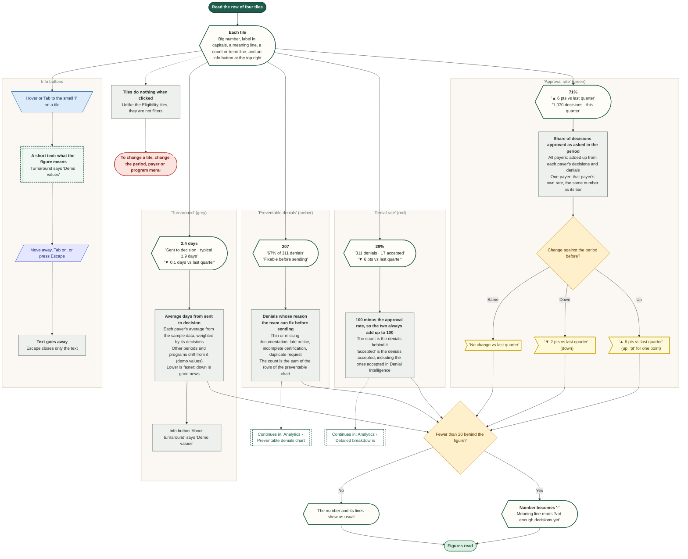

## Analytics › Program filter

The 'All programs' menu narrows every figure, chart and breakdown to one level of care: Residential, IOP, PHP or Withdrawal management. The demo has no per-program split of its decisions, so a small weighting table does it, the same way every time.

Route: `/analytics`

Demo values. The weights are invented: shares of decisions 40 / 30 / 20 / 10, and a shift in approval, turnaround, advice and edits for each program. They are balanced so 'All programs' stays the starting set (71%, 29%, 2.4 days, 207). The labels follow the sidebar's words 'Residential' and 'Withdrawal management'; the Dashboard's Program filter says 'Residential 3.5' and 'Detox'.

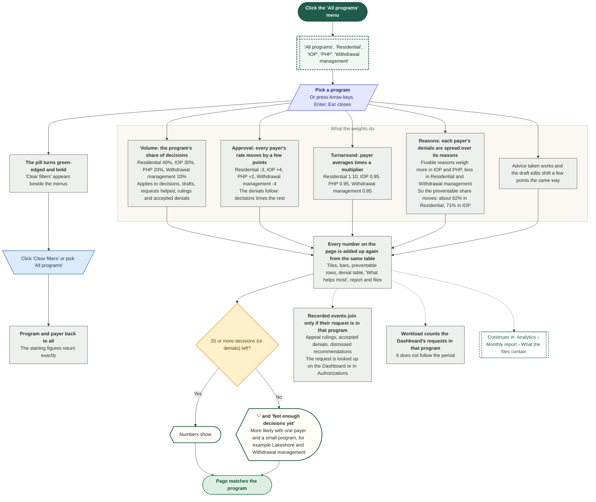

## Analytics › Charts: payers, draft edits and workload

Three cards you read but cannot click: the payer bars, the draft-edit donut and the workload card. The fourth chart, preventable denials, has its own diagram. There are no tooltips on hover and nothing opens on a click, except the link in the workload card. They change with the period, payer and program menus (workload: payer and program only).

Route: `/analytics`

Demo only: 'not enough decisions' on the bars and the donut cannot happen with the demo's numbers for all programs; with one small program and one payer it can. Workload is live: it counts the Dashboard's requests now.

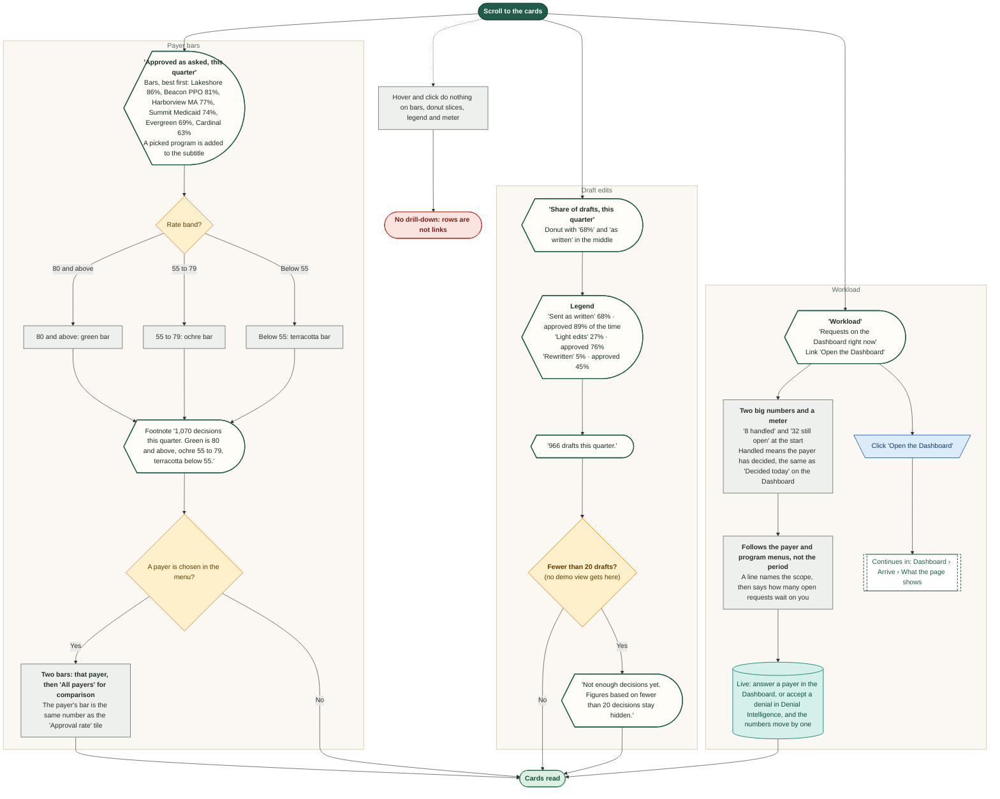

## Analytics › Common denial reasons: open Denial Intelligence

The table of common denial reasons sits in a folded section under 'Detailed breakdowns'. Every row is a link to Denial Intelligence, by the row or by the reason text. The link carries the row's payer and its reason, so the denial list opens already narrowed to those denials.

Route: `/analytics`

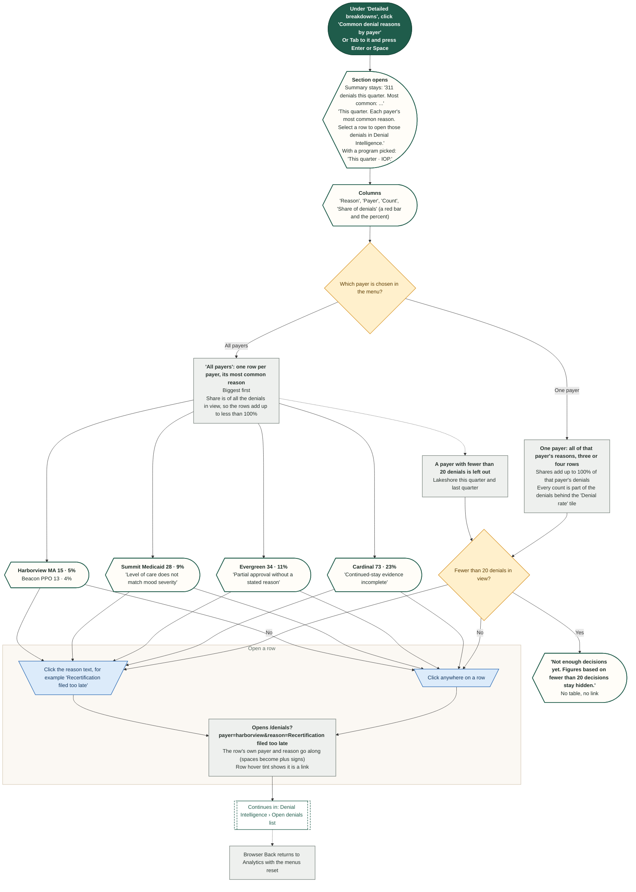

## Analytics › Denial outcomes and dismissed recommendations

What other screens write back to Analytics. Two figures sit under the denial table (in its folded section) and move when a denial is accepted or an appeal is ruled on. The 'Denial rate' tile shows the accepted count too. A list of dismissal reasons appears once a recommendation has been dismissed, inside the folded section 'How FLO's advice and drafts perform'. Each event moves the numbers only a little.

Route: `/analytics`

Demo only: the starting figures (96 rulings, 56% overturned, 17 accepted denials) are invented. Everything recorded in the demo counts in 'This quarter' and 'Last 12 months', never in 'Last quarter', and follows the payer and program menus. Accepting a denial also moves Workload (one more handled, one fewer open).

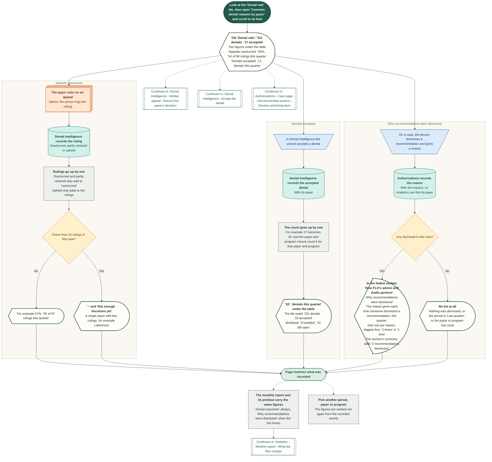

## Analytics › Preventable denials chart

A horizontal bar chart of the denials the team could have fixed before sending, one bar for each reason. Its rows add up to the 'Preventable denials' tile. It is read-only. The reasons come from the same table as the denial reasons list, each tagged as fixable or not.

Route: `/analytics`

Demo only. A reason is fixable when it is thin or missing documentation, late notice, an incomplete certification or a duplicate request. Not fixable: units above criteria, a clinical disagreement on level of care, a partial approval without a reason, a payer's network error. Each payer's denials are spread over its reasons in fixed proportions, so every denial is counted once.

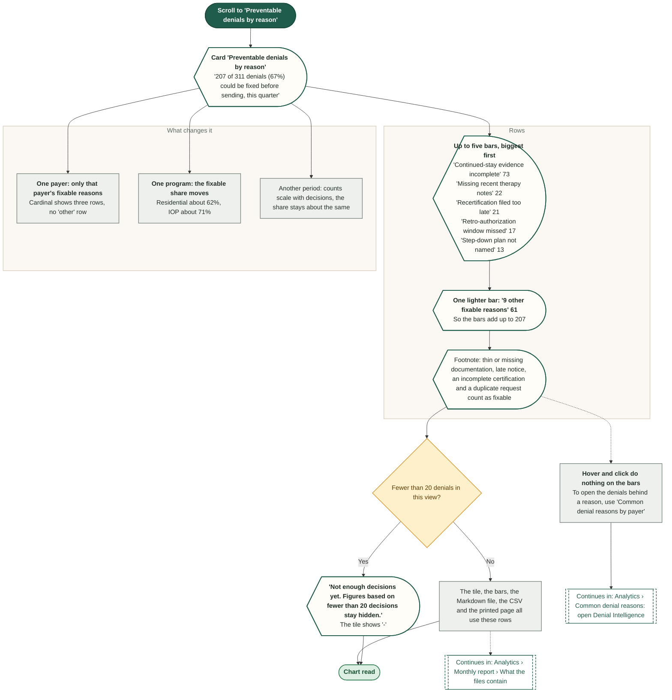

## Analytics › Detailed breakdowns

Under the heading 'Detailed breakdowns' three sections are folded. Each is a real button that shows its title and one summary line, and opens in place. Open by click, Enter or Space. Nothing else on the page moves except the content below it.

Route: `/analytics`

The summary lines are worked out from the page's figures, so they change with the menus. A section starts closed every time the page opens.

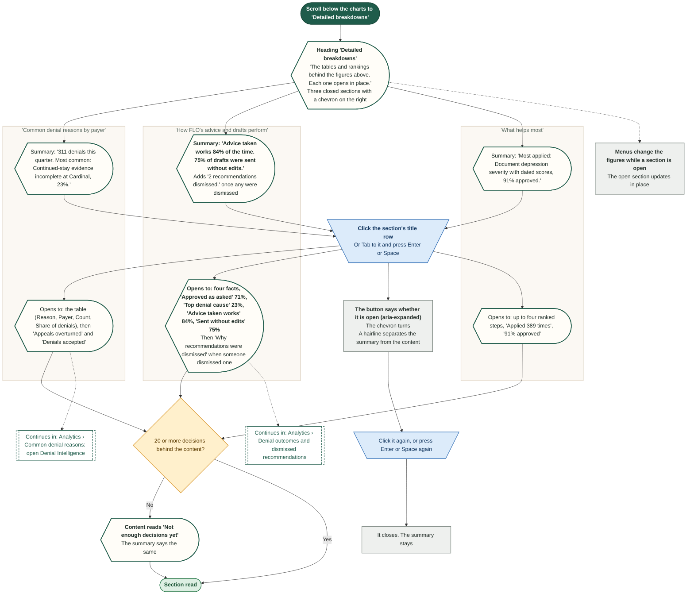

## Analytics › Monthly report › Open and build

'Monthly report' opens a small window where the Analyst agent builds the report in four short steps, about 3 seconds. Cancel, Close, Escape and a click outside all stop it. Closing throws the build away.

Route: `/analytics`

Demo only: the steps are a timer, 0.75 seconds each. The report is built from the period, payer and program chosen when the window opened. Escape closes the window, and a menu opened beforehand closes first, one press each.

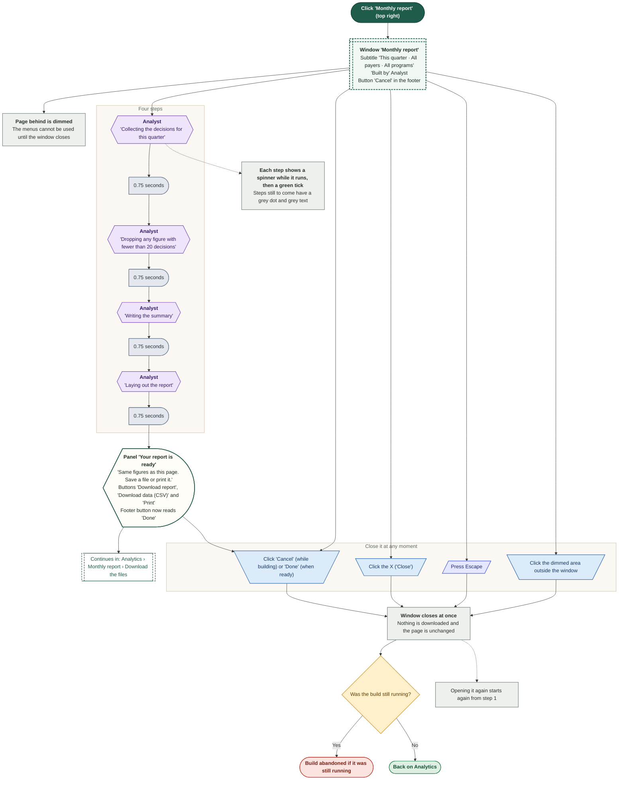

## Analytics › Monthly report › Download the files

When the report is ready the window offers two real files, a written report and the figures as a table, and a Print button. In the hosted preview, where the host page blocks downloads and printing, the buttons only explain why nothing happens. There is no PDF file: Print hands the page to the browser's own print window.

Route: `/analytics`

Demo only: the files hold exactly the figures on the page, and are named from the period, payer and program, for example psyflo-monthly-report-quarter-all-all.md.

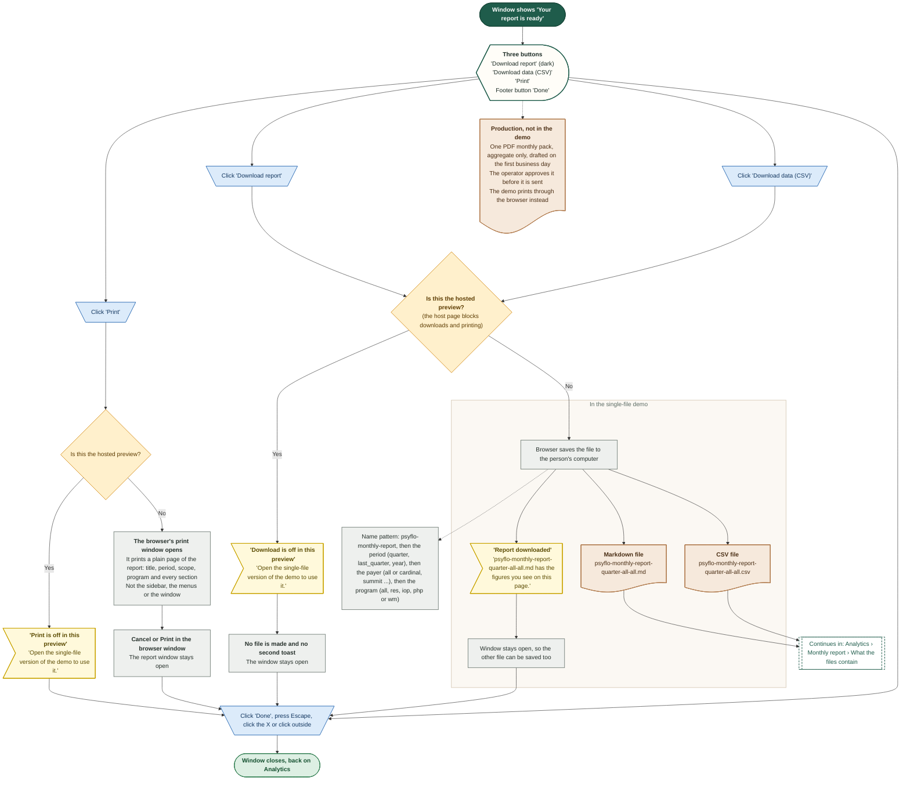

## Analytics › Monthly report › What the files contain

The two downloaded files and the printed page are built from the same numbers as the page, for the period, payer and program chosen when the window opened. A figure behind fewer than 20 decisions is written as 'Not enough decisions yet', never as a number.

Route: `/analytics`

Demo only: the real monthly pack in the product requirements is one PDF, aggregate only, approved by the operator before it is sent. The demo has no PDF file. The printed page holds the same sections as the written report.

```mermaid
%%{init: {"theme":"base","themeVariables":{"fontFamily":"'DM Sans', 'Segoe UI', system-ui, sans-serif","fontSize":"15px","lineColor":"#5B6B63","primaryTextColor":"#1C2B25","clusterBkg":"#FBF8F3","clusterBorder":"#D9CDBB","edgeLabelBackground":"#FFFFFF"},"flowchart":{"curve":"basis","nodeSpacing":36,"rankSpacing":48,"padding":12,"htmlLabels":true,"useMaxWidth":false,"wrappingWidth":230}} }%%
flowchart TD
  classDef k_start fill:#1F5C4B,stroke:#174638,color:#FFFFFF,stroke-width:1.5px,font-weight:600
  classDef k_end fill:#DDEFE3,stroke:#2E7D4F,color:#14502F,stroke-width:1.5px,font-weight:600
  classDef k_endx fill:#FBE3E0,stroke:#C0392B,color:#7A1F16,stroke-width:1.5px,font-weight:600
  classDef k_screen fill:#FFFDF8,stroke:#1F5C4B,color:#1C2B25,stroke-width:2px
  classDef k_overlay fill:#F1F7F3,stroke:#1F5C4B,color:#1C2B25,stroke-width:2px,stroke-dasharray:5 3
  classDef k_click fill:#DCEBFA,stroke:#2F6DB5,color:#12365F,stroke-width:1.5px
  classDef k_input fill:#E4E7FF,stroke:#4C5FD5,color:#1D2670,stroke-width:1.5px
  classDef k_process fill:#EEF0EE,stroke:#7A857F,color:#26302B,stroke-width:1.5px
  classDef k_agent fill:#EEE5FA,stroke:#7A4FC2,color:#341A63,stroke-width:1.5px
  classDef k_decision fill:#FFF0CC,stroke:#D9962B,color:#5C3B00,stroke-width:1.5px
  classDef k_store fill:#D5F0EA,stroke:#1C8E7B,color:#0B4A3F,stroke-width:1.5px
  classDef k_doc fill:#F6E9DC,stroke:#B07A4C,color:#4A2E14,stroke-width:1.5px
  classDef k_ext fill:#FFE6D2,stroke:#E07B39,color:#6B2F06,stroke-width:1.5px
  classDef k_wait fill:#E4E8EE,stroke:#6B7C93,color:#26303D,stroke-width:1.5px
  classDef k_toast fill:#FFF9DB,stroke:#C9A400,color:#5A4A00,stroke-width:1.5px
  classDef k_goto fill:#FFFFFF,stroke:#1F5C4B,color:#1F5C4B,stroke-width:1.5px,stroke-dasharray:5 3
  s1@{ shape: stadium, label: "A download button is clicked in the report window" }
  subgraph gMd ["Written report (.md)"]
  m1@{ shape: doc, label: "<b>'# Psyflo monthly report'</b><br/>'Period: This quarter', 'Scope: All payers' and 'Program: All programs'<br/>'Built by Analyst from demo data. Figures are modeled from the quarter's decisions; turnaround is demo values. A figure based on fewer than 20 decisions is left out.'" }
  m2@{ shape: doc, label: "<b>'## Headline figures'</b><br/>Seven bullets: approval rate with the trend line, denial rate, turnaround (days, demo values), preventable denials with its share, top denial cause, advice taken works, sent without edits" }
  m3@{ shape: doc, label: "<b>'## Approval rate by payer'</b><br/>One bullet per bar with its decisions" }
  m9@{ shape: doc, label: "<b>'## Preventable denials by reason'</b><br/>One bullet per row of the chart, so the bullets add up to the headline count" }
  m4@{ shape: doc, label: "<b>'## How people edit agent drafts'</b><br/>Three bullets, then 'Drafts counted'" }
  m5@{ shape: doc, label: "<b>'## Common denial reasons'</b><br/>Table: Reason, Payer, Count, Share of denials" }
  m7@{ shape: doc, label: "<b>'## Denial outcomes'</b><br/>'Appeals overturned: 56% (54 of 96 rulings, partly restored counts as overturned)'<br/>'Denials accepted: 17'" }
  m6@{ shape: doc, label: "<b>'## What helps most'</b><br/>Numbered list: step, times applied, percent approved" }
  m8@{ shape: doc, label: "<b>'## Why recommendations were dismissed'</b><br/>One bullet per reason with its count<br/>Left out when nobody dismissed one" }
  end
  subgraph gCsv ["Figures as a table (.csv)"]
  v1@{ shape: doc, label: "<b>One header row</b><br/>period, scope, section, label, value, count, program, unit<br/>Unit says percent, days, count or percent of denials" }
  v2@{ shape: doc, label: "<b>Rows by section</b><br/>headline, approval by payer, preventable denials, draft edits, denial reasons, denial outcomes, what helps most<br/>and 'dismissed recommendations' when there are any" }
  v3@{ shape: doc, label: "<b>Commas and quotes inside a value are wrapped in quotes</b><br/>Opens in a spreadsheet" }
  end
  q1@{ shape: diam, label: "Is the figure behind 20 or more decisions?" }
  p1@{ shape: rect, label: "The number is written" }
  p2@{ shape: rect, label: "<b>'Not enough decisions yet' is written in its place</b><br/>The count is kept" }
  p3@{ shape: rect, label: "Same view as the page: the same period, payer and program, the same hidden figures" }
  e1@{ shape: stadium, label: "File matches the screen" }
  s1 --> m1 & v1
  m1 --> m2 --> m3 --> m9 --> m4 --> m5 --> m7 --> m6 --> m8
  v1 --> v2 --> v3
  m8 --> q1
  v3 --> q1
  q1 -->|"Yes"| p1 --> e1
  q1 -->|"No"| p2 --> e1
  s1 -.-> p3
  p3 -.-> e1
  class s1 k_start
  class m1,m2,m3,m9,m4,m5,m7,m6,m8,v1,v2,v3 k_doc
  class q1 k_decision
  class p1,p2,p3 k_process
  class e1 k_end
  style gMd fill:#FBF8F3,stroke:#D9CDBB,stroke-width:1.5px,color:#5B6B63
  style gCsv fill:#FBF8F3,stroke:#D9CDBB,stroke-width:1.5px,color:#5B6B63
```
