# EMR Connect

Connected systems, sync, field mappings and fixes, and importing a record without a connection.

Shapes and colours: see `00-overview.md`. Source: `workflows/src/09-emr-connect/`.

## EMR Connect › Page › Arrive and read the page

What a person sees on arrival: the header with one button and one line saying the connection is simulated, a single 'Action required' line when something needs a person, a 'Connection health' card (four figures and one row per system) and a folded 'Advanced' section. The page follows the site view. Each region hands off to its own diagram.

Route: `/emr`

Demo data, shown here for Both sites. Three systems start on the list: 'Clinical record · Site A' and 'Clinical record · Site B' (Connected) and a Billing system that serves both sites (Needs attention). A viewer who sees one site gets two rows (that site's record system and the Billing system), the title can carry a 'Site A' tag, and the figures, the Action required line and Advanced count only that site. Nothing is a real connection: 'Simulated connection' is said once, under the description.

```mermaid
%%{init: {"theme":"base","themeVariables":{"fontFamily":"'DM Sans', 'Segoe UI', system-ui, sans-serif","fontSize":"15px","lineColor":"#5B6B63","primaryTextColor":"#1C2B25","clusterBkg":"#FBF8F3","clusterBorder":"#D9CDBB","edgeLabelBackground":"#FFFFFF"},"flowchart":{"curve":"basis","nodeSpacing":36,"rankSpacing":48,"padding":12,"htmlLabels":true,"useMaxWidth":false,"wrappingWidth":230}} }%%
flowchart TD
  classDef k_start fill:#1F5C4B,stroke:#174638,color:#FFFFFF,stroke-width:1.5px,font-weight:600
  classDef k_end fill:#DDEFE3,stroke:#2E7D4F,color:#14502F,stroke-width:1.5px,font-weight:600
  classDef k_endx fill:#FBE3E0,stroke:#C0392B,color:#7A1F16,stroke-width:1.5px,font-weight:600
  classDef k_screen fill:#FFFDF8,stroke:#1F5C4B,color:#1C2B25,stroke-width:2px
  classDef k_overlay fill:#F1F7F3,stroke:#1F5C4B,color:#1C2B25,stroke-width:2px,stroke-dasharray:5 3
  classDef k_click fill:#DCEBFA,stroke:#2F6DB5,color:#12365F,stroke-width:1.5px
  classDef k_input fill:#E4E7FF,stroke:#4C5FD5,color:#1D2670,stroke-width:1.5px
  classDef k_process fill:#EEF0EE,stroke:#7A857F,color:#26302B,stroke-width:1.5px
  classDef k_agent fill:#EEE5FA,stroke:#7A4FC2,color:#341A63,stroke-width:1.5px
  classDef k_decision fill:#FFF0CC,stroke:#D9962B,color:#5C3B00,stroke-width:1.5px
  classDef k_store fill:#D5F0EA,stroke:#1C8E7B,color:#0B4A3F,stroke-width:1.5px
  classDef k_doc fill:#F6E9DC,stroke:#B07A4C,color:#4A2E14,stroke-width:1.5px
  classDef k_ext fill:#FFE6D2,stroke:#E07B39,color:#6B2F06,stroke-width:1.5px
  classDef k_wait fill:#E4E8EE,stroke:#6B7C93,color:#26303D,stroke-width:1.5px
  classDef k_toast fill:#FFF9DB,stroke:#C9A400,color:#5A4A00,stroke-width:1.5px
  classDef k_goto fill:#FFFFFF,stroke:#1F5C4B,color:#1F5C4B,stroke-width:1.5px,stroke-dasharray:5 3
  s1@{ shape: stadium, label: "<b>Click 'EMR Connect' in the sidebar</b><br/>Under Connections" }
  p1@{ shape: curv-trap, label: "<b>EMR Connect</b><br/>Charts arrive on their own. Nothing is written back until a person approves it.<br/>'Simulated connection: this demo does not contact a real record system.'" }
  subgraph gHead ["Header button"]
  hb2@{ shape: trap-t, label: "<b>Click 'Connect a system'</b><br/>A paused Reader shows a toast instead" }
  end
  hg2@{ shape: subproc, label: "Continues in: EMR Connect › Connect a system › Choose the system and contact" }
  sg@{ shape: subproc, label: "Continues in: EMR Connect › Sites › What each site sees" }
  subgraph gAct ["Action required"]
  n1@{ shape: curv-trap, label: "<b>One banner line, only when something needs a person</b><br/>'Action required: Billing system needs attention. Also: 2 fields need a mapping, so New Case leaves them blank.'<br/>One button for the first item: 'Fix'" }
  n2@{ shape: rect, label: "Nothing needs a person: no banner" }
  end
  ng@{ shape: subproc, label: "Continues in: EMR Connect › Page › The Action required line" }
  subgraph gTiles ["Four figures (not buttons)"]
  t1@{ shape: rect, label: "<b>Last sync</b><br/>Time since the newest sync, and 'all systems answering'" }
  t2@{ shape: rect, label: "<b>Charts matched today</b><br/>23 (Site A 13, Site B 10)" }
  t3@{ shape: rect, label: "<b>Files pulled this week</b><br/>142 (Site A 80, Site B 62)" }
  t4@{ shape: rect, label: "<b>Sync failures</b><br/>2, from the Billing system (it serves both sites, so each site view shows the same 2)" }
  end
  tg@{ shape: subproc, label: "Continues in: EMR Connect › Page › What the health figures show" }
  subgraph gSys ["Connection health"]
  c1@{ shape: curv-trap, label: "<b>Connection health</b><br/>'2 of 3 systems connected. Read access for charts, insurance details and medications.'<br/>One site: 'Site A. 1 of 2 systems connected...' and, for a one-site viewer, an info icon on why only some systems show" }
  c2@{ shape: rect, label: "<b>One row per system: name, status pill, what it holds and reads ('All programs at Site A. Reads ...'), last sync, sync failures, buttons</b><br/>Then a line: 'Read only' or 'Read and write back', with the Write back switch" }
  c3@{ shape: trap-t, label: "Click 'Sync now' in the card header" }
  c4@{ shape: trap-t, label: "<b>Click 'Sync now', 'Fix', 'Reconnect' or 'Manage' on a row</b><br/>A row that is not Connected also says that New Case cannot pull a chart from it" }
  c6@{ shape: trap-t, label: "Click the 'Write back' switch on a row" }
  c5@{ shape: odd, label: "<b>'Connect your record system to let charts arrive on their own.'</b><br/>Empty list. Not reachable in the demo: a system can be disconnected, never removed" }
  end
  cg0@{ shape: subproc, label: "Continues in: EMR Connect › Sync › When an agent is paused or asks first" }
  cg1@{ shape: subproc, label: "Continues in: EMR Connect › Sync › Sync now" }
  cg2@{ shape: subproc, label: "Continues in: EMR Connect › Connected systems › What each status means" }
  cg3@{ shape: subproc, label: "Continues in: EMR Connect › Problems › Every error state and what it needs" }
  cg4@{ shape: subproc, label: "Continues in: EMR Connect › Connected systems › Read only or read and write back" }
  cg5@{ shape: subproc, label: "Continues in: EMR Connect › Manage › Open the Manage drawer" }
  subgraph gAdv ["Advanced (folded)"]
  a1@{ shape: curv-trap, label: "<b>Advanced</b><br/>'10 field mappings, 2 waiting, and the log of every read and write (8 lines).'<br/>Pill '2 to map'<br/>For one site the counts are that site's: Site A '7 field mappings ... (5 lines)', Site B '5 field mappings, 2 waiting ... (3 lines)'" }
  a2@{ shape: trap-t, label: "Click 'Advanced', or Tab to it and press Enter or Space" }
  end
  ag@{ shape: subproc, label: "Continues in: EMR Connect › Advanced › Field mappings and the activity log" }
  s1 --> p1
  p1 --> hb2
  hb2 --> hg2
  p1 -.-> sg
  p1 --> n1
  p1 -.-> n2
  n1 --> ng
  p1 --> t1 & t2 & t3 & t4
  t1 --> tg
  t2 --> tg
  t3 --> tg
  t4 --> tg
  p1 --> c1
  c1 --> c2
  c2 --> c3 & c4 & c6
  c1 -.-> c5
  c3 --> cg1
  c3 -.-> cg0
  c4 -.-> cg0
  c4 --> cg2
  c4 -.-> cg3
  c4 --> cg5
  c6 --> cg4
  p1 --> a1
  a1 --> a2 --> ag
  class s1 k_start
  class p1,n1,c1,a1 k_screen
  class hb2,c3,c4,c6,a2 k_click
  class hg2,sg,ng,tg,cg0,cg1,cg2,cg3,cg4,cg5,ag k_goto
  class n2,t1,t2,t3,t4,c2 k_process
  class c5 k_toast
  style gHead fill:#FBF8F3,stroke:#D9CDBB,stroke-width:1.5px,color:#5B6B63
  style gAct fill:#FBF8F3,stroke:#D9CDBB,stroke-width:1.5px,color:#5B6B63
  style gTiles fill:#FBF8F3,stroke:#D9CDBB,stroke-width:1.5px,color:#5B6B63
  style gSys fill:#FBF8F3,stroke:#D9CDBB,stroke-width:1.5px,color:#5B6B63
  style gAdv fill:#FBF8F3,stroke:#D9CDBB,stroke-width:1.5px,color:#5B6B63
```

## EMR Connect › Sites › What each site sees

Record systems belong to a site. 'Clinical record · Site A' and 'Clinical record · Site B' each hold all the programs at their site, and the Billing system serves both. The page lists only the systems at the sites in view, and a viewer limited to one site cannot sync, fix, reconnect, edit or disconnect the other site's system, because it is not there.

Route: `/emr`

Demo data. The site view comes from the top bar (a switch for Jordan Perez and Alex Morgan, a locked label for Dr. Rivera and Sam Okafor). Every flow that works on a system (connect, fix, reconnect, sync, disconnect, mappings, write-back) works the same on the systems that are listed.

```mermaid
%%{init: {"theme":"base","themeVariables":{"fontFamily":"'DM Sans', 'Segoe UI', system-ui, sans-serif","fontSize":"15px","lineColor":"#5B6B63","primaryTextColor":"#1C2B25","clusterBkg":"#FBF8F3","clusterBorder":"#D9CDBB","edgeLabelBackground":"#FFFFFF"},"flowchart":{"curve":"basis","nodeSpacing":36,"rankSpacing":48,"padding":12,"htmlLabels":true,"useMaxWidth":false,"wrappingWidth":230}} }%%
flowchart TD
  classDef k_start fill:#1F5C4B,stroke:#174638,color:#FFFFFF,stroke-width:1.5px,font-weight:600
  classDef k_end fill:#DDEFE3,stroke:#2E7D4F,color:#14502F,stroke-width:1.5px,font-weight:600
  classDef k_endx fill:#FBE3E0,stroke:#C0392B,color:#7A1F16,stroke-width:1.5px,font-weight:600
  classDef k_screen fill:#FFFDF8,stroke:#1F5C4B,color:#1C2B25,stroke-width:2px
  classDef k_overlay fill:#F1F7F3,stroke:#1F5C4B,color:#1C2B25,stroke-width:2px,stroke-dasharray:5 3
  classDef k_click fill:#DCEBFA,stroke:#2F6DB5,color:#12365F,stroke-width:1.5px
  classDef k_input fill:#E4E7FF,stroke:#4C5FD5,color:#1D2670,stroke-width:1.5px
  classDef k_process fill:#EEF0EE,stroke:#7A857F,color:#26302B,stroke-width:1.5px
  classDef k_agent fill:#EEE5FA,stroke:#7A4FC2,color:#341A63,stroke-width:1.5px
  classDef k_decision fill:#FFF0CC,stroke:#D9962B,color:#5C3B00,stroke-width:1.5px
  classDef k_store fill:#D5F0EA,stroke:#1C8E7B,color:#0B4A3F,stroke-width:1.5px
  classDef k_doc fill:#F6E9DC,stroke:#B07A4C,color:#4A2E14,stroke-width:1.5px
  classDef k_ext fill:#FFE6D2,stroke:#E07B39,color:#6B2F06,stroke-width:1.5px
  classDef k_wait fill:#E4E8EE,stroke:#6B7C93,color:#26303D,stroke-width:1.5px
  classDef k_toast fill:#FFF9DB,stroke:#C9A400,color:#5A4A00,stroke-width:1.5px
  classDef k_goto fill:#FFFFFF,stroke:#1F5C4B,color:#1F5C4B,stroke-width:1.5px,stroke-dasharray:5 3
  s1@{ shape: stadium, label: "<b>Open EMR Connect</b><br/>With Both sites, Site A, Site B, or as Dr. Rivera or Sam Okafor" }
  d1@{ shape: diam, label: "Which sites are in view?" }
  subgraph gBoth ["Both sites"]
  b1@{ shape: curv-trap, label: "<b>Jordan Perez or Alex Morgan on 'Both sites'</b><br/>Three rows: 'Clinical record · Site A', 'Clinical record · Site B', 'Billing system'<br/>6 min, 23 charts, 142 files, 2 failures<br/>'Action required: Billing system needs attention. Also: 2 fields need a mapping...'<br/>Advanced: 10 mappings, 2 waiting, 8 log lines" }
  end
  subgraph gA ["Site A"]
  a1@{ shape: curv-trap, label: "<b>Dr. Rivera, or Jordan or Alex on 'Site A'</b><br/>Two rows: 'Clinical record · Site A' and 'Billing system'<br/>6 min, 13 charts, 80 files, 2 failures<br/>'Action required: Billing system needs attention.'<br/>Advanced: 7 mappings, none waiting, 5 log lines" }
  a2@{ shape: rect, label: "Site B's record system, its two unmapped fields and its log lines are not listed or counted" }
  end
  subgraph gB ["Site B"]
  c1@{ shape: curv-trap, label: "<b>Sam Okafor, or Jordan or Alex on 'Site B'</b><br/>Two rows: 'Clinical record · Site B' and 'Billing system'<br/>11 min, 10 charts, 62 files, 2 failures<br/>'Action required: Billing system needs attention. Also: 2 fields need a mapping...'<br/>Advanced: 5 mappings, 2 waiting, 3 log lines" }
  c2@{ shape: rect, label: "Site A's record system and its log lines are not listed or counted" }
  end
  tag@{ shape: rect, label: "<b>For a viewer with both sites on one site, the title carries a small 'Site A' or 'Site B' tag</b><br/>The Connection health line says which site: 'Site A. 1 of 2 systems connected...'" }
  note@{ shape: rect, label: "<b>For a one-site viewer the line has an info icon</b><br/>'A record system belongs to a site. You see Site A's record system and the billing system both sites share. The other site's record system is not shown, and you cannot change it.'" }
  sum@{ shape: rect, label: "<b>Charts and files: Site A plus Site B always equals Both sites</b><br/>Sync failures count each system once: the shared Billing system shows its 2 in every view" }
  cSync@{ shape: trap-t, label: "Click 'Sync now' in the header (one site in view)" }
  sy@{ shape: cyl, label: "<b>Only the systems in view sync</b><br/>Only that site's charts and files go up; the other site's stay as they were<br/>The log line is about that site" }
  cConn@{ shape: trap-t, label: "Click 'Connect a system'" }
  pick@{ shape: lean-r, label: "<b>Choose the site it serves</b><br/>A viewer with both sites: 'Site A', 'Site B' or 'Both sites'<br/>A one-site viewer: only their own site, as text" }
  ns@{ shape: cyl, label: "<b>The new system is listed for that site only</b><br/>A system connected as Sam Okafor for Site B never shows for Dr. Rivera" }
  cSw@{ shape: trap-t, label: "Switch the viewer or the site while a pop-up or the Manage drawer is open for a system that leaves the view" }
  gone@{ shape: rect, label: "<b>The drawer or pop-up closes: it is only drawn for a system in view</b><br/>The store also refuses a change to a system at a site the viewer cannot see" }
  g1@{ shape: subproc, label: "Continues in: EMR Connect › Connect a system › Choose the system and contact" }
  g2@{ shape: subproc, label: "Continues in: EMR Connect › Sync › What other screens use from EMR Connect" }
  g3@{ shape: subproc, label: "Continues in: Who can see what › Roles, sites and a record at the other site" }
  e1@{ shape: stadium, label: "Each viewer sees and changes only the systems at their sites" }
  s1 --> d1
  d1 -->|"Both sites"| b1
  d1 -->|"Site A"| a1 --> a2
  d1 -->|"Site B"| c1 --> c2
  b1 & a2 & c2 --> tag --> note --> sum
  sum --> cSync --> sy
  sum --> cConn --> pick --> ns
  sy & ns --> e1
  cSw --> gone --> e1
  pick -.-> g1
  sy -.-> g2
  e1 --> g3
  class s1 k_start
  class d1 k_decision
  class b1,a1,c1 k_screen
  class a2,c2,tag,note,sum,gone k_process
  class cSync,cConn,cSw k_click
  class sy,ns k_store
  class pick k_input
  class g1,g2,g3 k_goto
  class e1 k_end
  style gBoth fill:#FBF8F3,stroke:#D9CDBB,stroke-width:1.5px,color:#5B6B63
  style gA fill:#FBF8F3,stroke:#D9CDBB,stroke-width:1.5px,color:#5B6B63
  style gB fill:#FBF8F3,stroke:#D9CDBB,stroke-width:1.5px,color:#5B6B63
```

## EMR Connect › Page › What the health figures show

The four figures at the top of 'Connection health' follow the state below them and the site view. They are not buttons. This diagram shows what each one says and what moves it.

Route: `/emr`

Times follow the Demo clock. Demo, Fast-forward ages the 'ago' labels and adds missed syncs for a system that needs attention, but never runs a sync. A missed sync is one per hour since the last good one (demo values).

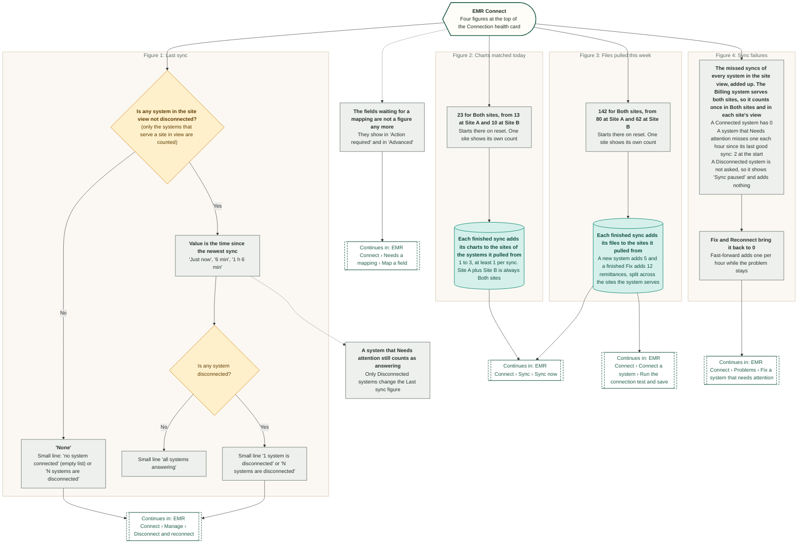

## EMR Connect › Connected systems › What each status means

Every system on the list is in one of three states. Each state shows different buttons and text, and a system moves between them by the clicks on the arrows.

Route: `/emr`

In the demo only the seeded Billing system starts in 'Needs attention'. Nothing in the demo moves a Connected system into it. A system that is not Connected also says that New Case cannot pull a chart from it.

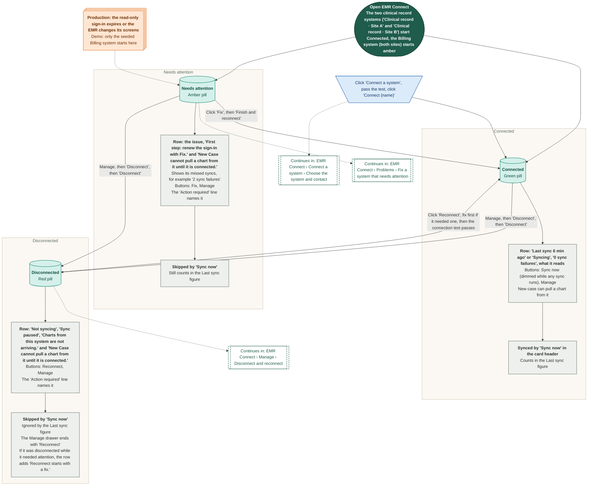

## EMR Connect › Page › The Action required line

One banner line under the header names what needs a person on this page, with one button for the first item. It lists only the systems and fields at the sites in view. When nothing needs a person there is no banner. The line follows the page: fix the system, map the fields or resume the agent, and it changes or goes.

Route: `/emr`

Order of importance: a system that Needs attention, a Disconnected system, fields waiting for a mapping, a paused Reader or Navigator. Only the first has a button here; the rest follow after 'Also:' as plain words, and each has its own button further down the page. Reader and Navigator are the two agents this page uses.

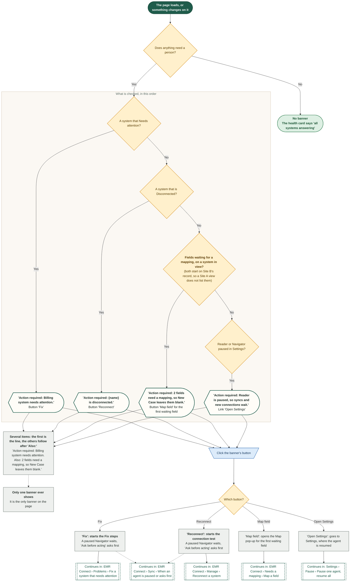

## EMR Connect › Connected systems › Read only or read and write back

Each system row ends with a line that says plainly whether the agents only read from it ('Read only') or may also write back ('Read and write back'), what write back means in one sentence, and the 'Write back' switch that changes it. The switch lives in that line.

Route: `/emr`

In the demo no value is really written: the switch decides whether the Dashboard offers the approval write-back box (the box is simulated, see Dashboard › Approve the write-back). A person's own choice, so a paused agent or 'Ask before acting' never holds it back. The Manage drawer shows the state in words and points back to this switch.

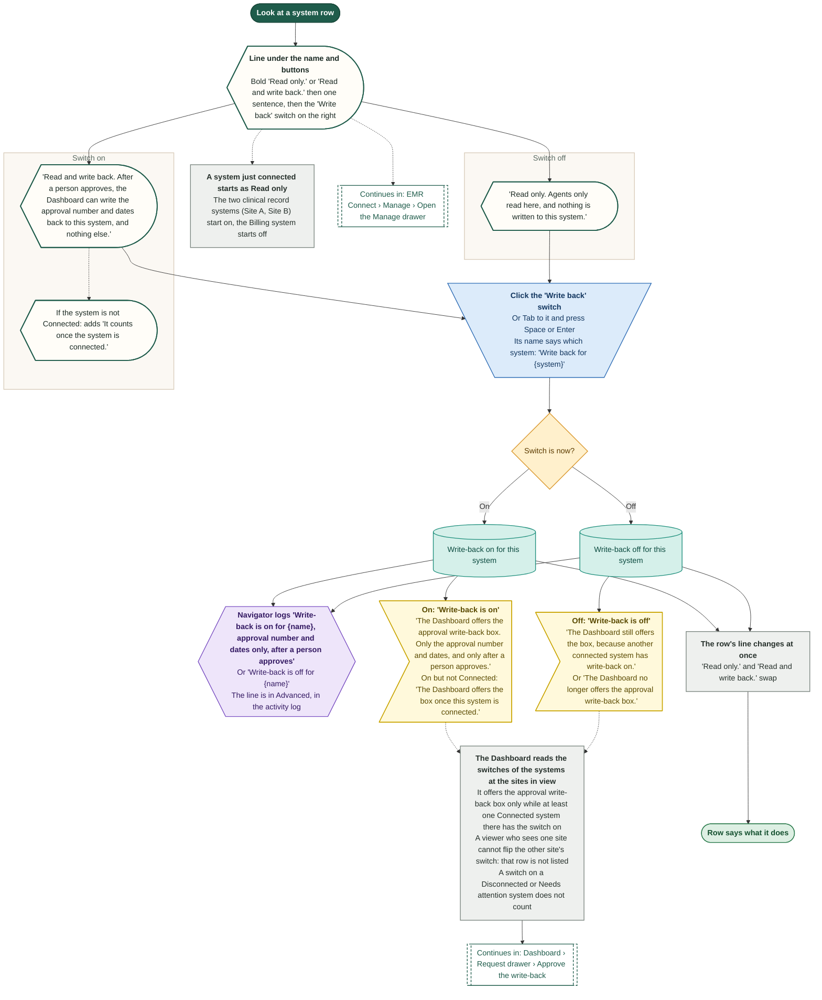

## EMR Connect › Recent activity › Read the activity log

Every read and write the agents make here is logged. The folded section 'Advanced' shows the newest six lines, and a drawer shows all of them. Most actions on this page add a line. Each line is about one site or both, and a viewer sees only the lines about the sites in view.

Route: `/emr`

Times follow the Demo clock. Demo, Reset demo data puts back the eight starting lines: all eight for Both sites, five for Site A and three for Site B.

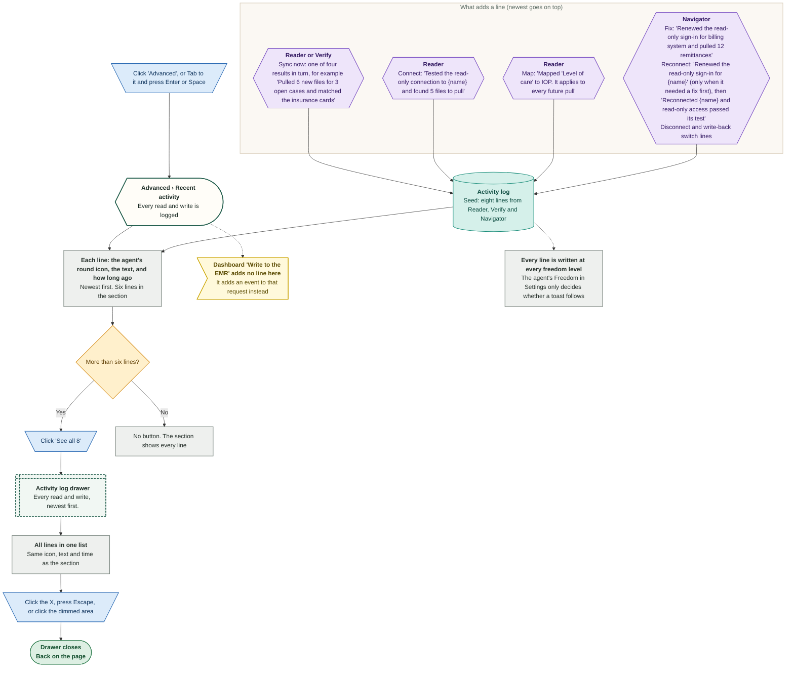

## EMR Connect › Connect a system › Choose the system and contact

The first two steps of the three-step 'Connect a system' pop-up: pick the kind of system and name it, then name the person at the practice who can approve read-only access.

Route: `/emr`

The demo asks for no password, key or scope. Access is always read-only. In production the clinic provides a service account that lives in a credential vault and is never typed into the screen.

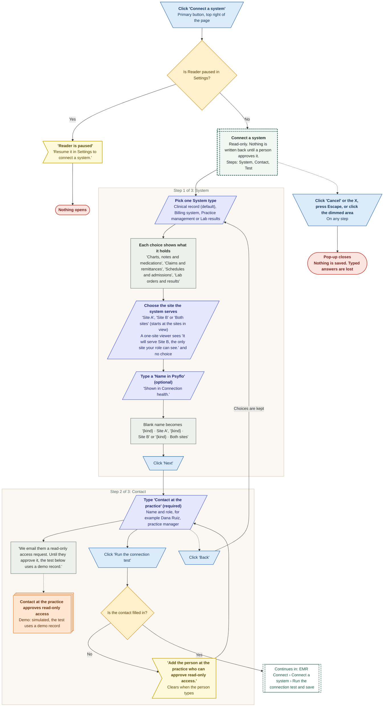

## EMR Connect › Connect a system › Run the connection test and save

Step 3 of 'Connect a system': three read-only checks run one after the other, then 'Connect {name}' saves the system. In the demo the test always passes. Reconnect runs the very same three checks.

Route: `/emr`

Production failures below come from the PRD (09 integrations) and are not simulated by the demo.

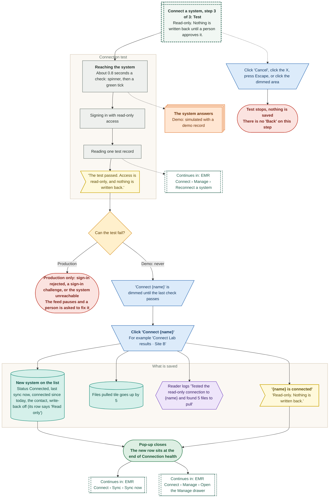

## EMR Connect › Sync › Sync now

A person starts a sync from the card header or from one row. The demo waits two seconds, then adds a result, updates the counters and the activity log, and says so in a toast unless Reader is set to 'Act on its own'.

Route: `/emr`

Demo: simulated. There is no EMR behind the button. Each sync takes the next of four fixed results. While a sync runs, every Sync now button is dimmed, so a second click cannot start.

```mermaid
%%{init: {"theme":"base","themeVariables":{"fontFamily":"'DM Sans', 'Segoe UI', system-ui, sans-serif","fontSize":"15px","lineColor":"#5B6B63","primaryTextColor":"#1C2B25","clusterBkg":"#FBF8F3","clusterBorder":"#D9CDBB","edgeLabelBackground":"#FFFFFF"},"flowchart":{"curve":"basis","nodeSpacing":36,"rankSpacing":48,"padding":12,"htmlLabels":true,"useMaxWidth":false,"wrappingWidth":230}} }%%
flowchart TD
  classDef k_start fill:#1F5C4B,stroke:#174638,color:#FFFFFF,stroke-width:1.5px,font-weight:600
  classDef k_end fill:#DDEFE3,stroke:#2E7D4F,color:#14502F,stroke-width:1.5px,font-weight:600
  classDef k_endx fill:#FBE3E0,stroke:#C0392B,color:#7A1F16,stroke-width:1.5px,font-weight:600
  classDef k_screen fill:#FFFDF8,stroke:#1F5C4B,color:#1C2B25,stroke-width:2px
  classDef k_overlay fill:#F1F7F3,stroke:#1F5C4B,color:#1C2B25,stroke-width:2px,stroke-dasharray:5 3
  classDef k_click fill:#DCEBFA,stroke:#2F6DB5,color:#12365F,stroke-width:1.5px
  classDef k_input fill:#E4E7FF,stroke:#4C5FD5,color:#1D2670,stroke-width:1.5px
  classDef k_process fill:#EEF0EE,stroke:#7A857F,color:#26302B,stroke-width:1.5px
  classDef k_agent fill:#EEE5FA,stroke:#7A4FC2,color:#341A63,stroke-width:1.5px
  classDef k_decision fill:#FFF0CC,stroke:#D9962B,color:#5C3B00,stroke-width:1.5px
  classDef k_store fill:#D5F0EA,stroke:#1C8E7B,color:#0B4A3F,stroke-width:1.5px
  classDef k_doc fill:#F6E9DC,stroke:#B07A4C,color:#4A2E14,stroke-width:1.5px
  classDef k_ext fill:#FFE6D2,stroke:#E07B39,color:#6B2F06,stroke-width:1.5px
  classDef k_wait fill:#E4E8EE,stroke:#6B7C93,color:#26303D,stroke-width:1.5px
  classDef k_toast fill:#FFF9DB,stroke:#C9A400,color:#5A4A00,stroke-width:1.5px
  classDef k_goto fill:#FFFFFF,stroke:#1F5C4B,color:#1F5C4B,stroke-width:1.5px,stroke-dasharray:5 3
  s1@{ shape: stadium, label: "<b>Click 'Sync now'</b><br/>In the Connection health header, or on a Connected row" }
  q0@{ shape: diam, label: "<b>Is any system Connected?</b><br/>(header button only)" }
  x0@{ shape: odd, label: "<b>'Nothing to sync'</b><br/>'No system is connected. Fix or reconnect one first.'<br/>Amber. No spinner" }
  gg@{ shape: subproc, label: "Continues in: EMR Connect › Sync › When an agent is paused or asks first" }
  q2@{ shape: diam, label: "Which button?" }
  p1@{ shape: rect, label: "<b>Header button spins</b><br/>Every Connected row shows 'Syncing'<br/>All Sync now buttons are dimmed" }
  p2@{ shape: rect, label: "<b>That row's button spins</b><br/>Its row shows 'Syncing'<br/>All Sync now buttons are dimmed" }
  e1@{ shape: st-rect, label: "<b>The EMR answers</b><br/>Demo: simulated, two seconds" }
  q4@{ shape: diam, label: "Did the person leave EMR Connect meanwhile?" }
  x3@{ shape: stadium, label: "<b>Sync is dropped</b><br/>Nothing is recorded" }
  q3@{ shape: diam, label: "<b>Is the system still Connected?</b><br/>(it could have been disconnected in Manage meanwhile)" }
  x2@{ shape: stadium, label: "<b>Spinner stops</b><br/>No toast, no log line, figures unchanged" }
  n1@{ shape: rect, label: "<b>Take the next result from a list of four</b><br/>The next sync takes the one after, then round again" }
  subgraph gRes ["The four results, in order"]
  r1@{ shape: hex, label: "<b>Reader</b><br/>'Pulled 6 new files for 3 open cases and matched the insurance cards'" }
  r2@{ shape: hex, label: "<b>Reader</b><br/>'Read 2 new admissions and proposed cases in Case Manager'" }
  r3@{ shape: hex, label: "<b>Verify</b><br/>'Re-checked coverage for 4 members after the sync'" }
  r4@{ shape: hex, label: "<b>Reader</b><br/>'Pulled the latest progress notes for 9 active stays'" }
  end
  ap@{ shape: rect, label: "Apply the result" }
  subgraph gSaved ["What changes"]
  d1@{ shape: cyl, label: "<b>Each synced system: last sync is now</b><br/>Rows read 'just now'" }
  d2@{ shape: cyl, label: "<b>Charts matched today and Files pulled this week go up</b><br/>About half when only some of the Connected systems are synced" }
  d3@{ shape: cyl, label: "<b>Recent activity (in Advanced) gets the result as its newest line</b><br/>For one system: '... from {system name}'" }
  end
  q5@{ shape: diam, label: "Is Reader set to 'Act on its own'?" }
  t1@{ shape: odd, label: "<b>'Sync finished'</b><br/>The result text. Green" }
  n2@{ shape: rect, label: "<b>No toast</b><br/>The figures and the new log line (in Advanced) show it" }
  z1@{ shape: stadium, label: "Last sync figure reads 'Just now'" }
  g1@{ shape: subproc, label: "Continues in: EMR Connect › Sync › What a sync pulls and when it runs" }
  g2@{ shape: subproc, label: "Continues in: EMR Connect › Recent activity › Read the activity log" }
  s1 --> q0
  q0 -->|"No"| x0
  q0 -->|"Yes, or a row button"| gg
  gg --> q2
  q2 -->|"Header"| p1
  q2 -->|"A row"| p2
  p1 --> e1
  p2 --> e1
  e1 --> q4
  q4 -->|"Yes"| x3
  q4 -->|"No"| q3
  q3 -->|"No"| x2
  q3 -->|"Yes"| n1
  n1 --> r1 & r2 & r3 & r4
  r1 & r2 & r3 & r4 --> ap
  ap --> d1 & d2 & d3
  d1 & d2 & d3 --> q5
  q5 -->|"No"| t1
  q5 -->|"Yes"| n2
  t1 --> z1
  n2 --> z1
  z1 --> g1
  d3 -.-> g2
  class s1 k_start
  class q0,q2,q4,q3,q5 k_decision
  class x0,t1 k_toast
  class gg,g1,g2 k_goto
  class p1,p2,n1,ap,n2 k_process
  class e1 k_ext
  class x3,x2 k_endx
  class r1,r2,r3,r4 k_agent
  class d1,d2,d3 k_store
  class z1 k_end
  style gRes fill:#FBF8F3,stroke:#D9CDBB,stroke-width:1.5px,color:#5B6B63
  style gSaved fill:#FBF8F3,stroke:#D9CDBB,stroke-width:1.5px,color:#5B6B63
```

## EMR Connect › Sync › When an agent is paused or asks first

Four buttons on this page start work that an agent does: Sync now and Connect a system (Reader), Fix and Reconnect (Navigator). Settings decides how each one starts. A paused agent waits, 'Ask before acting' asks first, any other level goes ahead.

Route: `/emr`

The choice is read at the moment of the click. Disconnect, the Write back switch and Map are a person's own decisions and are never held back. After the step, 'Act on its own' only logs it in Recent activity.

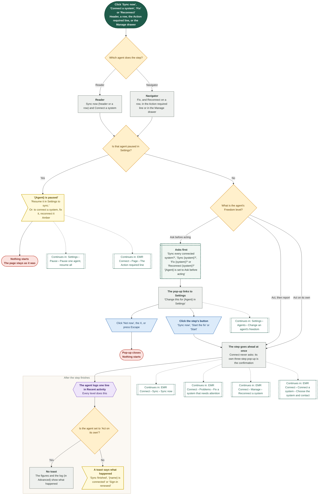

## EMR Connect › Sync › What a sync pulls and when it runs

What the agents bring in from a connected system, and when. The demo shows this with counters and one log line per sync. The schedule and the real pull come from the PRD.

Route: `/emr`

In the demo only 'Sync now' runs a sync. Demo, Fast-forward changes the 'ago' times and never starts one. No new chart, case or file appears anywhere else in the app. A sync waits while Reader is paused, and asks first when Reader is set to 'Ask before acting'.

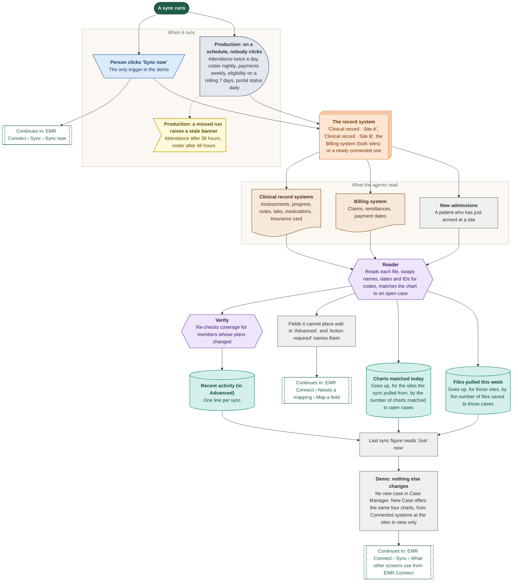

## EMR Connect › Sync › What other screens use from EMR Connect

Other screens lean on EMR Connect. The import row of New Case and Eligibility & Benefits offers 'Pull from EMR' only while a clinical record system at a site in view is Connected, and leaves out a field while its mapping waits. The Dashboard offers the approval write-back box only while a Connected system at a site in view has its write-back switch on.

Route: `/emr`

Found by reading the code and testing the built demo. Disconnect every clinical record system and 'Pull from EMR' is not offered. Switch write-back off on every row and the Dashboard shows 'Write-back is off for your records system.'

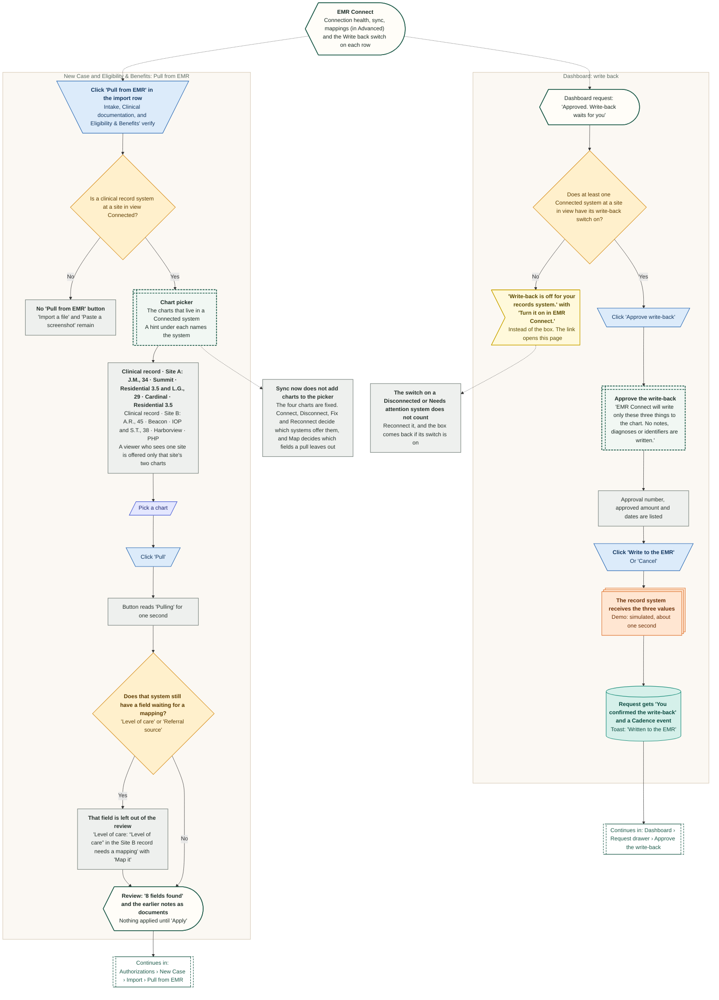

## EMR Connect › Needs a mapping › Map a field

When the agents meet a field they cannot place, it waits for a mapping. It shows in 'Action required' and, with its question, at the top of the field mappings in the folded 'Advanced' section. A person picks which Psyflo value it fills. The picker always has a value, so saving cannot fail.

Route: `/emr`

Starting fields: 'Level of care' (the Site B record) and 'Referral source' (intake at Site B). Both belong to Clinical record · Site B, so only a viewer who sees Site B is asked to map them. Until one is mapped, a chart pulled in New Case from that system leaves the matching field blank. Mapping is a person's own choice, so a paused Reader does not stop it.

```mermaid
%%{init: {"theme":"base","themeVariables":{"fontFamily":"'DM Sans', 'Segoe UI', system-ui, sans-serif","fontSize":"15px","lineColor":"#5B6B63","primaryTextColor":"#1C2B25","clusterBkg":"#FBF8F3","clusterBorder":"#D9CDBB","edgeLabelBackground":"#FFFFFF"},"flowchart":{"curve":"basis","nodeSpacing":36,"rankSpacing":48,"padding":12,"htmlLabels":true,"useMaxWidth":false,"wrappingWidth":230}} }%%
flowchart TD
  classDef k_start fill:#1F5C4B,stroke:#174638,color:#FFFFFF,stroke-width:1.5px,font-weight:600
  classDef k_end fill:#DDEFE3,stroke:#2E7D4F,color:#14502F,stroke-width:1.5px,font-weight:600
  classDef k_endx fill:#FBE3E0,stroke:#C0392B,color:#7A1F16,stroke-width:1.5px,font-weight:600
  classDef k_screen fill:#FFFDF8,stroke:#1F5C4B,color:#1C2B25,stroke-width:2px
  classDef k_overlay fill:#F1F7F3,stroke:#1F5C4B,color:#1C2B25,stroke-width:2px,stroke-dasharray:5 3
  classDef k_click fill:#DCEBFA,stroke:#2F6DB5,color:#12365F,stroke-width:1.5px
  classDef k_input fill:#E4E7FF,stroke:#4C5FD5,color:#1D2670,stroke-width:1.5px
  classDef k_process fill:#EEF0EE,stroke:#7A857F,color:#26302B,stroke-width:1.5px
  classDef k_agent fill:#EEE5FA,stroke:#7A4FC2,color:#341A63,stroke-width:1.5px
  classDef k_decision fill:#FFF0CC,stroke:#D9962B,color:#5C3B00,stroke-width:1.5px
  classDef k_store fill:#D5F0EA,stroke:#1C8E7B,color:#0B4A3F,stroke-width:1.5px
  classDef k_doc fill:#F6E9DC,stroke:#B07A4C,color:#4A2E14,stroke-width:1.5px
  classDef k_ext fill:#FFE6D2,stroke:#E07B39,color:#6B2F06,stroke-width:1.5px
  classDef k_wait fill:#E4E8EE,stroke:#6B7C93,color:#26303D,stroke-width:1.5px
  classDef k_toast fill:#FFF9DB,stroke:#C9A400,color:#5A4A00,stroke-width:1.5px
  classDef k_goto fill:#FFFFFF,stroke:#1F5C4B,color:#1F5C4B,stroke-width:1.5px,stroke-dasharray:5 3
  s1@{ shape: stadium, label: "<b>Open EMR Connect</b><br/>'Action required' names the waiting fields, and 'Advanced' shows the pill '2 to map'" }
  c1@{ shape: curv-trap, label: "<b>Advanced › Field mappings</b><br/>Waiting fields first, then every mapping" }
  r1@{ shape: rect, label: "<b>Row 1: 'Level of care' · Not mapped</b><br/>'Clinical record · Site B · Match to IOP or PHP'" }
  r2@{ shape: rect, label: "<b>Row 2: 'Referral source' · Not mapped</b><br/>'Match to a payer field'" }
  em@{ shape: odd, label: "<b>'10 mapped ... Every field the agents have met is mapped.'</b><br/>Shown at 0 fields. The pill and the 'Action required' mention go away" }
  b0@{ shape: trap-t, label: "Click 'Advanced', or Tab to it and press Enter or Space" }
  b1@{ shape: trap-t, label: "Click 'Map' on a waiting row" }
  b2@{ shape: trap-t, label: "<b>Click 'Map field' in the 'Action required' line</b><br/>Only when the waiting fields are the first thing that needs a person" }
  o1@{ shape: win-pane, label: "<b>Map 'Level of care'</b><br/>In the Site B record" }
  q1@{ shape: rect, label: "<b>Question from the agents</b><br/>'The Site B record writes Level of care as free text, such as Day program. Which level should the agents read it as?'" }
  i1@{ shape: lean-r, label: "<b>Pick a value in the dropdown (click, or arrow keys and Enter)</b><br/>Level of care: IOP (first) or PHP<br/>Referral source: Payer name (first), Plan type or Referring provider" }
  n1@{ shape: rect, label: "'Until it is mapped, New Case leaves the matching field blank when it pulls a chart from this system. Once it is mapped, every future pull fills it. Files already pulled are not rewritten.'" }
  d1@{ shape: diam, label: "Which button?" }
  k1@{ shape: trap-t, label: "Click 'Save the mapping'" }
  k2@{ shape: trap-t, label: "Click 'Cancel' or the X, press Escape, or click the dimmed area" }
  x1@{ shape: stadium, label: "<b>Pop-up closes</b><br/>The field stays waiting" }
  subgraph gSave ["What saving does"]
  s2@{ shape: cyl, label: "The field leaves the waiting rows" }
  s3@{ shape: cyl, label: "<b>A mapping row is added to the list</b><br/>'Level of care → PHP', 'Clinical record · Site B', mapped by 'You, 10/20'" }
  a1@{ shape: hex, label: "<b>Reader logs 'Mapped 'Level of care' to IOP. It applies to every future pull'</b><br/>In the activity log, in Advanced" }
  t1@{ shape: odd, label: "<b>'Field mapped'</b><br/>'Level of care' now fills IOP." }
  p1@{ shape: rect, label: "<b>The pill and the 'Action required' mention count down: 2, 1, then none</b><br/>At none the section summary reads '12 field mappings' with no 'waiting'" }
  p2@{ shape: rect, label: "<b>New Case now fills that field when it pulls a chart from this system</b><br/>Before, it left it blank" }
  end
  g2@{ shape: subproc, label: "Continues in: EMR Connect › Sync › What other screens use from EMR Connect" }
  e1@{ shape: stadium, label: "<b>Pop-up closes</b><br/>A mapped field cannot be unmapped or edited in the demo" }
  x2@{ shape: st-rect, label: "<b>Production: an unknown column holds a file back and shows what differs</b><br/>A confirmed mapping is remembered" }
  g1@{ shape: subproc, label: "Continues in: EMR Connect › Field mappings › Every mapping by system" }
  g3@{ shape: subproc, label: "Continues in: EMR Connect › Advanced › Field mappings and the activity log" }
  s1 --> b2 & b0
  b0 --> c1
  c1 --> r1 & r2
  c1 -.-> em
  r1 --> b1
  r2 --> b1
  b1 --> o1
  b2 --> o1
  o1 --> q1 --> i1 --> n1 --> d1
  d1 -->|"Save"| k1
  d1 -->|"Leave"| k2
  k2 --> x1
  k1 --> s2 & s3 & a1 & t1
  s2 --> p1
  s2 --> p2
  s3 --> p1
  p1 --> e1
  p2 -.-> g2
  e1 --> g1
  c1 -.-> g3
  c1 -.-> x2
  class s1 k_start
  class c1 k_screen
  class r1,r2,q1,n1,p1,p2 k_process
  class em,t1 k_toast
  class b0,b1,b2,k1,k2 k_click
  class o1 k_overlay
  class i1 k_input
  class d1 k_decision
  class x1 k_endx
  class s2,s3 k_store
  class a1 k_agent
  class g2,g1,g3 k_goto
  class e1 k_end
  class x2 k_ext
  style gSave fill:#FBF8F3,stroke:#D9CDBB,stroke-width:1.5px,color:#5B6B63
```

## EMR Connect › Field mappings › Every mapping by system

The field mappings list in the folded 'Advanced' section: every mapping with its system, what each of their fields fills in Psyflo, who mapped it, and the fields that still wait. A newly connected system starts with none.

Route: `/emr`

Seed data. 'Mapped by' reads 'Reader, 03/14' for the agents and 'You, {date}' for a person. Dates come from the Demo clock. A chart pulled in New Case leaves a waiting field blank (Level of care, Referral source) and fills a mapped one. The list is one list with the system named under each row, and it shows only the systems at the sites in view (Site A's viewer sees 7 mappings, Site B's 5, Both sites 10); the Manage drawer no longer holds mappings.

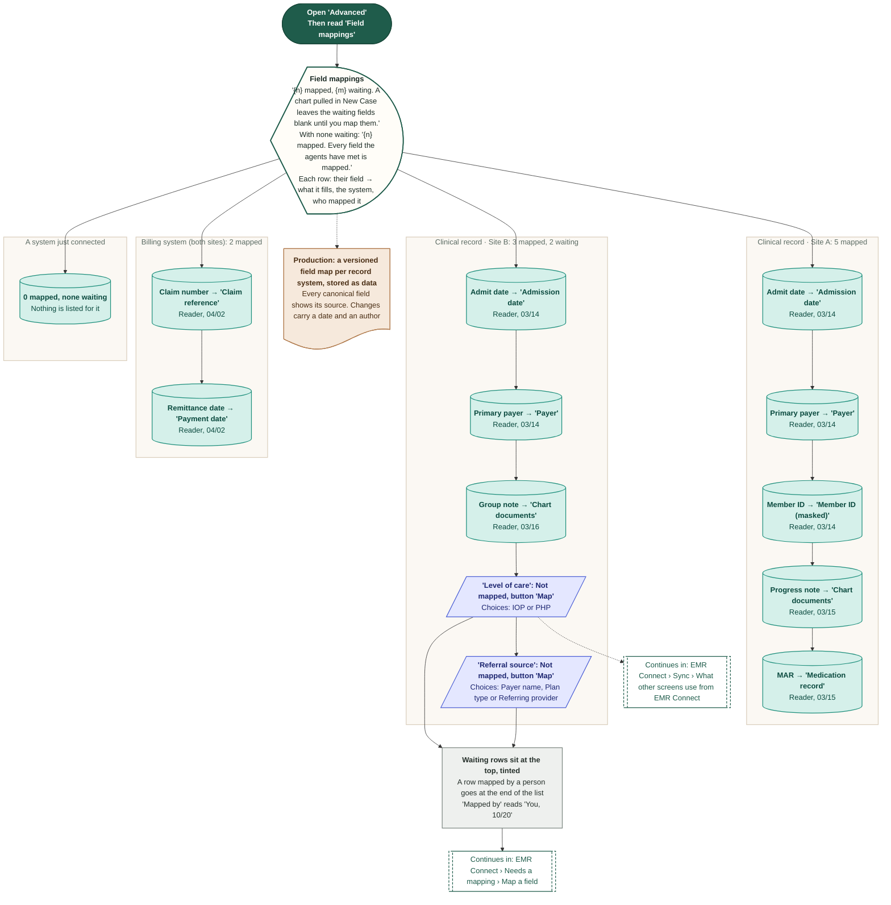

## EMR Connect › Problems › Fix a system that needs attention

The three-step 'Fix' pop-up for a system whose read-only sign-in has expired: say what happened, renew the sign-in, test it. Nothing is written to the system.

Route: `/emr`

In the demo the Billing system is the only system that Needs attention. The test always passes. Navigator does the fix, so a paused Navigator waits and 'Ask before acting' asks first.

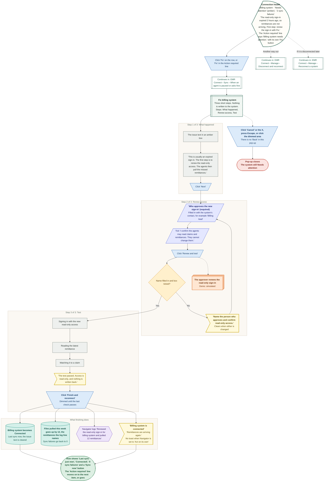

## EMR Connect › Problems › Every error state and what it needs

A way to read the page when something looks wrong. Start from what the page shows, find what the person has to do, and see how the page recovers. The demo has two real problem states, and every click that cannot go ahead says why.

Route: `/emr`

Production-only problems (from the PRD) are shown in orange. The demo cannot reach them.

```mermaid
%%{init: {"theme":"base","themeVariables":{"fontFamily":"'DM Sans', 'Segoe UI', system-ui, sans-serif","fontSize":"15px","lineColor":"#5B6B63","primaryTextColor":"#1C2B25","clusterBkg":"#FBF8F3","clusterBorder":"#D9CDBB","edgeLabelBackground":"#FFFFFF"},"flowchart":{"curve":"basis","nodeSpacing":36,"rankSpacing":48,"padding":12,"htmlLabels":true,"useMaxWidth":false,"wrappingWidth":230}} }%%
flowchart TD
  classDef k_start fill:#1F5C4B,stroke:#174638,color:#FFFFFF,stroke-width:1.5px,font-weight:600
  classDef k_end fill:#DDEFE3,stroke:#2E7D4F,color:#14502F,stroke-width:1.5px,font-weight:600
  classDef k_endx fill:#FBE3E0,stroke:#C0392B,color:#7A1F16,stroke-width:1.5px,font-weight:600
  classDef k_screen fill:#FFFDF8,stroke:#1F5C4B,color:#1C2B25,stroke-width:2px
  classDef k_overlay fill:#F1F7F3,stroke:#1F5C4B,color:#1C2B25,stroke-width:2px,stroke-dasharray:5 3
  classDef k_click fill:#DCEBFA,stroke:#2F6DB5,color:#12365F,stroke-width:1.5px
  classDef k_input fill:#E4E7FF,stroke:#4C5FD5,color:#1D2670,stroke-width:1.5px
  classDef k_process fill:#EEF0EE,stroke:#7A857F,color:#26302B,stroke-width:1.5px
  classDef k_agent fill:#EEE5FA,stroke:#7A4FC2,color:#341A63,stroke-width:1.5px
  classDef k_decision fill:#FFF0CC,stroke:#D9962B,color:#5C3B00,stroke-width:1.5px
  classDef k_store fill:#D5F0EA,stroke:#1C8E7B,color:#0B4A3F,stroke-width:1.5px
  classDef k_doc fill:#F6E9DC,stroke:#B07A4C,color:#4A2E14,stroke-width:1.5px
  classDef k_ext fill:#FFE6D2,stroke:#E07B39,color:#6B2F06,stroke-width:1.5px
  classDef k_wait fill:#E4E8EE,stroke:#6B7C93,color:#26303D,stroke-width:1.5px
  classDef k_toast fill:#FFF9DB,stroke:#C9A400,color:#5A4A00,stroke-width:1.5px
  classDef k_goto fill:#FFFFFF,stroke:#1F5C4B,color:#1F5C4B,stroke-width:1.5px,stroke-dasharray:5 3
  s1@{ shape: stadium, label: "Something on EMR Connect looks wrong" }
  q1@{ shape: diam, label: "What does the page show?" }
  subgraph gA ["Amber pill: 'Needs attention'"]
  a1@{ shape: rect, label: "<b>The read-only sign-in expired</b><br/>The row names the problem and says renew it with Fix" }
  a2@{ shape: trap-t, label: "<b>Click 'Fix'</b><br/>Needs: a person who approves, and a tick for read-only access" }
  a3@{ shape: subproc, label: "Continues in: EMR Connect › Problems › Fix a system that needs attention" }
  a4@{ shape: stadium, label: "Re-test: three checks. Row turns Connected" }
  end
  subgraph gR ["Red pill: 'Disconnected'"]
  r1@{ shape: rect, label: "<b>Someone disconnected it</b><br/>Row: 'Not syncing'. Charts from this system are not arriving. New Case cannot pull a chart from it until it is connected." }
  r2@{ shape: trap-t, label: "<b>Click 'Reconnect' on the row or in the Manage drawer</b><br/>Needs: a passed connection test, and the Fix steps first if it was on 'Needs attention'" }
  r4@{ shape: subproc, label: "Continues in: EMR Connect › Manage › Reconnect a system" }
  r3@{ shape: stadium, label: "<b>Re-test: the same three checks as Connect</b><br/>Row turns Connected only after they pass. Any earlier issue text is cleared" }
  end
  subgraph gT ["Last sync figure"]
  t1@{ shape: rect, label: "<b>'None': every system is Disconnected</b><br/>Small line: 'N systems are disconnected'" }
  t2@{ shape: rect, label: "Needs: every Disconnected row reconnected" }
  end
  subgraph gM ["'Action required' names fields waiting for a mapping"]
  m1@{ shape: rect, label: "<b>'2 fields need a mapping, so New Case leaves them blank.'</b><br/>Pill '2 to map' on 'Advanced'" }
  m2@{ shape: trap-t, label: "<b>Click 'Map field', or open 'Advanced' and click 'Map'</b><br/>Needs: a value picked for each field" }
  end
  subgraph gQ ["Clicks that stop with a message"]
  d1@{ shape: odd, label: "<b>'Sync now' with no Connected system</b><br/>'Nothing to sync'<br/>'No system is connected. Fix or reconnect one first.'" }
  d5@{ shape: odd, label: "<b>An agent is paused in Settings</b><br/>'Reader is paused' or 'Navigator is paused'<br/>'Resume it in Settings to sync.' (or to connect a system, fix it, reconnect it)" }
  d3@{ shape: stadium, label: "<b>Contact left blank while connecting</b><br/>'Add the person at the practice who can approve read-only access.'" }
  d4@{ shape: stadium, label: "<b>Fix form incomplete</b><br/>'Name the person who approves and confirm read-only access.'" }
  end
  subgraph gP ["Production only, from the PRD"]
  p1@{ shape: st-rect, label: "<b>The record system changes its screens</b><br/>The feed pauses and falls back to file upload" }
  p2@{ shape: st-rect, label: "<b>A sign-in challenge or lockout</b><br/>The run pauses and a task goes to the credential owner" }
  p3@{ shape: odd, label: "<b>A feed goes stale</b><br/>A banner and a task after the stale limit, 36 hours for attendance" }
  end
  s1 --> q1
  q1 -->|"Amber pill on a row"| a1 --> a2 --> a3
  a3 --> a4
  q1 -->|"Red pill on a row"| r1 --> r2 --> r4 --> r3
  q1 -->|"Last sync figure says None or a disconnected system"| t1 --> t2
  t2 --> r2
  q1 -->|"The banner or the pill names fields"| m1 --> m2
  q1 -->|"A toast after a click"| d1
  q1 -->|"A toast after a click"| d5
  q1 -.->|"A message under a field"| d3
  q1 -.->|"A message under a field"| d4
  q1 -.->|"Not in the demo"| p1
  p1 --> p2 --> p3
  class s1 k_start
  class q1 k_decision
  class a1,r1,t1,t2,m1 k_process
  class a2,r2,m2 k_click
  class a3,r4 k_goto
  class a4,r3 k_end
  class d1,d5,p3 k_toast
  class d3,d4 k_endx
  class p1,p2 k_ext
  style gA fill:#FBF8F3,stroke:#D9CDBB,stroke-width:1.5px,color:#5B6B63
  style gR fill:#FBF8F3,stroke:#D9CDBB,stroke-width:1.5px,color:#5B6B63
  style gT fill:#FBF8F3,stroke:#D9CDBB,stroke-width:1.5px,color:#5B6B63
  style gM fill:#FBF8F3,stroke:#D9CDBB,stroke-width:1.5px,color:#5B6B63
  style gQ fill:#FBF8F3,stroke:#D9CDBB,stroke-width:1.5px,color:#5B6B63
  style gP fill:#FBF8F3,stroke:#D9CDBB,stroke-width:1.5px,color:#5B6B63
```

## EMR Connect › Manage › Open the Manage drawer

One system's details in a right-hand drawer: connection facts, what the agents may read, whether it is read only or read and write back (in words), and a Disconnect or Reconnect button. A system that is not Connected says here that New Case cannot pull a chart from it. The Write back switch and the field mappings are not here: the switch is on the system's row, the mappings are in 'Advanced'.

Route: `/emr`

Drawer buttons that the demo does not have: pause, edit, rename, delete, rotate sign-in. The only way to stop a system is Disconnect, and a system is never removed. Escape closes one layer at a time, so a pop-up on top of the drawer closes first. The header button 'Manage mapping' no longer exists: the mappings sit in 'Advanced'.

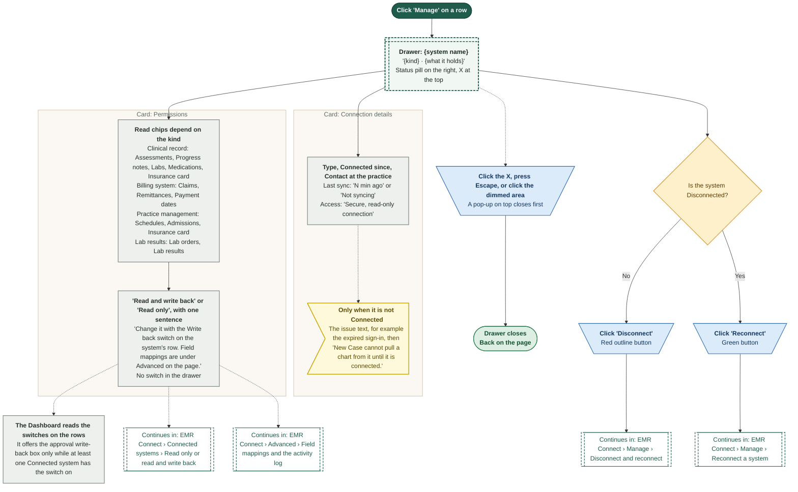

## EMR Connect › Manage › Disconnect and reconnect

Stop a system, or bring a stopped one back. Disconnect asks first. Reconnect runs the connection test, and Fix first if the system had a problem. Nothing is deleted, and the Dashboard is not touched.

Route: `/emr`

Escape closes one layer at a time: the confirmation first, then the drawer. Disconnect is a person's own decision, so it is never held back by an agent's pause or freedom.

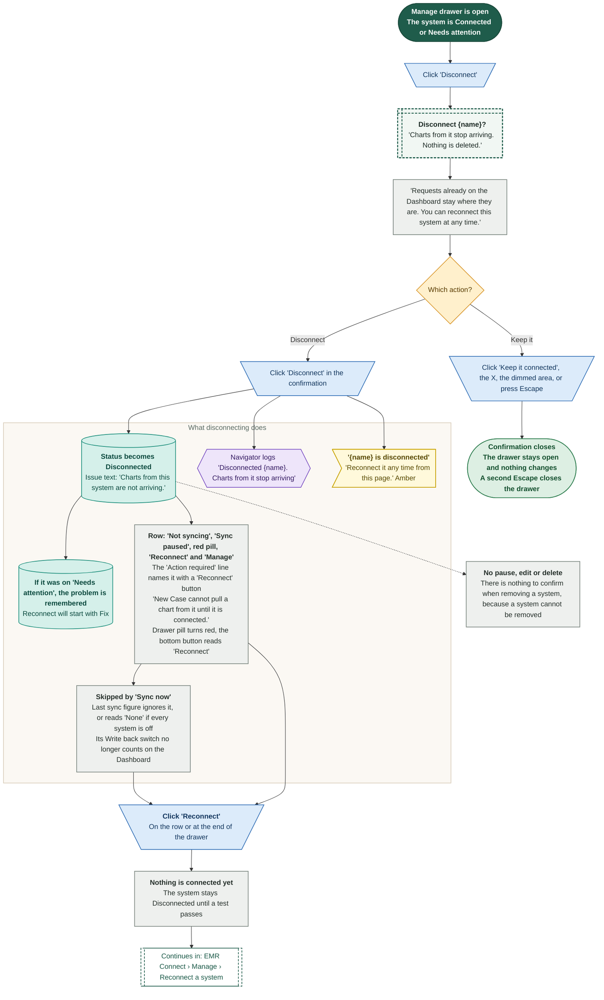

## EMR Connect › Manage › Reconnect a system

A Disconnected system comes back only after a passed test. If it was on 'Needs attention' when it was disconnected, the Fix steps come first. The test is the same three checks as Connect.

Route: `/emr`

Demo: the test always passes. The system stays Disconnected, and New Case cannot pull from it, until the last check passes and the person clicks the final button.

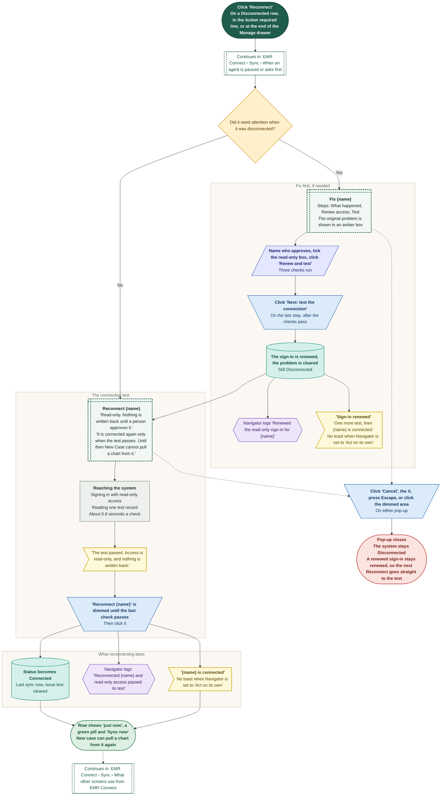

## EMR Connect › Advanced › Field mappings and the activity log

Under the connection health card, a folded section 'Advanced' holds the detail: every field mapping, with the ones still waiting at the top, and the log of every read and write. It starts closed, opens by click, Enter or Space, and shows how many fields wait in a pill.

Route: `/emr`

Seed data, counts shown for Both sites. For one site the field mappings and the log lines are that site's only (Site A: 7 mappings and 5 lines; Site B: 5 mappings, 2 waiting, and 3 lines). The section is not kept in the page while closed, so searching the page does not find its text until it is opened. The Map pop-up lives on the page, not in the section, so closing the section never loses a mapping in progress.

```mermaid
%%{init: {"theme":"base","themeVariables":{"fontFamily":"'DM Sans', 'Segoe UI', system-ui, sans-serif","fontSize":"15px","lineColor":"#5B6B63","primaryTextColor":"#1C2B25","clusterBkg":"#FBF8F3","clusterBorder":"#D9CDBB","edgeLabelBackground":"#FFFFFF"},"flowchart":{"curve":"basis","nodeSpacing":36,"rankSpacing":48,"padding":12,"htmlLabels":true,"useMaxWidth":false,"wrappingWidth":230}} }%%
flowchart TD
  classDef k_start fill:#1F5C4B,stroke:#174638,color:#FFFFFF,stroke-width:1.5px,font-weight:600
  classDef k_end fill:#DDEFE3,stroke:#2E7D4F,color:#14502F,stroke-width:1.5px,font-weight:600
  classDef k_endx fill:#FBE3E0,stroke:#C0392B,color:#7A1F16,stroke-width:1.5px,font-weight:600
  classDef k_screen fill:#FFFDF8,stroke:#1F5C4B,color:#1C2B25,stroke-width:2px
  classDef k_overlay fill:#F1F7F3,stroke:#1F5C4B,color:#1C2B25,stroke-width:2px,stroke-dasharray:5 3
  classDef k_click fill:#DCEBFA,stroke:#2F6DB5,color:#12365F,stroke-width:1.5px
  classDef k_input fill:#E4E7FF,stroke:#4C5FD5,color:#1D2670,stroke-width:1.5px
  classDef k_process fill:#EEF0EE,stroke:#7A857F,color:#26302B,stroke-width:1.5px
  classDef k_agent fill:#EEE5FA,stroke:#7A4FC2,color:#341A63,stroke-width:1.5px
  classDef k_decision fill:#FFF0CC,stroke:#D9962B,color:#5C3B00,stroke-width:1.5px
  classDef k_store fill:#D5F0EA,stroke:#1C8E7B,color:#0B4A3F,stroke-width:1.5px
  classDef k_doc fill:#F6E9DC,stroke:#B07A4C,color:#4A2E14,stroke-width:1.5px
  classDef k_ext fill:#FFE6D2,stroke:#E07B39,color:#6B2F06,stroke-width:1.5px
  classDef k_wait fill:#E4E8EE,stroke:#6B7C93,color:#26303D,stroke-width:1.5px
  classDef k_toast fill:#FFF9DB,stroke:#C9A400,color:#5A4A00,stroke-width:1.5px
  classDef k_goto fill:#FFFFFF,stroke:#1F5C4B,color:#1F5C4B,stroke-width:1.5px,stroke-dasharray:5 3
  s1@{ shape: stadium, label: "Scroll below the Connection health card" }
  sc@{ shape: curv-trap, label: "<b>Closed section 'Advanced'</b><br/>'10 field mappings, 2 waiting, and the log of every read and write (8 lines).'<br/>Pill '2 to map' (hidden at 0), chevron on the right" }
  k1@{ shape: trap-t, label: "<b>Click 'Advanced'</b><br/>Or Tab to it and press Enter or Space" }
  p1@{ shape: rect, label: "<b>The button says whether it is open (aria-expanded)</b><br/>The chevron turns" }
  o1@{ shape: curv-trap, label: "<b>Open: 'Field mappings'</b><br/>'10 mapped, 2 waiting. A chart pulled in New Case leaves the waiting fields blank until you map them.'" }
  subgraph gMap ["Field mappings list"]
  m1@{ shape: curv-trap, label: "<b>Waiting fields first, tinted</b><br/>'Level of care' with a 'Not mapped' pill, 'Clinical record · Site B · Match to IOP or PHP', button 'Map'<br/>'Referral source' ... 'Match to a payer field', button 'Map'" }
  m2@{ shape: curv-trap, label: "<b>Then every mapping, with its system and who mapped it</b><br/>'Admit date → Admission date', 'Reader, 03/14' ... ten rows at the start<br/>A mapping made by a person reads 'You, 10/20'" }
  m3@{ shape: trap-t, label: "Click 'Map' on a waiting row" }
  end
  gm@{ shape: subproc, label: "Continues in: EMR Connect › Needs a mapping › Map a field" }
  gm2@{ shape: subproc, label: "Continues in: EMR Connect › Field mappings › Every mapping by system" }
  subgraph gLog ["Recent activity"]
  l1@{ shape: curv-trap, label: "<b>'Recent activity'</b><br/>'Every read and write is logged'<br/>Newest six lines, then 'See all 8' when there are more" }
  l2@{ shape: trap-t, label: "Click 'See all 8'" }
  end
  gl@{ shape: subproc, label: "Continues in: EMR Connect › Recent activity › Read the activity log" }
  k2@{ shape: trap-t, label: "Click 'Advanced' again, or press Enter or Space on it" }
  p2@{ shape: rect, label: "<b>It closes</b><br/>Summary and pill stay, updated: for example '12 field mappings, and the log of every read and write (10 lines).'" }
  p3@{ shape: rect, label: "<b>Tab order: Connect a system, banner button, Sync now, row buttons and switches, then Advanced</b><br/>Open content follows in reading order" }
  p4@{ shape: rect, label: "What is not here: connection details and permissions (Manage drawer), the Write back switch (on each row), a Test button (the connection test runs inside Connect, Fix and Reconnect)" }
  e1@{ shape: stadium, label: "Detail read" }
  s1 --> sc --> k1 --> p1 --> o1
  o1 --> m1 --> m2
  m1 --> m3 --> gm
  m2 -.-> gm2
  o1 --> l1 --> l2 --> gl
  sc -.-> p3
  o1 --> k2 --> p2 --> e1
  sc -.-> p4
  class s1 k_start
  class sc,o1,m1,m2,l1 k_screen
  class k1,m3,l2,k2 k_click
  class p1,p2,p3,p4 k_process
  class gm,gm2,gl k_goto
  class e1 k_end
  style gMap fill:#FBF8F3,stroke:#D9CDBB,stroke-width:1.5px,color:#5B6B63
  style gLog fill:#FBF8F3,stroke:#D9CDBB,stroke-width:1.5px,color:#5B6B63
```

## EMR Connect › No connection › Import a record and start a New Case

For a record system that has no connection: one small row under Connection health opens the shared import in a side panel. Import an export (CSV or XLSX with field mapping, or a PDF) or paste a screenshot; on Apply, a New Case starts with the patient filled in.

Route: `/emr`

Demo only: the screenshot reading and the PDF reading are simulated and say so. Files and images stay in the browser.

```mermaid
%%{init: {"theme":"base","themeVariables":{"fontFamily":"'DM Sans', 'Segoe UI', system-ui, sans-serif","fontSize":"15px","lineColor":"#5B6B63","primaryTextColor":"#1C2B25","clusterBkg":"#FBF8F3","clusterBorder":"#D9CDBB","edgeLabelBackground":"#FFFFFF"},"flowchart":{"curve":"basis","nodeSpacing":36,"rankSpacing":48,"padding":12,"htmlLabels":true,"useMaxWidth":false,"wrappingWidth":230}} }%%
flowchart TD
  classDef k_start fill:#1F5C4B,stroke:#174638,color:#FFFFFF,stroke-width:1.5px,font-weight:600
  classDef k_end fill:#DDEFE3,stroke:#2E7D4F,color:#14502F,stroke-width:1.5px,font-weight:600
  classDef k_endx fill:#FBE3E0,stroke:#C0392B,color:#7A1F16,stroke-width:1.5px,font-weight:600
  classDef k_screen fill:#FFFDF8,stroke:#1F5C4B,color:#1C2B25,stroke-width:2px
  classDef k_overlay fill:#F1F7F3,stroke:#1F5C4B,color:#1C2B25,stroke-width:2px,stroke-dasharray:5 3
  classDef k_click fill:#DCEBFA,stroke:#2F6DB5,color:#12365F,stroke-width:1.5px
  classDef k_input fill:#E4E7FF,stroke:#4C5FD5,color:#1D2670,stroke-width:1.5px
  classDef k_process fill:#EEF0EE,stroke:#7A857F,color:#26302B,stroke-width:1.5px
  classDef k_agent fill:#EEE5FA,stroke:#7A4FC2,color:#341A63,stroke-width:1.5px
  classDef k_decision fill:#FFF0CC,stroke:#D9962B,color:#5C3B00,stroke-width:1.5px
  classDef k_store fill:#D5F0EA,stroke:#1C8E7B,color:#0B4A3F,stroke-width:1.5px
  classDef k_doc fill:#F6E9DC,stroke:#B07A4C,color:#4A2E14,stroke-width:1.5px
  classDef k_ext fill:#FFE6D2,stroke:#E07B39,color:#6B2F06,stroke-width:1.5px
  classDef k_wait fill:#E4E8EE,stroke:#6B7C93,color:#26303D,stroke-width:1.5px
  classDef k_toast fill:#FFF9DB,stroke:#C9A400,color:#5A4A00,stroke-width:1.5px
  classDef k_goto fill:#FFFFFF,stroke:#1F5C4B,color:#1F5C4B,stroke-width:1.5px,stroke-dasharray:5 3
  s1@{ shape: stadium, label: "Open EMR Connect" }
  sc@{ shape: curv-trap, label: "<b>Row under Connection health</b><br/>'No connection for a system? Import an export or paste a screenshot'<br/>Button 'Import a record'" }
  c1@{ shape: trap-t, label: "Click 'Import a record'" }
  o1@{ shape: win-pane, label: "<b>Side panel 'Import a record'</b><br/>'Import a file' and 'Paste a screenshot'<br/>No 'Pull from EMR' here" }
  cFile@{ shape: trap-t, label: "Click 'Import a file'" }
  cShot@{ shape: trap-t, label: "Click 'Paste a screenshot', or press Ctrl+V or Cmd+V in the panel" }
  gFile@{ shape: subproc, label: "Continues in: Authorizations › New Case › Import › Import a file with field mapping" }
  gShot@{ shape: subproc, label: "Continues in: Authorizations › New Case › Import › Paste a screenshot" }
  sRev@{ shape: curv-trap, label: "<b>Review: '9 fields found', a box for each</b><br/>'Apply 10'" }
  cApply@{ shape: trap-t, label: "Click 'Apply 10'" }
  st1@{ shape: cyl, label: "<b>A new case is made at the site in view</b><br/>The patient, coverage and request are filled; the notes become documents" }
  t1@{ shape: odd, label: "'Applied 9 fields and 1 document'" }
  p1@{ shape: rect, label: "<b>New Case opens on Intake with the case</b><br/>Each filled field says 'From file' or 'From screenshot'" }
  gIntake@{ shape: subproc, label: "Continues in: Authorizations › New Case › Intake › Initial authorization" }
  cEsc@{ shape: trap-t, label: "Press Escape, click outside, or the X" }
  e1@{ shape: stadium, label: "Panel closes; nothing is made" }
  s1 --> sc --> c1 --> o1
  o1 --> cFile --> gFile
  o1 --> cShot --> gShot
  gFile -.-> sRev
  gShot -.-> sRev
  sRev --> cApply --> st1 --> t1 --> p1 --> gIntake
  o1 --> cEsc --> e1
  class s1 k_start
  class sc,sRev k_screen
  class c1,cFile,cShot,cApply,cEsc k_click
  class o1 k_overlay
  class gFile,gShot,gIntake k_goto
  class st1 k_store
  class t1 k_toast
  class p1 k_process
  class e1 k_endx
```
