# EMR Connect

Connected systems, sync, field mappings and fixes.

Shapes and colours: see `00-overview.md`. Source: `workflows/src/09-emr-connect/`.

## EMR Connect › Page › Arrive and read the page

What a person sees on arrival: two header buttons, four tiles, the Connected systems list, Recent activity and two side panels. Each region hands off to its own diagram.

Route: `/emr`

Demo data. Three systems start on the list: two clinical record sites (Connected) and a Billing system (Needs a quick look).

```mermaid
%%{init: {"theme":"base","themeVariables":{"fontFamily":"'DM Sans', 'Segoe UI', system-ui, sans-serif","fontSize":"15px","lineColor":"#5B6B63","primaryTextColor":"#1C2B25","clusterBkg":"#FBF8F3","clusterBorder":"#D9CDBB","edgeLabelBackground":"#FFFFFF"},"flowchart":{"curve":"basis","nodeSpacing":36,"rankSpacing":48,"padding":12,"htmlLabels":true,"useMaxWidth":false,"wrappingWidth":230}} }%%
flowchart TD
  classDef k_start fill:#1F5C4B,stroke:#174638,color:#FFFFFF,stroke-width:1.5px,font-weight:600
  classDef k_end fill:#DDEFE3,stroke:#2E7D4F,color:#14502F,stroke-width:1.5px,font-weight:600
  classDef k_endx fill:#FBE3E0,stroke:#C0392B,color:#7A1F16,stroke-width:1.5px,font-weight:600
  classDef k_screen fill:#FFFDF8,stroke:#1F5C4B,color:#1C2B25,stroke-width:2px
  classDef k_overlay fill:#F1F7F3,stroke:#1F5C4B,color:#1C2B25,stroke-width:2px,stroke-dasharray:5 3
  classDef k_click fill:#DCEBFA,stroke:#2F6DB5,color:#12365F,stroke-width:1.5px
  classDef k_input fill:#E4E7FF,stroke:#4C5FD5,color:#1D2670,stroke-width:1.5px
  classDef k_process fill:#EEF0EE,stroke:#7A857F,color:#26302B,stroke-width:1.5px
  classDef k_agent fill:#EEE5FA,stroke:#7A4FC2,color:#341A63,stroke-width:1.5px
  classDef k_decision fill:#FFF0CC,stroke:#D9962B,color:#5C3B00,stroke-width:1.5px
  classDef k_store fill:#D5F0EA,stroke:#1C8E7B,color:#0B4A3F,stroke-width:1.5px
  classDef k_doc fill:#F6E9DC,stroke:#B07A4C,color:#4A2E14,stroke-width:1.5px
  classDef k_ext fill:#FFE6D2,stroke:#E07B39,color:#6B2F06,stroke-width:1.5px
  classDef k_wait fill:#E4E8EE,stroke:#6B7C93,color:#26303D,stroke-width:1.5px
  classDef k_toast fill:#FFF9DB,stroke:#C9A400,color:#5A4A00,stroke-width:1.5px
  classDef k_goto fill:#FFFFFF,stroke:#1F5C4B,color:#1F5C4B,stroke-width:1.5px,stroke-dasharray:5 3
  s1@{ shape: stadium, label: "<b>Click 'EMR Connect' in the sidebar</b><br/>Under Connections" }
  p1@{ shape: curv-trap, label: "<b>EMR Connect</b><br/>Charts arrive on their own. Nothing is written back until a person approves it." }
  subgraph gHead ["Header buttons"]
  hb1@{ shape: trap-t, label: "Click 'Manage mapping'" }
  hq@{ shape: diam, label: "Any system on the list?" }
  ho@{ shape: win-pane, label: "<b>Manage drawer opens</b><br/>for the outpatient site, or the first system" }
  hx@{ shape: stadium, label: "<b>Button is dimmed</b><br/>Nothing to open" }
  hb2@{ shape: trap-t, label: "Click 'Connect a system'" }
  end
  hg1@{ shape: subproc, label: "Continues in: EMR Connect › Manage › Open the Manage drawer" }
  hg2@{ shape: subproc, label: "Continues in: EMR Connect › Connect a system › Choose the system and contact" }
  subgraph gTiles ["Four tiles (they are not buttons)"]
  t1@{ shape: rect, label: "<b>Last sync</b><br/>Time since the newest sync. Green, amber or red" }
  t2@{ shape: rect, label: "<b>Charts matched today</b><br/>23 'to open cases'" }
  t3@{ shape: rect, label: "<b>Files pulled</b><br/>142 'this week'" }
  t4@{ shape: rect, label: "<b>Need a mapping</b><br/>2 'fields the agents could not place'" }
  end
  tg@{ shape: subproc, label: "Continues in: EMR Connect › Page › What each tile shows" }
  subgraph gSys ["Connected systems"]
  c1@{ shape: curv-trap, label: "<b>Connected systems</b><br/>Read access for charts, insurance details and medications" }
  c2@{ shape: rect, label: "One row per system: name, what it holds, last sync, status pill, buttons" }
  c3@{ shape: trap-t, label: "Click 'Sync now' in the card header" }
  c4@{ shape: trap-t, label: "Click 'Sync now', 'Fix', 'Reconnect' or 'Manage' on a row" }
  c5@{ shape: odd, label: "<b>'Connect your record system to let charts arrive on their own.'</b><br/>Empty list. Not reachable in the demo: a system can be disconnected, never removed" }
  end
  cg1@{ shape: subproc, label: "Continues in: EMR Connect › Sync › Sync now" }
  cg2@{ shape: subproc, label: "Continues in: EMR Connect › Connected systems › What each status means" }
  cg3@{ shape: subproc, label: "Continues in: EMR Connect › Problems › Every error state and what it needs" }
  subgraph gAct ["Recent activity"]
  a1@{ shape: curv-trap, label: "<b>Recent activity</b><br/>Every read and write is logged. Newest six lines" }
  a2@{ shape: trap-t, label: "<b>Click 'See all 8'</b><br/>Only shown when there are more than six lines" }
  end
  ag@{ shape: subproc, label: "Continues in: EMR Connect › Recent activity › Read the activity log" }
  subgraph gSide ["Right-hand panels"]
  r1@{ shape: curv-trap, label: "<b>What the agents can do here</b><br/>Read: assessments, notes, labs, medications, insurance card" }
  r2@{ shape: rect, label: "Write back: only the approval number and dates, and only after a person approves" }
  r3@{ shape: curv-trap, label: "<b>Needs a mapping</b><br/>Pill with the count, then one row per field with a 'Map' button" }
  r4@{ shape: trap-t, label: "Click 'Map' on a row" }
  end
  rg@{ shape: subproc, label: "Continues in: EMR Connect › Needs a mapping › Map a field" }
  s1 --> p1
  p1 --> hb1 & hb2
  hb1 --> hq
  hq -->|"Yes"| ho
  hq -->|"No"| hx
  ho --> hg1
  hb2 --> hg2
  p1 --> t1 & t2 & t3 & t4
  t1 --> tg
  t2 --> tg
  t3 --> tg
  t4 --> tg
  p1 --> c1
  c1 --> c2
  c2 --> c3 & c4
  c1 -.-> c5
  c3 --> cg1
  c4 --> cg2
  c4 -.-> cg3
  p1 --> a1
  a1 --> a2 --> ag
  p1 --> r1
  r1 --> r2
  p1 --> r3
  r3 --> r4 --> rg
  class s1 k_start
  class p1,c1,a1,r1,r3 k_screen
  class hb1,hb2,c3,c4,a2,r4 k_click
  class hq k_decision
  class ho k_overlay
  class hx k_endx
  class hg1,hg2,tg,cg1,cg2,cg3,ag,rg k_goto
  class t1,t2,t3,t4,c2,r2 k_process
  class c5 k_toast
  style gHead fill:#FBF8F3,stroke:#D9CDBB,stroke-width:1.5px,color:#5B6B63
  style gTiles fill:#FBF8F3,stroke:#D9CDBB,stroke-width:1.5px,color:#5B6B63
  style gSys fill:#FBF8F3,stroke:#D9CDBB,stroke-width:1.5px,color:#5B6B63
  style gAct fill:#FBF8F3,stroke:#D9CDBB,stroke-width:1.5px,color:#5B6B63
  style gSide fill:#FBF8F3,stroke:#D9CDBB,stroke-width:1.5px,color:#5B6B63
```

## EMR Connect › Page › What each tile shows

The four tiles at the top follow the state below them. They are not buttons. This diagram shows what each one says and what moves it.

Route: `/emr`

Times follow the Demo clock. Demo, Fast-forward ages the 'ago' labels but never runs a sync.

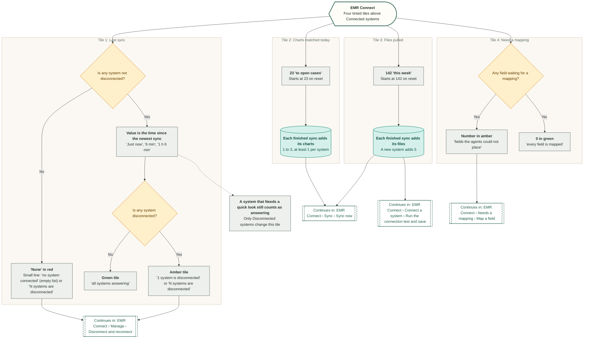

## EMR Connect › Connected systems › What each status means

Every system on the list is in one of three states. Each state shows different buttons and text, and a system moves between them by the clicks on the arrows.

Route: `/emr`

In the demo only the seeded Billing system starts in 'Needs a quick look'. Nothing in the demo moves a Connected system into it.

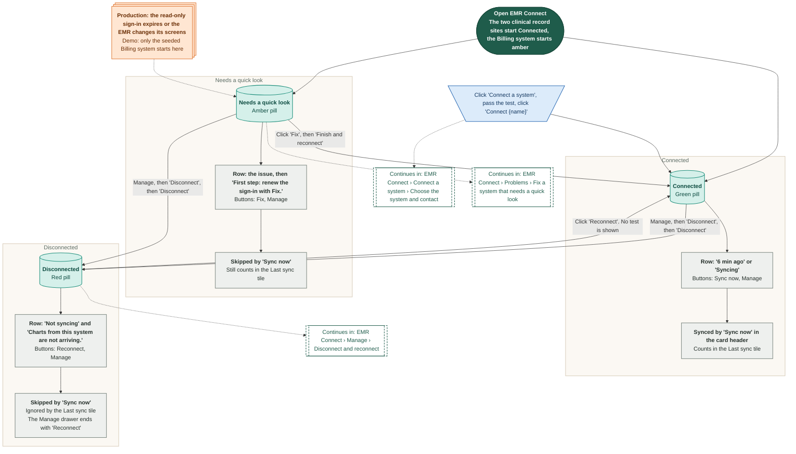

## EMR Connect › Recent activity › Read the activity log

Every read and write the agents make here is logged. The card shows the newest six lines; a drawer shows all of them. Most actions on this page add a line.

Route: `/emr`

Times follow the Demo clock. Demo, Reset demo data puts back the eight starting lines.

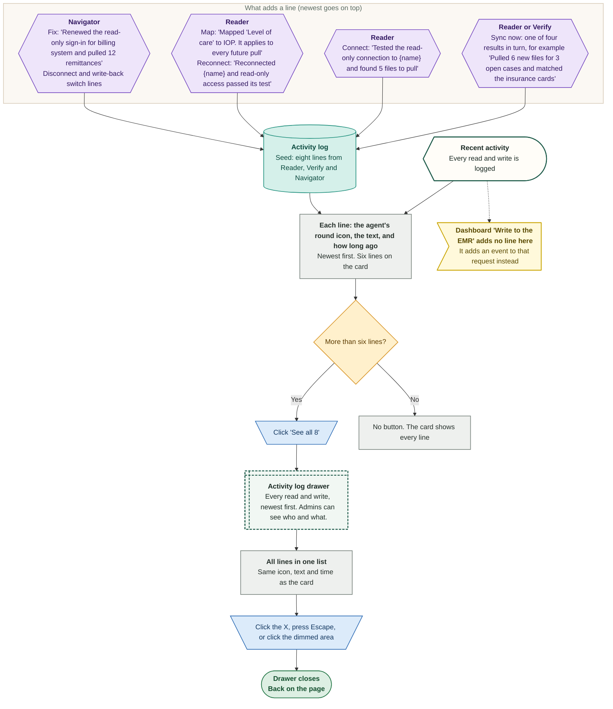

## EMR Connect › Connect a system › Choose the system and contact

The first two steps of the three-step 'Connect a system' pop-up: pick the kind of system and name it, then name the person at the practice who can approve read-only access.

Route: `/emr`

The demo asks for no password, key or scope. Access is always read-only. In production the clinic provides a service account that lives in a credential vault and is never typed into the screen.

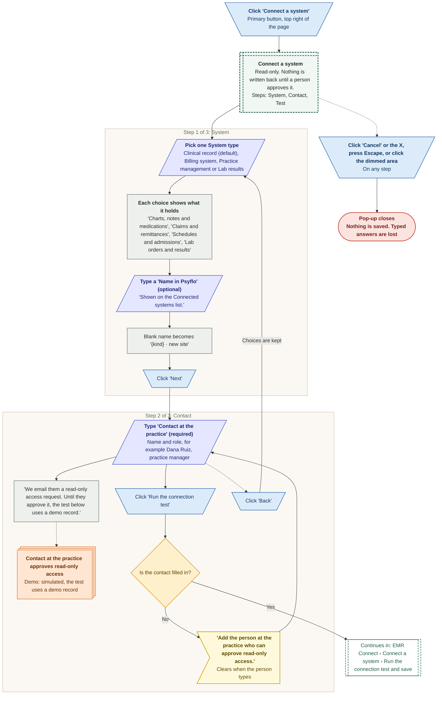

## EMR Connect › Connect a system › Run the connection test and save

Step 3 of 'Connect a system': three read-only checks run one after the other, then 'Connect {name}' saves the system. In the demo the test always passes.

Route: `/emr`

Production failures below come from the PRD (09 integrations) and are not simulated by the demo.

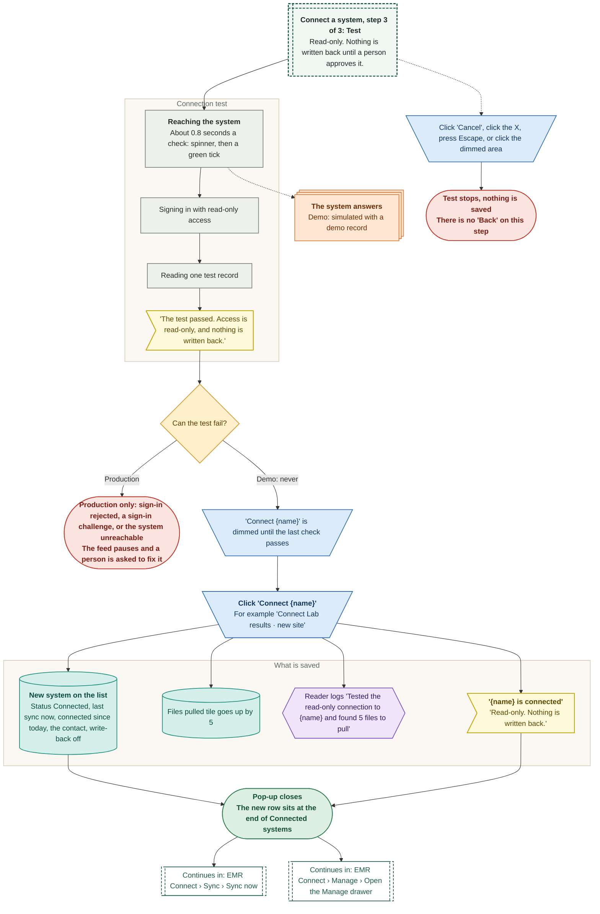

## EMR Connect › Sync › Sync now

A person starts a sync from the card header or from one row. The demo waits two seconds, then adds a result, updates the counters and the activity log, and shows a toast.

Route: `/emr`

Demo: simulated. There is no EMR behind the button. Each sync takes the next of four fixed results.

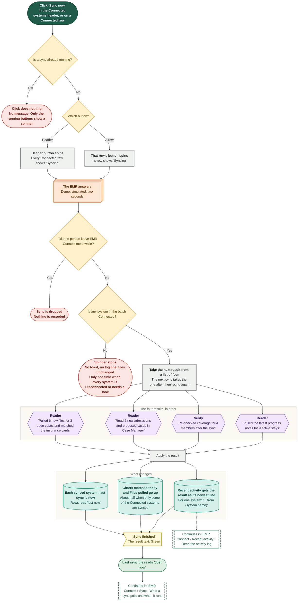

## EMR Connect › Sync › What a sync pulls and when it runs

What the agents bring in from a connected system, and when. The demo shows this with counters and one log line per sync. The schedule and the real pull come from the PRD.

Route: `/emr`

In the demo only 'Sync now' runs a sync. Demo, Fast-forward changes the 'ago' times and never starts one. No new chart, case or file appears anywhere else in the app.

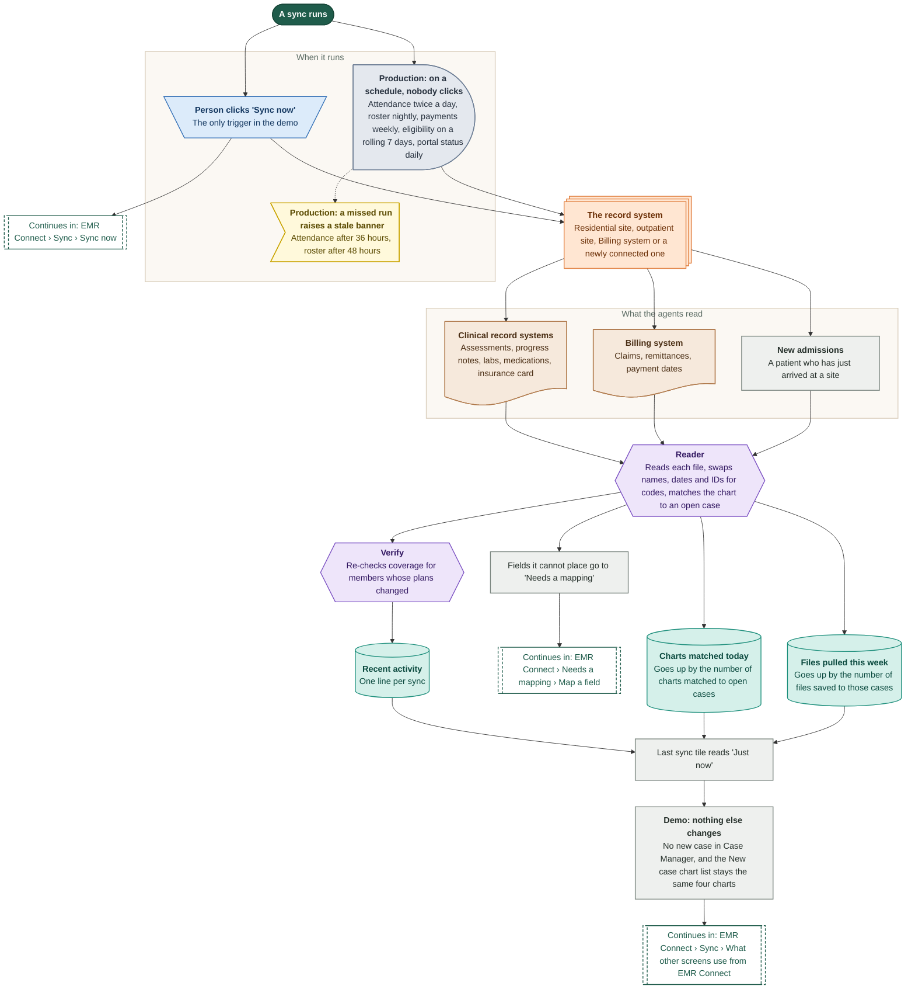

## EMR Connect › Sync › What other screens use from EMR Connect

Two other screens lean on EMR Connect: New case can pull a chart, and the Dashboard can write an approval back. In the demo neither one reads this page's systems or switches.

Route: `/emr`

Found by reading the code and testing the built demo. Disconnect every system and 'Pull' in New case still works.

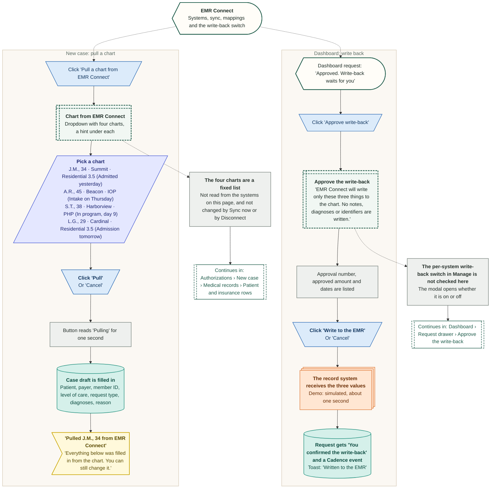

## EMR Connect › Needs a mapping › Map a field

When the agents meet a field they cannot place, it waits in 'Needs a mapping'. A person picks which Psyflo value it fills. The picker always has a value, so saving cannot fail.

Route: `/emr`

Starting fields: 'Level of care' (outpatient record) and 'Referral source' (intake). The demo does not apply a saved mapping anywhere else.

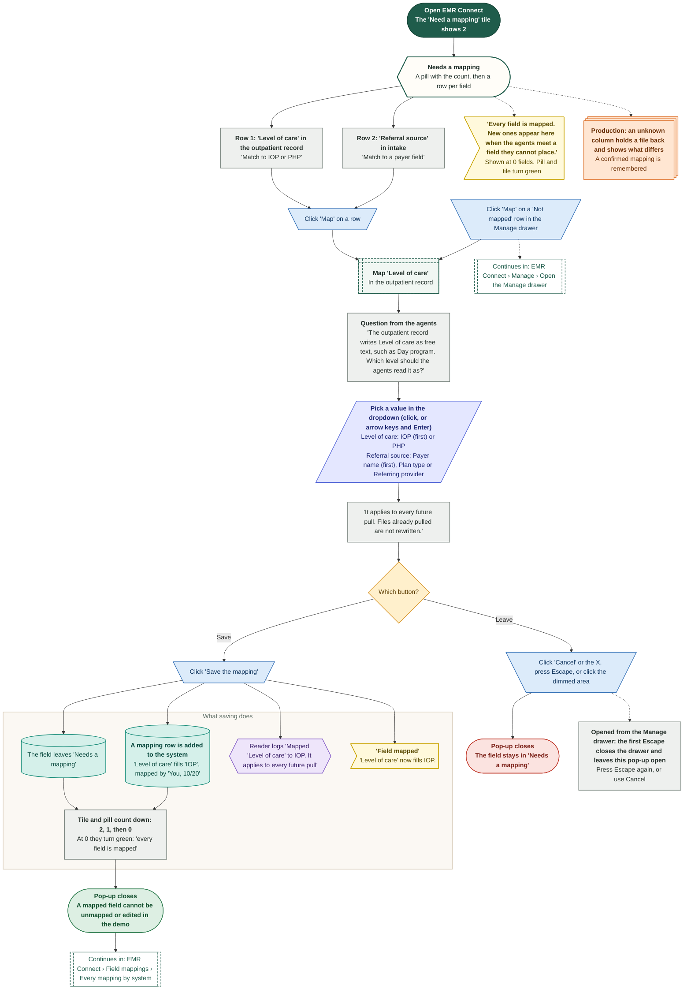

## EMR Connect › Field mappings › Every mapping by system

The Field mappings table in the Manage drawer, system by system: what each of their fields fills in Psyflo, who mapped it, and which fields still wait. A newly connected system starts with none.

Route: `/emr`

Seed data. 'Mapped by' reads 'Reader, 03/14' for the agents and 'You, {date}' for a person. Dates come from the Demo clock.

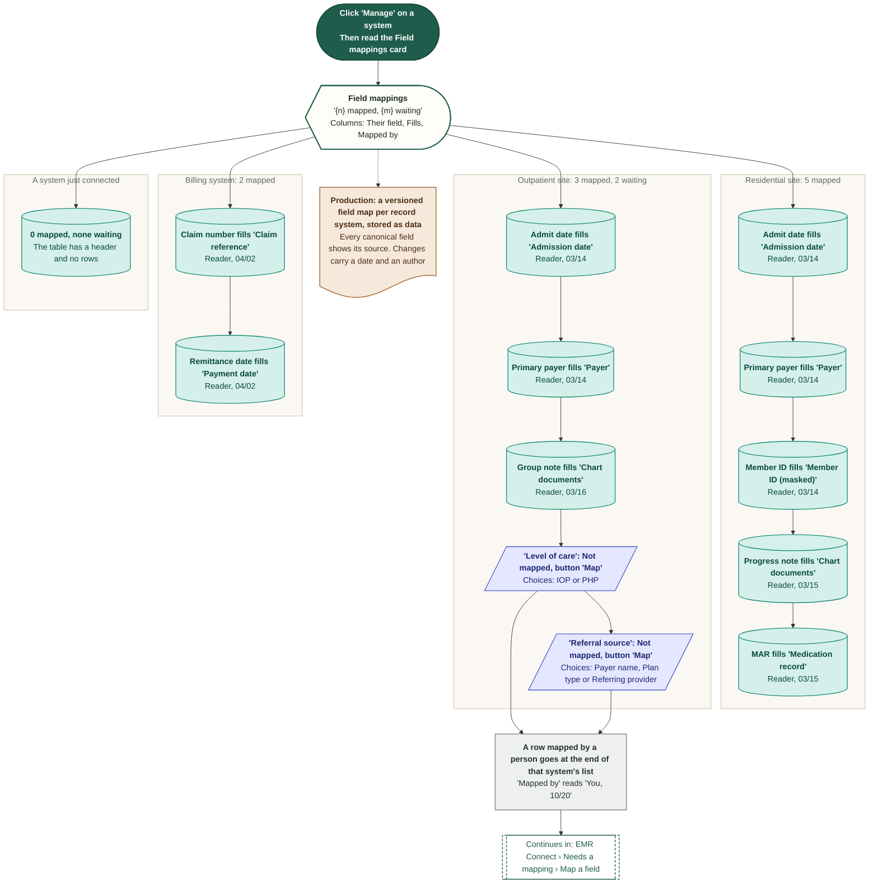

## EMR Connect › Problems › Fix a system that needs a quick look

The three-step 'Fix' pop-up for a system whose read-only sign-in has expired: say what happened, renew the sign-in, test it. Nothing is written to the system.

Route: `/emr`

In the demo the Billing system is the only system that Needs a quick look. The test always passes.

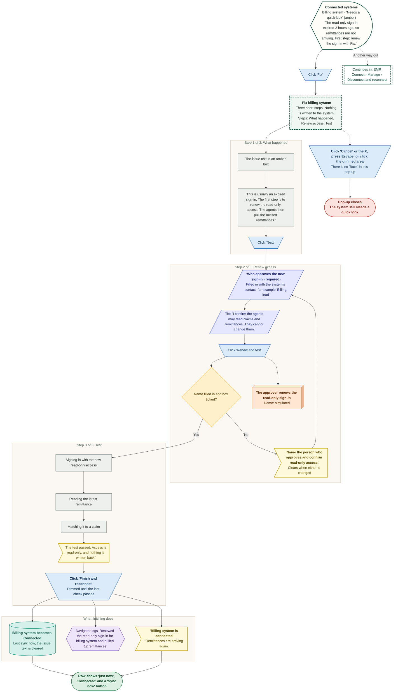

## EMR Connect › Problems › Every error state and what it needs

A way to read the page when something looks wrong. Start from what the page shows, find what the person has to do, and see how the page recovers. The demo has two real problem states and a few quiet dead ends.

Route: `/emr`

Production-only problems (from the PRD) are shown in orange. The demo cannot reach them.

```mermaid
%%{init: {"theme":"base","themeVariables":{"fontFamily":"'DM Sans', 'Segoe UI', system-ui, sans-serif","fontSize":"15px","lineColor":"#5B6B63","primaryTextColor":"#1C2B25","clusterBkg":"#FBF8F3","clusterBorder":"#D9CDBB","edgeLabelBackground":"#FFFFFF"},"flowchart":{"curve":"basis","nodeSpacing":36,"rankSpacing":48,"padding":12,"htmlLabels":true,"useMaxWidth":false,"wrappingWidth":230}} }%%
flowchart TD
  classDef k_start fill:#1F5C4B,stroke:#174638,color:#FFFFFF,stroke-width:1.5px,font-weight:600
  classDef k_end fill:#DDEFE3,stroke:#2E7D4F,color:#14502F,stroke-width:1.5px,font-weight:600
  classDef k_endx fill:#FBE3E0,stroke:#C0392B,color:#7A1F16,stroke-width:1.5px,font-weight:600
  classDef k_screen fill:#FFFDF8,stroke:#1F5C4B,color:#1C2B25,stroke-width:2px
  classDef k_overlay fill:#F1F7F3,stroke:#1F5C4B,color:#1C2B25,stroke-width:2px,stroke-dasharray:5 3
  classDef k_click fill:#DCEBFA,stroke:#2F6DB5,color:#12365F,stroke-width:1.5px
  classDef k_input fill:#E4E7FF,stroke:#4C5FD5,color:#1D2670,stroke-width:1.5px
  classDef k_process fill:#EEF0EE,stroke:#7A857F,color:#26302B,stroke-width:1.5px
  classDef k_agent fill:#EEE5FA,stroke:#7A4FC2,color:#341A63,stroke-width:1.5px
  classDef k_decision fill:#FFF0CC,stroke:#D9962B,color:#5C3B00,stroke-width:1.5px
  classDef k_store fill:#D5F0EA,stroke:#1C8E7B,color:#0B4A3F,stroke-width:1.5px
  classDef k_doc fill:#F6E9DC,stroke:#B07A4C,color:#4A2E14,stroke-width:1.5px
  classDef k_ext fill:#FFE6D2,stroke:#E07B39,color:#6B2F06,stroke-width:1.5px
  classDef k_wait fill:#E4E8EE,stroke:#6B7C93,color:#26303D,stroke-width:1.5px
  classDef k_toast fill:#FFF9DB,stroke:#C9A400,color:#5A4A00,stroke-width:1.5px
  classDef k_goto fill:#FFFFFF,stroke:#1F5C4B,color:#1F5C4B,stroke-width:1.5px,stroke-dasharray:5 3
  s1@{ shape: stadium, label: "Something on EMR Connect looks wrong" }
  q1@{ shape: diam, label: "What does the page show?" }
  subgraph gA ["Amber pill: 'Needs a quick look'"]
  a1@{ shape: rect, label: "<b>The read-only sign-in expired</b><br/>The row names the problem and says renew it with Fix" }
  a2@{ shape: trap-t, label: "<b>Click 'Fix'</b><br/>Needs: a person who approves, and a tick for read-only access" }
  a3@{ shape: subproc, label: "Continues in: EMR Connect › Problems › Fix a system that needs a quick look" }
  a4@{ shape: stadium, label: "Re-test: three checks. Row turns Connected" }
  end
  subgraph gR ["Red pill: 'Disconnected'"]
  r1@{ shape: rect, label: "<b>Someone disconnected it</b><br/>Row: 'Not syncing'. Charts from this system are not arriving." }
  r2@{ shape: trap-t, label: "<b>Click 'Reconnect' on the row or in the Manage drawer</b><br/>Needs: nothing else" }
  r3@{ shape: stadium, label: "<b>Re-test: none is shown</b><br/>Row turns Connected at once. Any earlier issue text is cleared" }
  end
  subgraph gT ["Last sync tile"]
  t1@{ shape: rect, label: "<b>Red 'None': every system is Disconnected</b><br/>Amber: 'N systems are disconnected'" }
  t2@{ shape: rect, label: "Needs: every Disconnected row reconnected" }
  end
  subgraph gM ["Amber tile: 'Need a mapping'"]
  m1@{ shape: rect, label: "'fields the agents could not place'" }
  m2@{ shape: trap-t, label: "<b>Click 'Map'</b><br/>Needs: a value picked for each field" }
  end
  subgraph gQ ["Quiet dead ends"]
  d1@{ shape: stadium, label: "<b>'Sync now' while another sync runs</b><br/>Click is ignored, no message" }
  d2@{ shape: stadium, label: "<b>'Sync now' with no Connected system</b><br/>Spins two seconds, then nothing" }
  d3@{ shape: stadium, label: "<b>Contact left blank while connecting</b><br/>'Add the person at the practice who can approve read-only access.'" }
  d4@{ shape: stadium, label: "<b>Fix form incomplete</b><br/>'Name the person who approves and confirm read-only access.'" }
  end
  subgraph gP ["Production only, from the PRD"]
  p1@{ shape: st-rect, label: "<b>The record system changes its screens</b><br/>The feed pauses and falls back to file upload" }
  p2@{ shape: st-rect, label: "<b>A sign-in challenge or lockout</b><br/>The run pauses and a task goes to the credential owner" }
  p3@{ shape: odd, label: "<b>A feed goes stale</b><br/>A banner and a task after the stale limit, 36 hours for attendance" }
  end
  s1 --> q1
  q1 -->|"Amber pill on a row"| a1 --> a2 --> a3
  a3 --> a4
  q1 -->|"Red pill on a row"| r1 --> r2 --> r3
  q1 -->|"Last sync tile is red or amber"| t1 --> t2
  t2 --> r2
  q1 -->|"Need a mapping tile is amber"| m1 --> m2
  q1 -->|"Nothing happens after a click"| d1
  q1 -->|"Nothing happens after a click"| d2
  q1 -.->|"A message under a field"| d3
  q1 -.->|"A message under a field"| d4
  q1 -.->|"Not in the demo"| p1
  p1 --> p2 --> p3
  class s1 k_start
  class q1 k_decision
  class a1,r1,t1,t2,m1 k_process
  class a2,r2,m2 k_click
  class a3 k_goto
  class a4,r3 k_end
  class d1,d2,d3,d4 k_endx
  class p1,p2 k_ext
  class p3 k_toast
  style gA fill:#FBF8F3,stroke:#D9CDBB,stroke-width:1.5px,color:#5B6B63
  style gR fill:#FBF8F3,stroke:#D9CDBB,stroke-width:1.5px,color:#5B6B63
  style gT fill:#FBF8F3,stroke:#D9CDBB,stroke-width:1.5px,color:#5B6B63
  style gM fill:#FBF8F3,stroke:#D9CDBB,stroke-width:1.5px,color:#5B6B63
  style gQ fill:#FBF8F3,stroke:#D9CDBB,stroke-width:1.5px,color:#5B6B63
  style gP fill:#FBF8F3,stroke:#D9CDBB,stroke-width:1.5px,color:#5B6B63
```

## EMR Connect › Manage › Open the Manage drawer

One system's details in a right-hand drawer: connection facts, what the agents may read, the write-back switch, the field mappings and a Disconnect or Reconnect button.

Route: `/emr`

Drawer buttons that the demo does not have: pause, edit, rename, delete, rotate sign-in. The only way to stop a system is Disconnect, and a system is never removed.

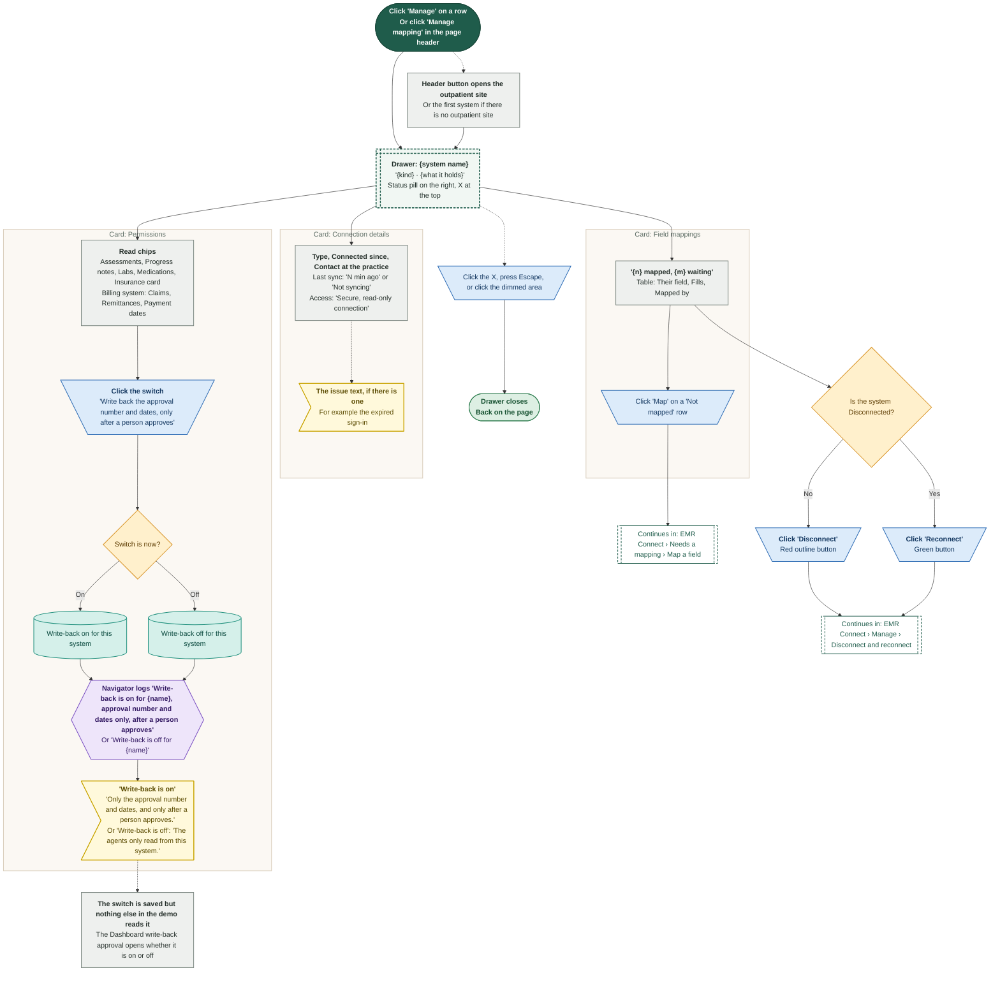

## EMR Connect › Manage › Disconnect and reconnect

Stop a system, or bring a stopped one back. Disconnect asks first. Reconnect does not. Nothing is deleted, and the Dashboard is not touched.

Route: `/emr`

Found by testing the built demo. Escape closes the drawer under the confirmation too. Reconnect skips 'Fix' and shows no test.

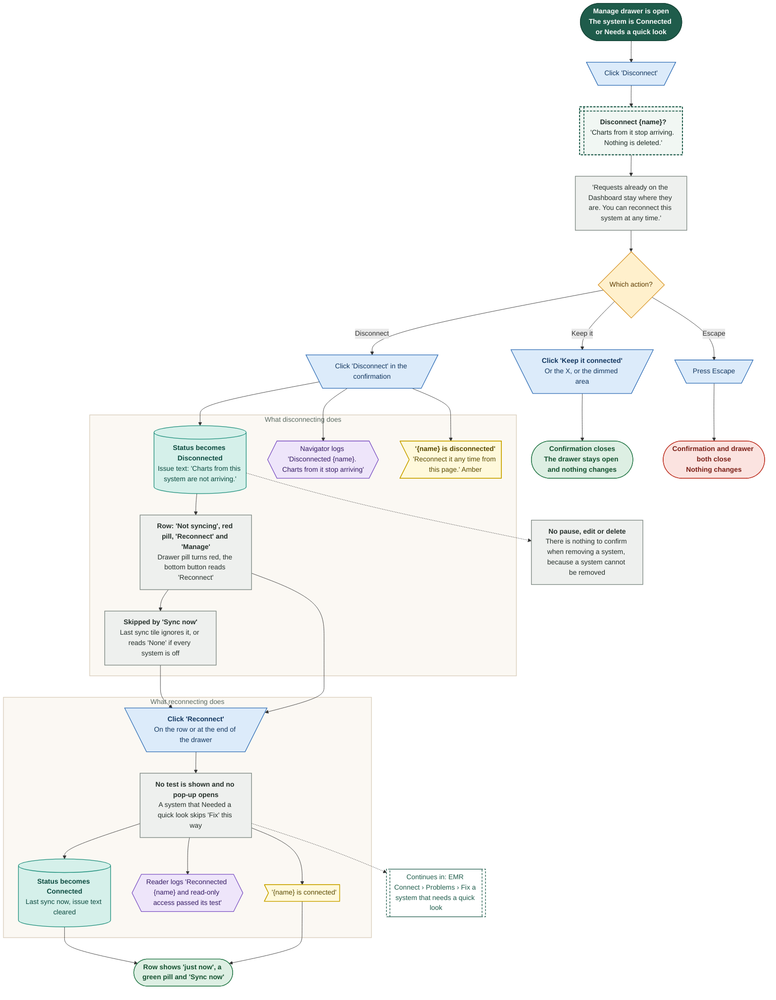
