# Payers

Each payer's process, rules, documents and the changes to acknowledge.

Shapes and colours: see `00-overview.md`. Source: `workflows/src/10-payers/`.

## Payers › Arrive on the page

How a person lands on Payers, which payer and tab they see first, what the badges count, and where each control on the page leads. Every other Payers diagram starts from one of the hand offs at the bottom.

Route: `/payers`

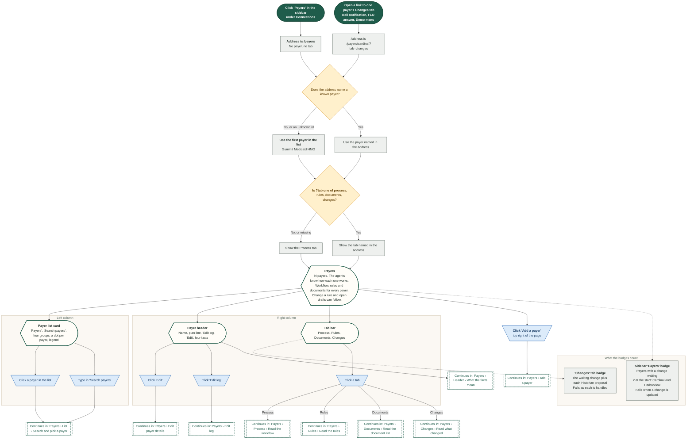

## Payers › List › Search and pick a payer

The 'Payers' card on the left: how the rows are grouped, what the dot means, how search narrows the list and what happens when a payer is picked. The tab that was open stays open.

Route: `/payers/:id?tab=process`

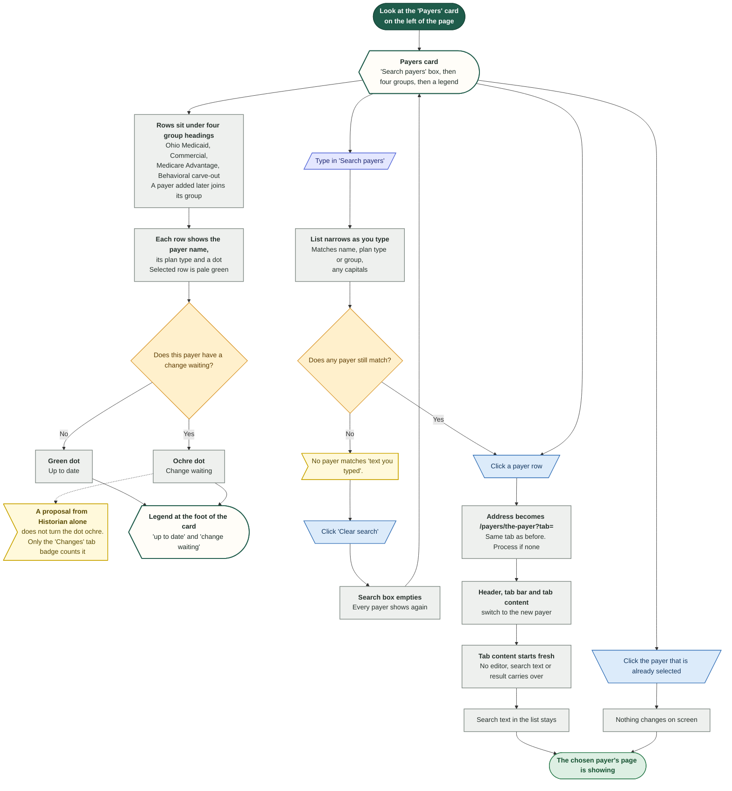

## Payers › Header › What the facts mean

The card above the tabs. It names the payer, says whether a change is waiting, and shows four facts. Two come from the last 90 days of decisions; two are the payer's configuration and change when someone edits the payer.

Route: `/payers/:id`

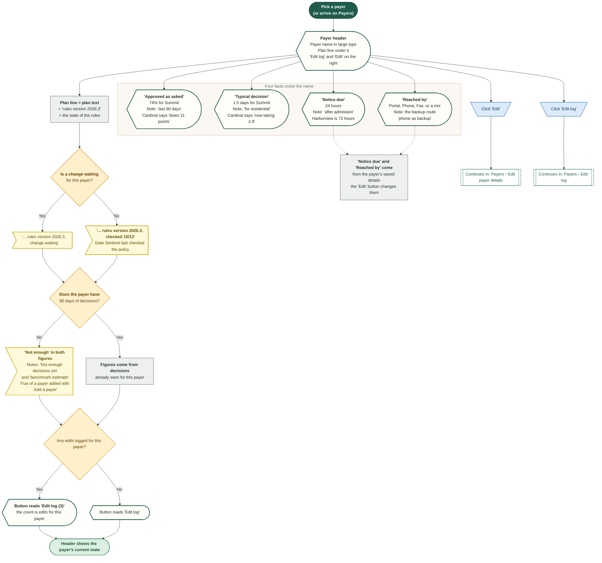

## Payers › Add a payer

The 'Add a payer' modal. A new payer starts with a standard workflow, rules and document lists and benchmark figures; the agents learn the rest from decisions. Nothing is saved until 'Add payer' passes its three checks.

Route: `/payers`

```mermaid
%%{init: {"theme":"base","themeVariables":{"fontFamily":"'DM Sans', 'Segoe UI', system-ui, sans-serif","fontSize":"15px","lineColor":"#5B6B63","primaryTextColor":"#1C2B25","clusterBkg":"#FBF8F3","clusterBorder":"#D9CDBB","edgeLabelBackground":"#FFFFFF"},"flowchart":{"curve":"basis","nodeSpacing":36,"rankSpacing":48,"padding":12,"htmlLabels":true,"useMaxWidth":false,"wrappingWidth":230}} }%%
flowchart TD
  classDef k_start fill:#1F5C4B,stroke:#174638,color:#FFFFFF,stroke-width:1.5px,font-weight:600
  classDef k_end fill:#DDEFE3,stroke:#2E7D4F,color:#14502F,stroke-width:1.5px,font-weight:600
  classDef k_endx fill:#FBE3E0,stroke:#C0392B,color:#7A1F16,stroke-width:1.5px,font-weight:600
  classDef k_screen fill:#FFFDF8,stroke:#1F5C4B,color:#1C2B25,stroke-width:2px
  classDef k_overlay fill:#F1F7F3,stroke:#1F5C4B,color:#1C2B25,stroke-width:2px,stroke-dasharray:5 3
  classDef k_click fill:#DCEBFA,stroke:#2F6DB5,color:#12365F,stroke-width:1.5px
  classDef k_input fill:#E4E7FF,stroke:#4C5FD5,color:#1D2670,stroke-width:1.5px
  classDef k_process fill:#EEF0EE,stroke:#7A857F,color:#26302B,stroke-width:1.5px
  classDef k_agent fill:#EEE5FA,stroke:#7A4FC2,color:#341A63,stroke-width:1.5px
  classDef k_decision fill:#FFF0CC,stroke:#D9962B,color:#5C3B00,stroke-width:1.5px
  classDef k_store fill:#D5F0EA,stroke:#1C8E7B,color:#0B4A3F,stroke-width:1.5px
  classDef k_doc fill:#F6E9DC,stroke:#B07A4C,color:#4A2E14,stroke-width:1.5px
  classDef k_ext fill:#FFE6D2,stroke:#E07B39,color:#6B2F06,stroke-width:1.5px
  classDef k_wait fill:#E4E8EE,stroke:#6B7C93,color:#26303D,stroke-width:1.5px
  classDef k_toast fill:#FFF9DB,stroke:#C9A400,color:#5A4A00,stroke-width:1.5px
  classDef k_goto fill:#FFFFFF,stroke:#1F5C4B,color:#1F5C4B,stroke-width:1.5px,stroke-dasharray:5 3
  s1@{ shape: stadium, label: "<b>Click 'Add a payer'</b><br/>top right of Payers" }
  m@{ shape: win-pane, label: "<b>Add a payer</b><br/>The agents start with a standard workflow<br/>and learn the rest from decisions." }
  subgraph gF ["Fields in the modal"]
  i1@{ shape: lean-r, label: "<b>Type 'Payer name' (required)</b><br/>Example: Riverbend Health" }
  i2@{ shape: lean-r, label: "<b>Pick 'Plan type'</b><br/>Managed care plan, PPO,<br/>Medicare Advantage, Carve-out" }
  i3@{ shape: lean-r, label: "<b>Pick 'Group'</b><br/>Ohio Medicaid, Commercial,<br/>Medicare Advantage, Behavioral carve-out" }
  i4@{ shape: lean-r, label: "<b>Tick 'How it is reached'</b><br/>Portal (ticked), Phone, Fax" }
  i5@{ shape: lean-r, label: "<b>Tick 'Programs it covers'</b><br/>Residential 3.5, IOP, PHP ticked<br/>Detox not ticked" }
  end
  clr@{ shape: rect, label: "Typing or ticking clears any red message" }
  ca@{ shape: trap-t, label: "Click 'Add payer'" }
  v1@{ shape: diam, label: "Is the payer name empty?" }
  v2@{ shape: diam, label: "Is no way of reaching ticked?" }
  v3@{ shape: diam, label: "Is no program ticked?" }
  e1@{ shape: odd, label: "Add the payer's name." }
  e2@{ shape: odd, label: "Choose at least one way to reach the payer." }
  e3@{ shape: odd, label: "Choose at least one program." }
  st@{ shape: cyl, label: "<b>Payer saved with a starter set</b><br/>Workflow v1 (six steps for how it is reached)<br/>Standard rules and document lists<br/>Figures marked as benchmark estimates" }
  lg@{ shape: cyl, label: "<b>Edit log gets 'Added a payer'</b><br/>Reason 'Payer added'" }
  tt@{ shape: odd, label: "<b>'Riverbend Health was added'</b><br/>Starter workflow, rules and documents are ready.<br/>Figures are benchmark estimates." }
  nav@{ shape: rect, label: "<b>Modal closes</b><br/>Opens /payers/custom-riverbend-health?tab=process" }
  pg@{ shape: curv-trap, label: "<b>New payer's Process tab</b><br/>Title now counts 7 payers<br/>Row in its group, green dot<br/>Header: 'Not enough' for both figures" }
  dup@{ shape: rect, label: "<b>Demo gap: no check for a name already in use.</b><br/>a second 'Riverbend Health' makes a second row<br/>and replaces the first one's starter set" }
  other@{ shape: rect, label: "<b>Demo gap: a payer added here appears only on Payers.</b><br/>New case, Dashboard and Authorizations<br/>keep their own payer lists" }
  cx@{ shape: trap-t, label: "Click 'Cancel'" }
  cesc@{ shape: trap-t, label: "<b>Press Escape, click the X</b><br/>or click the dimmed area" }
  x1@{ shape: stadium, label: "<b>Modal closes</b><br/>Nothing was added" }
  e@{ shape: stadium, label: "New payer is ready to edit" }
  g1@{ shape: subproc, label: "Continues in: Payers › Process › Read the workflow" }
  s1 --> m --> i1 --> i2 --> i3 --> i4 --> i5 --> ca
  i1 -.-> clr
  i4 -.-> clr
  ca --> v1
  v1 -->|"Yes"| e1 --> i1
  v1 -->|"No"| v2
  v2 -->|"Yes"| e2 --> i4
  v2 -->|"No"| v3
  v3 -->|"Yes"| e3 --> i5
  v3 -->|"No"| st --> lg --> tt --> nav --> pg --> g1
  st -.-> dup
  st -.-> other
  pg --> e
  m --> cx --> x1
  m --> cesc --> x1
  class s1 k_start
  class m k_overlay
  class i1,i2,i3,i4,i5 k_input
  class clr,nav,dup,other k_process
  class ca,cx,cesc k_click
  class v1,v2,v3 k_decision
  class e1,e2,e3,tt k_toast
  class st,lg k_store
  class pg k_screen
  class x1 k_endx
  class e k_end
  class g1 k_goto
  style gF fill:#FBF8F3,stroke:#D9CDBB,stroke-width:1.5px,color:#5B6B63
```

## Payers › Edit payer details

The 'Edit' button in the header opens one modal for the plan line, how the payer is reached, the notice rule, the backup route and the three 'How to reach' lines. Every edit needs a reason and is written to the edit log. Unlike workflow, rule and document edits, it does not wait for 'Update drafts'.

Route: `/payers/:id`

```mermaid
%%{init: {"theme":"base","themeVariables":{"fontFamily":"'DM Sans', 'Segoe UI', system-ui, sans-serif","fontSize":"15px","lineColor":"#5B6B63","primaryTextColor":"#1C2B25","clusterBkg":"#FBF8F3","clusterBorder":"#D9CDBB","edgeLabelBackground":"#FFFFFF"},"flowchart":{"curve":"basis","nodeSpacing":36,"rankSpacing":48,"padding":12,"htmlLabels":true,"useMaxWidth":false,"wrappingWidth":230}} }%%
flowchart TD
  classDef k_start fill:#1F5C4B,stroke:#174638,color:#FFFFFF,stroke-width:1.5px,font-weight:600
  classDef k_end fill:#DDEFE3,stroke:#2E7D4F,color:#14502F,stroke-width:1.5px,font-weight:600
  classDef k_endx fill:#FBE3E0,stroke:#C0392B,color:#7A1F16,stroke-width:1.5px,font-weight:600
  classDef k_screen fill:#FFFDF8,stroke:#1F5C4B,color:#1C2B25,stroke-width:2px
  classDef k_overlay fill:#F1F7F3,stroke:#1F5C4B,color:#1C2B25,stroke-width:2px,stroke-dasharray:5 3
  classDef k_click fill:#DCEBFA,stroke:#2F6DB5,color:#12365F,stroke-width:1.5px
  classDef k_input fill:#E4E7FF,stroke:#4C5FD5,color:#1D2670,stroke-width:1.5px
  classDef k_process fill:#EEF0EE,stroke:#7A857F,color:#26302B,stroke-width:1.5px
  classDef k_agent fill:#EEE5FA,stroke:#7A4FC2,color:#341A63,stroke-width:1.5px
  classDef k_decision fill:#FFF0CC,stroke:#D9962B,color:#5C3B00,stroke-width:1.5px
  classDef k_store fill:#D5F0EA,stroke:#1C8E7B,color:#0B4A3F,stroke-width:1.5px
  classDef k_doc fill:#F6E9DC,stroke:#B07A4C,color:#4A2E14,stroke-width:1.5px
  classDef k_ext fill:#FFE6D2,stroke:#E07B39,color:#6B2F06,stroke-width:1.5px
  classDef k_wait fill:#E4E8EE,stroke:#6B7C93,color:#26303D,stroke-width:1.5px
  classDef k_toast fill:#FFF9DB,stroke:#C9A400,color:#5A4A00,stroke-width:1.5px
  classDef k_goto fill:#FFFFFF,stroke:#1F5C4B,color:#1F5C4B,stroke-width:1.5px,stroke-dasharray:5 3
  s1@{ shape: stadium, label: "<b>Click 'Edit'</b><br/>in the payer header" }
  m@{ shape: win-pane, label: "<b>Edit payer details</b><br/>Admins can edit. Every edit is logged." }
  subgraph gF ["Fields"]
  i1@{ shape: lean-r, label: "Type 'Plan line'" }
  i2@{ shape: lean-r, label: "<b>Pick 'Reached by'</b><br/>Portal, Portal and fax,<br/>Portal and phone, Phone, Fax" }
  i3@{ shape: lean-r, label: "<b>Type 'Notice due'</b><br/>Example: 24 hours" }
  i4@{ shape: lean-r, label: "<b>Type 'Backup route'</b><br/>Example: phone as backup" }
  i5@{ shape: lean-r, label: "<b>Type the 'Portal', 'Phone' and 'Fax' lines</b><br/>They feed 'How to reach' on the Process tab" }
  i6@{ shape: lean-r, label: "<b>Type 'Reason for the edit' (required)</b><br/>Saved with your name, the time,<br/>the old text and the new text" }
  end
  odd@{ shape: rect, label: "<b>Demo gap: a payer whose 'Reached by' is not one of the five</b><br/>(for example 'Phone, Fax and portal') shows 'Portal' here.<br/>Saving then logs a change to 'Portal' even if untouched" }
  cs@{ shape: trap-t, label: "Click 'Save and log the edit'" }
  d1@{ shape: diam, label: "Is the reason empty?" }
  er@{ shape: odd, label: "Add a reason. It goes in the edit log." }
  diff@{ shape: rect, label: "<b>Compare each field with what is saved</b><br/>Plan line, Reached by, Notice due, Backup route,<br/>and each 'How to reach' line" }
  d2@{ shape: diam, label: "Did anything change?" }
  t0@{ shape: odd, label: "'Nothing changed'" }
  st@{ shape: cyl, label: "<b>Payer details saved</b><br/>Header, plan line and 'How to reach' update" }
  lg@{ shape: cyl, label: "<b>One edit log entry per changed field</b><br/>Area 'Payer details', with before, after and reason" }
  t1@{ shape: odd, label: "<b>'Payer details saved'</b><br/>The edit is in the log with your reason." }
  nb@{ shape: rect, label: "<b>No 'edit applies to new drafts only' banner</b><br/>Payer details are not part of a draft" }
  e1@{ shape: stadium, label: "<b>Modal closes</b><br/>Header shows the new values" }
  x1@{ shape: stadium, label: "<b>Modal closes</b><br/>Nothing saved" }
  cx@{ shape: trap-t, label: "Click 'Cancel'" }
  cesc@{ shape: trap-t, label: "<b>Press Escape, click the X</b><br/>or click the dimmed area" }
  g1@{ shape: subproc, label: "Continues in: Payers › Edit log" }
  g2@{ shape: subproc, label: "Continues in: Payers › Process › Reach and Caller instructions" }
  s1 --> m --> i1 --> i2 --> i3 --> i4 --> i5 --> i6 --> cs
  i2 -.-> odd
  cs --> d1
  d1 -->|"Yes"| er --> i6
  d1 -->|"No"| diff --> d2
  d2 -->|"No"| t0 --> x1
  d2 -->|"Yes"| st --> lg --> t1 --> nb --> e1
  lg -.-> g1
  i5 -.-> g2
  m --> cx --> x1
  m --> cesc --> x1
  class s1 k_start
  class m k_overlay
  class i1,i2,i3,i4,i5,i6 k_input
  class odd,diff,nb k_process
  class cs,cx,cesc k_click
  class d1,d2 k_decision
  class er,t0,t1 k_toast
  class st,lg k_store
  class e1 k_end
  class x1 k_endx
  class g1,g2 k_goto
  style gF fill:#FBF8F3,stroke:#D9CDBB,stroke-width:1.5px,color:#5B6B63
```

## Payers › Process › Read the workflow

The Process tab shows how an authorization works with one payer: numbered steps in order, with the condition drawn next to the step it leads to. It also holds the reach card, the script for Caller, and any banner about edits or proposals waiting.

Route: `/payers/summit?tab=process`

```mermaid
%%{init: {"theme":"base","themeVariables":{"fontFamily":"'DM Sans', 'Segoe UI', system-ui, sans-serif","fontSize":"15px","lineColor":"#5B6B63","primaryTextColor":"#1C2B25","clusterBkg":"#FBF8F3","clusterBorder":"#D9CDBB","edgeLabelBackground":"#FFFFFF"},"flowchart":{"curve":"basis","nodeSpacing":36,"rankSpacing":48,"padding":12,"htmlLabels":true,"useMaxWidth":false,"wrappingWidth":230}} }%%
flowchart TD
  classDef k_start fill:#1F5C4B,stroke:#174638,color:#FFFFFF,stroke-width:1.5px,font-weight:600
  classDef k_end fill:#DDEFE3,stroke:#2E7D4F,color:#14502F,stroke-width:1.5px,font-weight:600
  classDef k_endx fill:#FBE3E0,stroke:#C0392B,color:#7A1F16,stroke-width:1.5px,font-weight:600
  classDef k_screen fill:#FFFDF8,stroke:#1F5C4B,color:#1C2B25,stroke-width:2px
  classDef k_overlay fill:#F1F7F3,stroke:#1F5C4B,color:#1C2B25,stroke-width:2px,stroke-dasharray:5 3
  classDef k_click fill:#DCEBFA,stroke:#2F6DB5,color:#12365F,stroke-width:1.5px
  classDef k_input fill:#E4E7FF,stroke:#4C5FD5,color:#1D2670,stroke-width:1.5px
  classDef k_process fill:#EEF0EE,stroke:#7A857F,color:#26302B,stroke-width:1.5px
  classDef k_agent fill:#EEE5FA,stroke:#7A4FC2,color:#341A63,stroke-width:1.5px
  classDef k_decision fill:#FFF0CC,stroke:#D9962B,color:#5C3B00,stroke-width:1.5px
  classDef k_store fill:#D5F0EA,stroke:#1C8E7B,color:#0B4A3F,stroke-width:1.5px
  classDef k_doc fill:#F6E9DC,stroke:#B07A4C,color:#4A2E14,stroke-width:1.5px
  classDef k_ext fill:#FFE6D2,stroke:#E07B39,color:#6B2F06,stroke-width:1.5px
  classDef k_wait fill:#E4E8EE,stroke:#6B7C93,color:#26303D,stroke-width:1.5px
  classDef k_toast fill:#FFF9DB,stroke:#C9A400,color:#5A4A00,stroke-width:1.5px
  classDef k_goto fill:#FFFFFF,stroke:#1F5C4B,color:#1F5C4B,stroke-width:1.5px,stroke-dasharray:5 3
  s1@{ shape: stadium, label: "<b>Click the 'Process' tab</b><br/>(the tab shown when none is named)" }
  tab@{ shape: curv-trap, label: "<b>Process tab</b><br/>Banners, workflow card, two small cards, a note" }
  subgraph gB ["Banners at the top (only when they apply)"]
  dU@{ shape: diam, label: "<b>Edits saved but</b><br/>not yet applied to open drafts?" }
  bU@{ shape: odd, label: "<b>'1 edit applies to new drafts only'</b><br/>New drafts for Summit use your edits already.<br/>Open drafts (R-1042, R-1101) follow when you update them." }
  dP@{ shape: diam, label: "Did Historian propose changes?" }
  bP@{ shape: odd, label: "<b>'Historian proposed 1 change'</b><br/>It never edits the workflow on its own.<br/>'Review in Changes'" }
  end
  card@{ shape: curv-trap, label: "<b>Workflow card</b><br/>'How an authorization works with Summit'<br/>The workflow the agents follow, in order.<br/>Version 7, edited 10/12." }
  legend@{ shape: rect, label: "<b>'Step types' row</b><br/>Checklist step, File step, Portal step,<br/>Phone step, Condition" }
  subgraph gS ["One numbered step"]
  st@{ shape: curv-trap, label: "<b>Number, step title, step-type chip, agent chips</b><br/>For example: 'Give notice'  Portal step  Navigator" }
  stx@{ shape: rect, label: "<b>Plain sentence on what happens</b><br/>and a 'Typical' time on the right<br/>'same day', '2 minutes', '1.5 days'" }
  dc@{ shape: diam, label: "Does the step have conditions?" }
  br@{ shape: curv-trap, label: "<b>Condition rows under the step</b><br/>'If portal is down' leads to<br/>'Phone step' and what happens" }
  end
  six@{ shape: rect, label: "<b>Summit's six steps: Check coverage,</b><br/>Gather the documents, Give notice,<br/>Send the request, Follow up,<br/>Decision and next review" }
  diff@{ shape: rect, label: "<b>Other payers differ in how they are reached</b><br/>Evergreen: phone steps<br/>Lakeshore: file steps by fax<br/>Harborview: portal with fax for large files" }
  two@{ shape: curv-trap, label: "<b>'How to reach Summit' and</b><br/>'Instructions for Caller' side by side" }
  note@{ shape: odd, label: "<b>'Change a step or a condition and open drafts can follow.</b><br/>Admins can edit; every edit is logged.'" }
  cE@{ shape: trap-t, label: "Click 'Edit workflow'" }
  cR@{ shape: trap-t, label: "Click 'Re-learn from decisions'" }
  cRev@{ shape: trap-t, label: "Click 'Review in Changes'" }
  cUp@{ shape: trap-t, label: "Click 'Update 2 drafts'" }
  g_ed@{ shape: subproc, label: "Continues in: Payers › Process › Edit the workflow" }
  g_rl@{ shape: subproc, label: "Continues in: Payers › Process › Re-learn from decisions" }
  g_ch@{ shape: subproc, label: "Continues in: Payers › Changes › Read what changed" }
  g_up@{ shape: subproc, label: "Continues in: Payers › Edits waiting › Update drafts" }
  g_rc@{ shape: subproc, label: "Continues in: Payers › Process › Reach and Caller instructions" }
  s1 --> tab --> dU
  dU -->|"Yes"| bU --> dP
  dU -->|"No"| dP
  dP -->|"Yes"| bP --> card
  dP -->|"No"| card
  card --> legend --> st --> stx --> dc
  dc -->|"Yes"| br
  dc -->|"No"| six
  br --> six
  six -.-> diff
  six --> two --> note
  card --> cE --> g_ed
  card --> cR --> g_rl
  bP --> cRev --> g_ch
  bU --> cUp --> g_up
  two -.-> g_rc
  class s1 k_start
  class tab,card,st,br,two k_screen
  class dU,dP,dc k_decision
  class bU,bP,note k_toast
  class legend,stx,six,diff k_process
  class cE,cR,cRev,cUp k_click
  class g_ed,g_rl,g_ch,g_up,g_rc k_goto
  style gB fill:#FBF8F3,stroke:#D9CDBB,stroke-width:1.5px,color:#5B6B63
  style gS fill:#FBF8F3,stroke:#D9CDBB,stroke-width:1.5px,color:#5B6B63
```

## Payers › Process › Reach and Caller instructions

The two small cards under the workflow. 'How to reach' is read only here; its three lines are edited from the header's 'Edit' button. 'Instructions for Caller' is the script every Phone step follows, and has its own 'Edit'.

Route: `/payers/summit?tab=process`

```mermaid
%%{init: {"theme":"base","themeVariables":{"fontFamily":"'DM Sans', 'Segoe UI', system-ui, sans-serif","fontSize":"15px","lineColor":"#5B6B63","primaryTextColor":"#1C2B25","clusterBkg":"#FBF8F3","clusterBorder":"#D9CDBB","edgeLabelBackground":"#FFFFFF"},"flowchart":{"curve":"basis","nodeSpacing":36,"rankSpacing":48,"padding":12,"htmlLabels":true,"useMaxWidth":false,"wrappingWidth":230}} }%%
flowchart TD
  classDef k_start fill:#1F5C4B,stroke:#174638,color:#FFFFFF,stroke-width:1.5px,font-weight:600
  classDef k_end fill:#DDEFE3,stroke:#2E7D4F,color:#14502F,stroke-width:1.5px,font-weight:600
  classDef k_endx fill:#FBE3E0,stroke:#C0392B,color:#7A1F16,stroke-width:1.5px,font-weight:600
  classDef k_screen fill:#FFFDF8,stroke:#1F5C4B,color:#1C2B25,stroke-width:2px
  classDef k_overlay fill:#F1F7F3,stroke:#1F5C4B,color:#1C2B25,stroke-width:2px,stroke-dasharray:5 3
  classDef k_click fill:#DCEBFA,stroke:#2F6DB5,color:#12365F,stroke-width:1.5px
  classDef k_input fill:#E4E7FF,stroke:#4C5FD5,color:#1D2670,stroke-width:1.5px
  classDef k_process fill:#EEF0EE,stroke:#7A857F,color:#26302B,stroke-width:1.5px
  classDef k_agent fill:#EEE5FA,stroke:#7A4FC2,color:#341A63,stroke-width:1.5px
  classDef k_decision fill:#FFF0CC,stroke:#D9962B,color:#5C3B00,stroke-width:1.5px
  classDef k_store fill:#D5F0EA,stroke:#1C8E7B,color:#0B4A3F,stroke-width:1.5px
  classDef k_doc fill:#F6E9DC,stroke:#B07A4C,color:#4A2E14,stroke-width:1.5px
  classDef k_ext fill:#FFE6D2,stroke:#E07B39,color:#6B2F06,stroke-width:1.5px
  classDef k_wait fill:#E4E8EE,stroke:#6B7C93,color:#26303D,stroke-width:1.5px
  classDef k_toast fill:#FFF9DB,stroke:#C9A400,color:#5A4A00,stroke-width:1.5px
  classDef k_goto fill:#FFFFFF,stroke:#1F5C4B,color:#1F5C4B,stroke-width:1.5px,stroke-dasharray:5 3
  s1@{ shape: stadium, label: "<b>Scroll below the workflow card</b><br/>on the Process tab" }
  rc@{ shape: curv-trap, label: "<b>'How to reach Summit'</b><br/>Three rows: Portal, Phone, Fax" }
  rows@{ shape: rect, label: "<b>Each row has an icon, a title and a line</b><br/>Portal: Provider portal, sign-in saved by Navigator<br/>Phone: Provider line, weekdays 8 am to 6 pm<br/>Fax: Not used" }
  ro@{ shape: odd, label: "<b>No edit button on this card</b><br/>Change the lines with 'Edit' in the header" }
  cc@{ shape: curv-trap, label: "<b>'Instructions for Caller'</b><br/>The script in a tinted box<br/>'Used by the Phone steps. Confirmed 10/12.'" }
  script@{ shape: rect, label: "<b>Script: ask for the provider line, give member ID and date of birth,</b><br/>ask if the request arrived, never agree to a change,<br/>log the call" }
  ce@{ shape: trap-t, label: "<b>Click 'Edit'</b><br/>on the Caller card" }
  m@{ shape: win-pane, label: "<b>Edit the instructions for Caller</b><br/>Caller follows this on every Phone step and never agrees to a change." }
  i1@{ shape: lean-r, label: "<b>Type in 'Script'</b><br/>The box starts with the saved script" }
  i2@{ shape: lean-r, label: "Type 'Reason for the edit' (required)" }
  cs@{ shape: trap-t, label: "Click 'Save and log the edit'" }
  d1@{ shape: diam, label: "Is the reason empty?" }
  er@{ shape: odd, label: "Add a reason. It goes in the edit log." }
  d2@{ shape: diam, label: "Is the script the same as the saved one?" }
  t0@{ shape: odd, label: "'Nothing changed'" }
  gap@{ shape: rect, label: "<b>Demo gap: a blank script is accepted</b><br/>Phone steps would then have no instructions" }
  st@{ shape: cyl, label: "<b>Script saved</b><br/>'Confirmed' date becomes today" }
  lg@{ shape: cyl, label: "<b>Edit log entry</b><br/>Area 'Caller instructions'<br/>'Instructions for Caller', before and after" }
  t1@{ shape: odd, label: "<b>'Instructions for Caller saved'</b><br/>Phone steps use them from the next call.<br/>The edit is logged." }
  nb@{ shape: rect, label: "<b>No 'edit applies to new drafts only' banner</b><br/>The script is used on the next call, not by drafts" }
  e1@{ shape: stadium, label: "Card shows the new script" }
  cx@{ shape: trap-t, label: "Click 'Cancel'" }
  cesc@{ shape: trap-t, label: "<b>Press Escape, click the X</b><br/>or click the dimmed area" }
  x1@{ shape: stadium, label: "<b>Modal closes</b><br/>Nothing saved<br/>Reopening starts from the saved script" }
  g1@{ shape: subproc, label: "Continues in: Payers › Edit payer details" }
  g2@{ shape: subproc, label: "Continues in: Payers › Edit log" }
  s1 --> rc --> rows --> ro
  ro -.-> g1
  s1 --> cc --> script --> ce --> m --> i1 --> i2 --> cs --> d1
  d1 -->|"Yes"| er --> i2
  d1 -->|"No"| d2
  d2 -->|"Yes"| t0 --> x1
  d2 -->|"No"| st --> lg --> t1 --> nb --> e1
  i1 -.-> gap
  lg -.-> g2
  m --> cx --> x1
  m --> cesc --> x1
  class s1 k_start
  class rc,cc k_screen
  class rows,script,gap,nb k_process
  class ro,er,t0,t1 k_toast
  class ce,cs,cx,cesc k_click
  class m k_overlay
  class i1,i2 k_input
  class d1,d2 k_decision
  class st,lg k_store
  class e1 k_end
  class x1 k_endx
  class g1,g2 k_goto
```

## Payers › Process › Edit the workflow

'Edit workflow' opens a wide drawer with one card per step. Changes are held in the drawer and counted at the bottom; nothing reaches the payer's workflow until 'Save workflow' (next diagram). Conditions have their own diagram.

Route: `/payers/summit?tab=process`

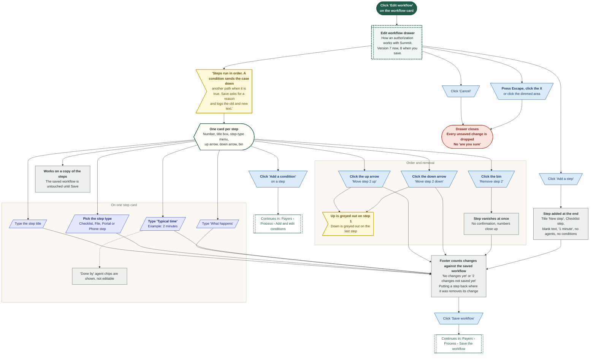

## Payers › Process › Add and edit conditions

A condition sends a case down another path when it is true. Each condition has four parts: what is tested, the value, the kind of step it leads to, and what happens. The sentence shown on the workflow card is built from the first two.

Route: `/payers/summit?tab=process`

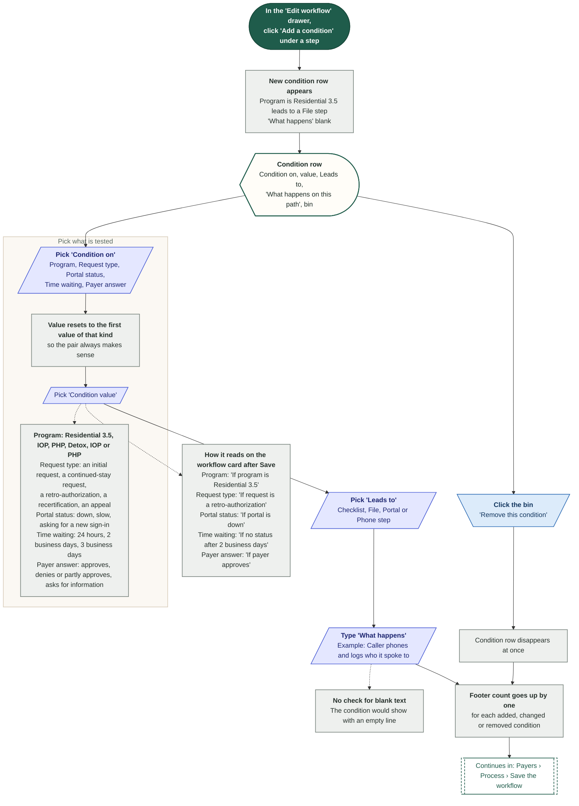

## Payers › Process › Save the workflow

'Save workflow' asks for a reason, then makes the edited steps the payer's next version. New drafts use the new version at once; open drafts wait for 'Update drafts'. There is no undo: a change is reversed by editing again, and the edit log keeps the old text.

Route: `/payers/summit?tab=process`

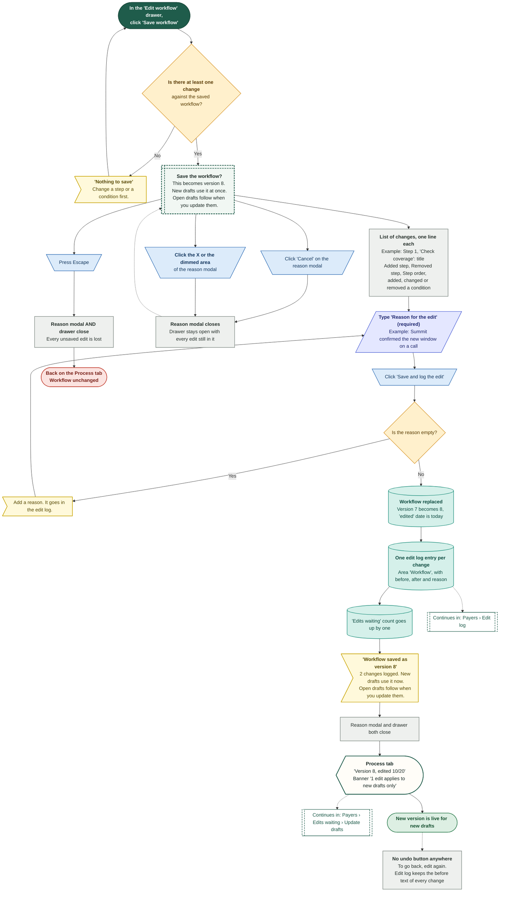

## Payers › Process › Re-learn from decisions

Historian looks at how the payer has ruled over the last 90 days and may propose one more condition for the workflow. It never edits the workflow itself. A person accepts or dismisses the proposal on the Changes tab.

Route: `/payers/summit?tab=process`

```mermaid
%%{init: {"theme":"base","themeVariables":{"fontFamily":"'DM Sans', 'Segoe UI', system-ui, sans-serif","fontSize":"15px","lineColor":"#5B6B63","primaryTextColor":"#1C2B25","clusterBkg":"#FBF8F3","clusterBorder":"#D9CDBB","edgeLabelBackground":"#FFFFFF"},"flowchart":{"curve":"basis","nodeSpacing":36,"rankSpacing":48,"padding":12,"htmlLabels":true,"useMaxWidth":false,"wrappingWidth":230}} }%%
flowchart TD
  classDef k_start fill:#1F5C4B,stroke:#174638,color:#FFFFFF,stroke-width:1.5px,font-weight:600
  classDef k_end fill:#DDEFE3,stroke:#2E7D4F,color:#14502F,stroke-width:1.5px,font-weight:600
  classDef k_endx fill:#FBE3E0,stroke:#C0392B,color:#7A1F16,stroke-width:1.5px,font-weight:600
  classDef k_screen fill:#FFFDF8,stroke:#1F5C4B,color:#1C2B25,stroke-width:2px
  classDef k_overlay fill:#F1F7F3,stroke:#1F5C4B,color:#1C2B25,stroke-width:2px,stroke-dasharray:5 3
  classDef k_click fill:#DCEBFA,stroke:#2F6DB5,color:#12365F,stroke-width:1.5px
  classDef k_input fill:#E4E7FF,stroke:#4C5FD5,color:#1D2670,stroke-width:1.5px
  classDef k_process fill:#EEF0EE,stroke:#7A857F,color:#26302B,stroke-width:1.5px
  classDef k_agent fill:#EEE5FA,stroke:#7A4FC2,color:#341A63,stroke-width:1.5px
  classDef k_decision fill:#FFF0CC,stroke:#D9962B,color:#5C3B00,stroke-width:1.5px
  classDef k_store fill:#D5F0EA,stroke:#1C8E7B,color:#0B4A3F,stroke-width:1.5px
  classDef k_doc fill:#F6E9DC,stroke:#B07A4C,color:#4A2E14,stroke-width:1.5px
  classDef k_ext fill:#FFE6D2,stroke:#E07B39,color:#6B2F06,stroke-width:1.5px
  classDef k_wait fill:#E4E8EE,stroke:#6B7C93,color:#26303D,stroke-width:1.5px
  classDef k_toast fill:#FFF9DB,stroke:#C9A400,color:#5A4A00,stroke-width:1.5px
  classDef k_goto fill:#FFFFFF,stroke:#1F5C4B,color:#1F5C4B,stroke-width:1.5px,stroke-dasharray:5 3
  s1@{ shape: stadium, label: "<b>Click 'Re-learn from decisions'</b><br/>on the workflow card" }
  busy@{ shape: rect, label: "Button shows a spinner" }
  st@{ shape: odd, label: "<b>Historian is reviewing how Summit</b><br/>ruled over the last 90 days." }
  h1@{ shape: hex, label: "<b>Historian reviews the last 90 days</b><br/>(demo: about 3 seconds, scripted)" }
  lv@{ shape: diam, label: "<b>Is the person still on Payers</b><br/>when the 3 seconds end?" }
  dropped@{ shape: stadium, label: "<b>Result dropped</b><br/>No toast, no proposal" }
  nx@{ shape: diam, label: "<b>Is there a proposal not yet in</b><br/>the workflow, the proposals or the dismissed list?" }
  tn@{ shape: odd, label: "<b>'Nothing new to propose'</b><br/>The workflow already matches how Summit ruled in the last 90 days." }
  pr@{ shape: cyl, label: "Proposal added to the payer" }
  tp@{ shape: odd, label: "<b>'Historian has a proposal'</b><br/>Review it on the Changes tab. The workflow has not changed." }
  bn@{ shape: curv-trap, label: "<b>Process tab banner</b><br/>'Historian proposed 1 change'<br/>It never edits the workflow on its own." }
  badge@{ shape: rect, label: "<b>'Changes' tab badge goes up by one</b><br/>List dot and sidebar badge do not change" }
  rv@{ shape: trap-t, label: "Click 'Review in Changes'" }
  cp@{ shape: curv-trap, label: "<b>Changes tab, proposal card</b><br/>Historian chip: 'Proposal: Ask for a therapy note on continued stays'<br/>Under 'Gather the documents': If request is a continued-stay request, File step" }
  ca@{ shape: trap-t, label: "Click 'Accept proposal'" }
  cd@{ shape: trap-t, label: "Click 'Dismiss'" }
  ac@{ shape: cyl, label: "<b>Condition added under that step</b><br/>Workflow becomes the next version<br/>Proposal removed" }
  lg@{ shape: cyl, label: "<b>Edit log entry, area 'Workflow'</b><br/>Reason 'Accepted Historian's proposal: ...'" }
  un@{ shape: cyl, label: "'Edits waiting' count goes up by one" }
  ta@{ shape: odd, label: "<b>'Proposal accepted'</b><br/>Added under 'Gather the documents' and logged as version 8." }
  dm@{ shape: cyl, label: "<b>Proposal removed and remembered as dismissed</b><br/>Historian will not offer it again" }
  td@{ shape: odd, label: "<b>'Proposal dismissed'</b><br/>The workflow did not change." }
  nr@{ shape: rect, label: "<b>No reason asked, no confirmation</b><br/>No way to bring a dismissed proposal back" }
  e1@{ shape: stadium, label: "<b>Run 'Re-learn' again for the next proposal</b><br/>Summit has two; Beacon has none left to offer" }
  g1@{ shape: subproc, label: "Continues in: Payers › Edits waiting › Update drafts" }
  g2@{ shape: subproc, label: "Continues in: Payers › Edit log" }
  s1 --> busy --> st --> h1 --> lv
  lv -->|"No"| dropped
  lv -->|"Yes"| nx
  nx -->|"No"| tn --> e1
  nx -->|"Yes"| pr --> tp --> bn --> badge
  bn --> rv --> cp
  cp --> ca --> ac --> lg --> un --> ta --> g1
  lg -.-> g2
  cp --> cd --> dm --> td --> e1
  ca -.-> nr
  cd -.-> nr
  ta --> e1
  class s1 k_start
  class busy,badge,nr k_process
  class st,tn,tp,ta,td k_toast
  class h1 k_agent
  class lv,nx k_decision
  class dropped k_endx
  class pr,ac,lg,un,dm k_store
  class bn,cp k_screen
  class rv,ca,cd k_click
  class e1 k_end
  class g1,g2 k_goto
```

## Payers › Edits waiting › Update drafts

After a workflow, rule or document-list edit is saved, new drafts use it at once but open drafts do not. An ochre banner on the Process, Rules and Documents tabs offers 'Update drafts'. A confirm step lists the drafts, two agents redraft for about three seconds, and each draft goes back for a new signature.

Route: `/payers/summit?tab=process`

```mermaid
%%{init: {"theme":"base","themeVariables":{"fontFamily":"'DM Sans', 'Segoe UI', system-ui, sans-serif","fontSize":"15px","lineColor":"#5B6B63","primaryTextColor":"#1C2B25","clusterBkg":"#FBF8F3","clusterBorder":"#D9CDBB","edgeLabelBackground":"#FFFFFF"},"flowchart":{"curve":"basis","nodeSpacing":36,"rankSpacing":48,"padding":12,"htmlLabels":true,"useMaxWidth":false,"wrappingWidth":230}} }%%
flowchart TD
  classDef k_start fill:#1F5C4B,stroke:#174638,color:#FFFFFF,stroke-width:1.5px,font-weight:600
  classDef k_end fill:#DDEFE3,stroke:#2E7D4F,color:#14502F,stroke-width:1.5px,font-weight:600
  classDef k_endx fill:#FBE3E0,stroke:#C0392B,color:#7A1F16,stroke-width:1.5px,font-weight:600
  classDef k_screen fill:#FFFDF8,stroke:#1F5C4B,color:#1C2B25,stroke-width:2px
  classDef k_overlay fill:#F1F7F3,stroke:#1F5C4B,color:#1C2B25,stroke-width:2px,stroke-dasharray:5 3
  classDef k_click fill:#DCEBFA,stroke:#2F6DB5,color:#12365F,stroke-width:1.5px
  classDef k_input fill:#E4E7FF,stroke:#4C5FD5,color:#1D2670,stroke-width:1.5px
  classDef k_process fill:#EEF0EE,stroke:#7A857F,color:#26302B,stroke-width:1.5px
  classDef k_agent fill:#EEE5FA,stroke:#7A4FC2,color:#341A63,stroke-width:1.5px
  classDef k_decision fill:#FFF0CC,stroke:#D9962B,color:#5C3B00,stroke-width:1.5px
  classDef k_store fill:#D5F0EA,stroke:#1C8E7B,color:#0B4A3F,stroke-width:1.5px
  classDef k_doc fill:#F6E9DC,stroke:#B07A4C,color:#4A2E14,stroke-width:1.5px
  classDef k_ext fill:#FFE6D2,stroke:#E07B39,color:#6B2F06,stroke-width:1.5px
  classDef k_wait fill:#E4E8EE,stroke:#6B7C93,color:#26303D,stroke-width:1.5px
  classDef k_toast fill:#FFF9DB,stroke:#C9A400,color:#5A4A00,stroke-width:1.5px
  classDef k_goto fill:#FFFFFF,stroke:#1F5C4B,color:#1F5C4B,stroke-width:1.5px,stroke-dasharray:5 3
  s1@{ shape: stadium, label: "<b>A workflow, rule or document-list</b><br/>edit was just saved" }
  un@{ shape: cyl, label: "<b>'Edits waiting' for this payer goes up by one</b><br/>Payer details and Caller script edits do not count" }
  bn@{ shape: curv-trap, label: "<b>Ochre banner on Process, Rules and Documents</b><br/>'1 edit applies to new drafts only'<br/>'2 edits apply...' after a second edit" }
  dr@{ shape: diam, label: "Does this payer have drafts in 'Preparing'?" }
  b1@{ shape: odd, label: "<b>New drafts for Summit use your edits already.</b><br/>Open drafts (R-1042, R-1101) follow when you update them.<br/>Button: 'Update 2 drafts'" }
  b0@{ shape: odd, label: "<b>New drafts for Evergreen use your edits already.</b><br/>There are no open drafts for this payer right now.<br/>Button: 'Update drafts'" }
  info@{ shape: rect, label: "<b>Drafts waiting for information (like P-1499) are not counted</b><br/>Only drafts in 'Preparing' are" }
  cu@{ shape: trap-t, label: "Click the banner button" }
  m@{ shape: win-pane, label: "<b>Update 2 drafts?</b><br/>Confirm gate. Nothing is redrafted until you say so.<br/>Reason: your edits to Summit." }
  dl@{ shape: diam, label: "Any drafts to list?" }
  rows@{ shape: rect, label: "<b>One row per draft</b><br/>R-1042, 'J.M., 34 · Summit', Residential 3.5, 'Draft, not yet sent'" }
  fn@{ shape: odd, label: "<b>'Each redrafted case returns to Case Manager for a new signature.</b><br/>A request that is already sent is never rewritten.<br/>It gets an addendum instead.'" }
  m0@{ shape: odd, label: "<b>Title reads 'Apply to new drafts?'</b><br/>'No open drafts are affected. Evergreen will use<br/>the change for every new draft from now on.'" }
  cs@{ shape: trap-t, label: "<b>Click 'Update 2 drafts'</b><br/>or 'Apply to new drafts'" }
  cx@{ shape: trap-t, label: "Click 'Cancel'" }
  cesc@{ shape: trap-t, label: "<b>Press Escape, click the X</b><br/>or click the dimmed area" }
  x1@{ shape: stadium, label: "<b>Modal closes</b><br/>Banner stays, nothing redrafted" }
  lock@{ shape: rect, label: "Cancel greys out. Escape, X and dimmed area do nothing" }
  a1@{ shape: hex, label: "<b>Scribe is redrafting 2 drafts</b><br/>(demo: 1.5 seconds, spinner then tick)" }
  a2@{ shape: hex, label: "<b>Integrity is checking every sentence</b><br/>against the chart (demo: 1.5 seconds)" }
  lv@{ shape: diam, label: "Still on Payers after 3 seconds?" }
  drop@{ shape: stadium, label: "<b>Redraft is dropped</b><br/>Banner stays, nothing changes" }
  dd@{ shape: diam, label: "Were there drafts?" }
  rd@{ shape: cyl, label: "<b>Each draft needs a person again</b><br/>'Redrafted after your edits to Summit's workflow, rules and documents.<br/>Waiting for a new signature'<br/>Timeline event by Scribe" }
  z@{ shape: cyl, label: "<b>'Edits waiting' resets to zero</b><br/>Banner disappears" }
  nt@{ shape: cyl, label: "<b>Bell notification 'Drafts updated'</b><br/>2 drafts were redrafted after your edits to Summit.<br/>Each needs a new signature." }
  t1@{ shape: odd, label: "<b>'2 drafts updated'</b><br/>Each returned to Case Manager for a new signature." }
  z0@{ shape: cyl, label: "<b>'Edits waiting' resets to zero</b><br/>Banner disappears<br/>No bell notification" }
  t0@{ shape: odd, label: "<b>'No open drafts to update'</b><br/>New drafts for Evergreen already use your edits." }
  g1@{ shape: subproc, label: "Continues in: Dashboard › Requests table" }
  cb@{ shape: trap-t, label: "<b>Click the bell notification</b><br/>'Drafts updated'" }
  g2@{ shape: subproc, label: "Continues in: Case Manager › Cases" }
  s1 --> un --> bn --> dr
  dr -->|"Yes"| b1 --> cu
  dr -->|"No"| b0 --> cu
  b1 -.-> info
  cu --> m --> dl
  dl -->|"Yes"| rows --> fn --> cs
  dl -->|"No"| m0 --> cs
  m --> cx --> x1
  m --> cesc --> x1
  cs --> lock --> a1 --> a2 --> lv
  lv -->|"No"| drop
  lv -->|"Yes"| dd
  dd -->|"Yes"| rd --> z --> nt --> t1 --> g1
  dd -->|"No"| z0 --> t0
  nt -.-> cb --> g2
  class s1 k_start
  class un,rd,z,nt,z0 k_store
  class bn k_screen
  class dr,dl,lv,dd k_decision
  class b1,b0,fn,m0,t1,t0 k_toast
  class info,rows,lock k_process
  class cu,cs,cx,cesc,cb k_click
  class m k_overlay
  class x1,drop k_endx
  class a1,a2 k_agent
  class g1,g2 k_goto
```

## Payers › Edit log

The 'Edit log' button opens a read-only drawer listing every edit to this payer, newest first, with who, when, why and the old and new text. It is the only record of a change: there is no undo or revert button.

Route: `/payers/:id`

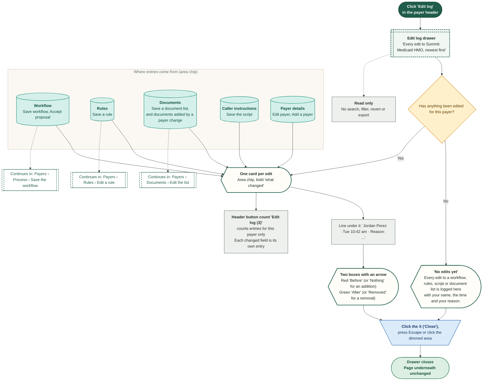

## Payers › Rules › Read the rules

Four rule cards for one payer, each a few plain lines, with the agents that use them and the date they were last confirmed. In the demo the rules are text the agents are said to follow; editing them is the next diagram. In the product, each field would carry a source and a confidence (published, payer-confirmed, observed, staff-reported, unconfirmed).

Route: `/payers/summit?tab=rules`

```mermaid
%%{init: {"theme":"base","themeVariables":{"fontFamily":"'DM Sans', 'Segoe UI', system-ui, sans-serif","fontSize":"15px","lineColor":"#5B6B63","primaryTextColor":"#1C2B25","clusterBkg":"#FBF8F3","clusterBorder":"#D9CDBB","edgeLabelBackground":"#FFFFFF"},"flowchart":{"curve":"basis","nodeSpacing":36,"rankSpacing":48,"padding":12,"htmlLabels":true,"useMaxWidth":false,"wrappingWidth":230}} }%%
flowchart TD
  classDef k_start fill:#1F5C4B,stroke:#174638,color:#FFFFFF,stroke-width:1.5px,font-weight:600
  classDef k_end fill:#DDEFE3,stroke:#2E7D4F,color:#14502F,stroke-width:1.5px,font-weight:600
  classDef k_endx fill:#FBE3E0,stroke:#C0392B,color:#7A1F16,stroke-width:1.5px,font-weight:600
  classDef k_screen fill:#FFFDF8,stroke:#1F5C4B,color:#1C2B25,stroke-width:2px
  classDef k_overlay fill:#F1F7F3,stroke:#1F5C4B,color:#1C2B25,stroke-width:2px,stroke-dasharray:5 3
  classDef k_click fill:#DCEBFA,stroke:#2F6DB5,color:#12365F,stroke-width:1.5px
  classDef k_input fill:#E4E7FF,stroke:#4C5FD5,color:#1D2670,stroke-width:1.5px
  classDef k_process fill:#EEF0EE,stroke:#7A857F,color:#26302B,stroke-width:1.5px
  classDef k_agent fill:#EEE5FA,stroke:#7A4FC2,color:#341A63,stroke-width:1.5px
  classDef k_decision fill:#FFF0CC,stroke:#D9962B,color:#5C3B00,stroke-width:1.5px
  classDef k_store fill:#D5F0EA,stroke:#1C8E7B,color:#0B4A3F,stroke-width:1.5px
  classDef k_doc fill:#F6E9DC,stroke:#B07A4C,color:#4A2E14,stroke-width:1.5px
  classDef k_ext fill:#FFE6D2,stroke:#E07B39,color:#6B2F06,stroke-width:1.5px
  classDef k_wait fill:#E4E8EE,stroke:#6B7C93,color:#26303D,stroke-width:1.5px
  classDef k_toast fill:#FFF9DB,stroke:#C9A400,color:#5A4A00,stroke-width:1.5px
  classDef k_goto fill:#FFFFFF,stroke:#1F5C4B,color:#1F5C4B,stroke-width:1.5px,stroke-dasharray:5 3
  s1@{ shape: stadium, label: "Click the 'Rules' tab" }
  tab@{ shape: curv-trap, label: "<b>Rules tab</b><br/>Banner if edits wait, four cards in two columns, a note" }
  dU@{ shape: diam, label: "<b>Edits saved but not yet</b><br/>applied to open drafts?" }
  bU@{ shape: odd, label: "<b>'1 edit applies to new drafts only'</b><br/>with 'Update 2 drafts'" }
  gU@{ shape: subproc, label: "Continues in: Payers › Edits waiting › Update drafts" }
  subgraph gC ["Each card"]
  c1@{ shape: curv-trap, label: "<b>Submission windows</b><br/>Notice within 24 hours of admission (72 for Harborview, by phone for Evergreen, by fax for Lakeshore)<br/>Recertification filed 72 hours before the unit limit<br/>A continued-stay review every 7 days after the first 7" }
  c2@{ shape: curv-trap, label: "<b>Backdating</b><br/>Differs by payer: Summit and Cardinal do not backdate,<br/>Beacon backdates within 2 business days,<br/>Evergreen up to 3 days with a call log, Lakeshore to the fax receipt date" }
  c3@{ shape: curv-trap, label: "<b>No authorization needed</b><br/>Individual therapy, Medication management,<br/>Initial assessment, Crisis stabilization first 24 hours<br/>(Evergreen has no crisis line). Shown with green ticks" }
  c4@{ shape: curv-trap, label: "<b>Peer-to-peer and appeals</b><br/>Summit: peer-to-peer call within 3 business days (Cardinal 2),<br/>written appeal within 60 days, expedited 72 hours,<br/>then external review (Evergreen: state hearing)" }
  end
  ub@{ shape: rect, label: "<b>Foot of each card</b><br/>'Used by Cadence and Navigator · confirmed 10/12'" }
  who@{ shape: rect, label: "<b>Used by</b><br/>Windows: Cadence, Navigator<br/>Backdating: Cadence, Scrubber<br/>No authorization needed: Verify, Criteria<br/>Peer-to-peer and appeals: Advocate, Cadence" }
  cf@{ shape: rect, label: "<b>'Confirmed' is a date</b><br/>Evergreen shows 10/09, the others 10/12<br/>It moves to today when a rule is edited" }
  note@{ shape: odd, label: "<b>'Rules are learned from past decisions and confirmed against</b><br/>Summit's published policy. An edit applies to new drafts at once,<br/>and to open drafts when you click Update drafts.'" }
  noeff@{ shape: rect, label: "<b>Demo: no screen shows a rule changing an approval chance.</b><br/>The rules are text on this tab and a reason to redraft" }
  ce@{ shape: trap-t, label: "<b>Click 'Edit' on a card</b><br/>(the button is named 'Edit Backdating' and so on)" }
  gE@{ shape: subproc, label: "Continues in: Payers › Rules › Edit a rule" }
  gF@{ shape: subproc, label: "Continues in: Payers › Configuration feeds the rest of the app" }
  s1 --> tab --> dU
  dU -->|"Yes"| bU --> gU
  dU -->|"No"| c1
  bU --> c1
  c1 --> c2 --> c3 --> c4
  c1 --> ub --> who --> cf
  c4 --> note
  c4 --> ce --> gE
  note -.-> noeff
  noeff -.-> gF
  class s1 k_start
  class tab,c1,c2,c3,c4 k_screen
  class dU k_decision
  class bU,note k_toast
  class gU,gE,gF k_goto
  class ub,who,cf,noeff k_process
  class ce k_click
  style gC fill:#FBF8F3,stroke:#D9CDBB,stroke-width:1.5px,color:#5B6B63
```

## Payers › Rules › Edit a rule

A rule is edited as plain text, one rule per line, with a reason. The change applies to new drafts at once and to open drafts only after 'Update drafts'. Blank lines are dropped, and a rule cannot be emptied.

Route: `/payers/summit?tab=rules`

```mermaid
%%{init: {"theme":"base","themeVariables":{"fontFamily":"'DM Sans', 'Segoe UI', system-ui, sans-serif","fontSize":"15px","lineColor":"#5B6B63","primaryTextColor":"#1C2B25","clusterBkg":"#FBF8F3","clusterBorder":"#D9CDBB","edgeLabelBackground":"#FFFFFF"},"flowchart":{"curve":"basis","nodeSpacing":36,"rankSpacing":48,"padding":12,"htmlLabels":true,"useMaxWidth":false,"wrappingWidth":230}} }%%
flowchart TD
  classDef k_start fill:#1F5C4B,stroke:#174638,color:#FFFFFF,stroke-width:1.5px,font-weight:600
  classDef k_end fill:#DDEFE3,stroke:#2E7D4F,color:#14502F,stroke-width:1.5px,font-weight:600
  classDef k_endx fill:#FBE3E0,stroke:#C0392B,color:#7A1F16,stroke-width:1.5px,font-weight:600
  classDef k_screen fill:#FFFDF8,stroke:#1F5C4B,color:#1C2B25,stroke-width:2px
  classDef k_overlay fill:#F1F7F3,stroke:#1F5C4B,color:#1C2B25,stroke-width:2px,stroke-dasharray:5 3
  classDef k_click fill:#DCEBFA,stroke:#2F6DB5,color:#12365F,stroke-width:1.5px
  classDef k_input fill:#E4E7FF,stroke:#4C5FD5,color:#1D2670,stroke-width:1.5px
  classDef k_process fill:#EEF0EE,stroke:#7A857F,color:#26302B,stroke-width:1.5px
  classDef k_agent fill:#EEE5FA,stroke:#7A4FC2,color:#341A63,stroke-width:1.5px
  classDef k_decision fill:#FFF0CC,stroke:#D9962B,color:#5C3B00,stroke-width:1.5px
  classDef k_store fill:#D5F0EA,stroke:#1C8E7B,color:#0B4A3F,stroke-width:1.5px
  classDef k_doc fill:#F6E9DC,stroke:#B07A4C,color:#4A2E14,stroke-width:1.5px
  classDef k_ext fill:#FFE6D2,stroke:#E07B39,color:#6B2F06,stroke-width:1.5px
  classDef k_wait fill:#E4E8EE,stroke:#6B7C93,color:#26303D,stroke-width:1.5px
  classDef k_toast fill:#FFF9DB,stroke:#C9A400,color:#5A4A00,stroke-width:1.5px
  classDef k_goto fill:#FFFFFF,stroke:#1F5C4B,color:#1F5C4B,stroke-width:1.5px,stroke-dasharray:5 3
  s1@{ shape: stadium, label: "<b>Click 'Edit' on a rule card</b><br/>Example: 'Edit Backdating'" }
  m@{ shape: win-pane, label: "<b>Edit backdating</b><br/>One rule per line. It applies to new drafts at once,<br/>and to open drafts when you click Update drafts." }
  i1@{ shape: lean-r, label: "<b>Type in 'Rules'</b><br/>One line per rule, starting from the saved lines" }
  i2@{ shape: lean-r, label: "<b>Type 'Reason for the edit' (required)</b><br/>Example: Summit confirmed the new window on a call" }
  cs@{ shape: trap-t, label: "Click 'Save and log the edit'" }
  d1@{ shape: diam, label: "Is the reason empty?" }
  er@{ shape: odd, label: "Add a reason. It goes in the edit log." }
  tr@{ shape: rect, label: "<b>Split on line breaks</b><br/>Trim each line, drop blank lines" }
  d2@{ shape: diam, label: "<b>Are there lines left, and</b><br/>do they differ from the saved ones?" }
  t0@{ shape: odd, label: "<b>'Nothing changed'</b><br/>Edit at least one line, and keep at least one rule." }
  x0@{ shape: stadium, label: "<b>Modal closes</b><br/>Nothing saved" }
  st@{ shape: cyl, label: "<b>Rule lines replaced</b><br/>'Confirmed' date becomes today" }
  lg@{ shape: cyl, label: "<b>Edit log entry, area 'Rules'</b><br/>Rule name, before and after (lines joined with semicolons), reason" }
  un@{ shape: cyl, label: "'Edits waiting' goes up by one" }
  t1@{ shape: odd, label: "<b>'Backdating saved'</b><br/>New drafts use it now. Open drafts follow when you click Update drafts." }
  bn@{ shape: curv-trap, label: "<b>Rule card shows the new lines</b><br/>Banner '1 edit applies to new drafts only'" }
  e1@{ shape: stadium, label: "New drafts use the rule from now on" }
  cx@{ shape: trap-t, label: "Click 'Cancel'" }
  cesc@{ shape: trap-t, label: "<b>Press Escape, click the X</b><br/>or click the dimmed area" }
  x1@{ shape: stadium, label: "<b>Modal closes</b><br/>Nothing saved, typed text discarded" }
  g1@{ shape: subproc, label: "Continues in: Payers › Edits waiting › Update drafts" }
  g2@{ shape: subproc, label: "Continues in: Payers › Configuration feeds the rest of the app" }
  g3@{ shape: subproc, label: "Continues in: Payers › Edit log" }
  s1 --> m --> i1 --> i2 --> cs --> d1
  d1 -->|"Yes"| er --> i2
  d1 -->|"No"| tr --> d2
  d2 -->|"No"| t0 --> x0
  d2 -->|"Yes"| st --> lg --> un --> t1 --> bn --> e1
  bn --> g1
  e1 -.-> g2
  lg -.-> g3
  m --> cx --> x1
  m --> cesc --> x1
  class s1 k_start
  class m k_overlay
  class i1,i2 k_input
  class cs,cx,cesc k_click
  class d1,d2 k_decision
  class er,t0,t1 k_toast
  class tr k_process
  class x0,x1 k_endx
  class st,lg,un k_store
  class bn k_screen
  class e1 k_end
  class g1,g2,g3 k_goto
```

## Payers › Documents › Read the document list

What the payer wants to see for each level of care, as a plain numbered list with no status on any row. The list is chosen with 'Level of care'. In the demo the lists are per level of care (Residential 3.5, IOP, PHP, Detox); request type only changes the workflow, not this list.

Route: `/payers/summit?tab=documents`

```mermaid
%%{init: {"theme":"base","themeVariables":{"fontFamily":"'DM Sans', 'Segoe UI', system-ui, sans-serif","fontSize":"15px","lineColor":"#5B6B63","primaryTextColor":"#1C2B25","clusterBkg":"#FBF8F3","clusterBorder":"#D9CDBB","edgeLabelBackground":"#FFFFFF"},"flowchart":{"curve":"basis","nodeSpacing":36,"rankSpacing":48,"padding":12,"htmlLabels":true,"useMaxWidth":false,"wrappingWidth":230}} }%%
flowchart TD
  classDef k_start fill:#1F5C4B,stroke:#174638,color:#FFFFFF,stroke-width:1.5px,font-weight:600
  classDef k_end fill:#DDEFE3,stroke:#2E7D4F,color:#14502F,stroke-width:1.5px,font-weight:600
  classDef k_endx fill:#FBE3E0,stroke:#C0392B,color:#7A1F16,stroke-width:1.5px,font-weight:600
  classDef k_screen fill:#FFFDF8,stroke:#1F5C4B,color:#1C2B25,stroke-width:2px
  classDef k_overlay fill:#F1F7F3,stroke:#1F5C4B,color:#1C2B25,stroke-width:2px,stroke-dasharray:5 3
  classDef k_click fill:#DCEBFA,stroke:#2F6DB5,color:#12365F,stroke-width:1.5px
  classDef k_input fill:#E4E7FF,stroke:#4C5FD5,color:#1D2670,stroke-width:1.5px
  classDef k_process fill:#EEF0EE,stroke:#7A857F,color:#26302B,stroke-width:1.5px
  classDef k_agent fill:#EEE5FA,stroke:#7A4FC2,color:#341A63,stroke-width:1.5px
  classDef k_decision fill:#FFF0CC,stroke:#D9962B,color:#5C3B00,stroke-width:1.5px
  classDef k_store fill:#D5F0EA,stroke:#1C8E7B,color:#0B4A3F,stroke-width:1.5px
  classDef k_doc fill:#F6E9DC,stroke:#B07A4C,color:#4A2E14,stroke-width:1.5px
  classDef k_ext fill:#FFE6D2,stroke:#E07B39,color:#6B2F06,stroke-width:1.5px
  classDef k_wait fill:#E4E8EE,stroke:#6B7C93,color:#26303D,stroke-width:1.5px
  classDef k_toast fill:#FFF9DB,stroke:#C9A400,color:#5A4A00,stroke-width:1.5px
  classDef k_goto fill:#FFFFFF,stroke:#1F5C4B,color:#1F5C4B,stroke-width:1.5px,stroke-dasharray:5 3
  s1@{ shape: stadium, label: "Click the 'Documents' tab" }
  tab@{ shape: curv-trap, label: "<b>Documents tab</b><br/>Banner if edits wait. Left: the list card.<br/>Right: 'Try it on a case'" }
  card@{ shape: curv-trap, label: "<b>'What Summit wants for Residential 3.5'</b><br/>'Nine documents. The agents ask for each one<br/>before they write a word.'<br/>'Edit list' button on the right" }
  dflt@{ shape: rect, label: "<b>Opens on Residential 3.5 every time</b><br/>the tab or the payer changes" }
  lc@{ shape: lean-r, label: "<b>Pick 'Level of care'</b><br/>Residential 3.5, IOP, PHP, Detox" }
  sw@{ shape: rect, label: "<b>Title, count and list switch to that level</b><br/>For Summit: Residential 9, IOP 6, PHP 7, Detox 8" }
  ol@{ shape: curv-trap, label: "<b>Numbered list</b><br/>Number, document name in bold,<br/>what it must show in grey" }
  ex@{ shape: rect, label: "<b>Example row</b><br/>ASAM multidimensional assessment<br/>Every dimension, dated within 7 days" }
  any@{ shape: diam, label: "Is the list empty?" }
  em@{ shape: odd, label: "'This list is empty. Add the documents Summit asks for.'" }
  pdiff@{ shape: rect, label: "<b>Payers differ a little</b><br/>Lakeshore adds 'Fax cover sheet' to every list<br/>Harborview adds a Part D medication list and a Medicare eligibility check<br/>Evergreen adds a call log with the reviewer" }
  one@{ shape: rect, label: "<b>One document reads 'One document.'</b><br/>Numbers up to fifteen are spelled out" }
  dU@{ shape: diam, label: "Edits saved but not yet applied?" }
  bU@{ shape: odd, label: "'1 edit applies to new drafts only'" }
  ce@{ shape: trap-t, label: "Click 'Edit list'" }
  gE@{ shape: subproc, label: "Continues in: Payers › Documents › Edit the list" }
  gC@{ shape: subproc, label: "Continues in: Payers › Documents › Try it on a case" }
  gU@{ shape: subproc, label: "Continues in: Payers › Edits waiting › Update drafts" }
  aft@{ shape: rect, label: "<b>A payer change can add rows</b><br/>Cardinal's 2026.3 change adds 'Remaining treatment goals'<br/>(Named in the latest progress note) to Residential 3.5,<br/>IOP and PHP once its drafts are updated" }
  gA@{ shape: subproc, label: "Continues in: Payers › Changes › Update drafts after a change" }
  s1 --> tab --> dU
  dU -->|"Yes"| bU --> gU
  dU -->|"No"| card
  bU --> card
  card --> dflt --> lc --> sw --> ol
  ol --> ex --> any
  any -->|"Yes"| em
  any -->|"No"| pdiff
  em -.-> ce
  pdiff -.-> one
  pdiff --> aft --> gA
  card --> ce --> gE
  tab --> gC
  class s1 k_start
  class tab,card,ol k_screen
  class dflt,sw,ex,pdiff,one,aft k_process
  class lc k_input
  class any,dU k_decision
  class em,bU k_toast
  class ce k_click
  class gE,gC,gU,gA k_goto
```

## Payers › Documents › Edit the list

'Edit list' changes the documents for the one level of care shown. Rows can be renamed, added and removed; there is no reordering. A reason is required and each change is logged. New drafts use the list at once; open drafts wait for 'Update drafts'.

Route: `/payers/summit?tab=documents`

```mermaid
%%{init: {"theme":"base","themeVariables":{"fontFamily":"'DM Sans', 'Segoe UI', system-ui, sans-serif","fontSize":"15px","lineColor":"#5B6B63","primaryTextColor":"#1C2B25","clusterBkg":"#FBF8F3","clusterBorder":"#D9CDBB","edgeLabelBackground":"#FFFFFF"},"flowchart":{"curve":"basis","nodeSpacing":36,"rankSpacing":48,"padding":12,"htmlLabels":true,"useMaxWidth":false,"wrappingWidth":230}} }%%
flowchart TD
  classDef k_start fill:#1F5C4B,stroke:#174638,color:#FFFFFF,stroke-width:1.5px,font-weight:600
  classDef k_end fill:#DDEFE3,stroke:#2E7D4F,color:#14502F,stroke-width:1.5px,font-weight:600
  classDef k_endx fill:#FBE3E0,stroke:#C0392B,color:#7A1F16,stroke-width:1.5px,font-weight:600
  classDef k_screen fill:#FFFDF8,stroke:#1F5C4B,color:#1C2B25,stroke-width:2px
  classDef k_overlay fill:#F1F7F3,stroke:#1F5C4B,color:#1C2B25,stroke-width:2px,stroke-dasharray:5 3
  classDef k_click fill:#DCEBFA,stroke:#2F6DB5,color:#12365F,stroke-width:1.5px
  classDef k_input fill:#E4E7FF,stroke:#4C5FD5,color:#1D2670,stroke-width:1.5px
  classDef k_process fill:#EEF0EE,stroke:#7A857F,color:#26302B,stroke-width:1.5px
  classDef k_agent fill:#EEE5FA,stroke:#7A4FC2,color:#341A63,stroke-width:1.5px
  classDef k_decision fill:#FFF0CC,stroke:#D9962B,color:#5C3B00,stroke-width:1.5px
  classDef k_store fill:#D5F0EA,stroke:#1C8E7B,color:#0B4A3F,stroke-width:1.5px
  classDef k_doc fill:#F6E9DC,stroke:#B07A4C,color:#4A2E14,stroke-width:1.5px
  classDef k_ext fill:#FFE6D2,stroke:#E07B39,color:#6B2F06,stroke-width:1.5px
  classDef k_wait fill:#E4E8EE,stroke:#6B7C93,color:#26303D,stroke-width:1.5px
  classDef k_toast fill:#FFF9DB,stroke:#C9A400,color:#5A4A00,stroke-width:1.5px
  classDef k_goto fill:#FFFFFF,stroke:#1F5C4B,color:#1F5C4B,stroke-width:1.5px,stroke-dasharray:5 3
  s1@{ shape: stadium, label: "<b>Click 'Edit list'</b><br/>on the document card" }
  m@{ shape: win-pane, label: "<b>Edit what Summit wants for Residential 3.5</b><br/>Reader uses this same list on the intake screen." }
  lvl@{ shape: rect, label: "<b>Edits only the level of care shown</b><br/>To change IOP, close this and switch 'Level of care' first" }
  rws@{ shape: curv-trap, label: "<b>One row per document</b><br/>Number, document name box, 'What it must show' box, bin" }
  i1@{ shape: lean-r, label: "Type a document name" }
  i2@{ shape: lean-r, label: "<b>Type 'What it must show'</b><br/>Example: Within 14 days" }
  rm@{ shape: trap-t, label: "<b>Click the bin</b><br/>'Remove document 4'" }
  rm2@{ shape: rect, label: "<b>Row vanishes at once</b><br/>No confirmation, numbers close up" }
  ad@{ shape: trap-t, label: "Click 'Add a document'" }
  nw@{ shape: rect, label: "Blank row added at the end" }
  i3@{ shape: lean-r, label: "Type 'Reason for the edit' (required)" }
  cs@{ shape: trap-t, label: "Click 'Save and log the edit'" }
  d1@{ shape: diam, label: "Is the reason empty?" }
  er@{ shape: odd, label: "Add a reason. It goes in the edit log." }
  cl@{ shape: rect, label: "Drop rows whose name is blank, trim the rest" }
  df@{ shape: rect, label: "<b>Compare with the saved list</b><br/>'Added a document', Changed 'name', 'Removed a document'" }
  d2@{ shape: diam, label: "Did anything change?" }
  t0@{ shape: odd, label: "'Nothing changed'" }
  st@{ shape: cyl, label: "Document list for that level of care replaced" }
  lg@{ shape: cyl, label: "<b>One edit log entry per change</b><br/>Area 'Documents'" }
  un@{ shape: cyl, label: "'Edits waiting' goes up by one" }
  t1@{ shape: odd, label: "<b>'Residential 3.5 list saved'</b><br/>Reader uses it on the intake screen from now on.<br/>Open drafts follow when you update them." }
  out@{ shape: curv-trap, label: "<b>Documents tab shows the new list and count</b><br/>Banner '1 edit applies to new drafts only'" }
  ck@{ shape: rect, label: "<b>'Try it on a case' now reads the new list</b><br/>A removed document can no longer be 'still needed'" }
  cx@{ shape: trap-t, label: "Click 'Cancel'" }
  cesc@{ shape: trap-t, label: "<b>Press Escape, click the X</b><br/>or click the dimmed area" }
  x1@{ shape: stadium, label: "<b>Modal closes</b><br/>Nothing saved" }
  e1@{ shape: stadium, label: "Edited list is in force for new drafts" }
  g1@{ shape: subproc, label: "Continues in: Payers › Documents › Try it on a case" }
  g2@{ shape: subproc, label: "Continues in: Payers › Edits waiting › Update drafts" }
  g3@{ shape: subproc, label: "Continues in: Payers › Configuration feeds the rest of the app" }
  s1 --> m --> lvl --> rws
  rws --> i1 --> i2 --> i3
  rws --> rm --> rm2 --> i3
  rws --> ad --> nw --> i1
  i3 --> cs --> d1
  d1 -->|"Yes"| er --> i3
  d1 -->|"No"| cl --> df --> d2
  d2 -->|"No"| t0 --> x1
  d2 -->|"Yes"| st --> lg --> un --> t1 --> out --> e1
  out --> ck --> g1
  out -.-> g2
  t1 -.-> g3
  m --> cx --> x1
  m --> cesc --> x1
  class s1 k_start
  class m k_overlay
  class lvl,rm2,nw,cl,df,ck k_process
  class rws,out k_screen
  class i1,i2,i3 k_input
  class rm,ad,cs,cx,cesc k_click
  class d1,d2 k_decision
  class er,t0,t1 k_toast
  class st,lg,un k_store
  class x1 k_endx
  class e1 k_end
  class g1,g2,g3 k_goto
```

## Payers › Documents › Try it on a case

'Try it on a case' lets Reader read a sample chart against this payer's list for that case's level of care. It is read only and sends nothing. The demo has no paste box: the chart is chosen from the cases still in 'Preparing'. A document only counts as missing when the payer's list actually asks for it.

Route: `/payers/cardinal?tab=documents`

```mermaid
%%{init: {"theme":"base","themeVariables":{"fontFamily":"'DM Sans', 'Segoe UI', system-ui, sans-serif","fontSize":"15px","lineColor":"#5B6B63","primaryTextColor":"#1C2B25","clusterBkg":"#FBF8F3","clusterBorder":"#D9CDBB","edgeLabelBackground":"#FFFFFF"},"flowchart":{"curve":"basis","nodeSpacing":36,"rankSpacing":48,"padding":12,"htmlLabels":true,"useMaxWidth":false,"wrappingWidth":230}} }%%
flowchart TD
  classDef k_start fill:#1F5C4B,stroke:#174638,color:#FFFFFF,stroke-width:1.5px,font-weight:600
  classDef k_end fill:#DDEFE3,stroke:#2E7D4F,color:#14502F,stroke-width:1.5px,font-weight:600
  classDef k_endx fill:#FBE3E0,stroke:#C0392B,color:#7A1F16,stroke-width:1.5px,font-weight:600
  classDef k_screen fill:#FFFDF8,stroke:#1F5C4B,color:#1C2B25,stroke-width:2px
  classDef k_overlay fill:#F1F7F3,stroke:#1F5C4B,color:#1C2B25,stroke-width:2px,stroke-dasharray:5 3
  classDef k_click fill:#DCEBFA,stroke:#2F6DB5,color:#12365F,stroke-width:1.5px
  classDef k_input fill:#E4E7FF,stroke:#4C5FD5,color:#1D2670,stroke-width:1.5px
  classDef k_process fill:#EEF0EE,stroke:#7A857F,color:#26302B,stroke-width:1.5px
  classDef k_agent fill:#EEE5FA,stroke:#7A4FC2,color:#341A63,stroke-width:1.5px
  classDef k_decision fill:#FFF0CC,stroke:#D9962B,color:#5C3B00,stroke-width:1.5px
  classDef k_store fill:#D5F0EA,stroke:#1C8E7B,color:#0B4A3F,stroke-width:1.5px
  classDef k_doc fill:#F6E9DC,stroke:#B07A4C,color:#4A2E14,stroke-width:1.5px
  classDef k_ext fill:#FFE6D2,stroke:#E07B39,color:#6B2F06,stroke-width:1.5px
  classDef k_wait fill:#E4E8EE,stroke:#6B7C93,color:#26303D,stroke-width:1.5px
  classDef k_toast fill:#FFF9DB,stroke:#C9A400,color:#5A4A00,stroke-width:1.5px
  classDef k_goto fill:#FFFFFF,stroke:#1F5C4B,color:#1F5C4B,stroke-width:1.5px,stroke-dasharray:5 3
  s1@{ shape: stadium, label: "<b>Look at the card 'Try it on a case'</b><br/>right of the document list<br/>Check a real chart against this list" }
  hc@{ shape: diam, label: "Is any case in 'Preparing'?" }
  nc@{ shape: odd, label: "<b>Menu shows 'No cases to check'</b><br/>'Check this chart' is greyed out" }
  xnc@{ shape: stadium, label: "Nothing to check until a case is being prepared" }
  df@{ shape: rect, label: "<b>Case starts as the first 'Preparing' case for this payer,</b><br/>else the first 'Preparing' case at all<br/>Cardinal: I-2207" }
  pk@{ shape: lean-r, label: "<b>Pick a 'Case'</b><br/>R-1042 · J.M., 34 (Residential 3.5)<br/>I-2207 · T.R., 29 (IOP)<br/>R-0988, R-1101, I-2262" }
  clr@{ shape: rect, label: "Picking a case clears any earlier result" }
  ck@{ shape: trap-t, label: "Click 'Check this chart'" }
  busy@{ shape: rect, label: "Button reads 'Reader is reading the chart' with a spinner" }
  rd@{ shape: hex, label: "<b>Reader reads the chart</b><br/>(demo: about 2 seconds, scripted)" }
  lv@{ shape: diam, label: "Still on Payers after 2 seconds?" }
  drop@{ shape: stadium, label: "Result dropped" }
  lc@{ shape: rect, label: "<b>'Level of care' switches to the case's program</b><br/>and the list on the left shows that list" }
  mt@{ shape: rect, label: "<b>Match the chart's known gaps against this payer's list</b><br/>A gap counts only if a list title contains it<br/>The case's own payer does not matter" }
  gp@{ shape: rect, label: "<b>Sample charts lack</b><br/>R-1042: therapy note<br/>I-2207: attendance record, remaining treatment goals<br/>R-1101: urine drug screen, nursing note with withdrawal scale<br/>R-0988 and I-2262: nothing" }
  dn@{ shape: diam, label: "Is anything still needed?" }
  r1@{ shape: odd, label: "<b>Ochre banner '5 of 6 ready'</b><br/>Still needed: an attendance record for the last 14 days.<br/>Cardinal usually asks for it." }
  r0@{ shape: odd, label: "<b>Green banner '9 of 9 ready'</b><br/>Nothing is missing. Reader found every document in the chart." }
  ft@{ shape: odd, label: "<b>'Checked I-2207 against Cardinal's IOP list.'</b><br/>Link 'Open the request'" }
  ol@{ shape: trap-t, label: "Click 'Open the request'" }
  g1@{ shape: subproc, label: "Continues in: Dashboard › Open a request" }
  why@{ shape: rect, label: "<b>Edit the list and check again to see it change</b><br/>Cardinal's list asks for 'Remaining treatment goals' only after<br/>its criteria change is updated, so I-2207 then reads '5 of 7 ready'" }
  info@{ shape: odd, label: "<b>'This is the same list Reader uses on the intake screen,</b><br/>so the warning there and the result here always match.'" }
  gap@{ shape: rect, label: "<b>Demo gap: New case intake keeps its own required-document</b><br/>table, so this list and the intake warning can differ" }
  g2@{ shape: subproc, label: "Continues in: Payers › Documents › Edit the list" }
  g3@{ shape: subproc, label: "Continues in: Authorizations › New case › Medical records › The checklist and Continue" }
  s1 --> hc
  hc -->|"No"| nc --> xnc
  hc -->|"Yes"| df --> pk --> clr --> ck --> busy --> rd --> lv
  lv -->|"No"| drop
  lv -->|"Yes"| lc --> mt --> dn
  mt -.-> gp
  dn -->|"Yes"| r1 --> ft
  dn -->|"No"| r0 --> ft
  ft --> ol --> g1
  ft --> why --> g2
  s1 -.-> info
  info -.-> gap
  gap -.-> g3
  class s1 k_start
  class hc,lv,dn k_decision
  class nc,r1,r0,ft,info k_toast
  class xnc,drop k_endx
  class df,clr,busy,lc,mt,gp,why,gap k_process
  class pk k_input
  class ck,ol k_click
  class rd k_agent
  class g1,g2,g3 k_goto
```

## Payers › Changes › Read what changed

The Changes tab has three parts from top to bottom: the state of the payer's rules (a waiting change or 'up to date'), any proposals from Historian, and a dated history called 'What changed'. Only the waiting change and the proposals need a person.

Route: `/payers/cardinal?tab=changes`

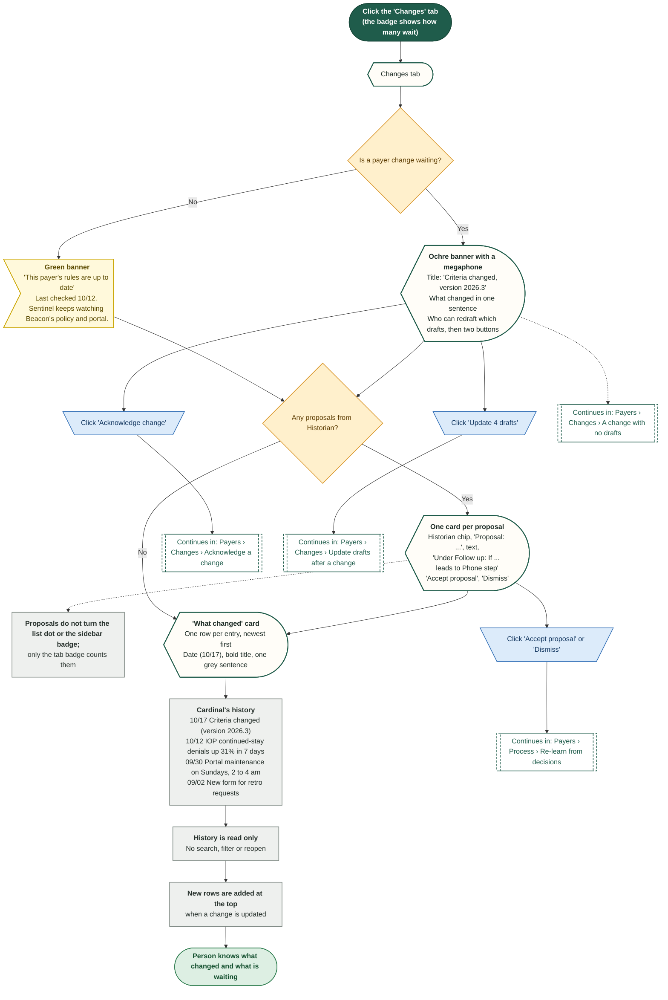

## Payers › Changes › A change arrives (policy watch)

How a payer's policy change reaches a person. In the product Sentinel watches each payer's policy and portal, compares versions, finds what affects open work and raises a change. In the demo two changes (Cardinal and Harborview) are already waiting when the demo starts; there is no button that creates a new one. Reset demo data brings them back.

Route: `/payers/cardinal?tab=changes`

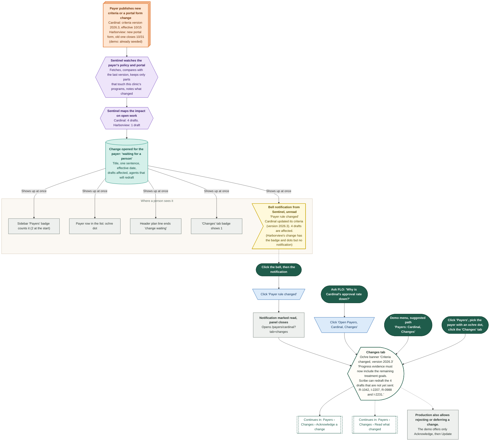

## Payers › Changes › Acknowledge a change

Acknowledging is the first of two gates. It records who saw the payer's change and when, and changes nothing else. 'Update drafts' stays locked until it is done, so a person has always read the change before any draft is redrafted. There is no way to take an acknowledgement back.

Route: `/payers/cardinal?tab=changes`

```mermaid
%%{init: {"theme":"base","themeVariables":{"fontFamily":"'DM Sans', 'Segoe UI', system-ui, sans-serif","fontSize":"15px","lineColor":"#5B6B63","primaryTextColor":"#1C2B25","clusterBkg":"#FBF8F3","clusterBorder":"#D9CDBB","edgeLabelBackground":"#FFFFFF"},"flowchart":{"curve":"basis","nodeSpacing":36,"rankSpacing":48,"padding":12,"htmlLabels":true,"useMaxWidth":false,"wrappingWidth":230}} }%%
flowchart TD
  classDef k_start fill:#1F5C4B,stroke:#174638,color:#FFFFFF,stroke-width:1.5px,font-weight:600
  classDef k_end fill:#DDEFE3,stroke:#2E7D4F,color:#14502F,stroke-width:1.5px,font-weight:600
  classDef k_endx fill:#FBE3E0,stroke:#C0392B,color:#7A1F16,stroke-width:1.5px,font-weight:600
  classDef k_screen fill:#FFFDF8,stroke:#1F5C4B,color:#1C2B25,stroke-width:2px
  classDef k_overlay fill:#F1F7F3,stroke:#1F5C4B,color:#1C2B25,stroke-width:2px,stroke-dasharray:5 3
  classDef k_click fill:#DCEBFA,stroke:#2F6DB5,color:#12365F,stroke-width:1.5px
  classDef k_input fill:#E4E7FF,stroke:#4C5FD5,color:#1D2670,stroke-width:1.5px
  classDef k_process fill:#EEF0EE,stroke:#7A857F,color:#26302B,stroke-width:1.5px
  classDef k_agent fill:#EEE5FA,stroke:#7A4FC2,color:#341A63,stroke-width:1.5px
  classDef k_decision fill:#FFF0CC,stroke:#D9962B,color:#5C3B00,stroke-width:1.5px
  classDef k_store fill:#D5F0EA,stroke:#1C8E7B,color:#0B4A3F,stroke-width:1.5px
  classDef k_doc fill:#F6E9DC,stroke:#B07A4C,color:#4A2E14,stroke-width:1.5px
  classDef k_ext fill:#FFE6D2,stroke:#E07B39,color:#6B2F06,stroke-width:1.5px
  classDef k_wait fill:#E4E8EE,stroke:#6B7C93,color:#26303D,stroke-width:1.5px
  classDef k_toast fill:#FFF9DB,stroke:#C9A400,color:#5A4A00,stroke-width:1.5px
  classDef k_goto fill:#FFFFFF,stroke:#1F5C4B,color:#1F5C4B,stroke-width:1.5px,stroke-dasharray:5 3
  s1@{ shape: stadium, label: "<b>Open the Changes tab</b><br/>of a payer with a waiting change" }
  bn@{ shape: curv-trap, label: "<b>Ochre banner</b><br/>'Acknowledge change' (blue, ready)<br/>'Update 4 drafts' (greyed out)<br/>Note: Acknowledging records who saw it.<br/>Updating redrafts, and each draft returns to Case Manager for a new signature." }
  hv@{ shape: trap-t, label: "Hover or click the greyed 'Update 4 drafts'" }
  tip@{ shape: odd, label: "<b>Tooltip: 'Acknowledge the change first'</b><br/>Nothing happens on click" }
  ca@{ shape: trap-t, label: "Click 'Acknowledge change'" }
  m@{ shape: win-pane, label: "<b>Acknowledge this change?</b><br/>Acknowledge gate. It records who saw the change and when." }
  bd@{ shape: curv-trap, label: "<b>Change shown in a tinted box</b><br/>'Criteria changed, version 2026.3'<br/>Progress evidence must now include the remaining treatment goals.<br/>Effective 10/15." }
  who@{ shape: rect, label: "<b>'You are acknowledging as Jordan Perez.</b><br/>This does not change any draft.<br/>Updating the drafts is a separate step.'" }
  ok@{ shape: trap-t, label: "<b>Click 'Acknowledge change'</b><br/>in the modal" }
  st@{ shape: cyl, label: "<b>Acknowledgement recorded on the change</b><br/>Who: Jordan Perez. When: the demo clock" }
  t1@{ shape: odd, label: "<b>'Change acknowledged'</b><br/>Recorded for Jordan Perez, Tue 10:42 am.<br/>Drafts are not changed until you update them." }
  bn2@{ shape: curv-trap, label: "<b>Banner now shows a green pill</b><br/>'Acknowledged by Jordan Perez, Tue 10:42 am'<br/>in place of the blue button<br/>'Update 4 drafts' is ready" }
  nb@{ shape: rect, label: "<b>No change to the sidebar badge, the dot or the drafts</b><br/>No edit log entry. No undo" }
  cx@{ shape: trap-t, label: "Click 'Cancel'" }
  cesc@{ shape: trap-t, label: "<b>Press Escape, click the X</b><br/>or click the dimmed area" }
  x1@{ shape: stadium, label: "<b>Modal closes</b><br/>Nothing recorded<br/>Banner as before" }
  e1@{ shape: stadium, label: "Ready for the second gate" }
  g1@{ shape: subproc, label: "Continues in: Payers › Changes › Update drafts after a change" }
  s1 --> bn
  bn --> hv --> tip --> ca
  bn --> ca --> m --> bd --> who --> ok --> st --> t1 --> bn2 --> e1
  bn2 -.-> nb
  e1 --> g1
  m --> cx --> x1
  m --> cesc --> x1
  class s1 k_start
  class bn,bd,bn2 k_screen
  class hv,ca,ok,cx,cesc k_click
  class tip,t1 k_toast
  class m k_overlay
  class who,nb k_process
  class st k_store
  class x1 k_endx
  class e1 k_end
  class g1 k_goto
```

## Payers › Changes › Update drafts after a change

The second gate. Once a payer's change is acknowledged, 'Update 4 drafts' lists exactly which requests are affected, then two agents redraft for about three seconds. Drafts return to Case Manager for a new signature; a request that was already sent is never rewritten and gets an addendum instead.

Route: `/payers/cardinal?tab=changes`

```mermaid
%%{init: {"theme":"base","themeVariables":{"fontFamily":"'DM Sans', 'Segoe UI', system-ui, sans-serif","fontSize":"15px","lineColor":"#5B6B63","primaryTextColor":"#1C2B25","clusterBkg":"#FBF8F3","clusterBorder":"#D9CDBB","edgeLabelBackground":"#FFFFFF"},"flowchart":{"curve":"basis","nodeSpacing":36,"rankSpacing":48,"padding":12,"htmlLabels":true,"useMaxWidth":false,"wrappingWidth":230}} }%%
flowchart TD
  classDef k_start fill:#1F5C4B,stroke:#174638,color:#FFFFFF,stroke-width:1.5px,font-weight:600
  classDef k_end fill:#DDEFE3,stroke:#2E7D4F,color:#14502F,stroke-width:1.5px,font-weight:600
  classDef k_endx fill:#FBE3E0,stroke:#C0392B,color:#7A1F16,stroke-width:1.5px,font-weight:600
  classDef k_screen fill:#FFFDF8,stroke:#1F5C4B,color:#1C2B25,stroke-width:2px
  classDef k_overlay fill:#F1F7F3,stroke:#1F5C4B,color:#1C2B25,stroke-width:2px,stroke-dasharray:5 3
  classDef k_click fill:#DCEBFA,stroke:#2F6DB5,color:#12365F,stroke-width:1.5px
  classDef k_input fill:#E4E7FF,stroke:#4C5FD5,color:#1D2670,stroke-width:1.5px
  classDef k_process fill:#EEF0EE,stroke:#7A857F,color:#26302B,stroke-width:1.5px
  classDef k_agent fill:#EEE5FA,stroke:#7A4FC2,color:#341A63,stroke-width:1.5px
  classDef k_decision fill:#FFF0CC,stroke:#D9962B,color:#5C3B00,stroke-width:1.5px
  classDef k_store fill:#D5F0EA,stroke:#1C8E7B,color:#0B4A3F,stroke-width:1.5px
  classDef k_doc fill:#F6E9DC,stroke:#B07A4C,color:#4A2E14,stroke-width:1.5px
  classDef k_ext fill:#FFE6D2,stroke:#E07B39,color:#6B2F06,stroke-width:1.5px
  classDef k_wait fill:#E4E8EE,stroke:#6B7C93,color:#26303D,stroke-width:1.5px
  classDef k_toast fill:#FFF9DB,stroke:#C9A400,color:#5A4A00,stroke-width:1.5px
  classDef k_goto fill:#FFFFFF,stroke:#1F5C4B,color:#1F5C4B,stroke-width:1.5px,stroke-dasharray:5 3
  s1@{ shape: stadium, label: "<b>Click 'Update 4 drafts'</b><br/>(ready after 'Acknowledge change')" }
  m@{ shape: win-pane, label: "<b>Update 4 drafts?</b><br/>Confirm gate. Nothing is redrafted until you say so.<br/>Reason: criteria changed, version 2026.3." }
  rows@{ shape: curv-trap, label: "<b>One row per affected request</b><br/>Request id, patient initials and age · payer,<br/>level of care chip, status" }
  subgraph gR ["Cardinal's four rows, as seeded"]
  r1@{ shape: rect, label: "<b>R-1042 · J.M., 34 · Summit · Residential 3.5</b><br/>Draft, not yet sent" }
  r2@{ shape: rect, label: "<b>I-2207 · T.R., 29 · Cardinal · IOP</b><br/>Draft, not yet sent" }
  r3@{ shape: rect, label: "<b>R-0988 · D.L., 41 · Beacon · Residential 3.5</b><br/>Draft, not yet sent" }
  r4@{ shape: rect, label: "<b>I-2231 · S.B., 37 · Cardinal · IOP</b><br/>Already sent. Gets an addendum" }
  end
  st@{ shape: rect, label: "<b>Status by stage</b><br/>Preparing: 'Draft, not yet sent'<br/>Info requested: 'Answer drafted, not yet sent'<br/>Anything later: 'Already sent. Gets an addendum'" }
  fn@{ shape: odd, label: "<b>'Each redrafted case returns to Case Manager for a new signature.</b><br/>A request that is already sent is never rewritten.<br/>It gets an addendum instead.'" }
  cs@{ shape: trap-t, label: "Click 'Update 4 drafts'" }
  lock@{ shape: rect, label: "<b>Cancel greys out and the button spins</b><br/>Escape, X and dimmed area do nothing" }
  a1@{ shape: hex, label: "<b>Scribe is redrafting 4 drafts</b><br/>(demo: 1.5 seconds)" }
  a2@{ shape: hex, label: "<b>Integrity is checking every sentence</b><br/>against the chart (demo: 1.5 seconds)" }
  lv@{ shape: diam, label: "Still on Payers after 3 seconds?" }
  drop@{ shape: stadium, label: "<b>Update dropped</b><br/>Change stays waiting, acknowledged" }
  subgraph gU ["What the update does"]
  u1@{ shape: cyl, label: "<b>Each draft or answer-in-draft needs a person again</b><br/>'Redrafted after Cardinal's change (criteria changed, version 2026.3).<br/>Waiting for a new signature'<br/>Timeline event by Scribe" }
  u2@{ shape: cyl, label: "<b>Each sent request gets a timeline event</b><br/>'Scribe prepared an addendum after ...'<br/>Its status does not change" }
  u3@{ shape: cyl, label: "<b>Payer's change cleared</b><br/>Checked date becomes today" }
  u4@{ shape: cyl, label: "<b>Document lists gain the change's new rows</b><br/>Remaining treatment goals: Named in the latest progress note<br/>in Residential 3.5, IOP and PHP" }
  u5@{ shape: cyl, label: "<b>Edit log: 3 'Documents' entries</b><br/>'Added to the Residential 3.5 list' and so on<br/>Reason 'After criteria changed, version 2026.3'" }
  u6@{ shape: cyl, label: "<b>'What changed' gets a new top row</b><br/>'Criteria changed, version 2026.3: acknowledged and applied'<br/>Acknowledged by Jordan Perez, ...<br/>Scribe and Integrity updated 4 drafts ..." }
  end
  nt@{ shape: cyl, label: "<b>Bell notification 'Drafts updated' from Scribe</b><br/>4 drafts were redrafted after Cardinal's change.<br/>Each needs a new signature in Case Manager." }
  t1@{ shape: odd, label: "<b>'4 drafts updated'</b><br/>Cardinal is up to date. Each draft returned to Case Manager<br/>for a new signature." }
  out@{ shape: curv-trap, label: "<b>Changes tab flips to green</b><br/>'This payer's rules are up to date', last checked today<br/>Sidebar badge drops, dot turns green" }
  cx@{ shape: trap-t, label: "Click 'Cancel'" }
  cesc@{ shape: trap-t, label: "<b>Press Escape, click the X</b><br/>or click the dimmed area" }
  x1@{ shape: stadium, label: "<b>Modal closes</b><br/>Nothing redrafted, still acknowledged" }
  odd@{ shape: rect, label: "<b>Demo oddity: two rows belong to other payers (Summit, Beacon)</b><br/>and the banner says 'not yet sent' for all four" }
  g1@{ shape: subproc, label: "Continues in: Dashboard › Requests table" }
  cb@{ shape: trap-t, label: "<b>Click the bell notification</b><br/>'Drafts updated'" }
  g2@{ shape: subproc, label: "Continues in: Case Manager › Cases" }
  g3@{ shape: subproc, label: "Continues in: Payers › Documents › Try it on a case" }
  g4@{ shape: subproc, label: "Continues in: Payers › Edit log" }
  s1 --> m --> rows
  rows --> r1 & r2 & r3 & r4
  r1 --> st
  r2 --> st
  r3 --> st
  r4 --> st
  st --> fn --> cs --> lock --> a1 --> a2 --> lv
  lv -->|"No"| drop
  lv -->|"Yes"| u1
  u1 --> u2
  u2 --> u3 --> u4 --> u5 --> u6 --> nt --> t1 --> out
  out --> g1
  nt -.-> cb --> g2
  u4 -.-> g3
  u5 -.-> g4
  rows -.-> odd
  m --> cx --> x1
  m --> cesc --> x1
  class s1 k_start
  class m k_overlay
  class rows,out k_screen
  class r1,r2,r3,r4,st,lock,odd k_process
  class fn,t1 k_toast
  class cs,cx,cesc,cb k_click
  class a1,a2 k_agent
  class lv k_decision
  class drop,x1 k_endx
  class u1,u2,u3,u4,u5,u6,nt k_store
  class g1,g2,g3,g4 k_goto
  style gR fill:#FBF8F3,stroke:#D9CDBB,stroke-width:1.5px,color:#5B6B63
  style gU fill:#FBF8F3,stroke:#D9CDBB,stroke-width:1.5px,color:#5B6B63
```

## Payers › Changes › A change with no drafts

Not every change touches many drafts. Harborview's portal form change affects one draft and adds no documents. A change that affected no drafts would change the wording of the banner, the button and the confirm step; the seed data has none, so that branch is not reachable in the demo. A payer with nothing waiting shows only history.

Route: `/payers/harborview?tab=changes`

```mermaid
%%{init: {"theme":"base","themeVariables":{"fontFamily":"'DM Sans', 'Segoe UI', system-ui, sans-serif","fontSize":"15px","lineColor":"#5B6B63","primaryTextColor":"#1C2B25","clusterBkg":"#FBF8F3","clusterBorder":"#D9CDBB","edgeLabelBackground":"#FFFFFF"},"flowchart":{"curve":"basis","nodeSpacing":36,"rankSpacing":48,"padding":12,"htmlLabels":true,"useMaxWidth":false,"wrappingWidth":230}} }%%
flowchart TD
  classDef k_start fill:#1F5C4B,stroke:#174638,color:#FFFFFF,stroke-width:1.5px,font-weight:600
  classDef k_end fill:#DDEFE3,stroke:#2E7D4F,color:#14502F,stroke-width:1.5px,font-weight:600
  classDef k_endx fill:#FBE3E0,stroke:#C0392B,color:#7A1F16,stroke-width:1.5px,font-weight:600
  classDef k_screen fill:#FFFDF8,stroke:#1F5C4B,color:#1C2B25,stroke-width:2px
  classDef k_overlay fill:#F1F7F3,stroke:#1F5C4B,color:#1C2B25,stroke-width:2px,stroke-dasharray:5 3
  classDef k_click fill:#DCEBFA,stroke:#2F6DB5,color:#12365F,stroke-width:1.5px
  classDef k_input fill:#E4E7FF,stroke:#4C5FD5,color:#1D2670,stroke-width:1.5px
  classDef k_process fill:#EEF0EE,stroke:#7A857F,color:#26302B,stroke-width:1.5px
  classDef k_agent fill:#EEE5FA,stroke:#7A4FC2,color:#341A63,stroke-width:1.5px
  classDef k_decision fill:#FFF0CC,stroke:#D9962B,color:#5C3B00,stroke-width:1.5px
  classDef k_store fill:#D5F0EA,stroke:#1C8E7B,color:#0B4A3F,stroke-width:1.5px
  classDef k_doc fill:#F6E9DC,stroke:#B07A4C,color:#4A2E14,stroke-width:1.5px
  classDef k_ext fill:#FFE6D2,stroke:#E07B39,color:#6B2F06,stroke-width:1.5px
  classDef k_wait fill:#E4E8EE,stroke:#6B7C93,color:#26303D,stroke-width:1.5px
  classDef k_toast fill:#FFF9DB,stroke:#C9A400,color:#5A4A00,stroke-width:1.5px
  classDef k_goto fill:#FFFFFF,stroke:#1F5C4B,color:#1F5C4B,stroke-width:1.5px,stroke-dasharray:5 3
  s1@{ shape: stadium, label: "<b>Open the 'Changes' tab</b><br/>for a payer" }
  dp@{ shape: diam, label: "Is a change waiting?" }
  up@{ shape: curv-trap, label: "<b>Green banner</b><br/>'This payer's rules are up to date'<br/>Only the 'What changed' history below" }
  hv@{ shape: rect, label: "<b>Harborview's waiting change</b><br/>'Portal form change', effective 10/18<br/>The request form now asks for the expected length of stay and a second contact.<br/>The old form closes 10/31." }
  dn@{ shape: diam, label: "How many drafts does the change affect?" }
  one@{ shape: odd, label: "<b>'Packet can redraft the 1 draft that is not yet sent: P-1499.'</b><br/>Buttons: 'Acknowledge change', then 'Update 1 draft'" }
  none@{ shape: odd, label: "<b>'No open drafts are affected.'</b><br/>Buttons: 'Acknowledge change', then 'Apply to new drafts'<br/>(no seeded change has this)" }
  ca1@{ shape: trap-t, label: "<b>Click 'Acknowledge change' and confirm,</b><br/>then 'Update 1 draft'" }
  ca0@{ shape: trap-t, label: "<b>Click 'Acknowledge change' and confirm,</b><br/>then 'Apply to new drafts'" }
  mo@{ shape: win-pane, label: "<b>Update 1 draft?</b><br/>Row: P-1499 · E.S., 42 · Harborview, PHP,<br/>'Answer drafted, not yet sent'" }
  mn@{ shape: win-pane, label: "<b>Apply to new drafts?</b><br/>No open drafts are affected.<br/>Harborview will use the change for every new draft from now on." }
  a1@{ shape: hex, label: "<b>Packet is redrafting 1 draft</b><br/>(its agents are Packet and Integrity)" }
  a2@{ shape: hex, label: "Integrity is checking every sentence against the chart" }
  da@{ shape: rect, label: "<b>No documents are added to Harborview's lists</b><br/>The change is about a form, not the list" }
  s1d@{ shape: cyl, label: "<b>P-1499 needs a person again</b><br/>'Redrafted after Harborview's change (portal form change).<br/>Waiting for a new signature'" }
  s0@{ shape: cyl, label: "<b>No drafts touched</b><br/>Change cleared, checked date is today<br/>Same three-second wait" }
  hh@{ shape: cyl, label: "<b>'What changed' gets a new top row</b><br/>'Portal form change: acknowledged and applied'" }
  hh0@{ shape: cyl, label: "<b>'What changed' gets a new top row</b><br/>'... acknowledged and applied'<br/>saying 0 drafts were updated" }
  t1@{ shape: odd, label: "<b>'1 draft updated'</b><br/>Harborview is up to date. Each draft returned to Case Manager<br/>for a new signature." }
  t0@{ shape: odd, label: "<b>'0 drafts updated'</b><br/>(the wording is not adjusted for none)" }
  bd@{ shape: rect, label: "<b>Sidebar badge drops by one</b><br/>Payer dot turns green" }
  cx@{ shape: trap-t, label: "<b>Click 'Cancel', press Escape,</b><br/>click the X or the dimmed area" }
  x1@{ shape: stadium, label: "Modal closes, change stays waiting" }
  e1@{ shape: stadium, label: "Payer is up to date" }
  g1@{ shape: subproc, label: "Continues in: Payers › Changes › Update drafts after a change" }
  s1 --> dp
  dp -->|"No"| up --> e1
  dp -->|"Yes"| hv --> dn
  dn -->|"One draft"| one --> ca1 --> mo
  dn -->|"No drafts"| none --> ca0 --> mn
  mo --> a1 --> a2 --> da --> s1d --> hh
  mn --> s0 --> hh0 --> t0 --> e1
  hh --> t1 --> bd --> e1
  mo --> cx --> x1
  mn --> cx
  mo -.-> g1
  class s1 k_start
  class dp,dn k_decision
  class up k_screen
  class hv,da,bd k_process
  class one,none,t1,t0 k_toast
  class ca1,ca0,cx k_click
  class mo,mn k_overlay
  class a1,a2 k_agent
  class s1d,s0,hh,hh0 k_store
  class x1 k_endx
  class e1 k_end
  class g1 k_goto
```

## Payers › Configuration feeds the rest of the app

What a payer's workflow, rules and document lists reach outside the Payers page. In the demo the working link is redrafting: updating drafts changes the matching requests on the Dashboard and sends a bell notification. The page text also says its document list is the one Reader uses on New case, and the rules feed the agents' decisions and the approval chance; the demo does not wire those, and this diagram marks them.

Route: `/payers/:id`

```mermaid
%%{init: {"theme":"base","themeVariables":{"fontFamily":"'DM Sans', 'Segoe UI', system-ui, sans-serif","fontSize":"15px","lineColor":"#5B6B63","primaryTextColor":"#1C2B25","clusterBkg":"#FBF8F3","clusterBorder":"#D9CDBB","edgeLabelBackground":"#FFFFFF"},"flowchart":{"curve":"basis","nodeSpacing":36,"rankSpacing":48,"padding":12,"htmlLabels":true,"useMaxWidth":false,"wrappingWidth":230}} }%%
flowchart TD
  classDef k_start fill:#1F5C4B,stroke:#174638,color:#FFFFFF,stroke-width:1.5px,font-weight:600
  classDef k_end fill:#DDEFE3,stroke:#2E7D4F,color:#14502F,stroke-width:1.5px,font-weight:600
  classDef k_endx fill:#FBE3E0,stroke:#C0392B,color:#7A1F16,stroke-width:1.5px,font-weight:600
  classDef k_screen fill:#FFFDF8,stroke:#1F5C4B,color:#1C2B25,stroke-width:2px
  classDef k_overlay fill:#F1F7F3,stroke:#1F5C4B,color:#1C2B25,stroke-width:2px,stroke-dasharray:5 3
  classDef k_click fill:#DCEBFA,stroke:#2F6DB5,color:#12365F,stroke-width:1.5px
  classDef k_input fill:#E4E7FF,stroke:#4C5FD5,color:#1D2670,stroke-width:1.5px
  classDef k_process fill:#EEF0EE,stroke:#7A857F,color:#26302B,stroke-width:1.5px
  classDef k_agent fill:#EEE5FA,stroke:#7A4FC2,color:#341A63,stroke-width:1.5px
  classDef k_decision fill:#FFF0CC,stroke:#D9962B,color:#5C3B00,stroke-width:1.5px
  classDef k_store fill:#D5F0EA,stroke:#1C8E7B,color:#0B4A3F,stroke-width:1.5px
  classDef k_doc fill:#F6E9DC,stroke:#B07A4C,color:#4A2E14,stroke-width:1.5px
  classDef k_ext fill:#FFE6D2,stroke:#E07B39,color:#6B2F06,stroke-width:1.5px
  classDef k_wait fill:#E4E8EE,stroke:#6B7C93,color:#26303D,stroke-width:1.5px
  classDef k_toast fill:#FFF9DB,stroke:#C9A400,color:#5A4A00,stroke-width:1.5px
  classDef k_goto fill:#FFFFFF,stroke:#1F5C4B,color:#1F5C4B,stroke-width:1.5px,stroke-dasharray:5 3
  s1@{ shape: stadium, label: "<b>A payer's workflow, rule, document list</b><br/>or payer change is saved or updated" }
  dk@{ shape: diam, label: "Which kind of save?" }
  cfg@{ shape: cyl, label: "<b>Saved on the payer</b><br/>New drafts use it from now on" }
  nw@{ shape: rect, label: "<b>Page says: new drafts use it at once.</b><br/>In the demo only the Payers page reads the saved lists back" }
  subgraph gW ["Wired in the demo: redrafting"]
  up@{ shape: trap-t, label: "<b>'Update N drafts' (after a payer change,</b><br/>or from the edits-waiting banner)" }
  rq@{ shape: cyl, label: "<b>Matching requests change</b><br/>needs a person: yes<br/>Status line 'Redrafted after ... Waiting for a new signature'<br/>Timeline event from Scribe, Packet or Integrity" }
  nf@{ shape: cyl, label: "<b>Bell notification 'Drafts updated'</b><br/>links to Case Manager" }
  dsh@{ shape: rect, label: "<b>Dashboard shows the new status line</b><br/>and lists the request among those needing you" }
  end
  subgraph gC ["Wired in the demo: links out of Payers"]
  oc@{ shape: trap-t, label: "<b>Click 'Open the request'</b><br/>in 'Try it on a case'" }
  od@{ shape: rect, label: "Opens Dashboard with that request's drawer" }
  end
  subgraph gP ["Said on the page, not wired in the demo"]
  p1@{ shape: rect, label: "<b>Documents tab: 'Reader uses this same list on the intake screen'</b><br/>New case keeps its own required-document table,<br/>so an edited list does not change New case" }
  p2@{ shape: rect, label: "<b>Rules tab: agents 'use' each rule</b><br/>No approval chance, queue order or New case check<br/>reads a rule, so editing one never moves a number" }
  p3@{ shape: rect, label: "<b>Header 'Approved as asked' (74% for Summit) is the figure</b><br/>New case uses for the approval chance: it ends 14 points higher<br/>and starts 26 below that. It comes from decision history,<br/>so editing a rule or list does not move it" }
  p4@{ shape: rect, label: "<b>Authorizations queue and Case Manager lists</b><br/>do not change when drafts are redrafted" }
  end
  prd@{ shape: rect, label: "<b>In the product (PRD 06)</b><br/>A rule version is stamped on every authorization;<br/>Packet reads the channel, form and documents; Cadence reads windows and caps;<br/>Advocate reads peer-to-peer and appeal windows" }
  g1@{ shape: subproc, label: "Continues in: Dashboard › Requests table" }
  g2@{ shape: subproc, label: "Continues in: Case Manager › Cases" }
  g3@{ shape: subproc, label: "Continues in: Dashboard › Open a request" }
  g4@{ shape: subproc, label: "Continues in: Authorizations › New case › Medical records › The checklist and Continue" }
  g5@{ shape: subproc, label: "Continues in: Authorizations › Case › Risk" }
  g7@{ shape: subproc, label: "Continues in: Authorizations › New case › Agents work › Start the run and watch it" }
  g6@{ shape: subproc, label: "Continues in: Authorizations › Queue" }
  s1 --> dk
  dk -->|"Workflow, rule or documents"| cfg --> nw
  dk -->|"Payer change or edits update"| up --> rq --> dsh --> g1
  rq --> nf --> g2
  nw -.-> p1
  nw -.-> p2
  nw -.-> p3
  nw -.-> p4
  p1 --> g4
  p2 --> g5
  p3 --> g7
  p4 --> g6
  oc --> od --> g3
  dk -->|"Chart check"| oc
  p2 -.-> prd
  class s1 k_start
  class dk k_decision
  class cfg,rq,nf k_store
  class nw,dsh,od,p1,p2,p3,p4,prd k_process
  class up,oc k_click
  class g1,g2,g3,g4,g5,g7,g6 k_goto
  style gW fill:#FBF8F3,stroke:#D9CDBB,stroke-width:1.5px,color:#5B6B63
  style gC fill:#FBF8F3,stroke:#D9CDBB,stroke-width:1.5px,color:#5B6B63
  style gP fill:#FBF8F3,stroke:#D9CDBB,stroke-width:1.5px,color:#5B6B63
```

## Payers › Every pop-up › Save, discard, close

One page for how every Payers pop-up closes. Nothing is saved by closing: Cancel, the X, Escape and a click on the dimmed area all throw away what was typed, with no 'are you sure'. There is no undo; a saved edit is reversed by editing again, and the edit log keeps the old text.

Route: `/payers/:id`

```mermaid
%%{init: {"theme":"base","themeVariables":{"fontFamily":"'DM Sans', 'Segoe UI', system-ui, sans-serif","fontSize":"15px","lineColor":"#5B6B63","primaryTextColor":"#1C2B25","clusterBkg":"#FBF8F3","clusterBorder":"#D9CDBB","edgeLabelBackground":"#FFFFFF"},"flowchart":{"curve":"basis","nodeSpacing":36,"rankSpacing":48,"padding":12,"htmlLabels":true,"useMaxWidth":false,"wrappingWidth":230}} }%%
flowchart TD
  classDef k_start fill:#1F5C4B,stroke:#174638,color:#FFFFFF,stroke-width:1.5px,font-weight:600
  classDef k_end fill:#DDEFE3,stroke:#2E7D4F,color:#14502F,stroke-width:1.5px,font-weight:600
  classDef k_endx fill:#FBE3E0,stroke:#C0392B,color:#7A1F16,stroke-width:1.5px,font-weight:600
  classDef k_screen fill:#FFFDF8,stroke:#1F5C4B,color:#1C2B25,stroke-width:2px
  classDef k_overlay fill:#F1F7F3,stroke:#1F5C4B,color:#1C2B25,stroke-width:2px,stroke-dasharray:5 3
  classDef k_click fill:#DCEBFA,stroke:#2F6DB5,color:#12365F,stroke-width:1.5px
  classDef k_input fill:#E4E7FF,stroke:#4C5FD5,color:#1D2670,stroke-width:1.5px
  classDef k_process fill:#EEF0EE,stroke:#7A857F,color:#26302B,stroke-width:1.5px
  classDef k_agent fill:#EEE5FA,stroke:#7A4FC2,color:#341A63,stroke-width:1.5px
  classDef k_decision fill:#FFF0CC,stroke:#D9962B,color:#5C3B00,stroke-width:1.5px
  classDef k_store fill:#D5F0EA,stroke:#1C8E7B,color:#0B4A3F,stroke-width:1.5px
  classDef k_doc fill:#F6E9DC,stroke:#B07A4C,color:#4A2E14,stroke-width:1.5px
  classDef k_ext fill:#FFE6D2,stroke:#E07B39,color:#6B2F06,stroke-width:1.5px
  classDef k_wait fill:#E4E8EE,stroke:#6B7C93,color:#26303D,stroke-width:1.5px
  classDef k_toast fill:#FFF9DB,stroke:#C9A400,color:#5A4A00,stroke-width:1.5px
  classDef k_goto fill:#FFFFFF,stroke:#1F5C4B,color:#1F5C4B,stroke-width:1.5px,stroke-dasharray:5 3
  s1@{ shape: stadium, label: "Any Payers pop-up is open" }
  ov@{ shape: win-pane, label: "<b>Ten pop-ups</b><br/>Add a payer, Edit payer details, Edit log, Edit workflow,<br/>Save the workflow?, Edit the instructions for Caller,<br/>Edit a rule, Edit what a payer wants, Acknowledge this change?,<br/>Update drafts?, plus the menus inside them" }
  subgraph gX ["Ways to close"]
  x1@{ shape: trap-t, label: "Click 'Cancel'" }
  x2@{ shape: trap-t, label: "Click the X ('Close')" }
  x3@{ shape: trap-t, label: "Press Escape" }
  x4@{ shape: trap-t, label: "Click the dimmed area outside" }
  end
  cl@{ shape: rect, label: "The pop-up is asked to close" }
  dk@{ shape: diam, label: "Which pop-up is it?" }
  pl@{ shape: rect, label: "<b>Plain pop-up (everything except the cases below)</b><br/>Closes. Typed text and picks are discarded<br/>Nothing is saved or logged" }
  rd@{ shape: rect, label: "<b>Edit log</b><br/>Read only, nothing to save or discard" }
  sv@{ shape: rect, label: "'Save the workflow?' over the Edit workflow drawer" }
  ek@{ shape: diam, label: "Which way was it closed?" }
  one@{ shape: rect, label: "<b>Cancel, X or dimmed area</b><br/>Only the reason modal closes<br/>The drawer keeps every edit" }
  both@{ shape: rect, label: "<b>Escape closes the reason modal AND the drawer</b><br/>Every unsaved workflow edit is lost" }
  bz@{ shape: rect, label: "<b>'Update drafts?' while the agents work (about 3 seconds)</b><br/>Cancel is greyed, Escape, X and dimmed area do nothing<br/>Wait for it to finish" }
  mn@{ shape: rect, label: "<b>A menu open inside a pop-up</b><br/>(Plan type, Group, Reached by, Level of care, Case, step type)<br/>Escape closes the menu and also the pop-up" }
  subgraph gS ["Ways to save (the primary button)"]
  sa@{ shape: rect, label: "<b>'Save and log the edit' needs a reason</b><br/>Empty reason: 'Add a reason. It goes in the edit log.'" }
  sb@{ shape: rect, label: "'Add payer' needs a name, a way to reach and a program" }
  sc@{ shape: rect, label: "<b>'Acknowledge change' and 'Update N drafts' are confirm buttons</b><br/>they need no typing" }
  sd@{ shape: rect, label: "<b>If nothing differs from what is saved:</b><br/>'Nothing changed' (or 'Nothing to save' in the workflow drawer)" }
  end
  sv1@{ shape: cyl, label: "<b>Saved: the change is in force for new drafts</b><br/>One edit log entry per change" }
  undo@{ shape: rect, label: "<b>No undo, revert or 'restore previous' button</b><br/>To go back: edit again. Edit log shows the before text" }
  e1@{ shape: stadium, label: "Back on the page, nothing half saved" }
  x0@{ shape: stadium, label: "Closed without saving" }
  s1 --> ov
  ov --> x1 & x2 & x3 & x4
  x1 --> cl
  x2 --> cl
  x3 --> cl
  x4 --> cl
  cl --> dk
  dk -->|"Plain"| pl --> x0
  dk -->|"Edit log"| rd --> x0
  dk -->|"Save the workflow?"| sv --> ek
  ek -->|"Cancel, X, dimmed area"| one --> x0
  ek -->|"Escape"| both --> x0
  dk -->|"Update drafts?, busy"| bz --> e1
  dk -->|"Menu open"| mn --> x0
  ov --> sa --> sv1
  ov --> sb --> sv1
  ov --> sc --> sv1
  sa --> sd
  sv1 --> e1
  e1 -.-> undo
  class s1 k_start
  class ov k_overlay
  class x1,x2,x3,x4 k_click
  class cl,pl,rd,sv,one,both,bz,mn,sa,sb,sc,sd,undo k_process
  class dk,ek k_decision
  class sv1 k_store
  class e1 k_end
  class x0 k_endx
  style gX fill:#FBF8F3,stroke:#D9CDBB,stroke-width:1.5px,color:#5B6B63
  style gS fill:#FBF8F3,stroke:#D9CDBB,stroke-width:1.5px,color:#5B6B63
```
