# Payers

Each payer's process, rules, documents and the changes to acknowledge.

Shapes and colours: see `00-overview.md`. Source: `workflows/src/10-payers/`.

## Payers › Arrive on the page

How a person lands on Payers, which payer and tab they see first, what the badges count, and where each control on the page leads. Payers are the same for every viewer and site view; only the drafts an update can redraft follow the site. Every other Payers diagram starts from one of the hand offs at the bottom.

Route: `/payers`

```mermaid
%%{init: {"theme":"base","themeVariables":{"fontFamily":"'DM Sans', 'Segoe UI', system-ui, sans-serif","fontSize":"15px","lineColor":"#5B6B63","primaryTextColor":"#1C2B25","clusterBkg":"#FBF8F3","clusterBorder":"#D9CDBB","edgeLabelBackground":"#FFFFFF"},"flowchart":{"curve":"basis","nodeSpacing":36,"rankSpacing":48,"padding":12,"htmlLabels":true,"useMaxWidth":false,"wrappingWidth":230}} }%%
flowchart TD
  classDef k_start fill:#1F5C4B,stroke:#174638,color:#FFFFFF,stroke-width:1.5px,font-weight:600
  classDef k_end fill:#DDEFE3,stroke:#2E7D4F,color:#14502F,stroke-width:1.5px,font-weight:600
  classDef k_endx fill:#FBE3E0,stroke:#C0392B,color:#7A1F16,stroke-width:1.5px,font-weight:600
  classDef k_screen fill:#FFFDF8,stroke:#1F5C4B,color:#1C2B25,stroke-width:2px
  classDef k_overlay fill:#F1F7F3,stroke:#1F5C4B,color:#1C2B25,stroke-width:2px,stroke-dasharray:5 3
  classDef k_click fill:#DCEBFA,stroke:#2F6DB5,color:#12365F,stroke-width:1.5px
  classDef k_input fill:#E4E7FF,stroke:#4C5FD5,color:#1D2670,stroke-width:1.5px
  classDef k_process fill:#EEF0EE,stroke:#7A857F,color:#26302B,stroke-width:1.5px
  classDef k_agent fill:#EEE5FA,stroke:#7A4FC2,color:#341A63,stroke-width:1.5px
  classDef k_decision fill:#FFF0CC,stroke:#D9962B,color:#5C3B00,stroke-width:1.5px
  classDef k_store fill:#D5F0EA,stroke:#1C8E7B,color:#0B4A3F,stroke-width:1.5px
  classDef k_doc fill:#F6E9DC,stroke:#B07A4C,color:#4A2E14,stroke-width:1.5px
  classDef k_ext fill:#FFE6D2,stroke:#E07B39,color:#6B2F06,stroke-width:1.5px
  classDef k_wait fill:#E4E8EE,stroke:#6B7C93,color:#26303D,stroke-width:1.5px
  classDef k_toast fill:#FFF9DB,stroke:#C9A400,color:#5A4A00,stroke-width:1.5px
  classDef k_goto fill:#FFFFFF,stroke:#1F5C4B,color:#1F5C4B,stroke-width:1.5px,stroke-dasharray:5 3
  s1@{ shape: stadium, label: "<b>Click 'Payers' in the sidebar</b><br/>under Connections" }
  s2@{ shape: stadium, label: "<b>Open a link to one payer's Changes tab</b><br/>Bell notification, FLO answer, Demo menu" }
  p1@{ shape: rect, label: "<b>Address is /payers</b><br/>No payer, no tab" }
  p2@{ shape: rect, label: "Address is /payers/cardinal?tab=changes" }
  d1@{ shape: diam, label: "Does the address name a known payer?" }
  p3@{ shape: rect, label: "<b>Use the first payer in the list</b><br/>Summit Medicaid HMO" }
  p4@{ shape: rect, label: "Use the payer named in the address" }
  d2@{ shape: diam, label: "<b>Is ?tab one of process,</b><br/>rules, documents, changes?" }
  p5@{ shape: rect, label: "Show the Process tab" }
  p6@{ shape: rect, label: "Show the tab named in the address" }
  pg@{ shape: curv-trap, label: "<b>Payers</b><br/>'N payers. The agents know how each one works.'<br/>Workflow, rules and documents for every payer. Every edit is logged with your reason." }
  subgraph gL ["Left column (above the payer on a narrow screen)"]
  list@{ shape: curv-trap, label: "<b>Payer list card</b><br/>'Payers', 'Search payers', one compact row per payer:<br/>name, plan type and programs, what it asks for, change mark" }
  c_pick@{ shape: trap-t, label: "Click a payer in the list" }
  c_search@{ shape: trap-t, label: "Type in 'Search payers'" }
  end
  subgraph gR ["Right column"]
  head@{ shape: curv-trap, label: "<b>Payer header</b><br/>Name, 'Demo rules. Not verified...' label, plan line, 'Edit log', 'Edit'<br/>Plan type, programs, needs, notice and reach, policy status" }
  tabs@{ shape: curv-trap, label: "<b>Tab bar</b><br/>Process, Rules, Documents, Changes" }
  c_edit@{ shape: trap-t, label: "Click 'Edit'" }
  c_log@{ shape: trap-t, label: "Click 'Edit log'" }
  c_tab@{ shape: trap-t, label: "Click a tab" }
  end
  c_add@{ shape: trap-t, label: "<b>Click 'Add a payer'</b><br/>top right of the page" }
  subgraph gB ["What the badges count"]
  b1@{ shape: rect, label: "<b>Sidebar 'Payers' badge</b><br/>Payers with a change waiting<br/>3 at the start: Cardinal, Evergreen<br/>and Harborview. Falls when a change is updated" }
  b2@{ shape: rect, label: "<b>'Changes' tab badge</b><br/>The waiting change plus each Historian proposal<br/>Falls as each is handled" }
  end
  g_list@{ shape: subproc, label: "Continues in: Payers › List › Search and pick a payer" }
  g_head@{ shape: subproc, label: "Continues in: Payers › Header › What the header says" }
  g_ps@{ shape: subproc, label: "Continues in: Payers › Header › Policy status and the demo-rules label" }
  g_edit@{ shape: subproc, label: "Continues in: Payers › Edit payer details" }
  g_log@{ shape: subproc, label: "Continues in: Payers › Edit log" }
  g_add@{ shape: subproc, label: "Continues in: Payers › Add a payer" }
  g_proc@{ shape: subproc, label: "Continues in: Payers › Process › Read the workflow" }
  g_rules@{ shape: subproc, label: "Continues in: Payers › Rules › Read the rules" }
  g_docs@{ shape: subproc, label: "Continues in: Payers › Documents › Read the document list" }
  g_chg@{ shape: subproc, label: "Continues in: Payers › Changes › Read what changed" }
  g_site@{ shape: subproc, label: "Continues in: Payers › Sites › Clinic-wide payers, drafts in view" }
  s1 --> p1 --> d1
  s2 --> p2 --> d1
  d1 -->|"No, or an unknown id"| p3 --> d2
  d1 -->|"Yes"| p4 --> d2
  d2 -->|"No, or missing"| p5 --> pg
  d2 -->|"Yes"| p6 --> pg
  pg --> list & head & tabs & c_add
  pg -.-> b1
  pg -.-> g_site
  tabs -.-> b2
  list --> c_pick & c_search
  c_pick --> g_list
  c_search --> g_list
  head --> c_edit & c_log
  head --> g_head
  head -.-> g_ps
  c_edit --> g_edit
  c_log --> g_log
  c_add --> g_add
  tabs --> c_tab
  c_tab -->|"Process"| g_proc
  c_tab -->|"Rules"| g_rules
  c_tab -->|"Documents"| g_docs
  c_tab -->|"Changes"| g_chg
  class s1,s2 k_start
  class p1,p2,p3,p4,p5,p6,b1,b2 k_process
  class d1,d2 k_decision
  class pg,list,head,tabs k_screen
  class c_pick,c_search,c_edit,c_log,c_tab,c_add k_click
  class g_list,g_head,g_ps,g_edit,g_log,g_add,g_proc,g_rules,g_docs,g_chg,g_site k_goto
  style gL fill:#FBF8F3,stroke:#D9CDBB,stroke-width:1.5px,color:#5B6B63
  style gR fill:#FBF8F3,stroke:#D9CDBB,stroke-width:1.5px,color:#5B6B63
  style gB fill:#FBF8F3,stroke:#D9CDBB,stroke-width:1.5px,color:#5B6B63
```

## Payers › List › Search and pick a payer

The 'Payers' card: one compact row per payer with its plan type, programs, what it asks for and a mark when a change is waiting, how search narrows the list and what happens when a payer is picked. The tab that was open stays open. Approval rate and decision time are not on this page: Analytics has them.

Route: `/payers/:id?tab=process`

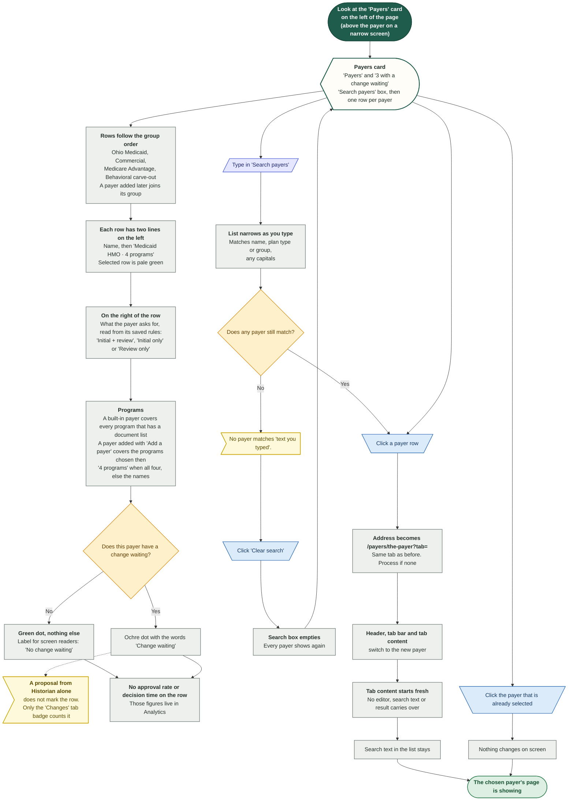

## Payers › Header › What the header says

The card above the tabs. It names the payer, carries one quiet label that says its rules are demo data, and says what a coordinator needs first: plan type, programs, whether an initial request or a continued-stay review is needed, notice and how the payer is reached, and the policy status. Everything is read from the payer and its saved configuration. Approved as asked and typical decision are no longer here: Analytics shows them.

Route: `/payers/:id`

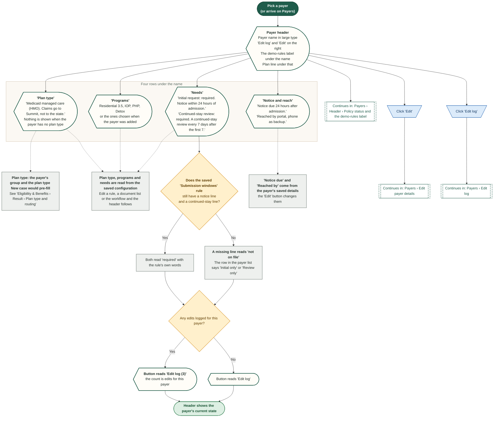

## Payers › Header › Policy status and the demo-rules label

Everything in this demo is sample data, so no rule may look verified by a payer. The header carries one quiet label next to the name, with the explanation in an info tip, and one line called Policy status. The date is the newest entry of the Changes log that a person handled in Psyflo. No verification date is invented, and nothing says a payer confirmed a rule.

Route: `/payers/cardinal`

Demo only: the rules, documents and workflows are invented. In the product a rule would carry a source and a confidence (published, payer-confirmed, observed, staff-reported, unconfirmed).

```mermaid
%%{init: {"theme":"base","themeVariables":{"fontFamily":"'DM Sans', 'Segoe UI', system-ui, sans-serif","fontSize":"15px","lineColor":"#5B6B63","primaryTextColor":"#1C2B25","clusterBkg":"#FBF8F3","clusterBorder":"#D9CDBB","edgeLabelBackground":"#FFFFFF"},"flowchart":{"curve":"basis","nodeSpacing":36,"rankSpacing":48,"padding":12,"htmlLabels":true,"useMaxWidth":false,"wrappingWidth":230}} }%%
flowchart TD
  classDef k_start fill:#1F5C4B,stroke:#174638,color:#FFFFFF,stroke-width:1.5px,font-weight:600
  classDef k_end fill:#DDEFE3,stroke:#2E7D4F,color:#14502F,stroke-width:1.5px,font-weight:600
  classDef k_endx fill:#FBE3E0,stroke:#C0392B,color:#7A1F16,stroke-width:1.5px,font-weight:600
  classDef k_screen fill:#FFFDF8,stroke:#1F5C4B,color:#1C2B25,stroke-width:2px
  classDef k_overlay fill:#F1F7F3,stroke:#1F5C4B,color:#1C2B25,stroke-width:2px,stroke-dasharray:5 3
  classDef k_click fill:#DCEBFA,stroke:#2F6DB5,color:#12365F,stroke-width:1.5px
  classDef k_input fill:#E4E7FF,stroke:#4C5FD5,color:#1D2670,stroke-width:1.5px
  classDef k_process fill:#EEF0EE,stroke:#7A857F,color:#26302B,stroke-width:1.5px
  classDef k_agent fill:#EEE5FA,stroke:#7A4FC2,color:#341A63,stroke-width:1.5px
  classDef k_decision fill:#FFF0CC,stroke:#D9962B,color:#5C3B00,stroke-width:1.5px
  classDef k_store fill:#D5F0EA,stroke:#1C8E7B,color:#0B4A3F,stroke-width:1.5px
  classDef k_doc fill:#F6E9DC,stroke:#B07A4C,color:#4A2E14,stroke-width:1.5px
  classDef k_ext fill:#FFE6D2,stroke:#E07B39,color:#6B2F06,stroke-width:1.5px
  classDef k_wait fill:#E4E8EE,stroke:#6B7C93,color:#26303D,stroke-width:1.5px
  classDef k_toast fill:#FFF9DB,stroke:#C9A400,color:#5A4A00,stroke-width:1.5px
  classDef k_goto fill:#FFFFFF,stroke:#1F5C4B,color:#1F5C4B,stroke-width:1.5px,stroke-dasharray:5 3
  s1@{ shape: stadium, label: "<b>Open a payer</b><br/>On any of the four tabs" }
  lab@{ shape: curv-trap, label: "<b>Label under the name</b><br/>'Demo rules. Not verified against the payer's current policy.'<br/>One label, quiet outline, never a banner" }
  tip@{ shape: trap-t, label: "<b>Hover, focus or click the info icon beside it</b><br/>(button 'About these rules')" }
  tipt@{ shape: win-pane, label: "<b>Info tip opens</b><br/>'Everything on Payers is sample data for this demo.<br/>None of it was read from, or checked against, a payer's current policy.<br/>Where a rule has a source in the data, the Rules tab shows it.'" }
  esc@{ shape: trap-t, label: "Press Escape, move away or click elsewhere" }
  cl@{ shape: rect, label: "<b>Tip closes</b><br/>Only the tip: a pop-up behind it stays" }
  ps@{ shape: curv-trap, label: "<b>Line at the foot of the header</b><br/>'Policy status: ...'" }
  d1@{ shape: diam, label: "Is a change waiting for this payer?" }
  w1@{ shape: rect, label: "'Change waiting for you (Criteria changed, version 2026.3, effective 10/15).'" }
  d2@{ shape: diam, label: "Has a person acknowledged it already?" }
  w2@{ shape: rect, label: "<b>'Change acknowledged, drafts not updated yet (Criteria changed, version 2026.3).'</b><br/>Date: when it was acknowledged" }
  w0@{ shape: rect, label: "'No change waiting.'" }
  d3@{ shape: diam, label: "<b>Does the Changes log have an entry</b><br/>that is not just the notice of a waiting change?" }
  l1@{ shape: rect, label: "<b>'Last acknowledged or applied in Psyflo 10/12.'</b><br/>Date of the newest handled entry, or when a waiting change was acknowledged" }
  l0@{ shape: rect, label: "'Nothing acknowledged or applied in Psyflo yet.'" }
  d4@{ shape: diam, label: "Is it a payer added with 'Add a payer'?" }
  s1t@{ shape: rect, label: "'Source: Psyflo benchmark, not a payer's policy'" }
  s2t@{ shape: rect, label: "'Source: Demo sample rules, version 2026.3'" }
  nov@{ shape: rect, label: "<b>Not shown anywhere on Payers</b><br/>No 'checked' or 'confirmed' date, no 'published policy', no 'Sentinel keeps watching'" }
  rl@{ shape: rect, label: "<b>Rules tab: each rule shows 'saved 10/12'</b><br/>Only a rule edited in Psyflo adds 'Source: Edited in Psyflo by {viewer}' (the person viewing when it was saved; Jordan Perez at the start)" }
  e1@{ shape: stadium, label: "The header says where the rules come from and what is waiting" }
  g1@{ shape: subproc, label: "Continues in: Payers › Changes › Acknowledge a change" }
  g2@{ shape: subproc, label: "Continues in: Payers › Rules › Read the rules" }
  s1 --> lab --> tip --> tipt --> esc --> cl --> e1
  lab --> ps --> d1
  d1 -->|"Yes"| d2
  d2 -->|"Yes"| w2 --> d3
  d2 -->|"No"| w1 --> d3
  d1 -->|"No"| w0 --> d3
  d3 -->|"Yes"| l1 --> d4
  d3 -->|"No"| l0 --> d4
  d4 -->|"Yes"| s1t --> nov
  d4 -->|"No"| s2t --> nov
  nov --> e1
  w1 -.-> g1
  nov -.-> rl --> g2
  class s1 k_start
  class lab,ps k_screen
  class tip,esc k_click
  class tipt k_overlay
  class cl,w1,w2,w0,l1,l0,s1t,s2t,nov,rl k_process
  class d1,d2,d3,d4 k_decision
  class e1 k_end
  class g1,g2 k_goto
```

## Payers › Add a payer

The 'Add a payer' modal. A new payer gets a full starter set (workflow, rules and document lists) and benchmark figures; the agents learn the rest from decisions. Nothing is saved until 'Add payer' passes its four checks, and a name that another payer already has is refused. The new payer is also offered wherever New case picks a payer.

Route: `/payers`

```mermaid
%%{init: {"theme":"base","themeVariables":{"fontFamily":"'DM Sans', 'Segoe UI', system-ui, sans-serif","fontSize":"15px","lineColor":"#5B6B63","primaryTextColor":"#1C2B25","clusterBkg":"#FBF8F3","clusterBorder":"#D9CDBB","edgeLabelBackground":"#FFFFFF"},"flowchart":{"curve":"basis","nodeSpacing":36,"rankSpacing":48,"padding":12,"htmlLabels":true,"useMaxWidth":false,"wrappingWidth":230}} }%%
flowchart TD
  classDef k_start fill:#1F5C4B,stroke:#174638,color:#FFFFFF,stroke-width:1.5px,font-weight:600
  classDef k_end fill:#DDEFE3,stroke:#2E7D4F,color:#14502F,stroke-width:1.5px,font-weight:600
  classDef k_endx fill:#FBE3E0,stroke:#C0392B,color:#7A1F16,stroke-width:1.5px,font-weight:600
  classDef k_screen fill:#FFFDF8,stroke:#1F5C4B,color:#1C2B25,stroke-width:2px
  classDef k_overlay fill:#F1F7F3,stroke:#1F5C4B,color:#1C2B25,stroke-width:2px,stroke-dasharray:5 3
  classDef k_click fill:#DCEBFA,stroke:#2F6DB5,color:#12365F,stroke-width:1.5px
  classDef k_input fill:#E4E7FF,stroke:#4C5FD5,color:#1D2670,stroke-width:1.5px
  classDef k_process fill:#EEF0EE,stroke:#7A857F,color:#26302B,stroke-width:1.5px
  classDef k_agent fill:#EEE5FA,stroke:#7A4FC2,color:#341A63,stroke-width:1.5px
  classDef k_decision fill:#FFF0CC,stroke:#D9962B,color:#5C3B00,stroke-width:1.5px
  classDef k_store fill:#D5F0EA,stroke:#1C8E7B,color:#0B4A3F,stroke-width:1.5px
  classDef k_doc fill:#F6E9DC,stroke:#B07A4C,color:#4A2E14,stroke-width:1.5px
  classDef k_ext fill:#FFE6D2,stroke:#E07B39,color:#6B2F06,stroke-width:1.5px
  classDef k_wait fill:#E4E8EE,stroke:#6B7C93,color:#26303D,stroke-width:1.5px
  classDef k_toast fill:#FFF9DB,stroke:#C9A400,color:#5A4A00,stroke-width:1.5px
  classDef k_goto fill:#FFFFFF,stroke:#1F5C4B,color:#1F5C4B,stroke-width:1.5px,stroke-dasharray:5 3
  s1@{ shape: stadium, label: "<b>Click 'Add a payer'</b><br/>top right of Payers" }
  m@{ shape: win-pane, label: "<b>Add a payer</b><br/>The agents start with a standard workflow<br/>and learn the rest from decisions." }
  subgraph gF ["Fields in the modal"]
  i1@{ shape: lean-r, label: "<b>Type 'Payer name' (required)</b><br/>Example: Riverbend Health" }
  i2@{ shape: lean-r, label: "<b>Pick 'Plan type'</b><br/>Managed care plan, PPO,<br/>Medicare Advantage, Carve-out" }
  i3@{ shape: lean-r, label: "<b>Pick 'Group'</b><br/>Ohio Medicaid, Commercial,<br/>Medicare Advantage, Behavioral carve-out" }
  i4@{ shape: lean-r, label: "<b>Tick 'How it is reached'</b><br/>Portal (ticked), Phone, Fax" }
  i5@{ shape: lean-r, label: "<b>Tick 'Programs it covers'</b><br/>Residential 3.5, IOP, PHP ticked<br/>Detox not ticked" }
  end
  clr@{ shape: rect, label: "Typing or ticking clears any red message" }
  ca@{ shape: trap-t, label: "Click 'Add payer'" }
  v1@{ shape: diam, label: "Is the payer name empty?" }
  v1b@{ shape: diam, label: "<b>Does the name match another payer?</b><br/>Any capitals, extra spaces ignored.<br/>A short name counts: 'Cardinal', 'Beacon'" }
  v2@{ shape: diam, label: "Is no way of reaching ticked?" }
  v3@{ shape: diam, label: "Is no program ticked?" }
  e1@{ shape: odd, label: "<b>Under the name box:</b><br/>'Add the payer's name.'" }
  e1b@{ shape: odd, label: "<b>Under the name box:</b><br/>'There is already a payer called<br/>Beacon PPO. Use a different name.'" }
  e2@{ shape: odd, label: "Choose at least one way to reach the payer." }
  e3@{ shape: odd, label: "Choose at least one program." }
  st@{ shape: cyl, label: "<b>Payer saved with a full starter set</b><br/>Workflow v1 (six steps for how it is reached)<br/>Four rules, document lists for all four levels of care<br/>Figures marked as benchmark estimates" }
  rb@{ shape: rect, label: "<b>'Reached by' is written in a fixed order</b><br/>Portal, phone, fax: 'Portal, phone and fax'<br/>so it is always one of the seven listed values" }
  lg@{ shape: cyl, label: "<b>Edit log gets 'Added a payer'</b><br/>Reason 'Payer added'" }
  tt@{ shape: odd, label: "<b>'Riverbend Health was added'</b><br/>Starter workflow, rules and documents are ready.<br/>Figures are benchmark estimates." }
  nav@{ shape: rect, label: "<b>Modal closes</b><br/>Opens /payers/custom-riverbend-health?tab=process" }
  pg@{ shape: curv-trap, label: "<b>New payer's Process tab</b><br/>Title now counts 7 payers<br/>Row in its group, green dot<br/>Header: plan type, the chosen programs, needs, source 'Psyflo benchmark, not a payer's policy'" }
  other@{ shape: rect, label: "<b>The payer is also saved where other screens read it</b><br/>New case offers it wherever a payer is picked,<br/>and reads its document list and rules like any payer" }
  cx@{ shape: trap-t, label: "Click 'Cancel'" }
  cesc@{ shape: trap-t, label: "<b>Press Escape, click the X</b><br/>or click the dimmed area<br/>Escape with a menu open closes the menu first" }
  x1@{ shape: stadium, label: "<b>Modal closes</b><br/>Nothing was added" }
  e@{ shape: stadium, label: "New payer is ready to edit" }
  g1@{ shape: subproc, label: "Continues in: Payers › Process › Read the workflow" }
  g2@{ shape: subproc, label: "Continues in: Authorizations › New case › Intake › Patient, insurance and request rows" }
  s1 --> m --> i1 --> i2 --> i3 --> i4 --> i5 --> ca
  i1 -.-> clr
  i4 -.-> clr
  ca --> v1
  v1 -->|"Yes"| e1 --> i1
  v1 -->|"No"| v1b
  v1b -->|"Yes"| e1b --> i1
  v1b -->|"No"| v2
  v2 -->|"Yes"| e2 --> i4
  v2 -->|"No"| v3
  v3 -->|"Yes"| e3 --> i5
  v3 -->|"No"| st --> rb --> lg --> tt --> nav --> pg --> g1
  st -.-> other
  other -.-> g2
  pg --> e
  m --> cx --> x1
  m --> cesc --> x1
  class s1 k_start
  class m k_overlay
  class i1,i2,i3,i4,i5 k_input
  class clr,rb,nav,other k_process
  class ca,cx,cesc k_click
  class v1,v1b,v2,v3 k_decision
  class e1,e1b,e2,e3,tt k_toast
  class st,lg k_store
  class pg k_screen
  class x1 k_endx
  class e k_end
  class g1,g2 k_goto
  style gF fill:#FBF8F3,stroke:#D9CDBB,stroke-width:1.5px,color:#5B6B63
```

## Payers › Edit payer details

The 'Edit' button in the header opens one modal for the plan line, how the payer is reached, the notice rule, the backup route and the three 'How to reach' lines. Every edit needs a reason, is written to the edit log and sends a bell notification. Unlike workflow, rule and document edits, it does not wait for 'Update drafts'. 'Reached by' only holds one of the seven listed values.

Route: `/payers/:id`

```mermaid
%%{init: {"theme":"base","themeVariables":{"fontFamily":"'DM Sans', 'Segoe UI', system-ui, sans-serif","fontSize":"15px","lineColor":"#5B6B63","primaryTextColor":"#1C2B25","clusterBkg":"#FBF8F3","clusterBorder":"#D9CDBB","edgeLabelBackground":"#FFFFFF"},"flowchart":{"curve":"basis","nodeSpacing":36,"rankSpacing":48,"padding":12,"htmlLabels":true,"useMaxWidth":false,"wrappingWidth":230}} }%%
flowchart TD
  classDef k_start fill:#1F5C4B,stroke:#174638,color:#FFFFFF,stroke-width:1.5px,font-weight:600
  classDef k_end fill:#DDEFE3,stroke:#2E7D4F,color:#14502F,stroke-width:1.5px,font-weight:600
  classDef k_endx fill:#FBE3E0,stroke:#C0392B,color:#7A1F16,stroke-width:1.5px,font-weight:600
  classDef k_screen fill:#FFFDF8,stroke:#1F5C4B,color:#1C2B25,stroke-width:2px
  classDef k_overlay fill:#F1F7F3,stroke:#1F5C4B,color:#1C2B25,stroke-width:2px,stroke-dasharray:5 3
  classDef k_click fill:#DCEBFA,stroke:#2F6DB5,color:#12365F,stroke-width:1.5px
  classDef k_input fill:#E4E7FF,stroke:#4C5FD5,color:#1D2670,stroke-width:1.5px
  classDef k_process fill:#EEF0EE,stroke:#7A857F,color:#26302B,stroke-width:1.5px
  classDef k_agent fill:#EEE5FA,stroke:#7A4FC2,color:#341A63,stroke-width:1.5px
  classDef k_decision fill:#FFF0CC,stroke:#D9962B,color:#5C3B00,stroke-width:1.5px
  classDef k_store fill:#D5F0EA,stroke:#1C8E7B,color:#0B4A3F,stroke-width:1.5px
  classDef k_doc fill:#F6E9DC,stroke:#B07A4C,color:#4A2E14,stroke-width:1.5px
  classDef k_ext fill:#FFE6D2,stroke:#E07B39,color:#6B2F06,stroke-width:1.5px
  classDef k_wait fill:#E4E8EE,stroke:#6B7C93,color:#26303D,stroke-width:1.5px
  classDef k_toast fill:#FFF9DB,stroke:#C9A400,color:#5A4A00,stroke-width:1.5px
  classDef k_goto fill:#FFFFFF,stroke:#1F5C4B,color:#1F5C4B,stroke-width:1.5px,stroke-dasharray:5 3
  s1@{ shape: stadium, label: "<b>Click 'Edit'</b><br/>in the payer header" }
  m@{ shape: win-pane, label: "<b>Edit payer details</b><br/>Admins can edit. Every edit is logged." }
  subgraph gF ["Fields"]
  i1@{ shape: lean-r, label: "Type 'Plan line'" }
  i2@{ shape: lean-r, label: "<b>Pick 'Reached by'</b><br/>Portal, Phone, Fax, Portal and phone,<br/>Portal and fax, Phone and fax,<br/>Portal, phone and fax" }
  i3@{ shape: lean-r, label: "<b>Type 'Notice due'</b><br/>Example: 24 hours" }
  i4@{ shape: lean-r, label: "<b>Type 'Backup route'</b><br/>Example: phone as backup" }
  i5@{ shape: lean-r, label: "<b>Type the 'Portal', 'Phone' and 'Fax' lines</b><br/>They feed 'How to reach' on the Process tab" }
  i6@{ shape: lean-r, label: "<b>Type 'Reason for the edit' (required)</b><br/>Saved with your name, the time,<br/>the old text and the new text" }
  end
  dv@{ shape: diam, label: "Is the saved 'Reached by' one of the seven?" }
  okv@{ shape: rect, label: "<b>The menu shows the saved value</b><br/>A payer added with Portal, Phone and Fax<br/>reads 'Portal, phone and fax', not 'Portal'" }
  ev@{ shape: odd, label: "<b>Menu is empty ('Pick how it is reached')</b><br/>Red line under it names the old value, then:<br/>'is not one of the listed ways.<br/>Pick one from the list.'" }
  dk@{ shape: diam, label: "Is 'Reached by' one of the seven?" }
  blk@{ shape: rect, label: "<b>Save does nothing</b><br/>The red line stays until a listed value is picked" }
  cs@{ shape: trap-t, label: "Click 'Save and log the edit'" }
  d1@{ shape: diam, label: "Is the reason empty?" }
  er@{ shape: odd, label: "Add a reason. It goes in the edit log." }
  diff@{ shape: rect, label: "<b>Compare each field with what is saved</b><br/>Plan line, Reached by, Notice due, Backup route,<br/>and each 'How to reach' line" }
  d2@{ shape: diam, label: "Did anything change?" }
  t0@{ shape: odd, label: "'Nothing changed'" }
  st@{ shape: cyl, label: "<b>Payer details saved</b><br/>Header, plan line and 'How to reach' update<br/>A payer added with 'Add a payer' keeps its<br/>entry for other screens in step" }
  lg@{ shape: cyl, label: "<b>One edit log entry per changed field</b><br/>Area 'Payer details', with before, after and reason" }
  nt@{ shape: cyl, label: "<b>Bell notification 'Evergreen details edited'</b><br/>opens the payer's Process tab" }
  t1@{ shape: odd, label: "<b>'Payer details saved'</b><br/>The edit is in the log with your reason." }
  nb@{ shape: rect, label: "<b>No 'edit applies to new drafts only' banner</b><br/>Payer details are not part of a draft" }
  e1@{ shape: stadium, label: "<b>Modal closes</b><br/>Header shows the new values" }
  x1@{ shape: stadium, label: "<b>Modal closes</b><br/>Nothing saved" }
  cx@{ shape: trap-t, label: "Click 'Cancel'" }
  cesc@{ shape: trap-t, label: "<b>Press Escape, click the X</b><br/>or click the dimmed area<br/>Escape with the 'Reached by' menu open closes the menu first" }
  g1@{ shape: subproc, label: "Continues in: Payers › Edit log" }
  g2@{ shape: subproc, label: "Continues in: Payers › Process › Reach and Caller instructions" }
  s1 --> m --> dv
  dv -->|"Yes"| okv --> i1
  dv -->|"No, an old value"| ev --> i1
  i1 --> i2 --> i3 --> i4 --> i5 --> i6 --> cs --> dk
  dk -->|"No"| blk --> i2
  dk -->|"Yes"| d1
  d1 -->|"Yes"| er --> i6
  d1 -->|"No"| diff --> d2
  d2 -->|"No"| t0 --> x1
  d2 -->|"Yes"| st --> lg --> nt --> t1 --> nb --> e1
  lg -.-> g1
  i5 -.-> g2
  m --> cx --> x1
  m --> cesc --> x1
  class s1 k_start
  class m k_overlay
  class i1,i2,i3,i4,i5,i6 k_input
  class dv,dk,d1,d2 k_decision
  class okv,blk,diff,nb k_process
  class ev,er,t0,t1 k_toast
  class cs,cx,cesc k_click
  class st,lg,nt k_store
  class e1 k_end
  class x1 k_endx
  class g1,g2 k_goto
  style gF fill:#FBF8F3,stroke:#D9CDBB,stroke-width:1.5px,color:#5B6B63
```

## Payers › Process › Read the workflow

The Process tab shows how an authorization works with one payer: numbered steps in order, with the condition drawn next to the step it leads to. The step-type key and the note about edits sit behind an info icon. How the payer is reached and the script for Caller are folded into one closed section. A banner shows only when edits or proposals wait.

Route: `/payers/summit?tab=process`

```mermaid
%%{init: {"theme":"base","themeVariables":{"fontFamily":"'DM Sans', 'Segoe UI', system-ui, sans-serif","fontSize":"15px","lineColor":"#5B6B63","primaryTextColor":"#1C2B25","clusterBkg":"#FBF8F3","clusterBorder":"#D9CDBB","edgeLabelBackground":"#FFFFFF"},"flowchart":{"curve":"basis","nodeSpacing":36,"rankSpacing":48,"padding":12,"htmlLabels":true,"useMaxWidth":false,"wrappingWidth":230}} }%%
flowchart TD
  classDef k_start fill:#1F5C4B,stroke:#174638,color:#FFFFFF,stroke-width:1.5px,font-weight:600
  classDef k_end fill:#DDEFE3,stroke:#2E7D4F,color:#14502F,stroke-width:1.5px,font-weight:600
  classDef k_endx fill:#FBE3E0,stroke:#C0392B,color:#7A1F16,stroke-width:1.5px,font-weight:600
  classDef k_screen fill:#FFFDF8,stroke:#1F5C4B,color:#1C2B25,stroke-width:2px
  classDef k_overlay fill:#F1F7F3,stroke:#1F5C4B,color:#1C2B25,stroke-width:2px,stroke-dasharray:5 3
  classDef k_click fill:#DCEBFA,stroke:#2F6DB5,color:#12365F,stroke-width:1.5px
  classDef k_input fill:#E4E7FF,stroke:#4C5FD5,color:#1D2670,stroke-width:1.5px
  classDef k_process fill:#EEF0EE,stroke:#7A857F,color:#26302B,stroke-width:1.5px
  classDef k_agent fill:#EEE5FA,stroke:#7A4FC2,color:#341A63,stroke-width:1.5px
  classDef k_decision fill:#FFF0CC,stroke:#D9962B,color:#5C3B00,stroke-width:1.5px
  classDef k_store fill:#D5F0EA,stroke:#1C8E7B,color:#0B4A3F,stroke-width:1.5px
  classDef k_doc fill:#F6E9DC,stroke:#B07A4C,color:#4A2E14,stroke-width:1.5px
  classDef k_ext fill:#FFE6D2,stroke:#E07B39,color:#6B2F06,stroke-width:1.5px
  classDef k_wait fill:#E4E8EE,stroke:#6B7C93,color:#26303D,stroke-width:1.5px
  classDef k_toast fill:#FFF9DB,stroke:#C9A400,color:#5A4A00,stroke-width:1.5px
  classDef k_goto fill:#FFFFFF,stroke:#1F5C4B,color:#1F5C4B,stroke-width:1.5px,stroke-dasharray:5 3
  s1@{ shape: stadium, label: "<b>Click the 'Process' tab</b><br/>(the tab shown when none is named)" }
  tab@{ shape: curv-trap, label: "<b>Process tab</b><br/>Banners, workflow card, one closed section" }
  subgraph gB ["Banners at the top (only when they apply)"]
  dU@{ shape: diam, label: "<b>Edits saved but</b><br/>not yet applied to open drafts?" }
  bU@{ shape: odd, label: "<b>'1 edit applies to new drafts only'</b><br/>New drafts for Summit use this at once.<br/>Sent requests keep what they were sent with.<br/>Click Update drafts to redraft the open ones (R-1042, R-1101)." }
  dP@{ shape: diam, label: "Did Historian propose changes?" }
  bP@{ shape: odd, label: "<b>'Historian proposed 1 change'</b><br/>It never edits the workflow on its own.<br/>'Review in Changes'" }
  end
  card@{ shape: curv-trap, label: "<b>Workflow card</b><br/>'How an authorization works with Summit' with an info icon<br/>'Version 7, edited 10/12.'<br/>'Edit workflow' and 'Re-learn from decisions'" }
  cTip@{ shape: trap-t, label: "<b>Hover, focus or click the info icon</b><br/>(button 'About this workflow')" }
  tip@{ shape: win-pane, label: "<b>Info tip</b><br/>The workflow in order, where the path splits<br/>The key: Checklist step, File step, Portal step, Phone step, Condition<br/>'Admins can edit; every edit is logged. New drafts use a saved edit at once.<br/>Sent requests keep what they were sent with. Click Update drafts to redraft open ones.'<br/>Escape closes it" }
  subgraph gS ["One numbered step"]
  st@{ shape: curv-trap, label: "<b>Number, step title, step-type chip, agent chips</b><br/>For example: 'Give notice'  Portal step  Navigator" }
  stx@{ shape: rect, label: "<b>Plain sentence on what happens</b><br/>and a 'Typical' time on the right<br/>'same day', '2 minutes', '1.5 days'" }
  dc@{ shape: diam, label: "Does the step have conditions?" }
  br@{ shape: curv-trap, label: "<b>Condition rows under the step</b><br/>'If portal is down' leads to<br/>'Phone step' and what happens" }
  end
  six@{ shape: rect, label: "<b>Summit's six steps: Check coverage,</b><br/>Gather the documents, Give notice,<br/>Send the request, Follow up,<br/>Decision and next review" }
  diff@{ shape: rect, label: "<b>Other payers differ in how they are reached</b><br/>Evergreen: phone steps<br/>Lakeshore: file steps by fax<br/>Harborview: portal with fax for large files" }
  two@{ shape: curv-trap, label: "<b>Closed section</b><br/>'How to reach Summit and what Caller says'<br/>'Reached by portal, phone as backup. Caller script saved 10/12.'<br/>Opens to 'How to reach Summit' and 'Instructions for Caller' side by side" }
  cE@{ shape: trap-t, label: "Click 'Edit workflow'" }
  cR@{ shape: trap-t, label: "Click 'Re-learn from decisions'" }
  cRev@{ shape: trap-t, label: "Click 'Review in Changes'" }
  cUp@{ shape: trap-t, label: "Click 'Update 2 drafts'" }
  g_ed@{ shape: subproc, label: "Continues in: Payers › Process › Edit the workflow" }
  g_rl@{ shape: subproc, label: "Continues in: Payers › Process › Re-learn from decisions" }
  g_ch@{ shape: subproc, label: "Continues in: Payers › Changes › Read what changed" }
  g_up@{ shape: subproc, label: "Continues in: Payers › Edits waiting › Update drafts" }
  g_rc@{ shape: subproc, label: "Continues in: Payers › Process › Reach and Caller instructions" }
  s1 --> tab --> dU
  dU -->|"Yes"| bU --> dP
  dU -->|"No"| dP
  dP -->|"Yes"| bP --> card
  dP -->|"No"| card
  card --> st --> stx --> dc
  card -.-> cTip --> tip
  dc -->|"Yes"| br
  dc -->|"No"| six
  br --> six
  six -.-> diff
  six --> two
  card --> cE --> g_ed
  card --> cR --> g_rl
  bP --> cRev --> g_ch
  bU --> cUp --> g_up
  two -.-> g_rc
  class s1 k_start
  class tab,card,st,br,two k_screen
  class dU,dP,dc k_decision
  class bU,bP k_toast
  class cTip,cE,cR,cRev,cUp k_click
  class tip k_overlay
  class stx,six,diff k_process
  class g_ed,g_rl,g_ch,g_up,g_rc k_goto
  style gB fill:#FBF8F3,stroke:#D9CDBB,stroke-width:1.5px,color:#5B6B63
  style gS fill:#FBF8F3,stroke:#D9CDBB,stroke-width:1.5px,color:#5B6B63
```

## Payers › Process › Reach and Caller instructions

The closed section under the workflow, 'How to reach Summit and what Caller says'. Opened, it shows 'How to reach' (read only here; its three lines are edited from the header's 'Edit' button) and 'Instructions for Caller' (the script every Phone step follows, with its own 'Edit').

Route: `/payers/summit?tab=process`

```mermaid
%%{init: {"theme":"base","themeVariables":{"fontFamily":"'DM Sans', 'Segoe UI', system-ui, sans-serif","fontSize":"15px","lineColor":"#5B6B63","primaryTextColor":"#1C2B25","clusterBkg":"#FBF8F3","clusterBorder":"#D9CDBB","edgeLabelBackground":"#FFFFFF"},"flowchart":{"curve":"basis","nodeSpacing":36,"rankSpacing":48,"padding":12,"htmlLabels":true,"useMaxWidth":false,"wrappingWidth":230}} }%%
flowchart TD
  classDef k_start fill:#1F5C4B,stroke:#174638,color:#FFFFFF,stroke-width:1.5px,font-weight:600
  classDef k_end fill:#DDEFE3,stroke:#2E7D4F,color:#14502F,stroke-width:1.5px,font-weight:600
  classDef k_endx fill:#FBE3E0,stroke:#C0392B,color:#7A1F16,stroke-width:1.5px,font-weight:600
  classDef k_screen fill:#FFFDF8,stroke:#1F5C4B,color:#1C2B25,stroke-width:2px
  classDef k_overlay fill:#F1F7F3,stroke:#1F5C4B,color:#1C2B25,stroke-width:2px,stroke-dasharray:5 3
  classDef k_click fill:#DCEBFA,stroke:#2F6DB5,color:#12365F,stroke-width:1.5px
  classDef k_input fill:#E4E7FF,stroke:#4C5FD5,color:#1D2670,stroke-width:1.5px
  classDef k_process fill:#EEF0EE,stroke:#7A857F,color:#26302B,stroke-width:1.5px
  classDef k_agent fill:#EEE5FA,stroke:#7A4FC2,color:#341A63,stroke-width:1.5px
  classDef k_decision fill:#FFF0CC,stroke:#D9962B,color:#5C3B00,stroke-width:1.5px
  classDef k_store fill:#D5F0EA,stroke:#1C8E7B,color:#0B4A3F,stroke-width:1.5px
  classDef k_doc fill:#F6E9DC,stroke:#B07A4C,color:#4A2E14,stroke-width:1.5px
  classDef k_ext fill:#FFE6D2,stroke:#E07B39,color:#6B2F06,stroke-width:1.5px
  classDef k_wait fill:#E4E8EE,stroke:#6B7C93,color:#26303D,stroke-width:1.5px
  classDef k_toast fill:#FFF9DB,stroke:#C9A400,color:#5A4A00,stroke-width:1.5px
  classDef k_goto fill:#FFFFFF,stroke:#1F5C4B,color:#1F5C4B,stroke-width:1.5px,stroke-dasharray:5 3
  s1@{ shape: stadium, label: "<b>Scroll below the workflow card</b><br/>on the Process tab" }
  op@{ shape: trap-t, label: "<b>Click the closed section</b><br/>'How to reach Summit and what Caller says'<br/>It is a button; Enter or Space also open it" }
  opn@{ shape: rect, label: "<b>Section opens</b><br/>Click again to close it<br/>It starts closed every time the tab opens" }
  rc@{ shape: curv-trap, label: "<b>'How to reach Summit'</b><br/>Three rows: Portal, Phone, Fax" }
  rows@{ shape: rect, label: "<b>Each row has an icon, a title and a line</b><br/>Portal: Provider portal, sign-in saved by Navigator<br/>Phone: Provider line, weekdays 8 am to 6 pm<br/>Fax: Not used" }
  ro@{ shape: odd, label: "<b>No edit button on this part</b><br/>Change the lines with 'Edit' in the header" }
  cc@{ shape: curv-trap, label: "<b>'Instructions for Caller'</b><br/>The script in a tinted box<br/>'Used by the Phone steps. Saved 10/12.'" }
  script@{ shape: rect, label: "<b>Script: ask for the provider line, give member ID and date of birth,</b><br/>ask if the request arrived, never agree to a change,<br/>log the call" }
  ce@{ shape: trap-t, label: "<b>Click 'Edit'</b><br/>on the Caller card" }
  m@{ shape: win-pane, label: "<b>Edit the instructions for Caller</b><br/>Caller follows this on every Phone step and never agrees to a change." }
  i1@{ shape: lean-r, label: "<b>Type in 'Script'</b><br/>The box starts with the saved script" }
  i2@{ shape: lean-r, label: "Type 'Reason for the edit' (required)" }
  cs@{ shape: trap-t, label: "Click 'Save and log the edit'" }
  d1@{ shape: diam, label: "Is the reason empty?" }
  er@{ shape: odd, label: "Add a reason. It goes in the edit log." }
  d2@{ shape: diam, label: "Is the script the same as the saved one?" }
  t0@{ shape: odd, label: "'Nothing changed'" }
  gap@{ shape: rect, label: "<b>Demo gap: a blank script is accepted</b><br/>Phone steps would then have no instructions" }
  st@{ shape: cyl, label: "<b>Script saved</b><br/>'Saved' date becomes today" }
  lg@{ shape: cyl, label: "<b>Edit log entry</b><br/>Area 'Caller instructions'<br/>'Instructions for Caller', before and after" }
  nt@{ shape: cyl, label: "<b>Bell notification</b><br/>'Summit caller instructions edited'<br/>opens the payer's Process tab" }
  t1@{ shape: odd, label: "<b>'Instructions for Caller saved'</b><br/>Caller follows them on its next call.<br/>The edit is logged." }
  nb@{ shape: rect, label: "<b>No 'edit applies to new drafts only' banner</b><br/>The script is used on the next call, not by drafts" }
  e1@{ shape: stadium, label: "Card shows the new script" }
  cx@{ shape: trap-t, label: "Click 'Cancel'" }
  cesc@{ shape: trap-t, label: "<b>Press Escape, click the X</b><br/>or click the dimmed area" }
  x1@{ shape: stadium, label: "<b>Modal closes</b><br/>Nothing saved, typed text discarded<br/>Reopening starts from the saved script" }
  g1@{ shape: subproc, label: "Continues in: Payers › Edit payer details" }
  g2@{ shape: subproc, label: "Continues in: Payers › Edit log" }
  s1 --> op --> opn --> rc --> rows --> ro
  ro -.-> g1
  opn --> cc --> script --> ce --> m --> i1 --> i2 --> cs --> d1
  d1 -->|"Yes"| er --> i2
  d1 -->|"No"| d2
  d2 -->|"Yes"| t0 --> x1
  d2 -->|"No"| st --> lg --> nt --> t1 --> nb --> e1
  i1 -.-> gap
  lg -.-> g2
  m --> cx --> x1
  m --> cesc --> x1
  class s1 k_start
  class op,ce,cs,cx,cesc k_click
  class opn,rows,script,gap,nb k_process
  class rc,cc k_screen
  class ro,er,t0,t1 k_toast
  class m k_overlay
  class i1,i2 k_input
  class d1,d2 k_decision
  class st,lg,nt k_store
  class e1 k_end
  class x1 k_endx
  class g1,g2 k_goto
```

## Payers › Process › Edit the workflow

'Edit workflow' opens a wide drawer with one card per step. Changes are held in the drawer and counted at the bottom; nothing reaches the payer's workflow until 'Save workflow' (next diagram). Conditions have their own diagram.

Route: `/payers/summit?tab=process`

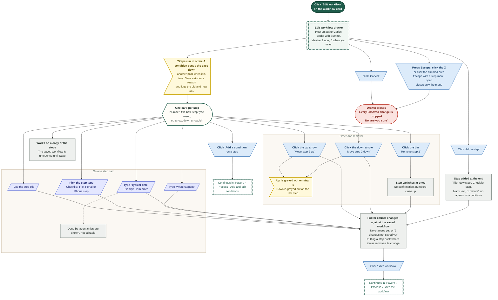

## Payers › Process › Add and edit conditions

A condition sends a case down another path when it is true. Each condition has four parts: what is tested, the value, the kind of step it leads to, and what happens. The sentence shown on the workflow card is built from the first two.

Route: `/payers/summit?tab=process`


## Payers › Process › Save the workflow

'Save workflow' asks for a reason, then makes the edited steps the payer's next version. New drafts use the new version at once; sent requests keep what they were sent with; open drafts wait for 'Update drafts'. Escape closes one pop-up at a time, so it never throws away the editor's edits by accident. There is no undo: a change is reversed by editing again, and the edit log keeps the old text.

Route: `/payers/summit?tab=process`

```mermaid
%%{init: {"theme":"base","themeVariables":{"fontFamily":"'DM Sans', 'Segoe UI', system-ui, sans-serif","fontSize":"15px","lineColor":"#5B6B63","primaryTextColor":"#1C2B25","clusterBkg":"#FBF8F3","clusterBorder":"#D9CDBB","edgeLabelBackground":"#FFFFFF"},"flowchart":{"curve":"basis","nodeSpacing":36,"rankSpacing":48,"padding":12,"htmlLabels":true,"useMaxWidth":false,"wrappingWidth":230}} }%%
flowchart TD
  classDef k_start fill:#1F5C4B,stroke:#174638,color:#FFFFFF,stroke-width:1.5px,font-weight:600
  classDef k_end fill:#DDEFE3,stroke:#2E7D4F,color:#14502F,stroke-width:1.5px,font-weight:600
  classDef k_endx fill:#FBE3E0,stroke:#C0392B,color:#7A1F16,stroke-width:1.5px,font-weight:600
  classDef k_screen fill:#FFFDF8,stroke:#1F5C4B,color:#1C2B25,stroke-width:2px
  classDef k_overlay fill:#F1F7F3,stroke:#1F5C4B,color:#1C2B25,stroke-width:2px,stroke-dasharray:5 3
  classDef k_click fill:#DCEBFA,stroke:#2F6DB5,color:#12365F,stroke-width:1.5px
  classDef k_input fill:#E4E7FF,stroke:#4C5FD5,color:#1D2670,stroke-width:1.5px
  classDef k_process fill:#EEF0EE,stroke:#7A857F,color:#26302B,stroke-width:1.5px
  classDef k_agent fill:#EEE5FA,stroke:#7A4FC2,color:#341A63,stroke-width:1.5px
  classDef k_decision fill:#FFF0CC,stroke:#D9962B,color:#5C3B00,stroke-width:1.5px
  classDef k_store fill:#D5F0EA,stroke:#1C8E7B,color:#0B4A3F,stroke-width:1.5px
  classDef k_doc fill:#F6E9DC,stroke:#B07A4C,color:#4A2E14,stroke-width:1.5px
  classDef k_ext fill:#FFE6D2,stroke:#E07B39,color:#6B2F06,stroke-width:1.5px
  classDef k_wait fill:#E4E8EE,stroke:#6B7C93,color:#26303D,stroke-width:1.5px
  classDef k_toast fill:#FFF9DB,stroke:#C9A400,color:#5A4A00,stroke-width:1.5px
  classDef k_goto fill:#FFFFFF,stroke:#1F5C4B,color:#1F5C4B,stroke-width:1.5px,stroke-dasharray:5 3
  s1@{ shape: stadium, label: "<b>In the 'Edit workflow' drawer,</b><br/>click 'Save workflow'" }
  d1@{ shape: diam, label: "<b>Is there at least one change</b><br/>against the saved workflow?" }
  t0@{ shape: odd, label: "<b>'Nothing to save'</b><br/>Change a step or a condition first." }
  m@{ shape: win-pane, label: "<b>Save the workflow?</b><br/>This becomes version 8. New drafts use it at once.<br/>Sent requests keep what they were sent with.<br/>Click Update drafts to redraft open ones." }
  lst@{ shape: rect, label: "<b>List of changes, one line each</b><br/>Example: Step 1, 'Check coverage': title<br/>Added step, Removed step, Step order,<br/>added, changed or removed a condition" }
  i1@{ shape: lean-r, label: "<b>Type 'Reason for the edit' (required)</b><br/>Example: Summit confirmed the new window on a call" }
  cs@{ shape: trap-t, label: "Click 'Save and log the edit'" }
  d2@{ shape: diam, label: "Is the reason empty?" }
  er@{ shape: odd, label: "Add a reason. It goes in the edit log." }
  v@{ shape: cyl, label: "<b>Workflow replaced</b><br/>Version 7 becomes 8, 'edited' date is today" }
  lg@{ shape: cyl, label: "<b>One edit log entry per change</b><br/>Area 'Workflow', with before, after and reason" }
  un@{ shape: cyl, label: "'Edits waiting' count goes up by one" }
  nt@{ shape: cyl, label: "<b>Bell notification 'Summit workflow edited'</b><br/>Saved version 8, changes logged,<br/>opens the payer's Process tab" }
  t1@{ shape: odd, label: "<b>'Workflow saved as version 8'</b><br/>2 changes logged. New drafts use it at once.<br/>Click Update drafts to redraft open ones." }
  cl@{ shape: rect, label: "Reason modal and drawer both close" }
  pg@{ shape: curv-trap, label: "<b>Process tab</b><br/>'Version 8, edited 10/20'<br/>Banner '1 edit applies to new drafts only'" }
  g1@{ shape: subproc, label: "Continues in: Payers › Edits waiting › Update drafts" }
  g2@{ shape: subproc, label: "Continues in: Payers › Edit log" }
  cx@{ shape: trap-t, label: "Click 'Cancel' on the reason modal" }
  cesc1@{ shape: trap-t, label: "<b>Press Escape, click the X or</b><br/>the dimmed area of the reason modal" }
  back@{ shape: rect, label: "<b>Only the reason modal closes</b><br/>Drawer stays open with every edit still in it" }
  cesc2@{ shape: trap-t, label: "<b>Press Escape again, or Cancel, the X</b><br/>or the dimmed area of the drawer" }
  both@{ shape: rect, label: "<b>Drawer closes</b><br/>Every unsaved edit is lost<br/>No 'are you sure'" }
  x1@{ shape: stadium, label: "<b>Back on the Process tab</b><br/>Workflow unchanged" }
  e1@{ shape: stadium, label: "New version is live for new drafts" }
  undo@{ shape: rect, label: "<b>No undo button anywhere</b><br/>To go back, edit again.<br/>Edit log keeps the before text of every change" }
  s1 --> d1
  d1 -->|"No"| t0 --> s1
  d1 -->|"Yes"| m --> lst --> i1 --> cs --> d2
  d2 -->|"Yes"| er --> i1
  d2 -->|"No"| v --> lg --> un --> nt --> t1 --> cl --> pg --> e1
  lg -.-> g2
  pg -.-> g1
  m --> cx --> back
  m --> cesc1 --> back
  back -.-> m
  back --> cesc2 --> both --> x1
  e1 -.-> undo
  class s1 k_start
  class d1,d2 k_decision
  class t0,er,t1 k_toast
  class m k_overlay
  class lst,cl,back,both,undo k_process
  class i1 k_input
  class cs,cx,cesc1,cesc2 k_click
  class v,lg,un,nt k_store
  class pg k_screen
  class g1,g2 k_goto
  class x1 k_endx
  class e1 k_end
```

## Payers › Process › Re-learn from decisions

Historian looks at how the payer has ruled over the last 90 days and may propose one more condition for the workflow. It never edits the workflow itself. A person accepts or dismisses the proposal on the Changes tab.

Route: `/payers/summit?tab=process`

```mermaid
%%{init: {"theme":"base","themeVariables":{"fontFamily":"'DM Sans', 'Segoe UI', system-ui, sans-serif","fontSize":"15px","lineColor":"#5B6B63","primaryTextColor":"#1C2B25","clusterBkg":"#FBF8F3","clusterBorder":"#D9CDBB","edgeLabelBackground":"#FFFFFF"},"flowchart":{"curve":"basis","nodeSpacing":36,"rankSpacing":48,"padding":12,"htmlLabels":true,"useMaxWidth":false,"wrappingWidth":230}} }%%
flowchart TD
  classDef k_start fill:#1F5C4B,stroke:#174638,color:#FFFFFF,stroke-width:1.5px,font-weight:600
  classDef k_end fill:#DDEFE3,stroke:#2E7D4F,color:#14502F,stroke-width:1.5px,font-weight:600
  classDef k_endx fill:#FBE3E0,stroke:#C0392B,color:#7A1F16,stroke-width:1.5px,font-weight:600
  classDef k_screen fill:#FFFDF8,stroke:#1F5C4B,color:#1C2B25,stroke-width:2px
  classDef k_overlay fill:#F1F7F3,stroke:#1F5C4B,color:#1C2B25,stroke-width:2px,stroke-dasharray:5 3
  classDef k_click fill:#DCEBFA,stroke:#2F6DB5,color:#12365F,stroke-width:1.5px
  classDef k_input fill:#E4E7FF,stroke:#4C5FD5,color:#1D2670,stroke-width:1.5px
  classDef k_process fill:#EEF0EE,stroke:#7A857F,color:#26302B,stroke-width:1.5px
  classDef k_agent fill:#EEE5FA,stroke:#7A4FC2,color:#341A63,stroke-width:1.5px
  classDef k_decision fill:#FFF0CC,stroke:#D9962B,color:#5C3B00,stroke-width:1.5px
  classDef k_store fill:#D5F0EA,stroke:#1C8E7B,color:#0B4A3F,stroke-width:1.5px
  classDef k_doc fill:#F6E9DC,stroke:#B07A4C,color:#4A2E14,stroke-width:1.5px
  classDef k_ext fill:#FFE6D2,stroke:#E07B39,color:#6B2F06,stroke-width:1.5px
  classDef k_wait fill:#E4E8EE,stroke:#6B7C93,color:#26303D,stroke-width:1.5px
  classDef k_toast fill:#FFF9DB,stroke:#C9A400,color:#5A4A00,stroke-width:1.5px
  classDef k_goto fill:#FFFFFF,stroke:#1F5C4B,color:#1F5C4B,stroke-width:1.5px,stroke-dasharray:5 3
  s1@{ shape: stadium, label: "<b>Click 'Re-learn from decisions'</b><br/>on the workflow card" }
  busy@{ shape: rect, label: "Button shows a spinner" }
  st@{ shape: odd, label: "<b>Historian is reviewing how Summit</b><br/>ruled over the last 90 days." }
  h1@{ shape: hex, label: "<b>Historian reviews the last 90 days</b><br/>(demo: about 3 seconds, scripted)" }
  lv@{ shape: diam, label: "<b>Is the person still on Payers</b><br/>when the 3 seconds end?" }
  dropped@{ shape: stadium, label: "<b>Result dropped</b><br/>No toast, no proposal" }
  nx@{ shape: diam, label: "<b>Is there a proposal not yet in</b><br/>the workflow, the proposals or the dismissed list?" }
  tn@{ shape: odd, label: "<b>'Nothing new to propose'</b><br/>The workflow already matches how Summit ruled in the last 90 days." }
  pr@{ shape: cyl, label: "Proposal added to the payer" }
  tp@{ shape: odd, label: "<b>'Historian has a proposal'</b><br/>Review it on the Changes tab. The workflow has not changed." }
  bn@{ shape: curv-trap, label: "<b>Process tab banner</b><br/>'Historian proposed 1 change'<br/>It never edits the workflow on its own." }
  badge@{ shape: rect, label: "<b>'Changes' tab badge goes up by one</b><br/>List dot and sidebar badge do not change" }
  rv@{ shape: trap-t, label: "Click 'Review in Changes'" }
  cp@{ shape: curv-trap, label: "<b>Changes tab, proposal card</b><br/>Historian chip: 'Proposal: Ask for a therapy note on continued stays'<br/>Under 'Gather the documents': If request is a continued-stay request, File step" }
  ca@{ shape: trap-t, label: "Click 'Accept proposal'" }
  cd@{ shape: trap-t, label: "Click 'Dismiss'" }
  ac@{ shape: cyl, label: "<b>Condition added under that step</b><br/>Workflow becomes the next version<br/>Proposal removed" }
  lg@{ shape: cyl, label: "<b>Edit log entry, area 'Workflow'</b><br/>Reason 'Accepted Historian's proposal: ...'" }
  un@{ shape: cyl, label: "'Edits waiting' count goes up by one" }
  nt@{ shape: cyl, label: "<b>Bell notification 'Summit workflow edited'</b><br/>Historian's proposal was accepted, saved as a new version" }
  ta@{ shape: odd, label: "<b>'Proposal accepted'</b><br/>Added under 'Gather the documents' and logged as version 8." }
  dm@{ shape: cyl, label: "<b>Proposal removed and remembered as dismissed</b><br/>Historian will not offer it again" }
  td@{ shape: odd, label: "<b>'Proposal dismissed'</b><br/>The workflow did not change." }
  nr@{ shape: rect, label: "<b>No reason asked, no confirmation</b><br/>No way to bring a dismissed proposal back" }
  e1@{ shape: stadium, label: "<b>Run 'Re-learn' again for the next proposal</b><br/>Summit has two; Beacon has none left to offer" }
  g1@{ shape: subproc, label: "Continues in: Payers › Edits waiting › Update drafts" }
  g2@{ shape: subproc, label: "Continues in: Payers › Edit log" }
  s1 --> busy --> st --> h1 --> lv
  lv -->|"No"| dropped
  lv -->|"Yes"| nx
  nx -->|"No"| tn --> e1
  nx -->|"Yes"| pr --> tp --> bn --> badge
  bn --> rv --> cp
  cp --> ca --> ac --> lg --> un --> nt --> ta --> g1
  lg -.-> g2
  cp --> cd --> dm --> td --> e1
  ca -.-> nr
  cd -.-> nr
  ta --> e1
  class s1 k_start
  class busy,badge,nr k_process
  class st,tn,tp,ta,td k_toast
  class h1 k_agent
  class lv,nx k_decision
  class dropped k_endx
  class pr,ac,lg,un,nt,dm k_store
  class bn,cp k_screen
  class rv,ca,cd k_click
  class e1 k_end
  class g1,g2 k_goto
```

## Payers › Edits waiting › Update drafts

After a workflow, rule or document-list edit is saved, new drafts use it at once, sent requests keep what they were sent with, and open drafts wait. An ochre banner on the Process, Rules and Documents tabs offers 'Update drafts'. A confirm step lists the payer's unsent drafts, two agents redraft for about three seconds, and each draft goes back for a new signature. Which drafts are open is read live from the Dashboard requests and the saved New case drafts.

Route: `/payers/summit?tab=process`

```mermaid
%%{init: {"theme":"base","themeVariables":{"fontFamily":"'DM Sans', 'Segoe UI', system-ui, sans-serif","fontSize":"15px","lineColor":"#5B6B63","primaryTextColor":"#1C2B25","clusterBkg":"#FBF8F3","clusterBorder":"#D9CDBB","edgeLabelBackground":"#FFFFFF"},"flowchart":{"curve":"basis","nodeSpacing":36,"rankSpacing":48,"padding":12,"htmlLabels":true,"useMaxWidth":false,"wrappingWidth":230}} }%%
flowchart TD
  classDef k_start fill:#1F5C4B,stroke:#174638,color:#FFFFFF,stroke-width:1.5px,font-weight:600
  classDef k_end fill:#DDEFE3,stroke:#2E7D4F,color:#14502F,stroke-width:1.5px,font-weight:600
  classDef k_endx fill:#FBE3E0,stroke:#C0392B,color:#7A1F16,stroke-width:1.5px,font-weight:600
  classDef k_screen fill:#FFFDF8,stroke:#1F5C4B,color:#1C2B25,stroke-width:2px
  classDef k_overlay fill:#F1F7F3,stroke:#1F5C4B,color:#1C2B25,stroke-width:2px,stroke-dasharray:5 3
  classDef k_click fill:#DCEBFA,stroke:#2F6DB5,color:#12365F,stroke-width:1.5px
  classDef k_input fill:#E4E7FF,stroke:#4C5FD5,color:#1D2670,stroke-width:1.5px
  classDef k_process fill:#EEF0EE,stroke:#7A857F,color:#26302B,stroke-width:1.5px
  classDef k_agent fill:#EEE5FA,stroke:#7A4FC2,color:#341A63,stroke-width:1.5px
  classDef k_decision fill:#FFF0CC,stroke:#D9962B,color:#5C3B00,stroke-width:1.5px
  classDef k_store fill:#D5F0EA,stroke:#1C8E7B,color:#0B4A3F,stroke-width:1.5px
  classDef k_doc fill:#F6E9DC,stroke:#B07A4C,color:#4A2E14,stroke-width:1.5px
  classDef k_ext fill:#FFE6D2,stroke:#E07B39,color:#6B2F06,stroke-width:1.5px
  classDef k_wait fill:#E4E8EE,stroke:#6B7C93,color:#26303D,stroke-width:1.5px
  classDef k_toast fill:#FFF9DB,stroke:#C9A400,color:#5A4A00,stroke-width:1.5px
  classDef k_goto fill:#FFFFFF,stroke:#1F5C4B,color:#1F5C4B,stroke-width:1.5px,stroke-dasharray:5 3
  s1@{ shape: stadium, label: "<b>A workflow, rule or document-list</b><br/>edit was just saved" }
  un@{ shape: cyl, label: "<b>'Edits waiting' for this payer goes up by one</b><br/>Payer details and Caller script edits do not count" }
  bn@{ shape: curv-trap, label: "<b>Ochre banner on Process, Rules and Documents</b><br/>'1 edit applies to new drafts only'<br/>'2 edits apply...' after a second edit" }
  dr@{ shape: diam, label: "<b>Does this payer have an unsent draft at a site in view?</b><br/>A request in 'Preparing', or a New case draft<br/>that is saved and not sent. Summit's two are R-1042 and R-1101: both sites show 2" }
  b1@{ shape: odd, label: "<b>New drafts for Summit use this at once.</b><br/>Sent requests keep what they were sent with.<br/>Click Update drafts to redraft the open ones (R-1042, R-1101).<br/>Button: 'Update 2 drafts'" }
  b0@{ shape: odd, label: "<b>New drafts for Evergreen use this at once.</b><br/>Sent requests keep what they were sent with.<br/>There are no open drafts for this payer right now.<br/>Button: 'Update drafts'" }
  info@{ shape: rect, label: "<b>Not counted: a request the payer already has</b><br/>(Received and later), and the answer to a payer's<br/>question on an 'Info requested' request, like P-1499" }
  cu@{ shape: trap-t, label: "Click the banner button" }
  m@{ shape: win-pane, label: "<b>Update 2 drafts?</b><br/>Nothing is redrafted until you confirm.<br/>Reason: your edits to Summit." }
  dl@{ shape: diam, label: "Any drafts to list?" }
  rows@{ shape: rect, label: "<b>One row per draft, read now</b><br/>R-1042, 'J.M., 34 · Summit', Residential 3.5, 'Draft, not yet sent'" }
  fn@{ shape: odd, label: "<b>'Each redrafted case returns to Case Manager for a new signature.</b><br/>Requests already sent keep what they were sent with.'" }
  m0@{ shape: odd, label: "<b>Title reads 'Apply to new drafts?'</b><br/>'No open drafts are affected. New drafts for Evergreen<br/>already use your edits.'" }
  cs@{ shape: trap-t, label: "<b>Click 'Update 2 drafts'</b><br/>or 'Apply to new drafts'" }
  cx@{ shape: trap-t, label: "Click 'Cancel'" }
  cesc@{ shape: trap-t, label: "<b>Press Escape, click the X</b><br/>or click the dimmed area" }
  x1@{ shape: stadium, label: "<b>Modal closes</b><br/>Banner stays, nothing redrafted" }
  lock@{ shape: rect, label: "Cancel greys out. Escape, X and dimmed area do nothing" }
  a1@{ shape: hex, label: "<b>Scribe is redrafting 2 drafts</b><br/>(demo: 1.5 seconds, spinner then tick)" }
  a2@{ shape: hex, label: "<b>Integrity is checking every sentence</b><br/>against the chart (demo: 1.5 seconds)" }
  lv@{ shape: diam, label: "Still on Payers after 3 seconds?" }
  drop@{ shape: stadium, label: "<b>Redraft is dropped</b><br/>Banner stays, nothing changes" }
  dd@{ shape: diam, label: "Were there drafts?" }
  rd@{ shape: cyl, label: "<b>Each draft needs a person again</b><br/>'Redrafted after your edits to Summit's workflow, rules and documents.<br/>Waiting for a new signature'<br/>Timeline event by Scribe" }
  rp@{ shape: cyl, label: "<b>Update recorded for Case Manager and New case</b><br/>Change 'edits-summit', payer, and the IDs of the drafts redrafted<br/>R-1042, R-1101" }
  z@{ shape: cyl, label: "<b>'Edits waiting' resets to zero</b><br/>Banner disappears" }
  nt@{ shape: cyl, label: "<b>Bell notification 'Drafts updated'</b><br/>2 drafts were redrafted after your edits to Summit.<br/>Each needs a new signature." }
  t1@{ shape: odd, label: "<b>'2 drafts updated'</b><br/>Each returned to Case Manager for a new signature." }
  z0@{ shape: cyl, label: "<b>'Edits waiting' resets to zero</b><br/>Banner disappears<br/>No update recorded, no bell notification" }
  t0@{ shape: odd, label: "<b>'No open drafts to update'</b><br/>New drafts for Evergreen already use your edits." }
  g1@{ shape: subproc, label: "Continues in: Dashboard › Requests table" }
  cb@{ shape: trap-t, label: "<b>Click the bell notification</b><br/>'Drafts updated'" }
  g2@{ shape: subproc, label: "Continues in: Case Manager › Active cases › Updated for a payer change" }
  s1 --> un --> bn --> dr
  dr -->|"Yes"| b1 --> cu
  dr -->|"No"| b0 --> cu
  b1 -.-> info
  cu --> m --> dl
  dl -->|"Yes"| rows --> fn --> cs
  dl -->|"No"| m0 --> cs
  m --> cx --> x1
  m --> cesc --> x1
  cs --> lock --> a1 --> a2 --> lv
  lv -->|"No"| drop
  lv -->|"Yes"| dd
  dd -->|"Yes"| rd --> rp --> z --> nt --> t1 --> g1
  dd -->|"No"| z0 --> t0
  nt -.-> cb --> g2
  class s1 k_start
  class un,rd,rp,z,nt,z0 k_store
  class bn k_screen
  class dr,dl,lv,dd k_decision
  class b1,b0,fn,m0,t1,t0 k_toast
  class info,rows,lock k_process
  class cu,cs,cx,cesc,cb k_click
  class m k_overlay
  class x1,drop k_endx
  class a1,a2 k_agent
  class g1,g2 k_goto
```

## Payers › Edit log

The 'Edit log' button opens a read-only drawer listing every edit to this payer, newest first, with who, when, why and the old and new text. It is the only record of a change: there is no undo or revert button.

Route: `/payers/:id`

```mermaid
%%{init: {"theme":"base","themeVariables":{"fontFamily":"'DM Sans', 'Segoe UI', system-ui, sans-serif","fontSize":"15px","lineColor":"#5B6B63","primaryTextColor":"#1C2B25","clusterBkg":"#FBF8F3","clusterBorder":"#D9CDBB","edgeLabelBackground":"#FFFFFF"},"flowchart":{"curve":"basis","nodeSpacing":36,"rankSpacing":48,"padding":12,"htmlLabels":true,"useMaxWidth":false,"wrappingWidth":230}} }%%
flowchart TD
  classDef k_start fill:#1F5C4B,stroke:#174638,color:#FFFFFF,stroke-width:1.5px,font-weight:600
  classDef k_end fill:#DDEFE3,stroke:#2E7D4F,color:#14502F,stroke-width:1.5px,font-weight:600
  classDef k_endx fill:#FBE3E0,stroke:#C0392B,color:#7A1F16,stroke-width:1.5px,font-weight:600
  classDef k_screen fill:#FFFDF8,stroke:#1F5C4B,color:#1C2B25,stroke-width:2px
  classDef k_overlay fill:#F1F7F3,stroke:#1F5C4B,color:#1C2B25,stroke-width:2px,stroke-dasharray:5 3
  classDef k_click fill:#DCEBFA,stroke:#2F6DB5,color:#12365F,stroke-width:1.5px
  classDef k_input fill:#E4E7FF,stroke:#4C5FD5,color:#1D2670,stroke-width:1.5px
  classDef k_process fill:#EEF0EE,stroke:#7A857F,color:#26302B,stroke-width:1.5px
  classDef k_agent fill:#EEE5FA,stroke:#7A4FC2,color:#341A63,stroke-width:1.5px
  classDef k_decision fill:#FFF0CC,stroke:#D9962B,color:#5C3B00,stroke-width:1.5px
  classDef k_store fill:#D5F0EA,stroke:#1C8E7B,color:#0B4A3F,stroke-width:1.5px
  classDef k_doc fill:#F6E9DC,stroke:#B07A4C,color:#4A2E14,stroke-width:1.5px
  classDef k_ext fill:#FFE6D2,stroke:#E07B39,color:#6B2F06,stroke-width:1.5px
  classDef k_wait fill:#E4E8EE,stroke:#6B7C93,color:#26303D,stroke-width:1.5px
  classDef k_toast fill:#FFF9DB,stroke:#C9A400,color:#5A4A00,stroke-width:1.5px
  classDef k_goto fill:#FFFFFF,stroke:#1F5C4B,color:#1F5C4B,stroke-width:1.5px,stroke-dasharray:5 3
  s1@{ shape: stadium, label: "<b>Click 'Edit log'</b><br/>in the payer header" }
  dr@{ shape: win-pane, label: "<b>Edit log drawer</b><br/>'Every edit to Summit Medicaid HMO, newest first'" }
  any@{ shape: diam, label: "Has anything been edited for this payer?" }
  em@{ shape: curv-trap, label: "<b>'No edits yet'</b><br/>Every edit to a workflow, rules, script or document list is logged here<br/>with your name, the time and your reason." }
  ent@{ shape: curv-trap, label: "<b>One card per edit</b><br/>Area chip, bold 'what changed'" }
  who@{ shape: rect, label: "<b>Line under it: '{viewer} · Tue 10:42 am · Reason: ...'</b><br/>The name is the person viewing when the edit was saved (Jordan Perez at the start; Dr. Rivera, Alex Morgan or Sam Okafor after 'Viewing as')" }
  ba@{ shape: curv-trap, label: "<b>Two boxes with an arrow</b><br/>Red 'Before' (or 'Nothing' for an addition)<br/>Green 'After' (or 'Removed' for a removal)" }
  subgraph gA ["Where entries come from (area chip)"]
  a1@{ shape: cyl, label: "<b>Workflow</b><br/>Save workflow, Accept proposal" }
  a2@{ shape: cyl, label: "<b>Rules</b><br/>Save a rule" }
  a3@{ shape: cyl, label: "<b>Documents</b><br/>Save a document list,<br/>and documents added by a payer change" }
  a4@{ shape: cyl, label: "<b>Caller instructions</b><br/>Save the script" }
  a5@{ shape: cyl, label: "<b>Payer details</b><br/>Edit payer, Add a payer" }
  end
  cnt@{ shape: rect, label: "<b>Header button count 'Edit log (3)'</b><br/>counts entries for this payer only<br/>Each changed field is its own entry" }
  ro@{ shape: rect, label: "<b>Read only</b><br/>No search, filter, revert or export" }
  cc@{ shape: trap-t, label: "<b>Click the X ('Close'),</b><br/>press Escape or click the dimmed area" }
  e1@{ shape: stadium, label: "<b>Drawer closes</b><br/>Page underneath unchanged" }
  g1@{ shape: subproc, label: "Continues in: Payers › Process › Save the workflow" }
  g2@{ shape: subproc, label: "Continues in: Payers › Rules › Edit a rule" }
  g3@{ shape: subproc, label: "Continues in: Payers › Documents › Edit the list" }
  s1 --> dr --> any
  any -->|"No"| em --> cc
  any -->|"Yes"| ent --> who --> ba --> cc
  ent --> cnt
  dr -.-> ro
  cc --> e1
  a1 --> ent
  a2 --> ent
  a3 --> ent
  a4 --> ent
  a5 --> ent
  a1 -.-> g1
  a2 -.-> g2
  a3 -.-> g3
  class s1 k_start
  class dr k_overlay
  class any k_decision
  class em,ent,ba k_screen
  class who,cnt,ro k_process
  class a1,a2,a3,a4,a5 k_store
  class cc k_click
  class e1 k_end
  class g1,g2,g3 k_goto
  style gA fill:#FBF8F3,stroke:#D9CDBB,stroke-width:1.5px,color:#5B6B63
```

## Payers › Rules › Read the rules

Four rules for one payer, each closed on its first line. A rule opens to a few plain lines with the agents that use it and the date it was last saved in Psyflo. The saved lines are what New case reads for this payer; editing them is the next diagram. The rules are demo data: none is shown as verified by the payer. In the product, each field would carry a source and a confidence (published, payer-confirmed, observed, staff-reported, unconfirmed).

Route: `/payers/summit?tab=rules`

```mermaid
%%{init: {"theme":"base","themeVariables":{"fontFamily":"'DM Sans', 'Segoe UI', system-ui, sans-serif","fontSize":"15px","lineColor":"#5B6B63","primaryTextColor":"#1C2B25","clusterBkg":"#FBF8F3","clusterBorder":"#D9CDBB","edgeLabelBackground":"#FFFFFF"},"flowchart":{"curve":"basis","nodeSpacing":36,"rankSpacing":48,"padding":12,"htmlLabels":true,"useMaxWidth":false,"wrappingWidth":230}} }%%
flowchart TD
  classDef k_start fill:#1F5C4B,stroke:#174638,color:#FFFFFF,stroke-width:1.5px,font-weight:600
  classDef k_end fill:#DDEFE3,stroke:#2E7D4F,color:#14502F,stroke-width:1.5px,font-weight:600
  classDef k_endx fill:#FBE3E0,stroke:#C0392B,color:#7A1F16,stroke-width:1.5px,font-weight:600
  classDef k_screen fill:#FFFDF8,stroke:#1F5C4B,color:#1C2B25,stroke-width:2px
  classDef k_overlay fill:#F1F7F3,stroke:#1F5C4B,color:#1C2B25,stroke-width:2px,stroke-dasharray:5 3
  classDef k_click fill:#DCEBFA,stroke:#2F6DB5,color:#12365F,stroke-width:1.5px
  classDef k_input fill:#E4E7FF,stroke:#4C5FD5,color:#1D2670,stroke-width:1.5px
  classDef k_process fill:#EEF0EE,stroke:#7A857F,color:#26302B,stroke-width:1.5px
  classDef k_agent fill:#EEE5FA,stroke:#7A4FC2,color:#341A63,stroke-width:1.5px
  classDef k_decision fill:#FFF0CC,stroke:#D9962B,color:#5C3B00,stroke-width:1.5px
  classDef k_store fill:#D5F0EA,stroke:#1C8E7B,color:#0B4A3F,stroke-width:1.5px
  classDef k_doc fill:#F6E9DC,stroke:#B07A4C,color:#4A2E14,stroke-width:1.5px
  classDef k_ext fill:#FFE6D2,stroke:#E07B39,color:#6B2F06,stroke-width:1.5px
  classDef k_wait fill:#E4E8EE,stroke:#6B7C93,color:#26303D,stroke-width:1.5px
  classDef k_toast fill:#FFF9DB,stroke:#C9A400,color:#5A4A00,stroke-width:1.5px
  classDef k_goto fill:#FFFFFF,stroke:#1F5C4B,color:#1F5C4B,stroke-width:1.5px,stroke-dasharray:5 3
  s1@{ shape: stadium, label: "Click the 'Rules' tab" }
  tab@{ shape: curv-trap, label: "<b>Rules tab</b><br/>Banner if edits wait, then one card 'Rules the agents follow'<br/>with an info icon and four closed rules" }
  dU@{ shape: diam, label: "<b>Edits saved but not yet</b><br/>applied to open drafts?" }
  bU@{ shape: odd, label: "<b>'1 edit applies to new drafts only'</b><br/>with 'Update 2 drafts'<br/>Sent requests keep what they were sent with" }
  gU@{ shape: subproc, label: "Continues in: Payers › Edits waiting › Update drafts" }
  tip@{ shape: trap-t, label: "<b>Hover, focus or click the info icon</b><br/>(button 'About these rules')" }
  tipt@{ shape: win-pane, label: "<b>'Open a rule to read it or edit it. New drafts use a saved edit at once.</b><br/>Sent requests keep what they were sent with. Click Update drafts to redraft open ones.<br/>These are demo rules, not verified against Summit's current policy.'" }
  subgraph gC ["Four closed rules, each a button with aria-expanded"]
  c1@{ shape: curv-trap, label: "<b>Submission windows</b><br/>'Notice within 24 hours of admission, and 2 more'  3 lines<br/>Notice differs by payer (72 hours for Harborview, by phone for Evergreen, by fax for Lakeshore)" }
  c2@{ shape: curv-trap, label: "<b>Backdating</b><br/>'Summit does not backdate an authorization, and 2 more'  3 lines<br/>Beacon backdates within 2 business days, Evergreen up to 3 days with a call log,<br/>Lakeshore to the fax receipt date" }
  c3@{ shape: curv-trap, label: "<b>No authorization needed</b><br/>'Individual therapy, and 3 more'  4 lines<br/>Shown with green ticks once open (Evergreen has no crisis line)" }
  c4@{ shape: curv-trap, label: "<b>Peer-to-peer and appeals</b><br/>'Peer-to-peer call within 3 business days of a denial, and 3 more'  4 lines<br/>Cardinal 2 days. Evergreen ends in a state hearing" }
  end
  op@{ shape: trap-t, label: "Click a rule (or Enter, Space)" }
  opn@{ shape: rect, label: "<b>Rule opens: its lines, then the foot line</b><br/>Click again to close" }
  ub@{ shape: rect, label: "<b>Foot line</b><br/>'Used by Cadence and Scrubber · saved 10/12'" }
  who@{ shape: rect, label: "<b>Used by</b><br/>Windows: Cadence, Navigator<br/>Backdating: Cadence, Scrubber<br/>No authorization needed: Verify, Criteria<br/>Peer-to-peer and appeals: Advocate, Cadence" }
  cf@{ shape: rect, label: "<b>'Saved' is the date the rule was last saved in Psyflo</b><br/>Evergreen shows 10/09, the others 10/12<br/>It moves to today when a rule is edited<br/>It is never a date the payer confirmed anything" }
  src@{ shape: rect, label: "<b>A rule edited here adds</b><br/>'Source: Edited in Psyflo by {viewer}' (the person viewing when it was saved; Jordan Perez at the start)<br/>A rule that was not edited shows no source of its own:<br/>the header says 'Source: Demo sample rules, version 2026.3'" }
  noeff@{ shape: rect, label: "<b>New case reads the saved lines for the payer</b><br/>and level of care of each draft<br/>See the New case diagrams for what it checks" }
  ce@{ shape: trap-t, label: "<b>Click 'Edit' inside an open rule</b><br/>(the button is named 'Edit Backdating' and so on)" }
  gE@{ shape: subproc, label: "Continues in: Payers › Rules › Edit a rule" }
  gF@{ shape: subproc, label: "Continues in: Payers › Configuration feeds the rest of the app" }
  gP@{ shape: subproc, label: "Continues in: Payers › Header › Policy status and the demo-rules label" }
  s1 --> tab --> dU
  dU -->|"Yes"| bU --> gU
  dU -->|"No"| c1
  bU --> c1
  tab -.-> tip --> tipt
  c1 --> c2 --> c3 --> c4
  c1 --> op --> opn --> ub --> who --> cf --> src
  src --> ce --> gE
  c4 -.-> noeff
  noeff -.-> gF
  src -.-> gP
  class s1 k_start
  class tab,c1,c2,c3,c4 k_screen
  class dU k_decision
  class bU k_toast
  class gU,gE,gF,gP k_goto
  class tip,op,ce k_click
  class tipt k_overlay
  class opn,ub,who,cf,src,noeff k_process
  style gC fill:#FBF8F3,stroke:#D9CDBB,stroke-width:1.5px,color:#5B6B63
```

## Payers › Rules › Edit a rule

A rule is edited as plain text, one rule per line, with a reason. New drafts use the saved rule at once, sent requests keep what they were sent with, and open drafts follow only after 'Update drafts'. Blank lines are dropped, and a rule cannot be emptied.

Route: `/payers/summit?tab=rules`

```mermaid
%%{init: {"theme":"base","themeVariables":{"fontFamily":"'DM Sans', 'Segoe UI', system-ui, sans-serif","fontSize":"15px","lineColor":"#5B6B63","primaryTextColor":"#1C2B25","clusterBkg":"#FBF8F3","clusterBorder":"#D9CDBB","edgeLabelBackground":"#FFFFFF"},"flowchart":{"curve":"basis","nodeSpacing":36,"rankSpacing":48,"padding":12,"htmlLabels":true,"useMaxWidth":false,"wrappingWidth":230}} }%%
flowchart TD
  classDef k_start fill:#1F5C4B,stroke:#174638,color:#FFFFFF,stroke-width:1.5px,font-weight:600
  classDef k_end fill:#DDEFE3,stroke:#2E7D4F,color:#14502F,stroke-width:1.5px,font-weight:600
  classDef k_endx fill:#FBE3E0,stroke:#C0392B,color:#7A1F16,stroke-width:1.5px,font-weight:600
  classDef k_screen fill:#FFFDF8,stroke:#1F5C4B,color:#1C2B25,stroke-width:2px
  classDef k_overlay fill:#F1F7F3,stroke:#1F5C4B,color:#1C2B25,stroke-width:2px,stroke-dasharray:5 3
  classDef k_click fill:#DCEBFA,stroke:#2F6DB5,color:#12365F,stroke-width:1.5px
  classDef k_input fill:#E4E7FF,stroke:#4C5FD5,color:#1D2670,stroke-width:1.5px
  classDef k_process fill:#EEF0EE,stroke:#7A857F,color:#26302B,stroke-width:1.5px
  classDef k_agent fill:#EEE5FA,stroke:#7A4FC2,color:#341A63,stroke-width:1.5px
  classDef k_decision fill:#FFF0CC,stroke:#D9962B,color:#5C3B00,stroke-width:1.5px
  classDef k_store fill:#D5F0EA,stroke:#1C8E7B,color:#0B4A3F,stroke-width:1.5px
  classDef k_doc fill:#F6E9DC,stroke:#B07A4C,color:#4A2E14,stroke-width:1.5px
  classDef k_ext fill:#FFE6D2,stroke:#E07B39,color:#6B2F06,stroke-width:1.5px
  classDef k_wait fill:#E4E8EE,stroke:#6B7C93,color:#26303D,stroke-width:1.5px
  classDef k_toast fill:#FFF9DB,stroke:#C9A400,color:#5A4A00,stroke-width:1.5px
  classDef k_goto fill:#FFFFFF,stroke:#1F5C4B,color:#1F5C4B,stroke-width:1.5px,stroke-dasharray:5 3
  s1@{ shape: stadium, label: "<b>Open a rule (click its row), then click its 'Edit'</b><br/>Example: 'Edit Backdating'" }
  m@{ shape: win-pane, label: "<b>Edit backdating</b><br/>One rule per line. New drafts use this at once.<br/>Sent requests keep what they were sent with.<br/>Click Update drafts to redraft open ones." }
  i1@{ shape: lean-r, label: "<b>Type in 'Rules'</b><br/>One line per rule, starting from the saved lines" }
  i2@{ shape: lean-r, label: "<b>Type 'Reason for the edit' (required)</b><br/>Example: Summit confirmed the new window on a call" }
  cs@{ shape: trap-t, label: "Click 'Save and log the edit'" }
  d1@{ shape: diam, label: "Is the reason empty?" }
  er@{ shape: odd, label: "Add a reason. It goes in the edit log." }
  tr@{ shape: rect, label: "<b>Split on line breaks</b><br/>Trim each line, drop blank lines" }
  d2@{ shape: diam, label: "<b>Are there lines left, and</b><br/>do they differ from the saved ones?" }
  t0@{ shape: odd, label: "<b>'Nothing changed'</b><br/>Edit at least one line, and keep at least one rule." }
  x0@{ shape: stadium, label: "<b>Modal closes</b><br/>Nothing saved" }
  st@{ shape: cyl, label: "<b>Rule lines replaced</b><br/>'Saved' date becomes today<br/>The rule gets 'Source: Edited in Psyflo by {viewer}' (the person viewing, Jordan Perez at the start)" }
  lg@{ shape: cyl, label: "<b>Edit log entry, area 'Rules'</b><br/>Rule name, before and after (lines joined with semicolons), reason" }
  un@{ shape: cyl, label: "'Edits waiting' goes up by one" }
  nt@{ shape: cyl, label: "<b>Bell notification 'Summit rule edited'</b><br/>opens the payer's Rules tab" }
  t1@{ shape: odd, label: "<b>'Backdating saved'</b><br/>New drafts use it at once.<br/>Click Update drafts to redraft open ones." }
  bn@{ shape: curv-trap, label: "<b>The rule row shows the new first line</b><br/>Open, it shows the new lines and the source<br/>Banner '1 edit applies to new drafts only'" }
  e1@{ shape: stadium, label: "<b>New drafts use the rule from now on</b><br/>New case reads it the next time it draws" }
  cx@{ shape: trap-t, label: "Click 'Cancel'" }
  cesc@{ shape: trap-t, label: "<b>Press Escape, click the X</b><br/>or click the dimmed area" }
  x1@{ shape: stadium, label: "<b>Modal closes</b><br/>Nothing saved, typed text discarded" }
  g1@{ shape: subproc, label: "Continues in: Payers › Edits waiting › Update drafts" }
  g2@{ shape: subproc, label: "Continues in: Payers › Configuration feeds the rest of the app" }
  g3@{ shape: subproc, label: "Continues in: Payers › Edit log" }
  s1 --> m --> i1 --> i2 --> cs --> d1
  d1 -->|"Yes"| er --> i2
  d1 -->|"No"| tr --> d2
  d2 -->|"No"| t0 --> x0
  d2 -->|"Yes"| st --> lg --> un --> nt --> t1 --> bn --> e1
  bn --> g1
  e1 -.-> g2
  lg -.-> g3
  m --> cx --> x1
  m --> cesc --> x1
  class s1 k_start
  class m k_overlay
  class i1,i2 k_input
  class cs,cx,cesc k_click
  class d1,d2 k_decision
  class er,t0,t1 k_toast
  class tr k_process
  class x0,x1 k_endx
  class st,lg,un,nt k_store
  class bn k_screen
  class e1 k_end
  class g1,g2,g3 k_goto
```

## Payers › Documents › Read the document list

What the payer wants to see for each level of care, as a plain numbered list with no status on any row. The list is closed on a one-line summary and opens on a click. The list is chosen with 'Level of care'. In the demo the lists are per level of care (Residential 3.5, IOP, PHP, Detox); request type only changes the workflow, not this list. New case checks a draft's documents against the saved list for its payer and level of care.

Route: `/payers/summit?tab=documents`

```mermaid
%%{init: {"theme":"base","themeVariables":{"fontFamily":"'DM Sans', 'Segoe UI', system-ui, sans-serif","fontSize":"15px","lineColor":"#5B6B63","primaryTextColor":"#1C2B25","clusterBkg":"#FBF8F3","clusterBorder":"#D9CDBB","edgeLabelBackground":"#FFFFFF"},"flowchart":{"curve":"basis","nodeSpacing":36,"rankSpacing":48,"padding":12,"htmlLabels":true,"useMaxWidth":false,"wrappingWidth":230}} }%%
flowchart TD
  classDef k_start fill:#1F5C4B,stroke:#174638,color:#FFFFFF,stroke-width:1.5px,font-weight:600
  classDef k_end fill:#DDEFE3,stroke:#2E7D4F,color:#14502F,stroke-width:1.5px,font-weight:600
  classDef k_endx fill:#FBE3E0,stroke:#C0392B,color:#7A1F16,stroke-width:1.5px,font-weight:600
  classDef k_screen fill:#FFFDF8,stroke:#1F5C4B,color:#1C2B25,stroke-width:2px
  classDef k_overlay fill:#F1F7F3,stroke:#1F5C4B,color:#1C2B25,stroke-width:2px,stroke-dasharray:5 3
  classDef k_click fill:#DCEBFA,stroke:#2F6DB5,color:#12365F,stroke-width:1.5px
  classDef k_input fill:#E4E7FF,stroke:#4C5FD5,color:#1D2670,stroke-width:1.5px
  classDef k_process fill:#EEF0EE,stroke:#7A857F,color:#26302B,stroke-width:1.5px
  classDef k_agent fill:#EEE5FA,stroke:#7A4FC2,color:#341A63,stroke-width:1.5px
  classDef k_decision fill:#FFF0CC,stroke:#D9962B,color:#5C3B00,stroke-width:1.5px
  classDef k_store fill:#D5F0EA,stroke:#1C8E7B,color:#0B4A3F,stroke-width:1.5px
  classDef k_doc fill:#F6E9DC,stroke:#B07A4C,color:#4A2E14,stroke-width:1.5px
  classDef k_ext fill:#FFE6D2,stroke:#E07B39,color:#6B2F06,stroke-width:1.5px
  classDef k_wait fill:#E4E8EE,stroke:#6B7C93,color:#26303D,stroke-width:1.5px
  classDef k_toast fill:#FFF9DB,stroke:#C9A400,color:#5A4A00,stroke-width:1.5px
  classDef k_goto fill:#FFFFFF,stroke:#1F5C4B,color:#1F5C4B,stroke-width:1.5px,stroke-dasharray:5 3
  s1@{ shape: stadium, label: "Click the 'Documents' tab" }
  tab@{ shape: curv-trap, label: "<b>Documents tab</b><br/>Banner if edits wait. Then 'Level of care' and 'Edit list',<br/>the closed list, and 'Try it on a case' below it" }
  card@{ shape: curv-trap, label: "<b>Closed section 'What Summit wants for Residential 3.5'</b><br/>'Nine documents: ASAM multidimensional assessment,<br/>Psychiatric evaluation or H&P, and 7 more.'" }
  op@{ shape: trap-t, label: "<b>Click the section (or Enter, Space)</b><br/>It opens and closes, and stays open when 'Level of care' changes" }
  dflt@{ shape: rect, label: "<b>Opens on Residential 3.5 every time</b><br/>the tab or the payer changes<br/>The list is closed again" }
  lc@{ shape: lean-r, label: "<b>Pick 'Level of care'</b><br/>Residential 3.5, IOP, PHP, Detox" }
  sw@{ shape: rect, label: "<b>Title, count and list switch to that level</b><br/>For Summit: Residential 9, IOP 6, PHP 7, Detox 8" }
  ol@{ shape: curv-trap, label: "<b>Open: numbered list</b><br/>Number, document name in bold,<br/>what it must show in grey<br/>Then 'The agents ask for each one before they write a word.'" }
  ex@{ shape: rect, label: "<b>Example row</b><br/>ASAM multidimensional assessment<br/>Every dimension, dated within 7 days" }
  any@{ shape: diam, label: "Is the list empty?" }
  em@{ shape: odd, label: "'This list is empty. Add the documents Summit asks for.'" }
  pdiff@{ shape: rect, label: "<b>Payers differ a little</b><br/>Lakeshore adds 'Fax cover sheet' to every list<br/>Harborview adds a Part D medication list and a Medicare eligibility check<br/>Evergreen adds a call log with the reviewer" }
  one@{ shape: rect, label: "<b>One document reads 'One document.'</b><br/>Numbers up to fifteen are spelled out" }
  dU@{ shape: diam, label: "Edits saved but not yet applied?" }
  bU@{ shape: odd, label: "<b>'1 edit applies to new drafts only'</b><br/>New drafts use this at once. Sent requests keep<br/>what they were sent with." }
  ce@{ shape: trap-t, label: "Click 'Edit list'" }
  gE@{ shape: subproc, label: "Continues in: Payers › Documents › Edit the list" }
  gC@{ shape: subproc, label: "Continues in: Payers › Documents › Try it on a case" }
  gU@{ shape: subproc, label: "Continues in: Payers › Edits waiting › Update drafts" }
  aft@{ shape: rect, label: "<b>A payer change can add rows</b><br/>Cardinal's 2026.3 change adds 'Remaining treatment goals'<br/>(Named in the latest progress note) to Residential 3.5,<br/>IOP and PHP when the change is updated.<br/>Evergreen's change adds 'Notice call reference number'" }
  gA@{ shape: subproc, label: "Continues in: Payers › Changes › Update drafts after a change" }
  s1 --> tab --> dU
  dU -->|"Yes"| bU --> gU
  dU -->|"No"| card
  bU --> card
  card --> dflt --> lc --> sw
  card --> op --> ol
  sw -.-> op
  ol --> ex --> any
  any -->|"Yes"| em
  any -->|"No"| pdiff
  em -.-> ce
  pdiff -.-> one
  pdiff --> aft --> gA
  tab --> ce --> gE
  tab --> gC
  class s1 k_start
  class tab,card,ol k_screen
  class op,ce k_click
  class dflt,sw,ex,pdiff,one,aft k_process
  class lc k_input
  class any,dU k_decision
  class em,bU k_toast
  class gE,gC,gU,gA k_goto
```

## Payers › Documents › Edit the list

'Edit list' changes the documents for the one level of care shown. Rows can be renamed, added and removed; there is no reordering. A reason is required and each change is logged. New drafts use the list at once, sent requests keep what they were sent with, and open drafts wait for 'Update drafts'.

Route: `/payers/summit?tab=documents`

```mermaid
%%{init: {"theme":"base","themeVariables":{"fontFamily":"'DM Sans', 'Segoe UI', system-ui, sans-serif","fontSize":"15px","lineColor":"#5B6B63","primaryTextColor":"#1C2B25","clusterBkg":"#FBF8F3","clusterBorder":"#D9CDBB","edgeLabelBackground":"#FFFFFF"},"flowchart":{"curve":"basis","nodeSpacing":36,"rankSpacing":48,"padding":12,"htmlLabels":true,"useMaxWidth":false,"wrappingWidth":230}} }%%
flowchart TD
  classDef k_start fill:#1F5C4B,stroke:#174638,color:#FFFFFF,stroke-width:1.5px,font-weight:600
  classDef k_end fill:#DDEFE3,stroke:#2E7D4F,color:#14502F,stroke-width:1.5px,font-weight:600
  classDef k_endx fill:#FBE3E0,stroke:#C0392B,color:#7A1F16,stroke-width:1.5px,font-weight:600
  classDef k_screen fill:#FFFDF8,stroke:#1F5C4B,color:#1C2B25,stroke-width:2px
  classDef k_overlay fill:#F1F7F3,stroke:#1F5C4B,color:#1C2B25,stroke-width:2px,stroke-dasharray:5 3
  classDef k_click fill:#DCEBFA,stroke:#2F6DB5,color:#12365F,stroke-width:1.5px
  classDef k_input fill:#E4E7FF,stroke:#4C5FD5,color:#1D2670,stroke-width:1.5px
  classDef k_process fill:#EEF0EE,stroke:#7A857F,color:#26302B,stroke-width:1.5px
  classDef k_agent fill:#EEE5FA,stroke:#7A4FC2,color:#341A63,stroke-width:1.5px
  classDef k_decision fill:#FFF0CC,stroke:#D9962B,color:#5C3B00,stroke-width:1.5px
  classDef k_store fill:#D5F0EA,stroke:#1C8E7B,color:#0B4A3F,stroke-width:1.5px
  classDef k_doc fill:#F6E9DC,stroke:#B07A4C,color:#4A2E14,stroke-width:1.5px
  classDef k_ext fill:#FFE6D2,stroke:#E07B39,color:#6B2F06,stroke-width:1.5px
  classDef k_wait fill:#E4E8EE,stroke:#6B7C93,color:#26303D,stroke-width:1.5px
  classDef k_toast fill:#FFF9DB,stroke:#C9A400,color:#5A4A00,stroke-width:1.5px
  classDef k_goto fill:#FFFFFF,stroke:#1F5C4B,color:#1F5C4B,stroke-width:1.5px,stroke-dasharray:5 3
  s1@{ shape: stadium, label: "<b>Click 'Edit list'</b><br/>beside 'Level of care'" }
  m@{ shape: win-pane, label: "<b>Edit what Summit wants for Residential 3.5</b><br/>New drafts use this list at once. Sent requests keep<br/>what they were sent with. Click Update drafts to redraft open ones." }
  lvl@{ shape: rect, label: "<b>Edits only the level of care shown</b><br/>To change IOP, close this and switch 'Level of care' first" }
  rws@{ shape: curv-trap, label: "<b>One row per document</b><br/>Number, document name box, 'What it must show' box, bin" }
  i1@{ shape: lean-r, label: "Type a document name" }
  i2@{ shape: lean-r, label: "<b>Type 'What it must show'</b><br/>Example: Within 14 days" }
  rm@{ shape: trap-t, label: "<b>Click the bin</b><br/>'Remove document 4'" }
  rm2@{ shape: rect, label: "<b>Row vanishes at once</b><br/>No confirmation, numbers close up" }
  ad@{ shape: trap-t, label: "Click 'Add a document'" }
  nw@{ shape: rect, label: "Blank row added at the end" }
  i3@{ shape: lean-r, label: "Type 'Reason for the edit' (required)" }
  cs@{ shape: trap-t, label: "Click 'Save and log the edit'" }
  d1@{ shape: diam, label: "Is the reason empty?" }
  er@{ shape: odd, label: "Add a reason. It goes in the edit log." }
  cl@{ shape: rect, label: "Drop rows whose name is blank, trim the rest" }
  df@{ shape: rect, label: "<b>Compare with the saved list</b><br/>'Added a document', Changed 'name', 'Removed a document'" }
  d2@{ shape: diam, label: "Did anything change?" }
  t0@{ shape: odd, label: "'Nothing changed'" }
  st@{ shape: cyl, label: "Document list for that level of care replaced" }
  lg@{ shape: cyl, label: "<b>One edit log entry per change</b><br/>Area 'Documents'" }
  un@{ shape: cyl, label: "'Edits waiting' goes up by one" }
  nt@{ shape: cyl, label: "<b>Bell notification 'Summit document list edited'</b><br/>opens the payer's Documents tab" }
  t1@{ shape: odd, label: "<b>'Residential 3.5 list saved'</b><br/>New drafts use it at once.<br/>Click Update drafts to redraft open ones." }
  out@{ shape: curv-trap, label: "<b>Documents tab shows the new list and count</b><br/>Banner '1 edit applies to new drafts only'" }
  ck@{ shape: rect, label: "<b>'Try it on a case' now reads the new list</b><br/>A removed document can no longer be 'still needed'<br/>New case reads the same saved list for its checks" }
  cx@{ shape: trap-t, label: "Click 'Cancel'" }
  cesc@{ shape: trap-t, label: "<b>Press Escape, click the X</b><br/>or click the dimmed area" }
  x1@{ shape: stadium, label: "<b>Modal closes</b><br/>Nothing saved" }
  e1@{ shape: stadium, label: "Edited list is in force for new drafts" }
  g1@{ shape: subproc, label: "Continues in: Payers › Documents › Try it on a case" }
  g2@{ shape: subproc, label: "Continues in: Payers › Edits waiting › Update drafts" }
  g3@{ shape: subproc, label: "Continues in: Payers › Configuration feeds the rest of the app" }
  s1 --> m --> lvl --> rws
  rws --> i1 --> i2 --> i3
  rws --> rm --> rm2 --> i3
  rws --> ad --> nw --> i1
  i3 --> cs --> d1
  d1 -->|"Yes"| er --> i3
  d1 -->|"No"| cl --> df --> d2
  d2 -->|"No"| t0 --> x1
  d2 -->|"Yes"| st --> lg --> un --> nt --> t1 --> out --> e1
  out --> ck --> g1
  out -.-> g2
  t1 -.-> g3
  m --> cx --> x1
  m --> cesc --> x1
  class s1 k_start
  class m k_overlay
  class lvl,rm2,nw,cl,df,ck k_process
  class rws,out k_screen
  class i1,i2,i3 k_input
  class rm,ad,cs,cx,cesc k_click
  class d1,d2 k_decision
  class er,t0,t1 k_toast
  class st,lg,un,nt k_store
  class x1 k_endx
  class e1 k_end
  class g1,g2,g3 k_goto
```

## Payers › Documents › Try it on a case

'Try it on a case' lets Reader read a chart against this payer's list. The chart is either a sample chart for a case still in 'Preparing', or text pasted into 'Paste chart text'. It is read only and sends nothing. A document only counts as missing when the payer's list actually asks for it.

Route: `/payers/cardinal?tab=documents`

```mermaid
%%{init: {"theme":"base","themeVariables":{"fontFamily":"'DM Sans', 'Segoe UI', system-ui, sans-serif","fontSize":"15px","lineColor":"#5B6B63","primaryTextColor":"#1C2B25","clusterBkg":"#FBF8F3","clusterBorder":"#D9CDBB","edgeLabelBackground":"#FFFFFF"},"flowchart":{"curve":"basis","nodeSpacing":36,"rankSpacing":48,"padding":12,"htmlLabels":true,"useMaxWidth":false,"wrappingWidth":230}} }%%
flowchart TD
  classDef k_start fill:#1F5C4B,stroke:#174638,color:#FFFFFF,stroke-width:1.5px,font-weight:600
  classDef k_end fill:#DDEFE3,stroke:#2E7D4F,color:#14502F,stroke-width:1.5px,font-weight:600
  classDef k_endx fill:#FBE3E0,stroke:#C0392B,color:#7A1F16,stroke-width:1.5px,font-weight:600
  classDef k_screen fill:#FFFDF8,stroke:#1F5C4B,color:#1C2B25,stroke-width:2px
  classDef k_overlay fill:#F1F7F3,stroke:#1F5C4B,color:#1C2B25,stroke-width:2px,stroke-dasharray:5 3
  classDef k_click fill:#DCEBFA,stroke:#2F6DB5,color:#12365F,stroke-width:1.5px
  classDef k_input fill:#E4E7FF,stroke:#4C5FD5,color:#1D2670,stroke-width:1.5px
  classDef k_process fill:#EEF0EE,stroke:#7A857F,color:#26302B,stroke-width:1.5px
  classDef k_agent fill:#EEE5FA,stroke:#7A4FC2,color:#341A63,stroke-width:1.5px
  classDef k_decision fill:#FFF0CC,stroke:#D9962B,color:#5C3B00,stroke-width:1.5px
  classDef k_store fill:#D5F0EA,stroke:#1C8E7B,color:#0B4A3F,stroke-width:1.5px
  classDef k_doc fill:#F6E9DC,stroke:#B07A4C,color:#4A2E14,stroke-width:1.5px
  classDef k_ext fill:#FFE6D2,stroke:#E07B39,color:#6B2F06,stroke-width:1.5px
  classDef k_wait fill:#E4E8EE,stroke:#6B7C93,color:#26303D,stroke-width:1.5px
  classDef k_toast fill:#FFF9DB,stroke:#C9A400,color:#5A4A00,stroke-width:1.5px
  classDef k_goto fill:#FFFFFF,stroke:#1F5C4B,color:#1F5C4B,stroke-width:1.5px,stroke-dasharray:5 3
  s1@{ shape: stadium, label: "<b>Look at the card 'Try it on a case'</b><br/>below the document list<br/>Check a chart against this list<br/>Its info icon holds the note on keyword matching" }
  hc@{ shape: diam, label: "<b>Is any case in 'Preparing' at a site in view?</b><br/>(the Case menu lists only those; a case at the other site is never offered)" }
  nc@{ shape: odd, label: "Menu shows 'No cases to check'" }
  df@{ shape: rect, label: "<b>Case starts as the first 'Preparing' case for this payer,</b><br/>else the first 'Preparing' case at all<br/>Cardinal: I-2207" }
  pk@{ shape: lean-r, label: "<b>Pick a 'Case'</b><br/>R-1042 · J.M., 34 (Residential 3.5)<br/>I-2207 · T.R., 29 (IOP)<br/>R-0988, R-1101, I-2262" }
  pt@{ shape: lean-r, label: "<b>Type or paste in 'Paste chart text' (optional)</b><br/>Hint: with text here, Reader checks it against the level<br/>of care list above instead of the case's chart" }
  clr@{ shape: rect, label: "<b>Picking a case or changing the text</b><br/>clears any earlier result" }
  dt@{ shape: diam, label: "<b>Is there pasted text?</b><br/>Blank or spaces only counts as none" }
  dg@{ shape: diam, label: "Is there a case or pasted text?" }
  xnc@{ shape: stadium, label: "<b>'Check this chart' stays greyed out</b><br/>Paste text, or wait for a case to be prepared" }
  ck@{ shape: trap-t, label: "Click 'Check this chart'" }
  busy@{ shape: rect, label: "Button reads 'Reader is reading the chart' with a spinner" }
  rd@{ shape: hex, label: "<b>Reader reads the chart</b><br/>(demo: about 2 seconds, scripted)" }
  lv@{ shape: diam, label: "Still on Payers after 2 seconds?" }
  drop@{ shape: stadium, label: "Result dropped" }
  subgraph gC ["A case's sample chart"]
  lc@{ shape: rect, label: "<b>'Level of care' switches to the case's program</b><br/>and the list on the left shows that list" }
  mt@{ shape: rect, label: "<b>Match the chart's known gaps against this payer's list</b><br/>A gap counts only if a list title contains it<br/>The case's own payer does not matter" }
  gp@{ shape: rect, label: "<b>Sample charts lack</b><br/>R-1042: therapy note<br/>I-2207: attendance record, remaining treatment goals<br/>R-1101: urine drug screen, nursing note with withdrawal scale<br/>R-0988 and I-2262: nothing" }
  end
  subgraph gT ["Pasted text"]
  pl@{ shape: rect, label: "<b>Uses the level of care shown on the left</b><br/>The chosen case is not used" }
  kw@{ shape: rect, label: "<b>Keyword check, the same text always gives the same answer</b><br/>A document is found when the text uses its name or a usual word<br/>for it: CIWA or COWS for the withdrawal scale, UDS for the urine screen, h&p<br/>A document someone added is found when all its own words appear" }
  end
  dn@{ shape: diam, label: "Is anything still needed?" }
  r1@{ shape: odd, label: "<b>Ochre banner '5 of 6 ready'</b><br/>Still needed: an attendance record for the last 14 days.<br/>Cardinal usually asks for it.<br/>A long list shows four, then 'and N more'" }
  r0@{ shape: odd, label: "<b>Green banner '9 of 9 ready'</b><br/>Nothing is missing. Reader found every document<br/>in the chart (or 'in the text')." }
  ft1@{ shape: odd, label: "<b>'Checked I-2207 against Cardinal's IOP list.'</b><br/>Link 'Open the request'" }
  ft2@{ shape: odd, label: "<b>'Checked the pasted text against Cardinal's IOP list, by keyword.'</b><br/>No link: no case was used" }
  ol@{ shape: trap-t, label: "Click 'Open the request'" }
  g1@{ shape: subproc, label: "Continues in: Dashboard › Open a request" }
  why@{ shape: rect, label: "<b>Edit the list and check again to see it change</b><br/>Cardinal's list asks for 'Remaining treatment goals' only after<br/>its criteria change is updated, so I-2207 then reads '5 of 7 ready'" }
  info@{ shape: odd, label: "<b>'New case checks documents against this same list.</b><br/>Pasted text is matched by keyword, so a document that<br/>is named differently can be missed.'" }
  g2@{ shape: subproc, label: "Continues in: Payers › Documents › Edit the list" }
  g3@{ shape: subproc, label: "Continues in: Authorizations › New case › Clinical documentation › The checklist and Continue" }
  s1 --> hc
  hc -->|"No"| nc --> pt
  hc -->|"Yes"| df --> pk --> pt
  pt --> clr --> dg
  dg -->|"No"| xnc
  dg -->|"Yes"| ck --> busy --> rd --> lv
  lv -->|"No"| drop
  lv -->|"Yes"| dt
  dt -->|"Yes, the text is read"| pl --> kw --> dn
  dt -->|"No, the case's chart is read"| lc --> mt --> dn
  mt -.-> gp
  dn -->|"Yes"| r1
  dn -->|"No"| r0
  r1 --> ft1
  r0 --> ft1
  kw -.-> ft2
  ft1 --> ol --> g1
  ft1 --> why --> g2
  s1 -.-> info
  info -.-> g3
  class s1 k_start
  class hc,dt,dg,lv,dn k_decision
  class nc,r1,r0,ft1,ft2,info k_toast
  class df,clr,busy,lc,mt,gp,pl,kw,why k_process
  class pk,pt k_input
  class xnc,drop k_endx
  class ck,ol k_click
  class rd k_agent
  class g1,g2,g3 k_goto
  style gC fill:#FBF8F3,stroke:#D9CDBB,stroke-width:1.5px,color:#5B6B63
  style gT fill:#FBF8F3,stroke:#D9CDBB,stroke-width:1.5px,color:#5B6B63
```

## Payers › Changes › Read what changed

The Changes tab has three parts from top to bottom: a waiting change (or one quiet line when nothing waits), any proposals from Historian, and a dated history called 'What changed'. Only the waiting change and the proposals need a person. The demo's changes are sample data and nothing here says a payer was checked.

Route: `/payers/cardinal?tab=changes`

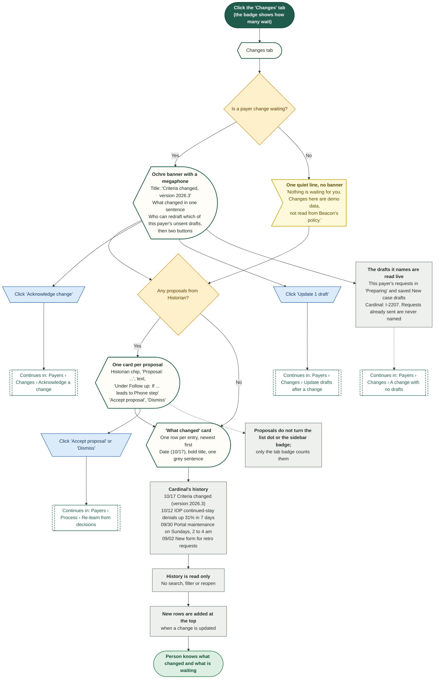

## Payers › Changes › A change arrives (policy watch)

How a payer's policy change reaches a person. In the product Sentinel watches each payer's policy and portal, compares versions, finds what affects open work and raises a change. In the demo three changes (Cardinal, Harborview and Evergreen) are already waiting when the demo starts; there is no button that creates a new one. Reset demo data brings them back.

Route: `/payers/cardinal?tab=changes`

```mermaid
%%{init: {"theme":"base","themeVariables":{"fontFamily":"'DM Sans', 'Segoe UI', system-ui, sans-serif","fontSize":"15px","lineColor":"#5B6B63","primaryTextColor":"#1C2B25","clusterBkg":"#FBF8F3","clusterBorder":"#D9CDBB","edgeLabelBackground":"#FFFFFF"},"flowchart":{"curve":"basis","nodeSpacing":36,"rankSpacing":48,"padding":12,"htmlLabels":true,"useMaxWidth":false,"wrappingWidth":230}} }%%
flowchart TD
  classDef k_start fill:#1F5C4B,stroke:#174638,color:#FFFFFF,stroke-width:1.5px,font-weight:600
  classDef k_end fill:#DDEFE3,stroke:#2E7D4F,color:#14502F,stroke-width:1.5px,font-weight:600
  classDef k_endx fill:#FBE3E0,stroke:#C0392B,color:#7A1F16,stroke-width:1.5px,font-weight:600
  classDef k_screen fill:#FFFDF8,stroke:#1F5C4B,color:#1C2B25,stroke-width:2px
  classDef k_overlay fill:#F1F7F3,stroke:#1F5C4B,color:#1C2B25,stroke-width:2px,stroke-dasharray:5 3
  classDef k_click fill:#DCEBFA,stroke:#2F6DB5,color:#12365F,stroke-width:1.5px
  classDef k_input fill:#E4E7FF,stroke:#4C5FD5,color:#1D2670,stroke-width:1.5px
  classDef k_process fill:#EEF0EE,stroke:#7A857F,color:#26302B,stroke-width:1.5px
  classDef k_agent fill:#EEE5FA,stroke:#7A4FC2,color:#341A63,stroke-width:1.5px
  classDef k_decision fill:#FFF0CC,stroke:#D9962B,color:#5C3B00,stroke-width:1.5px
  classDef k_store fill:#D5F0EA,stroke:#1C8E7B,color:#0B4A3F,stroke-width:1.5px
  classDef k_doc fill:#F6E9DC,stroke:#B07A4C,color:#4A2E14,stroke-width:1.5px
  classDef k_ext fill:#FFE6D2,stroke:#E07B39,color:#6B2F06,stroke-width:1.5px
  classDef k_wait fill:#E4E8EE,stroke:#6B7C93,color:#26303D,stroke-width:1.5px
  classDef k_toast fill:#FFF9DB,stroke:#C9A400,color:#5A4A00,stroke-width:1.5px
  classDef k_goto fill:#FFFFFF,stroke:#1F5C4B,color:#1F5C4B,stroke-width:1.5px,stroke-dasharray:5 3
  px@{ shape: st-rect, label: "<b>Payer publishes new criteria or a portal form change</b><br/>Cardinal: criteria version 2026.3, effective 10/15<br/>Harborview: new portal form, old one closes 10/31<br/>Evergreen: a reference number on phone notice, effective 10/22<br/>(demo: already seeded)" }
  sn@{ shape: hex, label: "<b>Sentinel watches the payer's policy and portal</b><br/>Fetches, compares with the last version, keeps only parts<br/>that touch this clinic's programs, notes what changed" }
  mp@{ shape: hex, label: "<b>Sentinel maps the impact on open work</b><br/>Only this payer's unsent drafts count<br/>Cardinal: I-2207. Harborview and Evergreen: none right now" }
  pc@{ shape: cyl, label: "<b>Change opened for the payer: 'waiting for a person'</b><br/>Title, one sentence, effective date,<br/>agents that will redraft<br/>The drafts it affects are read live, not stored" }
  subgraph gS ["Where a person sees it"]
  s1@{ shape: rect, label: "Sidebar 'Payers' badge counts it (3 at the start)" }
  s2@{ shape: rect, label: "Payer row in the list: ochre dot and the words 'Change waiting'" }
  s3@{ shape: rect, label: "Header 'Policy status' line starts 'Change waiting for you (...)'" }
  s4@{ shape: rect, label: "'Changes' tab badge shows 1" }
  s5@{ shape: odd, label: "<b>Bell notification from Sentinel, unread</b><br/>'Payer rule changed'<br/>Cardinal updated its criteria (version 2026.3). 4 drafts are affected.<br/>This text is fixed and still says 4; the Changes tab counts live<br/>(Harborview's and Evergreen's changes have the badge and dots but no notification)" }
  end
  st1@{ shape: stadium, label: "Click the bell, then the notification" }
  cn@{ shape: trap-t, label: "Click 'Payer rule changed'" }
  mr@{ shape: rect, label: "<b>Notification marked read, panel closes</b><br/>Opens /payers/cardinal?tab=changes" }
  st2@{ shape: stadium, label: "Ask FLO: 'Why is Cardinal's approval rate down?'" }
  cl@{ shape: trap-t, label: "Click 'Open Payers, Cardinal, Changes'" }
  st3@{ shape: stadium, label: "<b>Demo menu, suggested path</b><br/>'Payers: Cardinal, Changes'" }
  st4@{ shape: stadium, label: "<b>Click 'Payers', pick the payer with an ochre dot,</b><br/>click the 'Changes' tab" }
  ch@{ shape: curv-trap, label: "<b>Changes tab</b><br/>Ochre banner 'Criteria changed, version 2026.3'<br/>'Progress evidence must now include the remaining treatment goals.<br/>Scribe can redraft the 1 draft that is not yet sent: I-2207.<br/>Requests already sent keep what they were sent with.'" }
  rj@{ shape: rect, label: "<b>Production also allows rejecting or deferring a change.</b><br/>The demo offers only Acknowledge, then Update" }
  g1@{ shape: subproc, label: "Continues in: Payers › Changes › Acknowledge a change" }
  g2@{ shape: subproc, label: "Continues in: Payers › Changes › Read what changed" }
  px --> sn --> mp --> pc
  pc -->|"Shows up at once"| s1 & s2 & s3 & s4 & s5
  st1 --> cn --> mr --> ch
  s5 -.-> st1
  st2 --> cl --> ch
  st3 --> ch
  st4 --> ch
  ch --> g1
  ch -.-> g2
  ch -.-> rj
  class px k_ext
  class sn,mp k_agent
  class pc k_store
  class s1,s2,s3,s4,mr,rj k_process
  class s5 k_toast
  class st1,st2,st3,st4 k_start
  class cn,cl k_click
  class ch k_screen
  class g1,g2 k_goto
  style gS fill:#FBF8F3,stroke:#D9CDBB,stroke-width:1.5px,color:#5B6B63
```

## Payers › Changes › Acknowledge a change

Acknowledging is the first of two gates. It records who saw the payer's change and when, and changes nothing else. 'Update drafts' stays locked until it is done, so a person has always read the change before any draft is redrafted. There is no way to take an acknowledgement back.

Route: `/payers/cardinal?tab=changes`

```mermaid
%%{init: {"theme":"base","themeVariables":{"fontFamily":"'DM Sans', 'Segoe UI', system-ui, sans-serif","fontSize":"15px","lineColor":"#5B6B63","primaryTextColor":"#1C2B25","clusterBkg":"#FBF8F3","clusterBorder":"#D9CDBB","edgeLabelBackground":"#FFFFFF"},"flowchart":{"curve":"basis","nodeSpacing":36,"rankSpacing":48,"padding":12,"htmlLabels":true,"useMaxWidth":false,"wrappingWidth":230}} }%%
flowchart TD
  classDef k_start fill:#1F5C4B,stroke:#174638,color:#FFFFFF,stroke-width:1.5px,font-weight:600
  classDef k_end fill:#DDEFE3,stroke:#2E7D4F,color:#14502F,stroke-width:1.5px,font-weight:600
  classDef k_endx fill:#FBE3E0,stroke:#C0392B,color:#7A1F16,stroke-width:1.5px,font-weight:600
  classDef k_screen fill:#FFFDF8,stroke:#1F5C4B,color:#1C2B25,stroke-width:2px
  classDef k_overlay fill:#F1F7F3,stroke:#1F5C4B,color:#1C2B25,stroke-width:2px,stroke-dasharray:5 3
  classDef k_click fill:#DCEBFA,stroke:#2F6DB5,color:#12365F,stroke-width:1.5px
  classDef k_input fill:#E4E7FF,stroke:#4C5FD5,color:#1D2670,stroke-width:1.5px
  classDef k_process fill:#EEF0EE,stroke:#7A857F,color:#26302B,stroke-width:1.5px
  classDef k_agent fill:#EEE5FA,stroke:#7A4FC2,color:#341A63,stroke-width:1.5px
  classDef k_decision fill:#FFF0CC,stroke:#D9962B,color:#5C3B00,stroke-width:1.5px
  classDef k_store fill:#D5F0EA,stroke:#1C8E7B,color:#0B4A3F,stroke-width:1.5px
  classDef k_doc fill:#F6E9DC,stroke:#B07A4C,color:#4A2E14,stroke-width:1.5px
  classDef k_ext fill:#FFE6D2,stroke:#E07B39,color:#6B2F06,stroke-width:1.5px
  classDef k_wait fill:#E4E8EE,stroke:#6B7C93,color:#26303D,stroke-width:1.5px
  classDef k_toast fill:#FFF9DB,stroke:#C9A400,color:#5A4A00,stroke-width:1.5px
  classDef k_goto fill:#FFFFFF,stroke:#1F5C4B,color:#1F5C4B,stroke-width:1.5px,stroke-dasharray:5 3
  s1@{ shape: stadium, label: "<b>Open the Changes tab</b><br/>of a payer with a waiting change" }
  bn@{ shape: curv-trap, label: "<b>Ochre banner</b><br/>'Acknowledge change' (blue, ready)<br/>Update button (greyed out): 'Update 1 draft',<br/>or 'Apply to new drafts' when no draft is open<br/>Note: Acknowledging records who saw it.<br/>Updating redrafts, and each draft returns to Case Manager for a new signature." }
  hv@{ shape: trap-t, label: "Hover or click the greyed 'Update 1 draft'" }
  tip@{ shape: odd, label: "<b>Tooltip: 'Acknowledge the change first'</b><br/>Nothing happens on click" }
  ca@{ shape: trap-t, label: "Click 'Acknowledge change'" }
  m@{ shape: win-pane, label: "<b>Acknowledge this change?</b><br/>It records who saw the change and when." }
  bd@{ shape: curv-trap, label: "<b>Change shown in a tinted box</b><br/>'Criteria changed, version 2026.3'<br/>Progress evidence must now include the remaining treatment goals.<br/>Effective 10/15." }
  who@{ shape: rect, label: "<b>'You are acknowledging as {viewer}.</b><br/>This does not change any draft.<br/>Updating the drafts is a separate step.'" }
  ok@{ shape: trap-t, label: "<b>Click 'Acknowledge change'</b><br/>in the modal" }
  st@{ shape: cyl, label: "<b>Acknowledgement recorded on the change</b><br/>Who: the person viewing (Jordan Perez at the start). When: the demo clock" }
  t1@{ shape: odd, label: "<b>'Change acknowledged'</b><br/>Recorded for {viewer}, Tue 10:42 am.<br/>Drafts are not changed until you update them." }
  bn2@{ shape: curv-trap, label: "<b>Banner now shows a green pill</b><br/>'Acknowledged by {viewer}, Tue 10:42 am'<br/>in place of the blue button<br/>'Update 1 draft' is ready" }
  nb@{ shape: rect, label: "<b>No change to the sidebar badge, the dot or the drafts</b><br/>No edit log entry. No undo" }
  cx@{ shape: trap-t, label: "Click 'Cancel'" }
  cesc@{ shape: trap-t, label: "<b>Press Escape, click the X</b><br/>or click the dimmed area" }
  x1@{ shape: stadium, label: "<b>Modal closes</b><br/>Nothing recorded<br/>Banner as before" }
  e1@{ shape: stadium, label: "Ready for the second gate" }
  g1@{ shape: subproc, label: "Continues in: Payers › Changes › Update drafts after a change" }
  s1 --> bn
  bn --> hv --> tip --> ca
  bn --> ca --> m --> bd --> who --> ok --> st --> t1 --> bn2 --> e1
  bn2 -.-> nb
  e1 --> g1
  m --> cx --> x1
  m --> cesc --> x1
  class s1 k_start
  class bn,bd,bn2 k_screen
  class hv,ca,ok,cx,cesc k_click
  class tip,t1 k_toast
  class m k_overlay
  class who,nb k_process
  class st k_store
  class x1 k_endx
  class e1 k_end
  class g1 k_goto
```

## Payers › Changes › Update drafts after a change

The second gate. Once a payer's change is acknowledged, 'Update 1 draft' lists exactly this payer's unsent drafts, read live from the Dashboard requests and the saved New case drafts, then two agents redraft for about three seconds. Drafts return to Case Manager for a new signature. A request that was already sent is never listed or rewritten.

Route: `/payers/cardinal?tab=changes`

```mermaid
%%{init: {"theme":"base","themeVariables":{"fontFamily":"'DM Sans', 'Segoe UI', system-ui, sans-serif","fontSize":"15px","lineColor":"#5B6B63","primaryTextColor":"#1C2B25","clusterBkg":"#FBF8F3","clusterBorder":"#D9CDBB","edgeLabelBackground":"#FFFFFF"},"flowchart":{"curve":"basis","nodeSpacing":36,"rankSpacing":48,"padding":12,"htmlLabels":true,"useMaxWidth":false,"wrappingWidth":230}} }%%
flowchart TD
  classDef k_start fill:#1F5C4B,stroke:#174638,color:#FFFFFF,stroke-width:1.5px,font-weight:600
  classDef k_end fill:#DDEFE3,stroke:#2E7D4F,color:#14502F,stroke-width:1.5px,font-weight:600
  classDef k_endx fill:#FBE3E0,stroke:#C0392B,color:#7A1F16,stroke-width:1.5px,font-weight:600
  classDef k_screen fill:#FFFDF8,stroke:#1F5C4B,color:#1C2B25,stroke-width:2px
  classDef k_overlay fill:#F1F7F3,stroke:#1F5C4B,color:#1C2B25,stroke-width:2px,stroke-dasharray:5 3
  classDef k_click fill:#DCEBFA,stroke:#2F6DB5,color:#12365F,stroke-width:1.5px
  classDef k_input fill:#E4E7FF,stroke:#4C5FD5,color:#1D2670,stroke-width:1.5px
  classDef k_process fill:#EEF0EE,stroke:#7A857F,color:#26302B,stroke-width:1.5px
  classDef k_agent fill:#EEE5FA,stroke:#7A4FC2,color:#341A63,stroke-width:1.5px
  classDef k_decision fill:#FFF0CC,stroke:#D9962B,color:#5C3B00,stroke-width:1.5px
  classDef k_store fill:#D5F0EA,stroke:#1C8E7B,color:#0B4A3F,stroke-width:1.5px
  classDef k_doc fill:#F6E9DC,stroke:#B07A4C,color:#4A2E14,stroke-width:1.5px
  classDef k_ext fill:#FFE6D2,stroke:#E07B39,color:#6B2F06,stroke-width:1.5px
  classDef k_wait fill:#E4E8EE,stroke:#6B7C93,color:#26303D,stroke-width:1.5px
  classDef k_toast fill:#FFF9DB,stroke:#C9A400,color:#5A4A00,stroke-width:1.5px
  classDef k_goto fill:#FFFFFF,stroke:#1F5C4B,color:#1F5C4B,stroke-width:1.5px,stroke-dasharray:5 3
  s1@{ shape: stadium, label: "<b>Click 'Update 1 draft'</b><br/>(ready after 'Acknowledge change')" }
  m@{ shape: win-pane, label: "<b>Update 1 draft?</b><br/>Nothing is redrafted until you confirm.<br/>Reason: criteria changed, version 2026.3." }
  rows@{ shape: curv-trap, label: "<b>One row per unsent draft of this payer</b><br/>Request id, patient initials and age · payer,<br/>level of care chip, status" }
  r1@{ shape: rect, label: "<b>Cardinal's row, read now</b><br/>I-2207 · T.R., 29 · Cardinal · IOP<br/>Draft, not yet sent" }
  who@{ shape: rect, label: "<b>Who is listed</b><br/>Only drafts at the sites in view (Cardinal's I-2207 is at Site B, so Dr. Rivera and a Site A view see none; Both sites and Site B read 'Update 1 draft')<br/>This payer's requests in 'Preparing'<br/>and its saved New case drafts that are not sent<br/>Not listed: Summit's R-1042, Beacon's R-0988,<br/>sent I-2231, I-2218 (a reply on a request the payer has)" }
  fn@{ shape: odd, label: "<b>'Each redrafted case returns to Case Manager for a new signature.</b><br/>Requests already sent keep what they were sent with.'" }
  cs@{ shape: trap-t, label: "Click 'Update 1 draft'" }
  lock@{ shape: rect, label: "<b>Cancel greys out and the button spins</b><br/>Escape, X and dimmed area do nothing" }
  a1@{ shape: hex, label: "<b>Scribe is redrafting 1 draft</b><br/>(demo: 1.5 seconds)" }
  a2@{ shape: hex, label: "<b>Integrity is checking every sentence</b><br/>against the chart (demo: 1.5 seconds)" }
  lv@{ shape: diam, label: "Still on Payers after 3 seconds?" }
  drop@{ shape: stadium, label: "<b>Update dropped</b><br/>Change stays waiting, acknowledged" }
  subgraph gU ["What the update does"]
  u1@{ shape: cyl, label: "<b>Each listed draft needs a person again</b><br/>'Redrafted after Cardinal's change (criteria changed, version 2026.3).<br/>Waiting for a new signature'<br/>Timeline event by Scribe" }
  u2@{ shape: cyl, label: "<b>Update recorded for Case Manager and New case</b><br/>Which change, which payer, and the IDs<br/>of the drafts redrafted: I-2207" }
  u3@{ shape: cyl, label: "<b>Payer's change cleared</b><br/>No 'checked' date is written: nothing was checked against the payer" }
  u4@{ shape: cyl, label: "<b>Document lists gain the change's new rows</b><br/>Remaining treatment goals: Named in the latest progress note<br/>in Residential 3.5, IOP and PHP" }
  u5@{ shape: cyl, label: "<b>Edit log: 3 'Documents' entries</b><br/>'Added to the Residential 3.5 list' and so on<br/>Reason 'After criteria changed, version 2026.3'" }
  u6@{ shape: cyl, label: "<b>'What changed' gets a new top row</b><br/>'Criteria changed, version 2026.3: acknowledged and applied'<br/>Acknowledged by {viewer}, ...<br/>Scribe and Integrity updated 1 draft ..." }
  end
  nt@{ shape: cyl, label: "<b>Bell notification 'Drafts updated' from Scribe</b><br/>1 draft was redrafted after Cardinal's change.<br/>Each needs a new signature in Case Manager." }
  t1@{ shape: odd, label: "<b>'1 draft updated'</b><br/>The change is applied for Cardinal. Each draft returned to<br/>Case Manager for a new signature." }
  out@{ shape: curv-trap, label: "<b>Changes tab shows one quiet line</b><br/>'Nothing is waiting for you...'<br/>Header Policy status: 'No change waiting. Last acknowledged or applied in Psyflo' today<br/>Sidebar badge drops, row loses 'Change waiting', dot turns green" }
  cx@{ shape: trap-t, label: "Click 'Cancel'" }
  cesc@{ shape: trap-t, label: "<b>Press Escape, click the X</b><br/>or click the dimmed area" }
  x1@{ shape: stadium, label: "<b>Modal closes</b><br/>Nothing redrafted, still acknowledged" }
  g1@{ shape: subproc, label: "Continues in: Dashboard › Requests table" }
  cb@{ shape: trap-t, label: "<b>Click the bell notification</b><br/>'Drafts updated'" }
  g2@{ shape: subproc, label: "Continues in: Case Manager › Active cases › Updated for a payer change" }
  g3@{ shape: subproc, label: "Continues in: Payers › Documents › Try it on a case" }
  g4@{ shape: subproc, label: "Continues in: Payers › Edit log" }
  g5@{ shape: subproc, label: "Continues in: Payers › Changes › A change with no drafts" }
  s1 --> m --> rows
  rows --> r1 --> fn --> cs --> lock --> a1 --> a2 --> lv
  rows -.-> who
  lv -->|"No"| drop
  lv -->|"Yes"| u1
  u1 --> u2 --> u3 --> u4 --> u5 --> u6 --> nt --> t1 --> out
  out --> g1
  nt -.-> cb --> g2
  u4 -.-> g3
  u5 -.-> g4
  rows -.-> g5
  m --> cx --> x1
  m --> cesc --> x1
  class s1 k_start
  class m k_overlay
  class rows,out k_screen
  class r1,who,lock k_process
  class fn,t1 k_toast
  class cs,cx,cesc,cb k_click
  class a1,a2 k_agent
  class lv k_decision
  class drop,x1 k_endx
  class u1,u2,u3,u4,u5,u6,nt k_store
  class g1,g2,g3,g4,g5 k_goto
  style gU fill:#FBF8F3,stroke:#D9CDBB,stroke-width:1.5px,color:#5B6B63
```

## Payers › Changes › A change with no drafts

Not every change touches a draft. Harborview's portal form change and Evergreen's phone notice change find no unsent draft for their payer, so the banner, the button and the confirm step change their wording, and the change still closes properly. Cardinal's change, which finds one draft, is in the diagram before this one. A payer with nothing waiting shows only history.

Route: `/payers/harborview?tab=changes`

```mermaid
%%{init: {"theme":"base","themeVariables":{"fontFamily":"'DM Sans', 'Segoe UI', system-ui, sans-serif","fontSize":"15px","lineColor":"#5B6B63","primaryTextColor":"#1C2B25","clusterBkg":"#FBF8F3","clusterBorder":"#D9CDBB","edgeLabelBackground":"#FFFFFF"},"flowchart":{"curve":"basis","nodeSpacing":36,"rankSpacing":48,"padding":12,"htmlLabels":true,"useMaxWidth":false,"wrappingWidth":230}} }%%
flowchart TD
  classDef k_start fill:#1F5C4B,stroke:#174638,color:#FFFFFF,stroke-width:1.5px,font-weight:600
  classDef k_end fill:#DDEFE3,stroke:#2E7D4F,color:#14502F,stroke-width:1.5px,font-weight:600
  classDef k_endx fill:#FBE3E0,stroke:#C0392B,color:#7A1F16,stroke-width:1.5px,font-weight:600
  classDef k_screen fill:#FFFDF8,stroke:#1F5C4B,color:#1C2B25,stroke-width:2px
  classDef k_overlay fill:#F1F7F3,stroke:#1F5C4B,color:#1C2B25,stroke-width:2px,stroke-dasharray:5 3
  classDef k_click fill:#DCEBFA,stroke:#2F6DB5,color:#12365F,stroke-width:1.5px
  classDef k_input fill:#E4E7FF,stroke:#4C5FD5,color:#1D2670,stroke-width:1.5px
  classDef k_process fill:#EEF0EE,stroke:#7A857F,color:#26302B,stroke-width:1.5px
  classDef k_agent fill:#EEE5FA,stroke:#7A4FC2,color:#341A63,stroke-width:1.5px
  classDef k_decision fill:#FFF0CC,stroke:#D9962B,color:#5C3B00,stroke-width:1.5px
  classDef k_store fill:#D5F0EA,stroke:#1C8E7B,color:#0B4A3F,stroke-width:1.5px
  classDef k_doc fill:#F6E9DC,stroke:#B07A4C,color:#4A2E14,stroke-width:1.5px
  classDef k_ext fill:#FFE6D2,stroke:#E07B39,color:#6B2F06,stroke-width:1.5px
  classDef k_wait fill:#E4E8EE,stroke:#6B7C93,color:#26303D,stroke-width:1.5px
  classDef k_toast fill:#FFF9DB,stroke:#C9A400,color:#5A4A00,stroke-width:1.5px
  classDef k_goto fill:#FFFFFF,stroke:#1F5C4B,color:#1F5C4B,stroke-width:1.5px,stroke-dasharray:5 3
  s1@{ shape: stadium, label: "<b>Open the 'Changes' tab</b><br/>for a payer" }
  dp@{ shape: diam, label: "Is a change waiting?" }
  up@{ shape: curv-trap, label: "<b>One quiet line</b><br/>'Nothing is waiting for you. Changes here are demo data...'<br/>Only the 'What changed' history below" }
  hv@{ shape: rect, label: "<b>Harborview's waiting change</b><br/>'Portal form change', effective 10/18<br/>The request form now asks for the expected length of stay and a second contact.<br/>The old form closes 10/31." }
  ev@{ shape: rect, label: "<b>Evergreen's waiting change</b><br/>'Reference number on notice calls', effective 10/22<br/>It adds 'Notice call reference number' to the Residential 3.5 list" }
  dn@{ shape: diam, label: "<b>Does the payer have an unsent draft at a site in view?</b><br/>Read live: requests in 'Preparing'<br/>and saved New case drafts not sent, at the sites in view" }
  none@{ shape: odd, label: "<b>'No open drafts are affected.</b><br/>New drafts for Harborview use the change once you apply it.'<br/>Buttons: 'Acknowledge change', then 'Apply to new drafts'<br/>Note: 'Acknowledging records who saw it. Applying makes new drafts use the change.'" }
  why0@{ shape: rect, label: "<b>P-1499 is not listed: it is an answer on a request</b><br/>Harborview already has. R-0975 is the same for Evergreen" }
  one@{ shape: odd, label: "<b>'Scribe can redraft the 1 draft that is not yet sent: I-2207.'</b><br/>Buttons: 'Acknowledge change', then 'Update 1 draft'" }
  ca0@{ shape: trap-t, label: "<b>Click 'Acknowledge change' and confirm,</b><br/>then 'Apply to new drafts'" }
  mn@{ shape: win-pane, label: "<b>Apply to new drafts?</b><br/>Nothing is redrafted until you confirm.<br/>No open drafts are affected.<br/>Harborview will use the change for every new draft from now on." }
  a1@{ shape: hex, label: "<b>Packet is setting the change up for new drafts</b><br/>(demo: 1.5 seconds)" }
  a2@{ shape: hex, label: "<b>Integrity is checking the document lists</b><br/>(demo: 1.5 seconds)" }
  dd@{ shape: diam, label: "Does the change add documents?" }
  da@{ shape: cyl, label: "<b>Document lists gain the change's new rows</b><br/>Evergreen: 'Notice call reference number'<br/>Edit log: one 'Documents' entry" }
  dn0@{ shape: rect, label: "<b>Harborview adds none: the change is about a form,</b><br/>not the list" }
  s0@{ shape: cyl, label: "<b>No drafts touched</b><br/>No update recorded for Case Manager<br/>Change cleared, no 'checked' date is written" }
  hh0@{ shape: cyl, label: "<b>'What changed' gets a new top row</b><br/>'Portal form change: acknowledged and applied'<br/>'No open drafts needed an update. New drafts use the change.'" }
  t0@{ shape: odd, label: "<b>'No open drafts to update'</b><br/>The change is applied for Harborview.<br/>New drafts use it from now on." }
  nb@{ shape: rect, label: "<b>No 'Drafts updated' bell notification</b><br/>Sidebar badge drops by one<br/>Row loses 'Change waiting', dot turns green" }
  cx@{ shape: trap-t, label: "<b>Click 'Cancel', press Escape,</b><br/>click the X or the dimmed area" }
  x1@{ shape: stadium, label: "Modal closes, change stays waiting" }
  e1@{ shape: stadium, label: "The change is applied and the payer has nothing waiting" }
  g1@{ shape: subproc, label: "Continues in: Payers › Changes › Update drafts after a change" }
  g2@{ shape: subproc, label: "Continues in: Payers › Changes › Acknowledge a change" }
  s1 --> dp
  dp -->|"No"| up --> e1
  dp -->|"Yes"| hv --> dn
  dp -->|"Yes"| ev --> dn
  dn -->|"No"| none --> why0
  dn -->|"Yes"| one --> g1
  why0 --> ca0 --> mn
  mn --> a1 --> a2 --> dd
  dd -->|"Yes"| da --> s0
  dd -->|"No"| dn0 --> s0
  s0 --> hh0 --> t0 --> nb --> e1
  mn --> cx --> x1
  ca0 -.-> g2
  class s1 k_start
  class dp,dn,dd k_decision
  class up k_screen
  class hv,ev,why0,dn0,nb k_process
  class none,one,t0 k_toast
  class ca0,cx k_click
  class mn k_overlay
  class a1,a2 k_agent
  class da,s0,hh0 k_store
  class x1 k_endx
  class e1 k_end
  class g1,g2 k_goto
```

## Payers › Configuration feeds the rest of the app

What a payer's workflow, rules and document lists reach outside the Payers page. New drafts use a saved edit at once: New case reads the saved document list and rules every time it draws, and Case Manager reads the submission windows. Updating drafts changes the matching requests on the Dashboard, tags them in Case Manager and sends a bell notification. Requests already sent keep what they were sent with. The diagram also marks what no edit reaches.

Route: `/payers/:id`

```mermaid
%%{init: {"theme":"base","themeVariables":{"fontFamily":"'DM Sans', 'Segoe UI', system-ui, sans-serif","fontSize":"15px","lineColor":"#5B6B63","primaryTextColor":"#1C2B25","clusterBkg":"#FBF8F3","clusterBorder":"#D9CDBB","edgeLabelBackground":"#FFFFFF"},"flowchart":{"curve":"basis","nodeSpacing":36,"rankSpacing":48,"padding":12,"htmlLabels":true,"useMaxWidth":false,"wrappingWidth":230}} }%%
flowchart TD
  classDef k_start fill:#1F5C4B,stroke:#174638,color:#FFFFFF,stroke-width:1.5px,font-weight:600
  classDef k_end fill:#DDEFE3,stroke:#2E7D4F,color:#14502F,stroke-width:1.5px,font-weight:600
  classDef k_endx fill:#FBE3E0,stroke:#C0392B,color:#7A1F16,stroke-width:1.5px,font-weight:600
  classDef k_screen fill:#FFFDF8,stroke:#1F5C4B,color:#1C2B25,stroke-width:2px
  classDef k_overlay fill:#F1F7F3,stroke:#1F5C4B,color:#1C2B25,stroke-width:2px,stroke-dasharray:5 3
  classDef k_click fill:#DCEBFA,stroke:#2F6DB5,color:#12365F,stroke-width:1.5px
  classDef k_input fill:#E4E7FF,stroke:#4C5FD5,color:#1D2670,stroke-width:1.5px
  classDef k_process fill:#EEF0EE,stroke:#7A857F,color:#26302B,stroke-width:1.5px
  classDef k_agent fill:#EEE5FA,stroke:#7A4FC2,color:#341A63,stroke-width:1.5px
  classDef k_decision fill:#FFF0CC,stroke:#D9962B,color:#5C3B00,stroke-width:1.5px
  classDef k_store fill:#D5F0EA,stroke:#1C8E7B,color:#0B4A3F,stroke-width:1.5px
  classDef k_doc fill:#F6E9DC,stroke:#B07A4C,color:#4A2E14,stroke-width:1.5px
  classDef k_ext fill:#FFE6D2,stroke:#E07B39,color:#6B2F06,stroke-width:1.5px
  classDef k_wait fill:#E4E8EE,stroke:#6B7C93,color:#26303D,stroke-width:1.5px
  classDef k_toast fill:#FFF9DB,stroke:#C9A400,color:#5A4A00,stroke-width:1.5px
  classDef k_goto fill:#FFFFFF,stroke:#1F5C4B,color:#1F5C4B,stroke-width:1.5px,stroke-dasharray:5 3
  s1@{ shape: stadium, label: "<b>A payer's workflow, rule, document list</b><br/>or payer change is saved or updated" }
  dk@{ shape: diam, label: "Which kind of save?" }
  cfg@{ shape: cyl, label: "<b>Saved on the payer</b><br/>One edit log entry per change<br/>One bell notification<br/>New drafts use it from now on" }
  subgraph gR ["Read live by other screens (no Update drafts needed)"]
  p1@{ shape: rect, label: "<b>New case: the document list</b><br/>The Clinical documentation checklist, the file sorting and the<br/>Review & submit checks use the payer's saved list<br/>for the draft's level of care" }
  p2@{ shape: rect, label: "<b>New case: the rules</b><br/>Backdating: a start date that reaches back further<br/>than the rule allows is flagged<br/>No authorization needed: a level of care the payer names there" }
  p3@{ shape: rect, label: "<b>New case: the approval chance</b><br/>Each thing the payer asks for that a draft does not meet<br/>(a required document, an early start date)<br/>holds the chance back, up to 12 points" }
  p4@{ shape: rect, label: "<b>Case Manager: the next review</b><br/>The 'Submission windows' rule sets the days<br/>before the next review is booked, when it names a number" }
  p5@{ shape: rect, label: "<b>Payers added with 'Add a payer'</b><br/>have a full saved set like any payer<br/>and are offered wherever a payer is picked:<br/>New case, Eligibility & Benefits and the queue's Payer menu" }
  end
  subgraph gW ["Wired: redrafting after a payer change or edits"]
  up@{ shape: trap-t, label: "<b>'Update N drafts' (after a payer change,</b><br/>or from the edits-waiting banner)<br/>N counts only the drafts at the sites in view" }
  rq@{ shape: cyl, label: "<b>Each unsent draft of this payer changes</b><br/>needs a person: yes<br/>Status line 'Redrafted after ... Waiting for a new signature'<br/>Timeline event from Scribe or the change's agent" }
  rp@{ shape: cyl, label: "<b>Update recorded</b><br/>Change (or 'edits-summit'), payer and the IDs of the drafts redrafted" }
  nf@{ shape: cyl, label: "<b>Bell notification 'Drafts updated'</b><br/>links to Case Manager" }
  dsh@{ shape: rect, label: "<b>Dashboard shows the new status line</b><br/>and lists the request among those needing you" }
  cmt@{ shape: rect, label: "<b>Case Manager and New case tag those drafts</b><br/>'Updated for a payer change'" }
  end
  sent@{ shape: rect, label: "<b>Requests already sent are never changed</b><br/>They keep what they were sent with" }
  subgraph gC ["Wired: links out of Payers"]
  oc@{ shape: trap-t, label: "<b>Click 'Open the request'</b><br/>in 'Try it on a case'" }
  od@{ shape: rect, label: "Opens Dashboard with that request's drawer" }
  end
  subgraph gP ["Not read by any edit"]
  n1@{ shape: rect, label: "<b>The payer's approved-as-asked rate (74% for Summit, shown in Analytics)</b><br/>is where New case starts the approval chance: it ends 14 points higher.<br/>It comes from decision history, so no rule or list edit moves it" }
  n2@{ shape: rect, label: "<b>Authorizations queue order and the case page</b><br/>do not read the saved configuration" }
  end
  prd@{ shape: rect, label: "<b>In the product (PRD 06)</b><br/>A rule version is stamped on every authorization;<br/>Packet reads the channel, form and documents; Cadence reads windows and caps;<br/>Advocate reads peer-to-peer and appeal windows" }
  g1@{ shape: subproc, label: "Continues in: Dashboard › Requests table" }
  g2@{ shape: subproc, label: "Continues in: Case Manager › Active cases › Updated for a payer change" }
  g3@{ shape: subproc, label: "Continues in: Dashboard › Open a request" }
  g4@{ shape: subproc, label: "Continues in: Authorizations › New case › Clinical documentation › The checklist and Continue" }
  g5@{ shape: subproc, label: "Continues in: Authorizations › New case › Review & submit › Validation summary and checks" }
  g7@{ shape: subproc, label: "Continues in: Authorizations › New case › Authorization preparation › Start the run and watch it" }
  g6@{ shape: subproc, label: "Continues in: Authorizations › Queue › Open the queue and read the top" }
  s1 --> dk
  dk -->|"Workflow, rule or documents"| cfg
  dk -->|"Payer change or edits update"| up --> rq --> rp --> nf
  rq --> dsh --> g1
  rq --> cmt --> g2
  up -.-> sent
  cfg --> p1 & p2 & p4
  p1 --> g4
  p1 -.-> g5
  p2 --> p3 --> g7
  cfg -.-> p5
  cfg -.-> n1
  cfg -.-> n2
  n2 -.-> g6
  oc --> od --> g3
  dk -->|"Chart check"| oc
  p2 -.-> prd
  class s1 k_start
  class dk k_decision
  class cfg,rq,rp,nf k_store
  class p1,p2,p3,p4,p5,dsh,cmt,sent,od,n1,n2,prd k_process
  class up,oc k_click
  class g1,g2,g3,g4,g5,g7,g6 k_goto
  style gR fill:#FBF8F3,stroke:#D9CDBB,stroke-width:1.5px,color:#5B6B63
  style gW fill:#FBF8F3,stroke:#D9CDBB,stroke-width:1.5px,color:#5B6B63
  style gC fill:#FBF8F3,stroke:#D9CDBB,stroke-width:1.5px,color:#5B6B63
  style gP fill:#FBF8F3,stroke:#D9CDBB,stroke-width:1.5px,color:#5B6B63
```

## Payers › Every pop-up › Save, discard, close

One page for how every Payers pop-up closes. Nothing is saved by closing: Cancel, the X, Escape and a click on the dimmed area all throw away what was typed, with no 'are you sure'. Escape closes only the top layer, so a menu, then the pop-up over a drawer, then the drawer each take one press. There is no undo; a saved edit is reversed by editing again, and the edit log keeps the old text.

Route: `/payers/:id`

```mermaid
%%{init: {"theme":"base","themeVariables":{"fontFamily":"'DM Sans', 'Segoe UI', system-ui, sans-serif","fontSize":"15px","lineColor":"#5B6B63","primaryTextColor":"#1C2B25","clusterBkg":"#FBF8F3","clusterBorder":"#D9CDBB","edgeLabelBackground":"#FFFFFF"},"flowchart":{"curve":"basis","nodeSpacing":36,"rankSpacing":48,"padding":12,"htmlLabels":true,"useMaxWidth":false,"wrappingWidth":230}} }%%
flowchart TD
  classDef k_start fill:#1F5C4B,stroke:#174638,color:#FFFFFF,stroke-width:1.5px,font-weight:600
  classDef k_end fill:#DDEFE3,stroke:#2E7D4F,color:#14502F,stroke-width:1.5px,font-weight:600
  classDef k_endx fill:#FBE3E0,stroke:#C0392B,color:#7A1F16,stroke-width:1.5px,font-weight:600
  classDef k_screen fill:#FFFDF8,stroke:#1F5C4B,color:#1C2B25,stroke-width:2px
  classDef k_overlay fill:#F1F7F3,stroke:#1F5C4B,color:#1C2B25,stroke-width:2px,stroke-dasharray:5 3
  classDef k_click fill:#DCEBFA,stroke:#2F6DB5,color:#12365F,stroke-width:1.5px
  classDef k_input fill:#E4E7FF,stroke:#4C5FD5,color:#1D2670,stroke-width:1.5px
  classDef k_process fill:#EEF0EE,stroke:#7A857F,color:#26302B,stroke-width:1.5px
  classDef k_agent fill:#EEE5FA,stroke:#7A4FC2,color:#341A63,stroke-width:1.5px
  classDef k_decision fill:#FFF0CC,stroke:#D9962B,color:#5C3B00,stroke-width:1.5px
  classDef k_store fill:#D5F0EA,stroke:#1C8E7B,color:#0B4A3F,stroke-width:1.5px
  classDef k_doc fill:#F6E9DC,stroke:#B07A4C,color:#4A2E14,stroke-width:1.5px
  classDef k_ext fill:#FFE6D2,stroke:#E07B39,color:#6B2F06,stroke-width:1.5px
  classDef k_wait fill:#E4E8EE,stroke:#6B7C93,color:#26303D,stroke-width:1.5px
  classDef k_toast fill:#FFF9DB,stroke:#C9A400,color:#5A4A00,stroke-width:1.5px
  classDef k_goto fill:#FFFFFF,stroke:#1F5C4B,color:#1F5C4B,stroke-width:1.5px,stroke-dasharray:5 3
  s1@{ shape: stadium, label: "Any Payers pop-up is open" }
  ov@{ shape: win-pane, label: "<b>Ten pop-ups</b><br/>Add a payer, Edit payer details, Edit log, Edit workflow,<br/>Save the workflow?, Edit the instructions for Caller,<br/>Edit a rule, Edit what a payer wants, Acknowledge this change?,<br/>Update drafts?, plus the menus inside them" }
  subgraph gX ["Ways to close"]
  x1@{ shape: trap-t, label: "Click 'Cancel'" }
  x2@{ shape: trap-t, label: "Click the X ('Close')" }
  x3@{ shape: trap-t, label: "Press Escape" }
  x4@{ shape: trap-t, label: "Click the dimmed area outside" }
  end
  cl@{ shape: rect, label: "<b>The top layer is asked to close</b><br/>Escape only ever reaches the top layer" }
  dk@{ shape: diam, label: "Which pop-up is it?" }
  pl@{ shape: rect, label: "<b>Plain pop-up (everything except the cases below)</b><br/>Closes. Typed text and picks are discarded<br/>Nothing is saved or logged" }
  rd@{ shape: rect, label: "<b>Edit log</b><br/>Read only, nothing to save or discard" }
  sv@{ shape: rect, label: "<b>'Save the workflow?' over the Edit workflow drawer</b><br/>Cancel, X, Escape or the dimmed area:<br/>only this reason modal closes" }
  dr@{ shape: rect, label: "<b>The drawer is still open with every edit in it</b><br/>A second Escape, Cancel, X or dimmed area closes it:<br/>every unsaved workflow edit is lost, no 'are you sure'" }
  bz@{ shape: rect, label: "<b>'Update drafts?' while the agents work (about 3 seconds)</b><br/>Cancel is greyed, Escape, X and dimmed area do nothing<br/>Wait for it to finish" }
  mn@{ shape: rect, label: "<b>A menu open inside a pop-up</b><br/>(Plan type, Group, Reached by, Level of care, Case, step type)<br/>Escape closes only the menu<br/>The next Escape closes the pop-up" }
  subgraph gS ["Ways to save (the primary button)"]
  sa@{ shape: rect, label: "<b>'Save and log the edit' needs a reason</b><br/>Empty reason: 'Add a reason. It goes in the edit log.'<br/>'Edit payer details' also needs a listed 'Reached by'" }
  sb@{ shape: rect, label: "<b>'Add payer' needs a name no other payer has,</b><br/>a way to reach and a program" }
  sc@{ shape: rect, label: "<b>'Acknowledge change' and 'Update N drafts' are confirm buttons</b><br/>they need no typing" }
  sd@{ shape: rect, label: "<b>If nothing differs from what is saved:</b><br/>'Nothing changed' (or 'Nothing to save' in the workflow drawer)" }
  end
  sv1@{ shape: cyl, label: "<b>Saved: the change is in force for new drafts</b><br/>One edit log entry per change<br/>One bell notification" }
  undo@{ shape: rect, label: "<b>No undo, revert or 'restore previous' button</b><br/>To go back: edit again. Edit log shows the before text" }
  e1@{ shape: stadium, label: "Back on the page, nothing half saved" }
  x0@{ shape: stadium, label: "Closed without saving" }
  s1 --> ov
  ov --> x1 & x2 & x3 & x4
  x1 --> cl
  x2 --> cl
  x3 --> cl
  x4 --> cl
  cl --> dk
  dk -->|"Plain"| pl --> x0
  dk -->|"Edit log"| rd --> x0
  dk -->|"Save the workflow?"| sv --> dr --> x0
  dk -->|"Update drafts?, busy"| bz --> e1
  dk -->|"Menu open"| mn --> x0
  ov --> sa --> sv1
  ov --> sb --> sv1
  ov --> sc --> sv1
  sa --> sd
  sv1 --> e1
  e1 -.-> undo
  class s1 k_start
  class ov k_overlay
  class x1,x2,x3,x4 k_click
  class cl,pl,rd,sv,dr,bz,mn,sa,sb,sc,sd,undo k_process
  class dk k_decision
  class sv1 k_store
  class e1 k_end
  class x0 k_endx
  style gX fill:#FBF8F3,stroke:#D9CDBB,stroke-width:1.5px,color:#5B6B63
  style gS fill:#FBF8F3,stroke:#D9CDBB,stroke-width:1.5px,color:#5B6B63
```

## Payers › Sites › Clinic-wide payers, drafts in view

Payers are the clinic's, not a site's: every viewer sees the same six payers, rules, documents and changes, and the Payers badge never changes with the site view. What does follow the site is the list of drafts a payer change or an edit can redraft, because a draft belongs to a case and a case belongs to a site.

Route: `/payers/:id`

Demo data. Cardinal's change (criteria v2026.3) affects one unsent draft, I-2207, which is at Site B. Summit's two unsent drafts, R-1042 and R-1101, are at Site A. Edits and acknowledgements are logged under the person viewing.

```mermaid
%%{init: {"theme":"base","themeVariables":{"fontFamily":"'DM Sans', 'Segoe UI', system-ui, sans-serif","fontSize":"15px","lineColor":"#5B6B63","primaryTextColor":"#1C2B25","clusterBkg":"#FBF8F3","clusterBorder":"#D9CDBB","edgeLabelBackground":"#FFFFFF"},"flowchart":{"curve":"basis","nodeSpacing":36,"rankSpacing":48,"padding":12,"htmlLabels":true,"useMaxWidth":false,"wrappingWidth":230}} }%%
flowchart TD
  classDef k_start fill:#1F5C4B,stroke:#174638,color:#FFFFFF,stroke-width:1.5px,font-weight:600
  classDef k_end fill:#DDEFE3,stroke:#2E7D4F,color:#14502F,stroke-width:1.5px,font-weight:600
  classDef k_endx fill:#FBE3E0,stroke:#C0392B,color:#7A1F16,stroke-width:1.5px,font-weight:600
  classDef k_screen fill:#FFFDF8,stroke:#1F5C4B,color:#1C2B25,stroke-width:2px
  classDef k_overlay fill:#F1F7F3,stroke:#1F5C4B,color:#1C2B25,stroke-width:2px,stroke-dasharray:5 3
  classDef k_click fill:#DCEBFA,stroke:#2F6DB5,color:#12365F,stroke-width:1.5px
  classDef k_input fill:#E4E7FF,stroke:#4C5FD5,color:#1D2670,stroke-width:1.5px
  classDef k_process fill:#EEF0EE,stroke:#7A857F,color:#26302B,stroke-width:1.5px
  classDef k_agent fill:#EEE5FA,stroke:#7A4FC2,color:#341A63,stroke-width:1.5px
  classDef k_decision fill:#FFF0CC,stroke:#D9962B,color:#5C3B00,stroke-width:1.5px
  classDef k_store fill:#D5F0EA,stroke:#1C8E7B,color:#0B4A3F,stroke-width:1.5px
  classDef k_doc fill:#F6E9DC,stroke:#B07A4C,color:#4A2E14,stroke-width:1.5px
  classDef k_ext fill:#FFE6D2,stroke:#E07B39,color:#6B2F06,stroke-width:1.5px
  classDef k_wait fill:#E4E8EE,stroke:#6B7C93,color:#26303D,stroke-width:1.5px
  classDef k_toast fill:#FFF9DB,stroke:#C9A400,color:#5A4A00,stroke-width:1.5px
  classDef k_goto fill:#FFFFFF,stroke:#1F5C4B,color:#1F5C4B,stroke-width:1.5px,stroke-dasharray:5 3
  s1@{ shape: stadium, label: "<b>Open Payers</b><br/>As any of the four viewers, on any site view" }
  p1@{ shape: rect, label: "<b>The same payers, rules, documents and changes for everyone</b><br/>Sidebar badge 'Payers' stays 3 for every viewer and site view" }
  cAck@{ shape: trap-t, label: "Acknowledge a change, or save an edit" }
  lg@{ shape: cyl, label: "<b>Edit log and 'Acknowledged by' name the person viewing</b><br/>Jordan Perez at the start; Dr. Rivera, Alex Morgan or Sam Okafor after 'Viewing as'" }
  cUp@{ shape: trap-t, label: "<b>Open the Update drafts step</b><br/>'Update N drafts' (Changes tab banner) or the edits-waiting banner" }
  d1@{ shape: diam, label: "Which drafts does this payer have at the sites in view?" }
  subgraph gAll ["Both sites"]
  a1@{ shape: curv-trap, label: "<b>Cardinal: 'Update 1 draft' (I-2207)</b><br/>Summit: 'Update 2 drafts' (R-1042, R-1101)<br/>Same numbers as before sites" }
  end
  subgraph gA ["Site A"]
  b1@{ shape: curv-trap, label: "<b>Dr. Rivera, or a viewer with both sites on 'Site A'</b><br/>Cardinal: 'No open drafts are affected. New drafts for Cardinal use the change once you apply it.' Button 'Apply to new drafts'<br/>Summit (edits-waiting banner): 'Update 2 drafts' (R-1042, R-1101)" }
  end
  subgraph gB ["Site B"]
  c1@{ shape: curv-trap, label: "<b>Sam Okafor, or a viewer with both sites on 'Site B'</b><br/>Cardinal: 'Update 1 draft' (I-2207)<br/>Summit (edits-waiting banner): button 'Update drafts', and its pop-up opens as 'Apply to new drafts?'" }
  end
  d2@{ shape: diam, label: "Can this viewer see both sites, with one chosen?" }
  hint@{ shape: odd, label: "<b>A plain hint under the banner</b><br/>'1 more draft at Site B is not in this view, so it is not updated. Choose Both sites to include it.'" }
  nohint@{ shape: rect, label: "<b>No word about the other site</b><br/>A one-site viewer is never told what exists there" }
  cConf@{ shape: trap-t, label: "Confirm 'Update N drafts'" }
  ag@{ shape: hex, label: "<b>Scribe and Integrity redraft exactly the drafts that were listed (demo: 3 seconds)</b><br/>A draft at a site the viewer cannot see is never listed, counted or changed" }
  up@{ shape: cyl, label: "<b>Each listed draft needs a person again</b><br/>Update recorded for Case Manager and New case" }
  t1@{ shape: odd, label: "<b>'N drafts updated'</b><br/>Or 'No open drafts to update' when none were in view" }
  cChk@{ shape: trap-t, label: "Documents tab › 'Try it on a case'" }
  chk@{ shape: rect, label: "<b>The Case menu lists only 'Preparing' cases at the sites in view</b><br/>Switching the site view changes the list" }
  g1@{ shape: subproc, label: "Continues in: Payers › Changes › Update drafts after a change" }
  g2@{ shape: subproc, label: "Continues in: Payers › Edits waiting › Update drafts" }
  g3@{ shape: subproc, label: "Continues in: Payers › Documents › Try it on a case" }
  g4@{ shape: subproc, label: "Continues in: Who can see what › Roles, sites and a record at the other site" }
  e1@{ shape: stadium, label: "Payers stay the clinic's; drafts stay with their site" }
  s1 --> p1 --> cAck --> lg
  p1 --> cUp --> d1
  d1 -->|"Both sites"| a1
  d1 -->|"Site A"| b1
  d1 -->|"Site B"| c1
  a1 & b1 & c1 --> d2
  d2 -->|"Yes, one site chosen and drafts at the other"| hint
  d2 -->|"No, or nothing at the other site"| nohint
  hint & nohint --> cConf --> ag --> up --> t1 --> e1
  p1 --> cChk --> chk --> g3
  cUp -.-> g1
  cUp -.-> g2
  e1 --> g4
  class s1 k_start
  class p1,nohint,chk k_process
  class cAck,cUp,cConf,cChk k_click
  class lg,up k_store
  class d1,d2 k_decision
  class a1,b1,c1 k_screen
  class hint,t1 k_toast
  class ag k_agent
  class g1,g2,g3,g4 k_goto
  class e1 k_end
  style gAll fill:#FBF8F3,stroke:#D9CDBB,stroke-width:1.5px,color:#5B6B63
  style gA fill:#FBF8F3,stroke:#D9CDBB,stroke-width:1.5px,color:#5B6B63
  style gB fill:#FBF8F3,stroke:#D9CDBB,stroke-width:1.5px,color:#5B6B63
```
