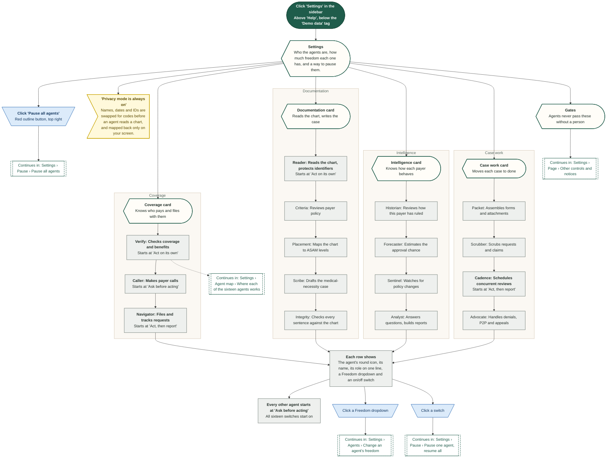
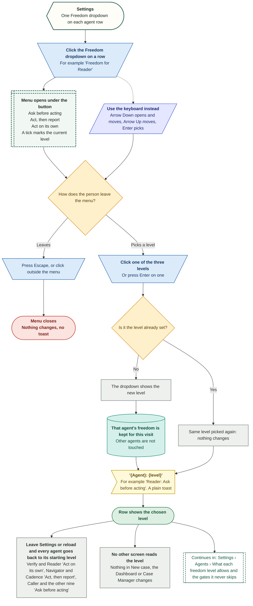
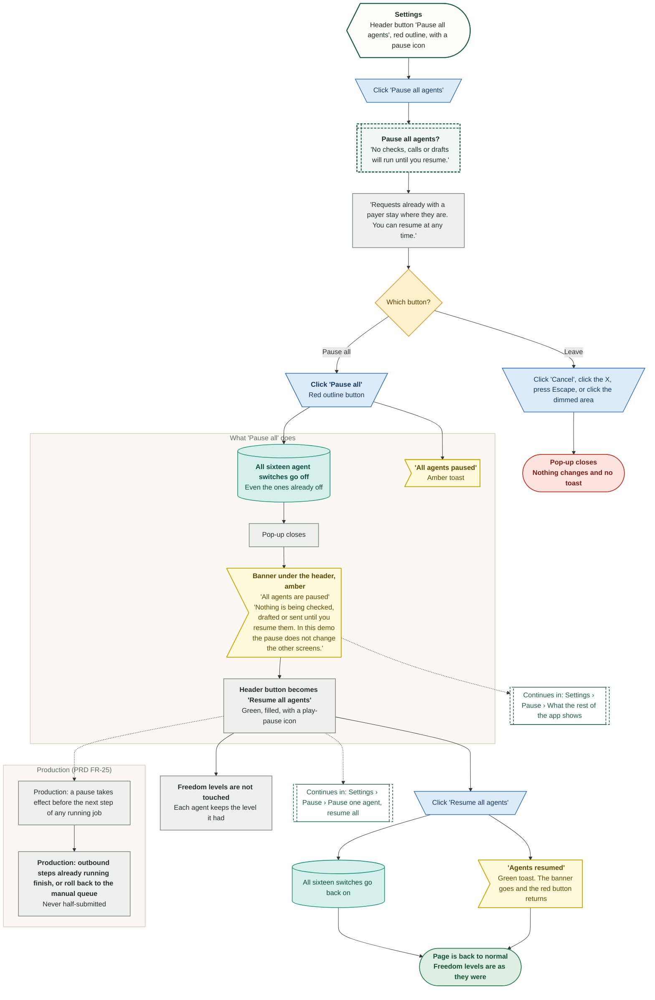
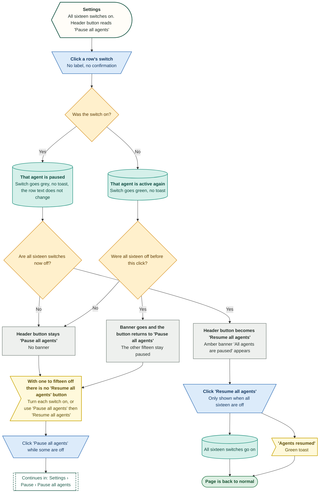
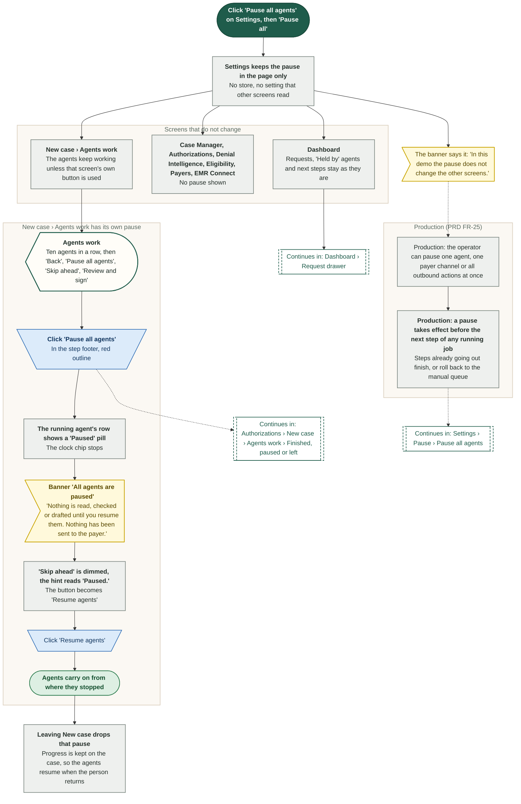
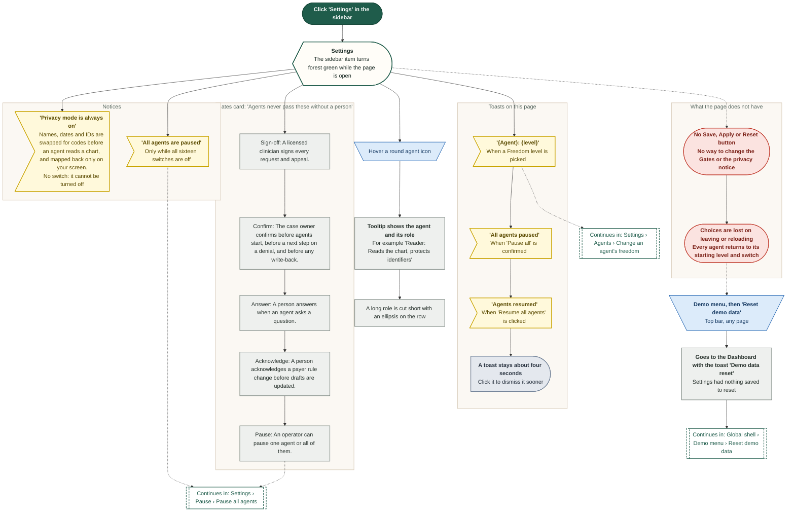
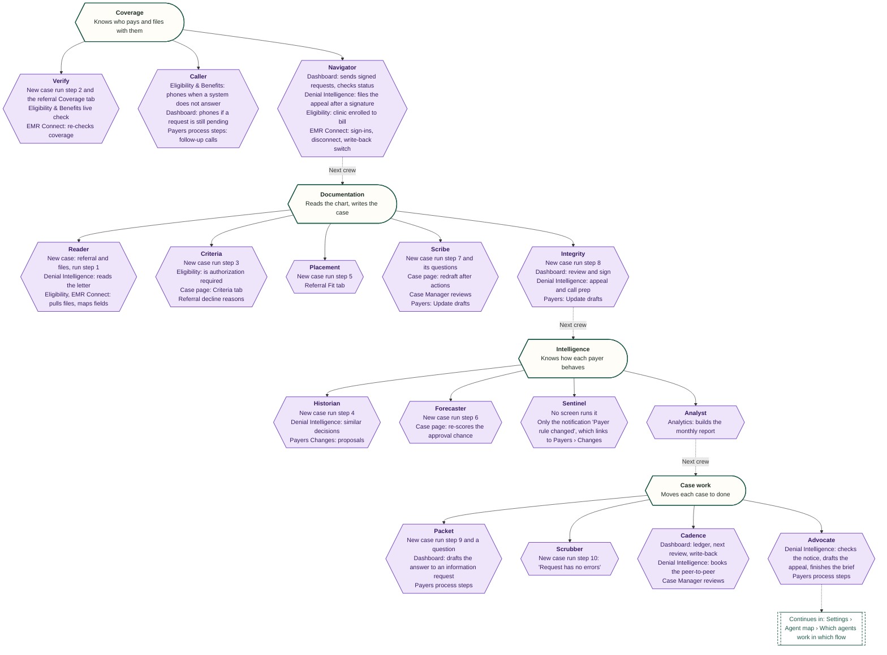

# Settings

The sixteen agents, how much freedom each has, Pause all.

Shapes and colours: see `00-overview.md`. Source: `workflows/src/11-settings/`.

## Settings › Agents › Arrive and read the sixteen agents

The Settings page is one screen about the agents: who they are, how much freedom each one has, a switch for each, and a button to pause them all. This shows what the person sees and what each row says.

Route: `/settings`

Everything on this page is kept in the page itself. Leave Settings and every agent goes back to its starting level and switch.

## Settings › Agents › Change an agent's freedom

Each of the sixteen rows has a Freedom dropdown with three levels. Picking one changes the label and shows a toast. In the demo the choice is kept only while the person stays on Settings.

Route: `/settings`

Nothing else in the app reads this choice. Checked by searching the code and by leaving the page and coming back.

## Settings › Agents › What each freedom level allows and the gates it never skips

The three levels set how much an agent does before a person looks. Five gates sit above every level. The demo shows only the level names and the Gates card, so the meaning of each level comes from the PRD guardrail matrix.

Route: `/settings`

The mapping from the three demo labels to the PRD words (Stage or Draft, Auto + notify, Auto) is our reading. The PRD sets autonomy per action, not per agent.

```mermaid
%%{init: {"theme":"base","themeVariables":{"fontFamily":"'DM Sans', 'Segoe UI', system-ui, sans-serif","fontSize":"15px","lineColor":"#5B6B63","primaryTextColor":"#1C2B25","clusterBkg":"#FBF8F3","clusterBorder":"#D9CDBB","edgeLabelBackground":"#FFFFFF"},"flowchart":{"curve":"basis","nodeSpacing":36,"rankSpacing":48,"padding":12,"htmlLabels":true,"useMaxWidth":false,"wrappingWidth":230}} }%%
flowchart TD
  classDef k_start fill:#1F5C4B,stroke:#174638,color:#FFFFFF,stroke-width:1.5px,font-weight:600
  classDef k_end fill:#DDEFE3,stroke:#2E7D4F,color:#14502F,stroke-width:1.5px,font-weight:600
  classDef k_endx fill:#FBE3E0,stroke:#C0392B,color:#7A1F16,stroke-width:1.5px,font-weight:600
  classDef k_screen fill:#FFFDF8,stroke:#1F5C4B,color:#1C2B25,stroke-width:2px
  classDef k_overlay fill:#F1F7F3,stroke:#1F5C4B,color:#1C2B25,stroke-width:2px,stroke-dasharray:5 3
  classDef k_click fill:#DCEBFA,stroke:#2F6DB5,color:#12365F,stroke-width:1.5px
  classDef k_input fill:#E4E7FF,stroke:#4C5FD5,color:#1D2670,stroke-width:1.5px
  classDef k_process fill:#EEF0EE,stroke:#7A857F,color:#26302B,stroke-width:1.5px
  classDef k_agent fill:#EEE5FA,stroke:#7A4FC2,color:#341A63,stroke-width:1.5px
  classDef k_decision fill:#FFF0CC,stroke:#D9962B,color:#5C3B00,stroke-width:1.5px
  classDef k_store fill:#D5F0EA,stroke:#1C8E7B,color:#0B4A3F,stroke-width:1.5px
  classDef k_doc fill:#F6E9DC,stroke:#B07A4C,color:#4A2E14,stroke-width:1.5px
  classDef k_ext fill:#FFE6D2,stroke:#E07B39,color:#6B2F06,stroke-width:1.5px
  classDef k_wait fill:#E4E8EE,stroke:#6B7C93,color:#26303D,stroke-width:1.5px
  classDef k_toast fill:#FFF9DB,stroke:#C9A400,color:#5A4A00,stroke-width:1.5px
  classDef k_goto fill:#FFFFFF,stroke:#1F5C4B,color:#1F5C4B,stroke-width:1.5px,stroke-dasharray:5 3
  s1@{ shape: stadium, label: "An agent is about to take a step" }
  q0@{ shape: diam, label: "Is it clinical content or a clinical decision?" }
  x1@{ shape: stadium, label: "<b>Never done by an agent at any level</b><br/>Writing or editing assessments, plans, diagnoses or scores<br/>Choosing units, frequency or dates<br/>Answering a payer's clinical questions<br/>Pausing, discharging or continuing a patient" }
  q1@{ shape: diam, label: "Is the step one of the five gates?" }
  q3@{ shape: diam, label: "Which level is set on the agent's row?" }
  subgraph gGate ["The five gates (the Gates card), above every level"]
  g1@{ shape: trap-t, label: "<b>Sign-off</b><br/>A licensed clinician signs every request and appeal" }
  g2@{ shape: trap-t, label: "<b>Confirm</b><br/>The case owner confirms before agents start, before a next step on a denial, and before any write-back" }
  g3@{ shape: lean-r, label: "<b>Answer</b><br/>A person answers when an agent asks a question" }
  g4@{ shape: trap-t, label: "<b>Acknowledge</b><br/>A person acknowledges a payer rule change before drafts are updated" }
  g5@{ shape: trap-t, label: "<b>Pause</b><br/>An operator can pause one agent or all of them" }
  end
  subgraph gLev ["The three levels (Freedom dropdown)"]
  l1@{ shape: rect, label: "<b>Ask before acting</b><br/>The agent prepares it and a person confirms before it lands<br/>(PRD: Stage or Draft)" }
  l2@{ shape: rect, label: "<b>Act, then report</b><br/>The agent does it and the result shows afterwards in the feed<br/>(PRD: Auto + notify)" }
  l3@{ shape: rect, label: "<b>Act on its own</b><br/>The agent does it without a prompt<br/>(PRD: Auto)" }
  end
  p1@{ shape: rect, label: "<b>The signature is bound to the exact packet</b><br/>Nothing addressed to a payer leaves without it. PRD: an invariant, not a setting" }
  p2@{ shape: rect, label: "The step goes ahead" }
  n1@{ shape: subproc, label: "Continues in: New case › Review and sign" }
  n2@{ shape: subproc, label: "Continues in: Dashboard › Request drawer › Approve the write-back" }
  n3@{ shape: subproc, label: "Continues in: New case › Agents work › Answer a question" }
  n4@{ shape: subproc, label: "Continues in: Payers › Changes › Acknowledge a change" }
  n5@{ shape: subproc, label: "Continues in: Settings › Pause › Pause all agents" }
  n6@{ shape: subproc, label: "Continues in: Settings › Agents › Which steps need a person" }
  s1 --> q0
  q0 -->|"Yes"| x1
  q0 -->|"No"| q1
  q1 -->|"Yes"| g1 & g2 & g3 & g4 & g5
  q1 -->|"No"| q3
  q3 -->|"Ask before acting"| l1
  q3 -->|"Act, then report"| l2
  q3 -->|"Act on its own"| l3
  g1 --> p1 --> p2
  g2 --> p2
  g3 --> p2
  g4 --> p2
  g5 --> p2
  l1 --> p2
  l2 --> p2
  l3 --> p2
  g1 -.-> n1
  g2 -.-> n2
  g3 -.-> n3
  g4 -.-> n4
  g5 -.-> n5
  q3 -.-> n6
  class s1 k_start
  class q0,q1,q3 k_decision
  class x1 k_endx
  class g1,g2,g4,g5 k_click
  class g3 k_input
  class l1,l2,l3,p1,p2 k_process
  class n1,n2,n3,n4,n5,n6 k_goto
  style gGate fill:#FBF8F3,stroke:#D9CDBB,stroke-width:1.5px,color:#5B6B63
  style gLev fill:#FBF8F3,stroke:#D9CDBB,stroke-width:1.5px,color:#5B6B63
```

## Settings › Agents › Which steps need a person

The PRD guardrail matrix, step by step: what each kind of agent action may do on its own and which human step it still needs. The Settings page only hints at this in its Gates card.

Route: `/settings`

From the PRD on agents and automation (07), section 7, the guardrail matrix. The demo does not enforce any of it from this page.

```mermaid
%%{init: {"theme":"base","themeVariables":{"fontFamily":"'DM Sans', 'Segoe UI', system-ui, sans-serif","fontSize":"15px","lineColor":"#5B6B63","primaryTextColor":"#1C2B25","clusterBkg":"#FBF8F3","clusterBorder":"#D9CDBB","edgeLabelBackground":"#FFFFFF"},"flowchart":{"curve":"basis","nodeSpacing":36,"rankSpacing":48,"padding":12,"htmlLabels":true,"useMaxWidth":false,"wrappingWidth":230}} }%%
flowchart TD
  classDef k_start fill:#1F5C4B,stroke:#174638,color:#FFFFFF,stroke-width:1.5px,font-weight:600
  classDef k_end fill:#DDEFE3,stroke:#2E7D4F,color:#14502F,stroke-width:1.5px,font-weight:600
  classDef k_endx fill:#FBE3E0,stroke:#C0392B,color:#7A1F16,stroke-width:1.5px,font-weight:600
  classDef k_screen fill:#FFFDF8,stroke:#1F5C4B,color:#1C2B25,stroke-width:2px
  classDef k_overlay fill:#F1F7F3,stroke:#1F5C4B,color:#1C2B25,stroke-width:2px,stroke-dasharray:5 3
  classDef k_click fill:#DCEBFA,stroke:#2F6DB5,color:#12365F,stroke-width:1.5px
  classDef k_input fill:#E4E7FF,stroke:#4C5FD5,color:#1D2670,stroke-width:1.5px
  classDef k_process fill:#EEF0EE,stroke:#7A857F,color:#26302B,stroke-width:1.5px
  classDef k_agent fill:#EEE5FA,stroke:#7A4FC2,color:#341A63,stroke-width:1.5px
  classDef k_decision fill:#FFF0CC,stroke:#D9962B,color:#5C3B00,stroke-width:1.5px
  classDef k_store fill:#D5F0EA,stroke:#1C8E7B,color:#0B4A3F,stroke-width:1.5px
  classDef k_doc fill:#F6E9DC,stroke:#B07A4C,color:#4A2E14,stroke-width:1.5px
  classDef k_ext fill:#FFE6D2,stroke:#E07B39,color:#6B2F06,stroke-width:1.5px
  classDef k_wait fill:#E4E8EE,stroke:#6B7C93,color:#26303D,stroke-width:1.5px
  classDef k_toast fill:#FFF9DB,stroke:#C9A400,color:#5A4A00,stroke-width:1.5px
  classDef k_goto fill:#FFFFFF,stroke:#1F5C4B,color:#1F5C4B,stroke-width:1.5px,stroke-dasharray:5 3
  s1@{ shape: stadium, label: "An agent wants to take a step" }
  q1@{ shape: diam, label: "What kind of step is it?" }
  a1@{ shape: rect, label: "<b>Auto + notify</b><br/>A person acts only on exceptions" }
  a2@{ shape: rect, label: "<b>Stage</b><br/>Intake confirms before the coverage change lands" }
  a3@{ shape: rect, label: "<b>Auto when the reading is sure</b><br/>Stage when it is not, and always for a partial approval<br/>The coordinator checks against the letter" }
  a4@{ shape: rect, label: "<b>Stage</b><br/>The coordinator confirms before the EMR is written" }
  a5@{ shape: rect, label: "<b>Draft</b><br/>The clinician edits the clinical content and signs" }
  a6@{ shape: rect, label: "<b>Human-initiated, after a signature</b><br/>The clinician's signature is bound to the packet hash" }
  a7@{ shape: rect, label: "<b>Auto + notify, a later phase</b><br/>The coordinator reviews the outcome" }
  a8@{ shape: rect, label: "<b>Human-initiated</b><br/>The coordinator schedules, a clinician attends the peer-to-peer" }
  a9@{ shape: rect, label: "<b>Auto + notify</b><br/>The operator acknowledges the proposed rule" }
  x1@{ shape: stadium, label: "<b>Never</b><br/>The clinician authors clinical content and sets units, frequency and dates<br/>Callers never answer clinical questions" }
  h1@{ shape: trap-t, label: "<b>Clinician signs</b><br/>A licensed clinician signs every request and appeal" }
  h2@{ shape: trap-t, label: "Case owner confirms the write-back" }
  g1@{ shape: subproc, label: "Continues in: New case › Review and sign" }
  g2@{ shape: subproc, label: "Continues in: Dashboard › Request drawer › Approve the write-back" }
  g3@{ shape: subproc, label: "Continues in: Payers › Changes › Acknowledge a change" }
  g4@{ shape: subproc, label: "Continues in: Denial Intelligence › Written appeal › Edit, sign and file" }
  s1 --> q1
  q1 -->|"Read, poll or check: eligibility, packet completeness, status, decision letters"| a1
  q1 -->|"Change coverage on the chart: Verify"| a2
  q1 -->|"Put units, window and reason in the ledger: Navigator"| a3
  q1 -->|"Write the approval number and dates to the EMR: Navigator"| a4
  q1 -->|"Draft a cover sheet or an appeal letter: Packet, Advocate"| a5
  q1 -->|"Submit, fax, email an appeal or message a payer: Navigator"| a6
  q1 -->|"Call a payer for receipt or status: Caller"| a7
  q1 -->|"Call a payer for denial criteria or a peer-to-peer: Caller"| a8
  q1 -->|"Propose a payer rule from a bulletin: Sentinel, Packet, Advocate"| a9
  q1 -->|"Write clinical content, choose units or dates, answer clinical questions"| x1
  a5 --> h1
  a6 --> h1
  a4 --> h2
  h1 --> g1
  h1 -.-> g4
  h2 --> g2
  a9 -.-> g3
  class s1 k_start
  class q1 k_decision
  class a1,a2,a3,a4,a5,a6,a7,a8,a9 k_process
  class x1 k_endx
  class h1,h2 k_click
  class g1,g2,g3,g4 k_goto
```

## Settings › Pause › Pause all agents

One red button stops all sixteen agents, after one question. The page then shows an amber banner and a green 'Resume all agents' button. In the demo, nothing outside this page changes.

Route: `/settings`

Demo only: the pause lives in the page and is lost when the person leaves Settings. The real rules for a pause (PRD FR-25) are shown in orange.

## Settings › Pause › Pause one agent, resume all

Each row has its own switch. The header button and banner follow the switches: they show 'paused' only when all sixteen are off. This is how the page behaves for one, a few, or all switches.

Route: `/settings`

Tested in the built demo. The switch has no label and no toast. The only sign of a single pause is the switch itself.

## Settings › Pause › What the rest of the app shows

Pausing on Settings stops nothing in the demo. The only other pause button is on the New case Agents work step, and it is separate. This shows what each place does and what the real product must do.

Route: `/settings`

Found by searching the code for the pause state and by testing both screens. Settings and New case do not share it.

## Settings › Page › Other controls and notices

Everything on the Settings page that is not an agent row or the pause button: the sidebar item, the always-on notices, the Gates card, tooltips, toasts and the things the page does not have.

Route: `/settings`

Found by reading the page and testing it. There is no Save, Apply or Reset button anywhere on the page.

## Settings › Agent map › Which agents work in which flow

The sixteen agents on Settings are named all over the app. This follows the journey of a case through the sidebar and lists the agents that act on each screen, as the demo shows them.

Route: `/settings`

Built by searching the code for where each agent appears. Sentinel has no screen of its own, only a notification. The next diagram lists the same thing agent by agent.

```mermaid
%%{init: {"theme":"base","themeVariables":{"fontFamily":"'DM Sans', 'Segoe UI', system-ui, sans-serif","fontSize":"15px","lineColor":"#5B6B63","primaryTextColor":"#1C2B25","clusterBkg":"#FBF8F3","clusterBorder":"#D9CDBB","edgeLabelBackground":"#FFFFFF"},"flowchart":{"curve":"basis","nodeSpacing":36,"rankSpacing":48,"padding":12,"htmlLabels":true,"useMaxWidth":false,"wrappingWidth":230}} }%%
flowchart TD
  classDef k_start fill:#1F5C4B,stroke:#174638,color:#FFFFFF,stroke-width:1.5px,font-weight:600
  classDef k_end fill:#DDEFE3,stroke:#2E7D4F,color:#14502F,stroke-width:1.5px,font-weight:600
  classDef k_endx fill:#FBE3E0,stroke:#C0392B,color:#7A1F16,stroke-width:1.5px,font-weight:600
  classDef k_screen fill:#FFFDF8,stroke:#1F5C4B,color:#1C2B25,stroke-width:2px
  classDef k_overlay fill:#F1F7F3,stroke:#1F5C4B,color:#1C2B25,stroke-width:2px,stroke-dasharray:5 3
  classDef k_click fill:#DCEBFA,stroke:#2F6DB5,color:#12365F,stroke-width:1.5px
  classDef k_input fill:#E4E7FF,stroke:#4C5FD5,color:#1D2670,stroke-width:1.5px
  classDef k_process fill:#EEF0EE,stroke:#7A857F,color:#26302B,stroke-width:1.5px
  classDef k_agent fill:#EEE5FA,stroke:#7A4FC2,color:#341A63,stroke-width:1.5px
  classDef k_decision fill:#FFF0CC,stroke:#D9962B,color:#5C3B00,stroke-width:1.5px
  classDef k_store fill:#D5F0EA,stroke:#1C8E7B,color:#0B4A3F,stroke-width:1.5px
  classDef k_doc fill:#F6E9DC,stroke:#B07A4C,color:#4A2E14,stroke-width:1.5px
  classDef k_ext fill:#FFE6D2,stroke:#E07B39,color:#6B2F06,stroke-width:1.5px
  classDef k_wait fill:#E4E8EE,stroke:#6B7C93,color:#26303D,stroke-width:1.5px
  classDef k_toast fill:#FFF9DB,stroke:#C9A400,color:#5A4A00,stroke-width:1.5px
  classDef k_goto fill:#FFFFFF,stroke:#1F5C4B,color:#1F5C4B,stroke-width:1.5px,stroke-dasharray:5 3
  s1@{ shape: stadium, label: "A case's journey down the sidebar" }
  flo@{ shape: rect, label: "<b>FLO is not one of the sixteen</b><br/>Ask FLO, in the top bar, answers a question from your data" }
  emr@{ shape: curv-trap, label: "<b>EMR Connect</b><br/>Reader: pulls files, matches charts, maps fields<br/>Verify: re-checks coverage<br/>Navigator: renews sign-ins, write-back, disconnects" }
  elig@{ shape: curv-trap, label: "<b>Authorizations › Eligibility & Benefits</b><br/>Reader, Verify: ask each source<br/>Caller: phones if a system does not answer<br/>Criteria: is authorization required<br/>Navigator: is the clinic enrolled to bill" }
  ref@{ shape: curv-trap, label: "<b>Authorizations › New case › Referral and Medical records</b><br/>Reader: reads each file and the referral<br/>Verify: Coverage tab<br/>Placement: Fit tab<br/>Criteria: Decline reasons" }
  run@{ shape: curv-trap, label: "<b>Authorizations › New case › Agents work</b><br/>Ten in order: Reader, Verify, Criteria, Historian, Placement, Forecaster, Scribe, Integrity, Packet, Scrubber<br/>Scribe and Packet may ask one question" }
  sign@{ shape: curv-trap, label: "<b>Authorizations › New case › Review and sign</b><br/>Integrity: every sentence traces to the chart<br/>A licensed clinician signs" }
  auth@{ shape: curv-trap, label: "<b>Authorizations › Queue and Case page</b><br/>Criteria: what the payer asks for<br/>Scribe, Integrity, Forecaster: update the draft and re-score the chance<br/>Each row shows the agent holding the request" }
  mgr@{ shape: curv-trap, label: "<b>Case Manager</b><br/>Each case shows the agent working on it<br/>Reviews this week: drafted by Scribe or Cadence" }
  dash@{ shape: curv-trap, label: "<b>Dashboard</b><br/>Navigator: sends signed requests, checks status<br/>Caller: phones if still pending<br/>Packet: drafts the answer to an information request<br/>Integrity: checks it<br/>Cadence: ledger, next review, write-back" }
  den@{ shape: curv-trap, label: "<b>Denial Intelligence</b><br/>Reader: reads the letter<br/>Advocate: checks the notice, drafts the appeal<br/>Historian: compares similar decisions<br/>Integrity: checks every statement<br/>Cadence: books the peer-to-peer<br/>Navigator: files the appeal after a signature" }
  pay@{ shape: curv-trap, label: "<b>Payers</b><br/>Historian: proposals on Changes<br/>Scribe, Integrity: redraft open drafts<br/>Process tab names Navigator, Caller, Packet and others on each step<br/>Sentinel: only the 'Payer rule changed' notification" }
  note@{ shape: curv-trap, label: "<b>Top bar › Notifications</b><br/>Every item carries the agent that raised it<br/>Advocate, Cadence, Caller, Navigator, Packet, Reader, Scribe, Forecaster, Sentinel" }
  ana@{ shape: curv-trap, label: "<b>Analytics</b><br/>Analyst: builds the monthly report" }
  g1@{ shape: subproc, label: "Continues in: Settings › Agent map › Where each of the sixteen agents works" }
  s1 --> emr & elig
  s1 -.-> flo
  emr -->|"Pull a chart"| ref
  elig -->|"Coverage checked"| ref
  ref --> run --> sign
  sign -->|"Sign and send"| dash
  run -.-> mgr
  auth -.-> mgr
  mgr --> sign
  dash -->|"Denied or partly approved"| den
  pay -.->|"Rule change updates drafts"| run
  dash --> ana
  den --> ana
  dash -.-> note
  den -.-> note
  pay -.-> note
  ana --> g1
  class s1 k_start
  class flo k_process
  class emr,elig,ref,run,sign,auth,mgr,dash,den,pay,note,ana k_screen
  class g1 k_goto
```

## Settings › Agent map › Where each of the sixteen agents works

The sixteen agents, four crews as on the Settings page, and every screen where the demo shows each one acting. Read it with the flow-by-flow map.

Route: `/settings`

Taken from the code. An agent that appears only in a notification (Sentinel) is marked as such.

