# Settings

The sixteen agents, how much freedom each has, Pause all, and Sites and access.

Shapes and colours: see `00-overview.md`. Source: `workflows/src/11-settings/`.

## Settings › Agents › Arrive and read the sixteen agents

The Settings page is one screen about the agents: who they are, how much freedom each one has, a switch for each, and a button to pause them all, plus a closed card on who can see which site. This shows what the person sees and what each row says.

Route: `/settings`

Every level and switch is kept in the app, not in the page. Leave Settings and come back and nothing has changed. 'Reset demo data' puts every agent back to its starting level with its switch on.

```mermaid
%%{init: {"theme":"base","themeVariables":{"fontFamily":"'DM Sans', 'Segoe UI', system-ui, sans-serif","fontSize":"15px","lineColor":"#5B6B63","primaryTextColor":"#1C2B25","clusterBkg":"#FBF8F3","clusterBorder":"#D9CDBB","edgeLabelBackground":"#FFFFFF"},"flowchart":{"curve":"basis","nodeSpacing":36,"rankSpacing":48,"padding":12,"htmlLabels":true,"useMaxWidth":false,"wrappingWidth":230}} }%%
flowchart TD
  classDef k_start fill:#1F5C4B,stroke:#174638,color:#FFFFFF,stroke-width:1.5px,font-weight:600
  classDef k_end fill:#DDEFE3,stroke:#2E7D4F,color:#14502F,stroke-width:1.5px,font-weight:600
  classDef k_endx fill:#FBE3E0,stroke:#C0392B,color:#7A1F16,stroke-width:1.5px,font-weight:600
  classDef k_screen fill:#FFFDF8,stroke:#1F5C4B,color:#1C2B25,stroke-width:2px
  classDef k_overlay fill:#F1F7F3,stroke:#1F5C4B,color:#1C2B25,stroke-width:2px,stroke-dasharray:5 3
  classDef k_click fill:#DCEBFA,stroke:#2F6DB5,color:#12365F,stroke-width:1.5px
  classDef k_input fill:#E4E7FF,stroke:#4C5FD5,color:#1D2670,stroke-width:1.5px
  classDef k_process fill:#EEF0EE,stroke:#7A857F,color:#26302B,stroke-width:1.5px
  classDef k_agent fill:#EEE5FA,stroke:#7A4FC2,color:#341A63,stroke-width:1.5px
  classDef k_decision fill:#FFF0CC,stroke:#D9962B,color:#5C3B00,stroke-width:1.5px
  classDef k_store fill:#D5F0EA,stroke:#1C8E7B,color:#0B4A3F,stroke-width:1.5px
  classDef k_doc fill:#F6E9DC,stroke:#B07A4C,color:#4A2E14,stroke-width:1.5px
  classDef k_ext fill:#FFE6D2,stroke:#E07B39,color:#6B2F06,stroke-width:1.5px
  classDef k_wait fill:#E4E8EE,stroke:#6B7C93,color:#26303D,stroke-width:1.5px
  classDef k_toast fill:#FFF9DB,stroke:#C9A400,color:#5A4A00,stroke-width:1.5px
  classDef k_goto fill:#FFFFFF,stroke:#1F5C4B,color:#1F5C4B,stroke-width:1.5px,stroke-dasharray:5 3
  s1@{ shape: stadium, label: "<b>Click 'Settings' in the sidebar</b><br/>Above 'Help', below the 'Demo data' tag" }
  p1@{ shape: curv-trap, label: "<b>Settings</b><br/>Who the agents are, how much freedom each one has, a way to pause them, and who can see which site." }
  hb@{ shape: trap-t, label: "<b>Click 'Pause all agents'</b><br/>Red outline button, top right<br/>'Resume all agents' when all sixteen are paused" }
  g1@{ shape: subproc, label: "Continues in: Settings › Pause › Pause all agents" }
  bn@{ shape: odd, label: "<b>'Privacy mode is always on'</b><br/>Names, dates and IDs are swapped for codes before an agent reads a chart, and mapped back only on your screen." }
  gates@{ shape: curv-trap, label: "<b>Gates</b><br/>Agents never pass these without a person" }
  lv@{ shape: curv-trap, label: "<b>What each level changes</b><br/>One plain line for each of the three levels<br/>Subtitle: 'Set per agent. Applied in EMR Connect'" }
  g6@{ shape: subproc, label: "Continues in: Settings › Agents › What each freedom level allows and the gates it never skips" }
  g2@{ shape: subproc, label: "Continues in: Settings › Page › Other controls and notices" }
  sa@{ shape: curv-trap, label: "<b>Sites and access (closed card, first in the grid)</b><br/>'Two sites, four roles'" }
  gsa@{ shape: subproc, label: "Continues in: Settings › Sites and access › Read the roles and switch with View as" }
  subgraph gCov ["Coverage"]
  c0@{ shape: curv-trap, label: "<b>Coverage card</b><br/>Knows who pays and files with them" }
  c1@{ shape: rect, label: "<b>Verify: Checks coverage and benefits</b><br/>Starts at 'Act on its own'" }
  c2@{ shape: rect, label: "<b>Caller: Makes payer calls</b><br/>Starts at 'Ask before acting'" }
  c3@{ shape: rect, label: "<b>Navigator: Files and tracks requests</b><br/>Starts at 'Act, then report'" }
  end
  subgraph gDoc ["Documentation"]
  d0@{ shape: curv-trap, label: "<b>Documentation card</b><br/>Reads the chart, writes the case" }
  d1@{ shape: rect, label: "<b>Reader: Reads the chart, protects identifiers</b><br/>Starts at 'Act on its own'" }
  d2@{ shape: rect, label: "Criteria: Reviews payer policy" }
  d3@{ shape: rect, label: "Placement: Maps the chart to ASAM levels" }
  d4@{ shape: rect, label: "Scribe: Drafts the medical-necessity case" }
  d5@{ shape: rect, label: "Integrity: Checks every sentence against the chart" }
  end
  subgraph gInt ["Intelligence"]
  i0@{ shape: curv-trap, label: "<b>Intelligence card</b><br/>Knows how each payer behaves" }
  i1@{ shape: rect, label: "Historian: Reviews how this payer has ruled" }
  i2@{ shape: rect, label: "Forecaster: Estimates the approval chance" }
  i3@{ shape: rect, label: "Sentinel: Watches for policy changes" }
  i4@{ shape: rect, label: "Analyst: Answers questions, builds reports" }
  end
  subgraph gCase ["Case work"]
  k0@{ shape: curv-trap, label: "<b>Case work card</b><br/>Moves each case to done" }
  k1@{ shape: rect, label: "Packet: Assembles forms and attachments" }
  k2@{ shape: rect, label: "Scrubber: Scrubs requests and claims" }
  k3@{ shape: rect, label: "<b>Cadence: Schedules concurrent reviews</b><br/>Starts at 'Act, then report'" }
  k4@{ shape: rect, label: "Advocate: Handles denials, P2P and appeals" }
  end
  row@{ shape: rect, label: "<b>Each row shows</b><br/>The agent's round icon, its name, its role on one line, a Freedom dropdown and an on/off switch<br/>A 'Paused' tag beside the name while its switch is off" }
  st@{ shape: rect, label: "<b>Every other agent starts at 'Ask before acting'</b><br/>All sixteen switches start on" }
  fz@{ shape: trap-t, label: "Click a Freedom dropdown" }
  sw@{ shape: trap-t, label: "Click a switch" }
  g3@{ shape: subproc, label: "Continues in: Settings › Agents › Change an agent's freedom" }
  g4@{ shape: subproc, label: "Continues in: Settings › Pause › Pause one agent, resume all" }
  g5@{ shape: subproc, label: "Continues in: Settings › Agent map › Where each of the sixteen agents works" }
  s1 --> p1
  p1 --> hb --> g1
  p1 --> bn
  p1 --> c0 & d0 & i0 & k0
  c0 --> c1
  d0 --> d1
  i0 --> i1
  k0 --> k1
  c1 --> c2 --> c3
  d1 --> d2 --> d3 --> d4 --> d5
  i1 --> i2 --> i3 --> i4
  k1 --> k2 --> k3 --> k4
  c3 --> row
  d5 --> row
  i4 --> row
  k4 --> row
  row --> st
  row --> fz --> g3
  row --> sw --> g4
  p1 --> sa --> gsa
  p1 --> gates --> g2
  p1 --> lv --> g6
  c1 -.-> g5
  class s1 k_start
  class p1,gates,lv,sa,c0,d0,i0,k0 k_screen
  class hb,fz,sw k_click
  class g1,g6,g2,gsa,g3,g4,g5 k_goto
  class bn k_toast
  class c1,c2,c3,d1,d2,d3,d4,d5,i1,i2,i3,i4,k1,k2,k3,k4,row,st k_process
  style gCov fill:#FBF8F3,stroke:#D9CDBB,stroke-width:1.5px,color:#5B6B63
  style gDoc fill:#FBF8F3,stroke:#D9CDBB,stroke-width:1.5px,color:#5B6B63
  style gInt fill:#FBF8F3,stroke:#D9CDBB,stroke-width:1.5px,color:#5B6B63
  style gCase fill:#FBF8F3,stroke:#D9CDBB,stroke-width:1.5px,color:#5B6B63
```

## Settings › Agents › Change an agent's freedom

Each of the sixteen rows has a Freedom dropdown with three levels. Picking one saves it for that agent and shows a toast. EMR Connect reads it: 'Ask before acting' makes Sync now, Fix and Reconnect ask first, and 'Act on its own' logs without a toast.

Route: `/settings`

The level is kept in the app, so it is still there after leaving Settings. Only 'Reset demo data' puts the starting levels back. The 'What each level changes' card on the page says where a level applies.

```mermaid
%%{init: {"theme":"base","themeVariables":{"fontFamily":"'DM Sans', 'Segoe UI', system-ui, sans-serif","fontSize":"15px","lineColor":"#5B6B63","primaryTextColor":"#1C2B25","clusterBkg":"#FBF8F3","clusterBorder":"#D9CDBB","edgeLabelBackground":"#FFFFFF"},"flowchart":{"curve":"basis","nodeSpacing":36,"rankSpacing":48,"padding":12,"htmlLabels":true,"useMaxWidth":false,"wrappingWidth":230}} }%%
flowchart TD
  classDef k_start fill:#1F5C4B,stroke:#174638,color:#FFFFFF,stroke-width:1.5px,font-weight:600
  classDef k_end fill:#DDEFE3,stroke:#2E7D4F,color:#14502F,stroke-width:1.5px,font-weight:600
  classDef k_endx fill:#FBE3E0,stroke:#C0392B,color:#7A1F16,stroke-width:1.5px,font-weight:600
  classDef k_screen fill:#FFFDF8,stroke:#1F5C4B,color:#1C2B25,stroke-width:2px
  classDef k_overlay fill:#F1F7F3,stroke:#1F5C4B,color:#1C2B25,stroke-width:2px,stroke-dasharray:5 3
  classDef k_click fill:#DCEBFA,stroke:#2F6DB5,color:#12365F,stroke-width:1.5px
  classDef k_input fill:#E4E7FF,stroke:#4C5FD5,color:#1D2670,stroke-width:1.5px
  classDef k_process fill:#EEF0EE,stroke:#7A857F,color:#26302B,stroke-width:1.5px
  classDef k_agent fill:#EEE5FA,stroke:#7A4FC2,color:#341A63,stroke-width:1.5px
  classDef k_decision fill:#FFF0CC,stroke:#D9962B,color:#5C3B00,stroke-width:1.5px
  classDef k_store fill:#D5F0EA,stroke:#1C8E7B,color:#0B4A3F,stroke-width:1.5px
  classDef k_doc fill:#F6E9DC,stroke:#B07A4C,color:#4A2E14,stroke-width:1.5px
  classDef k_ext fill:#FFE6D2,stroke:#E07B39,color:#6B2F06,stroke-width:1.5px
  classDef k_wait fill:#E4E8EE,stroke:#6B7C93,color:#26303D,stroke-width:1.5px
  classDef k_toast fill:#FFF9DB,stroke:#C9A400,color:#5A4A00,stroke-width:1.5px
  classDef k_goto fill:#FFFFFF,stroke:#1F5C4B,color:#1F5C4B,stroke-width:1.5px,stroke-dasharray:5 3
  s1@{ shape: curv-trap, label: "<b>Settings</b><br/>One Freedom dropdown on each agent row" }
  c1@{ shape: trap-t, label: "<b>Click the Freedom dropdown on a row</b><br/>For example 'Freedom for Reader'" }
  o1@{ shape: win-pane, label: "<b>Menu opens under the button</b><br/>Ask before acting<br/>Act, then report<br/>Act on its own<br/>A tick marks the current level" }
  k1@{ shape: lean-r, label: "<b>Use the keyboard instead</b><br/>Arrow Down opens and moves, Arrow Up moves, Enter picks" }
  q1@{ shape: diam, label: "How does the person leave the menu?" }
  p1@{ shape: trap-t, label: "<b>Click one of the three levels</b><br/>Or press Enter on one" }
  p2@{ shape: trap-t, label: "Press Escape, or click outside the menu" }
  x1@{ shape: stadium, label: "<b>Menu closes</b><br/>Nothing changes, no toast" }
  q2@{ shape: diam, label: "Is it the level already set?" }
  a1@{ shape: rect, label: "The dropdown shows the new level" }
  a2@{ shape: cyl, label: "<b>That agent's freedom is saved in the app</b><br/>Other agents are not touched" }
  a3@{ shape: rect, label: "Same level picked again: nothing changes and no toast" }
  t1@{ shape: odd, label: "<b>'{Agent}: {level}'</b><br/>For example 'Reader: Ask before acting'. A plain toast" }
  n1@{ shape: rect, label: "<b>Starting levels</b><br/>Verify and Reader 'Act on its own', Navigator and Cadence 'Act, then report', Caller and the other nine 'Ask before acting'<br/>Leaving Settings keeps the choice. Reset demo data restores these" }
  n2@{ shape: rect, label: "<b>EMR Connect reads the levels of Reader and Navigator</b><br/>The other agents' levels are saved but no screen acts on them yet" }
  e1@{ shape: stadium, label: "Row shows the chosen level" }
  g1@{ shape: subproc, label: "Continues in: Settings › Agents › What each freedom level allows and the gates it never skips" }
  g2@{ shape: subproc, label: "Continues in: EMR Connect › Sync › When an agent is paused or asks first" }
  s1 --> c1 --> o1 --> q1
  c1 -.-> k1
  k1 --> q1
  q1 -->|"Picks a level"| p1 --> q2
  q1 -->|"Leaves"| p2 --> x1
  q2 -->|"No"| a1 --> a2 --> t1
  q2 -->|"Yes"| a3 --> e1
  t1 --> e1
  e1 --> n1 & n2
  e1 --> g1
  n2 --> g2
  class s1 k_screen
  class c1,p1,p2 k_click
  class o1 k_overlay
  class k1 k_input
  class q1,q2 k_decision
  class x1 k_endx
  class a1,a3,n1,n2 k_process
  class a2 k_store
  class t1 k_toast
  class e1 k_end
  class g1,g2 k_goto
```

## Settings › Agents › What each freedom level allows and the gates it never skips

The three levels set how much an agent does before a person looks. Five gates sit above every level. The page names the levels, says in one line what each changes (the 'What each level changes' card) and shows the Gates card. The PRD guardrail matrix gives the wider meaning.

Route: `/settings`

The mapping from the three demo labels to the PRD words (Stage or Draft, Auto + notify, Auto) is our reading. The PRD sets autonomy per action, not per agent. In the demo the levels are applied in EMR Connect only.

```mermaid
%%{init: {"theme":"base","themeVariables":{"fontFamily":"'DM Sans', 'Segoe UI', system-ui, sans-serif","fontSize":"15px","lineColor":"#5B6B63","primaryTextColor":"#1C2B25","clusterBkg":"#FBF8F3","clusterBorder":"#D9CDBB","edgeLabelBackground":"#FFFFFF"},"flowchart":{"curve":"basis","nodeSpacing":36,"rankSpacing":48,"padding":12,"htmlLabels":true,"useMaxWidth":false,"wrappingWidth":230}} }%%
flowchart TD
  classDef k_start fill:#1F5C4B,stroke:#174638,color:#FFFFFF,stroke-width:1.5px,font-weight:600
  classDef k_end fill:#DDEFE3,stroke:#2E7D4F,color:#14502F,stroke-width:1.5px,font-weight:600
  classDef k_endx fill:#FBE3E0,stroke:#C0392B,color:#7A1F16,stroke-width:1.5px,font-weight:600
  classDef k_screen fill:#FFFDF8,stroke:#1F5C4B,color:#1C2B25,stroke-width:2px
  classDef k_overlay fill:#F1F7F3,stroke:#1F5C4B,color:#1C2B25,stroke-width:2px,stroke-dasharray:5 3
  classDef k_click fill:#DCEBFA,stroke:#2F6DB5,color:#12365F,stroke-width:1.5px
  classDef k_input fill:#E4E7FF,stroke:#4C5FD5,color:#1D2670,stroke-width:1.5px
  classDef k_process fill:#EEF0EE,stroke:#7A857F,color:#26302B,stroke-width:1.5px
  classDef k_agent fill:#EEE5FA,stroke:#7A4FC2,color:#341A63,stroke-width:1.5px
  classDef k_decision fill:#FFF0CC,stroke:#D9962B,color:#5C3B00,stroke-width:1.5px
  classDef k_store fill:#D5F0EA,stroke:#1C8E7B,color:#0B4A3F,stroke-width:1.5px
  classDef k_doc fill:#F6E9DC,stroke:#B07A4C,color:#4A2E14,stroke-width:1.5px
  classDef k_ext fill:#FFE6D2,stroke:#E07B39,color:#6B2F06,stroke-width:1.5px
  classDef k_wait fill:#E4E8EE,stroke:#6B7C93,color:#26303D,stroke-width:1.5px
  classDef k_toast fill:#FFF9DB,stroke:#C9A400,color:#5A4A00,stroke-width:1.5px
  classDef k_goto fill:#FFFFFF,stroke:#1F5C4B,color:#1F5C4B,stroke-width:1.5px,stroke-dasharray:5 3
  s1@{ shape: stadium, label: "An agent is about to take a step" }
  q0@{ shape: diam, label: "Is it clinical content or a clinical decision?" }
  x1@{ shape: stadium, label: "<b>Never done by an agent at any level</b><br/>Writing or editing assessments, plans, diagnoses or scores<br/>Choosing units, frequency or dates<br/>Answering a payer's clinical questions<br/>Pausing, discharging or continuing a patient" }
  q1@{ shape: diam, label: "Is the step one of the five gates?" }
  q3@{ shape: diam, label: "Which level is set on the agent's row?" }
  subgraph gGate ["The five gates (the Gates card), above every level"]
  g1@{ shape: trap-t, label: "<b>Sign-off</b><br/>A licensed clinician signs every request and appeal" }
  g2@{ shape: trap-t, label: "<b>Confirm</b><br/>The case owner confirms before agents start, before a next step on a denial, and before any write-back" }
  g3@{ shape: lean-r, label: "<b>Answer</b><br/>A person answers when an agent asks a question" }
  g4@{ shape: trap-t, label: "<b>Acknowledge</b><br/>A person acknowledges a payer rule change before drafts are updated" }
  g5@{ shape: trap-t, label: "<b>Pause</b><br/>An operator can pause one agent or all of them" }
  end
  subgraph gLev ["The three levels (Freedom dropdown)"]
  l1@{ shape: rect, label: "<b>Ask before acting</b><br/>On the page: 'Waits for your OK. Reader asks before it syncs, and Navigator before it fixes or reconnects a system.'<br/>(PRD: Stage or Draft)" }
  l2@{ shape: rect, label: "<b>Act, then report</b><br/>On the page: 'Goes ahead, then reports what it did in a toast and in Recent activity.'<br/>(PRD: Auto + notify)" }
  l3@{ shape: rect, label: "<b>Act on its own</b><br/>On the page: 'Goes ahead and only logs what it did in Recent activity, with no toast.'<br/>(PRD: Auto)" }
  end
  p1@{ shape: rect, label: "<b>The signature is bound to the exact packet</b><br/>Nothing addressed to a payer leaves without it. PRD: an invariant, not a setting" }
  p2@{ shape: rect, label: "The step goes ahead" }
  n1@{ shape: subproc, label: "Continues in: Authorizations › New case › Review & submit › Sign and send to payer" }
  n2@{ shape: subproc, label: "Continues in: Dashboard › Request drawer › Approve the write-back" }
  n3@{ shape: subproc, label: "Continues in: Authorizations › New case › Authorization preparation › An agent asks a question" }
  n4@{ shape: subproc, label: "Continues in: Payers › History & Changes › Acknowledge a change" }
  n5@{ shape: subproc, label: "Continues in: Settings › Pause › Pause all agents" }
  n6@{ shape: subproc, label: "Continues in: Settings › Agents › Which steps need a person" }
  n7@{ shape: subproc, label: "Continues in: EMR Connect › Sync › When an agent is paused or asks first" }
  s1 --> q0
  q0 -->|"Yes"| x1
  q0 -->|"No"| q1
  q1 -->|"Yes"| g1 & g2 & g3 & g4 & g5
  q1 -->|"No"| q3
  q3 -->|"Ask before acting"| l1
  q3 -->|"Act, then report"| l2
  q3 -->|"Act on its own"| l3
  g1 --> p1 --> p2
  g2 --> p2
  g3 --> p2
  g4 --> p2
  g5 --> p2
  l1 --> p2
  l2 --> p2
  l3 --> p2
  g1 -.-> n1
  g2 -.-> n2
  g3 -.-> n3
  g4 -.-> n4
  g5 -.-> n5
  q3 -.-> n6
  l1 -.-> n7
  class s1 k_start
  class q0,q1,q3 k_decision
  class x1 k_endx
  class g1,g2,g4,g5 k_click
  class g3 k_input
  class l1,l2,l3,p1,p2 k_process
  class n1,n2,n3,n4,n5,n6,n7 k_goto
  style gGate fill:#FBF8F3,stroke:#D9CDBB,stroke-width:1.5px,color:#5B6B63
  style gLev fill:#FBF8F3,stroke:#D9CDBB,stroke-width:1.5px,color:#5B6B63
```

## Settings › Agents › Which steps need a person

The PRD guardrail matrix, step by step: what each kind of agent action may do on its own and which human step it still needs. The Settings page only hints at this in its Gates card.

Route: `/settings`

From the PRD on agents and automation (07), section 7, the guardrail matrix. The demo does not enforce any of it from this page.

```mermaid
%%{init: {"theme":"base","themeVariables":{"fontFamily":"'DM Sans', 'Segoe UI', system-ui, sans-serif","fontSize":"15px","lineColor":"#5B6B63","primaryTextColor":"#1C2B25","clusterBkg":"#FBF8F3","clusterBorder":"#D9CDBB","edgeLabelBackground":"#FFFFFF"},"flowchart":{"curve":"basis","nodeSpacing":36,"rankSpacing":48,"padding":12,"htmlLabels":true,"useMaxWidth":false,"wrappingWidth":230}} }%%
flowchart TD
  classDef k_start fill:#1F5C4B,stroke:#174638,color:#FFFFFF,stroke-width:1.5px,font-weight:600
  classDef k_end fill:#DDEFE3,stroke:#2E7D4F,color:#14502F,stroke-width:1.5px,font-weight:600
  classDef k_endx fill:#FBE3E0,stroke:#C0392B,color:#7A1F16,stroke-width:1.5px,font-weight:600
  classDef k_screen fill:#FFFDF8,stroke:#1F5C4B,color:#1C2B25,stroke-width:2px
  classDef k_overlay fill:#F1F7F3,stroke:#1F5C4B,color:#1C2B25,stroke-width:2px,stroke-dasharray:5 3
  classDef k_click fill:#DCEBFA,stroke:#2F6DB5,color:#12365F,stroke-width:1.5px
  classDef k_input fill:#E4E7FF,stroke:#4C5FD5,color:#1D2670,stroke-width:1.5px
  classDef k_process fill:#EEF0EE,stroke:#7A857F,color:#26302B,stroke-width:1.5px
  classDef k_agent fill:#EEE5FA,stroke:#7A4FC2,color:#341A63,stroke-width:1.5px
  classDef k_decision fill:#FFF0CC,stroke:#D9962B,color:#5C3B00,stroke-width:1.5px
  classDef k_store fill:#D5F0EA,stroke:#1C8E7B,color:#0B4A3F,stroke-width:1.5px
  classDef k_doc fill:#F6E9DC,stroke:#B07A4C,color:#4A2E14,stroke-width:1.5px
  classDef k_ext fill:#FFE6D2,stroke:#E07B39,color:#6B2F06,stroke-width:1.5px
  classDef k_wait fill:#E4E8EE,stroke:#6B7C93,color:#26303D,stroke-width:1.5px
  classDef k_toast fill:#FFF9DB,stroke:#C9A400,color:#5A4A00,stroke-width:1.5px
  classDef k_goto fill:#FFFFFF,stroke:#1F5C4B,color:#1F5C4B,stroke-width:1.5px,stroke-dasharray:5 3
  s1@{ shape: stadium, label: "An agent wants to take a step" }
  q1@{ shape: diam, label: "What kind of step is it?" }
  a1@{ shape: rect, label: "<b>Auto + notify</b><br/>A person acts only on exceptions" }
  a2@{ shape: rect, label: "<b>Stage</b><br/>Intake confirms before the coverage change lands" }
  a3@{ shape: rect, label: "<b>Auto when the reading is sure</b><br/>Stage when it is not, and always for a partial approval<br/>The coordinator checks against the letter" }
  a4@{ shape: rect, label: "<b>Stage</b><br/>The coordinator confirms before the EMR is written" }
  a5@{ shape: rect, label: "<b>Draft</b><br/>The clinician edits the clinical content and signs" }
  a6@{ shape: rect, label: "<b>Human-initiated, after a signature</b><br/>The clinician's signature is bound to the packet hash" }
  a7@{ shape: rect, label: "<b>Auto + notify, a later phase</b><br/>The coordinator reviews the outcome" }
  a8@{ shape: rect, label: "<b>Human-initiated</b><br/>The coordinator schedules, a clinician attends the peer-to-peer" }
  a9@{ shape: rect, label: "<b>Auto + notify</b><br/>The operator acknowledges the proposed rule" }
  x1@{ shape: stadium, label: "<b>Never</b><br/>The clinician authors clinical content and sets units, frequency and dates<br/>Callers never answer clinical questions" }
  h1@{ shape: trap-t, label: "<b>Clinician signs</b><br/>A licensed clinician signs every request and appeal" }
  h2@{ shape: trap-t, label: "Case owner confirms the write-back" }
  g1@{ shape: subproc, label: "Continues in: Authorizations › New case › Review & submit › Sign and send to payer" }
  g2@{ shape: subproc, label: "Continues in: Dashboard › Request drawer › Approve the write-back" }
  g3@{ shape: subproc, label: "Continues in: Payers › History & Changes › Acknowledge a change" }
  g4@{ shape: subproc, label: "Continues in: Denial Intelligence › Written appeal › Edit, sign and file" }
  s1 --> q1
  q1 -->|"Read, poll or check: eligibility, packet completeness, status, decision letters"| a1
  q1 -->|"Change coverage on the chart: Verify"| a2
  q1 -->|"Put units, window and reason in the ledger: Navigator"| a3
  q1 -->|"Write the approval number and dates to the EMR: Navigator"| a4
  q1 -->|"Draft a cover sheet or an appeal letter: Packet, Advocate"| a5
  q1 -->|"Submit, fax, email an appeal or message a payer: Navigator"| a6
  q1 -->|"Call a payer for receipt or status: Caller"| a7
  q1 -->|"Call a payer for denial criteria or a peer-to-peer: Caller"| a8
  q1 -->|"Propose a payer rule from a bulletin: Sentinel, Packet, Advocate"| a9
  q1 -->|"Write clinical content, choose units or dates, answer clinical questions"| x1
  a5 --> h1
  a6 --> h1
  a4 --> h2
  h1 --> g1
  h1 -.-> g4
  h2 --> g2
  a9 -.-> g3
  class s1 k_start
  class q1 k_decision
  class a1,a2,a3,a4,a5,a6,a7,a8,a9 k_process
  class x1 k_endx
  class h1,h2 k_click
  class g1,g2,g3,g4 k_goto
```

## Settings › Pause › Pause all agents

One red button stops all sixteen agents, after one question. The page then shows an amber banner that says what is held back, a 'Paused' tag on every row and a green 'Resume all agents' button. Other screens read the pause.

Route: `/settings`

The pause is kept in the app, so it stays after leaving Settings. 'Reset demo data' lifts it. The real rules for a pause (PRD FR-25) are shown in orange.

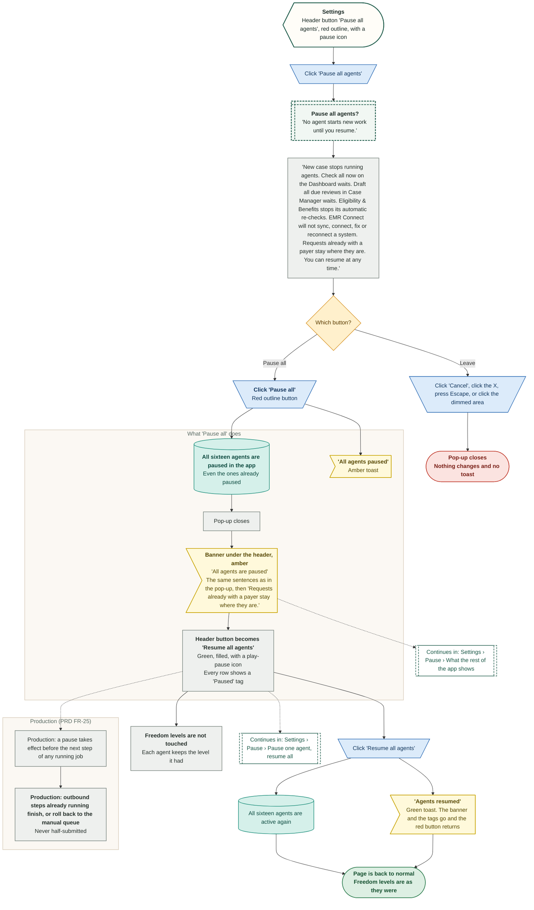

## Settings › Pause › Pause one agent, resume all

Each row has its own switch. Turning one off pauses that agent: its row gets a 'Paused' tag and an amber banner names it and says what it holds back. The banner carries a 'Resume all agents' button.

Route: `/settings`

The header button follows the count. It reads 'Resume all agents' only when all sixteen are paused. The switch's accessible name is the agent's name and whether it is paused or working.

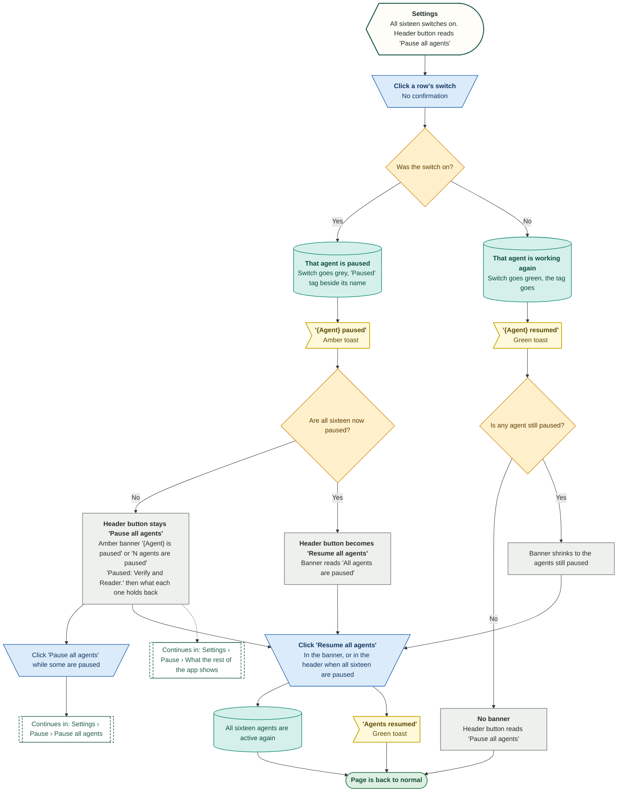

## Settings › Pause › What the rest of the app shows

Pausing on Settings is shared with the rest of the app. Each screen that uses a paused agent holds that work and says so, and the pause shows on Settings too. This lists what each place does.

Route: `/settings`

Found by reading the code and testing the built demo. There is one pause for the whole app: the 'Pause all agents' button on New case is the same switch as Settings. 'Reset demo data' lifts it.

```mermaid
%%{init: {"theme":"base","themeVariables":{"fontFamily":"'DM Sans', 'Segoe UI', system-ui, sans-serif","fontSize":"15px","lineColor":"#5B6B63","primaryTextColor":"#1C2B25","clusterBkg":"#FBF8F3","clusterBorder":"#D9CDBB","edgeLabelBackground":"#FFFFFF"},"flowchart":{"curve":"basis","nodeSpacing":36,"rankSpacing":48,"padding":12,"htmlLabels":true,"useMaxWidth":false,"wrappingWidth":230}} }%%
flowchart TD
  classDef k_start fill:#1F5C4B,stroke:#174638,color:#FFFFFF,stroke-width:1.5px,font-weight:600
  classDef k_end fill:#DDEFE3,stroke:#2E7D4F,color:#14502F,stroke-width:1.5px,font-weight:600
  classDef k_endx fill:#FBE3E0,stroke:#C0392B,color:#7A1F16,stroke-width:1.5px,font-weight:600
  classDef k_screen fill:#FFFDF8,stroke:#1F5C4B,color:#1C2B25,stroke-width:2px
  classDef k_overlay fill:#F1F7F3,stroke:#1F5C4B,color:#1C2B25,stroke-width:2px,stroke-dasharray:5 3
  classDef k_click fill:#DCEBFA,stroke:#2F6DB5,color:#12365F,stroke-width:1.5px
  classDef k_input fill:#E4E7FF,stroke:#4C5FD5,color:#1D2670,stroke-width:1.5px
  classDef k_process fill:#EEF0EE,stroke:#7A857F,color:#26302B,stroke-width:1.5px
  classDef k_agent fill:#EEE5FA,stroke:#7A4FC2,color:#341A63,stroke-width:1.5px
  classDef k_decision fill:#FFF0CC,stroke:#D9962B,color:#5C3B00,stroke-width:1.5px
  classDef k_store fill:#D5F0EA,stroke:#1C8E7B,color:#0B4A3F,stroke-width:1.5px
  classDef k_doc fill:#F6E9DC,stroke:#B07A4C,color:#4A2E14,stroke-width:1.5px
  classDef k_ext fill:#FFE6D2,stroke:#E07B39,color:#6B2F06,stroke-width:1.5px
  classDef k_wait fill:#E4E8EE,stroke:#6B7C93,color:#26303D,stroke-width:1.5px
  classDef k_toast fill:#FFF9DB,stroke:#C9A400,color:#5A4A00,stroke-width:1.5px
  classDef k_goto fill:#FFFFFF,stroke:#1F5C4B,color:#1F5C4B,stroke-width:1.5px,stroke-dasharray:5 3
  s1@{ shape: stadium, label: "<b>Pause an agent on Settings</b><br/>Its switch, or 'Pause all agents' then 'Pause all'" }
  p1@{ shape: cyl, label: "<b>The pause is saved in the app</b><br/>Every screen reads the same switch" }
  t1@{ shape: odd, label: "<b>The banner on Settings says what is held back, agent by agent</b><br/>For example 'Paused: Verify and Reader.' then one sentence for each screen" }
  subgraph gNew ["New case › Authorization preparation"]
  n1@{ shape: curv-trap, label: "<b>Authorization preparation</b><br/>Ten agents in a row, then 'Back', 'Pause all agents', 'Skip ahead', 'Review & submit'" }
  n3@{ shape: rect, label: "<b>The run holds when it reaches a paused agent</b><br/>Its row shows a 'Paused' pill, the clock chip stops and 'Skip ahead' is dimmed" }
  n4@{ shape: odd, label: "<b>Banner 'Agents are paused in Settings' or '{Agent} is paused in Settings'</b><br/>'Nothing is read, checked or drafted until it is resumed. Nothing has been sent to the payer.'" }
  n6@{ shape: trap-t, label: "Click 'Resume agents' or 'Resume {Agent}'" }
  n7@{ shape: stadium, label: "Agents carry on from where they stopped" }
  n2@{ shape: trap-t, label: "<b>Click 'Pause all agents' in the step footer</b><br/>The same pause as on Settings, so Settings shows it too" }
  end
  subgraph gDash ["Dashboard"]
  o1@{ shape: rect, label: "<b>Navigator paused: 'Check all now' is dimmed</b><br/>A link under it reads 'Navigator is paused in Settings'" }
  end
  subgraph gMgr ["Case Manager"]
  m1@{ shape: rect, label: "<b>Cadence paused: 'Draft all due reviews' drafts nothing</b><br/>Toast 'Cadence is paused in Settings'<br/>'It drafts no reviews until you resume it there.'" }
  end
  subgraph gElig ["Eligibility & Benefits"]
  e1@{ shape: rect, label: "<b>Verify paused: the automatic re-checks do not run</b><br/>Rows read 'Not re-checked: Verify is paused in Settings'" }
  e2@{ shape: rect, label: "Verify resumed: it catches up with every re-check that came due" }
  end
  subgraph gEmr ["EMR Connect"]
  x1@{ shape: rect, label: "<b>Reader paused: 'Sync now' and 'Connect a system' show 'Reader is paused'</b><br/>Navigator paused: 'Fix' and 'Reconnect' show 'Navigator is paused'<br/>Map and Disconnect still work" }
  end
  n8@{ shape: rect, label: "<b>Screens that do not read the pause</b><br/>Authorizations queue and case page, Denial Intelligence, Analytics, Payers, Ask FLO" }
  subgraph gReal ["Production (PRD FR-25)"]
  r1@{ shape: rect, label: "Production: the operator can pause one agent, one payer channel or all outbound actions at once" }
  r2@{ shape: rect, label: "<b>Production: a pause takes effect before the next step of any running job</b><br/>Steps already going out finish, or roll back to the manual queue" }
  end
  g1@{ shape: subproc, label: "Continues in: Authorizations › New case › Authorization preparation › Finished, paused or left" }
  g2@{ shape: subproc, label: "Continues in: Dashboard › Header › Check all now and the demo clock" }
  g3@{ shape: subproc, label: "Continues in: Case Manager › Reviews this week › Draft all due reviews and sign all clean drafts" }
  g4@{ shape: subproc, label: "Continues in: Authorizations › Eligibility & Benefits › List › What the screen shows" }
  g5@{ shape: subproc, label: "Continues in: EMR Connect › Sync › When an agent is paused or asks first" }
  g6@{ shape: subproc, label: "Continues in: Settings › Pause › Pause all agents" }
  s1 --> p1 --> t1
  p1 --> n1 & o1 & m1 & e1 & x1
  p1 -.-> n8
  n1 --> n3 --> n4 --> n6 --> n7
  n2 --> p1
  n3 -.-> g1
  o1 -.-> g2
  m1 -.-> g3
  e1 --> e2
  e1 -.-> g4
  x1 -.-> g5
  t1 -.-> r1
  r1 --> r2
  r2 -.-> g6
  class s1 k_start
  class p1 k_store
  class t1,n4 k_toast
  class n1 k_screen
  class n3,o1,m1,e1,e2,x1,n8,r1,r2 k_process
  class n6,n2 k_click
  class n7 k_end
  class g1,g2,g3,g4,g5,g6 k_goto
  style gNew fill:#FBF8F3,stroke:#D9CDBB,stroke-width:1.5px,color:#5B6B63
  style gDash fill:#FBF8F3,stroke:#D9CDBB,stroke-width:1.5px,color:#5B6B63
  style gMgr fill:#FBF8F3,stroke:#D9CDBB,stroke-width:1.5px,color:#5B6B63
  style gElig fill:#FBF8F3,stroke:#D9CDBB,stroke-width:1.5px,color:#5B6B63
  style gEmr fill:#FBF8F3,stroke:#D9CDBB,stroke-width:1.5px,color:#5B6B63
  style gReal fill:#FBF8F3,stroke:#D9CDBB,stroke-width:1.5px,color:#5B6B63
```

## Settings › Page › Other controls and notices

Everything on the Settings page that is not an agent row or the pause button: the sidebar item, the always-on notices, the Gates card, the levels card, tooltips, toasts and the things the page does not have.

Route: `/settings`

Found by reading the page and testing it. There is no Save, Apply or Reset button anywhere on the page: every change is kept at once.

```mermaid
%%{init: {"theme":"base","themeVariables":{"fontFamily":"'DM Sans', 'Segoe UI', system-ui, sans-serif","fontSize":"15px","lineColor":"#5B6B63","primaryTextColor":"#1C2B25","clusterBkg":"#FBF8F3","clusterBorder":"#D9CDBB","edgeLabelBackground":"#FFFFFF"},"flowchart":{"curve":"basis","nodeSpacing":36,"rankSpacing":48,"padding":12,"htmlLabels":true,"useMaxWidth":false,"wrappingWidth":230}} }%%
flowchart TD
  classDef k_start fill:#1F5C4B,stroke:#174638,color:#FFFFFF,stroke-width:1.5px,font-weight:600
  classDef k_end fill:#DDEFE3,stroke:#2E7D4F,color:#14502F,stroke-width:1.5px,font-weight:600
  classDef k_endx fill:#FBE3E0,stroke:#C0392B,color:#7A1F16,stroke-width:1.5px,font-weight:600
  classDef k_screen fill:#FFFDF8,stroke:#1F5C4B,color:#1C2B25,stroke-width:2px
  classDef k_overlay fill:#F1F7F3,stroke:#1F5C4B,color:#1C2B25,stroke-width:2px,stroke-dasharray:5 3
  classDef k_click fill:#DCEBFA,stroke:#2F6DB5,color:#12365F,stroke-width:1.5px
  classDef k_input fill:#E4E7FF,stroke:#4C5FD5,color:#1D2670,stroke-width:1.5px
  classDef k_process fill:#EEF0EE,stroke:#7A857F,color:#26302B,stroke-width:1.5px
  classDef k_agent fill:#EEE5FA,stroke:#7A4FC2,color:#341A63,stroke-width:1.5px
  classDef k_decision fill:#FFF0CC,stroke:#D9962B,color:#5C3B00,stroke-width:1.5px
  classDef k_store fill:#D5F0EA,stroke:#1C8E7B,color:#0B4A3F,stroke-width:1.5px
  classDef k_doc fill:#F6E9DC,stroke:#B07A4C,color:#4A2E14,stroke-width:1.5px
  classDef k_ext fill:#FFE6D2,stroke:#E07B39,color:#6B2F06,stroke-width:1.5px
  classDef k_wait fill:#E4E8EE,stroke:#6B7C93,color:#26303D,stroke-width:1.5px
  classDef k_toast fill:#FFF9DB,stroke:#C9A400,color:#5A4A00,stroke-width:1.5px
  classDef k_goto fill:#FFFFFF,stroke:#1F5C4B,color:#1F5C4B,stroke-width:1.5px,stroke-dasharray:5 3
  s1@{ shape: stadium, label: "Click 'Settings' in the sidebar" }
  p1@{ shape: curv-trap, label: "<b>Settings</b><br/>The sidebar item turns forest green while the page is open" }
  subgraph gBan ["Notices"]
  b1@{ shape: odd, label: "<b>'Privacy mode is always on'</b><br/>Names, dates and IDs are swapped for codes before an agent reads a chart, and mapped back only on your screen.<br/>No switch: it cannot be turned off" }
  b2@{ shape: odd, label: "<b>'All agents are paused', or '{Agent} is paused' and 'N agents are paused'</b><br/>Amber, while any agent is paused<br/>Says what is held back, then 'Requests already with a payer stay where they are.'" }
  end
  subgraph gLev ["Levels card: 'What each level changes'"]
  v1@{ shape: rect, label: "Subtitle 'Set per agent. Applied in EMR Connect'" }
  v2@{ shape: rect, label: "<b>Ask before acting, Act, then report and Act on its own</b><br/>One plain line for each" }
  end
  subgraph gGate ["Gates card: 'Agents never pass these without a person'"]
  g1@{ shape: rect, label: "Sign-off: A licensed clinician signs every request and appeal." }
  g2@{ shape: rect, label: "Confirm: The case owner confirms before agents start, before a next step on a denial, and before any write-back." }
  g3@{ shape: rect, label: "Answer: A person answers when an agent asks a question." }
  g4@{ shape: rect, label: "Acknowledge: A person acknowledges a payer rule change before drafts are updated." }
  g5@{ shape: rect, label: "Pause: An operator can pause one agent or all of them." }
  end
  h1@{ shape: trap-t, label: "Hover a round agent icon" }
  h2@{ shape: rect, label: "<b>Tooltip shows the agent and its role</b><br/>For example 'Reader: Reads the chart, protects identifiers'" }
  h3@{ shape: rect, label: "A long role is cut short with an ellipsis on the row" }
  subgraph gToast ["Toasts on this page"]
  t1@{ shape: odd, label: "<b>'{Agent}: {level}'</b><br/>When a different Freedom level is picked" }
  t2@{ shape: odd, label: "<b>'All agents paused'</b><br/>When 'Pause all' is confirmed" }
  t3@{ shape: odd, label: "<b>'Agents resumed'</b><br/>When 'Resume all agents' is clicked" }
  t5@{ shape: odd, label: "<b>'{Agent} paused' or '{Agent} resumed'</b><br/>When one switch is turned" }
  t4@{ shape: delay, label: "<b>A toast stays about four seconds</b><br/>Click it to dismiss it sooner" }
  end
  subgraph gNone ["What the page does not have"]
  n1@{ shape: stadium, label: "<b>No Save, Apply or Reset button</b><br/>No way to change the Gates or the privacy notice<br/>No edit control for who can see which site: the roles are fixed, and 'View as' only switches the viewer" }
  n2@{ shape: stadium, label: "<b>Choices are lost on a reload</b><br/>Every agent returns to its starting level and switch. Leaving the page keeps them" }
  end
  d1@{ shape: trap-t, label: "<b>Demo menu, then 'Reset demo data'</b><br/>Top bar, any page" }
  d2@{ shape: rect, label: "<b>Goes to the Dashboard with the toast 'Demo data reset'</b><br/>Every agent is back at its starting level with its switch on" }
  x1@{ shape: subproc, label: "Continues in: Settings › Agents › Change an agent's freedom" }
  x2@{ shape: subproc, label: "Continues in: Settings › Pause › Pause all agents" }
  x3@{ shape: subproc, label: "Continues in: Global shell › Demo menu › Reset demo data" }
  s1 --> p1
  p1 --> b1 & b2
  b2 -.-> x2
  p1 --> v1 --> v2
  p1 --> g1 --> g2 --> g3 --> g4 --> g5
  g5 -.-> x2
  p1 --> h1 --> h2 --> h3
  p1 --> t1
  t1 --> t2 --> t3 --> t5 --> t4
  t1 -.-> x1
  p1 -.-> n1
  n1 --> n2
  n2 -.-> d1
  d1 --> d2 --> x3
  class s1 k_start
  class p1 k_screen
  class b1,b2,t1,t2,t3,t5 k_toast
  class v1,v2,g1,g2,g3,g4,g5,h2,h3,d2 k_process
  class h1,d1 k_click
  class t4 k_wait
  class n1,n2 k_endx
  class x1,x2,x3 k_goto
  style gBan fill:#FBF8F3,stroke:#D9CDBB,stroke-width:1.5px,color:#5B6B63
  style gLev fill:#FBF8F3,stroke:#D9CDBB,stroke-width:1.5px,color:#5B6B63
  style gGate fill:#FBF8F3,stroke:#D9CDBB,stroke-width:1.5px,color:#5B6B63
  style gToast fill:#FBF8F3,stroke:#D9CDBB,stroke-width:1.5px,color:#5B6B63
  style gNone fill:#FBF8F3,stroke:#D9CDBB,stroke-width:1.5px,color:#5B6B63
```

## Settings › Agent map › Which agents work in which flow

The sixteen agents on Settings are named all over the app. This follows the journey of a case through the sidebar and lists the agents that act on each screen, as the demo shows them.

Route: `/settings`

Built by searching the code for where each agent appears. Sentinel has no screen of its own, only a notification. The next diagram lists the same thing agent by agent.

```mermaid
%%{init: {"theme":"base","themeVariables":{"fontFamily":"'DM Sans', 'Segoe UI', system-ui, sans-serif","fontSize":"15px","lineColor":"#5B6B63","primaryTextColor":"#1C2B25","clusterBkg":"#FBF8F3","clusterBorder":"#D9CDBB","edgeLabelBackground":"#FFFFFF"},"flowchart":{"curve":"basis","nodeSpacing":36,"rankSpacing":48,"padding":12,"htmlLabels":true,"useMaxWidth":false,"wrappingWidth":230}} }%%
flowchart TD
  classDef k_start fill:#1F5C4B,stroke:#174638,color:#FFFFFF,stroke-width:1.5px,font-weight:600
  classDef k_end fill:#DDEFE3,stroke:#2E7D4F,color:#14502F,stroke-width:1.5px,font-weight:600
  classDef k_endx fill:#FBE3E0,stroke:#C0392B,color:#7A1F16,stroke-width:1.5px,font-weight:600
  classDef k_screen fill:#FFFDF8,stroke:#1F5C4B,color:#1C2B25,stroke-width:2px
  classDef k_overlay fill:#F1F7F3,stroke:#1F5C4B,color:#1C2B25,stroke-width:2px,stroke-dasharray:5 3
  classDef k_click fill:#DCEBFA,stroke:#2F6DB5,color:#12365F,stroke-width:1.5px
  classDef k_input fill:#E4E7FF,stroke:#4C5FD5,color:#1D2670,stroke-width:1.5px
  classDef k_process fill:#EEF0EE,stroke:#7A857F,color:#26302B,stroke-width:1.5px
  classDef k_agent fill:#EEE5FA,stroke:#7A4FC2,color:#341A63,stroke-width:1.5px
  classDef k_decision fill:#FFF0CC,stroke:#D9962B,color:#5C3B00,stroke-width:1.5px
  classDef k_store fill:#D5F0EA,stroke:#1C8E7B,color:#0B4A3F,stroke-width:1.5px
  classDef k_doc fill:#F6E9DC,stroke:#B07A4C,color:#4A2E14,stroke-width:1.5px
  classDef k_ext fill:#FFE6D2,stroke:#E07B39,color:#6B2F06,stroke-width:1.5px
  classDef k_wait fill:#E4E8EE,stroke:#6B7C93,color:#26303D,stroke-width:1.5px
  classDef k_toast fill:#FFF9DB,stroke:#C9A400,color:#5A4A00,stroke-width:1.5px
  classDef k_goto fill:#FFFFFF,stroke:#1F5C4B,color:#1F5C4B,stroke-width:1.5px,stroke-dasharray:5 3
  s1@{ shape: stadium, label: "A case's journey down the sidebar" }
  flo@{ shape: rect, label: "<b>FLO is not one of the sixteen</b><br/>Ask FLO, in the top bar, answers a question from your data" }
  emr@{ shape: curv-trap, label: "<b>EMR Connect</b><br/>Reader: pulls files, matches charts, maps fields<br/>Verify: re-checks coverage<br/>Navigator: renews sign-ins, reconnects, write-back, disconnects" }
  elig@{ shape: curv-trap, label: "<b>Authorizations › Eligibility & Benefits</b><br/>Reader, Verify: ask each source<br/>Caller: phones if a system does not answer<br/>Criteria: is authorization required<br/>Navigator: is the clinic enrolled to bill" }
  ref@{ shape: curv-trap, label: "<b>Authorizations › New case › Intake, Eligibility & Benefits and Clinical documentation</b><br/>Reader: reads each file and the referral<br/>Verify: Coverage tab, and the check on Eligibility & Benefits<br/>Placement: Fit tab<br/>Criteria: Decline reasons" }
  run@{ shape: curv-trap, label: "<b>Authorizations › New case › Authorization preparation</b><br/>Ten in order: Reader, Verify, Criteria, Historian, Placement, Forecaster, Scribe, Integrity, Packet, Scrubber<br/>Scribe and Packet may ask one question" }
  sign@{ shape: curv-trap, label: "<b>Authorizations › New case › Review & submit</b><br/>Integrity: every sentence traces to the chart<br/>A licensed clinician signs" }
  auth@{ shape: curv-trap, label: "<b>Authorizations › Queue and Case page</b><br/>Criteria: what the payer asks for<br/>Scribe, Integrity, Forecaster: update the draft and re-score the chance<br/>Each row shows the agent holding the request" }
  mgr@{ shape: curv-trap, label: "<b>Case Manager</b><br/>Each case shows the agent working on it<br/>Reviews this week: drafted by Scribe or Cadence" }
  dash@{ shape: curv-trap, label: "<b>Dashboard</b><br/>Navigator: sends signed requests, checks status<br/>Caller: phones if still pending<br/>Packet: drafts the answer to an information request<br/>Integrity: checks it<br/>Cadence: ledger, next review, write-back" }
  den@{ shape: curv-trap, label: "<b>Denial Intelligence</b><br/>Reader: reads the letter<br/>Advocate: checks the notice, drafts the appeal<br/>Historian: compares similar decisions<br/>Integrity: checks every statement<br/>Cadence: books the peer-to-peer<br/>Navigator: files the appeal after a signature" }
  pay@{ shape: curv-trap, label: "<b>Payers</b><br/>Historian: proposals on Changes<br/>Scribe, Integrity: redraft open drafts<br/>Process tab names Navigator, Caller, Packet and others on each step<br/>Sentinel: only the 'Payer rule changed' notification" }
  note@{ shape: curv-trap, label: "<b>Top bar › Notifications</b><br/>Every item carries the agent that raised it<br/>Advocate, Cadence, Caller, Navigator, Packet, Reader, Scribe, Forecaster, Sentinel" }
  ana@{ shape: curv-trap, label: "<b>Analytics</b><br/>Analyst: builds the monthly report" }
  g1@{ shape: subproc, label: "Continues in: Settings › Agent map › Where each of the sixteen agents works" }
  s1 --> emr & elig
  s1 -.-> flo
  emr -->|"Pull a chart"| ref
  elig -->|"Coverage checked"| ref
  ref --> run --> sign
  sign -->|"Sign and send"| dash
  run -.-> mgr
  auth -.-> mgr
  mgr --> sign
  dash -->|"Denied or partly approved"| den
  pay -.->|"Rule change updates drafts"| run
  dash --> ana
  den --> ana
  dash -.-> note
  den -.-> note
  pay -.-> note
  ana --> g1
  class s1 k_start
  class flo k_process
  class emr,elig,ref,run,sign,auth,mgr,dash,den,pay,note,ana k_screen
  class g1 k_goto
```

## Settings › Agent map › Where each of the sixteen agents works

The sixteen agents, four crews as on the Settings page, and every screen where the demo shows each one acting. Read it with the flow-by-flow map.

Route: `/settings`

Taken from the code. An agent that appears only in a notification (Sentinel) is marked as such.

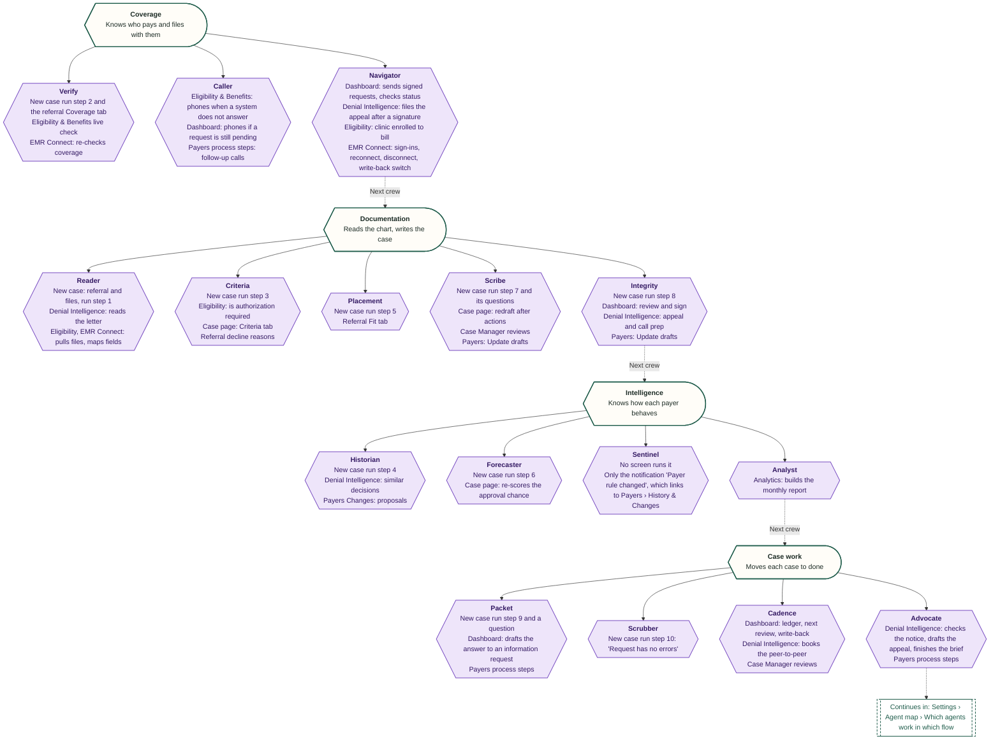

## Settings › Sites and access › Read the roles and switch with View as

A closed card on Settings that shows the rule the demo follows on every screen: access is by site (minimum necessary). A small table lists the four demo roles and the sites each can see, and 'View as' switches to a role, exactly as 'Viewing as' in the Demo menu does. It shows the rule; it is not an admin tool, so there is nothing to edit.

Route: `/settings`

Demo only. The viewer is not saved between reloads. Settings itself is clinic-wide: the agents, their levels and Pause all are the same for every viewer.

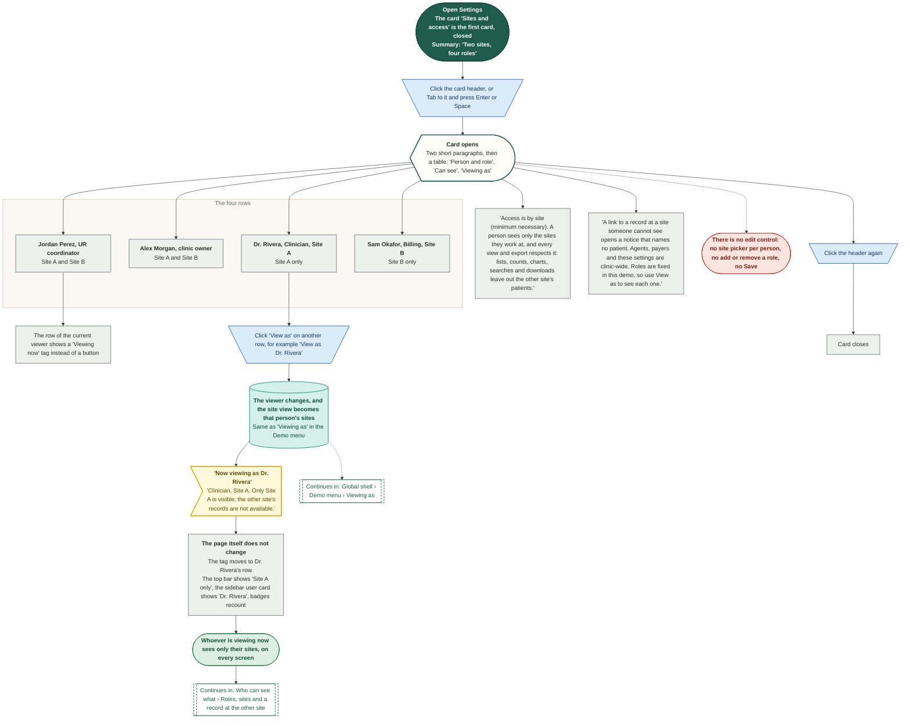
