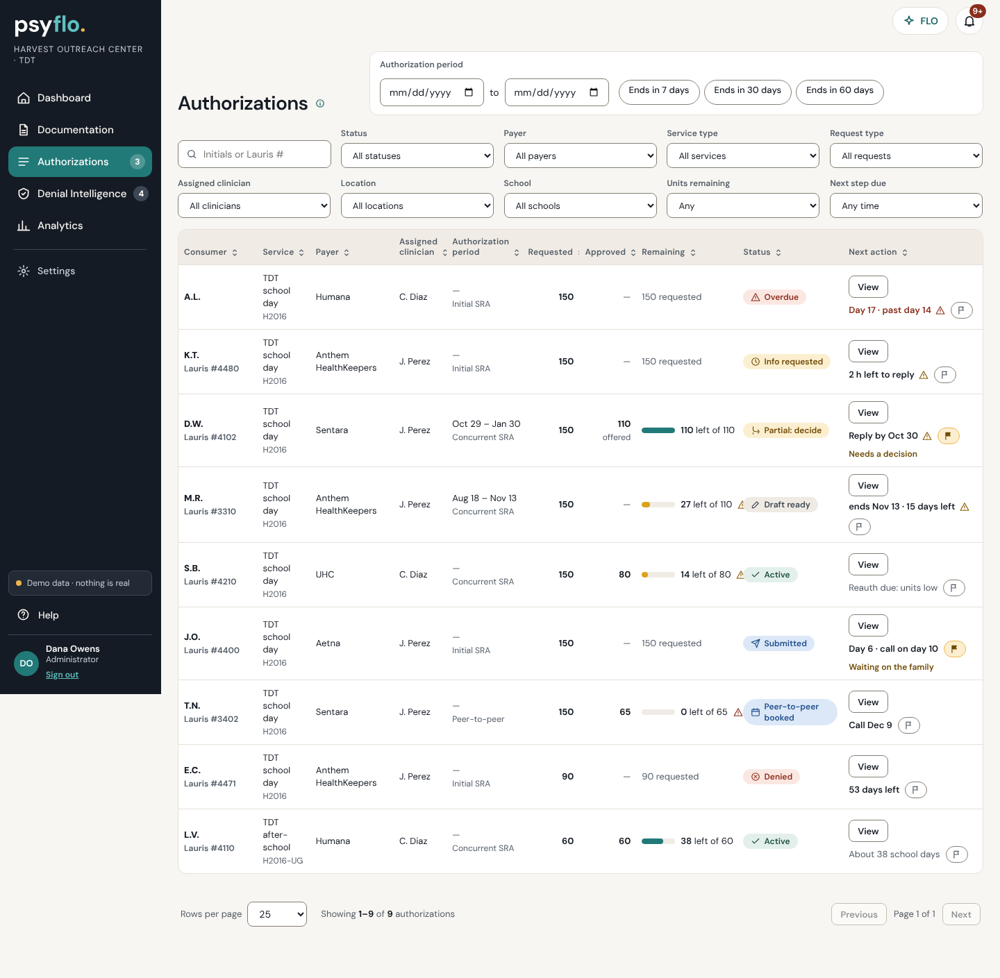
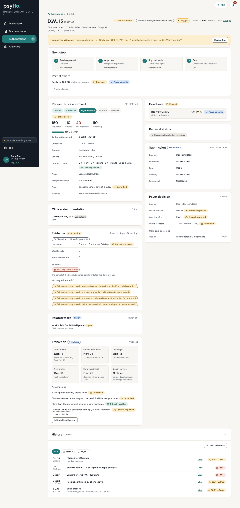
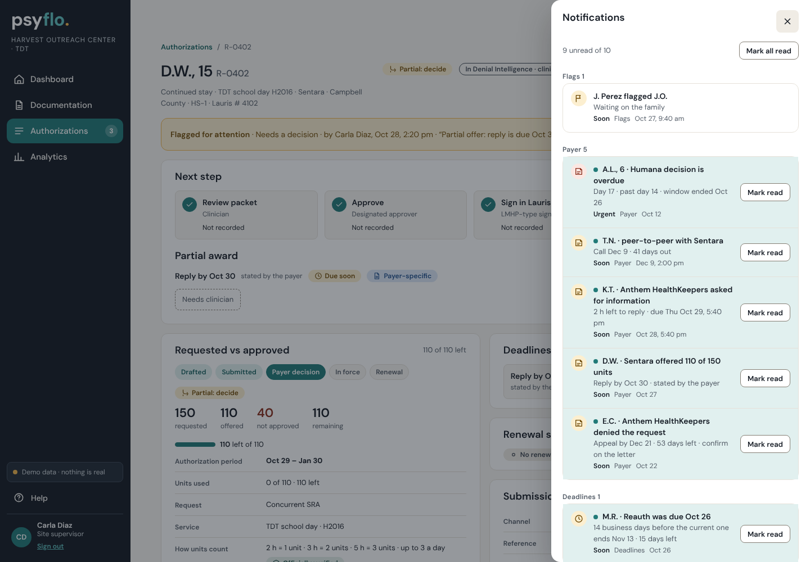
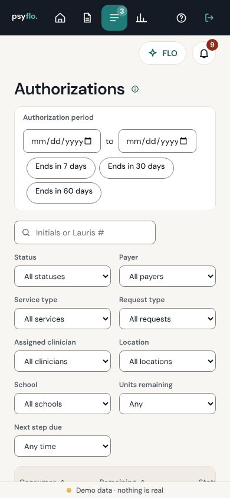

# Round 3 (Nov 12) · Authorizations: the list, the case page, History, flags and the bell

The product owner asked for the artifact's All Authorizations list and authorization page ("when I click inside an authorization it should look like the artifact"), **flags**, **a separate notification system**, the artifact's **History**, and flags on the deadline ("by time") column. The administrator view is the master; every other role that may open Authorizations gets the same screens with its own scope. Synthetic data only.

## What the screens look like now

| Screen | What changed |
|---|---|
| **Authorizations** (list) | The artifact's layout: an "Authorization period" card top right (From, To, and *Ends in 7 / 30 / 60 days*, with a line saying what the dates match), ten filters in a 5 × 2 grid (Search · Status · Payer · Service type · Request type · Assigned clinician · Location · School · Units remaining · Next step due), and one table: **Consumer · Service · Payer · Assigned clinician · Authorization period · Requested · Approved · Remaining · Status · Next action**. Status is a dropdown (the chips are gone, as in the artifact) and has a **Flagged** option. *Remaining* keeps the one-bar unit display (yellow from 75% used). *Next action* holds the one button, the dated deadline with its warning icon, and the **flag button**; a flagged row also names the reason. The pager (10 / 25 / 50 / 100) is at the bottom; there is no "N of M" at the top. |
| **Authorization** (case page) | Header with the flag button and owner; a flag banner when somebody flagged it; the primary "Next step" panel (unchanged behaviour: review, approve, sign, send are still done by people with the capability); then the artifact's two columns of cards: *Requested vs approved* (stepper, requested / approved or offered / not approved / remaining, unit bar, period, request, service, how units count with its source chip, payer, clinician, pace, units used, the Enter-units-in-Lauris task) · *Clinical documentation* · *Evidence* · *Related tasks* · *Transition* on the left, *Deadlines* · *Renewal status* · *Submission* · *Payer decision* on the right; **History** full width below. |
| **History** | The artifact's block: a count, a filter by who did it, a row per step (date and time, the step, a detail line, a *View* link, an **actor tag**), a pop-up per row (What · When · Who · Document · Source · Next action), and **Add to history** (call, note, document received, payer contact; audited, sends nothing). Actor tags: Voice agent · Psyflo agent · Psyflo · Staff · From Lauris · Payer. |
| **The bell** (top bar) | A separate notification centre. The number on the bell is the unread count; the drawer is grouped Flags / Payer / Deadlines / Units / Notes, each item opens its record, *Mark read* and *Mark all read* are per person. |

## Captures (synthetic data)

| Screen | Capture |
|---|---|
| Authorizations, administrator, 1440 px |  |
| Authorization case page with the flag banner and History, site supervisor, 1440 px |  |
| The bell, site supervisor |  |
| Authorizations at phone width, 390 px |  |

## Flags

- A flag is workflow, not clinical. The person picks a **reason from a short list** (Needs a decision, Deadline is close, Units running low, Payer follow-up needed, Waiting on the family, Documents missing, Other) and may add a one-line note (140 characters, "no clinical details").
- **The note is shown only to clinicians and to the person who wrote it** (server projection); administrators and supervisors see the reason, who and when. The audit text says `Flagged for attention · <reason>`; the note never goes into the audit text. This keeps "the administrator sees status, never clinical text" true for a free-text field.
- One open flag per request. Anyone who may open Authorizations (`authorizations` capability: clinician, supervisor, administrator) can raise or clear it; clearing somebody else's flag is recorded as `Flag cleared (raised by <name>)`. Direct support cannot see or raise flags (403).
- Where it shows: the flag button in the *Next action* cell of every row, the *Flagged* status, the banner and button on the case page, History (Flagged / Flag cleared rows), the *Deadlines* card, and the bell.

## Notifications (computed, per person, nothing is sent)

`web/js/shared/sel/notify.js` computes the list from the role-projected state; nothing is stored except what a person has read (`state.notify_read[personId]`, written by `notify.read`, not an audit event, and each person's projection holds only their own list). Sources: a flag raised by somebody else; payer items (information requested, partial offer, denial, peer-to-peer, decision overdue, follow-up call due); deadlines that are soon or overdue; units at the warning threshold (`units.warn_used_pct`) or none left; for direct support only, notes sent back. A role never gets an item about a record it cannot open (direct support: own patients' units and notes only; no payer or flag items). Ids are computed from the record and the situation (`payer:R-0402:partial`), so a new situation on the same record is unread again. The bell sends no email, text or push.

## Artifact modules mapped to files

| Artifact | Unified |
|---|---|
| `80-auth-list` (list, filters, period card, columns, `fromParams`) | `web/js/screens/Authorizations.js`, `web/screens/Authorizations.dc.html`, `web/js/shared/sel/auth.js` (`authQueue`, `rowOf`, `normalizeParams`, `queueOptions`) |
| `80-auth-list` detail (`unitsCard`, `docsCard`, `deadlinesCard`, `renewalCard`, `submissionCard`, `correspondenceCard`) | `web/js/screens/Authorization.js` (`sec_units`, `sec_documents`, `deadlinesCard`, `renewalCard`, `sec_submission`, `sec_payer`), `a-css.js` |
| `08-history` (actors, rows, filter, pop-ups, add) | `historyOf` in `sel/auth.js`, `historyBlock` / `openHist` / `histAdd` in `Authorization.js`, action `history.add` |
| flags, bell (the artifact's top-right icons) | `server/psyflo/actions/x-flags.js`, `web/js/screens/a-flag.js`, `web/js/ui/bell.js`, `web/js/shared/sel/notify.js` |

## Kept from the unified demo although the artifact does otherwise

- A person starts every send, signature and approval; the case page's Next step panel is unchanged. The History "Voice agent" and "Psyflo agent" tags only describe steps the demo already records (the Sfax stub is the *Psyflo agent*, marked **Simulated**). A *Voice agent* row appears only when an event carries `actor_kind: 'voice'` (the Denial Intelligence work logs those; always Simulated).
- Units are shown as the one bar "N left of M" (feedback Nov 11) inside the artifact's *Remaining* column, with *Units used* in the case card.
- The artifact's Status dropdown values map to the unified status groups (Needs action, Draft, Awaiting signature, Submitted, Active, Renewal due) plus Flagged. A `stage=` link still works and shows a "Stage: … · Clear stage" strip because the artifact has no stage dropdown.
- History is built from the audit trail plus the dates the request implies; schedule rows (follow-up due, decision window, reauth due) stay in *Deadlines*, not in History. The one Psyflo-rule label is "Psyflo" (drafts and rule-based checks), not "Psyflo AI": nothing here is a model call.
- Role scope is unchanged: no capability cell was widened. `request.flag` and `history.add` need `authorizations`; `notify.read` needs `myWork`.

## Tests

`test/flags.mjs` (new, 16 tests): flag rules (reason list, one per request, clear, audit with who and when, note kept out of the audit text, note visibility by role, direct support 403), notifications (computed ids, role scope, per-person read state, a new situation is unread again, not an audit event), History (actor kinds, no schedule rows, `history.add` audited), and the screens (flag from the list, the other person's bell, bell drawer and keyboard, direct support's bell, case banner and clear, History filter, pop-up and add, phone width 390 with 24 px targets). `test/authorizations.mjs` was rewritten where it described the old UI (Status dropdown instead of chips, the ten artifact columns and the ten-filter grid, the pager, the History pop-up replacing the timeline drawer). `test/s1.mjs`, `s3.mjs` and `parity.mjs` (V-007, V-008) read the new card titles and History.

## Files

New: `server/psyflo/actions/x-flags.js`, `seed/extra/flags.json`, `seed/extra/history.json` (two backdated events for R-0411 so its History is not empty), `web/js/shared/sel/notify.js`, `web/js/ui/bell.js`, `web/js/screens/a-flag.js`, `test/flags.mjs`, this file. Rewritten: `Authorizations.js` and `.dc.html`, `Authorization.js`. Extended: `web/js/shared/sel/auth.js`, `web/js/screens/a-css.js`. Shared-file hunks: `web/js/app.js` (one import line for the bell), `web/css/components.css` (the bell number is 12 px, not 11, to pass the 12 px text rule).
