# 03 · UX before and after

> **Update, Nov 11.** Written before the direct support and site supervisor feedback round. Where this document describes **My Work** (the logo target, its To do, Review and Team sections) or **Track Time**, read the current product instead: the rail is patient-first (Dashboard, Documentation, Authorizations, Denial Intelligence, Analytics), My Work's sections moved to the Dashboard and Documentation, and Track Time was removed. See `docs/FEEDBACK-ROUND-2026-11-11.md`.

Deliverable 3 (prompt Part 21, item 3) · Nov 11, 2026 · Psyflo × Harvest unified demo

This document says what got simpler, by how much, and what did not. "Before" is the pristine Nov 8 master (commit `d9e0537`). "After" is the unified build in this folder. The numbers come from Playwright runs on both builds with one counting function; where a number is traced from labels and tests instead of clicked, it is tagged.

Synthetic data only. The extension was measured as the in-page 400 px panel next to the mock Lauris, not as the real MV3 side panel in Chrome, which has not been run.

## 1. How the numbers were taken

The counting rule is the one in `review/03b-density-audit.md`, applied unchanged.

- **Scope:** visible DOM inside the screen root (`#root`, or `#panel` for the extension), full page height. The old demo bar and the new presenter dock are excluded from screen counts and reported separately.
- **Primary navigation choices:** persistent links in the rail or sidebar.
- **Visible actions:** buttons, links, summaries and form fields. Row-level buttons count once per row, on purpose.
- **Explanatory paragraphs:** leaf text blocks of 12 or more words (10 in the panel) that are not inside controls, table cells, labels, headings or chips.
- **Cards above the main task:** bordered, rounded containers whose bottom edge is above the first row, table head or primary action.
- **Words on screen:** all visible words in the screen root.

Before numbers were re-measured on a copy of the Nov 8 tree on ports 4980 to 4982 and match `03b` on every screen re-measured (19 platform and phone screens, 5 panel states). After numbers were taken on this build, Live preset, 1440×900 for the platform, 390×844 for phone and portals, a 1,300 px tall frame for the panel. Tags: [M] clicked or measured in this run, [T] traced from screen labels and the QA suites.

Not measured: a screen-reader session, the real Chrome side panel, Safari, Firefox, a venue network.

## 2. Headline results

| Measure | Before | After |
|---|---|---|
| Persistent navigation, clinician | 19 (11 sidebar + 8 demo-bar controls) | 5 (My Work, Authorizations, Denial Intelligence, Analytics, Referrals); presenter dock hidden, 0 controls in the product viewport |
| Tab stops before main content, clinician | 20 | 8, or 1 with the skip link [M] |
| Explanatory paragraphs, 15 platform screens | 105 (avg 7.0), 2,298 words | 41 (avg 2.7), 674 words |
| Words on screen, same 15 screens | 6,272 | 3,630 |
| Visible actions, same 15 screens | 150 (avg 10.0) | 233 (avg 15.5) |
| Presenter chrome inside the product | 4 role toggles in the panel, 2 Demo buttons in Authorizations, a 132 px demo bar on phone | none; one navy dock above the viewport, closed by default (0 px) |
| Extension home, clinician | 37 actions, 2,083 px tall | 8 actions, fits one screen |
| Text under 12 px, 20 probed screens | 73 elements | 0 |
| Phone and portal targets under 44 px, 9 screens | 39 of 70 | 1 of 85 |

The pattern in the table is the one `03b` predicted: the old pages were short on controls and heavy on reading, so the build replaced paragraphs with states, chips and drawers. Reading fell by about 70 percent. Controls went up by half, because queues gained sorting, filters and per-row actions, and case pages now hold what used to be three screens. Where that went too far is in section 9.

## 3. Navigation

### The rail

The dark 240 px sidebar with 11 or 12 items and a "four doors" list is now a light rail of about 230 px (it collapses to icons at 1024 px [M], and Authorizations no longer scrolls sideways there; it was 1,119 px wide before). The logo opens My Work. Three large items follow: Authorizations, Denial Intelligence, Analytics. Below a divider, two small links: Referrals and Settings. An item shows only if the signed-in role may open the route it points at, so each role sees a different rail:

| Role | Rail |
|---|---|
| Clinician | Authorizations (3), Denial Intelligence (4), Analytics, Referrals (4) |
| Supervisor | Authorizations, Analytics |
| Admin | Authorizations, Denial Intelligence, Analytics, Settings |
| Direct support | My Work only; the phone and the extension panel are their product |

Counts show only when above zero and carry a spoken sentence ("3 need action"). The rail foot holds "Demo data · nothing is real", Help and the user card. The four doors (extension, phone, family, school) left the product navigation and live in the presenter dock's Surfaces menu.

### My Work

Do next, the supervisor Review queue and the Staff dashboard became sections of one screen, `My Work`, with `?section=todo|review|team|day|referrals`. The clinician list is grouped Today, This week, Waiting on others. Today shows three lines with item-specific verbs ("Send reply", "Send notice", "Open screening") and a "Show all 13" button; the other groups are collapsed. Each line carries its clock and its source chip. The old greeting paragraph and the five identical "Open in Lauris" buttons are gone.

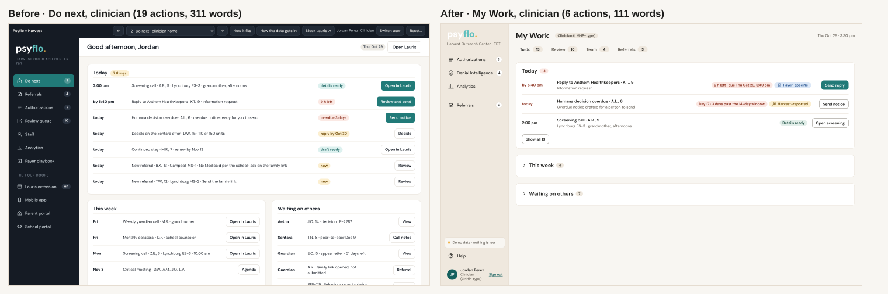

### Redirects

Every historic route id still resolves. Fourteen redirect rules (`web/js/registry.js`, switched on in `web/js/shared/redirects-live.js`) hand old ids to their new place and carry the query. I opened 20 old and new ids as a clinician and read where each landed [M].

| Old route | Lands on |
|---|---|
| `DoNext`, `ReviewQueue`, `StaffDashboard` | `MyWork?section=todo`, `review`, `team` (`day` for direct support) |
| `Users` | `Settings?tab=people` (admin only) |
| `Authorizations?id=…` | `Authorization?id=…` (the queue itself stays `Authorizations`) |
| `Submission?id=…`, `EarlyDischarge?id=…` | `Authorization?id=…&section=submission`, `section=transition` |
| `InfoRequest?id=…`, `Partials?id=…`, `PeerBrief?id=…` | `DenialCase?id=…&section=action&action=info`, `options`, `p2p` |
| `Partials` (no id) | `DenialIntelligence?decision=partial` |
| `PayerPlaybook` | `Analytics?section=payer&panel=guidance` (a drawer) |
| `Eligibility?id=…` or `?referral=…` | `Referral?id=…&panel=eligibility` |
| `WhereThingsLive` | the presenter's Architecture drawer; `?full=1` keeps the page |

`Referrals`, `Referral` and `AppealLetter` are never redirected. `legacy=1` on any URL bypasses a redirect and opens the old screen. A route a role may not open answers "Not available for …" with a way home; a clinician opening `Users` sees that message, which is correct.

### Presentation and Explore

The old navy demo bar, which looked like product chrome, was replaced by a presenter dock that looks like nothing in the product: navy ribbon, dashed marigold edge, monospace PRESENTER label. It sits above the viewport.

- **Presentation mode** (default): the dock is hidden and out of the tab order. `Ctrl+Shift+P` or `?present=1` opens it. The product fills the window.
- **Explore mode** (`?mode=explore`, remembered in the browser): the dock is open as a slim ribbon, with an extra "All screens" picker that is searchable and role-aware, so every route is reachable by the roles that may open it.

The dock holds Scenario (six), Role (six sign-ins, no page reload), Reset (Live flows or Canvas snapshot), Simulate (receive a reply, advance a day on both clocks), Notes (a "How the data gets in" drawer per screen), Maturity (overlay), Surfaces, and the mode toggle. The Demo buttons that sat in the Authorizations header and the four role toggles in the panel home moved here.

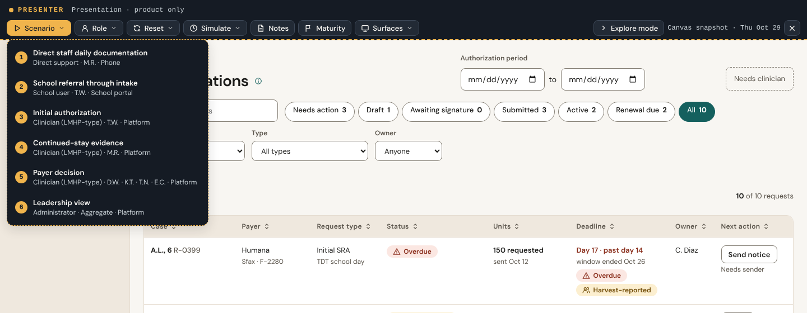

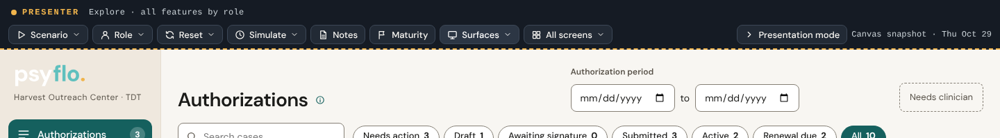

## 4. Platform screens

Counts are Before → After. "Prose" is blocks (words). Clicks are for the key task from the role's first screen unless stated.

| Screen | Visible actions | Prose | Words | Key task, clicks |
|---|---|---|---|---|
| My Work (was Do next) | 19 → 6 | 4 (60) → 0 | 311 → 111 | open the most urgent item: 1 → 1 [M] |
| Referrals queue | 9 → 21 | 0 → 0 | 211 → 159 | open REF-118: 2 → 2 [T] |
| Referral review | 8 → 9 | 10 (225) → 1 (16) | 559 → 148 | send the family link: 2 plus a scroll to y=1,189 → 1 click at y=370 from the page [M], 3 from the rail [T] |
| Eligibility (now a panel) | 5 → 8 | 2 (34) → 2 (32) | 198 → 161 | record the result: 3 → 3 [T] |
| Authorizations queue | 32 → 46 | 6 (87) → 0 | 559 → 475 | open M.R.'s continued stay: 2 → 2 [M] |
| Case shell (was Submission) | 3 → 19 | 2 (29) → 2 (25) | 220 → 208 | send the overdue notice: 2 → 3 with a confirm dialog [M] |
| Denial Intelligence queue | none in master | 0 | 164 | open a case: 1 |
| Denial case, Decision section | 7 → 6 | 14 (271) → 4 (83) | 632 → 187 | log the Sentara decision: 3 → 6 [M] |
| Information request | 6 → 5 | 14 (445) → 7 (120) | 603 → 177 | send the Anthem reply: 3 → 8 [T] |
| Peer-to-peer | 10 → 14 | 12 (324) → 6 (86) | 573 → 288 | log the outcome: 2 → 2 [T] |
| Early discharge (now Transition) | 3 → 16 | 3 (68) → 2 (29) | 274 → 236 | set the plan: 1 → 1 [T] |
| Payer playbook (now a drawer) | 1 → 7 | 17 (317) → 4 (60) | 530 → 153 | read what the payer asks: 1 → 1 [M] |
| Analytics, outcomes section | 8 → 24 | 4 (70) → 1 (13) | 401 → 385 | export: 2 → 3 [T] |
| Review queue (supervisor) | 13 → 4 | 8 (176) → 5 (99) | 376 → 195 | approve one note: 1 → 1 [M] |
| Staff, direct support (My day) | 18 → 13 | 6 (115) → 7 (109) | 463 → 259 | write the overdue note: 1 → 1 [M] |
| Users (now Settings, People) | 8 → 11 | 3 (77) → 1 (23) | 362 → 193 | change a role: 2 → not re-traced |

### Authorizations

The queue opens on work. Seven overlapping chips (Needs action, Draft, Awaiting signature, Submitted, Active, Renewal due, All) carry counts and are filters, not buckets. The eight columns are Case, Payer, Request type, Status, Units (requested to approved, with a bar), Deadline, Owner and Next action. Every deadline carries a source chip (Harvest-reported, Payer-specific, Unverified). The seven "History · n" links are gone; history is a timeline inside the case. The long header button ("Open a student in Lauris to draft a continued stay") became "Start continued stay".

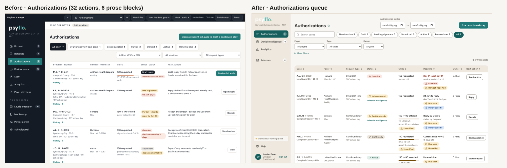

### Case shell

One request, one page: a header with the stage chip and owner, a **Next step** panel, then accordions for Documentation, Evidence, Submission history, Units, Timeline, Payer correspondence, Related tasks and Transition. The Next step panel is four boxes (Review packet, Approve, Sign in Lauris, Send), each naming who may do it and what was recorded. The sent state appears once, in the header chip, where the old Submission page said "overdue" four times.

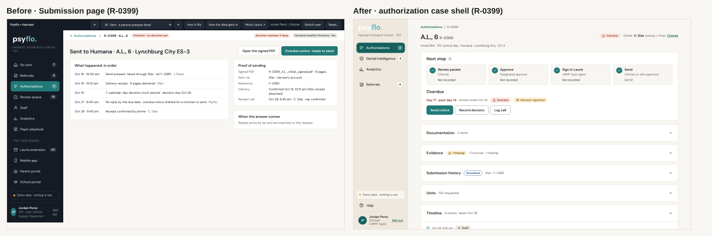

### Denial Intelligence

The master had four separate screens and no queue (Partials, InfoRequest, PeerBrief, PayerPlaybook). The build has a queue with the nine columns of Part 8.1 and a case workspace with five tabs: Decision, Evidence, Options, Action, History. A NEXT bar names the one thing to do. Options lists only paths valid for the case, each with a deadline and a verification chip; the rest sit under "Not available here (2)". The old "Why insurers say no" table and the peer-to-peer question lists moved into the payer guidance drawer and into accordions.

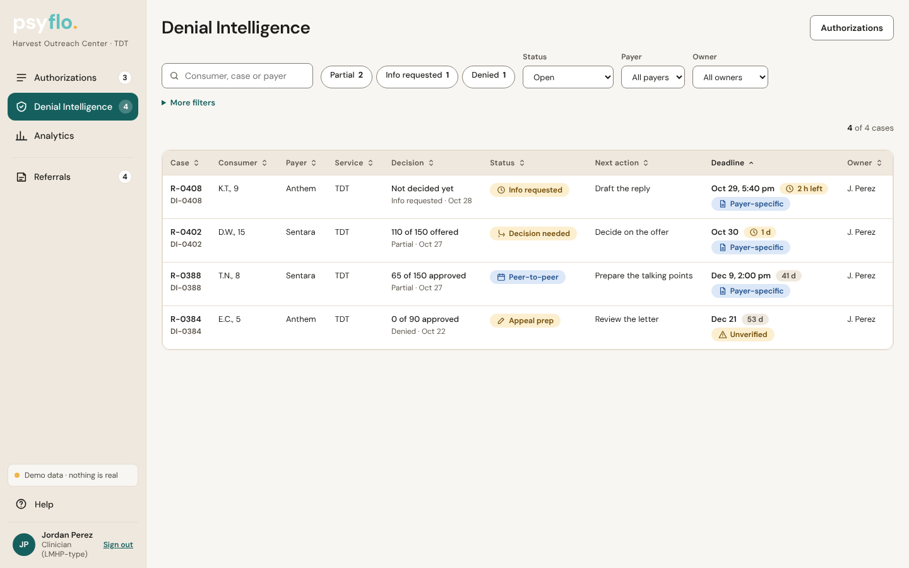

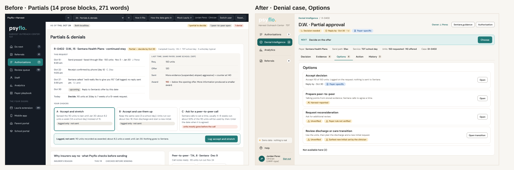

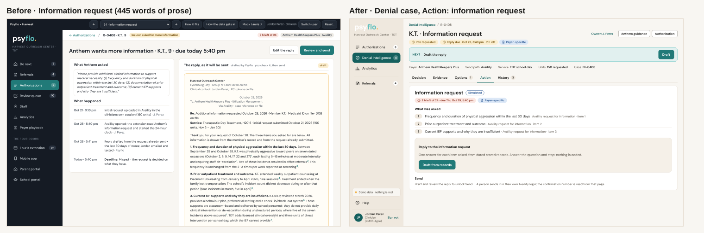

### Analytics

Analytics has a pilot scorecard of six measures first, then three sections (Patient Outcomes, Payer Performance, Patient Population). A dataset switch (Case-backed or Illustrative cohort) and a banner say which data is on screen; the two are never summed. Small groups print "Fewer than 5". The eight tiles above the old table became six scorecard tiles with a "?" popover for each definition.

Against the master, Analytics grew (8 to 24 actions in Outcomes) because the master had one page and no filters. Against the secondary demo it shrank: its three tabs held 144, 55 and 51 actions and 354, 330 and 350 words of explanation; the unified sections hold 24, 31 and 27 actions and at most 39 words of explanation each [M]. Cards above the main table went from 8 to 7, because the scorecard is itself a band of six. That is not a reduction.

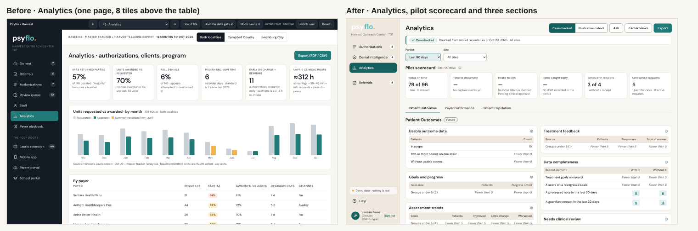

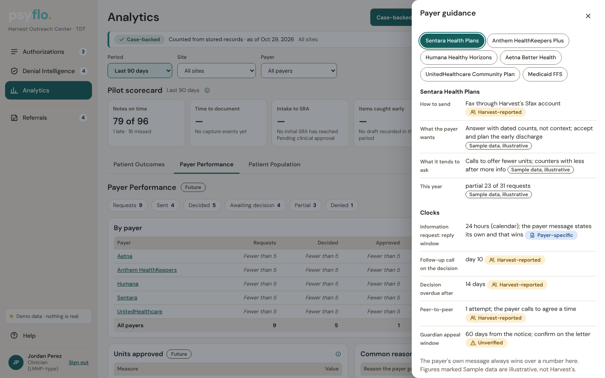

### My Work for supervisors, direct support and Settings

Supervisor Review (13 → 4 actions) shows the staffer's words beside what Psyflo added and one set of buttons: Approve, Return with a note, That didn't happen. The 27-word rule became an info popover. Direct-support "My day" shows Behind, Due next and To fix. Users and roles became Settings with seven tabs: People, Roles, Units, Rules, Audit, Family link, Presenter.

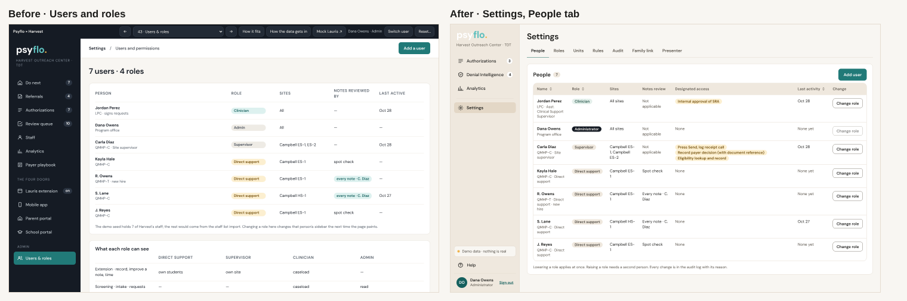

### Referral review

The criteria paragraphs became an accordion ("Insurance criteria · 4 missing · 2 needed · 1 shown") and a stepper (Referral, Family link, Eligibility, Screening call, Intake). The family link and eligibility checks are sections of the same page, with a Simulated chip.

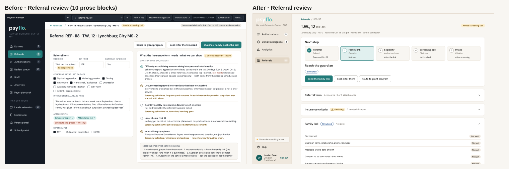

Full-size 1440×900 captures of the after state, for reading detail the pairs scale away: [My Work](img/after-mywork.png), [Authorizations](img/after-authorizations.png), [case shell](img/after-case.png), [denial Options](img/after-denial-options.png), [information request](img/after-info.png), [Analytics](img/after-analytics-outcomes.png).

## 5. The extension panel at 400 px

Home now has the open student, three equal buttons (Scribe, Track Time, Scan & Enhance), one next task and collapsed accordions. For people without the licence, the third button is replaced by one line of reason. The four "signed in as (demo)" toggles are gone.

| State | Actions | Prose | Height |
|---|---|---|---|
| Home, direct support | 14 → 6 | 4 (61) → 2 (25) | one screen |
| Home, clinician | 37 → 8 | 8 (116) → 4 (55) | 2,083 px → fits 1,262 px |
| Initial request, T.W. | 3 → 4 on home, 18 in review | 19 (289) → 5 (82) | 1,427 px → 1,501 px in review |
| Continued stay, M.R. | 7 → 11 | 8 (205) → 6 (82) | one screen |
| Daily note, M.R. | 6 → 11 | 4 (62) → 8 (125) | one screen → 1,456 px |
| Role toggles | 4 → 0 | | |
| Controls under 44 px, clinician home | 37 of 37 → 2 of 8 | | |
| Text under 13 px, clinician home | 95 of 111 → 6 of 22 | | |

The daily note view grew on purpose. It now holds the staffer's own words, the drafted narrative, the questions for what was not said, the contact-time block with its Confirm control, and the checks. The initial request used to be a list of 19 explanation blocks; it is now a home with "Review 7 statements" and a review screen.

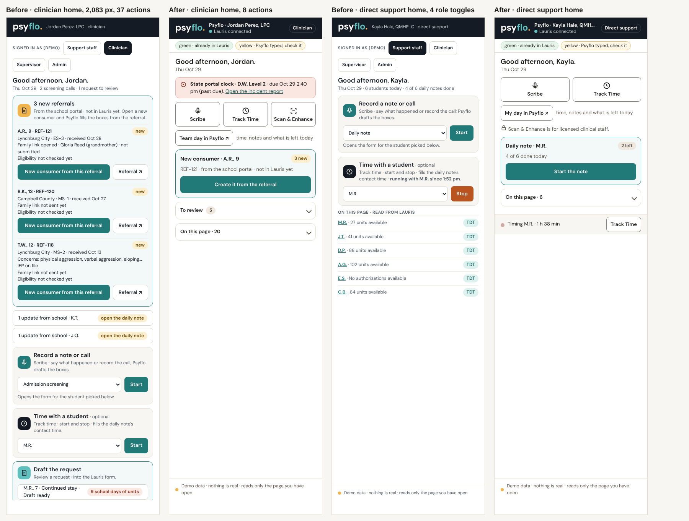

## 6. Mobile, family and school

**Phone (390 px).** The 132 px, three-row demo bar (15.6 percent of the viewport) is gone; the presenter dock is closed until `?present=1` or `Ctrl+Shift+P`. Home has My students as chips, Current activity, and Say what happened, with a student bar (initials, Harvest number, school, grade) and "Change". Saving a dictation asks "Save to M.R. (grade 2, Campbell ES-1)?". The promise that the timer "runs with the screen locked" is gone. The microphone is asked once a day ("Allow today" or "Type instead"). Every target but one is at least 44 px (the signature pad's "Clear" link, 41 px wide); every screen has one `h1`.

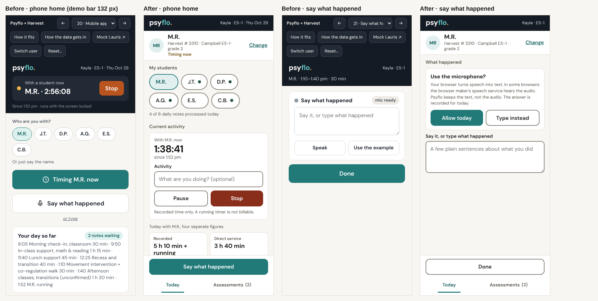

**Family portal.** The home is a checklist ("2 of 5 done" for the seeded T.W. guardian) with a Next step card and one task per screen. English and Español sit at the top, 44 px tall. Signing follows the signature mode in Settings (Remote allowed, In person required, Pending, Completed, Ready to review), with Draw and Type your name. Across the 13 phone screens, actions fell from 99 to 87 and explanatory words from 555 to 284 [M]. The family home itself got heavier in prose (1 block to 5), because the checklist rows carry status lines; it also gained headings and 44 px targets.

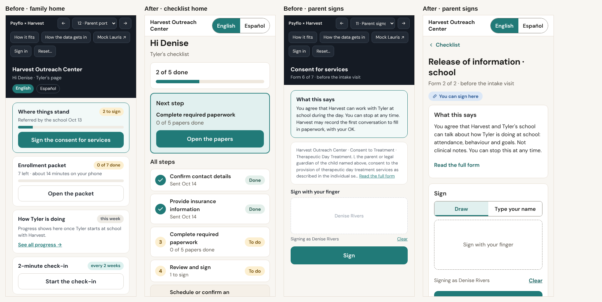

**School portal.** A "Harvest needs" card (missing information) sits above the list; the 49-field referral form shows three required fields first and three more sections collapsed. The school sees status text only. The list has a student link and a View button per row, so actions rose from 17 to 25 even though prose fell from 156 words to 88.

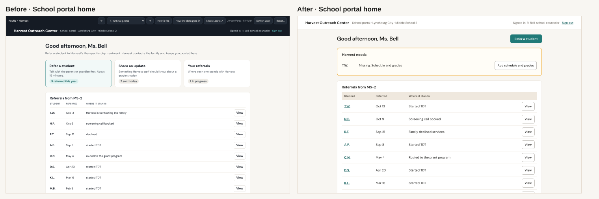

## 7. Interaction changes

- **Drawers.** Event detail, payer guidance and "How the data gets in" open in a right-hand drawer (460 px): focus moves in, Tab is trapped, the page behind is inert, Escape closes, focus returns to the opener.
- **Filter bar.** One component serves four queues: a search box, count chips with `aria-pressed`, "More filters", an "N of M" count, "Clear filters (n)". Every change is written into the URL, so `#/Authorizations?status=needs` survives a reload and can be copied [M]. Clicking a lit chip clears it [M]. The v3 filter bar had ten dropdowns on every list; this one has three chips and a More filters disclosure.
- **Timeline detail.** Each event is a button. It opens What, When, Who (with an actor chip: Staff, PsyFlo draft, From Lauris, Payer, Family, System), Document, Source and Next action. A missing field says "Not recorded". Simulated events wear a Simulated chip. Newest first.
- **Draft review, three-way.** Staff input, PsyFlo wording and Source side by side in wide containers and as three tabs at 400 px. Per statement: Accept, Reject, Edit, Restore previous. There is no bulk accept: "Accept the 7 with sources" counts only statements with sources, and Approve and fill stays disabled until every statement has a decision. A statement with no source prints "Evidence missing — verify …" and cannot be accepted silently.
- **Progressive disclosure.** Accordions with a one-line summary (Evidence · 1 missing), "Show all 13", "More filters", "Not available here (2)", collapsed Recent activity. Nothing was removed; each hidden piece is one click away.
- **Confirm dialogs for consequential steps.** Approve, Send by fax, Send notice and Log the decision each say what will be recorded and, where it applies, the student, request, payer and packet. Approve adds that approving is not signing.

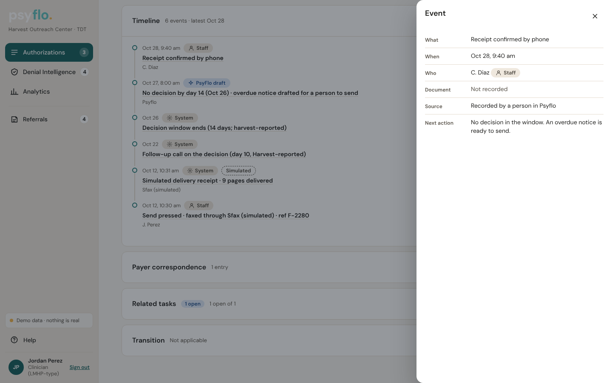

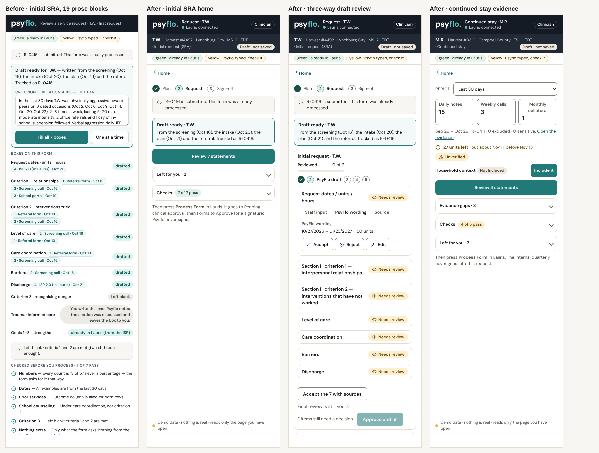

## 8. Accessibility, measured

| Measure | Before | After |
|---|---|---|
| Skip link | none | first tab stop on every route |
| Tab stops before main, clinician / direct support / admin | 20 / 14 / 21 | 8 / 5 / 8 (1 with the skip link) |
| Focus on route change | stayed on `body` | moves to `main` [M]; the new title is announced in a `role="status"` region [M] |
| Overlays | modal never took focus | focus trap, inert background, focus return, Escape |
| Filter chips | no `aria-pressed` | `aria-pressed` on every chip |
| Text failing contrast, 20 screens | 2 of 1,176 elements (3.37:1 and 2.89:1) | 0 of 999 |
| Input border contrast | 1.4 to 1.6:1 | 4.0:1 on white (`#857F75`, read from the computed style) |
| Text under 12 px | 73 elements | 0 |
| Phone and portal screens with an `h1` and a `main` | 0 of 9 | 9 of 9; 34 headings |
| Phone and portal targets under 44 px | 39 of 70 | 1 of 85 |
| Unlabeled fields | 1 | 0 |
| Presenter controls inside the product (role toggles, Demo buttons) | 6 | 0 |

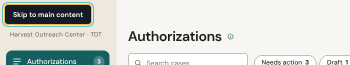

Known gaps, measured. On the platform, 26 controls across seven probed screens are still under 24 px: the 18 px "About …" info buttons and the sortable column headers (an 18 px button inside a taller cell). WCAG 2.5.8 allows small targets with enough spacing; spacing was not checked. The 400 px panel's daily-note view still has 5 of 11 controls under 44 px. A drawer stays open if the hash changes underneath it (browser Back, or editing the address); Escape closes it. Keyboard and focus order were checked by script, not by a screen-reader session.

## 9. What stayed dense, and what got worse

**Deliberately dense.** These screens carry the task, and the build kept them whole.

- The Authorizations queue: eight columns and a next action per row. Reviewers scan it across cases.
- Settings, Rules: 72 rules, each with a value, source category and verification date. Settings, Audit: every event with actor, kind and simulated flag. These are reference tables.
- Analytics tables: figures with definitions behind "?" and the minimum group size visible.
- The draft review: seven statements with their sources. The rule is that nothing is accepted unseen.
- Evidence review: 19 rows for the continued-stay window, each openable.
- The case shell: eight accordions. Only Next step and Timeline are open.

**Where the numbers went the wrong way.**

- **Visible actions rose** from 150 to 233 on the 15 platform screens. The Authorizations queue went from 32 to 46 (it gained eight sortable headers, a date range, search and "More filters", and each row has two links to the case). That is above the 24 target in `03b` for queues.
- **Some key tasks take more clicks.** Logging a partial decision went from 3 to 6 clicks (queue, Choose, Open, pick the option, Log the decision, Log it). Sending the information reply went from 3 to 8 (Send reply, Draft from records, Edit and Save for the missing item, Mark reviewed, Open Availity and send, Open Availity, then a person sends it in the mock portal). The overdue notice went from 2 to 3. Every added click is a review gate or a confirm that did not exist: a person reads what will be recorded, and a draft cannot be marked reviewed while it holds "Evidence missing".
- **Repeated labels did not fall** (36 to 35). They are per-row buttons ("Write note" ×7), counted on purpose.
- **Case shell and Transition grew** (3 to 19 and 3 to 16 actions) because they now hold what used to be three screens.
- **Seeded requests that were sent before the approval stage existed** show a checked Next step with "Not recorded" for approver and signer (R-0399 is the example). The state is honest, and it reads oddly.
