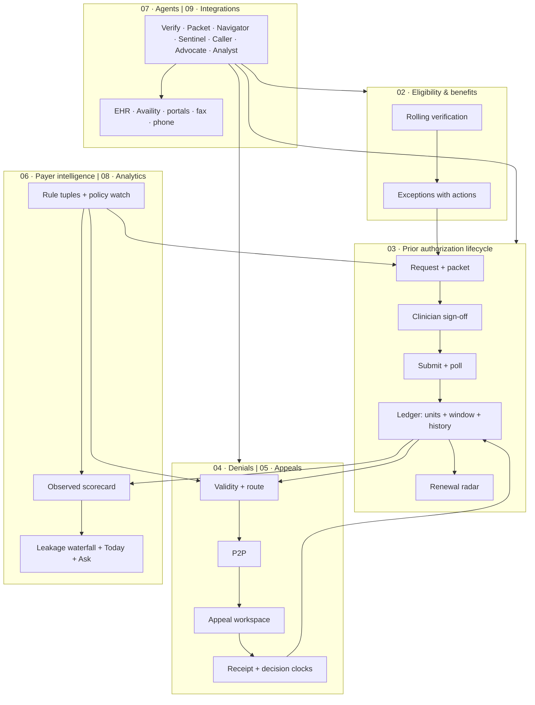

# PRD 01 — Platform Overview, Product Strategy and Information Architecture

**Owner:** Shravan · **Design:** Rohit · **Status:** v1, 19 Sep 2026 · **Reads with:** `_brief.md` and PRDs 02–10

---

## 1. Summary

Psyflo is the authorization layer for behavioral health providers who bill Medicaid managed care. It sits on top of the EHR and the payer portals and owns the one object nobody else models properly: the authorization, with its two clocks, its history and its payer. Around it, four product lines form one workflow — eligibility verification, the prior authorization lifecycle, denials management and appeals — supported by payer intelligence, AI agents, analytics and integrations.

The thesis, in one line from the design partner: **"There's nothing that can kind of pull it all together in one consolidated view."** (Tracy, 1 Sep). The strategic bet is that visibility, timing and history, delivered with a clinician sign-off on everything, is what a $3.5M safety-net clinic will pay for — and that the horizontal "AI RCM" vendors will keep optimising the transaction (submit, call, draft) rather than the object.

## 2. Problem, evidence, and why now

**The problem.** Providers that bill insurance are not paid in full for the care they deliver and do not know in advance what they will be paid. For higher levels of care in Medicaid, the failure concentrates in authorization: every patient needs one, it is granted in units and windows, it is denied a third of the time, and its history is destroyed by the EHR on every renewal.

**Evidence (organisations, not anecdotes).** 60+ discovery interviews; nine of ten clinics volunteered insurance as the top problem; a design partner who has built her own engine and still runs a five-tab spreadsheet; two demoed personas losing $10–15K and $80–85K a month respectively; Ohio's statewide 30-unit IOP cap producing "denied, denied, denied"; Chicago's County Care PA on 60% of clients; a California SNF managing plan-by-plan PA rules including transport. (`../research/00-research-synthesis.md`, `../research/tracy-call-transcripts.md`)

**Why now.**
- CMS-0057-F forces Medicaid managed care plans to decide in 7 days, state specific reasons, publish PA metrics and expose a PA API by 2027 — data and deadlines a product can exploit.
- MHPAEA's 2024 rule makes PA on mental health a parity question; observed-vs-published metrics become leverage.
- State-level tailwinds (Ohio SB 162 on recoupments and appeal fees; Kentucky's 2025 PA mandate created the pain).
- Agentic browser automation makes "sit on top of the EHR and the portals" feasible without vendor APIs, which is exactly the integration posture the design partner asked for.

## 3. Product principles

See `_brief.md`. The eight principles are: approval and visibility over submission; nothing sends itself; history is never overwritten; two clocks; observed not predicted; explain every number; built for the safety-net segment; HIPAA-first. Every PRD's acceptance criteria trace back to these.

## 4. Product lines and how they connect

| Line | Job | Lead metric | PRD |
| --- | --- | --- | --- |
| Eligibility & benefits | Know before the session that the payer will pay | Lapse visits caught before service | 02 |
| PA lifecycle | Every request visible; renewals filed before the binding clock | Visits without active auth | 03 |
| Denials | Every adverse determination validated, routed, deadlined | Invalid-denial recovery; P2P reversal | 04 |
| Appeals | Sent, confirmed, decided, on time | Receipt confirmation rate; appeal win | 05 |
| Payer intelligence | Rules, policy changes, observed behaviour | Policy changes acknowledged before impact | 06 |
| Agents | Do the button-pressing; never sign | Human touches per request | 07 |
| Analytics & Ask | KPIs, waterfall, daily workflow, questions | Time to answer | 08 |
| Integrations & data | Sit on top of the EHR; immutable ledger; HIPAA | Sync freshness; write-back success | 09 |

## 5. Personas and their home screens

| Persona | Home | What they do there |
| --- | --- | --- |
| Operator (Tracy) | Today | Coverage today by cause; needs-me queue; agent feed; jumps to payers and leakage |
| PA coordinator | Authorization board · Renewal radar | Work the stuck and the due; start packets; chase status |
| Clinician | Sign-off queue · Appeal workspace | Review, sign, send back; prepare P2P |
| Front desk | Eligibility | Exceptions with one-line actions |
| Offshore biller | Board (Needs me) · Denials | File signed packets; confirm receipts; resubmit corrected claims |
| Board/owner | Leakage · Payers | Monthly pack |

## 6. Information architecture

Left navigation, grouped by verb: **Overview** (Today) · **Verify** (Eligibility) · **Authorize** (Authorizations, Renewal radar) · **Defend** (Denials, Appeals) · **Learn** (Payers, Leakage) · **Automate** (Agents). Global: site toggle, date, "Demo data" marker (demo only), sign-off queue badge, Ask Psyflo panel.

Object pages: Authorization (patient-centric), Appeal (case-centric), Payer (rules + scorecard), Agent run. Every object reachable in one click from any mention.

Design language (for Rohit): dense operational UI; white panels on a neutral background; semantic colour only for state (green covered/approved, amber partial/attention, red exhausted/denied/overdue, violet sign-off, blue in-flight, cyan Medicare-first); MRN + initials, never names, on shared screens; tabular numbers; plain-language action lines on every exception row; timelines for anything with steps; a persistent "nothing sends itself" gate in every outbound flow. Reference screens: `/demo/*` in this repository; UI patterns worth borrowing are listed in `../research/competitor-landscape.md` §6.

## 7. Positioning and pricing hypotheses

**Positioning.** "The authorization ledger for behavioral health Medicaid: see every request, every unit, every deadline, and sign everything yourself." Against submission automators: "we don't file your paperwork, we make sure it gets approved and you know where it is." Against EHRs: "we keep the history they delete." Against behavioral-health natives (Lucida, Oprox, Flexbone): co-designed with a clinic that already built the engine; sign-off-first; sits on Sunwave/Valant and Availity without full integration.

**Pricing hypotheses (to test, not to promise).** Anchors from the market: $0.15–1.25 per eligibility check, $0.75–1.00 per PA, $4–5 per appeal, $3–3.50 per payer call, $1,500/month platform fee, $9K/month fixed at 2,500 visits (CombineHealth), 2–4% of recovered revenue (HealOS, Heron). Harbor's spend today: ~$2K/month Claude credits plus offshore hours; the design partner offered $1,000 deposit and $1,000/month for the pilot (Superhuman Overview page). Hypothesis: platform fee per site + per authorization; never percentage-of-collections in Medicaid (counsel flagged exposure); pilot pricing grandfathered for design partners.

## 8. Roadmap (18 weeks)

| Phase | Weeks | Scope | Exit |
| --- | --- | --- | --- |
| 0 Demo | now | Seeded clickable demo (this repo) | Tracy says "I can't get that today" and corrects our numbers |
| 1 Pilot foundation | 1–5 | Ledger import; board, detail, radar, sign-off queue on Harbor data; eligibility exceptions; polling read-only | Renewals filed before binding date ≥90%; Tracy stops updating the spreadsheet |
| 2 Agents file & defend | 6–10 | Navigator files signed packets; appeals workspace with receipt calls; denial routing; policy watch | Every open appeal has a confirmed receipt and due date |
| 3 Second partner | 11–18 | Valant/Nirvana clinic; verification depth (COB, carve-outs); claim-level denials; multi-program rule tuples | Two clinics live; observed scorecard across payers |

## 9. Risks and mitigations

| Risk | Mitigation |
| --- | --- |
| Demo becomes the product (Stage 01 warning) | Every screen is labelled demo data; pilot starts with her export; written kill criteria before the call |
| Harbor is one clinic, one state, one code | Rule tuples are payer × program × plan from day one; second partner in a different EHR and payer mix |
| Portal automation fragility / payer ToS | Fail-safe to manual queue with screenshots; Availity APIs where licensed; FHIR path by 2027 |
| We do not improve approval rates | Say so; sell visibility, timing, history, packet completeness; calibrate her grade before promising more |
| PHI in LLM prompts | BAA with model vendor; minimum necessary; de-identified drafting where possible; audit |
| Two segments with different products (day program vs group practice) | Make it a decision at Gate B, not a drift; PRD 02 carries the group-practice defaults |

## 10. Success for the platform (12 months)

Three clinics live on real ledgers; renewals filed on time ≥95%; visits without authorization down 70%; every appeal receipt-confirmed; operator time on tracking under 30 minutes a day; a payer scorecard that a clinic has used in a provider-relations conversation.

## 11. Open questions

Pricing model acceptable to safety-net buyers; Sunwave API scope; which second partner; whether prediction ever becomes a feature (calibration); how much of Harbor's engine (prompts, criteria library) can be licensed into the product.
