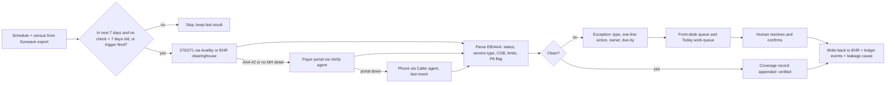
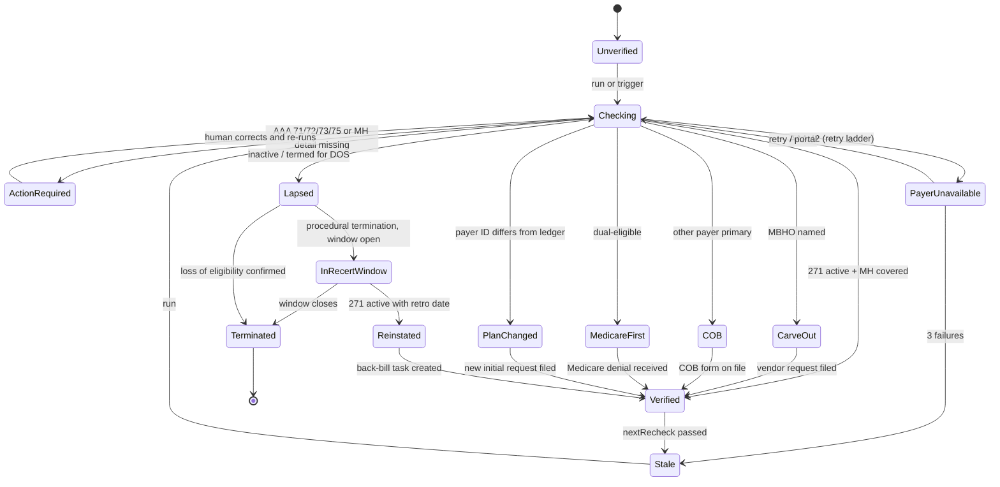

# 02 · Eligibility & Benefits Verification

**Product line:** 1 of 4 (see `_brief.md`). **Status:** Draft v0.1 for Harbor pilot scoping. **Date:** 2026-09-19.
**Demo reference:** `/demo/eligibility` (nav entry in `apps/frontend/src/app/demo/~lib/nav.ts`; data model `apps/frontend/src/lib/demo/eligibility.ts`; consumed today by the `/demo/today` work queue).

---

## 1. Summary and problem statement

Eligibility & Benefits Verification answers one question for every scheduled visit before it happens: **will this payer pay for this service, for this member, on this date — and if not, what exactly must someone do, and who?** It runs a rolling seven-day verification ahead of the schedule, reads the behavioral-health benefit detail that generic checks skip (carve-outs, daily and weekly limits, PA-required flags), resolves coordination of benefits and the Medicare-first sequence for dual-eligibles, detects MCO plan changes and coverage lapses, and turns every non-clean result into a one-line action with an owner and a due date. Every result is appended, never overwritten, to the member's coverage history and to the authorization ledger, so an eligibility lapse becomes a named leakage cause on the day it happens rather than a write-off discovered at remittance.

This is the first product line because it is the cheapest failure to prevent and the one the safety-net segment cannot recover from: a Medicaid member whose coverage lapsed on the 31st and who attended nine sessions in September cannot be billed for any of them (`_brief.md`, principle 7).

### What the evidence says

1. **Verification today is a button pressed once, at intake.** "We have a connection with our clearinghouse, which allows us to push a button... The clearinghouse will let us know if they have a valid or active Medicaid policy that covers H2020... We do the verification of benefits before they come in for their appointment." — Tracy Cosker, *tracy-call-transcripts.md*, Call 1, *Insurance verification*.2. **The check does not answer the behavioral-health question.** Dave Cherry (Ellie Mental Health, Ohio): Nirvana via Valant returns active/inactive, deductible and sometimes copay, but does not confirm mental-health coverage until the EOB arrives 2–10 weeks later; not all payers are supported; he verifies at intake and annually and wants weekly batch verification with exception reporting, roughly 50 outliers a week pushed to therapists before the session. — Discovery interview, Sep 2026.
3. **Medicare-first is a mandatory, unbillable loop.** "We have to submit to Medicare and get a denial from Medicare before we can submit to Medicaid. So even though we know that they're not going to pay... we're required to submit them just to get that denial." — *tracy-call-transcripts.md*, Call 1, *EHR and payer mix*. The demo's dual-eligible story has that rejection pending 14 days (*draft_prd.md* §11).
4. **A missed lapse is unbillable care, not delayed cash.** "In organizations like us, we can't charge the patient. We're not allowed to." — *tracy-call-transcripts.md*, Call 2 [52:40]. Roxanne (FQHC): Medicaid recertification lapses are routine, there is a 3-month reinstatement window, and back-billing is common. — Discovery interview, Sep 2026.
5. **COB surfaces as a recoupment a year later.** Dave Cherry: COB denials when Medicaid members have undisclosed commercial coverage; recoupments 6–12 months later. — Discovery interview, Sep 2026.
6. **The incumbents define the gap.** Availity: "per-payer manual lookups, no mental-health benefit detail (carve-outs, daily limits, session counts), no exception reporting, overwrites history." Nirvana: "returns 'verified' only, no carve-out or benefit detail, not all payers, no re-verification cadence." — *competitor-landscape.md* §2(a).

### The gap in one line

Today's check answers "is the policy active?" on the day someone presses the button. The visit needs to know whether H2020 is covered and by whom (Sohar reports 93% carve-out pick-up, *competitor-landscape.md* §3.5), who pays first, whether the MCO changed, what limits apply, what the front desk should do, and what it cost when it failed. Psyflo answers all of that seven days ahead, with an owner.

---

## 2. Goals, non-goals, success metrics

### Goals

1. No scheduled visit in the next seven days without a verification less than seven days old, for every payer the clinic bills (5 MCOs, straight Kentucky Medicaid, Medicare, Medicare Advantage).
2. Every non-clean result becomes an exception with a plain-language action, an owner and a due-by; exceptions close on a human confirmation, never by the agent.
3. Carve-out, daily/weekly limits, PA-required, COB order and Medicare-first are first-class fields, not notes.
4. Eligibility events feed the authorization ledger (an authorization is void for dates after a lapse or plan change) and the leakage report (a lapse is a named cause with an owner).
5. Verification history is immutable and per member: "when did we last know this member was covered, and what did the payer say?" is answerable for any date.
6. Cost-bounded: one paid check per member per window unless a trigger fires; a 60-patient clinic's run costs tens of dollars a month.

### Non-goals

- Not a clearinghouse and no 270/271 rail of its own; Psyflo drives Availity, the EHR's clearinghouse and, where needed, Sohar (*competitor-landscape.md* §1: "partner for 270/271 depth, not build it").
- No claim submission, scrubbing, remittance posting or patient billing; no approval prediction; no cost estimates for Medicaid members.
- No patient- or guardian-facing outreach in the pilot (P2).
- The EHR stays the demographics system of record; Psyflo proposes corrections and writes back only after a human confirms.

### Success metrics

| Metric | Type | Pilot target (Harbor, 90 days) |
|---|---|---|
| Verification coverage: visits in the 7-day window with a check < 7 days old | Leading | ≥ 98% |
| Exception lead time before the appointment | Leading | Median ≥ 48 h; none raised after the visit |
| Exceptions resolved with human confirmation before the appointment | Leading | ≥ 90% |
| Visits delivered on lapsed or changed coverage (`eligibility_lapsed`) | Lagging | From 9 (demo baseline month) to ≤ 2/month, then 0 |
| Eligibility-caused denials (CO-22, 24, 26, 27, 31, 109, 119) per 100 claims | Lagging | −75% vs prior 90 days |
| Medicare-first cycle time (Medicare rejection → Medicaid claim released) | Lagging | Visible for 100% of duals; median down from ~14 days |
| Plan change → new initial request filed | Lagging | ≤ 2 business days, 100% |
| Paid checks per member per month | Leading | ≤ 5 (≈ 300/month for 60 members) |
---

## 3. Users and jobs-to-be-done

| Persona | Job to be done | What they see |
|---|---|---|
| **Intake coordinator / front desk** | Confirm coverage, payer, carve-out, guardian and COB before intake; work next week's exceptions every morning; know at check-in whether the client is covered | Exception queue with one-line actions; coverage chip on the day's schedule |
| **Operator / compliance lead (Tracy)** | Know nobody attends on dead coverage; see lapses, plan changes and Medicare-first delays as counts and dollars; prove the process to auditors | Summary tiles, the `Coverage lapsed` cause on `/demo/today`, the leakage row, audit trail |
| **PA coordinator (Jordan)** | Be told the day a plan changes so a new initial request goes in; know which carve-out vendor to file with | `plan_changed` and `carve_out` exceptions routed to the authorizations board |
| **Clinician (Heather)** | Be warned before a session that a client may not be covered; never make a billing decision | One-line pre-session flag; nothing else |
| **Offshore biller** | Release dual-eligible Medicaid claims only after the Medicare rejection; bill the correct primary; avoid CO-22/CO-24 rework | `medicare_first` and `cob` exceptions with "bill X first" |
| **Owner / board** | See care delivered on lapsed coverage and whether it is falling | Leakage report, trend |
---

## 4. End-to-end workflow

### 4.1 As-is (Harbor, September 2026)

| Step | Who | What happens | Failure it produces |
|---|---|---|---|
| One-time verification | Intake coordinator | Clearinghouse button in Sunwave; sometimes Availity VOB (*tracy-call-transcripts.md*, Call 1) | Active/inactive and "H2020 covered"; nothing on carve-outs, COB order or limits |
| Attendance 2–5 days/week for months | Clinic | No re-verification; unit report run by hand | Coverage ends at month-end; nobody knows until claims deny |
| Dual-eligibles | Billing | Medicare claim filed, rejection awaited, then Medicaid | Rejection pending 14+ days; Medicaid claim blocked |
| Plan change at open enrollment or redetermination | Nobody | Found when the authorization or claim denies | Authorization void for the new MCO; days of care unbillable |
| Remittance | Billing | CO-22/27/109 worked as AR | Write-off; at Ellie, recoupment 6–12 months later |

### 4.2 To-be (with Psyflo)

The `Verify` agent runs at 06:10, skips fresh members unless a trigger fires (FR-04), walks the channel ladder (FR-03), classifies each result into one of the eight `EligStatus` values (FR-05 to FR-09) and writes one exception per member (FR-17), routed by type: `plan_changed`/`carve_out` to Jordan, `medicare_first`/`cob` to billing, `inactive`/`action_required` to the front desk. The intake coordinator works the queue by appointment date; a human confirmation (FR-18) precedes any chart write (FR-23); the ledger and leakage report update from events (FR-24); clinicians see one line per affected client and the operator gets a weekly digest.

---

## 5. Functional requirements

Priorities: **P0** Harbor pilot · **P1** v1 (second design partner) · **P2** later.

### A. Verification engine

**FR-01 · Rolling 7-day pre-visit verification (P0).** A scheduled run verifies every member with an appointment in the next seven calendar days, seven days a week. Appointments added inside the window are verified on the next run (CombineHealth, *competitor-landscape.md* §3.1). Window configurable 3–14 days.
*AC:* An appointment on T+6 added at 15:00 has a check the next morning. Sixty members complete before 07:00 local; the summary shows `checkedAt`, total, verified, exceptions, inactive, Medicare-first (`eligibilitySummary()`). On run failure the previous result is kept with a `stale` marker and a support-owned exception is raised.

**FR-02 · Intake verification before the first appointment (P0).** Run when the intake is booked and again that morning; includes the PA-required flag and carve-out routing so the first authorization goes to the right payer.
*AC:* The request wizard (`/demo/authorizations/new`) will not open without a coverage record dated within 7 days and pre-fills payer, plan, member ID and carve-out payer from it.

**FR-03 · Channel ladder: 270/271 → portal → phone (P0; phone P1).** HIPAA 5010 270 through Availity (4 of 5 Kentucky MCOs) or the EHR's clearinghouse; for the MCO not on Availity (demo: WellCare) and for carve-out vendors (Carelon) the `Verify` agent uses the portal with vault-held service-account credentials; the `Caller` agent phones provider services only when both fail or the exception requires it. `source` is recorded exactly as in `EligibilityCheck.source`.
*AC:* One `source` and a raw-response reference per check. Portal only after a 271 with AAA 42/79 or without MH service-type detail. Phone never first; always a transcript, structured result and duration.

**FR-04 · Cadence and de-duplication (P0).** One paid check per member per 7-day window, plus re-checks on triggers: the 1st of the month (Medicaid terminations are effective month-end), a new appointment inside the window when the last check predates a month boundary, an eligibility-type CARC (22/24/26/27/31/109), a renewal being filed, the Kentucky MCO open-enrollment period for members flagged as changing, and manual re-run. Adjustable per payer (Heron, *competitor-landscape.md* §3.7).
*AC:* A member checked Monday with appointments Tuesday–Friday gets no further paid check that week absent a trigger. On the 1st every member in the window is re-checked. Monthly checks per member ≤ 5; count and unit cost shown on the run summary.

**FR-05 · Response parsing, errors, retry (P0).** EB segments read by service-type code and EB01 status; AAA rejects mapped: 72 (subscriber ID), 73 (name), 71 (DOB), 75 (not found) → `action_required` with the probable fix (demo: "transposed digits: on file ...4471, card may read ...4417"); 42 (payer unable to respond) → retry ladder (30 min, 2 h, next run) then portal; 62 (DOS outside inquiry period) → re-issue in range.
*AC:* Every AAA code has a status, action template and owner. No AAA 42 exception before the third failure. A plan-level "active" with no MH service-type answer is never "verified" for H2020; it becomes `action_required: MH benefit not returned; confirm via portal`.

### B. Behavioral-health benefit detail

**FR-06 · Service-type-level benefit resolution (P0).** The 270 requests plan coverage (STC 30) plus the behavioral-health service types for the program (MH, A4, CF, A6, AI). Result populates `mhBenefit` (e.g. "Covered — H2020 TRP, prior authorization required") with provenance (service-type segment vs inferred).
*AC:* `mhBenefit` is never "covered" on plan-level data alone for a payer known to carve out or limit MH; the screen shows provenance.

**FR-07 · Carve-out detection and routing (P0 detect; P1 route).** When the 271 (EB01 = U "contact following entity", or a named MBHO in loop 2120) or the payer rules table says behavioral health is managed by Carelon, Magellan, Optum Behavioral or another vendor, status is `carve_out` with "Authorize and bill Carelon, not the MCO" (demo SPECIAL[22]). The ledger's payer for that member becomes the vendor; integrations show whether credentials exist (demo: "Carelon — credentials needed").
*AC:* The exception names vendor, portal, contract status, and links to a pre-filled new request. Sohar's 93% pick-up is the partner-rail benchmark.

**FR-08 · Daily/weekly limits and cross-provider overlap (P1).** Limitation segments (EB01 = F with day/week/year qualifier and quantity) populate `dailyLimit` and a weekly limit; the payer rules table can override with confirmed policy (Melissa, Discovery interview, Sep 2026). Where the 271 or claim history exposes another provider's same-day utilization, status is `action_required: confirm no overlap` (demo SPECIAL[35]; overlaps deny CO-119).
*AC:* Limits display with source. An H2020 per-diem member with "1 unit/day" and a same-day H2020 claim from another provider is flagged before the appointment.

**FR-09 · PA-required flag joined to the ledger (P0).** Each coverage record carries `paRequired` for the service code (true for H2020 under every Kentucky MCO since July 2025, *tracy-call-transcripts.md*, Call 1). When true and no active version covers the appointment date, the row shows the `/demo/today` authorization cause (`no_auth`, `awaiting_decision`, `units_exhausted`, `window_expired`) beside the coverage status, so "eligible but unauthorized" and "authorized but ineligible" are both visible.
*AC:* Both chips render from their own source rows. From 2027 the flag can be refreshed from a payer's CMS-0057-F Prior Authorization API.

### C. Coordination of benefits and dual-eligibles

**FR-10 · COB detection and payer ordering (P0).** An "other payer" in the 271 (EB01 = R), a second policy in the EHR, or a CO-22 → `cob` with the primary named and "Medicaid pays last — obtain COB form before billing" (demo SPECIAL[19], guardian's employer coverage). The record stores the ordered payer list and confirmation date.
*AC:* Resolution requires the primary's name and member ID and either "COB form on file" or "TPL updated with the state". Medicaid claims for the member are flagged "hold until primary adjudicates".

**FR-11 · Medicare-first for dual-eligibles (P0).** Members with Medicare (traditional or Medicare Advantage) plus Kentucky Medicaid are `medicare_first`; the record tracks Medicare type (MAC vs the MA plan by name; CombineHealth's D-SNP-vs-commercial check, *competitor-landscape.md* §3.1), Medicare claim filed date, days pending, denial reference, and Medicaid claim release. H2020 is not a Medicare benefit, so the denial is expected, but Medicaid is payer of last resort and the claim cannot be filed without it.
*AC:* Every dual shows "Medicare claim pending N days" on the row and in the authorization side panel (*draft_prd.md* §6). At a threshold (default 14 days) the `Caller` agent is offered. The denial is attached to the coverage record and the hold lifts on confirmation.

**FR-12 · Undisclosed coverage and TPL reconciliation (P1).** For members whose 271 shows an other payer or whose remits show TPL recoupments, run discovery (Sohar Discovery, 55% weighted hit rate, *competitor-landscape.md* §3.5) and surface the found policy for confirmation.*AC:* A hit creates a `cob` exception with source; no chart change until confirmed.

### D. Coverage changes

**FR-13 · MCO plan-change detection (P0).** The 271 payer ID and plan name are compared with the ledger's payer on every check. A difference → `plan_changed`: "Member moved from WellCare to Passport on 1 Sep. The WellCare authorization does not transfer — file a new initial request" (demo SPECIAL[13]). The old versions are marked void for dates on or after the change (an appended event), and a "New request required — plan changed" item lands on the authorizations board and renewal radar with the change date as the binding clock.
*AC:* Detection on day D produces a new-request task on day D with payer, effective date and the prior units/window for reference; the old chain stays readable. If the payer rules table holds a confirmed transition-of-care honoring period, the task says so and the void date moves; default is the change date.

**FR-14 · Coverage lapse and recertification window (P0).** Inactive, subscriber-not-found for the DOS, or a termination date → `inactive` with last confirmed active date, `visitsSinceVerified`, probable reason (procedural termination vs loss of eligibility) and the reinstatement window end (demo SPECIAL[7]: "coverage ended 31 Aug. 9 visits delivered since... Recertification window open until 30 Nov"). Action "Re-verify with the guardian and pause billing"; owner front desk; the ledger marks the authorization inactive-for-coverage from the termination date.
*AC:* Raised on the first run after termination, never later than the first appointment after it. Shows a countdown to the reconsideration window (90 days for procedural terminations under 42 CFR 435.916; Kentucky specifics per §9) and whether retroactive coverage could apply. Scheduling shows "coverage lapsed — see front desk"; care decisions remain the clinician's.

**FR-15 · Reinstatement and back-billing (P1).** A later check showing reinstatement with a retroactive date → `reinstated`; visits between lapse and reinstatement are reclassified from structural to recoverable and a "back-bill N visits" task is created (Roxanne: back-billing common — Discovery interview, Sep 2026).
*AC:* Reclassification appends events; the leakage report shows the movement with dates. Void versions reactivate only if the payer is unchanged.

**FR-16 · Open-enrollment surge mode (P1).** During Kentucky MCO open enrollment and the first week of each month, cadence tightens to daily for members whose 271 shows a future termination or pending assignment; the queue groups by "changes effective on the 1st".
*AC:* In December the operator sees "changes effective 1 Jan: 4 members, 4 new requests to file", not four denials in January.

### E. Exception workflow

**FR-17 · Exception report with one-line action, owner, due-by (P0).** Every non-verified result carries: type (`EligStatus`), `headline` (one imperative sentence with the justifying fact), `detail` (AAA code, EB segment, portal text), owner (front desk / PA coordinator / billing / clinician / Psyflo support), due-by (appointment minus one day), links.*AC:* No exception without a headline stating action and evidence. Owners are roles mapped per clinic. A weekly digest lists exceptions by type, open vs closed, and lapses caught before vs after the first affected visit.

**FR-18 · Resolution actions and the human confirmation gate (P0).** Fixed resolutions per type: `action_required` → "Corrected member ID: ____ · Re-run"; `inactive` → "Recert started with guardian on ____" / "Reinstated retro to ____" / "Confirmed terminated — discharge planning"; `plan_changed` → "New request filed (auth id)"; `cob` → "COB form on file / primary billed"; `carve_out` → "Vendor request filed"; `medicare_first` → "Medicare denial received (ref)"; `collect_upfront` → "Collected $__ / waived". A named user resolves; the agent proposes only.
*AC:* The `Verify` guardrail holds: "Never changes coverage on the chart without a human confirming" (`agents.ts`). Every resolution is an event with actor, timestamp and fields changed. Answers to agent questions can be saved as payer rules (*competitor-landscape.md* §6).

**FR-19 · Front-desk check-in and scheduling flag (P1).** The day's schedule (`/demo/today` patient list) shows a coverage chip per member (`verified`, `exception open: type`, `lapsed`). Booking a member with an open `inactive` or `plan_changed` exception warns, never blocks (*competitor-landscape.md* §6 item 16, adapted for Medicaid).
*AC:* Chip derived from the latest record and open exceptions, not copied. Warnings are logged.

**FR-20 · Pre-session clinician push (P1).** On the morning of a session, one line per affected client ("A.R. — coverage exception open; front desk is working it") in the EHR note or the clinic's channel. No benefit detail, no dollars.
*AC:* Minimum necessary (initials/MRN, type); suppressed once resolved.

### F. Financial

**FR-21 · Cost-share and collect-upfront flags (P1 commercial; P2 Medicaid).** For commercial and MA members the record carries `copay`, coinsurance and `deductibleRemaining`; `collect_upfront` renders "Coverage active and in-network. Collect $X at check-in" and flags high remaining deductibles (CombineHealth's "Collect Upfront" pill, *competitor-landscape.md* §3.1). For Medicaid members the flag is limited to state-permitted nominal amounts and is off for Harbor ("no self-pay at all").
*AC:* No Medicaid member is ever shown a deductible to collect. Copay/coinsurance/deductible accuracy is measured against the first remittance (Sohar's up-to-95% benchmark).

**FR-22 · Insurance discovery (P2).** For intakes without a card, or lapsed members, run discovery (Sohar $0.60/call, 55% hit rate; Nirvana 40%; Trizetto 25% — *competitor-landscape.md* §3.5) and present candidates for confirmation.
*AC:* Opt-in per clinic, priced per call in the run summary, never writes unconfirmed.

### G. Integration, data and trust

**FR-23 · EHR read and write-back — Sunwave, Valant (P0 read; P1 write-back).** Read schedule, census, demographics, insurance on file, guardian and the EHR's own verification stamp via export or service account (Sunwave "Read via export + agent write-back", `agents.ts`). Write back after confirmation: verification date and result, corrected member ID, new payer/plan, COB primary, carve-out payer, a note with the headline. Valant path for the second design partner.
*AC:* Every write-back is an `agent_run` with steps, screenshot or API response, and the confirming user. A failed write-back leaves Psyflo's record intact and raises a support exception. Psyflo never deletes an EHR policy row.

**FR-24 · Eligibility events feed the ledger and leakage report (P0).** Coverage events (`coverage_verified`, `coverage_lapsed`, `coverage_reinstated`, `plan_changed`, `carve_out_detected`, `cob_detected`, `medicare_denial_pending`, `medicare_denial_received`, `limit_conflict`) append to the member's `AuthEvent` list and drive the visit classifier: a visit after a lapse or plan change is `eligibility_lapsed` (`VisitReason`), priced at the per-diem rate ($244.29, `format.ts`), owner "Front desk" (`coverage-hero.tsx`), tag structural unless reinstated (FR-15).*AC:* The `/demo/today` chip and the `/demo/leakage` row "Coverage lapsed" reconcile to the same visit rows; `leakageReport()` derives the count from classified visits rather than the demo's constant 9. Every dollar traces to rows (`_brief.md`, principle 6).

**FR-25 · Immutable verification history (P0).** Every check is a new row; nothing is edited; the member's coverage timeline is queryable for any date.
*AC:* A re-run adds a row and moves the "latest" pointer; prior rows render in the history tab.
**FR-26 · Audit, PHI minimisation, credentials (P0).** MRN and initials on shared screens (`_brief.md`, principle 8); raw 271s encrypted and shown only in the detail drawer; vault credentials with MFA sessions; an audit row per agent action; BAA with rails.
*AC:* Queue exports default to MRN/initials. Credential use is logged per run with the service account, never a personal login.

**FR-27 · Ask Psyflo over eligibility (P1).** "Who lapses at month-end?" or "how many checks did we pay for in August?" answered with cited coverage rows (`Analyst`, `agents.ts`).
*AC:* Every answer lists the rows and run IDs used.

### Priority summary

| Priority | FRs |
|---|---|
| P0 (Harbor pilot) | 01, 02, 03 (270/271 + portal), 04, 05, 06, 07 (detect), 09, 10, 11, 13, 14, 17, 18, 23 (read), 24, 25, 26 |
| P1 (v1) | 03 (phone), 07 (route), 08, 12, 15, 16, 19, 20, 21 (commercial), 23 (write-back), 27 |
| P2 | 21 (Medicaid cost share), 22, guardian/PCH outreach |

---

## 6. Screens and UX

Borrowed: CombineHealth's eligibility table with status pills and a note per row; HealOS/Arrow's sources chip, recheck cooldown and questions to a human; Sohar's carve-out and network status as fields (*competitor-landscape.md* §6). Nothing here submits anything.

### 6.1 `/demo/eligibility` — Verification run and exceptions (P0)

**Purpose.** The morning screen for the intake coordinator and the one-glance answer for Tracy: how many of the next seven days' members are verified, and what must be done today.

**Layout.**
- *Header strip:* "Rolling 7-day verification · ran today 06:10 · next run tomorrow 06:00", `Re-run now`; location toggle; window selector.
- *Summary tiles* (clickable filters from `eligibilitySummary()`): Checked 60 · Verified 53 · Exceptions 7 · Inactive 1 · Medicare-first 4 · Checks used / est. cost (P1). Proportional bars as in Arrow's status buckets.
- *Exception table* (sort: appointment date, then severity): MRN · initials · appointment · payer/plan (carve-out vendor if any) · status pill (`ELIG_STATUS_LABEL`; tones from `status-badge.tsx`: verified/collect green, action_required amber, inactive red, carve_out violet, cob amber, medicare_first cyan, plan_changed amber) · headline · owner · due-by · source · last verified · next recheck.
- *Verified section* collapsed below ("54 verified — show"), so the default view is only what needs action.

**Row detail drawer.** Persistent header "MRN · initials · payer · appointment · status". Panels: (a) *Benefit detail* — `planName`, `memberId` (last 4), `coverageActive`, `inNetwork`, `mhBenefit` with provenance, `dailyLimit`, weekly limit, `paRequired` plus the active authorization chip, `copay`/`deductibleRemaining` (commercial only), COB order, Medicare type and days pending; (b) *Evidence* — parsed 271 (EB rows, AAA in plain English) or portal/phone transcript, with "N sources · 1 run"; (c) *History* — every check, newest first, never collapsed; (d) *Resolution* — the fixed action set (FR-18) with a required confirmer; (e) *Links* — Open patient, Create new authorization request (pre-filled), Re-run, Escalate to phone, Write back to Sunwave (disabled until confirmed).

**States.** Running (progress by channel: "Availity 48/48 · WellCare portal 9/12"); complete; partial ("WellCare portal unavailable since 05:52; 12 members carry yesterday's result, marked stale"); stale rows (amber outline); credentials needed (links to `/demo/agents`).

**Empty state.** "All 60 members verified for the next 7 days. Next run tomorrow 06:00," verified table expanded.

**Error state.** "Availity rejected the batch (AAA 79). Nothing was checked. Support paged; last good run 20 Sep 06:10." Never a blank table.

### 6.2 Coverage on the patient — `/demo/authorizations/[id]` side panel (P0)

A "Coverage" block beside the dual-eligible flag (*draft_prd.md* §6): latest status pill, last verified, next recheck, open exception headline, Medicare-first clock ("Medicare claim pending 14 days · Medicaid claim held"). Coverage events interleave with authorization events on the history timeline, so a plan change sits beside the void marker on the old version.

### 6.3 Today integration — `/demo/today` (P0)

The cause chip "Coverage lapsed" (owner: Front desk) and the work-queue item already read `eligibilitySummary()`; the patient list gains the coverage chip (FR-19), which opens the 6.1 drawer in place.

### 6.4 Verify agent card and cadence settings — `/demo/agents` (P1)

The `Verify` card shows run history (`AGENT_RUNS` run-5), the channel ladder per payer, cadence rules, per-check cost and cap, the guardrail line, and integration status (Carelon: credentials needed).

### 6.5 Weekly exception digest (P1)

Printable or emailed: exceptions by type and payer, closure within due-by, lapses caught before vs after the first affected visit, Medicare-first median days, checks and cost, the week's `eligibility_lapsed` value.

---

## 7. Agent behaviours and guardrails

| Agent | Does | Never |
|---|---|---|
| **Verify** | Runs the 270/271 batch and portal checks on the rolling window; parses MH detail, carve-outs, COB, limits; writes the one-line action; proposes chart corrections; schedules rechecks with visible cooldown | Changes the chart without a human confirming; bills; contacts a member or guardian; runs a paid check outside cadence without a trigger |
| **Caller** | Phones provider services last: termination dates, Medicare claim status, carve-out vendor; records, transcribes, summarises as "what we did, what we found, recommended action" (LunaBill, *competitor-landscape.md* §3.3) | Negotiates clinical questions; calls without a scripted purpose; calls the member |
| **Navigator** | Files the new initial request after a plan change, after clinician sign-off | Submits anything unsigned |
| **Analyst** | Answers "Ask Psyflo" over coverage rows; builds the digest and leakage row | Predicts; shows a number without its rows |

**Common guardrails.** Vault service accounts, never personal logins; minimum-necessary PHI in logs; per-clinic monthly check cap with hard stop and 80% alert; per-payer retry budget; every run records steps, sources, outcome and any question with fixed options (`AgentRun.question`); answers become payer rules only when a named user saves them; agents state uncertainty rather than assert.

---

## 8. Data model and integration touchpoints

### 8.1 Entities

| Entity | Key fields (demo names where they exist) | Notes |
|---|---|---|
| **CoverageRecord** (current view, one per member) | `mrn`, `payerId`, `planName`, `memberId`, `coverageActive`, `inNetwork`, `mhBenefit`, `mhBenefitSource`, `carveOutPayer`, `dailyLimit`, `weeklyLimit`, `paRequired`, `cobOrder[]`, `medicareType`, `medicareClaimFiledAt`, `medicareDenialRef`, `copay`, `coinsurance`, `deductibleRemaining`, `lastVerifiedAt`, `nextRecheck`, `status` (`EligStatus`), `terminationDate`, `reconsiderationWindowEnd`, `retroEffectiveDate` | Pointer to the latest check; never edited in place |
| **EligibilityCheck** (immutable, one per attempt) | Demo `EligibilityCheck` plus `rawResponseRef`, `aaaCode`, `channelAttempt` (1–3), `costCents` | `source`, `headline`, `detail`, `visitsSinceVerified` as in `eligibility.ts` |
| **Exception** | `checkId`, `type`, `owner` (role), `dueBy`, `state` (open/resolved/expired), `resolutionKind`, `resolvedBy`, `resolvedAt`, `fieldsChanged` | One open per member per type |
| **CoverageEvent** | `at`, `type`, `actor`, `detail`, `checkId` | Appended to `Authorization.events` as `AuthEvent` |
| **PayerChannelConfig** | `payerId`, `eligibilityChannel`, `portal`, `credentialRef`, `returnsMhServiceType`, `carveOutVendor`, `transitionOfCareDays?`, `recertWindowDays`, `retroMonths` | Extends demo `Payer` |
| **CadenceRule** | `windowDays`, `monthBoundaryRecheck`, `triggers[]`, `maxChecksPerMemberPerMonth`, `openEnrollmentStart/End` | Per clinic, overridable per payer |
| **DiscoveryRequest** (P2) | `mrn`, `requestedAt`, `provider`, `hit`, `candidates[]`, `confirmedBy` | Opt-in |

### 8.2 Coverage status state machine

Flags can co-exist (a dual with a carve-out); the row's headline status is chosen by severity: Lapsed > PlanChanged > ActionRequired > COB > CarveOut > MedicareFirst > CollectUpfront > Verified.

### 8.3 Events

| Event | Raised by | Consumers |
|---|---|---|
| `coverage_exception_raised` / `exception_resolved` | FR-17 / FR-18 | Queue, digest, audit |
| `coverage_lapsed` | FR-14 | Visit classifier (`eligibility_lapsed`), Today chip, leakage row, ledger void marker |
| `coverage_reinstated` | FR-15 | Visit reclassification, back-bill task |
| `plan_changed` | FR-13 | Ledger void, new-request task, renewal radar |
| `carve_out_detected` | FR-07 | Ledger payer, credential check |
| `cob_detected` | FR-10 | Claim hold, billing queue |
| `medicare_denial_pending` / `_received` | FR-11 | Medicare-first clock, claim release |
| `limit_conflict` | FR-08 | Exception, CO-119 prevention |
### 8.4 Integration touchpoints

| System | Method | Notes |
|---|---|---|
| Availity (4 of 5 KY MCOs) | Batch and real-time 270/271 (5010 X279A1) via Availity or a clearinghouse API | CAQH CORE rules govern real-time timing and content; MH service-type depth recorded per payer |
| Non-Availity MCO portal (demo: WellCare); Carelon / MBHOs | `Verify` agent with vault credentials | Screenshot plus parsed text stored; Carelon credentials needed today |
| Kentucky Medicaid (straight Medicaid, MCO assignment) | State provider eligibility portal / 270 to the state | Confirms MCO assignment on the 1st |
| Medicare traditional; Medicare Advantage plans | CMS HETS 270/271 or MAC portal; MA via Availity | Demo labels the MAC "Novitas"; confirm Harbor's jurisdiction. MA distinguished from commercial |
| Sohar (partner, P1/P2) | Verification, Discovery, Network Status APIs | 5-second average, 93% carve-out pick-up, $0.60/discovery |
| Sunwave / Valant | In: schedule, census, insurance; out: human-confirmed write-back | Export plus agent write-back (Sunwave); eligibility screens (Valant) |
| Remittance (835); fax / phone | CARC/RARC feed from the RCM; eFax for COB forms; `Caller` last resort | Eligibility CARCs trigger re-checks; transcripts on the record |

---

## 9. Payer and regulatory rules the feature must encode

| Rule | Encoding | Source / note |
|---|---|---|
| HIPAA 270/271 (5010 X279A1): inquiry by service type; EB01 codes (1 active, 6 inactive, B/C/A cost share, F limitation, R other payer, U contact entity); AAA reject codes | Parser tables; per-payer `returnsMhServiceType` | X12; CAQH CORE eligibility operating rules |
| Medicaid is payer of last resort; TPL pursued | COB order enforced; Medicaid claim hold when a primary exists | 42 CFR 433.139; Dave Cherry recoupments |
| Medicare-first for duals; H2020 non-covered by Medicare; denial required before Medicaid pays | `medicare_first` clock; denial reference required to release | *tracy-call-transcripts.md*, Call 1; open: does Kentucky DMS accept a standing non-covered attestation |
| Kentucky managed care: five MCOs (Aetna Better Health of Kentucky, Anthem BCBS Medicaid, Humana Healthy Horizons, Passport by Molina, WellCare of Kentucky per `payers.ts`); Availity for four; assignment changes effective the 1st; annual open enrollment; some straight-Medicaid members | `PayerChannelConfig`; month-boundary re-check; surge mode | `_brief.md`; demo roster |
| MCO change: authorization does not transfer by default; a confirmed transition-of-care period is a per-payer field | FR-13 void date | Verify against the Kentucky MCO contract (open) |
| Kentucky PA mandate for community behavioral health since July 2025 | `paRequired = true` for H2020 under every KY MCO | *tracy-call-transcripts.md*, Call 1 |
| Redetermination: procedural terminations reconsidered without a new application if the renewal is returned within 90 days; Kentucky retroactive eligibility | `reconsiderationWindowEnd`, `retroEffectiveDate`; back-billing task | 42 CFR 435.916; Roxanne's 3-month window (Discovery interview, Sep 2026); confirm Kentucky specifics |
| Daily/weekly MH limits across providers (e.g., 1 hour/day, 3 hours/week) | `dailyLimit`, `weeklyLimit`, overlap flag; CO-119 prevention | Melissa (Discovery interview, Sep 2026); MHPAEA 2024 final rule: quantitative MH limits stricter than med/surg are parity-reviewable — surface in payer conversations, never as a block |
| CMS-0057-F: 7-day/72-hour PA decisions from Jan 2026; from Jan 2027 the Payer-to-Payer API exchanges claims, clinical and active PA data when a member changes plans (the new plan need not honor the authorization) and the Prior Authorization API exposes whether PA is required | Roadmap: plan-change task cites the previous plan's PA once exchanged; PA-required refresh from the API | CMS-0057-F |
| Ohio SB 162 (Oct 7, 2026): recoupment lookback 1 year | Recoupment-risk analytic for the Ohio partner | `_brief.md` |

---

## 10. Edge cases and failure modes

| Case | Behaviour |
|---|---|
| Retroactive termination (active on the 28th; on the 1st termed effective the prior month) | Lapse raised on the month-boundary run; visits in the retro period become `eligibility_lapsed`; exception states the retro date and window; `Caller` may confirm |
| Member ID transposed, name or DOB mismatch (AAA 72/73/71) | `action_required` with the probable fix from the card on file; re-run on correction; no chart change until confirmed |
| Payer unavailable (AAA 42) for a day | Retry ladder, then portal; row marked stale, not inactive; no front-desk exception before the third failure |
| 271 active at plan level, silent on MH | Not verified for H2020; portal check; per-payer rule saved once a human answers |
| Dual with Medicare Advantage, not traditional Medicare | Denial must come from the MA plan; status names the plan |
| Medicare rejection past threshold (e.g., 30 days) | Escalation to billing with a timely-filing countdown for the Medicaid claim |
| Carve-out vendor the clinic is not contracted with | "Not contracted — cannot bill" routed to the operator, not the front desk |
| Another provider bills the same day | `limit_conflict` before the visit where data allows; else reconciled from the CO-119 remit and saved as a rule |
| Same name / twins | Match on member ID + DOB; name-only matches are `action_required` |
| Check-cost spike from a misconfigured trigger | Monthly cap hard-stops paid checks and pages support; unpaid portal checks continue |
| False "inactive" from payer file lag on the 1st | Second check at 12:00 before escalation; rule per payer once observed |

---

## 11. KPIs and analytics this feature emits

| KPI | Definition | Type | Where |
|---|---|---|---|
| Verification coverage | Visits in window with a check < 7 days old ÷ visits | Leading | `/demo/eligibility` tiles, digest |
| Exception rate by type and payer | Exceptions ÷ checks | Leading | Digest, `/demo/payers` |
| Exception lead time; closure before due-by | Hours before appointment; resolved ÷ raised | Leading | Digest |
| Lapses caught before vs after the first affected visit | Count and value | Lagging | Digest, leakage |
| `eligibility_lapsed` visits and value | Classified visits × per diem | Lagging | `/demo/today`, `/demo/leakage` |
| Eligibility-caused denials per 100 claims | CARC 22/24/26/27/31/109/119 | Lagging | `/demo/denials`, `/demo/payers` |
| Medicare-first cycle time | Filed → denial → Medicaid released, per dual | Lagging | Patient side panel, digest |
| Payer response quality | AAA rate, MH-detail return rate, latency, per payer | Leading | Verify card, `/demo/payers` |
| Checks and cost | Paid checks per member per month, cost, cap headroom | Leading | Verify card |

Every KPI drills to its `EligibilityCheck`, `Exception` or `Visit` rows (`_brief.md`, principle 6).

---

## 12. Rollout and phasing

| Phase | Scope | Exit criteria |
|---|---|---|
| **Harbor pilot (weeks 1–8)** | Sunwave export read; 270/271 via Availity for four MCOs; WellCare portal via agent; Medicare via HETS/MAC; all P0 FRs including carve-out detection (FR-07); Today and leakage integration; agent write-back for confirmed member-ID and payer corrections only | 4 consecutive weeks at ≥ 98% coverage; zero visits on undetected lapsed coverage; the exception queue replaces the manual button; one plan change and one lapse handled end-to-end |
| **Second design partner (Ohio, Valant + Nirvana; e.g., Ellie Mental Health)** | Weekly batch with therapist push (FR-20); commercial cost-share (FR-21); COB/TPL reconciliation (FR-12); limits and overlap (FR-08); Valant write-back; Caller (FR-03) | ~50 exceptions/week worked from the queue; eligibility denials −75%; TPL recoupments trending to zero |
| **General availability** | Sohar rail and Discovery (FR-22); surge mode (FR-16); reinstatement recovery (FR-15); Ask Psyflo (FR-27); multi-state rule packs; CMS-0057-F APIs in 2027 | Rule packs for two states; cost per verified visit under $0.50 |

Pricing posture (*competitor-landscape.md* §5): checks are priced by the market at $0.15–$1.25; Psyflo passes rail cost through and sells prevented `eligibility_lapsed` visits and avoided recoupments, not check volume.

---

## 13. Open questions and research asks

1. **Sunwave's clearinghouse.** Which clearinghouse sits behind the "push a button" check, whether the raw 271 is retrievable, and whether Availity batch 270 is enabled for Harbor's tax ID (may need the Sunwave contact — *tracy-call-transcripts.md*, Call 2 [56:56]).
2. **Which MCO is not on Availity** for eligibility as well as PA (demo assumes WellCare; transcript loose end 15).
3. **MH service-type depth per MCO.** Does each 271 return MH/CF detail, a limitation segment, or only STC 30? Decides how often the portal ladder runs.
4. **Carve-outs in Kentucky Medicaid.** Whether any of the five MCOs delegates behavioral health to Carelon, Magellan or Optum for Harbor's members, and whether Harbor is contracted. The demo's Carelon story must be confirmed or replaced.
5. **Transition of care on MCO change.** Whether the Kentucky MCO contract obliges the receiving MCO to honor an existing authorization; if so, FR-13's void date changes.
6. **Recertification specifics.** Kentucky's reconsideration window, retroactive months, and whether personal care homes handle recertification for residents (making the PCH the owner of outreach).
7. **Medicare-first mechanics.** Whether Kentucky DMS accepts a standing "non-covered service" attestation for H2020 instead of a per-claim denial; Harbor's actual MAC and turnaround; duals on MA vs traditional.
8. **Cost tolerance.** Harbor's per-transaction clearinghouse cost and the ceiling for paid checks per month.
9. **Same-day overlap.** Whether other providers bill codes conflicting with H2020's daily limit, and whether MCOs expose that in the 271 or only at adjudication.
10. **Dave Cherry's numbers.** Valant/Nirvana API access, the true weekly outlier count, a sample of TPL recoupments.
11. **Pilot data ask.** A 90-day export of eligibility CARCs and the intake coordinator's verification log, to baseline §11.

---

## 14. Evidence appendix

| Source | Used for |
|---|---|
| `docs/prior-auth/prd/_brief.md` | Principles, personas, regulatory context, demo routes, template |
| `docs/prior-auth/research/tracy-call-transcripts.md` — Call 1: *Insurance verification*; *EHR and payer mix*; Call 2: [52:40], [56:56]; loose ends 15–17 | As-is verification, Medicare-first, payer mix, guardians and personal care homes, systems |
| `docs/prior-auth/research/competitor-landscape.md` — §2(a), §3.1, §3.2, §3.3, §3.5, §3.7, §5, §6, §7 | Patterns to borrow, partner rails, pricing anchors |
| Discovery interviews, Sep 2026 — Dave Cherry (Ellie Mental Health, Ohio); Melissa (CT); Roxanne (FQHC) | Weekly batch with exception reporting, EOB lag, COB and recoupments; daily/weekly limits, deductible awareness; recertification lapses, 3-month window, back-billing |
| Vendor demo notes, Sep 2026 — Sohar carve-out 93%, Discovery 55%; CombineHealth rolling 7-day outputs, $1–1.25/check; HealOS $0.15/check | Benchmarks and cost model |
| `scratchpad/research/draft_prd.md` — §4, §6, §10, §11 | Today causes, dual-eligible side panel, Medicare-first analytic, demo stories |
| `apps/frontend/src/lib/demo/` (`eligibility.ts`, `types.ts`, `agents.ts`, `payers.ts`, `analytics.ts`, `derive.ts`, `format.ts`); `app/demo/~lib/nav.ts`; `app/demo/today/~lib/coverage-hero.tsx` | Entity and field names, `Verify` agent, integrations, payer roster, per diem, owner map |
| CMS-0057-F; X12 005010X279A1 270/271; CAQH CORE eligibility operating rules; 42 CFR 433.139 and 435.916; MHPAEA 2024 final rule; Ohio SB 162 | Regulatory rules in §9 |
