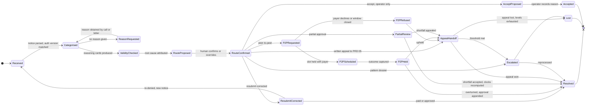
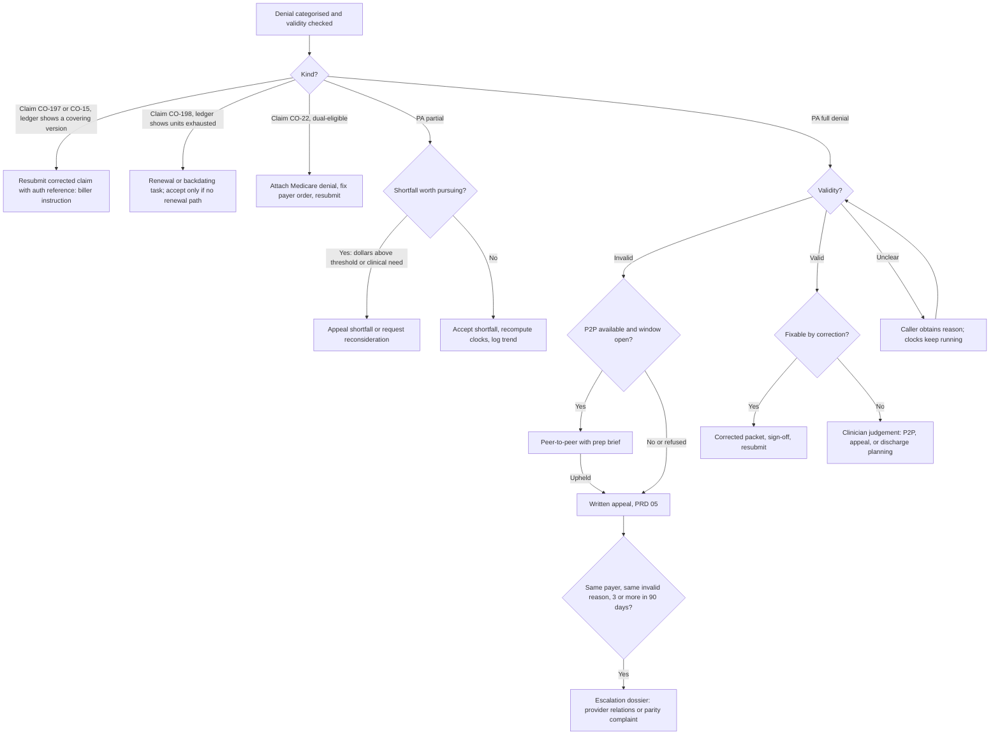

# 04 — Denials Management

**Product line:** 3 of 4 (see `_brief.md`). **Status:** draft v1, 2026-09-19. **Depends on:** the PA lifecycle and authorization-ledger PRDs (versions, two clocks, events), the eligibility PRD, payer intelligence (policy versions, observed behaviour). **Feeds:** the Appeals PRD (05), analytics and leakage. **Demo reference:** `/demo/denials`; model in `apps/frontend/src/lib/demo/denials.ts`, `appeals.ts`, `types.ts`, `payers.ts`.

---

## 1. Summary and problem statement

Denials management sits between the authorization ledger and written appeals. It brings every adverse determination into one queue — full and partial PA denials by portal, fax, mail or 278 response, and the claim-level denials that trace back to authorization (CO-197 no precertification, CO-198 units exceeded, CO-15 invalid authorization number, CO-22 coordination of benefits) — and does five things a spreadsheet cannot: categorises the denial; checks whether the payer followed its own criteria and what the clinical record shows, with explainable reasoning cards; attributes a root cause; routes it against a per-payer deadline clock (resubmit corrected, peer-to-peer, written appeal, accept, escalate); and turns the root cause into a prevention rule. It owns the peer-to-peer and partial-approval workflows, hands written appeals to PRD 05, and stays open until the outcome is appended to the ledger.

The problem, in the evidence:

> "Our denials on PAs run about 30% — about 30% of our requests are being denied." — Tracy Cosker, `research/tracy-call-transcripts.md`, Call 1, *Denials, appeals and the clinician burden*

> "Every time we get a new reason, we will change our process, change our documentation, update it, and then we'll get a new denial for a completely different reason. ... 'Oh, well, now we're going to deny it because they live in a personal care home.'" — Tracy, Call 2 [17:42]

> "I've uploaded all of their reference documents ... and they're like, 'They're not even following their own rule. I don't know why they're mentioning this. They don't put that anywhere in their rules.'" — Tracy, Call 2 [18:00]

> "We'll ask for 60 units, but they'll only give us 30, and they don't give us a reason why." — Tracy, Call 1, *Building her own tracking tool*

> Jennifer (Ohio SUD/IOP): after Ohio Medicaid's 30-unit IOP cap took effect in July 2026 her PAs came back "denied, denied, denied"; at peer-to-peer the reviewer asked the date of last use and said denied, with no explanation. — corpus summary in `prd/_brief.md`; PM brief for this PRD

> Dave Cherry (Ellie Mental Health, Ohio): Anthem rejects roughly 50% of claims on submission and about 25% are eventually paid; recoupments arrive 6–24 months later with no reason; the contract says there are no appeal rights; "duplicate service, same date" denials; CareSource cut rates 15% retroactively. — `prd/_brief.md`; PM brief

Tracy's funnel is the shape of the product: ~70% first-pass approval; utilization managers work "a matrix that they're checking off" and escalate to a clinical reviewer who often denies and recommends a peer-to-peer; ~50% of peer-to-peers overturn at 30–60 minutes of clinician time each; some payers refuse P2P; ~15% reach written appeal (Call 1, *The three layers*). Denied patients who would be harmed by a pause keep attending free for up to 60 days — "just under $10,000 of revenue" for a five-day-a-week patient (Call 2 [23:02]).

Why this is a product line and not a tab in the appeals tool:

1. **The denial is often not a documentation problem.** Tracy's engine, loaded with every MCO rule and denial letter, concludes the payer is not following its own criteria. Better appeal letters treat the symptom. The validity check must separate *we were short* (fix the packet, adopt a rule) from *the payer contradicted itself* (peer-to-peer, appeal, pattern dossier).
2. **Peer-to-peer and partial approval are unmodelled.** Across seven demoed vendors both are absent (`research/competitor-landscape.md` §4); only QuickIntell and Lucida claim them, undemoed. Yet P2P recovers half of Harbor's denials and partials are the newest leak.
3. **The administrative half is the segment.** Aegis's CEO rated a single-CPT Medicaid clinic with ~15 denials a day, half administrative, a weak fit: his product "works best when there's a very high volume of denials and a lot of the cases are not administrative" (§3.6 `[AE-demo]`). CombineHealth prices appeals at $4–5 per denied claim, validity check first, human edits kept as training data, and Adam calls the payer when a claim sits two weeks at $3–3.50 per call (§3.1 `[CH-email]` `[CH-demo]`). Neither ties a claim denial to an authorization ledger; a CO-197 against an authorization that exists is pure rework, and only the ledger can prove it.

---

## 2. Goals, non-goals, success metrics

**Goals.** (1) Every adverse determination, PA or claim, any channel, is in one queue within one business day, linked to its authorization version, with a clock running. (2) Every denial carries a cited validity finding before anyone decides what to do. (3) Every denial is routed by a human within two business days from a recommendation that shows dollars and the clock. (4) Peer-to-peers are scheduled inside the payer's window, briefed on one page, and captured. (5) Partial approvals are decisions, not absorptions. (6) Root causes become checklist rules the packet agent enforces. (7) The operator sees denials by payer × category × validity × dollars over time.

**Non-goals.** Drafting, signing, sending and tracking written appeals and external reviews (PRD 05). Submitting claims or corrected claims — Psyflo hands the biller an exact instruction. Predicting overturn probability (principle 5). Agents negotiating clinical questions. Contract underpayment recovery (Aegis's core).

| Metric | Type | Baseline (Harbor, stated) | Pilot target |
|---|---|---|---|
| First-pass approval, by payer | lagging | ~70% (Call 1) | monthly with trend; +5 pts where root cause was packet |
| P2P reversal, by payer and clinician | lagging | ~50% (Call 1) | measured; brief on 100% of P2Ps |
| Appeal rate (routed to appeal ÷ denials) | lagging | ~15% of clients reach appeal (reconcile, §13) | falls as resubmit and P2P absorb fixable denials |
| Days-to-route (receipt → route confirmed) | leading | not measured | median ≤ 1 business day, p95 ≤ 3 |
| Invalid-denial share | leading | unknown | per payer; feeds escalation |
| Deadline misses | leading | at least one ("we don't have that on file", Call 2) | zero |

---

## 3. Users and jobs-to-be-done

| Persona | Jobs here | Never asked to |
|---|---|---|
| **Operator (Tracy)** | See every open denial with dollars and days left; confirm or override routes; the only role that accepts a write-off; adopt prevention rules; decide escalations; answer "how many denied, how many in appeal". | Re-key from a portal into Excel; work out which clock binds. |
| **PA coordinator (Jordan)** | Triage daily; attach missing notices; request P2Ps via the payer's channel; hold calendar slots; assemble corrected packets from the agent's checklist; chase missing reasons. | Judge clinical validity. |
| **Clinician (Heather, LCSW)** | Read a one-page P2P brief, hold the call, capture the outcome in two minutes; decide care continuity on each denial; own the clinical argument in corrected packets. | Read a 60-page packet to find the criterion; schedule a P2P by phone tree. |
| **Offshore biller (~$12/h)** | Work exact instructions: resubmit claim X with reference Y in loop 2300 REF; attach the Medicare denial; fax a P2P form. | Judge validity, route or write-off. |

---

## 4. End-to-end workflow

### 4.1 As-is (Harbor today)

1. A decision appears in Availity or the WellCare portal on the daily refresh, or a letter arrives by fax or mail; partials arrive with no reason (Call 1). Claim denials surface separately as CARC codes in Sunwave's RCM and nobody reconciles them to the authorization ("invisible today", `scratchpad/research/draft_prd.md` §10).
2. The row moves to the appeals tab of the five-tab Excel tracker; Tracy uploads the letter to her Claude engine, which often cannot see why it was denied (Call 2 [17:42]).
3. If a peer-to-peer is offered, staff request it and Heather holds it: 30–60 minutes, about half overturn. Some payers refuse.
4. If upheld or refused, Heather writes the appeal; the 50–70-page packet is faxed, split in three for some MCOs; staff call three days later to confirm receipt (Call 2 [18:49]) — PRD 05. The clinician decides whether the patient keeps attending free (Call 2 [23:02]).
5. Nothing feeds back into the next packet except memory, and the process change produces a different denial next time.

### 4.2 To-be (with Psyflo)

| Step | Who acts | Agent does | Output |
|---|---|---|---|
| 1. Intake | Navigator (portals), fax/mail OCR, 835 feed | Extracts decision, dates, reason, criteria cited, units, reference; matches the version or claim line; de-duplicates. | `Received` |
| 2. Categorise | Advocate | Taxonomy category with confidence; `no reason` opens a Caller task. | `Categorised` |
| 3. Validity check | Advocate, with Sentinel's policy versions and the Sunwave record | Cited reasoning cards; sources-checked count. | invalid / valid / unclear |
| 4. Route | Advocate proposes; Jordan confirms resubmit, P2P, appeal; Tracy confirms accept, escalate | Decision tree (FR-06) with clocks and dollars; never accept alone; overrides are training signal. | `RouteConfirmed` |
| 5a. Resubmit corrected | Packet rebuilds the element; Heather signs; Navigator resubmits; biller gets claim instruction cards | | resolved or re-denied |
| 5b. Peer-to-peer | Jordan requests; Heather holds with the brief; outcome captured | Request draft, calendar hold, brief, outcome form | overturned → version appended; upheld → 05 |
| 5c. Partial review | Heather (need), Tracy (dollars) | Shortfall × rate; recomputed clocks and file-by; payer partial trend | accept or appeal shortfall |
| 5d. Appeal / escalate | PRD 05 / Tracy | Denial context travels with the case; pattern dossier | outcome written back |
| 6. Continuity, prevent, report | Heather; Tracy; Analyst | Free-care meter starts; root cause becomes a rule Packet enforces; heatmap and leakage with every number traced to rows | decision, rule, analytics |

---

## 5. Functional requirements

Priorities: **P0** Harbor pilot · **P1** v1 (second design partner) · **P2** later.

### 5.1 Denial state machine

Mapping to the demo (`denials.ts` `DenialStatus`): `new` covers Received through RouteProposed; the `appeal_*`, `receipt_unconfirmed` and `under_review` statuses are AppealHandoff sub-states owned by PRD 05 and mirrored here; the rest map by name. `DenialRoute` gains `escalate` and `partial`. Every transition appends an `AuthEvent` (`types.ts`); nothing is overwritten (principle 3).

### 5.2 Categorisation taxonomy

| Code | Category | Applies to | Signal → default presumption |
|---|---|---|---|
| MN | Medical necessity | PA | "does not meet criteria", "symptoms stable" → check criteria set and record |
| DOC | Documentation insufficient | PA | "insufficient clinical information" → is the evidence in the packet? |
| ADM-MISS | Missing element | PA | form, signature, NPI, dates, stale assessment → valid; fix and resubmit |
| ELIG | Eligibility | PA / claim | member inactive, wrong plan, carve-out → eligibility PRD |
| POL | Policy change | PA | new cap, recency rule or form (`POLICY_CHANGES`) → valid only if effective on the request date |
| NR | No reason given | PA incl. partial | decision only → unclear; CMS-0057-F requires a specific reason; call |
| ADM-FMT | Administrative / formatting | PA | merged PDF rejected, wrong split, portal or form version → valid; fix, adopt rule |
| PART | Partial approval | PA | `unitsGranted < unitsAsked` → denial of the shortfall |
| CLM-197 | Claim: no precertification (CO-197, RARC M62) | claim | covering version exists → payer error; none → ours |
| CLM-198 | Claim: units exceeded (CO-198, RARC N54) | claim | visits beyond `unitsGranted` → renewal / backdating path |
| CLM-15 | Claim: invalid authorization number (CO-15) | claim | reference mismatch → resubmit with correct reference |
| CLM-22 | Claim: COB (CO-22) | claim | dual-eligible without the Medicare denial → attach and resubmit |

The first seven map onto `DenialCategory` in `types.ts` plus a new `administrative` value; the claim rows extend the demo's `auth_missing` and `units_exceeded`. CO-18 duplicate-service denials (Dave Cherry) reconcile as units per day under CLM-198.

### 5.3 Requirements

**FR-01 Multi-channel intake (P0).** Sources: portal status and letters from Navigator's daily poll; inbound fax OCR; scanned mail; 278 responses (HCR01 action codes, HCR03 reason where supplied); 835 remittances (CAS segments with CARC and RARC). Each creates or updates one `Denial` linked to an MRN and an authorization version, or a claim line and its covering version.
*Acceptance:* 100% of pilot determinations appear within one business day of the earliest system-visible date; each is linked or flagged `unmatched`; extracted fields show beside the source image; the notice is stored immutably.

**FR-02 Duplicates and supersession (P0).** Same version + determination date + decision → merged as a duplicate notice, all files kept. Same version, different decision (denial then corrected approval; approval then retro-denial) → new event and version; the later supersedes for status, the earlier is never deleted.
*Acceptance:* fax + mail + portal copies yield one row with three attachments; a corrected approval closes the denial as "superseded by payer".

**FR-03 Categorisation (P0).** Advocate assigns one primary category with confidence and a quoted span; one-click override; overrides stored de-identified as training signal.
*Acceptance:* ≥ 90% agreement with the operator on a labelled set of Harbor's historical denial letters (Call 1); every category shows its quote.

**FR-04 Validity check with reasoning cards (P0).** For each PA denial, an ordered stack of cards, each citing its source (after CombineHealth Rachel's reasoning cards, `[CH-shots]`): (1) *Denial reason review* — reason as stated, criteria cited or not; (2) *Criteria comparison* — the payer's criteria set and policy version effective on the request date (Sentinel), each criterion met / not met / not addressed with the packet page; (3) *Clinical record review* — quotes from treatment plan, LOCUS, PCH notes with document, date, page; (4) *Payer history* — this payer's decisions on this reason for this program, with P2P and appeal overturn rates from the ledger; (5) *Root cause*; (6) *Recommendation*. Output `invalid` (payer contradicts its criteria or the record), `valid` (packet short of a stated criterion) or `unclear`, with a sources-checked count (HealOS pattern, `[HO-shots]`).
*Acceptance:* no card asserts a fact without a citation the reviewer can open; cards precede any route; clinician edits are attributed and used for training only with operator opt-in.

**FR-05 Root-cause attribution (P0).** Primary and optional secondary from **packet** (missing, stale, buried), **criteria** (record does not meet the criterion), **payer behaviour** (criterion not in policy, misapplied, no reason, refused P2P), **process** (late renewal, wrong channel, never submitted), **eligibility data**. Required before route confirmation.
*Acceptance:* root cause filters queue and heatmap; payer-behaviour causes feed the escalation counter (FR-13); packet and process causes feed the rules loop (FR-14).

**FR-06 Routing recommendation (P0).** Advocate proposes a route from the tree below with dollars at stake (`valueAtRisk` = visits since decision × rate, `denials.ts`) and the binding clock; at least two options are always shown; `accept` is never the sole option and only the operator role can confirm it.

*Acceptance:* every recommendation shows the rule that produced it; overrides are logged with reason; median days-to-route ≤ 1 business day.

**FR-07 Deadline clocks (P0).** Per denial the system runs every applicable clock and shows the binding one: appeal window from the notice date (per payer 30 / 60 / 120 days, `payers.ts` `appealDeadlineDays`); P2P request window (payer-specific, often short; default "unknown — confirm on call"); expedited track (72 hours) on clinician attestation; the CMS-0057-F 7-day decision clock on the underlying request; corrected-claim / timely-filing window per contract; the continuation-of-benefits window (§9) when a renewal denial reduces or ends a previously authorized course; the free-care meter; Ohio SB 162's 60-day recoupment response (P2). Alerts at 14, 7 and 3 days; no clock is silenced without operator acknowledgment.
*Acceptance:* zero deadline misses in the pilot; queue sorts by binding clock; an uncertain start date computes conservatively and is labelled.

**FR-08 Peer-to-peer workflow (P0).** (a) *Request:* Advocate drafts it in the payer's channel; Jordan sends or Caller calls. (b) *Schedule:* the agent reads the clinician's calendar, proposes three slots inside the payer's window, holds one and attaches the brief. (c) *Brief, one page:* reason as stated; the criterion in the payer's words with citation; evidence quotes with document and date; this payer's prior P2P questions and outcomes for this reason (the Jennifer pattern, "reviewer asked date of last use"); three clinician-editable talking points; the ask. (d) *Outcome capture, two minutes:* reviewer name and credential, duration, questions asked, outcome (overturned / partial / upheld / refused), units and window granted, reference, next step; an overturn appends a `p2p` version (as `seed-auths.ts` `resolveDenial` does). (e) *Refusal:* `P2PRefused` with reason, counted per payer, automatic hand-off to 05.
*Acceptance:* route confirmation to P2P held ≤ 7 days median; 100% of held P2Ps have a brief and a captured outcome; conversion by clinician and payer (draft demo PRD §10).

**FR-09 Partial approval as a first-class denial (P0).** Any version with `unitsGranted < unitsAsked` opens a `PART` denial: shortfall units and dollars (the leakage row "Partial approval shortfall", `analytics.ts`), the payer's partial trend (`PARTIAL_BY_QUARTER`), and the recomputed two clocks and file-by date under the granted units. Options: accept the shortfall (operator), reconsideration or P2P, appeal the shortfall (05). The authorization goes `active` on the granted units regardless; care is never blocked by the decision.
*Acceptance:* every partial is queued within one business day; accepting recomputes `fileBy` immediately (`derive.ts` `clocksFor`); the scorecard shows partial rate and asked → granted.

**FR-10 Payer follow-up call for "no reason given" (P1; P0 as a biller task card).** Caller phones provider services, navigates IVR and hold, and asks for the specific criterion not met, the reviewer's credential, whether P2P is available and by when, the appeal destination and required forms, and the reference; the script cites the CMS-0057-F specific-reason requirement. Structured result on the denial (LunaBill's "what we did, what we found, recommended action", `[LB-demo]`), recording and transcript attached. A clinical question ends the call with an escalation to the clinician.
*Acceptance:* ≥ 90% of `NR` denials have a documented reason or refusal within 5 business days; every call has a structured outcome.

**FR-11 Resubmit-corrected path (P0).** PA denials with packet or administrative root cause: Packet rebuilds only the element at fault, Heather signs, Navigator resubmits in the payer's split; both packets are versions. Claim denials where the ledger covers the DOS: a biller instruction card — claim, DOS, authorization reference, where it goes (loop 2300 REF, G1), what to attach — with the ledger row that justifies it. Psyflo does not submit claims.
*Acceptance:* a corrected PA resubmission is impossible without a signature event; re-denials re-enter the queue linked to the prior denial.

**FR-12 Accept / write-off gate (P0).** Only the operator role can move a denial to `Accepted`; reason mandatory (no renewal path, discharge, below threshold, window missed with cause); dollars shown at acceptance; accepted denials appear in the leakage report by reason; the agent never proposes accept alone and never closes a denial for age.
*Acceptance:* the monthly write-off report is produced from `Accepted` rows alone.

**FR-13 Escalation dossier (P1).** When invalid denials from one payer with the same root-cause reason reach a threshold (default 3 in 90 days), or P2P is refused repeatedly, Advocate assembles the denials, the payer's published criteria, the cards, P2P and appeal outcomes, the payer's published PA metric beside the observed rate (`publishedFirstPassApproval`), and the applicable rule (CMS-0057-F; Medicaid parity, 42 CFR 438 subpart K; MHPAEA for commercial plans). The operator decides whether it goes to provider relations, the state Medicaid agency, or nowhere.
*Acceptance:* one-click dossier from filtered denials; sending is a human act; the event is appended to every included authorization.

**FR-14 Prevention rules loop (P1).** From a root cause, Advocate proposes a rule in the payer × program rule set (Neon's tuple pattern, `[NE-demo]`): a required element, a recency limit, a packet split, a cover-sheet line ("document the personal-care-home placement"), a pre-empted question ("date of last use"). The operator adopts, edits or rejects; adopted rules carry provenance (denial ids, date) and Packet enforces them before the next submission (the "8 of 9 present" check in `agents.ts` run-3). Recurrence after adoption is measured.
*Acceptance:* every adopted rule links to its source denials; Packet blocks submission pending a human choice when a rule is unmet; the rules screen shows recurrence since adoption.

**FR-15 Denial analytics and Ask Psyflo (P0 basic, P1 full).** Heatmap payer × category with count, dollars and invalid share (CombineHealth's "Payor Denial Count Heatmap" with Chart/Table toggle, `[CH-shots]`, extended with validity); quarterly trend; days-to-route; P2P conversion by clinician and payer; appeal rate; no-reason share; free-care days and dollars; shortfall units by payer. Every cell drills to rows (principle 6); Ask Psyflo answers "which payer denied most for no reason last quarter" with cited rows (P1).
*Acceptance:* the `/demo/payers` denial mix and the `/demo/leakage` denial rows reconcile to denial rows; the operator sees "how many denied, how many in appeal" at a glance (Call 2 [65:27]).

**FR-16 Auth-to-claim reconciliation (P1).** Every 835 line with CARC 197, 198, 15 or 22 (and 18 for per-diem duplicates) is matched to the ledger by MRN, payer and DOS and classified *ledger covers* (payer error → FR-11 instruction), *ledger does not cover* (units exhausted, window expired, no version → renewal/backdating path; accept only if no path) or *unknown* (data gap → task). Two report lines: "claims denied despite valid authorization" and "claims denied because the ledger was right".
*Acceptance:* runs on every remit import; each claim denial shows its matched ledger row; both lines appear on the leakage screen.

**FR-17 Hand-off to Appeals (P0).** Route `appeal`, `P2PHeld → upheld`, `P2PRefused` or "appeal shortfall" creates an appeal case in 05 carrying the denial, notices, cards, root cause, the binding clock, the payer's channel and destination (`appealChannel`, `appealFax`, `requiresMemberSignedAppealForm`, `packetSplit`) and the P2P outcome. The denial mirrors appeal sub-states read-only and closes only when 05 writes the outcome; a won appeal appends an `appeal` version with units and a restarted window (as seeded in `stories.ts` `applyFourRenewals`).
*Acceptance:* no appeal without a denial; no denial closes while its appeal is open; the event chain reads denial → P2P → appeal → outcome.

**FR-18 Care-continuity decision (P0).** On every PA denial and partial the clinician records continue-free / pause / discharge planning; the choice starts or stops the free-care meter and later visits are classified `denied_in_appeal` (`derive.ts` `coverageOn`).
*Acceptance:* required before the denial leaves `RouteConfirmed`; free-care dollars visible on the row and in leakage.

**FR-19 Recoupment and retro-adjustment intake (P2).** Recoupment letters, retroactive rate cuts and 835 takebacks enter the same queue with their own clocks (SB 162: one-year lookback, 60-day response) and root causes; "no appeal rights per contract" is recorded as payer behaviour and an escalation input (Dave Cherry).

---

## 6. Screens and UX

### 6.1 Denials queue — `/demo/denials`

*Purpose.* The daily view: what is open, what binds first, what it is worth. *Layout.* Six KPI tiles that act as filters (Arrow's status buckets, `[HO-shots]`): Open, Value at risk, Deadline ≤ 14 days, Invalid share, Won, Lost — exactly `denialSummary()` in `denials.ts`. Columns: MRN · payer · kind · code · category · validity pill (Invalid / Valid / Unclear) · route · status · deadline (days left, red under 7) · value at risk · owner. Default sort: binding deadline, then value; filters on payer, kind, validity, route, status, owner, location; saved view "Needs me today". Status-specific second line per row (HealOS queue cards, `[HO-deck]`): "P2P Tue 23 Sep 2:30pm · Heather M." / "Reason requested — call tomorrow 9:00" / "Resubmit with AET-4204N in loop 2300 REF". *States.* Empty shows last closed and invalid share; loading shows skeleton rows with last poll time; error names the failed intake source, never a blank table. *Interactions.* Row → workspace; multi-select assign; "Unmatched notices" badge; persistent "Demo data — not Harbor's records" marker.

### 6.2 Denial workspace — `/demo/denials/[id]` (specified here; the demo currently links appeal-routed denials to `/demo/appeals/[id]`)

*Header strip* (CombineHealth, `[CH-shots]`): MRN, payer, auth version, units used / granted, window, notice date, binding clock ("Appeal window: 41 days left, Anthem 60-day"), status, owner. *Left — timeline* with green completed and hollow pending dots from Received to Rule adopted; `gate` states mark human steps ("Route confirmation — Jordan P."; "Continuity decision — Heather M."). *Centre — document viewer* tabs: Denial notice (image plus extracted fields), Packet as submitted (the page the reviewer should have seen highlighted), Policy excerpt (version, effective date), Call transcript. *Right — reasoning cards* (FR-04) with source chips; then the *route panel*: options with dollars and clock ("P2P: window closes in 6 days · this payer overturns 48%" / "Accept: $2,687 written off — operator only"), a confirm per option, an override reason. Below: the continuity control; the partial panel (asked 60, granted 30, shortfall 30 units = $7,329, file-by moves from 30 Sep to 12 Sep); the P2P panel (request, slots, brief, outcome form); the prevention proposal ("Adopt rule: WellCare renewals require LOCUS ≤ 30 days — from this denial and 2 others"). *Questions to human* appear inline (HealOS, `[HO-shots]`): "Is the PCH placement documented in the current treatment plan? [Yes, page 4] [No] [Not sure]".

### 6.3 P2P brief and outcome form

Brief (print, PDF, mobile), one page: reason as stated · criterion in payer wording with citation · evidence quotes with document and date · this payer's last five P2Ps for this reason · three editable talking points · the ask · reviewer and dial-in. Outcome form, mobile-first, six fields, two minutes; submits an event; an overturn appends a version.

### 6.4 Analytics — on `/demo/payers` and `/demo/leakage`

Heatmap payer × category (count / dollars / invalid-share toggle; Chart/Table toggle); denials per 100 requests by quarter; partial detail by payer; P2P conversion by clinician and payer; days-to-route distribution; no-reason share with the CMS rule noted. Leakage rows fed here: the three existing denial rows plus new "Claims denied despite valid authorization" and "Accepted write-offs by reason". A *Rules* tab on `/demo/payers` (P1) lists payer × program rules with provenance, enforcement count and recurrence. `/demo/today` adds "Route needed" and "P2P today" work items; `/demo/agents` shows Advocate and Caller runs (run-2 in `agents.ts` is the receipt-confirmation call).

---

## 7. Agent behaviours and guardrails

| Agent (`agents.ts`) | Does here | Never |
|---|---|---|
| **Navigator** | Captures decisions and letters; resubmits signed corrected packets. | Submits anything unsigned. |
| **Advocate** | Categorises; cited validity cards; root cause; route proposals; P2P briefs; rule proposals; dossiers. | Accepts a write-off; sends anything; writes an un-cited card; argues a clinical point with a payer. |
| **Caller** | Obtains reasons, P2P availability, appeal instructions; confirms receipt; records, transcribes, summarises. | Negotiates clinical questions — it ends the call and escalates; contacts a patient or guardian. |
| **Packet** | Rebuilds only the faulty element; enforces adopted rules pre-submission. | Writes clinical content. |
| **Sentinel** | Supplies the policy version effective on the request date; flags changes that explain `POL` denials. | Rewrites a rule without acknowledgment. |
| **Analyst** | Answers questions over denials; heatmap and leakage lines. | Predicts overturn odds. |

**Guardrails.** (1) **The agent never accepts a write-off** — `Accepted` needs the operator role, a reason and a displayed dollar value; accept is never the only option; no denial closes for age. (2) **The clinician owns clinical arguments** — briefs and corrected clinical content are drafts the clinician edits and signs; Caller does not discuss merits; a clinician, never an agent, holds the P2P. (3) **Nothing sends itself** (principle 2) — corrected packets, P2P letters and appeals pass sign-off; claim corrections are biller instructions, not submissions. (4) **Explain or it does not count** — a finding or route may rely only on cited cards; an un-cited assertion becomes a question to the human. (5) **Observed, not predicted** (principle 5) — route panels show this payer's observed P2P and appeal outcomes, never a probability for this case. (6) **Clocks are sovereign** — dismissed only with operator acknowledgment. (7) **History is append-only** (principle 3) — duplicates, supersessions, overrides and reschedules are events. (8) **Minimum necessary** (principle 8) — MRN/initials on shared screens; training on edits is de-identified and opt-in (CombineHealth's edits-feed-training pattern, `[CH-demo]`); every agent action is an audited event.

---

## 8. Data model and integration touchpoints

| Entity | Key fields |
|---|---|
| `Denial` | id, mrn, payerId, kind (`pa` / `partial` / `claim`), authVersionId or claimLineId, receivedAt, noticeDate, code, category, reason, validity, validityNote, rootCause, route, status, bindingClockId, valueAtRisk, continuityDecision, owner, appealId |
| `DenialNotice` | denialId, source (`portal` / `fax` / `mail` / `278` / `835` / `call`), receivedAt, fileRef, extractedFields, ocrConfidence, duplicateOf |
| `ValidityCard` | denialId, order, title, body, tone, citations[] (documentRef, page, policyId, policyVersion, effectiveDate), sourcesChecked |
| `RouteDecision` | denialId, options[] (route, dollars, clockDaysLeft, observedOutcomeRate), confirmedRoute, confirmedBy, overrideReason, at |
| `DeadlineClock` | denialId, type (appeal window, P2P window, expedited, decision SLA, claim correction, continuation of benefits, recoupment response, free care), startDate, startCertainty, dueDate, sourceRuleId, acknowledgedBy |
| `P2PSession` | denialId, requestedAt, scheduledAt, clinicianId, briefRef, heldAt, durationMin, reviewerName, reviewerCredential, questionsAsked[], outcome, unitsGranted, windowStart, windowEnd, refusedReason |
| `PartialDecision` | denialId, unitsAsked, unitsGranted, shortfallUnits, shortfallValue, decision, decidedBy, recomputedFileBy |
| `PayerCall` | denialId, purpose, holdMin, structured outcome, transcriptRef, recordingRef |
| `PreventionRule` | id, payerId, program, ruleText, kind, proposedFrom[] (denialIds), adoptedBy, adoptedAt, enforcedCount, recurrenceSince |
| `ClaimDenialLine` | claimId, mrn, payerId, dos, cpt, units, billed, carc, rarc, remitDate, matchedVersionId, reconciliation, instructionRef |

New `EventType` values appended to `Authorization.events`: `denial_received`, `validity_checked`, `reason_obtained`, `route_confirmed`, `continuity_decided`, `p2p_refused`, `partial_accepted`, `claim_reconciled`, `rule_adopted`, `escalated`, `denial_closed`.

| System | Direction | Used for |
|---|---|---|
| Availity (4 of 5 MCOs); WellCare portal | read | decision status, letters, 278 responses where exposed; P2P request forms |
| Inbound fax (eFax), scanned mail | read | denial, partial and recoupment letters → OCR |
| Sunwave (EHR/CRM/RCM) | read; write-back via the existing agent | clinical record for the validity check; claim lines and 835 CARC/RARC via RCM export; outcome and reference write-back |
| Clinician calendar (Google / Microsoft) | read/write | P2P slot proposal and hold |
| Phone (voice agent) | outbound | reasons, P2P availability, receipt |
| PRD 05 appeal case | write/read | hand-off and outcome |

---

## 9. Payer and regulatory rules the feature must encode

| Rule | Encoding |
|---|---|
| CMS-0057-F: 7-day standard / 72-hour expedited decisions from 1 Jan 2026; specific reason for denials; public PA metrics from 2026 | `decision_sla` clock; `NR` denials flagged non-compliant and counted per payer; published metric beside observed on the scorecard |
| Kentucky: PA mandated July 2025; 5-day decision described by Tracy; decisions backdated to request date | KY SLA setting; backdating drives reconciliation of claims delivered while pending |
| Medicaid managed care enrollee appeals (42 CFR 438.402–438.420, as summarised in `_brief.md`): 60-day window (some plans and provider-dispute tracks 30); standard appeals resolved in 30 days, expedited 72 hours; state fair hearing after; continuation of benefits for a reduced or terminated previously authorized service when requested within the plan's short window (commonly 10 days) | `appeal_window` per payer; a **track** field (`enrollee_appeal` with member consent — likely the "client-signed authorization form" Tracy described — vs `provider_dispute`); `continuation_of_benefits` clock on renewal denials and partials; applicability to TRP to be confirmed per MCO contract (§13) |
| MHPAEA 2024 final rule; Medicaid managed care parity (42 CFR 438 subpart K): PA and P2P practices are non-quantitative treatment limitations | dossier cites the applicable regime; invalid share and P2P refusals are the evidence lines |
| Ohio SB 162 (7 Oct 2026): one-year recoupment lookback, 60-day response, no appeal fees | `recoupment_response` clock; lookback test on recoupment intake (P2) |
| Payer-specific (`payers.ts`, transcripts): appeal channel and fax, window (30 / 60 / 120), member-signed form, three-part split, unit caps, criteria set, P2P availability and request window (unknown), partial behaviour | payer rule tuples with effective dates; Sentinel diffs; every rule shows source and version |
| X12: 278 HCR01 (A1 certified, A2 partial, A3 not certified, A4 pended, A6 modified) and HCR03; 835 CAS groups and CARC 197 / 198 / 15 / 22 / 18 / 50 with RARC M62, N54; dual-eligibles: Medicare must deny before Kentucky Medicaid pays (Call 1) | intake parsers (FR-01); category mapping (§5.2); CO-22 path attaches the Medicare denial |

---

## 10. Edge cases and failure modes

| Case | Behaviour |
|---|---|
| **Denial with no letter** (portal says "denied" only; 278 `A3` without HCR03; the notice went to the member or guardian at the personal care home) | Create the denial from the portal decision date; clocks start conservatively from it; task "obtain letter" (Caller requests a fax copy; Jordan asks the PCH or guardian); route may be confirmed without the letter, with the validity card marked "reason unverified". |
| **Duplicate notices** (fax + mail + portal; two letters for one request) | Merge by version + date + decision, all files retained; a differing decision creates a superseding event (FR-02). |
| **Denial after backdated approval** | (a) Claims for DOS during the pending period denied CO-197 before the backdated approval loaded: reconciliation flags them for resubmission once the version covers the DOS. (b) Approval backdated, then a retro-rescission or recoupment: post-payment adverse determination (FR-19); contract rights checked; escalation input. (c) Renewal backdated with fewer units than were delivered in the gap: tail visits `units_exhausted`; partial handling for the gap; accept requires the operator. |
| **Payer refuses P2P** ("they don't have time"; P2P only before the final determination) | `P2PRefused` with reason; immediate hand-off to 05 so the window is not spent waiting; counted per payer; if P2P exists only pre-determination, that payer's P2P window clock is set on future denials. |
| **Undocumented criterion asked at P2P** (Jennifer: date of last use) | Captured in `questionsAsked`; Advocate proposes a pre-empt rule; the next brief for that payer lists the question. |
| **Reason not in the payer's policy** ("they live in a personal care home") | Criteria card: "criterion not found in policy … version … effective …"; validity `invalid`; root cause payer behaviour; escalation counter increments. |
| **Late notice** (received after the window computed from the notice date) | Clock from receipt with a "late notice" flag; Caller confirms the mailing date; the appeal argues timeliness from receipt. |
| **"We don't have that on file"** for a request the ledger shows submitted | A denial cannot exist without a submission event; the request re-enters the lifecycle with its reference and screenshot as evidence; never a write-off. |
| **Eligibility denial; low-confidence OCR** | Routed to the eligibility PRD, authorization paused not closed; uncertain OCR fields become questions to the human and no clock starts from an unconfirmed date without the conservative label. |

---

## 11. KPIs and analytics this feature emits

| KPI | Definition | Rows |
|---|---|---|
| First-pass approval | full approvals ÷ decided initial + renewal versions, by payer and quarter | `AuthVersion` |
| Invalid-denial share | validity = invalid ÷ PA denials, by payer | `Denial` |
| No-reason share; time to reason | `NR` ÷ denials; days to `reason_obtained` | `Denial`, `PayerCall` |
| Days-to-route | `route_confirmed.at − receivedAt`, median and p95 | `RouteDecision` |
| P2P reversal; time to P2P; refusals | overturned ÷ held, by payer and clinician | `P2PSession` |
| Appeal rate | routed to appeal ÷ denials, and ÷ patients (to reconcile Tracy's 15%) | `RouteDecision` |
| Deadline misses | clocks passed while open | `DeadlineClock` |
| Free-care days and dollars | `denied_in_appeal` visits × rate, per denial | `Visit` |
| Claims denied despite valid authorization | `ledger_covers` lines, count and dollars, by payer | `ClaimDenialLine` |
| Recurrence after rule adoption | same payer + root cause after `adoptedAt` | `PreventionRule`, `Denial` |
| Clinician minutes per denial; accepted write-offs by reason | P2P duration + edits + sign-offs at $90/h; `Accepted` rows | `P2PSession`, `Denial` |

All figures derive from the immutable ledger — the history Sunwave's overwrite destroys (Call 1).

---

## 12. Rollout and phasing

**Phase 0 — Harbor pilot (weeks 1–6).** Intake from Availity/WellCare polls, fax OCR and manual upload; taxonomy and validity cards trained on Harbor's historical denial letters and approved packets (Call 1); routing with clocks for five MCOs plus Medicare; P2P workflow; partial handling; continuity decision; accept gate; queue and workspace; basic heatmap; hand-off to 05. Claim-level intake from a manual CSV of 835 lines to prove reconciliation. *Exit:* zero deadline misses; days-to-route ≤ 1 business day median; 100% of P2Ps briefed and captured; the write-off report produced from `Accepted` rows.

**Phase 1 — second design partner (Ohio; the Dave Cherry / Jennifer profile).** 835 ingestion by clearinghouse or Valant export; Caller for reasons and receipt; prevention rules with Packet enforcement; escalation dossier; recoupment intake with SB 162 clocks; multi-CPT taxonomy (IOP caps, CO-18 duplicates); Ask Psyflo. *Exit:* the reconciliation report accepted by the biller as their work queue; recurrence measured on at least three adopted rules.

**Phase 2 — general.** 278 parsing via the CMS-0057-F Prior Authorization API (2027); external-review outcomes from 05; parity dossier templates by state; denials priced into the platform fee rather than CombineHealth's $4–5 per appeal, with value stated as free-care days avoided and clinician minutes saved (`competitor-landscape.md` §5).

---

## 13. Open questions and research asks

1. **Reconcile the funnel.** Is "15%" of all clients or of denials, and what share of written appeals wins? (transcripts, *Loose ends* 13.) Sets the appeal-rate target and sizes 05.
2. **Which MCO refuses P2P, under what stated policy, and what is each MCO's P2P request window?** No payer is named (*Loose ends* 15).
3. **Which payer requires the member-signed appeal form**, and is it enrollee consent for an enrollee appeal (bringing continuation-of-benefits rights) or a provider-dispute requirement?
4. **Continuation of benefits.** Do Kentucky MCO contracts treat a TRP renewal denial or partial as a reduction of a previously authorized service, and has Harbor ever requested it? This could replace free care with paid care during appeal.
5. **Are renewals backdated like initial requests?** Decides whether CO-198 gap visits are recoverable (draft demo PRD §7).
6. **Claim-level denials today.** Can Sunwave export 835 CARC/RARC by claim line? How many CO-197/198/15/22 lines in the last 90 days, and how many against a valid authorization? Assumed uncounted, not zero.
7. **Denial letter samples per MCO** — formats, whether criteria are cited, whether the notice goes to the guardian.
8. **P2P history and logistics.** Are reviewer names, questions and durations recorded today? Which calendar does Heather use; may a covering clinician hold a P2P; call-recording consent per state and payer?
9. **Volume and pricing.** Roughly 25–35 requests a month at Harbor's renewal cadence implies ~8–10 PA denials a month plus partials and claim lines (to confirm), against CombineHealth's $4–5 per appeal and $3–3.50 per call.

---

## 14. Evidence appendix

| Source | Used for |
|---|---|
| `docs/prior-auth/prd/_brief.md` | Principles, personas, regulatory context (CMS-0057-F, Medicaid appeals, MHPAEA, Ohio SB 162), corpus summaries for Dave Cherry and Jennifer, demo routes |
| PM brief for this PRD | Jennifer and Dave Cherry interview facts; CombineHealth pricing, validity-first, edits-feed-training, two-week call trigger; Aegis fit |
| `docs/prior-auth/research/tracy-call-transcripts.md` — Call 1: *Denials, appeals and the clinician burden*; *The three layers*; *Building her own tracking tool*; Call 2: [15:28]–[24:20]; *Verbatim quotes* 7, 13, 21; *Open questions* 6–8, 13, 15 | Denial rate, P2P success, cost and refusals, partials without reason, shifting reasons, UM matrix and clinical-reviewer escalation, free care up to 60 days, missed windows, guardians |
| `docs/prior-auth/research/competitor-landscape.md` — §3.1 CombineHealth, §3.2 HealOS/Arrow, §3.3 LunaBill, §3.4 Neon, §3.6 Aegis, §4 matrix, §5 pricing, §6 patterns | Reasoning cards, appeals timeline, heatmap, Adam's call trigger and pricing; sources-checked chip and questions-to-human; structured call outcomes; rule tuples; absence of P2P and partial states; Aegis weak fit |
| `scratchpad/research/draft_prd.md` (demo PRD) | Partial as its own state; auth-to-claim reconciliation and P2P conversion by clinician as Tier 2 metrics; care-continuity metric; renewal backdating question; mock-data labelling |
| `apps/frontend/src/lib/demo/denials.ts`, `appeals.ts`, `types.ts`, `payers.ts`, `agents.ts`, `stories.ts`, `analytics.ts`, `derive.ts` | `Denial` fields, `denialSummary()` tiles, statuses and routes, seeded CO-197 and CO-198 claim denials, payer channels and windows, policy changes, agent roster, four-renewals story, leakage rows, two-clock derivation |
