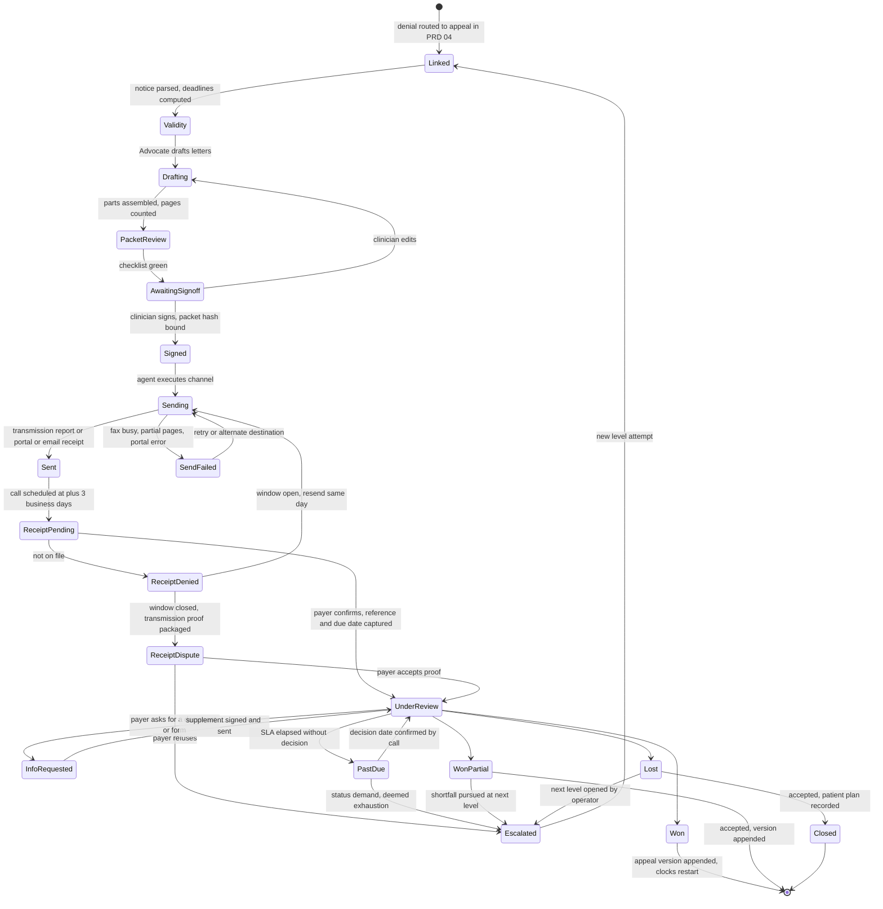

# PRD 05 — Appeals

**Product line:** Appeals — written appeals of prior-authorization denials and partial approvals, payer second level where offered, external review / state fair hearing, and the appeal-status visibility problem.
**Status:** Draft for Harbor pilot scoping. Assumes the reader has read `_brief.md`.
**Upstream:** PRD 04 (`04-denials.md`) owns categorisation, validity and routing of an adverse determination, including peer-to-peer. This PRD starts when a denial is routed to *appeal* and ends when the outcome is appended to the authorization ledger (PRD 02).
**Demo reference:** `/demo/appeals`, `/demo/appeals/[id]`; mock model `apps/frontend/src/lib/demo/appeals.ts`.

---

## 1. Summary and problem statement

An appeal at Harbor is a 50–70 page packet that a clinician writes, an offshore biller faxes, and nobody can see again until a letter arrives or does not. It is the step Tracy would change first and the one with the least visibility, even though it is "a small portion of our business" and "not the biggest leak of money" (tracy-call-transcripts.md, Call 2 [15:28]). The money is real all the same: the clinic keeps some denied patients in programming for the whole appeal, at roughly $10,000 of revenue per patient per 60-day appeal, recoverable only if the appeal wins.

The failure is not drafting; Harbor's own Claude engine already drafts and grades packets. The failure is everything after the draft: proving the packet arrived, knowing the decision date, learning on the last day of the window that a form was missing, and being told after the due date that the payer has nothing on file. The Appeals product turns each of those into a tracked state with an owner and a clock, and never sends anything a clinician has not signed.

**Evidence.**

1. "The appeals has the least amount of visibility. … you send them to a fax number and you just hope for the best. … for TRP services … they do not have the online appeal submission option. … They're like 50, 60, 70 pages long. We have no idea if they've received them. So now, three days later, I make them call and verify." — tracy-call-transcripts.md, Call 2 [18:49]
2. "The date that they said we'd have a determination by had passed, and they were like, 'Oh, I don't see this. We don't have that.' … 'We even have a reference number, everything.' … If you don't submit it within a certain timeframe, you can't submit it, and you're out of luck." — Call 2 [20:50]–[21:28]
3. "We've got to divide it into three separate things, because that's the way they want to see it at the MCO. If we put it all in one, they literally will be like, 'You're missing this.' And I'm like, 'No, it's on page 12.'" — Call 2 [22:09]
4. "'You didn't fill out this special form that you have to fill out with this packet.' And they don't tell you that till the last day of the appeal process." — Call 2 [22:40]
5. "Sometimes we will have somebody who's been attending for free … for 60 days. … If they approve that appeal, then we can backdate it and recover those. But if they don't, then we lose that revenue. … just under $10,000 of revenue sometimes." — Call 2 [23:02]
6. "About 15% of our clients are going through that appeal process … we're at about an 85% approval rate right now. But that's after either a peer-to-peer or an appeal." — Call 1, *What happens on a denial*; and "'They're not even following their own rule.'" — Call 2 [17:42]

**Sizing at Harbor (estimate; confirm against the appeals tab of her tracker).** 30% of requests are denied and half of those are overturned at peer-to-peer, so ~15% of requests reach a written appeal (Call 1) — three to five a month at Harbor's volume. Each costs ~4 clinician hours in the demo's costing model (`analytics.ts`, $90/h ≈ $360) and, when the patient stays in programming, ~40 visit days × $244.29 ≈ $9,800 at risk (draft_prd.md, Kentucky H2020 rate; matches her "just under $10,000"). The demo leakage report seeds "Free care during appeal — 61 visits, $14,902" for 90 days (draft_prd.md §9).

---

## 2. Goals, non-goals, success metrics

**Goals**

- G1. Every appeal has a stage, an owner, a payer deadline, a file-by date and, after sending, a transmission proof, a payer reference and a decision-due date. "Where is my appeal" is answered from the ledger, not a phone call.
- G2. Nothing leaves without a clinician's signature bound to the exact packet sent.
- G3. Receipt is confirmed by the third business day after sending; "not on file" is an escalated state with a dispute trail, not a write-off.
- G4. The packet is built to the payer's rule as of the send date: three-part split, criteria crosswalk on page one, member-signed form where required, correct destination.
- G5. Outcomes append to the authorization ledger as a new version and restart both clocks; nothing is overwritten.
- G6. Continuation of care during the appeal is a tracked decision with a running cost.

**Non-goals**

- Predicting whether an appeal will win. We show observed win rates by payer, level and reason from the clinic's own history (brief, principle 5); no competing score until one is calibrated.
- Writing clinical content. The Advocate drafts from the record and payer policy; the clinician edits and signs.
- Claim-level appeals (CARC/RARC), except where a claim denial is caused by a PA outcome (PRD 04, PRD 02).
- Medicare appeals; Harbor's Medicare submissions exist to obtain the denial Medicaid requires (Call 1, *EHR and payer mix*).
- Representation at a state fair hearing. We prepare the file; a human presents it.

**Success metrics**

| Metric | Type | Baseline (Harbor, reported) | Pilot target |
| --- | --- | --- | --- |
| Receipt confirmed ≤ 3 business days after sending | Leading | Ad hoc calls; "we don't always get really good visibility" | 100% attempted, ≥ 90% confirmed |
| Deadline misses (window closed, nothing filed) | Lagging | At least one "out of luck" event | 0 |
| "Not on file" after the due date | Lagging | ≥ 1 in the week before Call 2 | 0 undetected; every instance disputed with proof |
| Free-care days and $ per appeal; % recovered by backdating | Lagging | ~$10K/patient anecdote | Measured for 100% of appeals |
| Written-appeal win rate by payer × level × reason | Lagging | "About 50%" (ambiguous, loose end 13) | Measured, reported quarterly |

---

## 3. Users and jobs-to-be-done

| Persona | Job | What the product must do |
| --- | --- | --- |
| **Operator / compliance lead (Tracy)** | Know where every appeal is, what is past due, what free care costs and which payer loses her appeals; decide pause vs continue; approve reusable arguments. | Board with counts and dollars; past-due and unconfirmed lanes; continuation toggle; analytics that trace to rows; "Ask Psyflo: which appeals have no receipt confirmation?" (`ask.ts`). |
| **PA coordinator (Jordan)** | Build the packet to the payer's rule, get it signed and out before file-by, chase receipt. | Packet builder with per-payer checklist, page counts, three-part export, member-form tracking, sign-off queue, receipt status. |
| **Clinician (Heather, LCSW)** | Edit the medical-necessity argument and sign without spending 3–4 hours. | Draft grounded in her own assessments with page and dimension citations; inline edit; one signature binding the packet. |
| **Offshore biller** | Send on the right channel, resend on failure, make the receipt call. | Send queue that opens only for signed packets; destination shown; transmission report attached automatically; call script with fields to capture. |
| **Intake coordinator / front desk** | Tell the personal care home and guardian whether the patient attends during the appeal. | Continuation status on the patient; scripted notice; return date when paused. |
| **Payer appeals reviewer (external)** | Find the criteria evidence without reading 70 pages. | Crosswalk on page 1 of Part 1; "Part n of 3", member ID and reference on every cover page. |

---

## 4. End-to-end workflow

### 4.1 As-is (Harbor today)

1. The denial letter arrives and is logged in the appeals tab of the five-tab Excel tracker (Call 1, *Denials, appeals and the clinician burden*).
2. Peer-to-peer requested; ~50% overturn; some payers refuse to hold one (Call 1, *The three layers*).
3. Heather writes the appeal letter ("I really still feel that this person needs this treatment", Call 1); the engine drafts and grades; documents are exported from Sunwave.
4. The packet is split into clinical assessments / medical records / cover sheet for the MCOs that require it; one payer also needs a client-signed authorization form (Call 1; Call 2 [22:09]).
5. The offshore team faxes 50–70 pages, or emails, depending on the payer; there is no online option for TRP appeals (Call 2 [18:49]).
6. Three days later staff call to verify receipt; sometimes an acknowledgement letter with a date arrives, sometimes nothing. The decision is "supposed to be within 30 days, or sometimes … 60"; staff call again when the stated date passes; in one case the payer had nothing on file despite a reference number (Call 2 [20:50]).
7. Meanwhile the patient pauses or keeps attending free of charge for up to 60 days (Call 2 [23:02]).
8. If won, the approval is backdated and the free-care days billed; if lost, written off and in several cases the patient is discharged (Call 1).

### 4.2 To-be (with Psyflo)

| Step | Who acts | What the agent does | Output |
| --- | --- | --- | --- |
| 1. Case created | System, on PRD 04 route = appeal | Advocate opens a Level 1 case from the denial (notice date, reason, validity, P2P outcome); computes payer deadline and file-by; opens the continuation decision. | `Linked` → `Validity` |
| 2. Validity and strategy | Advocate; operator reviews | Re-checks the packet against the policy in force on the notice date; flags a missing specific reason (CMS-0057-F); proposes library arguments. | Reasoning cards |
| 3. Draft letters | Advocate; clinician edits | Drafts cover and appeal letters from assessments, LOCUS, treatment plan, attendance, P2P notes and policy excerpts; every clinical claim cites a document and page. | Editable drafts |
| 4. Packet assembly | Packet agent; Jordan reviews | Pulls documents from Sunwave, applies recency rules, assigns Parts 1/2/3, counts pages, builds the crosswalk as page 1, adds the member-form slot where required. | Checklist |
| 5. Clinician sign-off | Heather | Nothing; the gate is human. The signature binds a hash of the exact files. | `Signed` |
| 6. Submission | Navigator (fax, email, portal) or biller (mail) | Executes only on a signed packet, one transmission per part for fax; captures the proof; schedules the receipt call. | `Sent` + proof |
| 7. Receipt confirmation | Caller at +3 business days | Confirms the packet is logged; captures payer reference, date logged, decision-due date and any additional form as structured fields, plus the transcript. | `UnderReview` or `ReceiptDenied` |
| 8. Decision clock | System | Runs the payer/level SLA from confirmed receipt; alerts at −7, −2, 0, past due; Caller obtains status when past due. | Alerts, `PastDue` |
| 9. Outcome | Jordan records; system appends | Appends an `appeal` version with units and window; restarts both clocks; reconciles visits delivered during the appeal; proposes the next level if lost or partial; winning arguments proposed to the library. | Ledger version |

### 4.3 State machine (per level attempt)

---

## 5. Functional requirements

Priority: **P0** pilot (Harbor), **P1** v1 (second design partner), **P2** later.

**FR-01 Case creation from a denial (P0).** When PRD 04 routes a denial to *appeal*, a P2P is recorded as upheld, or a partial approval is marked "appeal shortfall", the system creates an `AppealCase` linked to the denial and the contested authorization version.
*Acceptance:* case carries notice date, received date, reason and category, validity finding, P2P outcome and notes; payer, level = Level 1, channel and destination come from the payer rule in force on the notice date; a second case against the same version requires an explicit "new level" action.

**FR-02 Level ladder (P0).** Each case holds ordered level attempts: P2P (recorded, owned by PRD 04) → Level 1 internal appeal → Level 2 (payer second level, only where the payer's rule defines one) → External (state fair hearing; Kentucky independent third-party review where applicable).
*Acceptance:* each attempt has its own window, filed date, receipt, decision clock and outcome; a level cannot open until the previous one has an outcome or a deemed-exhaustion finding; the ladder shows the next available level and its window, or External directly where the payer has no Level 2.

**FR-03 Deadline computation (P0).** Per level: payer deadline = notice date + payer window (calendar days unless the rule says business days, with the source shown); Psyflo file-by = last business day at or before (payer deadline − confirmation buffer); the buffer defaults to 5 business days for fax and mail (3 for the receipt call + 2 to resend) and 2 for portal and email.
*Acceptance:* both dates on the board and the case; a deadline on a weekend or holiday rolls file-by back, never forward; a rule change (demo `POLICY_CHANGES` pc-4: Passport 60 → 30 days) recomputes open cases and flags those now inside the buffer; the case states that the P2P does not toll the window.

**FR-04 Packet builder (P0).** Three parts: Part 1 (cover letter, appeal letter, criteria crosswalk, denial notice, member-signed form if required), Part 2 (clinic assessments: LOCUS, SMI checklist, treatment plan, attendance and progress), Part 3 (external records). Each document has status `ready | missing | needs_signature | stale`, a page count and a part (`appeals.ts` `AppealDoc`).
*Acceptance:* per-part and total page counts; the crosswalk is page 1 of Part 1 and maps each criterion the payer cited to the document and page that evidences it; `three-part` payers export three files with their own cover pages ("Part n of 3", member ID, reference, pages), others one file in the same order; recency rules (e.g. LOCUS within 30 days, psychiatric evaluation within 12 months) mark documents `stale` with the rule cited; any `missing` or `stale` document blocks sign-off unless an operator override is logged.

**FR-05 Letter drafting (P0).** The Advocate drafts the cover letter and appeal letter from the record and the payer's policy.
*Acceptance:* every clinical statement carries an inline citation to a source document and page; every criteria statement cites the policy document, section and version date; unsupported statements render as gaps, never as filled text; clinician edits are stored as a diff and can be proposed to the library (FR-14).

**FR-06 Member-signed authorization form (P0).** Where the payer requires the enrollee's written consent for the provider to appeal on their behalf, the form is a tracked document.
*Acceptance:* generated pre-filled (member, guardian, provider, reference); `needs_signature` until a signed copy is uploaded; the case shows who is collecting it, with a due date ≥ 3 business days before file-by; refusal is recorded and the provider-dispute route offered where the payer has one, else the case closes as `member_declined`.

**FR-07 Clinician sign-off gate (P0).** No packet is sent without a clinician signature.
*Acceptance:* Sign & send is disabled until the checklist is green (documents ready, member form signed if required, split rule satisfied, destination verified against today's rule, file-by not passed or override logged); signing records name, credential, timestamp and a hash of every file; any file change after signing reverts to `AwaitingSignoff`; send exists only in `Signed`; `signed` is appended to the ledger.

**FR-08 Submission by channel (P0 fax and email, mail as a manual step; P1 portal).** The Navigator executes the send for a signed packet on the payer's channel.
*Acceptance:* fax: one transmission per part with its own cover page; transmission report (pages, duration, remote ID, result) attached; failed or partial sends retried three times over two hours, then escalated to the biller with the alternate number; email: attachments named per part, receipt stored; portal: confirmation screenshot and reference captured; mail: carrier, tracking and date recorded and the buffer extended by transit time; every channel appends `appeal_filed` with proof.

**FR-09 Receipt confirmation (P0 with staff on the phone; P1 with the Caller agent).** Three business days after the transmission report, a receipt call is scheduled.
*Acceptance:* the script captures logged yes/no, date logged, payer appeal reference, decision-due date, any additional form required, representative name, and whether the packet was logged as one or three documents; the result is written as structured fields first and transcript second (competitor-landscape.md §6 item 14); "not on file" moves the case to `ReceiptDenied` and, if the window is open, triggers a same-day resend plus a second call at +2 business days; if the window is closed, opens `ReceiptDispute` with the transmission reports, cover pages and call log packaged for provider relations.

**FR-10 Decision clock (P0).** From confirmed receipt (fallback: transmission date), the payer/level SLA runs.
*Acceptance:* defaults of 30 calendar days standard and 72 hours expedited, overridable per payer with source; an acknowledgement letter's date overrides the computed due date; an extension notice adds up to 14 calendar days; both are stored; alerts at −7, −2, 0 and past due; `PastDue` schedules a status call; after a further 7 days a written status demand cites the payer's SLA and the federal timeframe and offers External on deemed exhaustion.

**FR-11 Information requests during review (P0).** A payer request for a document or form is a tracked sub-state.
*Acceptance:* `InfoRequested` records what was asked, by whom and by when; a clinical supplement passes the sign-off gate; the clock shows whether the payer paused it; the incident is tagged and Sentinel proposes a rule update the operator acknowledges.

**FR-12 Outcome capture and ledger append (P0).** The decision is recorded as `won`, `won_partial`, `lost`, `withdrawn` or `no_decision`.
*Acceptance:* `won` and `won_partial` append an `AuthVersion` of kind `appeal` with units, window, decision date, reference and the backdating rule applied, plus `appeal_decided`; the contested version is never modified; both clocks restart from the new version; visits since the denial are reconciled — inside the new window billable, the rest kept as free-care leakage; `won_partial` shows the shortfall in units and dollars and offers the next level; `lost` offers the next level with its window and closes continuation with a recorded patient plan.

**FR-13 Continuation of care during appeal (P0 tracking; P1 continuation-of-benefits workflow).** Every case carries a mode: `continue_free` (clinic policy), `continue_billable` (continuation of benefits under the Medicaid rule, where applicable) or `pause` (with a return plan).
*Acceptance:* the operator chooses the mode with the clinician's recommendation logged; the case shows free-care days and dollars to date (visits since the denial effective date × contracted rate, default $244.29) and a projection to the decision-due date; `continue_billable` is offered only when the contested decision reduced or terminated a previously authorized service and the appeal was filed within the payer's continuation window (default 10 calendar days from the notice), with a warning that the payer may seek recovery if the appeal fails; `pause` records the notice given to patient, guardian and care home and the return date, shown on the Today screen (PRD 01).

**FR-14 Argument library (P1).** Argument blocks keyed by payer × denial-reason category, each with its policy citation, the criteria dimension addressed and its win/loss record.
*Acceptance:* a block enters the library only on clinician approval; blocks are templates with slots and hold no PHI; each records the policy version it cites and is flagged by Sentinel when that policy changes; the Advocate proposes blocks ranked by observed win rate with counts shown ("won 4 of 6 at Anthem, medical necessity, since Jan 2026"); rejections are counted.

**FR-15 Appeal analytics (P0 operational tiles; P1 full).** See §11; every figure opens its source rows.

**FR-16 External review preparation (P1).** When Level 1 (and Level 2 where offered) ends `lost` or `no_decision`, the case can open External.
*Acceptance:* the window is computed from the resolution notice (default 120 calendar days for a Medicaid state fair hearing); the request form and venue come from the payer/state rule; the hearing file holds every notice, every packet with proofs of sending and receipt, call logs and the argument history, with a chronology; opening External requires operator confirmation and, for a member hearing, the member's or guardian's signed request; no agent files at this level.

**FR-17 Expedited appeal (P1).** A case can be flagged expedited when the clinician attests that the standard timeframe could seriously jeopardize the patient's health or ability to maintain function.
*Acceptance:* the attestation is part of the signed packet; the clock switches to 72 hours; the receipt call is next business day; a payer refusal is stored and the clock reverts.

**FR-18 Retro-authorization requests (P2).** Authorization for dates already delivered (after retroactive Medicaid eligibility or a re-intake after a lost appeal) is a request type in PRD 02, not an appeal, but the case links to it.
*Acceptance:* the operator can open a retro request from `lost` or `pause`; free-care days stay tagged until it is decided.

---

## 6. Screens and UX

### 6.1 Appeals board — `/demo/appeals`

**Purpose.** Answer "where is every appeal, and which one needs me today"; the nav hint on this route is "Where is my appeal" (`nav.ts`).

**Layout.** Six clickable status tiles with count, dollars at stake and a proportional bar (Arrow's pattern, competitor-landscape.md §6 item 9): Drafting · Awaiting signature · Sent, receipt unconfirmed · Under review · Past due · Decided last 90 days (won / partial / lost). Below, a table: MRN · payer · level · stage · file-by (days left, red inside the buffer) · filed · receipt (date and reference, or next call) · decision due · days in stage · continuation mode · free-care days / $ · owner · next action. Sorted by urgency; filters by payer, level, location, owner and mode; saved view "Needs me today".

**States.** Empty: "No open appeals. 14 decided in the last 90 days — see analytics." Error: a fax failure or a "not on file" call shows as a red row banner with the retry or dispute action.

**Borrowed.** CombineHealth's appeals list and "Human review required" status (competitor-landscape.md §3.1); Arrow's tiles; separate "payer verdict" and "current work" columns (§6 item 10).

### 6.2 Appeal workspace — `/demo/appeals/[id]`

**Purpose.** One case, end to end, in three panes under a persistent header strip: MRN | payer | level | denial reason (category) | payer deadline · file-by | stage.

**Left — timeline and ladder.** Eight steps with the demo's keys: `received`, `validity`, `draft`, `packet`, `signoff` (rendered as a gate), `submit`, `receipt`, `decision`; completed steps carry a date and a one-line note ("Faxed · transmission report saved"). Beneath, the level ladder: P2P → Level 1 (this case) → Level 2 (if the payer offers one) → External. Borrowed from CombineHealth's six-step timeline with filled and hollow dots (§3.1), extended with the two steps it stops short of: receipt confirmation and decision.

**Center — documents and reasoning.** Tabs:
- *Packet*: three part groups with status chips, page counts and part totals ("Part 1 · 9 pages", "Part 3 · 43 pages", "Total 68"), "+ Add document" and a one-line rationale per document (CombineHealth's packet review, §6 item 12); stale and missing documents list first with the rule that makes them so.
- *Letters*: cover and appeal letters, editable, with citation pins that open the source page in a drawer; gaps highlighted; "Regenerate section" never touches clinician-edited text.
- *Reasoning*: Denial reason review, Policy criteria comparison, Clinical documentation review, Root cause (`appeals.ts` `ReasoningCard`), each with a sources chip.
- *Calls and proofs*: transmission reports per part, portal screenshot or email receipt, and each Caller run with the structured result first and the transcript below (`agents.ts` run-2).

**Right — Sign & send.** The FR-07 checklist, which must be entirely green, plus page counts within the payer's limit and the destination's rule source and effective date. Then the signature block (name, credential, timestamp, hash) and a Send button, disabled until the signature exists, that names the channel ("Fax to +1 (502) 555-0177 · 3 transmissions"). After sending, the pane becomes the tracker: proof of sending, receipt status and next call, decision clock with its source, continuation mode with free-care days and dollars, and the outcome form (result, units, window, backdating rule, reference) with the next-level suggestion.

**States.** Those of §4.3; Send is hidden in Drafting, disabled in Awaiting signature and enabled only in Signed.

**Empty and error.** A case with no notice file shows "Notice missing — upload or fetch from the portal" and blocks deadline computation until the notice date is entered. A fax failure shows the report's error and retry count.

### 6.3 Outcome and escalation dialog

Records the letter, appends the version, restarts the clocks, reconciles visits, and shows an expected-value line from observed data only ("this payer overturned 2 of 6 Level 1 losses at external review; 30 units short ≈ $7,329 at stake; ~4 clinician hours"); no probability is computed for the case.

### 6.4 Payer appeal rules (on `/demo/payers`)

Per payer: channel and destination, window and its basis, member-form requirement, split rule, page limit, SLA per level, Level 2 availability, external venue, and sources with effective dates. Sentinel's diffs land here (demo `pc-3` Anthem three-document rule, `pc-4` Passport 30-day window).

### 6.5 Ask Psyflo

"Which appeals have no receipt confirmation?" returns the case list citing the Appeals workspace and Caller run log (`ask.ts`).

---

## 7. Agent behaviours and guardrails

| Agent (demo roster) | Does here | Never |
| --- | --- | --- |
| **Advocate** | Creates the case; validity check against the policy in force; drafts letters with citations; proposes library arguments; tracks deadlines. | Sends; writes a clinical statement without a source; removes clinician-edited text. |
| **Packet** | Pulls documents from Sunwave; applies recency rules; assigns parts; counts pages; builds the crosswalk. | Writes clinical content; substitutes a document silently. |
| **Navigator** | Executes fax, email and portal sends for signed packets; captures proofs; retries. | Submits an unsigned or hash-mismatched packet; sends to a destination not on the payer rule. |
| **Caller** | Receipt call at +3 business days; status calls when past due; structured capture; recording and transcript. | Negotiates clinical questions; withdraws, amends or accepts a partial on the call. |
| **Sentinel** | Diffs payer appeal rules (windows, forms, split, destinations); flags affected open cases. | Changes a rule without operator acknowledgement. |
| **Analyst** | Answers questions over cases and the ledger; builds the analytics. | Predicts the outcome of a case. |

**Guardrails (P0).**

1. The signature binds a packet hash; the send path verifies it before every transmission and refuses on mismatch.
2. Deadline math is conservative: business-day roll-back, confirmation buffer, P2P does not toll the window.
3. Minimum necessary on calls: member ID, date of birth and reference only; no diagnosis discussed; the agent identifies itself as calling for Harbor Behavioral Health.
4. Every agent action appends an event with actor, timestamp, sources checked and outcome; nothing is deleted.
5. Member-signed forms are collected by staff; the agent pre-fills but never signs or sends a form marked `needs_signature`.
6. Level 2 and External open only on operator confirmation, and member consent where a member appeal is required.
7. A policy excerpt quoted in a letter must resolve to a stored policy document with an effective date; unresolved quotes block sign-off.
8. Channel credentials live in the vault; agents run under a service account with its own audit identity.

---

## 8. Data model and integration touchpoints

| Entity | Key fields |
| --- | --- |
| `AppealCase` | authorizationId, contestedVersionId, denialId, mrn, payerId, continuationMode, currentLevelId, status |
| `AppealLevel` | level (P2P / Level 1 / Level 2 / External), noticeDate, noticeReceivedAt, payerDeadline, fileBy, deadlineBasis, channel, destination, expedited, filedAt, proofs[], receiptStatus, payerReference, dateLogged, decisionDueAt, dueDateSource, outcome, resultingVersionId |
| `Packet`, `PacketDocument` | parts[1..3], totalPages, splitRule, pageLimit, checklist[], hash, signedBy, signedAt; per document: part, kind, pages, status, sourceRef, recencyRule, rationale |
| `Letter` | kind, draftText, editedText, diff, citations[] (docId, page, policyId, section, versionDate), gaps[] |
| `Transmission`, `ReceiptCall`, `InfoRequest` | channel, destination, sentAt, result, pagesSent, remoteId, reportFile, attempt; logged, dateLogged, reference, decisionDueAt, additionalRequired, repName, transcriptRef; items[], respondBy, clockPaused, suppliedAt |
| `ContinuationRecord` | mode, startAt, endAt, freeCareVisits, freeCareValue, noticeGivenTo[], returnPlan, recoveredVisits |
| `ArgumentBlock` | payerId, reasonCategory, criteriaDimension, template, policyId, policyVersionDate, approvedBy, wins, losses |
| `PayerAppealRule` | payerId, level, channel, destinations[], windowDays, windowBasis, memberFormRequired, splitRule, pageLimit, slaDays, expeditedHours, level2Offered, externalVenue, sources[] (title, effectiveDate, acknowledgedBy) |

**Ledger events** (reusing `types.ts` `EventType`, additions marked): `appeal_drafted`, `signed`, `appeal_filed` (with proofs), `receipt_confirmed`, `receipt_denied` (new), `info_requested`, `appeal_decided`, `level_escalated` (new), `continuation_started` / `continuation_ended` (new), `agent_run`, `note`. A won appeal appends an `AuthVersion` with `kind: "appeal"`; the contested version keeps its `denied` or `partial` decision forever.

| System | Direction | Use |
| --- | --- | --- |
| Sunwave | Read via form export; agent write-back | Assessments, treatment plan, attendance (free-care counting), guardian and release records; appeal reference and outcome written to the PA fields without deleting prior values. |
| Availity / payer portals | Read; write where a portal appeal exists | Denial letters, acknowledgements, status; portal upload where allowed for TRP (open question 2). |
| Fax service | Send and receive | Per-part transmissions and reports; inbound letters matched by reference or member ID. |
| Email, phone, mail | Send / outbound / manual | Email appeals with receipts; receipt and status calls with recordings and transcripts; carrier and tracking captured by the biller. |
| Policy sources (bulletins, manuals; Policy Reporter where licensed) | Read | Appeal rules and criteria versions with effective dates. |

---

## 9. Payer and regulatory rules the feature must encode

Defaults; each payer's rule record overrides with a cited source and effective date. *Confirm* marks a research ask (§13).

| Rule | Default | Source / note |
| --- | --- | --- |
| Enrollee appeal filing window | 60 calendar days from the date on the adverse benefit determination notice | 42 CFR 438.402(c)(2)(ii). Some plans use 30 days (demo: Passport, `payers.ts`). The window runs from the notice date, not the date Harbor reads it. |
| One internal appeal level | The MCO offers exactly one enrollee appeal level | 42 CFR 438.402(b). "Level 2" exists only as a provider-side dispute where a payer manual offers it. |
| Standard resolution | 30 calendar days from receipt | 42 CFR 438.408(b)(2). Tracy's "30 days, or sometimes 60" (Call 2 [18:49]); past 30 is a status call. |
| Expedited | 72 hours | 42 CFR 438.408(b)(3), when the standard time could seriously jeopardize health or the ability to maintain function. |
| Deemed exhaustion | If the MCO misses notice or timing requirements the internal appeal is deemed exhausted and a state fair hearing is available | 42 CFR 438.408(c)(3); basis for FR-10's escalation. |
| State fair hearing window | 120 calendar days from the MCO's resolution notice | 42 CFR 438.408(f)(2). Kentucky venue and forms: *confirm* (Cabinet for Health and Family Services administrative hearing). |
| Provider appeals for the enrollee | Enrollee's written consent required | 42 CFR 438.402(c)(1)(ii). The most likely explanation for the "client-signed authorization form" (Call 1); which payers require it is loose end 15. |
| Continuation of benefits | Applies when the decision terminates, suspends or reduces a previously authorized service; appeal filed within 10 calendar days of the notice or before the effective date; enrollee requests it; the MCO may recover costs if the final resolution is adverse | 42 CFR 438.420. Renewal denials and partial renewals of ongoing TRP may qualify; initial-request denials do not. *Confirm* per KY MCO contract before Harbor relies on it (FR-13). |
| Specific denial reason | The notice must state the specific reason | CMS-0057-F (Medicaid managed care, 2026). "No reason supplied" denials and partials (Call 1) are procedurally deficient; the letter and validity card say so. It changes request timeframes, not appeal timeframes. |
| Parity | PA and appeal practices for MH/SUD may not be more restrictive than for medical/surgical benefits | 42 CFR 438 Subpart K as the operative Medicaid authority; MHPAEA 2024 final rule as leverage language (enforcement posture shifted in 2025). |
| Kentucky | PA mandated July 2025; approvals backdated to request date; no online appeal for TRP; three-part split and member form at some MCOs | tracy-call-transcripts.md. Kentucky independent third-party review of MCO decisions (KRS 205.5510–.5520): *confirm* applicability to H2020 PA denials and its window. |

---

## 10. Edge cases and failure modes

| Case | Behaviour |
| --- | --- |
| Fax busy, no answer or partial pages | Navigator retries (3 × over 2 hours), then escalates to the biller with the alternate destination; file-by unchanged; red on the board if inside the buffer. |
| Payer denies receipt inside the window | Same-day resend of all parts; second call at +2 business days; both reports kept. |
| Payer denies receipt after the window | `ReceiptDispute`: transmission reports, cover pages and call transcript packaged for provider relations; if refused, External on deemed exhaustion; never closed as "out of luck" without the trail. |
| Deadline on a weekend or holiday | File-by rolls to the preceding business day; the payer deadline is displayed as stated. |
| Member or guardian refuses to sign the consent form | Refusal recorded; provider-dispute route offered where the payer has one; otherwise `member_declined` with the patient plan. Guardian unavailable: task escalates to the intake coordinator at file-by − 5 business days. |
| Appeal won with fewer units (60 asked, 30 granted, the HBH-1077 story in `stories.ts`) | `won_partial`; version appended with 30 units; both clocks restart; shortfall (30 units ≈ $7,329) shown; next level offered with observed rates; renewal file-by recomputed because units now bind first. |
| Window start disputed (filing date vs decision date) | The version stores the payer's stated window and the backdating rule applied; visits between denial and window start stay tagged free care; open question 1. |
| Special form revealed during review or on the last day | `InfoRequested` with the payer's deadline; supplement through sign-off if clinical; incident tagged; rule updated for future packets. |
| Payer asks for a document sent in Part 3 ("it's on page 12") | Reply cites part, page and transmission report; the crosswalk is re-sent as a one-page supplement; incident tagged as reviewer-read failure. |
| Patient changes MCO or leaves the care home mid-appeal | Appeal continues with the original MCO for the contested dates; a new request opens with the new MCO (PRD 02); continuation ends on discharge. |
| Letter says approved but claims deny for no authorization | Claim denial linked to the appeal version (PRD 04 `auth_missing`) with the letter attached for resubmission. |
| Retro-authorization after a lost appeal and re-intake | FR-18: request opened in PRD 02, linked; free-care days stay tagged until decided. |

---

## 11. KPIs and analytics this feature emits

All computed from `AppealCase`, `AppealLevel`, `Transmission`, `ReceiptCall`, `ContinuationRecord` and ledger versions; every tile opens its source rows (brief, principle 6).

**Operational (daily).** Open appeals by stage; awaiting signature with clinician and age; receipt unconfirmed > 3 business days; past due; inside the file-by buffer; free-care days and dollars today and projected to decision.

**Effectiveness (monthly, quarterly).** Written-appeal outcomes (full, partial, lost) by payer × level × denial-reason category × signing clinician; units asked vs granted on appeal; dollars recovered by backdating vs written off; time from notice to filed, filed to confirmed receipt, and confirmed receipt to decision, by payer and level; receipt-confirmation rate; "not on file", information-request and special-form incidents by payer; deadline adherence; appeals per 100 requests; external-review outcomes; page counts; clinician minutes per appeal, costed.

**Care continuity.** Patients paused, days paused, patients continued free, patients discharged after final denial, patients returned after a pause (draft_prd.md §10, Tier 1).

**Comparisons shown, not predicted.** Observed Level 1 win rate per payer beside the payer's published appeal metrics (CMS-0057-F public reporting, from 2026); HealOS's cross-partner 73% overturn benchmark (competitor-landscape.md §3.2) as a sourced reference, not a target.

---

## 12. Rollout and phasing

**Phase 0 — Harbor pilot (weeks 1–5 of the co-design engagement).** FR-01–FR-13 core and FR-15 operational tiles. Fax and email executed by the Navigator; mail manual. Receipt calls made by Harbor's billing team from the scripted form while the Caller agent shadows and transcribes, until Harbor approves the script. Payer rules seeded for the five MCOs from Tracy's SOPs and Looms (transcripts, loose end 16). Success gate: two consecutive months with 100% receipt-confirmation attempts, zero deadline misses, and every outcome appended as a version.

**Phase 1 — second design partner.** Caller agent live; portal appeals where allowed; argument library (FR-14); full analytics (FR-15); continuation-of-benefits workflow (FR-13) after legal review; external review preparation (FR-16); expedited appeals (FR-17); Sentinel diffs on appeal rules; state rule packs (Ohio SB 162's appeal-fee ban and 60-day provider response, with effective dates).

**Phase 2 — general.** State fair hearing case management and Kentucky IITPR if applicable; retro-authorization linkage (FR-18); an optional payer-call rail (Infinitus-class); a calibration study before any appeal-success score is shown; concurrent-review appeal variants (IOP, PHP) beyond TRP.

---

## 13. Open questions and research asks

1. **Are appeal wins backdated, and to what date** — the original request date (as initial approvals are in Kentucky), the denial date or the filing date? The demo seeds HBH-1077 as "backdated to 2026-07-13" with a window starting on the decision date, which is inconsistent; the answer decides whether free-care days are recoverable.
2. **Which of the five Kentucky MCOs allow portal appeals for TRP (H2020)?** Tracy says none; confirm per payer, including Availity's appeal function.
3. **Which payer requires the client-signed form, and is it the 438.402(c)(1)(ii) written consent?** Does Harbor file as the member's authorized representative (60 days, continuation rights, fair hearing) or as a provider dispute (payer-defined window, no continuation)? Loose end 15.
4. **Do any MCO contracts set 30 rather than 60 days, or count business days**, and what do they accept as proof of timely filing by fax?
5. **Can Harbor use continuation of benefits (438.420) for renewal denials and partial renewals** instead of free care, and how do the MCOs handle recovery when the appeal fails?
6. **Has Harbor ever filed an expedited appeal**, and would a clinician attest to jeopardy for SMI patients whose routine is protective?
7. **What is Harbor's written-appeal win rate**, separate from P2P (loose end 13), by payer?
8. **Kentucky independent third-party review (KRS 205.5510–.5520):** does it apply to H2020 PA denials, what is the window, who pays?
9. **Where do denial and decision letters arrive**, and who owns the fax line and its transmission reports today?
10. **How does Harbor account for free-care days** ($0 claims, no claims, or write-off), so the leakage report matches her write-off report?
11. **Retro-authorization rules per MCO** and **page limits per fax destination**.
12. **Will Tracy share the appeals tab, the cover-sheet template and a set of decision letters** so payer rules and the crosswalk are seeded from real artifacts (loose end 16)?

---

## 14. Evidence appendix

| Source | Used for |
| --- | --- |
| `docs/prior-auth/prd/_brief.md` | Principles, personas, regulatory context, template, demo routes |
| `docs/prior-auth/research/tracy-call-transcripts.md` — Call 1: *Denials, appeals and the clinician burden*; *What happens on a denial*; *The three layers*; *The document set*. Call 2: [15:28], [17:42], [18:49], [20:50]–[21:28], [22:09], [22:40], [23:02]; *Open questions* 13, 15, 16 | Problem statement, as-is workflow, rates (30% denied, 50% P2P, 15% appeal, 85% overall), edge cases, open questions |
| `docs/prior-auth/research/competitor-landscape.md` — §2(f) JustAppeals, Intelliga, Infinitus; §3.1 CombineHealth appeals workspace and voice agent; §3.2 HealOS 73% benchmark; §2(c)/(d) EasyPA, Flow, Lucida, CriteriaIQ; §6 patterns 1, 2, 9, 10, 12, 13, 14 | Screen layout, borrowed patterns, external review as a lifecycle state, structured call results |
| `scratchpad/research/draft_prd.md` — §3 immutable versions; §9 leakage rows; §10 care-continuity metrics; §11 four-renewals story; $244.29 H2020 rate | Sizing, ledger-append rule, analytics, "do not predict" rule |
| `apps/frontend/src/lib/demo/appeals.ts`, `types.ts`, `denials.ts`, `payers.ts`, `agents.ts`, `stories.ts`, `seed-auths.ts`, `ask.ts`, `format.ts`, `nav.ts` | Step keys, document parts, level and channel enums, denial statuses, payer appeal rules, agent guardrails, receipt-call run, HBH-1077 story, Ask question, rates |
| 42 CFR 438.402, 438.408, 438.420, 438 Subpart K; CMS-0057-F; MHPAEA 2024 final rule; KRS 205.5510–.5520 (to confirm) | Regulatory defaults in §9 |
