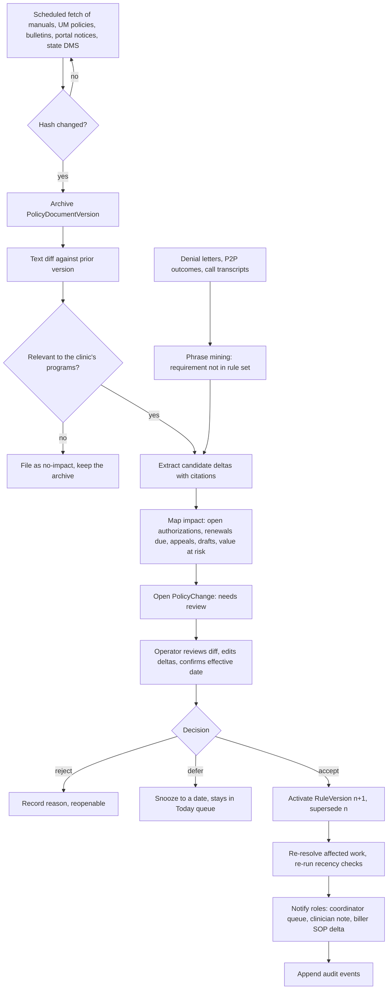

# 06 · Payer Intelligence & Rules Engine

**Layer:** supporting (consumed by eligibility, PA lifecycle, denials, appeals, analytics)
**Status:** draft v0.1 · 2026-09-19 · assumes the reader has read `_brief.md`
**Demo reference:** `/demo/payers` (scorecard, trend, policy changes), seeded from `apps/frontend/src/lib/demo/payers.ts`, `analytics.ts` and `types.ts`

## 1. Summary and problem statement

The Payer Intelligence & Rules Engine is the layer that knows, for each payer × program × plan, three things: what the payer says it requires (rules), what the payer actually does (observed behaviour computed from the clinic's own immutable ledger), and when either changes (policy monitoring). Every other product line reads from it: eligibility asks who administers the benefit; the PA lifecycle asks which form, channel, documents, recency, units and turnaround; denials asks whether a denial matches the payer's own criteria; appeals asks which channel, deadline, form and split; analytics asks whether a payer is getting worse, and since when.

Today that knowledge lives in Tracy's head, in the Claude project she calls "the engine", in a five-tab spreadsheet, in SOPs and Looms for an offshore billing team, and in denial letters nobody re-reads. It is not versioned, so a changed requirement is discovered from a denial; not tied to outcomes, so nobody sees that one MCO has cut its units three renewals running; and not shared with the people doing the work, who may be filing under stale instructions.

Evidence:

1. "There are certainly stated rules, guidelines, regulations that each of the MCOs will provide... over the last year they've become much more complicated, much more payer-specific." — tracy-call-transcripts.md, Call 1, *Why prior auth became the problem*
2. "Every MCO has their own little way that they want to do it... They all have different forms, they all have different sites, they all have different guidelines." — Call 1, *The Claude engine*
3. "It's really important for me to have that, so I can see trends and I can understand: are we getting more denials from this payer? What's going on? What's changed?" and "We'll ask for 60 units, but they'll only give us 30, and they don't give us a reason why." — Call 1, *Building her own tracking tool*
4. "I've uploaded all of their reference documents from the providers, all of their rules — and they're like, 'They're not even following their own rule. I don't know why they're mentioning this.'" — Call 2 [17:42]
5. "'You didn't fill out this special form that you have to fill out with this packet.' And they don't tell you that till the last day of the appeal process." — Call 2, *Appeals visibility* [18:49]–[22:09]
6. Policy Reporter archives policy versions because payers remove old ones; a Cigna policy change in May was used to deny a claim authorized in February. — competitor-landscape.md `[PR-sum]`
7. Neon demo: policy change notices land in an inbox and are missed, claims are denied 60 days later, and the clinic persona tracks policy changes for an offshore team in a 15-tab sheet ("now we're approved for 30 units not 60, here's the updated billing logic"). — `[NE-demo]`, research notes supplied with this brief
8. Jennifer (Ohio SUD/IOP): a statewide Medicaid IOP 30-unit cap from July 2026 applied to every member at once. — `_brief.md`

What good looks like at the end of the Harbor pilot: one rule set per tuple with a source and an effective date on every field; a change inbox where a policy change is detected before its effective date, mapped to the renewals it touches and acknowledged by Tracy; a scorecard from ledger rows showing WellCare's first-pass approval falling from 78% to 62% while the aggregate sits at 70% (the story payers.ts seeds); and a loop where Jordan's answers to agents become rules that are never asked again.

## 2. Goals, non-goals, success metrics

### Goals

- **G1.** Every packet is assembled against a resolved, dated rule version, stamped on the authorization so the packet can be defended later.
- **G2.** Policy changes are detected, diffed, mapped to affected work and acknowledged before their effective date where the payer gives notice, and within five business days of publication otherwise.
- **G3.** Observed payer behaviour is computed from ledger rows, explainable to the row, and raises an alert when it degrades.
- **G4.** Clinic strategy ("ask this payer for 40, not 60"; "file this payer two weeks early") is written down as reviewable, approved rules instead of tribal knowledge.
- **G5.** Every question an agent asks a human becomes a rule with provenance.

### Non-goals

- Approval-probability scores. Principle 5 applies; this PRD ships a calibration plan (FR-28), not a score.
- A general policy library for every US payer, or a data business competing with Policy Reporter and MMIT (they are candidate sources). Pilot content is Harbor's ~10 payer endpoints and one program; the model must generalise, the content need not.
- Writing clinical content or choosing a diagnosis. Strategy rules suggest and require documentation; clinicians decide (principle 2).
- Submitting anything. The engine tells the Navigator agent what to file, where and how; submission belongs to the PA lifecycle PRD.

### Success metrics

| Type | Metric | Target |
|---|---|---|
| Leading | Rule coverage: active tuples with every P0 field at ≥ `staff-reported` (and at `published` or `payer-confirmed`) | 100% by pilot week 4 (≥ 80% by week 8) |
| Leading | Detection lag (publication → PolicyChange opened) | median < 3 business days |
| Leading | Acknowledgment lag (opened → accepted, rejected or deferred) | median < 2 business days |
| Leading | Changes with impact mapped before their effective date | ≥ 80% |
| Lagging | Denials categorised `policy_change` or `missing_element` traceable to a stale rule | 0 per quarter from pilot month 3 |
| Lagging | Packets returned for wrong channel, form or split | 0 per quarter |
| Lagging | Calibration verdict on Harbor's engine delivered | pilot week 8 |

## 3. Users and jobs-to-be-done

| Persona | Job | What this layer gives them |
|---|---|---|
| Operator / compliance lead (Tracy) | Know what changed, for which payer, at what cost; sign off on the rules the clinic files under; hold payers to their own criteria | Change inbox with impact; scorecard with drill-through; provenance on every field; off-policy denial counts |
| PA coordinator (Jordan) | File the right form, site and documents first time; know how early to file per payer | Resolved rule at packet assembly; recency checks; per-payer lead time |
| Clinician (Heather) | Update only what needs updating; know which criteria the reviewer checks; approve rules touching clinical content | Recency rules against Sunwave dates; criteria set per payer; approval gate |
| Intake coordinator | Route a new member to the right administrator | Carve-out and plan resolution |
| Offshore biller | Follow current instructions without judgement calls | Plain-language SOP deltas; no 15-tab sheet |
| Owner / board | Know whether a payer trend is a revenue problem | Degradation alerts in units and dollars |
| Payer UM reviewer (external) | Find the criteria evidence on page 1 | Criteria set and required elements drive the cover sheet |

## 4. End-to-end workflow

### As-is (Harbor today)

1. **Rules live in three places:** the MCO reference documents Tracy uploaded to her engine; SOPs and Looms for the billing team ("I am a Loom and SOP person", Call 2 [56:56]); and memory.
2. **Change discovery is accidental.** A new denial reason appears ("they live in a personal care home"), the documentation changes, a different reason appears next (Call 2 [17:42]); a required appeal form surfaces on the last day of the window (Call 2 [22:09]). Vendors are no better: LunaBill asked the persona how often the payer updates policy `[LB-demo]`.
3. **Requirement application is manual.** Jordan picks the payer's form in Availity (4 of 5 MCOs) or the fifth MCO's portal, fills NPIs, EIN, rendering provider, CPT, diagnosis and dates, and uploads the packet; some MCOs need three separate documents or the reviewer says "you're missing this" when it is on page 12 (Call 1, *The document set*; Call 2 [22:09]).
4. **Renewal prep depends on Tracy,** who tells Heather which three of six documents are outside their date-range parameters (Call 2 [45:32]). The parameters are written nowhere the software can read.
5. **Payer behaviour is invisible.** Sunwave overwrites on renewal, so approval rate by payer and the partial-approval trend cannot be computed (Call 1, *Building her own tracking tool*).
6. **The engine grades packets** for likelihood of approval (Call 1, *The Claude engine*), and nobody knows whether the grade is calibrated (draft_prd.md §2).

### To-be (with Psyflo)

| Step | Who acts | What happens |
|---|---|---|
| 1. Seed | Operator, Sentinel | Tracy's MCO documents, SOPs and tracker are ingested; Sentinel drafts one rule set per tuple with a citation per field; Tracy confirms or marks fields unconfirmed |
| 2. Resolve and apply | Packet, Jordan, Heather | The engine resolves (administrator, program, plan, date) to a rule version; an unconfirmed P0 field first raises a question to Jordan, whose answer becomes a rule; documents are checked for recency; split, cover sheet and units asked follow the rule; Heather signs |
| 3. Stamp | Ledger | The AuthVersion records `ruleVersionId`, so the packet can be defended against the rule in force at submission |
| 4. Watch and acknowledge | Sentinel, Operator | Daily fetch; diff; cited deltas; impact mapped to open work; PolicyChange opened; Tracy reviews, sets the effective date and accepts, rejects or defers; acceptance activates a RuleVersion |
| 5. Notify | System | Jordan's renewal cards re-check documents; Heather sees the documentation implication; billers receive an SOP delta |
| 6. Observe | Analyst | Nightly metrics; degradation alerts; observed versus published |
| 7. Learn | Sentinel, Advocate, Caller | Denial-letter language and call answers not in the rule set become rule candidates; off-policy denials counted per payer; a human confirms |

### Change lifecycle

## 5. Functional requirements

Priorities: **P0** pilot (Harbor), **P1** v1 (second design partner), **P2** later.

### 5A. Rule tuples and resolution

**FR-01 (P0) Rule tuple model.** A `PayerRuleSet` is keyed by administrator (the entity that adjudicates PA: an MCO, a carve-out vendor such as Carelon, Medicaid fee-for-service, a Medicare MAC, a commercial plan), program/service (TRP H2020 for the pilot; PSR/CORE, ACT, HCBS, CFTSS and IOP for v1; Neon's plan × program tuples `[NE-demo]`), and plan/product (an MCO's Medicaid product versus its D-SNP). Resolution walks plan → administrator default → state layer → global default and records which level answered.
*Acceptance:* a member whose behavioural-health benefit is carved out to Carelon resolves to the Carelon rule set, not the MCO's; every result carries `resolvedAtLevel` and `ruleVersionId`; a missing tuple returns `unresolved` with the fallback named, never a silent default.

**FR-02 (P0) Fields with provenance.** Every field carries `value`, `confidence` ∈ {`published`, `payer-confirmed`, `observed`, `staff-reported`, `unconfirmed`}, `source` (document excerpt, call transcript, human answer or ledger query), `effectiveFrom/To`, `enteredBy`, `verifiedAt`. Field groups: PA required (yes, no, conditional, blanket); request channel and form (Availity payer form, payer portal, fax, phone, X12 278); required documents with recency and signature rules; packet split; unit caps (per authorization, per window, per day, initial versus renewal); window length and backdating; decision SLA (regulatory, contractual); P2P availability and request window; appeal levels, channels, deadlines, forms and split; contacts; criteria set; denial-phrase map; eligibility notes (carve-out, COB, Medicare-first).
*Acceptance:* no field saves without a confidence; hovering a field shows the source excerpt; a `published` field must link to an archived document version.

**FR-03 (P0) Document recency rules.** Required documents are expressed as (document kind, maximum age in days at submission, required signer) and evaluated against document dates from Sunwave, returning `attached`, `stale` or `missing` per document with the rule cited.
*Acceptance:* under WellCare's "LOCUS within 30 days" (payers.ts, pc-1) a LOCUS dated 40 days before submission returns `stale`; the 13-month psychiatric evaluation in agent run-3 (agents.ts) returns `stale` under Humana's 12-month rule; Heather's renewal list names exactly the documents outside parameters (Call 2 [45:32]).

**FR-04 (P0) Channel, form, split, contacts.** Rule sets specify the request channel and form identifier, the appeal channel (fax number, portal, email address), whether a member-signed appeal form is required, packet split (`single` or `three-part`: clinical assessments, external medical records, cover sheet), UM phone, appeals fax and provider-relations contact.
*Acceptance:* the Packet agent produces a three-part export for a three-part payer and a single export otherwise; the Advocate agent will not mark an appeal ready when a required member-signed form is absent.

**FR-05 (P0) Parameters consumed by the two clocks.** Unit cap, window length, decision SLA, observed median turnaround and appeal deadline feed the ledger's derived dates: file-by = min(projected exhaustion, window end) − lead time, where lead time defaults per payer from observed median turnaround plus a safety margin (draft_prd.md §7).
*Acceptance:* changing Humana's cap from 60 to 40 changes the projected renewal cadence for every Humana member (pc-2); the 7-calendar-day CMS clock and the 5-day Kentucky clock are both visible on a pending request.

**FR-06 (P0) Versioning and stamping.** `RuleVersion` is immutable. A change creates a new version with `effectiveFrom`, `supersedes` and status draft → proposed → active → superseded (or retracted). Every AuthVersion stores the `ruleVersionId` it was assembled under. As-of queries return the version active on any date (cf. Policy Reporter's archived versions, `[PR-sum]`).
*Acceptance:* after Passport's appeal window shortens on 2026-10-01 (pc-4), an appeal of a denial dated 2026-09-20 still shows a 60-day deadline; the authorization detail reads "filed under Anthem · TRP · v3 (effective 2026-07-01)".

**FR-07 (P1) Seeding and import.** Sentinel ingests PDFs, bulletins, SOP documents and spreadsheet rows, proposes fields with citations, and routes them for confirmation. Nothing becomes active without a human.
*Acceptance:* seeding Harbor's five MCOs from Tracy's reference documents populates ≥ 80% of P0 fields with a citation; each draft field shows the excerpt it came from.

**FR-08 (P1) State-level layer.** A state Medicaid layer (Kentucky DMS for the pilot; Ohio for the second partner) holds rules that apply to every MCO, such as the July 2025 Kentucky PA mandate or Ohio's July 2026 IOP 30-unit cap; MCO rules inherit unless stricter.
*Acceptance:* entering a statewide cap once updates the resolved cap for all administrators and creates one PolicyChange whose impact is the union across them.

### 5B. Policy monitoring

**FR-09 (P0) Source registry and archive.** Per administrator: provider manual URLs, UM/clinical policy index, bulletin mailbox, portal notice locations, state DMS bulletin page, and manual upload. Every fetch stores a `PolicyDocumentVersion` with hash, fetched-at, URL and rendered text or PDF.
*Acceptance:* WellCare clinical policy CP-BH-114 exists as two archived versions after the September change; a source that fails three fetches shows "source stale since <date>".

**FR-10 (P0) Change detection and diff.** On a new version, Sentinel produces a text diff, filters to sections relevant to the clinic's programs, and extracts candidate deltas (field path, old value, new value, stated effective date, citation).
*Acceptance:* the LOCUS 90 → 30 day change is extracted as a delta on `documents[LOCUS].maxAgeDays` citing the bulletin paragraph; a dental-benefit change is filed as no-impact; a re-published PDF with a new hash but identical text is not raised.

**FR-11 (P0) Impact mapping.** Each candidate change is mapped to open authorizations, renewals due inside the affected window, open appeals and drafts awaiting sign-off, with counts and value at risk at the contracted per-diem rate (cf. ParaHealth's policy-aware reauths, `[Table]`).
*Acceptance:* pc-1 shows "9 renewals due in the next 30 days" with the list (one gap day each = $2,199 at $244.29); pc-4 shows the two Passport denials with fewer than 12 days left; every count drills to ledger rows (principle 6).

**FR-12 (P0) Acknowledgment workflow.** The operator reviews the diff, corrects the extracted delta if wrong, confirms the effective date, and accepts (activates a RuleVersion), rejects (records why) or defers (to a date). Sentinel never activates a rule.
*Acceptance:* an unacknowledged change appears in the Today work queue after two business days; acceptance writes an audit event with actor, timestamp, diff and effective date.

**FR-13 (P1) Notifications and SOP delta.** On acceptance the engine emits role-specific notices: Jordan's affected renewal cards re-check documents; Heather receives the documentation implication; billers receive a one-paragraph plain-language SOP delta; a weekly digest lists changes by payer. This replaces the 15-tab sheet in the Neon evidence.
*Acceptance:* an accepted cap change produces the biller note "Humana: authorizations are now 40 units per 90-day window; renewals fall due every ~13 weeks at 3 visits/week" without anyone typing it; unacknowledged notices are visible to the operator.

**FR-14 (P1) Unpublished-requirement mining.** Advocate and Caller pass denial-letter language, P2P outcomes and call transcripts to Sentinel. A requirement cited by a payer but absent from its rule set becomes a rule candidate at confidence `observed`, with the letters as evidence.
*Acceptance:* two denials from one payer citing personal-care-home residence create one candidate "residence justification required" linking both letters, shown as "observed, unpublished" until confirmed or rejected.

**FR-15 (P2) Third-party feeds.** Policy Reporter or MMIT documents can enter the same pipeline as a source type, with pass-through cost recorded (`[NE-demo]`, `[PR-sum]`).

### 5C. Observed behaviour

**FR-16 (P0) Metric computation.** Nightly, from the immutable ledger, per administrator × program × period (month, quarter, rolling 90 days): first-pass approval (versions approved in full ÷ decided), partial rate, asked → granted, median and p90 turnaround (submitted → decided) overall and by weekday of submission, P2P reversal, appeal win, information-request rate, denial-reason mix (the six `DenialCategory` values in types.ts), SLA-breach rate (> 7 calendar days), fax receipt-failure rate. Each metric stores numerator and denominator row ids.
*Acceptance:* every number on the scorecard opens the rows behind it; a metric with n < 10 renders "n=4, insufficient"; Harbor's seeded aggregate first-pass approval lands near her stated ~70% (Call 1).

**FR-17 (P0) Degradation alerts.** An alert fires when a payer's rolling-90-day first-pass approval is ≥ 10 points below its prior two-quarter mean with n ≥ 15, when partial rate rises ≥ 10 points, or when median turnaround rises ≥ 3 days. Alerts state both numbers, n, and dollar impact.
*Acceptance:* the seeded WellCare series (first-pass 78% → 62%; partials 8% → 31%, payers.ts) fires both alerts from Q1 2026; the operator can mark an alert `confirmed`, `expected (policy change X)` or `dismissed`, and the choice is stored.

**FR-18 (P1) Observed versus published.** `PublishedMetric` rows hold each payer's CMS-0057-F annual PA metrics (approval, denial and approval-after-appeal rates, average and median turnaround) with source and period. The scorecard shows the gap with the caveat that published figures cover all services while observed figures are program-specific (draft_prd.md §8).
*Acceptance:* the gap is blank, not zero, when no report exists; a gap ≥ 15 points (seeded WellCare: 85% published versus 62% observed) is flagged for a provider-relations conversation.

**FR-19 (P0) Criteria set with an unconfirmed state.** Each rule set has `criteriaSet` ∈ {LOCUS, InterQual, MCG, ASAM, proprietary (policy id), unconfirmed} (types.ts `CriteriaSet`). An unconfirmed value creates a standing question for the Caller agent's next call with that payer's UM department.
*Acceptance:* the demo shows three confirmed and two unconfirmed (draft_prd.md §8); confirming via a call attaches the transcript excerpt and sets confidence `payer-confirmed`.

**FR-20 (P1) Off-policy denials.** A denial whose stated reason is not among the rule set's published criteria is tagged `off_policy` in addition to its clinical category. Counts per payer per quarter appear on the scorecard and feed the Advocate agent's appeal grounds.
*Acceptance:* Tracy's "they're not even following their own rule" cases are countable per payer; each links the denial letter and the policy excerpt it contradicts.

**FR-21 (P1) Turnaround by weekday and channel.** Turnaround distributions by submission weekday and by channel (Availity, portal, fax) inform the file-by lead time (draft_prd.md §11).
*Acceptance:* the renewal radar shows "submit by Thursday: Friday submissions to WellCare take a median 3 days longer" only when n supports it.

### 5D. Clinic-specific strategy rules

**FR-22 (P1) Authoring.** A `StrategyRule` has a condition (administrator, program, plan, diagnosis group, attendance pattern, request kind), an action (`suggest`, `require`, `warn`), a rationale, linked evidence, a type (`administrative` or `clinical_content`) and versions. Administrative rules ("ask Humana for 40, not 60"; "file WellCare renewals 14 days ahead") are approved by the operator. Clinical-content rules ("when both diagnoses are documented and clinically justified, lead the cover sheet with the one that meets this payer's SMI criteria") require clinician approval. CombineHealth's consultant-encoded comorbidity rule ("diagnosis A yields 30 units, comorbid diagnosis B yields 60", `[CH-demo]`) is representable only as a suggestion with a documentation requirement.
*Acceptance:* a clinical-content rule cannot be activated by a non-clinician; every activation is an audit event; the rule shows where it applied and the outcomes of those requests.

**FR-23 (P1) Application and effect.** Strategy rules surface as labelled suggestions in packet assembly and renewal planning ("SR-7: ask 40 units. Humana caps at 40; asking 60 produced partials in 11 of 12 requests since January"). They never change clinical content automatically. The engine reports each rule's outcomes with and without application.
*Acceptance:* a suggestion can be dismissed with a reason; a rule with worse outcomes over n ≥ 15 is flagged for review.

**FR-24 (P2) Compliance guardrails.** Rules that would alter a diagnosis, level of care or narrative without a documented clinical basis are blocked at authoring; a compliance-reviewer role can freeze any rule.

### 5E. Accuracy flywheel

**FR-25 (P0) Questions become rules.** When an agent needs a field that is missing or unconfirmed, it raises a `RuleQuestion` inline in its run (Arrow's question card, `[HO-shots]`) and on the Payers screen. The answer writes the field at confidence `staff-reported` with the answer as source, and the question closes. The same question is never asked twice for the same tuple and field (Neon: "unlike a human, they won't forget it", `[NE-deck]`).
*Acceptance:* after Jordan answers "Passport requires the member-signed appeal form", the next Passport appeal does not ask; the field's provenance shows Jordan, the date and the run that asked; the operator can bulk-review staff-reported fields to upgrade or correct them.

**FR-26 (P1) Outcome feedback and coverage score.** Denials citing unknown requirements (FR-14), partial patterns and information requests generate rule candidates. A coverage score per tuple (share of P0 fields at each confidence threshold) appears on the scorecard.
*Acceptance:* coverage recomputes on every field change; the pilot dashboard shows coverage moving from seed to 100%.

### 5F. Prediction non-goal and calibration plan

**FR-27 (P0) No probability anywhere.** The product shows observed rates only, labelled "observed, last N requests". No screen, agent message or export shows a predicted approval probability (draft_prd.md §2; agents.ts, Analyst: "Never predicts approval odds; it reports observed history").
*Acceptance:* a lint on UI copy and agent prompts rejects "likelihood of approval", "probability of approval" and "predicted approval".

**FR-28 (P1) Calibration ingestion.** Harbor's engine already grades each packet for likelihood of approval (Call 1, *The Claude engine*). The engine ingests (packet reference, predicted score, date), joins to ledger outcomes, and produces a reliability diagram by decile, a Brier score against the base rate, and n. Gate for any future predictive feature: n ≥ 100 decided packets, Brier improvement ≥ 10% over base rate, calibration slope between 0.8 and 1.2 on a held-out quarter, reviewed by the clinical advisor.
*Acceptance:* the calibration page renders "not yet calibrated (n=37)" until the gate passes; the verdict and the data behind it are exportable for the design-partner review (draft_prd.md §12, the ask for her scores).

## 6. Screens and UX

Demo reference: `/demo/payers`. All screens use MRN or initials only (principle 8) and carry a persistent "observed, not predicted" label on any rate.

### 6.1 Payer scorecard (tab 1)

- **Purpose.** Answer "are we getting more denials from this payer, what changed?" in one table.
- **Layout.** One row per administrator with the FR-16 rates, n, median decision days (p90 on hover), off-policy denials, trend versus two quarters ago, published figure with gap, criteria set and rule coverage. Below: first-pass trend across six quarters spanning July 2025; denial-reason mix by payer; partial-approval detail (asked versus granted, 180 days).
- **States and interactions.** Low-n cells ("n=4"); alert badge on a degrading row; published column reading "no report published yet"; click any cell → the rows behind it; click a payer → rule set (6.3); period and program selectors.
- **Empty / error.** "No decided requests yet. Import the 90-day export to see history." Metric job failed → last computed timestamp, never a blank table.
- **Borrowed.** CombineHealth's payer-by-reason heatmap `[CH-shots]`; EasyPA's won/lost-by-payer analytics `[Table]`; Arrow's KPI tiles with counts `[HO-shots]`.

### 6.2 Policy changes inbox (tab 2)

- **Purpose.** Nothing about a payer changes without someone at the clinic seeing it, with the impact attached.
- **Layout.** PolicyChange cards: payer, title, detected and effective dates, source, impact line ("Affects 9 renewals due in 30 days · $2,199 at risk"), status. Filters by payer, status and effective-within-N-days; header counts for unacknowledged, effective this month and stale sources.
- **Interactions.** Open → change review (6.4); the acknowledge control is disabled until the diff has been viewed.
- **States.** Empty: "27 documents watched, no changes this week; last fetch 05:30" (agents.ts run-4). Stale-source warning. Retroactive change flagged "effective before detection".
- **Borrowed.** Policy Reporter's versions with effective dates `[PR-sum]`; Arrow's scheduled-recheck card with last and next check `[HO-shots]`.

### 6.3 Rule set detail (payer × program × plan)

- **Purpose.** The one place that says what this payer requires, with a source on every line.
- **Layout.** Header: administrator, program, plan, active version and effective date, coverage %. Tabs: Requirements, Appeals, Contacts, Criteria, Strategy rules that apply here, Provenance (every field with confidence badge and excerpt), History (version timeline with diffs and an as-of date picker).
- **States.** Unconfirmed fields highlighted with an "ask on next call" toggle; fallback-resolved fields labelled "inherited from payer default"; conflict badge when two sources disagree.
- **Interactions.** Editing a field proposes a new version for the operator to confirm; open the archived document at the cited page; list what was filed under this version.
- **Empty.** "No rule set for Carelon Behavioral Health × TRP. 3 members resolve here. Seed from a document or answer the 6 open questions."
- **Borrowed.** Neon's plan × program tuples `[NE-demo]`; Myndshft's rules library and Humata PolicyMatch `[Table]`; CombineHealth's policy-criteria card citing a policy number `[CH-shots]`.

### 6.4 Change review (diff)

- **Purpose.** Decide what a change means before it produces a denial.
- **Layout.** Left: old versus new text with the changed paragraph highlighted. Centre: extracted deltas as editable rows. Right: impact list with owners and value at risk. Footer: effective date; accept, reject, defer; roles to notify.
- **States.** Low extraction confidence → deltas marked "suggested" and must be edited before acceptance. Retroactive → a panel of authorizations submitted between the effective date and today, with "filed under prior version" evidence.
- **Borrowed.** CombineHealth's reasoning-step cards beside the source document `[CH-shots]`.

### 6.5 Strategy rules

- **Purpose and layout.** Make clinic strategy explicit, approved and measured: a list with type badge, status (draft, awaiting clinician approval, active, retired), scope, applied count and outcome with n; an editor with condition builder, action, rationale, evidence links and named approver.
- **States.** Awaiting approval shows the approver; a rule with worse outcomes shows a review flag.
- **Borrowed.** CombineHealth's consultant-encoded clinic rules `[CH-demo]`, made self-service and audited.

### 6.6 Open questions and calibration

- **Open questions.** The flywheel's inbox, on the Payers screen and inside agent runs on `/demo/agents`: question, tuple, the run that asked, options or free text, answered-by, and the field it will write. Unanswered questions block a packet and appear in the Today queue. Borrowed from Arrow's question cards `[HO-shots]` and Neon's flywheel `[NE-deck]`.
- **Calibration (P1).** Reliability diagram, Brier versus base rate, n, gate status. Empty state: "Upload predicted scores (CSV: packet reference, score, date)."

## 7. Agent behaviours and guardrails

Agents touching this layer (roster in agents.ts): **Sentinel** (policy watch), **Analyst** (Ask Psyflo), **Packet** (consumes rules), **Navigator** (consumes channel and form), **Advocate** (consumes appeal rules, flags off-policy denials), **Caller** (confirms criteria set and asks for the criteria behind a denial).

Behaviours:

- Sentinel fetches, diffs, extracts, maps impact, opens a PolicyChange, and stops. It proposes RuleVersions and never activates one ("Never rewrites a rule without you acknowledging the change", agents.ts); a delta without a citation cannot be proposed.
- Packet resolves the rule set before assembling; when a P0 field is unconfirmed it asks rather than guesses, and it does not proceed on a fallback-resolved cap or channel until a human has confirmed that fallback once.
- Analyst answers "why is this number X" with rows, never extrapolates a rate into a prediction, and says "n too small" when it is.
- Caller may ask a payer's UM line factual questions from the unconfirmed list (criteria set, form requirements, fax number); it never discusses a member's clinical case.
- Advocate cites the rule version in force at submission when a denial relies on a newer policy.

Guardrails:

- Human activation for every rule and strategy rule; clinician activation for clinical-content rules.
- Minimum-n thresholds on every displayed rate; no probability language (FR-27).
- Source precedence when sources conflict: state regulation > payer policy or manual > bulletin > portal notice > payer-confirmed call > denial-letter inference > staff recollection; if the higher-precedence source is older, raise a conflict question instead of resolving.
- PHI minimisation: policy documents contain no PHI; questions reference MRNs only; call transcripts fall under the existing audit policy.
- Fetches respect rate limits and site terms; portal notices are captured only through the clinic's own service account.
- Every agent action is an audit event listing sources checked (Arrow's "22 sources · 1 run", `[HO-shots]`).

## 8. Data model and integration touchpoints

### Entities

| Entity | Key fields |
|---|---|
| `Administrator` | id, name, kind (mco, carve-out, medicaid-ffs, medicare-mac, commercial), state, parentPayerId, portals, contacts, activeFrom/To |
| `PayerRuleSet` | id, administratorId, programId (TRP, PSR/CORE, ACT, HCBS, CFTSS, IOP, each with HCPCS list and unit definition), planId (null = administrator default), stateLayerId, activeVersionId, coverage {p0Confirmed, p0Published}, openQuestionCount |
| `RuleVersion` | id, ruleSetId, number, status (draft, proposed, active, superseded, retracted), effectiveFrom, effectiveTo, supersedesId, fields {path → {value, confidence, sourceRef, enteredBy, verifiedAt}} for the FR-02 groups, createdBy, activatedBy, activatedAt, policyChangeId |
| `PolicyDocument` and `PolicyDocumentVersion` | id, administratorId or stateLayerId, kind (manual, um-policy, bulletin, portal-notice, state-bulletin, denial-letter, transcript, upload, feed), url, title, fetchSchedule, lastFetchedAt, staleSince; each version: hash, fetchedAt, publishedDate, textRef, pdfRef |
| `PolicyChange` | id, administratorId, documentVersionId, priorVersionId, title, summary, deltas [{fieldPath, old, new, citation, confidence}], effectiveDate, detectedAt, retroactive, status, acknowledgedBy, acknowledgedAt, resultingRuleVersionId, impact {authorizationIds[], renewalIds[], appealIds[], draftIds[], valueAtRisk} |
| `ObservedMetric` and `DegradationAlert` | id, administratorId, programId, period, metric (the FR-16 list), value, n, numeratorRowIds[], denominatorRowIds[], byWeekday, byChannel, computedAt; each alert: baseline, current, delta, n, dollarImpact, status (open, confirmed, expected, dismissed), linkedPolicyChangeId |
| `PublishedMetric` | id, administratorId, reportingYear, metric, value, sourceUrl, scope ("all services") |
| `StrategyRule` | id, type, condition, action {kind, text}, rationale, evidenceRefs[], status, versions[], approvedBy, approvedRole, appliedCount, outcomes {applied, notApplied} |
| `RuleQuestion`, `CalibrationRecord` | as specified in FR-25 and FR-28 |

Ledger links: `AuthVersion.ruleVersionId` and `AuthVersion.strategyRuleIds[]` extend the demo `AuthVersion` (types.ts); `DenialCategory` gains `off_policy` as a secondary tag; the demo `Payer` object (payers.ts) becomes a projection of the active RuleVersion.

### Events (append-only)

`rule.version.{proposed, activated, retracted}`, `rule.field.answered`, `policy.document.{fetched, stale}`, `policy.change.{detected, impact_mapped, acknowledged}`, `notice.{sent, acknowledged}`, `metric.{computed, degradation_alert, published_gap}`, `strategy_rule.{proposed, approved, applied}`, `question.{asked, answered}`, `calibration.record_added`.

### Integration touchpoints

| System | Direction | Used for |
|---|---|---|
| Sunwave (EHR, CRM, RCM) | read via export and agent | document dates for recency, diagnosis codes, plan on file |
| Availity and the one MCO portal not on Availity | read | payer-specific form identifiers, portal notices, decision letters |
| Payer bulletin mailboxes; payer and state web sources (manuals, UM policies, Kentucky DMS) | mail ingestion; scheduled fetch | bulletins, manuals and policy documents |
| Fax (eFax) and phone (voice agent) | read | denial letters (OCR) for phrase mining; call transcripts for payer-confirmed fields |
| CMS-0057-F public reports | fetch | `PublishedMetric` |
| Harbor engine | CSV upload | `CalibrationRecord` |
| Carelon or Magellan portals (when a carve-out exists) | read | the carve-out administrator's rule set; "credentials needed" today in agents.ts INTEGRATIONS |

## 9. Payer and regulatory rules the feature must encode

- **Kentucky PA mandate, July 2025.** PA required for community behavioural health services; the initial blanket authorizations have given way to payer-specific criteria (Call 1). Encoded as the state-layer `paRequired = yes` for TRP with effective date 2025-07-01.
- **Decision timeframes.** The 5-day Kentucky requirement Tracy describes, and CMS-0057-F's 7-calendar-day standard and 72-hour expedited timeframes for Medicaid managed care from January 2026; both stored under `sla`. Decisions backdate to the request date for initial requests; renewal backdating is `unconfirmed` until answered (draft_prd.md §7).
- **CMS-0057-F specific denial reasons and public metrics.** A denial with no reason is categorised `no_reason` and counted; the Advocate agent can request the specific reason citing the rule. Annual public PA metrics from 2026 feed `PublishedMetric`. The FHIR Prior Authorization API due in 2027 becomes a requirement-determination source mapped onto the same fields.
- **MHPAEA.** PA on MH/SUD may not be more restrictive than on medical/surgical benefits, and plans must maintain comparative analyses of such limitations. Off-policy denial counts and the observed-versus-published gap are the evidence a clinic brings to that conversation.
- **Medicaid managed care appeals (42 CFR 438 subpart F).** Enrollee appeal window of 60 calendar days from the adverse benefit determination (some plans or provider-dispute processes use 30); standard resolution within 30 calendar days, expedited 72 hours; state fair hearing after the plan appeal; continuation of benefits when requested in time. Per-payer deadlines turn "30 days, or sometimes 60, fuzzy depending on the MCO" (Call 2 [18:49]) into one confirmed number.
- **Dual-eligibles.** Medicare must deny before Kentucky Medicaid pays (Call 1); encoded on the Medicare rule set as an eligibility note that gates Medicaid billing, not PA.
- **Kentucky MCO landscape.** Five contracted MCOs, four on Availity, one on its own portal (Call 1). A behavioural-health carve-out resolves to the carve-out administrator's rule set (Sohar reports 93% pickup of carve-outs such as Carelon and Magellan, `[SO-deck]`).
- **Ohio SB 162** (effective October 2026): recoupment lookback, provider response window and the appeal-fee ban stored in the Ohio state layer for the second design partner.

## 10. Edge cases and failure modes

| Case | Handling |
|---|---|
| Conflicting sources: manual says 60 units, bulletin says 40, denial letters imply 30 | Precedence order (§7); if the higher-precedence source is older, open a conflict question; show all three with dates; `conflict` badge until resolved |
| Retroactive change: effective date before detection, or "effective upon publication" posted late | Mark `retroactive`; list authorizations submitted in the gap; the stamp proves they were filed under the prior version; Advocate uses it in appeals (the Cigna case, `[PR-sum]`) |
| Carve-out to Carelon or Magellan | Eligibility returns the administrator; resolution targets Carelon × program; with no rule set, questions open and the member is flagged on Today; observed metrics are keyed to Carelon, not the MCO |
| Member switches MCO mid-authorization | The authorization does not transfer; a new request under the new tuple; any transition-of-care provision lives in the state layer; eligibility flags the switch |
| Payer does not follow its own rule | Denial tagged `off_policy` with the contradicting excerpt; counted per payer; proposed as an `observed` requirement only after three consistent cases |
| Partial approval with no reason | `no_reason` category; asked → granted tracked; five or more such requests propose a strategy-rule candidate ("ask for the cap") for the operator, never applied automatically |
| Source or portal outage | Source marked stale after three failures; Today shows "policy watch degraded for <payer> since <date>"; no false "no changes" state |
| Strategy rule drifting toward upcoding | Clinical-content type needs clinician approval and a documented clinical basis; compliance freeze (FR-24); effect review |
| Policy change lands while a request is pended | The request keeps its stamped version; the impact list flags it "decided under old rule?" for the coordinator to check the decision letter |

## 11. KPIs and analytics this feature emits

- **Coverage:** rule coverage per tuple at both confidence thresholds; open questions; mean time to answer.
- **Policy watch:** sources watched; fetch success rate; changes detected; detection and acknowledgment lag; share mapped before effective date; precision (changes rejected as noise).
- **Impact:** authorizations, renewals and appeals touched by changes; value at risk identified; documents re-requested before submission rather than after a denial.
- **Observed behaviour:** every §5C metric by administrator × program × period; alerts opened, confirmed, expected, dismissed; off-policy denials; observed-versus-published gap.
- **Strategy rules:** active count; applied count; outcome delta with n.
- **Calibration:** n; Brier versus base rate; gate status.
- **Downstream (analytics PRD):** denials categorised `policy_change` or `missing_element`; packets returned for wrong channel, form or split; clinician hours spent updating documents still within parameters.

## 12. Rollout and phasing

**Phase 0 · Harbor pilot, weeks 1–2 (seed).** Ingest Tracy's MCO reference documents, SOPs, Looms and the five-tab tracker; Sentinel drafts five MCO × TRP rule sets plus Kentucky Medicaid FFS and Medicare; Tracy confirms in the two-hour design workshop, and unconfirmed fields become the first question list; the 90-day export computes the first scorecard. Exit: coverage ≥ 80% at `staff-reported`; n on every scorecard cell.

**Phase 1 · Harbor pilot, weeks 3–8.** Policy watch live on the five MCOs and Kentucky DMS; change inbox and acknowledgment; recency checks in packet assembly; questions-to-rules; degradation alerts; calibration verdict. Exit: zero packets returned for form, channel or split; every renewal assembled against a stamped rule version; changes acknowledged inside two business days.

**Phase 2 · Second design partner (Ohio: Jennifer or Dave Cherry).** Multi-program tuples (IOP with the statewide 30-unit cap; outpatient on Valant); the Ohio MCO set; state layer with SB 162; strategy rules with clinician approval; observed-versus-published when the first CMS reports appear; Policy Reporter or MMIT evaluated as a source.

**Phase 3 · General.** Shared rules library across tenants with tenant overrides and preserved provenance; opt-in anonymised cross-clinic observed metrics; the FHIR PA API (2027) as a source; the calibration gate reviewed before any predictive feature.

## 13. Open questions and research asks

1. Which MCO is not on Availity, which requires the member-signed appeal form, and which accepts appeals by email, fax or portal? Tracy named no payers (tracy-call-transcripts.md, open question 15); the values in payers.ts are placeholders.
2. Are renewals backdated like initial requests? This decides whether the renewal lead time protects cash timing or revenue (draft_prd.md §7).
3. Which criteria set does each MCO apply to TRP? Two are seeded "unconfirmed"; ask on the next UM call.
4. Is the 30-day window some MCOs quote an enrollee appeal deadline or a provider-dispute deadline? It decides which clock the Advocate counts down.
5. Do any Harbor members have a behavioural-health carve-out administrator today, making the Carelon rule set Phase 1 work?
6. Does Harbor contract with all of Kentucky's Medicaid MCOs or a subset, and is a re-procurement pending that would change the set?
7. Will Tracy share her engine's approval grades with outcomes for the calibration verdict (draft_prd.md §12)?
8. Where do payer bulletins arrive today (which mailbox, whose), and can Psyflo receive a copy?
9. What is the P2P request window per MCO, and which MCOs refuse P2P for TRP (Call 1, *The three layers*)?
10. How does Sunwave expose document dates (form-export metadata versus PDF) for recency checks?
11. For the second partner: is Ohio's IOP 30-unit cap per authorization, per month or per episode, and does it apply to renewals in flight?
12. Research ask: collect five real denial letters and two policy documents per MCO before the pilot to measure extraction precision.

## 14. Evidence appendix

| Source | Used for |
|---|---|
| `docs/prior-auth/prd/_brief.md` | Principles, personas, regulatory context, demo routes, template, Jennifer (Ohio) evidence |
| `docs/prior-auth/research/tracy-call-transcripts.md` | Payer variety; partials without reason; "what changed?"; payers not following their own rules; three-part packets; last-day form discovery; 4 of 5 MCOs on Availity; the engine's contents and grading; renewal document parameters; open question 15 |
| `docs/prior-auth/research/competitor-landscape.md` | Neon tuples and flywheel `[NE-demo]` `[NE-deck]`; Policy Reporter versions and the Cigna case `[PR-sum]`; Myndshft, Humata, QuickIntell, Flexbone, ParaHealth, EasyPA `[Table]`; CombineHealth `[CH-deck]` `[CH-shots]` `[CH-demo]`; Sohar `[SO-deck]`; Arrow `[HO-shots]`; LunaBill `[LB-demo]` |
| `scratchpad/research/draft_prd.md` | Payer scorecard (observed versus published, criteria transparency, the degrading payer); no prediction until calibrated; calibration as the roadmap fork; lead time per payer; weekday variation |
| `apps/frontend/src/lib/demo/payers.ts`, `analytics.ts`, `types.ts`, `agents.ts`, `stories.ts` | Field names; `POLICY_CHANGES` pc-1 to pc-4; six-quarter series; `CriteriaSet` with `unconfirmed`; `DenialCategory`; Sentinel and Analyst contracts; Carelon integration state; the four-renewals story |
| Neon Health demo call research notes (supplied with this brief) | Policy notices missed in an inbox; claims denied 60 days later; 15-tab sheet for an offshore team; "30 units not 60, updated billing logic" |
| CMS-0057-F; MHPAEA; 42 CFR 438 subpart F; Kentucky PA mandate (July 2025); Ohio SB 162 | Regulatory rules in §9 |
