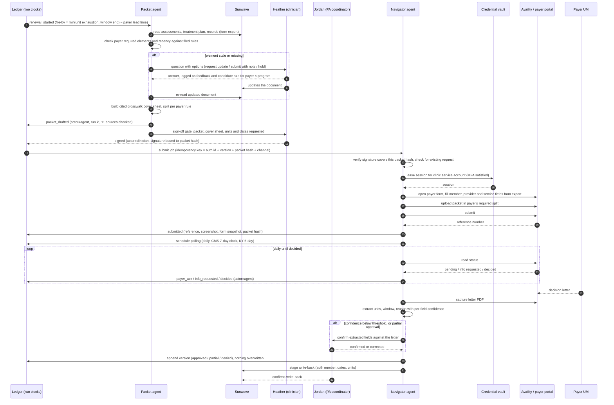

# 07 — AI Agents & Automation

**Status:** Draft v1 · **Reads first:** `_brief.md` · **Demo reference:** `/demo/agents` (roster, runs, guardrails, integrations), `/demo/authorizations/new` (sign-off gate, then LiveRun submission), `/demo/appeals/[id]` (appeal workspace with gate, reasoning cards, call transcript) · **Mock model:** `apps/frontend/src/lib/demo/agents.ts`, `types.ts`, `appeals.ts`, `payers.ts`, `demo-ui/agent-run.tsx`

## 1. Summary and problem statement

Psyflo's agent layer does the reading, checking, filing, polling, calling and drafting that today consume two PA FTEs, 2–3 hours a day of the COO's time and 3–4 clinician hours per packet at Harbor, without taking a decision away from the clinician. The design partner has already built the most important agent herself: a Claude "engine" holding every MCO's requirements, denial letters and approved packets, which ingests Sunwave intake forms, session recordings and Wispr Flow dictation, pre-fills the Sunwave forms, generates a one-page criteria cover sheet and grades approval likelihood, with a clinician reviewing everything before it leaves (tracy-call-transcripts.md, Call 1, "The Claude engine", "The document set"). She has also rejected a browser-agent vendor that automated only Availity submission because it solved "the smallest part of my problem" at a price she called "ridiculous" (Call 1, "What vendors got wrong"; Call 2, [41:10]).

Those two facts fix the shape of this layer. The agents add what her engine does not do — rolling eligibility, packet-completeness checks against each payer's current rule, portal polling and decision capture, receipt calls, grounded appeal drafts, policy watch, and a ledger that records every action — and interoperate with her engine rather than replace it. They never submit, fax, email or say anything on a call that a clinician has not signed or scripted. Her write-back automation, a Claude Code browser tool that "ties up somebody's computer" for 15–20 minutes, is the operating model to industrialise: headless, server-side, evidenced with screenshots, under the clinic's BAA (Call 1).

The disqualifying failure is confident fabrication: "he was so confident when he said that this is what you had to do" (Call 1). Every agent output here is grounded in a named source, carries a confidence state, and can say "unconfirmed" or "not found" instead of inventing a criterion.

The competitive bar is CombineHealth's named agents and IVR-navigating voice agent, HealOS/Arrow's "22 sources · 1 run" chip and inline questions, and Neon's rule tuples and accuracy flywheel (competitor-landscape.md §3.1, §3.2, §3.4); submission is a commodity at $0.75–$1.00 per PA (§5). None of them has the ledger the agents write to, the sign-off gate in the timeline, or the refusal to predict.

### Evidence quotes

| # | Quote | Source |
|---|---|---|
| 1 | "We aren't sending anything automatically; we always have the human. I'm a big proponent of 'human plus AI' movements." | tracy-call-transcripts.md, Call 1, "What vendors got wrong" |
| 2 | "The billing team that we have, they're like $12 an hour… 15 minutes for them to submit a form is not much… versus one of my clinicians who's $90 an hour and her having to spend 3 or 4 hours on forms." | tracy-call-transcripts.md, Call 1, "What vendors got wrong" |
| 3 | "It hallucinates a lot. It gives you a really confident answer that it knows what it's doing, and then when you actually start pulling things out, you're like, 'I don't think you understood this.'" | tracy-call-transcripts.md, Call 1, "What vendors got wrong" |
| 4 | "The appeals, you send them to a fax number, and you just hope for the best… three days later, I make them call and verify that they've received it." | tracy-call-transcripts.md, Call 2, [18:49] |
| 5 | "It ties up somebody's computer, and sometimes it can take 15, 20 minutes… we want to keep it on our own servers so that we are HIPAA compliant." | tracy-call-transcripts.md, Call 1, "Write-back to Sunwave, and HIPAA" |
| 6 | Exceptions flagged, a human answers, the answer updates instructions, "and unlike a human, they won't forget it." | competitor-landscape.md §3.4 (Neon accuracy flywheel) |

## 2. Goals, non-goals, success metrics

### Goals

1. Remove every non-clinical touch that does not require judgement: verification, element checks, filing after signature, polling, decision capture, write-back, receipt calls, policy diffs.
2. Cut clinician minutes per packet by naming which documents are stale and drafting the non-clinical parts with citations, so Heather's "six documents per renewal" becomes "these three" (Call 2, [45:32]).
3. Make every agent action explainable and reversible: sources checked, steps, artifacts, a ledger event with `actor = agent`, a replayable log.
4. Absorb payer hold time and IVR navigation (demo run `run-2`: a 34-minute hold, agents.ts).
5. Turn every human answer and edit into a durable, payer-specific rule with provenance.

### Non-goals

- **Approval prediction.** No probability score until calibrated on the clinic's own outcomes (`_brief.md` principle 5; draft_prd.md §2). Analyst reports observed history only.
- **Autonomous submission of unsigned artifacts.** Nothing addressed to a payer leaves without a clinician signature bound to the packet hash; an invariant, not a setting.
- **Clinical decision-making.** Agents do not choose diagnoses, LOCUS scores, units or frequency; do not write assessments or plans; do not answer clinical questions on calls. "You're still choosing. You're the one who's doing it all" (Call 1).
- **Replacing Tracy's engine at pilot;** Psyflo imports its outputs and extends them.
- **Claims scrubbing, clearinghouse or billing functions** (`_brief.md`).
- **Negotiating with payers,** accepting determinations, withdrawing requests or attesting anything verbally.

### Success metrics

| Metric | Type | Pilot target (Harbor, 90 days) |
|---|---|---|
| Unsigned outbound actions | Lagging, invariant | 0 |
| Human touches per request (renewal trigger → decision captured) | Leading | ≤ 3 (sign-off, one question, one write-back confirm) |
| Clinician minutes per renewal packet | Lagging | −40% vs. week-1 baseline (draft_prd.md §9) |
| Question rate (questions per run) | Leading | ≤ 0.3 by day 90, falling as rules accumulate |
| Hold hours absorbed per month | Lagging | ≥ 8 h at Harbor's ~10–20 calls |
| Run error rate (failed + manual fallback / runs) | Leading | ≤ 3% polls, ≤ 5% submissions, ≤ 10% calls |
| Decision-capture lag (payer decision → ledger version) | Lagging | ≤ 1 business day |
| Fabrication findings (reviewer marks "not in record") | Lagging | 0 per 100 drafts; any finding is a P0 bug |

## 3. Users and jobs-to-be-done

| Persona | Jobs the agents do for them | Jobs they keep |
|---|---|---|
| **Operator (Tracy)** | See what ran, what it touched, what it asked; acknowledge policy diffs; approve rules; audit any action to its evidence ("my key KPIs as well as my workflow for the day", Call 2, [64:09]). | Policy sign-off, payer relationships, kill switch. |
| **PA coordinator (Jordan)** | Packet assembled and checked; filing after signature; daily polling; letters captured; write-back staged; receipt confirmed by phone. | Administrative questions, low-confidence extractions, the manual queue. |
| **Clinician (Heather, LCSW)** | Told which documents are stale; cover sheet and crosswalk drafted with citations; appeal letter drafted from her own assessments; P2P brief assembled. | Writes and signs all clinical content; signs every outbound packet; does the P2P. |
| **Intake / front desk** | Rolling verification with a plain-language action per exception; plan changes and carve-outs before the visit. | Collects insurance, calls guardians. |
| **Offshore biller (~$12/h)** | Faxing, portal filing and hold time removed. | Works the manual queue: "clear queues, not judgement calls" (`_brief.md`). |
| **Owner / board** | Runs, cost per run and clinician hours avoided on one page. | Approves spend. |
| **Payer UM reviewer** | Receives the packet in the split they demand with criteria evidence on page 1 (Call 2, [18:49]). | — |

## 4. End-to-end workflow

### 4.1 As-is (Harbor, September 2026)

Sources: tracy-call-transcripts.md, Call 1 ("Insurance verification", "The Claude engine", "Write-back to Sunwave", "The document set") and Call 2 ([18:49]–[23:02], [24:20], [45:32]).

- **Verify coverage** (intake coordinator): clearinghouse button in Sunwave; no re-verification cadence.
- **Notice a renewal is due** (Tracy): two exported reports merged by Claude, checked by hand; the unit report went unrun for three weeks and one patient went 40 units over.
- **Tell the clinician what to update** (Tracy → Heather): "Here are the three documents you've got to update." 13 renewals, ~6 documents each.
- **Draft documentation** (Heather + engine): drafts from Sunwave forms, recordings and Wispr Flow; Heather reviews.
- **Write back** (Claude Code browser tool): fills Sunwave forms; ties up a computer 15–20 minutes.
- **Assemble and submit** (biller, $12/h): form export; Availity per-MCO form (NPI, EIN, rendering provider, CPT, ICD-10, dates); three uploads; ~10–15 minutes.
- **Track status** (Tracy, staff): daily refresh in Availity or the payer portal; 5-tab Excel.
- **Appeal** (Heather + biller): 50–70 page fax in three parts; receipt call three business days later; "we don't have that on file"; special form demanded on the last day.

### 4.2 To-be: the agent roster

The seven agents in the demo model (agents.ts) map onto the touches above. Each has a `does` list and one `never` line, shown on the roster card and enforced in code.

| Agent | Responsibility | Trigger | Never |
|---|---|---|---|
| **Verify** | 270/271 and portal eligibility on a rolling 7-day window; parses carve-outs, COB, daily limits; one action line per exception (CombineHealth, competitor-landscape.md §3.1). | Nightly; schedule change. | Changes coverage without a human confirming. |
| **Packet** | Pulls assessments, plan and records from Sunwave; checks each payer's required elements and recency; builds the cited crosswalk cover sheet; splits per payer rule. | `renewal_started`; new intake; denial routed to appeal. | Writes clinical content. |
| **Navigator** | Files signed requests in Availity or the payer portal; polls open requests; captures decision letters; extracts units, window, reason; appends versions; stages Sunwave write-back. | `signed`; daily poll; payer message. | Submits anything unsigned. |
| **Sentinel** | Fetches MCO bulletins, manuals and UM guidelines; diffs against filed rules; maps changes to open renewals and appeals. | Weekly; on demand. | Rewrites a rule without acknowledgement. |
| **Caller** | Navigates IVR and hold; confirms fax receipt; asks for denial criteria; requests P2P scheduling; records, transcribes, summarises. | 3 business days after a fax; SLA breach; staff request. | Negotiates clinical questions. |
| **Advocate** | Checks denial validity against the payer's own policy; drafts cover and appeal letters from the record with citations; tracks deadlines per level. | `decided = denied/partial`, route = appeal. | Sends an appeal. |
| **Analyst** | Answers questions over the ledger ("next 12 PAs due in October"); builds the leakage report; explains every number to source rows. | Chat; nightly. | Predicts approval odds. |

### 4.3 The run model

Every invocation is a **run**: `trigger → steps → sources checked → outcome → ledger events`, with artifacts as evidence. It is the object rendered by `RunSteps`/`LiveRun` (`agent-run.tsx`) and listed on `/demo/agents`.

- **Trigger:** a schedule, a ledger event (`signed`, `renewal_started`, `decided`), a policy diff or a human click.
- **Steps:** ordered, each with `label`, `state ∈ {done, active, pending, blocked}`, `detail`, duration; a `blocked` step carries the reason and, where a human can unblock it, a **question**.
- **Sources checked:** every document, portal page, API response and rule consulted; Arrow's "N sources · 1 run" chip (§3.2).
- **Outcome:** one actionable sentence plus structured fields.
- **Ledger events:** appended with `actor = agent`, run id and version number (`AuthEvent`, types.ts); corrections are new events.
- **Artifacts:** before/after screenshots, exact form values, upload hash, decision letters, fax reports, call audio and transcript (CombineHealth's "Submission Complete" screenshot; HealOS's captured reference, §3.1, §3.2).
- **Retries:** idempotent steps retry ≤ 3 with backoff; non-idempotent steps (submit, fax, send, dial) never auto-retry after an ambiguous result and go to the manual queue.
- **Idempotency:** outbound runs carry `authorization_id + version + packet_hash + channel`; a repeat is refused and linked to the original; Navigator searches the portal for an existing matching request before submitting.

### 4.4 Renewal submission run (to-be)

Happy path: one human touch (the signature); with a stale element, three. The demo's `SUBMISSION_SCRIPT` is steps 15–22, played in `/demo/authorizations/new` only after the gate.

## 5. Functional requirements

Priority: **P0** pilot (read/poll/draft), **P1** v1 (file after signature), **P2** later (calls, second partner).

### Run model and evidence

**FR-01 Run object (P0).** Every invocation creates a run with trigger, steps, sources checked, outcome, artifacts, cost, model and prompt-template versions, rules applied. *Acceptance:* every `actor = agent` event links to its run; a run with zero sources cannot report a finding.

**FR-02 Ledger-only writes (P0).** Agents append `AuthEvent`s and `AuthVersion`s; no agent code path updates an existing version. *Acceptance:* versions are insert-only by schema test; a corrected extraction is a new event referencing the old.

**FR-03 Evidence, idempotency, duplicate guard (P1).** Outbound steps store before/after screenshots, submitted form values, upload hash and channel receipt; outbound runs carry an idempotency key; Navigator searches the portal before submitting. *Acceptance:* a `submitted` event opens its screenshot and the exact PDF, hash matching the signed packet; a replayed submit job returns the original run; a seeded duplicate yields a `blocked` step, not a submission.

**FR-04 Retry policy (P0).** Read-only steps retry ≤ 3 with backoff; non-idempotent steps never auto-retry after an ambiguous result. *Acceptance:* fault injection (timeout after click) yields one manual-queue item and zero second submissions.

### Human-in-the-loop

**FR-05 Sign-off gate (P0).** Any artifact addressed to a payer requires a clinician signature bound to the artifact hash; the gate is a state in the authorization timeline (`awaiting_signoff`, types.ts) and in the appeal steps ("Nothing leaves without a signature", appeals.ts). *Acceptance:* a job whose packet hash differs from the signed hash is refused with a visible reason; the audit query "outbound actions without a matching `signed` event" returns zero.

**FR-06 Inline questions with options (P0).** A blocked run asks one question with 2–4 options plus free text, addressed to the right persona (clinical → clinician, administrative → coordinator), shown inline and in that person's queue (HealOS "Question 1/2", §3.2; demo `run-3`). *Acceptance:* the question names the block's source ("Psychiatric evaluation dated 2025-08-02; Humana rule: within 12 months"); answering resumes the run; unanswered questions escalate after 1 business day (4 hours if the file-by date is within 3 days).

**FR-07 Edit-as-feedback (P1).** Every human edit to a draft, extracted field or form value is stored as a diff on the run and offered as a candidate rule or style preference (CombineHealth keeps edits as training signal, §3.1). *Acceptance:* a rule proposal cites the edit that produced it; rejected proposals are not re-proposed for the same payer × program × field.

**FR-08 Escalation rules (P0).** Deterministic: clinical content → clinician; identity or coverage mismatch → intake; channel failure → manual queue; policy conflict → operator; every escalation carries run context. *Acceptance:* each type has a configured owner; an unassigned escalation is impossible.

### Channels: browser, API, EDI, fax, phone

**FR-09 Channel abstraction (P1).** Each payer × action has channels in priority order: API (Availity API; CMS-0057-F PA API from 2027), EDI via clearinghouse (270/271; 278 where supported), portal automation, fax, phone; the ledger records the channel used. *Acceptance:* changing a payer's channel leaves the ledger contract unchanged; a `Fax` payer (Novitas, payers.ts) produces a fax run with a transmission report.

**FR-10 Credential vault, service accounts, MFA, sessions (P1).** Credentials belong to the clinic, live in an access-logged vault and are used only by a named automation user or service account the clinic created where the portal permits (Neon's service accounts, §3.4; HealOS "Credentials Vault; sessions persist", §3.2). TOTP secrets live in the vault; SMS or email MFA routes to a clinic inbox with a human approving within the run; sessions persist per clinic in isolated browser profiles; Psyflo staff never see plaintext credentials. *Acceptance:* the vault log shows a run id per lease; rotation invalidates sessions; an MFA challenge pauses the run until approved; a payer without credentials shows "credentials needed" (Carelon, `INTEGRATIONS`).

**FR-11 Pacing, rate limits, payer terms (P1).** Human-speed pacing and per-portal concurrency; a per-payer allowlist; one-switch disable per portal; where a payer's terms restrict automated access, the channel is API/EDI or manual until written permission exists. *Acceptance:* a lockout or CAPTCHA disables the channel, opens a manual item and notifies the operator; terms status is a field on each integration.

**FR-12 Sunwave read and staged write-back (P0 read, P1 write).** Read via scheduled exports and the form export; write-back of auth number, dates and units is staged and confirmed by staff (Tracy: sit on top of the EHR's data structure rather than depend on full integration, Call 2, [41:10]). *Acceptance:* staged write-back shows a before/after diff; the confirmed write is verified by read-back with screenshots; the ledger wins on disagreement.

**FR-13 Fax (P1).** Page count, three-part split where required, cover page, transmission report as artifact, receipt call scheduled 3 business days later. *Acceptance:* a failed transmission creates a manual item, never a silent retry; the appeal timeline shows "Faxed · transmission report saved" then "Receipt confirmation" (appeals.ts).

### Voice agent

**FR-14 Purposes, scripts, IVR, hold (P2).** Four purposes with versioned, operator-editable scripts: receipt confirmation, status, denial-criteria request, P2P scheduling. DTMF and speech IVR navigation with a learned tree per payer line; hold and transfer detection; a duration cap (default 75 minutes) after which the agent requests a callback and opens a manual item. *Acceptance:* every call carries purpose and script version; hold minutes sum into "hold hours absorbed"; weekly QA finds no utterance outside the script (Neon scores 100% of calls against work instructions, §3.4).

**FR-15 Disclosure, consent, minimum PHI (P2).** The agent identifies itself as an automated assistant calling for the clinic, states the call is recorded, and discloses only what the payer needs to locate the case (member ID, DOB, reference). *Acceptance:* the disclosure is the first agent utterance in 100% of transcripts; a red-team rep asking for a diagnosis, opinion or attestation gets the refusal line and an escalation.

**FR-16 Structured outcome and escalation (P2).** Each call ends with fields: reached, rep name, confirmed on file (yes/no/unknown), logged date, decision due, additional form required, reference, next step, escalation; summary above transcript and audio (CombineHealth "Follow-up by Adam", LunaBill's "what we did, what we found, recommended action", Infinitus structured results, §3.1, §3.3, §2(f)). The agent never answers clinical questions, never accepts, contests or withdraws, never agrees to reduce units; it offers a clinician callback or warm-transfers to the coordinator. *Acceptance:* fields populate `receipt_confirmed`/`payer_ack` events; "unknown" renders as unconfirmed; an intent classifier blocks clinical responses.

### Drafting and hallucination controls

**FR-17 Grounded drafting with citations (P0).** Cover sheets, crosswalks and appeal letters are generated only from documents attached to this version, the policy library entry in force on the decision date, and the clinic's rule library. Every factual sentence carries a citation; uncited sentences are flagged and block signing. *Acceptance:* clicking a sentence opens its source excerpt; a seeded test with no LOCUS on file yields "LOCUS not found in record", never a score.

**FR-18 No fabricated criteria (P0).** When a payer's criteria are not in the library, drafts say "criteria unconfirmed for [payer]" and the payer card shows `criteriaSet = unconfirmed` (types.ts); the agent never paraphrases a criterion from memory. *Acceptance:* a prompt-injection test asking for "WellCare's continued-stay rule" with an empty library returns unconfirmed.

**FR-19 Clinician-owned clinical content (P0).** The medical-necessity argument is drafted only from clinician-authored assessments and plans; the agent adds no diagnoses, scores, events, dates or symptoms; every number and date must match its cited source. *Acceptance:* a consistency check blocks mismatches (LOCUS level, crisis contacts, attendance); the draft header states "Clinical content authored by [clinician]; assembled by Advocate".

**FR-20 Confidence and unconfirmed states (P0).** Every extracted field carries a confidence; below threshold it is shown as unconfirmed and routed to a human; partial approvals always require confirmation (units granted < asked is the costliest field to get wrong, `_brief.md` principle 4). *Acceptance:* the ledger never stores a low-confidence value as fact.

**FR-21 Grounded "Ask Psyflo" (P0).** Analyst cites ledger rows and refuses prediction questions with the observed-history alternative. *Acceptance:* every answer lists source rows; probability questions use the refusal template.

### Flywheel, observability, reliability

**FR-22 Rule library with provenance (P0).** Rules keyed by payer × program × field (Neon's plan-comma-program tuples, §3.4) with effective dates, a source (bulletin, staff answer, edit, observed denial) and acknowledgement state; Sentinel proposes, a human acknowledges, agents file under acknowledged rules only. *Acceptance:* proposals stay visible on the Payers screen until acknowledged (`POLICY_CHANGES.acknowledged`, payers.ts); a rule without a source cannot be saved.

**FR-23 Run logs, audit trail, replay (P0).** Runs log hashed inputs, steps, outputs, sources, artifacts, cost, model and prompt versions; an audit export per authorization lists every agent action; a run can be replayed in dry-run mode against stored inputs. *Acceptance:* replaying a historic packet check with today's rules shows a diff of findings; the export exists as PDF and JSON.

**FR-24 Reliability targets and fallbacks (P1).** Verify ≥ 99% run success; Navigator poll ≥ 98%; submission ≥ 97% first attempt and 100% within one business day via the manual queue; Caller ≥ 90% structured outcomes; extraction ≥ 98% field accuracy after confirmation. A portal layout change disables that portal and fills the manual queue with the pre-filled form, checklist and packet. *Acceptance:* per-agent 30-day dashboards; the roster's `reliability` field is live.

**FR-25 Kill switch and scope (P0).** The operator can pause any agent, any payer channel or all outbound actions instantly; scope limits agents to locations, payers and actions. *Acceptance:* a pause takes effect before the next step of any running job; in-flight outbound steps complete or roll back to the manual queue, never half-submit.

### Security, privacy, cost

**FR-26 HIPAA, BAA, minimum necessary, retention (P0).** Model calls run under a BAA with zero data retention and no training on inputs; prompts carry only the fields a task needs (MRN and initials, not name, unless the payer form needs it); flywheel exemplars are de-identified before storage; screens show MRN/initials (`_brief.md` principle 8). Artifacts attached to a version are retained with the record (default 7 years, legal-hold aware); unattached prompt/response traces are deleted after 90 days. *Acceptance:* a monthly audit samples 50 runs for unnecessary identifiers; deletion jobs are logged; BAA and retention settings are visible on the integrations screen.

**FR-27 Cost per run (P1).** Each run records tokens, browser minutes, telephony and STT/TTS minutes, fax pages and third-party API calls at cost, rolled up per agent and authorization. *Acceptance:* a monthly report compares cost per run type to the §11 benchmarks; a run exceeding 5× its type's median is stopped for review.

## 6. Screens and UX

**Agents (`/demo/agents`).** Purpose: what runs, what it touched, what never sends. Four tabs. *Roster:* one card per agent with role, `does` lines, the `never` line, runs today, last run, reliability (agents.ts). *Runs:* agent, title, subject, started, status, sources-checked chip, outcome; a drawer shows `RunSteps`, artifacts, the question card and cost. *Guardrails:* the §7 matrix plus kill switch and scope controls. *Integrations:* each system's status, mode, last activity (`INTEGRATIONS`), vault and payer-terms status. States: empty ("No runs yet — Verify runs at 06:00"), running (LiveRun), needs-human (amber), error (manual queue link). Borrowed: HealOS run header, sources chip and questions; CombineHealth named agents and "Human review required" (competitor-landscape.md §6).

**New authorization request (`/demo/authorizations/new`).** The wizard ends at the gate, then the run: packet checklist with document status (`attached`, `missing`, `stale`, `updated`), units and dates requested, cover sheet preview with citations, a sign button that binds the signature to the packet hash, then `LiveRun` playing `SUBMISSION_SCRIPT`. Submit is disabled until `signed`. Error state: a `blocked` step with reason and "send to manual queue".

**Appeal workspace (`/demo/appeals/[id]`).** Left: eight steps (received → validity → draft → packet review → **clinician sign-off (gate)** → submission → receipt confirmation → decision, appeals.ts). Centre: document tabs. Right: reasoning cards ("Denial reason review", "Policy criteria comparison", "Clinical documentation review", "Root cause"), each citing its source, then the call pane with purpose, audio, structured outcome and transcript. Borrowed: CombineHealth's timeline and reasoning cards; LunaBill's summary beside the transcript (§6).

**Manual queue (in `/demo/today`).** Each item carries the pre-filled form, packet, checklist, failure reason and screenshots, plus a "mark done with reference" action that writes the same ledger event a successful run would.

**Rule library (under `/demo/payers`).** Rows of payer, program, field, value, effective date, source, proposer, acknowledger; plain-English entry is parsed into fields and confirmed (HealOS, §3.2).

## 7. Agent behaviours and guardrails

### Guardrail matrix

Autonomy: **Auto** (runs and writes alone), **Auto + notify** (visible in the feed), **Stage** (human confirms before it lands), **Draft** (human edits and signs), **Human-initiated** (only on a human click, still gated), **Never**.

| Action | Agent | Autonomy | Required human step |
|---|---|---|---|
| Read Sunwave exports; run 270/271 and portal eligibility | Verify, Packet, Analyst | Auto + notify | acts on exceptions |
| Change coverage on the chart | Verify | Stage | intake confirms |
| Poll status, capture decision letter | Navigator | Auto + notify | — |
| Extract units, window, reason into the ledger | Navigator | Auto if confidence ≥ threshold; Stage otherwise and always for partials | coordinator confirms against the letter |
| Write auth number, dates, units to Sunwave | Navigator | Stage | coordinator confirms |
| Check packet completeness and recency | Packet | Auto + notify | clinician answers questions |
| Draft cover sheet and crosswalk | Packet | Draft | clinician reviews and signs |
| Draft appeal cover and appeal letters | Advocate | Draft | clinician edits clinical content and signs |
| Write or edit assessments, plans, diagnoses, scores | — | Never | clinician authors |
| Choose units, frequency or dates requested | — | Never (pre-filled from the signed plan only) | clinician sets |
| Submit request or renewal (portal/API/EDI) | Navigator | Human-initiated after signature | signature bound to packet hash |
| Fax or email an appeal; message a payer | Navigator | Human-initiated after signature | clinician signature |
| Call payer for receipt or status | Caller | Auto + notify (Phase 2) | coordinator reviews outcome |
| Call payer for denial criteria or P2P scheduling | Caller | Human-initiated | coordinator schedules; clinician attends P2P |
| Answer clinical questions; accept, contest or withdraw | Caller | Never | clinician callback |
| Propose a rule from a bulletin, edit or answer | Sentinel, Packet, Advocate | Auto + notify | operator acknowledges |
| Predict approval probability | — | Never until calibrated | — |
| Pause, discharge or continue a patient | — | Never | clinician and operator |

Common rules: a finding with no source is not a finding; one question at a time, with options; "unconfirmed" beats a guess; stopping beats an ambiguous outbound action; never overwrite.

## 8. Data model and integration touchpoints

### Entities

| Entity | Key fields |
|---|---|
| **AgentRun** | id, agentId, trigger {type, payload, eventId?}, subject {authorizationId?, mrn?, payerId?}, startedAt, endedAt, status (`completed`, `running`, `needs_human`, `failed`, `manual_fallback`), steps[], sourcesChecked[], outcome, artifacts[], question?, cost {tokens, browserMinutes, telephonyMinutes, faxPages, usd}, modelVersion, promptTemplateVersion, rulesApplied[] |
| **Question** | runId, text, options[], addressedTo, askedAt, answeredAt, answer, answeredBy, ruleProposalId? |
| **Artifact** | id, runId, kind (`screenshot`, `form_snapshot`, `upload`, `decision_letter`, `fax_report`, `call_audio`, `transcript`, `email_receipt`), hash, storageRef, phi, retentionClass |
| **Rule** | payerId, program, field, value, effectiveFrom, effectiveTo?, source {kind, ref}, proposedBy, acknowledgedBy?, acknowledgedAt?, supersedes? |
| **PolicyDocument** | payerId, title, version, effectiveDate, fetchedAt, hash, storageRef (versions retained, after Policy Reporter's archived policies, competitor-landscape.md §2(a)) |
| **Integration** | system, mode (`api`, `edi`, `portal`, `fax`, `phone`), accountKind, vaultRef, mfaMethod, sessionProfileRef, status, payerTermsStatus, rateLimit, lastUsedAt |
| **CallRecord** | runId, purpose, scriptVersion, lineDialed, ivrPath[], holdMinutes, repName?, disclosureGiven, structuredOutcome{}, audioRef, transcriptRef, escalation? |
| **ManualQueueItem** | runId, reason, prefilledForm{}, packetRef, checklist[], assignedTo, resolvedAt, resolutionEvent |

Agents emit the types.ts `EventType`s with `actor = agent` (`packet_drafted`, `submitted`, `payer_ack`, `info_requested`, `decided`, `appeal_filed`, `receipt_confirmed`, `units_alert`); humans emit `signed`, `p2p_scheduled`, `p2p_held`; `system` emits `renewal_started`. Every agent event carries `runId`.

### Integration touchpoints

| System | Mode | Read | Write | Notes |
|---|---|---|---|---|
| Sunwave | Scheduled exports + form export; staged write-back | Patients, intake forms, assessments, plans, attendance | Auth number, dates, units | Sunwave overwrites PA on renewal; the ledger keeps history. |
| Availity | API where available; portal via service account; 270/271 | Eligibility, status, letters | Requests and renewals after signature | 4 of 5 KY MCOs; Availity has an API Tracy has tried (Call 1). |
| Payer portals (WellCare; Carelon carve-out) | Portal automation | Status, letters | Requests after signature | Per-portal allowlist and terms status. |
| Clearinghouse / eligibility API (Sohar) | 270/271; 278 where supported | Coverage, carve-outs, COB | — | Buy depth, do not build (§3.5). |
| Novitas (Medicare MAC) | Fax + portal | Rejection status for duals | Medicare-first submissions | Medicare must deny before Medicaid pays. |
| eFax | API | Transmission reports, inbound letters | Appeals in three parts | Followed by a Caller receipt call. |
| Telephony | SIP/PSTN with STT/TTS | — | Calls per script | Recorded, transcribed, structured. |

## 9. Payer and regulatory rules the feature must encode

- **Decision clocks.** CMS-0057-F: 7 calendar days standard, 72 hours expedited, from January 2026; Kentucky's 5-day requirement as Tracy describes it. Navigator starts both at `submitted`, flags day 5 and day 7, and triggers a Caller status call when the clock passes undecided (demo `run-1`, "1 past the 7-day rule flagged").
- **Backdating.** Decisions apply from the request date; `submittedAt` is the effective start for initials. Renewal backdating is unknown (draft_prd.md §7) and stored per payer as unconfirmed until observed.
- **Specific denial reasons** (CMS-0057-F). Advocate compares the stated reason to the payer's own criteria and treats "no reason given" as its own category (`no_reason`, types.ts).
- **Appeal windows and forms.** 60 days standard, 30 for some plans (Passport, payers.ts); member-signed appeal forms for some payers; three-part split; email, fax or portal per payer. All are rules with sources and effective dates.
- **Continuation of benefits.** Advocate records free-care days from denial to decision (`freeCareDays`, appeals.ts); no agent decides continuation.
- **Medicare-first for duals.** The Medicare rejection is a tracked prerequisite state.
- **MHPAEA 2024 rule.** Citable in appeal letters only from a library entry with a source.
- **PA API (2027).** FR-09 prefers the FHIR PA API when exposed; portal automation is the bridge.
- **Recording consent.** Kentucky is a one-party-consent state, but representatives may sit anywhere; the agent discloses recording on every call (FR-15).
- **Portal terms of use.** Automation runs only through clinic-owned accounts under the clinic's agreement with a documented terms status (FR-11); otherwise API/EDI or the manual queue.

## 10. Edge cases and failure modes

| Failure mode | Detection | Fallback | Owner |
|---|---|---|---|
| Portal layout change breaks a step | DOM assertion fails; screenshot diff | Disable that portal; manual item with pre-filled form, checklist, packet; re-author the flow | Biller, Psyflo |
| MFA challenge, CAPTCHA or lockout mid-run | Login step blocked; 401 | MFA: question to coordinator; CAPTCHA or lockout: disable channel, manual item, notify operator | Coordinator, Operator |
| Ambiguous submit (timeout after click) | No reference captured | No retry; manual item "verify whether request exists"; duplicate guard next attempt | Biller |
| Wrong patient or member ID mismatch | Form vs. export vs. 271 disagree | Stop before submit; escalate to intake | Intake |
| Stale or missing packet element | Recency rule | Question with options (demo `run-3`) | Clinician |
| Decision letter parsed wrongly | Low confidence; partial; read-back mismatch | Field unconfirmed; coordinator confirms against the excerpt | Coordinator |
| Fax failure or partial pages | Transmission report | Manual item; re-send after human check; never silent retry | Biller |
| Payer says "not on file" despite reference | Caller outcome `confirmedOnFile = no` | Escalate to operator; re-send with new report; appeal-window countdown shown | Operator |
| Special form demanded late in the window | Caller outcome `additionalFormRequired` | Rule proposal for payer × program; task with deadline | Coordinator |
| Caller stuck in IVR or hold beyond cap | Repeating IVR path; duration cap | End call, request callback, manual item; update learned IVR path | Coordinator |
| Rep asks a clinical question or attestation | Intent classifier | Refusal line, clinician callback, escalation logged | Clinician |
| Draft contains an uncited or mismatched fact | Citation and consistency checks | Sentence flagged; gate blocked until resolved | Clinician |
| Policy library empty or stale | `criteriaSet = unconfirmed` | Draft says unconfirmed; Sentinel fetch task; nothing invented | Operator |
| Prompt injection via payer document or page | Untrusted content sandboxed; instructions only from Psyflo templates | Content treated as data; attempt logged | Psyflo |

## 11. KPIs and analytics this feature emits

| KPI | Definition | Shown on |
|---|---|---|
| Runs per day by agent and status | count(`AgentRun`) by agent, status | Agents |
| Human touches per request | human events (signed, answered, confirmed, manual resolution) per version | Agents; Owner view |
| Question rate | questions / runs and per authorization; trend as rules accumulate | Agents |
| Hold hours absorbed | Σ holdMinutes per month | Agents; Owner view |
| Run error rate | (failed + manual_fallback) / runs by agent and channel | Agents |
| Fabrication findings | reviewer-flagged statements per 100 drafts (P0 alert) | Agents |
| Cost per run and per authorization | from `AgentRun.cost` | Owner view |

### Cost model and pricing implications

Sourced benchmarks (competitor-landscape.md §5): CombineHealth $1–$1.25 per eligibility check, $3–$3.50 per payer call, $4–$5 per appealed denial, $1,500 monthly platform fee or $9,000 per month fixed for 2,500 visits; HealOS $0.75–$1.00 per PA and $0.15 per eligibility check plus 2% of recovered AR; Kouper $14–$18 per AI talk-hour. The target clinic spends about $2,000 per month on Claude credits plus offshore contractors at $12 per hour (§5, persona statements).

Planning assumptions for Psyflo's internal cost per run, to be validated in the pilot (not sourced):

| Run type | Harbor monthly volume (est.) | Cost driver | Assumed cost per run |
|---|---|---|---|
| Eligibility check (API or partner) | ~260 (60 patients weekly) | API fee | $0.15–$0.60 |
| Portal status poll | ~400 (~14 open × daily) | browser minutes | $0.05–$0.20 |
| Packet check + cover sheet draft | ~30 | tokens over ~13 documents | $0.50–$2.00 |
| Submission run after signature | ~30 | browser minutes, screenshots | $0.50–$1.50 |
| Appeal validity check + drafts | ~4–8 | tokens over 50–70 pages | $2–$5 |
| Payer call (receipt/status) | ~10–20 | telephony, STT/TTS, model per minute; hold dominates | $3–$15 |

At Harbor's volume the layer costs roughly $150–$500 per month to run, so per-transaction pricing would undercut the per-PA commodity or misprice the value. Pricing follows `_brief.md` principle 7 and competitor-landscape.md §7: a platform fee buyers already accept (CombineHealth's $1,500) with agents included under fair-use caps, payer calls at cost or the $3–$3.50 market rate, and value argued as prevented leakage ($10–15K/month written off at Harbor) and clinician hours at $90/h, never submissions.

## 12. Rollout and phasing

| Phase | Scope | Autonomy | Exit criteria |
|---|---|---|---|
| **0 — Harbor pilot, weeks 1–6: read, poll, draft only** | Verify (read), Navigator poll and decision capture, Packet checks and cover-sheet drafts, Advocate validity checks and drafts, Sentinel diffs, Analyst; rule library seeded from Tracy's SOPs, Looms and engine outputs; manual queue live. | No outbound action; write-back staged only. | ≥ 98% poll success over 30 days; 0 fabrication findings across ≥ 50 drafts; first rule set acknowledged; baseline clinician minutes measured. |
| **1 — file after signature, weeks 7–12** | Navigator submits signed requests and renewals in Availity and the WellCare portal; fax appeals with transmission reports; Sunwave write-back confirmed by staff; idempotency and duplicate guard live. | Human-initiated outbound, bound to signature. | ≥ 97% first-attempt submission over 30 runs; 0 unsigned outbound; 0 duplicates; manual queue cleared within one business day. |
| **2 — calls, months 4–5** | Caller for receipt confirmation and SLA-breach status; then denial-criteria requests and P2P scheduling on request. | Auto + notify for receipt/status; human-initiated for criteria/P2P. | ≥ 90% structured outcomes; disclosure in 100% of transcripts; 0 clinical-intent responses in weekly QA. |
| **3 — second design partner, general** | Valant read path (Ellie Mental Health); plain-English rule authoring; API-first channel abstraction; CMS PA API readiness. | Per clinic configuration. | Second clinic reaches Phase 1 exit in ≤ 6 weeks without hand-authored portal flows. |

In Phase 0 Psyflo attaches the engine's cover sheet and packet to the version, runs its own completeness check against the rule library, and shows both side by side; her likelihood grade is stored for the calibration study (draft_prd.md §10) and never displayed as a Psyflo prediction.

## 13. Open questions and research asks

1. **Availity terms and API.** What automation is permitted under Harbor's Availity agreement, and what does the API expose for PA submission and status? Tracy tried it: "getting them all to talk properly to one another… it's a nightmare" (Call 1).
2. **Which MCO is off Availity, which requires the member-signed form, which accepts email appeals** (tracy-call-transcripts.md, "Loose ends" 15).
3. **Sunwave exports and a Sunwave contact** (Call 2, [56:56]): is Phase 0 read export-based or automation-based?
4. **Renewal backdating.** If renewals are not backdated, filing lag is permanent loss and the Packet trigger lead time must be longer (draft_prd.md §7).
5. **Engine handoff.** Will Tracy share the engine's prompts, cover-sheet template and grading rubric, and graded scores against outcomes for calibration?
6. **Call volume and payer acceptance.** How many payer calls per month, and do any payers refuse automated callers? Neon judged voice for benefit checks "on par with outsourcing call centers to India" at small scale (§3.4); measure before Phase 2.
7. **Extraction confirmation threshold.** What confidence lets Jordan skip confirmation for full approvals? Start at "always confirm".
8. **The two PA FTEs' week.** Which tasks are runs here and which are not yet represented ("still the biggest unexplained cost", draft_prd.md §13)?
9. **BAA and hosting.** Tracy's BAA covers Claude Code, projects and chats but not Cowork (Call 1); confirm Psyflo's BAA and zero-retention configuration, and whether Harbor wants agents on its own infrastructure.
10. **Payer reaction to automation.** Do Kentucky MCO manuals prohibit bots on their portals, and what happens if a payer objects? Needed before Phase 1.

## 14. Evidence appendix

| Source | Used for |
|---|---|
| `docs/prior-auth/prd/_brief.md` | Principles, personas, regulatory context, demo routes, template. |
| `docs/prior-auth/research/tracy-call-transcripts.md`, Call 1 (Sept 1, 2026) | The engine and its inputs; cover sheet; form export; Availity per-MCO forms; Claude Code write-back (15–20 minutes); HIPAA-compliant Claude with BAA and de-identification; $12/h biller vs $90/h clinician; the rejected submission-only vendor; hallucination quote; "human plus AI". |
| `docs/prior-auth/research/tracy-call-transcripts.md`, Call 2 (Sept 11, 2026) | Faxed 50–70 page appeals, three-part split, receipt calls, "we don't have that on file", late special forms; units vs. windows and ghost expirations; Heather's 13 renewals; sit on top of the EHR; KPIs plus workflow and the AI chat. |
| `docs/prior-auth/research/competitor-landscape.md` | CombineHealth agents, voice agent, "Human review required", edits as training signal, pricing; HealOS/Arrow plain-English portal RPA, credentials vault, polling, sources chip, questions to human, pricing; Neon tuples, flywheel, service accounts, call QA; LunaBill "additional FTE" logins; Infinitus structured results; Kouper per AI-hour; Policy Reporter archived versions; positioning. |
| `scratchpad/research/draft_prd.md` | Demo acceptance tests, the refusal to ship an uncalibrated score, open questions on backdating, the FTEs' week and calibration. |
| `apps/frontend/src/lib/demo/agents.ts`, `types.ts` | Roster with `does`/`never`, `AgentRun`, `RunStep`, `SUBMISSION_SCRIPT`, seeded runs, `INTEGRATIONS`; `Actor`, `EventType`, `AuthStatus`, `AuthVersion`, `CriteriaSet`. |
| `apps/frontend/src/lib/demo/appeals.ts`, `payers.ts` | Appeal steps with the gate and receipt call, three-part docs, reasoning cards, IVR transcript; payer channels, windows, member-signed forms, policy changes with acknowledgement. |
| `apps/frontend/src/lib/demo-ui/agent-run.tsx`, `app/demo/~lib/nav.ts` | `RunSteps` and `LiveRun` patterns; demo routes. |
