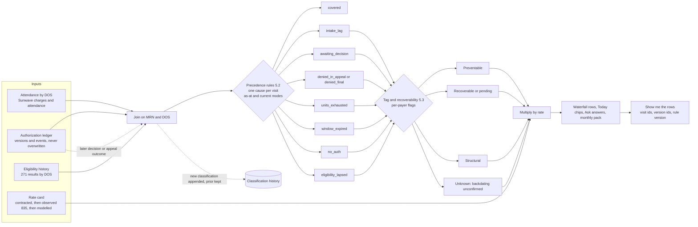

# 08 — Analytics, Leakage Reporting & Ask Psyflo

**Status:** draft v0.1 for review · **Owner:** product · **Read first:** `_brief.md` · **Depends on:** the authorization ledger (lifecycle PRD), eligibility history, denial and appeal events, the agent run log · **Demo reference:** `/demo/today` (coverage hero, needs-me queue, agent feed), `/demo/leakage` (waterfall, tag tiles, clinician time, care continuity, CSV), `/demo/payers` (scorecard, trend, denial mix, partials, policy changes) and the Ask Psyflo panel (`apps/frontend/src/app/demo/~lib/ask-panel.tsx`); models in `apps/frontend/src/lib/demo/{analytics,derive,ask,types,payers,agents}.ts`.

## 1. Summary and problem statement

This layer is where the ledger gets read. Every other PRD writes rows: versions, events, visits, eligibility results, agent runs. This one turns those rows into four things the operator cannot get today: a morning home page that says who can be billed for and what needs doing; a continuous leakage waterfall that attributes every unbillable visit to one cause, one tag and one dollar value; the consumption views of the payer scorecard; and a question box over the ledger that answers with row-level citations. It computes nothing that is not arithmetic over stored rows, and it predicts nothing (`_brief.md`, principles 5 and 6).

The problem it replaces is manual and monthly. Tracy builds her "waterfall report" by uploading three files to Claude (charges by date of service, payments by date of service, the authorization spreadsheet) to learn that of 60 patients seen only 45 had an active PA for that date of service, and that a payer takes two to three months to reach 98% of collectible revenue (tracy-call-transcripts.md, Call 1, "The waterfall report, write-back to Sunwave, and HIPAA"). The unit-usage report is run by hand; a three-week gap let one patient run 40 units over (Call 2 [27:29]). Sunwave offers "three separate reports", static, and the advice to export to Excel (Call 2 [49:11]). The five-tab spreadsheet is the only holistic view. Write-offs run $10,000–15,000 a month across 30–35 claims on about $3.5 million of revenue; $86,000 of back claims were recovered in her first month simply by starting to track (Call 2 [28:05]). CombineHealth's "Taylor" chat and HealOS/Arrow's KPI tiles show the interface pattern but sit on claims data, not a unit-and-date ledger (competitor-landscape.md §3.1, §3.2, §4).

> "So it can tell me: all right, we saw 60 patients. Of those 60 patients, only 45 of them had active PAs for that date of service. So the most revenue that I can collect is X, because the others all have to get written off." — tracy-call-transcripts.md, Call 1, "The waterfall report, write-back to Sunwave, and HIPAA"

> "What I can't see is everybody on a holistic view right now: to know we've got 74 approvals, 2 that are denied, 3 that are in appeal, 12 that are over here." — tracy-call-transcripts.md, Call 2 [65:27]

> "I added a component of a search engine tool to it so that I could just go in and ask it, 'What are the next 12 PAs that are coming due in October?' and it would just spit out the answer." — tracy-call-transcripts.md, Call 2 [64:35]

> "I'm paying you thousands of dollars for a system. I don't want to export it and work on it in Excel. That is not an acceptable solution to me." — tracy-call-transcripts.md, Call 2 [49:11]

> "I think it was just because I hadn't actually run the unit usage report in about three weeks, and he came every day. And his expiration date wasn't until November, so it wasn't even on my radar." — tracy-call-transcripts.md, Call 2 [27:29]

## 2. Goals, non-goals, success metrics

**Goals.** (1) Replace the manual waterfall and the hand-run unit-usage report with a nightly computation that assigns every delivered visit one cause, one tag and one dollar value, with the rows behind each figure one click away. (2) Give the operator one page each morning: coverage today by cause with an owner, the day's queue across product lines, what the agents did. (3) Make the scorecard consumable: rates with denominators, trends with the events that explain them, comparisons that isolate one payer, site or date. (4) Answer questions over the ledger in natural language with citations and decline everything else. (5) Produce the owner's monthly pack and finance's exports without anyone opening Excel to do the work.

**Non-goals.** No approval-probability score or forecast of payer decisions (§13). No general-purpose BI tool, free-form SQL or general-ledger warehouse. No claims scrubbing; 835s are read to measure recovery, not to post. No PHI in email, Slack, decks or Sheets. Export serves consumers of the numbers (accountant, owner, board), never a step in working the process.

| Kind | Metric | Baseline | Target (Harbor, 90 days after go-live) |
|---|---|---|---|
| Lagging | Preventable leakage (units exhausted + window expired + no auth), $ per month | Unknown until the 90-day export is ingested | −50% versus first full month |
| Lagging | Patients found over their unit grant ("ghost expirations") | "Usually four or five"; one at 40 over (Call 2 [27:13]) | 0 |
| Lagging | Write-off dollars matched to an attributed cause | $10–15K/month, unreconciled (Call 2 [28:05]) | ≥ 95% |
| Lagging | Operator hours to produce the waterfall and owner pack | Monthly manual build in Claude | 0; pack ready on the first business day |
| Leading | Spreadsheet tabs still maintained | 5 (Call 1) | 0 by week 8 |
| Leading | Ask questions per week; share answered without escalation | — | ≥ 15; ≥ 80% |

## 3. Users and jobs-to-be-done

| Persona | Jobs this layer serves | Must never |
|---|---|---|
| Operator / compliance lead (Tracy) | Coverage and value at risk before the day starts; the whole book by status; the leak by cause and payer; "what is coming due" without building it; a pack for the owner | Require an export to act; show an untraceable number |
| PA coordinator (Jordan) | Work the needs-me queue; see the patient behind each cause chip; know which decisions are past the payer rule | Hide an item's owner; show clinical content |
| Clinician (Heather, LCSW) | Only her items: packets to sign, P2P slots, appeal letters; her own P2P conversion, privately | Rank clinicians publicly |
| Intake coordinator / front desk | Eligibility exceptions with an action line; lapse visits attributed to the desk only when the 271 history says so | Blame a payer-side change on the desk |
| Offshore biller | Queues with deadlines (appeal windows, receipt confirmations); CSV of what to file | See dollar KPIs or clinical detail |
| Owner / board (Luke) | Monthly: preventable versus structural leakage, recovered revenue, clinician hours, care continuity, payer trend, before/after any change | Receive PHI or silently restated numbers |
| Finance / accountant | CSV or Sheets of visits, classification, rate source, payments; write-off reconciliation | Work from definitions that drift from the app |

## 4. End-to-end workflow

### 4.1 As-is (Harbor, September 2026)

| Cadence | Step | Who | Tool | Evidence |
|---|---|---|---|---|
| Daily, 2–3 h | Refresh Availity and portal statuses; update spreadsheet tabs (approved, renewals, appeals) | Tracy plus 2 PA FTEs | Availity, WellCare portal, Excel | Call 1; Call 2 [18:49] |
| Ad hoc (once, three weeks) | Run the unit-usage report; export two Sunwave reports; have Claude merge them; check units against end dates and attendance by eye | Tracy | Sunwave, Claude | Call 2 [24:20], [27:29] |
| Weekly | Email the clinician the renewals due and which 3 of 6 documents need updating | Tracy → Heather | Email | Call 2 [45:32] |
| Monthly | Build the waterfall from charges, payments and the PA spreadsheet; run the write-off report (30–35 claims, $10–15K) | Tracy, billing team | Claude project, Sunwave RCM | Call 1; Call 2 [28:05] |
| Ad hoc | "What are the next 12 PAs coming due in October?" | Tracy | Her own Claude-project mock-up over the spreadsheet | Call 2 [64:35] |

### 4.2 To-be (with Psyflo)

| When | What happens | Who acts | What the agent does |
|---|---|---|---|
| Nightly and on every ledger event | Every visit in the trailing 12 months is classified in both modes (§5.1); rate card applied; alerts evaluated; Today assembled for 06:00 | — | Analyst computes; Navigator, Verify and Advocate events trigger recompute |
| Monday 07:00 | "This week" digest: renewals binding, decisions past the rule, appeals without receipt, patients over units | Operator reads | Analyst sends counts and a link; no PHI by email |
| Morning | Operator opens Today, clicks a cause chip, assigns or acts; clinician sees only her items; anyone asks Psyflo and gets cited rows | Tracy, Jordan, Heather | Analyst plans a query over the semantic layer, executes, validates every number, cites rows |
| Decision or appeal outcome arrives | Visits flip class (awaiting → covered by backdate; in appeal → covered or final); recovered revenue increments; leakage restated with a note | — | Analyst appends a classification version; nothing is edited |
| First business day of the month | Pack drafted (aggregate only) with restatement lines; operator approves; PDF to owner; Sheets mirror refreshed; write-off report reconciled | Tracy approves | Analyst drafts and matches on MRN, DOS and amount; nothing sends without approval |

## 5. Metrics dictionary and functional requirements

### 5.1 Base objects and modes

- **Visit**: one delivered H2020 service day for one MRN at one site, from Sunwave attendance and charges by date of service. Units = 1 per visit-day.
- **Version**: an immutable authorization version with `unitsAsked`, `unitsGranted`, `windowStart`, `windowEnd`, `submittedAt`, `decidedAt`, `decision ∈ {approved, partial, denied, pending}`, `kind ∈ {initial, renewal, p2p, appeal}` (types.ts).
- **Classification**: the single cause assigned to a visit, in two modes. *As-at-DOS* uses only what was known on the date of service (what the demo's `coverageOn()` computes: a visit before a later backdated decision is `awaiting_decision`). *Current* uses everything known now, including backdated effective dates. Today and value at risk use as-at; the waterfall's recoverable and recovered bands use current; the difference is recovered revenue.
- **Rate**: `rate(payer, service, site, DOS)` from the rate card (§5.3).
- **Windows**: coverage is one clinic-local day; scorecard rates are trailing-quarter with a six-quarter trend; leakage defaults to the trailing 90 days (30 and 180 selectable) with a month view; write-offs and the pack are calendar months.

### 5.2 Classification precedence (one cause per visit)

Evaluated in order; the first match wins. This is the production form of `coverageOn()` in derive.ts, with eligibility computed rather than hard-coded (the demo sets `counts.eligibility_lapsed = 9` inside `leakageReport()`).

1. Eligibility history shows coverage inactive on the DOS → `eligibility_lapsed`.
2. No authorization exists for the MRN → `no_auth`.
3. No version with `submittedAt ≤ DOS` → `intake_lag`.
4. The latest version as at the DOS is undecided (or, in as-at mode, decided after the DOS): kind p2p or appeal → `denied_in_appeal`; kind renewal → look to the prior decided version: its `windowEnd < DOS` → `window_expired`; its units used before the DOS ≥ granted → `units_exhausted`; otherwise `covered` under the prior version; kind initial → `awaiting_decision`.
5. Decision denied → `denied_in_appeal` while a P2P or appeal is open, else `denied_final`.
6. `DOS > windowEnd` → `window_expired`.
7. Units used inside the window before the DOS ≥ `unitsGranted` → `units_exhausted`.
8. Otherwise `covered`, citing the version id.

`partial_shortfall` and `discharged_after_final_denial` are not visit classes; they are derived rows (units short, and forward months) beneath the visit rows in the waterfall.

### 5.3 Tags, recoverability and rate modelling

| Cause | Tag | Recoverable? | Rule and evidence |
|---|---|---|---|
| Intake-to-submission lag | Structural | No | Backdating reaches the request date, not intake; 1–2 days written off per intake (Call 1) |
| Awaiting first decision | Recoverable (pending) | Yes, if approved | KY decision within 5 days, backdated to the request date (Call 1); "pending" band until decided |
| Denied, in appeal | Recoverable | Only if the P2P or appeal wins | Won appeals are backdated (Call 2 [23:02]); continuation-of-benefits check (§9) |
| Units exhausted | Preventable | No | Payer pays granted units only; flag `retroUnitIncrease` (default no) |
| Window expired | Preventable | Unknown | Per-payer flag `renewalBackdates ∈ {yes, no, unknown}`; "unknown" is its own band, never folded into a subtotal (draft_prd.md §7) |
| No auth on file | Preventable | No | Process failure; flag `retroAuth` (default no) |
| Coverage lapsed | Structural | No | Unless reinstated retroactively; flag `retroEligibility` (default unknown) |
| Denied, final | Structural (write-off) | No | Written off after the last level |
| Partial shortfall (units) | Recoverable | Via appeal of the partial, rarely pursued | "Ask for 60 units, get 30, no reason why" (Call 1) |
| Discharged after final denial | Structural, forward | No | Planned visits per month × rate per discharged patient (Call 1) |

Preventable is the honest sizing of the product; recoverable is the appeals conversation; structural is context (draft_prd.md §9).

**Rate resolution**, in order, per (payer, service, site, DOS): (1) a contracted rate with an effective date; (2) the observed 835 allowed amount per unit over the trailing 90 days when at least 20 paid units exist; (3) the modelled default, $244.29 per visit day for KY H2020 in the demo (`VISIT_RATE`; draft_prd.md §1). Every dollar carries its rate source as a badge; a rate change restates values and writes an event. The caveat stays on screen, as the leakage page already does (`leakage-client.tsx`).

### 5.4 Metrics dictionary

| # | Metric | Formula (numerator ÷ denominator) | Grain and window | Notes |
|---|---|---|---|---|
| M1 | Coverage today | Scheduled patients classified `covered` (as-at, on date d) ÷ patients on the schedule for d | Day; site; default today | Recomputed within 5 minutes of a change |
| M2 | Value at risk | Σ over uncovered scheduled patients of rate(payer, service, site, d) | Day; 30-day series uses delivered uncovered visits | Forward-looking; leakage counts delivered visits |
| M3 | Holistic status counts | count(authorizations) by current status | Now; site | "74 approved, 2 denied, 3 in appeal, 12 over here" (Call 2 [65:27]) |
| M4 | First-pass approval | Versions with kind ∈ {initial, renewal} and decision = approved ÷ same kinds with decision ∈ {approved, partial, denied} | By payer, site; decided in trailing quarter; six-quarter trend | Partial excluded from numerator; n shown; greyed when n < 10 |
| M5 | Partial rate | decision = partial ÷ decided (M4 set) | As M4 | Partial is its own state |
| M6 | Asked → granted | mean(unitsAsked), mean(unitsGranted) over decided versions with decision ∈ {approved, partial}; unit yield = Σ granted ÷ Σ asked over all decided, denials as 0 | As M4 | Demo hard-codes asked = 60; production computes |
| M7 | Turnaround | Median and P90 of (decidedAt − submittedAt) in calendar days; share > SLA | By payer; trailing quarter | SLA = `decisionSlaDays` (7 per CMS-0057-F; 5 in KY) |
| M8 | P2P reversal | p2p versions with decision ∈ {approved, partial} ÷ p2p versions decided | By payer; by clinician (P2) | Clinician split private to that clinician and the operator |
| M9 | Appeal win | Appeal versions with decision ∈ {approved, partial} ÷ appeal versions decided | By payer; by level | Withdrawn excluded; open appeals shown with age |
| M10 | Renewal gap days | Σ over renewals of max(0, coverStart(vₙ) − bindingEnd(vₙ₋₁) − 1); bindingEnd = min(windowEnd, date units ran out); coverStart = effective start of vₙ, backdated where the payer backdates | Per renewal; by renewal decision date | Gap visits = visits inside the gap; tagged per `renewalBackdates` |
| M11 | Units exhausted | Visits classified `units_exhausted`; units over per patient = max(0, used − granted) | Period; patient | Units over > 0 fires the ghost-expiration alert |
| M12 | Stranded units / utilisation | Closed versions: granted − used; utilisation = used ÷ granted. Active: projected from actual visits per week | Per version; by payer | Under-use by payer is the over-asking signal (draft_prd.md §10) |
| M13 | Intake-to-submission lag | submittedAt(initial) − intakeDate in days; lag visits = visits with DOS in [intake, submittedAt) | Per intake; median; by intake date | Structural: the backdate reaches the request date only |
| M14 | Free care during appeal | Visits classified `denied_in_appeal` (as-at) × rate, split once decided into recovered, lost and open | Per patient; period | Up to 60 days; "just under $10,000" at five days a week (Call 2 [23:02]) |
| M15 | Eligibility-lapse visits | Visits whose DOS falls on a day the 271 history shows inactive | Period; site | Structural unless reinstated retroactively |
| M16 | Write-offs | Σ adjustments in the period with reason in the auth, eligibility, timely-filing and appeal-lost set; claim count | Calendar month | Sunwave adjustment export; reconciled to attribution |
| M17 | Recovered revenue | Σ 835 payments on visits whose as-at class was uncovered and whose current class is covered | Month by payment date; identified versus realised | The "$86,000" number (Call 2 [28:05]), computed continuously |
| M18 | Clinician hours and cost | packets × h_packet + P2Ps × h_p2p + appeals × h_appeal; × rate | Period; per-request average | Defaults 3.5 h, 0.75 h, 4 h, $90/h (`clinicianTime()`); "hours per packet today" editable, blank by default |
| M19 | Agent human-touches | Runs with status `needs_human` ÷ runs; touches per authorization beyond the mandatory sign-off | Period; per agent | Sign-off is always ≥ 1 because nothing sends itself |
| M20 | Care continuity | Patients paused (no attendance ≥ 7 days after a denial, no discharge); days paused; discharged after final denial; returned after pause | Period; patient | Not a revenue metric; demo figures are static and labelled |

**Why care continuity is on the pack.** For a safety-net provider a caught failure is a paused patient, not recovered revenue (`_brief.md`, principle 7). A nonprofit board's fiduciary question is mission delivered: how many patients stayed in care through the authorization cycle, how many were discharged because a payer said no, how many came back when an appeal won. Harbor keeps patients attending free when a pause would harm them and has discharged several after final denials (Call 1; Call 2 [23:02]). The same counts are the evidence base for parity and fair-hearing arguments (§9), so the panel carries no dollar framing.

### 5.5 Functional requirements

| FR | Requirement | Priority | Acceptance criteria |
|---|---|---|---|
| FR-01 | Coverage hero on Today: covered ÷ scheduled for date d; cause chips with count, value and owner label (Payer clock, Our timing, Payer behaviour, Process gap, Intake, Front desk); past-date mode using as-at classification | P0; past-date P1 | Chips sum to uncovered and filter the list; row cause equals the engine's; refresh within 5 minutes |
| FR-02 | Needs-me queue across product lines: eligibility exceptions, sign-offs, info requests, decisions past the rule, P2P slots, appeal deadlines, receipt confirmations, patients over units | P0 | Owner pill and deep link per item; counts equal source screens; a clinician sees only her items |
| FR-03 | Holistic status strip (Partial distinct) and agent feed (runs since midnight, sources checked, `needs_human`) | P0 | Strip sums to total authorizations; feed matches the run log |
| FR-04 | Visit classification engine per §5.2 in as-at and current modes | P0 | Deterministic; unit tests per cause using the demo stories; each classification stores rule and covering version ids |
| FR-05 | Tags and recoverability per §5.3 with per-payer flags | P0 | Flag change reclassifies and logs; "unknown" is its own band |
| FR-06 | Rate card with the §5.3 resolution order and a source badge on every dollar | P0 | Contracted rate applies from its effective date only; changes restate and log |
| FR-07 | Leakage waterfall for 30, 90, 180-day, custom and month windows: chart and table (cause, visits, value, tag, recoverability, rate source); tag tiles that filter; pending and unknown bands | P0 | Table total equals chart total; each row opens its visits; preventable is the headline |
| FR-08 | Restatement: snapshot at pack time; later reclassification shown as a delta with reason (retro approval, appeal won, rate change, late attendance) | P1 | Snapshots immutable; the next pack lists every restated line |
| FR-09 | Recovered revenue from the 835 join (M17), identified versus realised | P1 | Every recovered dollar cites a payment id and both classifications |
| FR-10 | Write-off reconciliation: import the Sunwave adjustment report; match on MRN, DOS, amount | P1 | ≥ 95% of write-off dollars matched, or the unmatched list explains why |
| FR-11 | Auth-to-claim reconciliation: claim denials with CARC 197/198 against a ledger showing coverage → rework queue | P2 | Each mismatch shows claim, covering version and the auth number the claim carried |
| FR-12 | Computed scorecard: M4–M9 and M12 with n, greyed below n = 10, trend versus three quarters earlier, published rate, criteria set; partial detail and denial mix views | P0 | Aggregate first-pass within ±3 points of Tracy's ~70% on Harbor data, or the gap explained |
| FR-13 | Trend with event markers: July 2025 KY mandate, January 2026 CMS 7-day rule, acknowledged policy changes | P0 | Markers come from the payer-intelligence store |
| FR-14 | Published versus observed: ingest CMS-0057-F public PA metrics per plan and show the gap | P2 | Shown only when the published period and scope are known |
| FR-15 | Care-continuity metrics (M20) with a per-patient list; continuation-of-benefits flag on renewal denials making visits during a timely member appeal billable-pending | P1; flag P2 | No dollar framing; MRN and initials only; flag cited by the classification |
| FR-16 | Clinician time panel (M18) with editable assumptions; "hours per packet today" blank until entered; measured times replace defaults once ≥ 20 instances exist | P0 panel; P2 measured | Per-request average shown; assumptions logged; panel states what the engine saved |
| FR-17 | Ask Psyflo answers built only from an executed query over the semantic layer; every number in the prose must appear in the result set; P50 ≤ 5 s, P95 ≤ 15 s; thumbs and escalate per answer | P0 fixed library; P1 free text | Validator rejects any number absent from the result set and falls back to the table; escalations reach the Psyflo Slack help channel (Call 2 [56:56]) |
| FR-18 | Row-level citations: chips listing MRN, version and event ids; "Show me the rows" opens the exact filtered table | P0 | Chip count equals rows returned; same view the screens use |
| FR-19 | No predictions: prediction intents are declined with an observed-history answer | P0 | The decline names the metric offered instead |
| FR-20 | Decline when unanswerable: out-of-scope questions return "cannot answer from the ledger" plus the nearest saved question | P0 | Zero invented figures across a 200-question test set |
| FR-21 | Saved questions (filters, rerun, sharing) and scheduled digests (in-app, email, optional Slack) carrying counts and a link only outside the app | P1 | Rerun shows the delta; no MRN, initials or per-patient dollars externally; audit entry per send |
| FR-22 | PHI minimisation and role scoping: MRN and initials only; dollar KPIs hidden from roles without finance scope; every question and the rows touched logged | P0 | Access log exportable for HIPAA audit; role tests pass |
| FR-23 | Monthly pack drafted on the first business day, aggregate only, with restatement lines; operator approves before send; board deck export | P1; deck P2 | No PHI in the PDF; contents per §6.5; approval logged |
| FR-24 | CSV export of any table (the demo's `leakage-csv.ts` columns) and a read-only Google Sheets mirror of the five tabs (approved, renewals, appeals, denials, write-offs), hourly | P0 CSV; P1 Sheets | Export logged with user, filter, row count; sheet header "Source: Psyflo — edits are not read back"; BAA-covered workspace only |
| FR-25 | Read API (`/metrics`, `/visits`, `/ledger`) with the app's definitions | P2 | Definition version in every response |
| FR-26 | Comparison views: site versus site, payer versus payer, before/after a date with equal-length windows | P1 | n per side; disabled below n = 10 |
| FR-27 | Alert rules with the §5.6 defaults, acknowledgement and precision tracking | P0 ghost expiration and file-by; P1 others | Each alert links to rows; precision reported monthly |
| FR-28 | Lineage on every number (definition version, row count, sources, computed-at, rate source, "Show me the rows") and freshness (last attendance sync, last decision poll) | P0 | On every tile, cell and answer; banner when a feed is older than 24 hours |

### 5.6 Default alert thresholds (FR-27)

| Alert | Default rule | Owner | Channel |
|---|---|---|---|
| Ghost expiration | Units over > 0, or units remaining ≤ 5 with ≥ 10 window days left ("five units left and 12 days on their PA", Call 2 [26:00]) | Jordan | In-app immediately; digest |
| File-by passed | Renewal file-by date < today and no renewal in flight | Jordan | In-app; digest |
| Coverage today | Coverage < 90% or value at risk > $1,000 | Tracy | Morning in-app |
| Decision past the rule | Pending request older than the payer SLA (7 days; 5 in KY) | Jordan | In-app |
| Appeal without receipt | Filed ≥ 3 business days ago with no receipt confirmation (Call 2 [18:49]) | Offshore biller | In-app |
| Payer drift | First-pass down ≥ 10 points versus three quarters earlier, or partial rate > 20%, with n ≥ 10 | Tracy | Weekly digest |
| Stranded units | Projected utilisation < 75% on an active version | Jordan | Weekly digest |
| Write-off pace | Month-to-date write-offs > $10,000 | Tracy, owner | Monthly pack |

## 6. Screens and UX

### 6.1 Today — `/demo/today`

**Purpose.** Answer "of the patients on today's schedule, how many can we bill for?" and put the day's queue beside it (Call 2 [64:35]).

**Layout.** Date and site toggle. Hero band: "45 of 60 patients today are covered by an active authorization", value at risk at the resolved rate, cause chips in a fixed order (awaiting decision, units exhausted, window expired, denied in appeal, no auth, intake lag, coverage lapsed) with count, dollars, owner label and one-line meaning, and a 30-day unbillable-visits sparkline (`coverage-hero.tsx`). Below: the filtered patient list (MRN, initials, site, payer, cause, short reason such as "3 over", units and days remaining, file-by) beside the needs-me queue and agent feed (`work-queue.tsx`, `agent-feed.tsx`). A status strip carries M3.

**States and interactions.** Before attendance posts the hero uses the schedule and says so; after 10:00 it switches to attendance. Stale feeds show the FR-28 banner; past-date mode carries an "as at" ribbon. Chip → list → patient detail (`/demo/authorizations/[id]`); queue item → the owning screen; "mark done" hides for the day; the Ask panel opens with the hero's numbers pre-cited. Zero uncovered reads "Everyone on today's schedule is covered"; a missing schedule falls back to patients who attended in the last 7 days, labelled.

**Borrowed.** Plain-language action lines (CombineHealth), status tiles with count, dollars and a bar (Arrow), "sources checked" on agent runs (Arrow) (competitor-landscape.md §6); the cause-to-owner mapping is Psyflo's.

### 6.2 Leakage — `/demo/leakage`

**Purpose.** Tracy's waterfall, computed continuously and restated honestly (Call 1; draft_prd.md §9).

**Layout (as built).** Period selector (last 30, 90, 180 days), "Export waterfall (CSV)" and "Ask Psyflo about this". Four tiles that filter: Preventable ("what the product sells against"), Recoverable ("an appeal could still win it"), Structural ("Medicaid patients cannot be billed") and Total. A caveat banner stating the modelled visit and clinician rates. Table (cause, visits or units, value, tag, recoverability, one-line meaning) beside the chart; beneath, the clinician time and care-continuity panels (`leakage-client.tsx`, `clinician-time.tsx`, `care-continuity.tsx`). Production adds the pending and unknown bands, a month view, the 835 collection curve ("2 to 3 months to reach 98%", Call 1), a rate-source badge per row and a restatement banner when the view differs from the last pack.

**States and interactions.** Partial month labelled "month to date", no annualisation; rows affected by unposted attendance carry the FR-28 flag; no 835 feed hides the collection curve and labels recovered "identified only". Row → visit drawer (MRN, DOS, covering version, rule version); "Compare" opens §6.4 on the same period; "hours per packet today" re-prices the packet line live and states what the engine saved.

**Borrowed.** Chart/Table toggle from CombineHealth's heatmap; recurring-cause framing from Aegis (competitor-landscape.md §3.1, §3.6); the three tags and the unknown band are Psyflo's.

### 6.3 Payers — `/demo/payers`

**Purpose.** The consumption views of the scorecard the lifecycle and payer-intelligence PRDs compute (draft_prd.md §8).

**Layout (as built).** A story callout (the degrading payer, read from the quarterly series), the scorecard table (requests, first-pass, partial, asked → granted, median days, P2P reversal, appeal win, trend, published rate, criteria set), the six-quarter trend with the mandate quarter marked, denial-mix bars, the partials panel with a by-payer headline, the policy-change list with acknowledgement, a criteria-transparency footnote and a payer sheet on row click (`payers-client.tsx`, `scorecard-model.ts`, `partials-panel.tsx`). Production adds n under every rate, greying below n = 10, the 7-day-rule and policy-change markers, and the published-versus-observed column (FR-14).

**Interactions and borrowing.** Row → payer sheet → that payer's authorizations; marker → the policy change; "compare" pins two payers. Borrowed: payer-by-reason heatmap (CombineHealth), won/lost-by-payer analytics (EasyPA), the CMS-0057-F published comparison (competitor-landscape.md §2(c); `_brief.md`).

### 6.4 Comparison views (inside Leakage and Payers)

Two panes with equal-length windows: site versus site, payer versus payer, or before/after a date (defaults: 1 July 2025 mandate, 1 January 2026 7-day rule, any acknowledged policy change). Same metrics per pane with n and a signed delta; no significance claims. Below n = 10 per side the comparison is disabled rather than shown with a warning.

### 6.5 Monthly pack and owner view (no demo route)

One PDF, aggregate only: coverage trend; waterfall with subtotals and the pending and unknown bands; recovered revenue identified versus realised; write-offs reconciled; scorecard with trend; clinician hours and cost; care continuity; alerts fired and acted; a restatement section listing every changed line with its reason. Tracy asked for material her owner can pre-read (Call 2 [66:49]).

### 6.6 Ask Psyflo panel (`ask-panel.tsx`)

**Purpose.** "What are the next 12 PAs that are coming due in October?" answered from the ledger, with rows (Call 2 [64:35]).

**Layout.** A side sheet on every screen. Header: "Answers come from the authorization ledger. Every number cites its source rows. No predictions." Empty state shows the suggested questions from ask.ts (next 12 renewals; which payer cuts units most; late-renewal cost over 90 days; who on today's schedule cannot be billed; appeals without receipt). Each answer card: one sentence or a short numbered list, an optional table, a citations chip ("12 rows · versions · attendance"), "Show me the rows", "Save", "Schedule", thumbs, "Escalate". The demo's `answer()` keyword-matches canned answers; production uses the planner and validator of §7.

**States.** Answered; declined (out of scope or prediction) with the nearest saved question; partial (query ran, prose withheld because validation failed, table shown); slow (progress naming the sources being read); ledger unavailable (last cached answer with its timestamp).

**Borrowed.** Chat over metrics and executive reports (CombineHealth "Taylor"); "Ask Arrow" and the sources chip; questions-to-human reused as the escalate action (competitor-landscape.md §3.1, §3.2); row citations and the decline rule are Psyflo's.

## 7. Agent behaviours and guardrails

The Analyst agent (agents.ts) "answers questions over the authorization ledger, builds the leakage report continuously, explains every number back to its source rows" and "never predicts approval odds". Its behaviours:

1. **Plan, don't compute.** A question maps to an intent over a fixed semantic layer: a metric from §5.4, filters (payer, site, period, status, MRN), a sort and a limit. The plan runs as a parameterised query. The language model never performs arithmetic and never treats free text as data; it sees the result set and writes the sentence.
2. **Validate every number.** Each numeral, date and dollar figure in the prose must match a value in the result set after formatting. Failure withholds the prose and shows the table (FR-17); failures are logged with plan and result hash.
3. **Decline outside the layer.** Unknown intents, clinical judgement and predictions are declined with a named alternative (FR-19, FR-20). "Will WellCare approve HBH-1077?" returns WellCare's observed rates and the patient's own history.
4. **Cite rows and minimise PHI.** Every answer carries the ids of the versions, events, visits or eligibility results used and a rule version (FR-18, FR-28); MRN and initials only; external digests carry counts and links; every question, plan and row set touched goes to the access log (FR-21, FR-22).
5. **Restate, never rewrite; time-box.** Reclassifications append a version with a reason; pack snapshots are immutable (FR-08). One plan per question, a 30-second cap, no chained tool use; on a cap the answer names the sources not read.
6. **No sending.** Digests and packs are drafted; the operator approves the pack and a person creates every digest schedule (FR-23). The agent has no outbound channel a human did not give it.

## 8. Data model and integration touchpoints

### 8.1 Attribution pipeline

### 8.2 Entities

| Entity | Key fields | Notes |
|---|---|---|
| Visit | id, mrn, site, service_code, dos, units, attendance_source, posted_at | Sunwave attendance is authoritative; `posted_at` drives freshness |
| VisitClassification | visit_id, mode, computed_at, cause, covering_version_id, tag, recoverability, rate_id, value, rule_version, restatement_reason | Append-only; latest per (visit, mode) is the view |
| RateCard | payer_id, service_code, site, effective_from, amount, source | Resolution order §5.3 |
| Payment / Adjustment | visit_id, payer_id, paid_at or posted_at, allowed, paid, carc, rarc, reason_code | 835 and the write-off report; feed M16, M17, observed rates |
| MetricDefinition | key, version, formula_text, query_template, unit, default_window | The semantic layer Ask plans against |
| LeakageSnapshot | id, period, generated_at, rows_json, definitions_version, approved_by | Immutable; packs reference one |
| AskQuestion | id, user_id, role, text, intent, plan_json, result_hash, citations, validator_result, latency_ms, outcome | The HIPAA access log |
| SavedQuestion, DigestSchedule, AlertRule, AlertEvent, ClinicianTimeEntry, CareEpisodeEvent, ExportJob | Actor, time, linked rows and channel per §5.5 | Feed M18, M20, alert precision and export audit |

### 8.3 Integration touchpoints

| System | Direction | What | Mode |
|---|---|---|---|
| Sunwave (EHR, CRM, RCM) | In | Attendance and charges by DOS, today's schedule, intake dates, discharge events, adjustment report; 835 payments | Scheduled export via the report route Tracy already uses; no full integration (Call 2 [41:10]) |
| Ledger (Psyflo) | In | Versions, events, eligibility results, agent runs | Internal event stream |
| Google Sheets | Out | Read-only mirror of five tabs | Hourly; BAA-covered workspace only |
| Email, Slack | Out | Digests and pack notifications: counts and links only | On schedule, human-created |
| CMS public PA reporting | In | Published plan metrics for FR-14 | Annual file, P2 |

## 9. Payer and regulatory rules the feature must encode

| Rule | Source | Encoding |
|---|---|---|
| Standard PA decision within 7 calendar days (expedited 72 hours) from January 2026; specific denial reasons; annual public PA metrics; FHIR PA API by 2027 | CMS-0057-F (`_brief.md`) | `decisionSlaDays = 7`; "past the rule" alert and M7 share > SLA; FR-14; trend marker |
| Kentucky 5-day decision; approval backdated to the request date; PA mandate from July 2025 | Call 1 | KY tenants use 5; `awaiting_decision` is recoverable-pending; backdate sets `coverStart = submittedAt`; mandate is the default before/after marker (`MANDATE_QUARTER`) |
| Renewal backdating unconfirmed | draft_prd.md §7 | `renewalBackdates` per payer; unknown band |
| Medicaid patients cannot be billed | `_brief.md` principle 7; Call 2 [52:40] | No patient-responsibility band; uncovered is written off or recovered from the payer, never shifted |
| Medicaid appeal windows (60 days; some plans 30); internal appeal then state fair hearing; continuation of benefits | `_brief.md`; payers.ts `appealDeadlineDays` | Appeal-deadline alerts; M9 by level; FR-15 flag makes some "free care" visits billable-pending |
| MHPAEA 2024 NQTL comparability | `_brief.md` | Payer-versus-payer and published-versus-observed gaps exportable as evidence for parity conversations; no legal conclusion on screen |
| Medicare-first for dual-eligibles; HIPAA minimum necessary | Call 1; `_brief.md` principle 8 | Medicare pending days are a collection-timing metric (P2), never an uncovered cause; FR-21, FR-22 |

## 10. Edge cases and failure modes

| Case | Handling |
|---|---|
| Attendance not yet posted for recent days | Those days are unclassified, excluded from leakage and flagged (FR-28); coverage today uses the schedule; unit countdowns use posted plus scheduled visits with an "n days unposted" note. The 40-units-over case was a stale-attendance failure, so staleness is itself an alert |
| Retro-approval or appeal win reclassifies past visits | Current-mode class flips to covered; as-at is kept; recovered revenue increments; the next pack carries a restatement line |
| Final denial after appeal | `denied_in_appeal` → `denied_final`; recoverable falls, structural rises, with a restatement line |
| Partial months | Labelled month to date; no annualisation; comparisons default to complete periods |
| Plan change mid-window (WellCare → Passport in eligibility.ts) | The old authorization is void for the new payer's DOS; visits classify `no_auth` with detail "payer mismatch"; the eligibility exception owns the fix |
| Retroactive Medicaid reinstatement | `eligibility_lapsed` flips only when the eligibility history is corrected; tag per `retroEligibility` |
| Overlapping versions (appeal win covering dates a renewal also covers) | Precedence picks the earliest covering version; nothing is double-counted |
| Contracted rate unknown, or different by site | Modelled badge and caveat on every dollar; rate card keyed by site |
| Small denominators | Rates greyed below n = 10; no trend arrows; comparisons disabled |
| Definition change | New `MetricDefinition` version; old snapshots keep theirs; the pack notes the change |
| Ask validator failure | Prose withheld, table shown, failure logged; repeated failures on one intent disable it until reviewed |
| Appeal outcome arrives after the pack was sent | Restated in the next pack; the sent one is never edited |

## 11. KPIs and analytics this feature emits

| KPI | Definition | Target |
|---|---|---|
| Time to answer | P50 and P95 from question to validated answer | ≤ 5 s; ≤ 15 s |
| Questions answered without a human | Answered ÷ (answered + declined + escalated) | ≥ 80% by week 8 |
| Invented-number rate | Validator failures where prose held a number absent from the result set, per 100 answers | 0 shipped; all caught before display |
| Citation use | Answers where "Show me the rows" was opened ÷ answers | Tracked; ≥ 25% means trust is being checked |
| Time to waterfall | Operator hours from "I want August's leakage" to a shareable pack | 0 |
| Write-off match rate | M16 dollars matched to attributed visits | ≥ 95% |
| Alert precision | Acted ÷ fired, by rule | ≥ 60%; rules under 30% reviewed |
| Freshness | Working days with attendance posted within 24 hours | ≥ 95% |

## 12. Rollout and phasing

| Phase | Scope | Exit criteria |
|---|---|---|
| Pilot, Harbor, weeks 1–4 | Ingest the 90-day export (authorizations, decisions, attendance, spreadsheet); classification engine and tags (FR-04, FR-05) with modelled rates (FR-06); Today (FR-01 to FR-03); waterfall (FR-07); scorecard and trend (FR-12, FR-13); clinician time panel (FR-16); Ask with the fixed question library (FR-17 to FR-20, FR-22); CSV (FR-24); ghost-expiration and file-by alerts (FR-27); lineage and freshness (FR-28) | Tracy corrects the cause split for a real day; aggregate first-pass within ±3 points of her ~70%; zero patients over units for 30 days; the unit-usage report is no longer run by hand |
| v1, weeks 5–12 | Free-text Ask with validator; saved questions and digests (FR-21); restatement (FR-08); 835 join (FR-09); write-off reconciliation (FR-10); care continuity (FR-15); contracted rates per MCO; comparisons (FR-26); remaining alerts; monthly pack (FR-23); Sheets mirror (FR-24) | First pack approved and sent without Excel; five tabs retired; write-off match ≥ 95% |
| Second design partner | Multi-service-code rate card and classification (Ohio IOP with a 30-unit cap; Valant attendance); per-tenant owner labels; recoupment-aware write-offs (Ohio SB 162 lookback) | The same engine passes the partner's own day-level check |
| General | FR-11, FR-14, FR-25, the board deck, measured clinician time, continuation of benefits, Medicare-first cycle time, P2P by clinician; opt-in de-identified cross-tenant benchmarks | Definitions frozen at v1.0 with a change log |

## 13. Open questions and research asks

1. **Contracted rates.** What do the five MCOs, straight Medicaid and Medicare pay per H2020 unit, and do Lexington and Hopkinsville differ? Until entered, every dollar is modelled at the demo's $244.29 (draft_prd.md §9).
2. **Tracy's spreadsheet columns as the data model.** The five tabs (appeals, renewals, everyone currently approved, two unnamed) are her working schema; their columns should map one-to-one to ledger fields and to the Sheets mirror (draft_prd.md §13; transcripts, "Loose ends" 16).
3. **Calibration ask.** Her engine grades approval likelihood. Plot its scores against actual outcomes on the same 90-day export; if it tracks, prediction becomes a roadmap item; if not, "observed, not predicted" stands (draft_prd.md §10, Tier 3).
4. **Are renewals backdated like initials?** Decides whether `window_expired` is recoverable or permanent, and what the renewal gap is worth (draft_prd.md §7).
5. **What is the "12 over here"?** Confirm the fourth bucket in her holistic view so the status strip uses her words (Call 2 [65:27]).
6. **Write-off report structure.** Which adjustment reason codes does the monthly report carry, and do they separate no-auth, units-exceeded, eligibility and appeal-lost? Needed for M16 (Call 2 [28:05]).
7. **Schedule, attendance and 835 sources.** Does Sunwave expose today's expected patients, posted attendance by DOS with a posted-at timestamp, and payments by DOS? Decides when coverage today can switch to attendance and whether the collection curve is computed rather than remembered.
8. **Continuation of benefits and retroactive eligibility.** Does Harbor invoke continuation on renewal denials, and how often are lapsed members reinstated retroactively in Kentucky? Sets the tags on "free care during appeal" and "coverage lapsed".
9. **Who sees dollars, and who reads the pack.** Which roles see dollar KPIs (default: finance scope only); Harbor's ownership structure is not stated in the transcripts, so confirm whether the artefact is an owner pack or a board pack.

## 14. Evidence appendix

| Source | Used for |
|---|---|
| `docs/prior-auth/prd/_brief.md` | Principles 5–8, personas, regulatory context, demo routes, template |
| `docs/prior-auth/research/tracy-call-transcripts.md`, Call 1: "Why every patient needs a PA", "Units, windows and renewals", "Building her own tracking tool", "The waterfall report, write-back to Sunwave, and HIPAA", "What vendors got wrong" | Waterfall (60 seen, 45 covered; 2–3 months to 98%), backdating, partial approvals, overwritten history, $90/h clinicians versus $12/h billers |
| Same, Call 2: [18:49], [23:02], [24:20]–[27:29], [28:05], [45:32], [49:11], [64:35]–[65:27] | Appeals visibility; free care during appeal; units versus windows and ghost expirations; write-offs, recovery and revenue; renewals load; "export to Excel"; KPIs plus workflow, holistic view and AI chat |
| `docs/prior-auth/research/competitor-landscape.md` §3.1, §3.2, §2(c), §4, §6 | CombineHealth Taylor and heatmap; Arrow KPI tiles, Ask Arrow, sources chip, questions to human; EasyPA won/lost analytics; feature matrix; UI patterns |
| `scratchpad/research/draft_prd.md` §1, §4, §8, §9, §10, §13 | Opening number, Screens 1, 5 and 6, three framings, modelled-rate caveat, metric tiers, open questions |
| `apps/frontend/src/lib/demo/{derive,analytics,ask,types,payers,agents,format}.ts` | Classification precedence (`coverageOn`), tags (`LEAK_META`), demo values, Analyst guardrails, suggested questions |
| `apps/frontend/src/app/demo/today/~lib/*`, `leakage/~lib/*`, `payers/~lib/*`, `~lib/ask-panel.tsx`, `~lib/nav.ts` | Screen layouts and copy as built |
