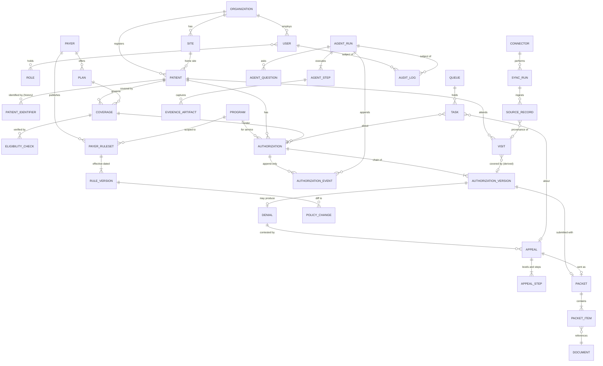

# 09 — Integrations, Data Model & Platform Foundations

| | |
|---|---|
| **Layer** | Supporting layer: integrations & data model. Every product line reads from and writes to what is specified here. |
| **Status** | Draft v1 for Harbor pilot planning, 2026-09-19 |
| **Assumes** | `_brief.md` (shared context, principles, personas, glossary) |
| **Demo reference** | `/demo/agents` (integrations panel, agent runs), `/demo/authorizations/[id]` (history that survives renewal), `/demo/eligibility` (source and freshness per row) |

## 1. Summary and problem statement

The other PRDs describe what the operator sees. This one describes what sits underneath: how Psyflo gets data out of, and back into, an EHR without a full integration; how it reaches Availity, payer portals, the clearinghouse, fax and phone; how the ledger is modelled so history is never overwritten; and which HIPAA and security controls wrap it. The problem is structural: the systems that hold the facts do not hold them in a usable shape, and the only tool that does is a five-tab spreadsheet.

**Evidence**

1. "There's probably anywhere from 3 to 7 different systems that we have to use to keep track of this information ... the EHR systems just don't seem to be set up for the types of authorizations that we do. They're more set up for an authorization for an MRI, where it's just a yes or a no." (tracy-call-transcripts.md, Call 1, *Staffing cost and the 3–7 systems problem*)
2. "A lot of the tools you have will overwrite the old one. So you lose your historical information, because they're like, 'Oh, you don't need that anymore.'" (tracy-call-transcripts.md, Call 1, *Building her own tracking tool*)
3. "We've been working with our EHR, trying desperately to get them to make some enhancements, but when you're dealing with software, we're one of hundreds of clients." (tracy-call-transcripts.md, Call 1, *Denials, appeals and the clinician burden*)
4. "The most advantageous thing would be not using APIs, but coming up with a way that you could easily integrate with some of the top EHRs. It can sit on top of — it doesn't have to fully integrate with, but can sit on top of, or do regular calls to and from, the database elements ... somebody can very easily just click from their EHR into their PA tool." (tracy-call-transcripts.md, Call 2, [45:01])
5. "We use one of the Claude Code tools that allows it to take over a browser ... it ties up somebody's computer, and sometimes it can take 15, 20 minutes ... we want to keep it on our own servers so that we are HIPAA compliant." (tracy-call-transcripts.md, Call 1, *The waterfall report, write-back to Sunwave, and HIPAA*)
6. "'Well, you could just export this and then work it in Excel.' ... That is not an acceptable solution to me." (tracy-call-transcripts.md, Call 2, [48:40] section)

**What the rest of the corpus adds.** Dave Cherry (Ellie Mental Health, Ohio) runs Valant because franchise headquarters chose it; with no open APIs without corporate approval, his integration is a Power BI roster export uploaded as CSV, plus Nirvana eligibility embedded in the EHR (Dave Cherry call, summarised in `_brief.md`). Neon integrates by point-and-click automation through a service account on Valant or Sunwave, starting from a CSV export, with agentic write-back; the clinic persona on that call was moving from Valant to Sunwave (competitor-landscape.md §2(a), §3.4). HealOS reads Sunwave notes (§3.2); LunaBill and Heron load by API, SFTP/FTP or CSV (§3.3, §3.7); Sohar sells verification as an API (§3.5); Lucida and Athon list Sunwave and Availity connectors (§2(d)).

**What this PRD decides.** Four integration tiers feeding one canonical model, so a CSV-only clinic gets the same ledger as one with an API; an Authorization as a chain of immutable versions plus append-only events, with the clocks as computed views; the security envelope; multi-tenant deployment with server-side agents; and the import path from Harbor's spreadsheet.

## 2. Goals, non-goals, success metrics

**Goals**

1. A clinic with no API access has a ledger of record within two weeks, from exports and a spreadsheet alone.
2. Nothing is lost: every fact is versioned, every change is an event, every value knows its source and time.
3. Agents run on Psyflo's servers under clinic-controlled service accounts, with a screenshot for every portal or EHR action.
4. Every screen says how fresh its data is.
5. HIPAA-first: minimum necessary on shared screens, BAAs with every sub-processor including the LLM vendor, an auditable trail.
6. The clinic can export its entire ledger at any time.

**Non-goals**

- Not an EHR, clearinghouse, billing service or claims scrubber (`_brief.md`); never edits clinical content or posts claims.
- No in-house 270/271 or 837/835 connectivity; eligibility depth comes from a partner or through Availity (competitor-landscape.md §7, point 5).
- No FHIR Prior Authorization API build before a payer exposes one (CMS-0057-F, January 2027); no general-purpose RPA product; no approval-probability model (product principle 5).

**Success metrics**

| Metric | Type | Pilot target |
|---|---|---|
| Kickoff to ledger live on the clinic's real data | Leading | ≤ 10 business days |
| Sync freshness: age of attendance data at 09:00 local | Leading | ≤ 12 h median; every day ≤ 36 h |
| Write-back success (verified by read-back ÷ attempted) | Leading | ≥ 98% |
| Agent portal run failure rate (error or human takeover ÷ runs) | Leading | ≤ 5% by pilot week 8 |
| Ledger completeness (active patients with a current version) | Lagging | 100% |
| Ghost expirations discovered outside Psyflo | Lagging | 0 per month (today "usually four or five", Call 2) |

## 3. Users and jobs-to-be-done

| Persona | Job in this layer |
| --- | --- |
| Operator / compliance lead (Tracy) | Approve which systems connect and how; own the BAA; review the audit trail and write-back conflicts; export the ledger |
| PA coordinator (Jordan) | Open a patient from Sunwave in one click; trust that attendance and decisions arrived overnight; resolve identity and conflict tasks |
| Clinician (Heather) | Sign packets whose documents came from the EHR unchanged; answer agent questions inline |
| Intake coordinator | See coverage and plan changes surfaced from the 271 before the visit |
| Offshore biller | Work a queue of submissions, faxes and calls with only the fields needed |
| Owner / board | Aggregate views with no patient identifiers |
| Psyflo forward-deployed engineer | Build and maintain each EHR playbook, run the import, watch sync health, respond to UI drift |

## 4. End-to-end workflow

### As-is at Harbor (tracy-call-transcripts.md, both calls)

| # | Step | System | Who |
|---|---|---|---|
| 1 | Eligibility "button" to the clearinghouse: active Medicaid policy covering H2020 | Sunwave CRM | Intake coordinator |
| 2 | Engine drafts documents from intake forms plus Wispr Flow dictation; Claude Code browser automation writes them into Sunwave forms (15–20 minutes, ties up a machine) | Sunwave, Claude | Clinician, Tracy |
| 3 | Form export of forms plus cover sheet, split into three documents (assessments / medical records / cover sheet) | Sunwave | Coordinator |
| 4 | Per-MCO Availity form (NPIs, EIN, rendering provider, CPT, diagnosis, dates) and upload; the fifth MCO in its own portal | Availity, MCO portal | Coordinator / biller |
| 5 | Daily refresh of pending status; the decision keyed into the Sunwave PA record (overwriting the previous one) and the "everyone approved" tab | Availity, Sunwave, Excel | Coordinator |
| 6 | Export the unit-usage report and PA spreadsheet, merge in Claude, eyeball gaps ("I hadn't actually run the unit usage report in about three weeks") | Sunwave reports, Claude | Tracy |
| 7 | Renewals tab drives Heather's document list; appeals tab tracks faxes; a call three days after faxing confirms receipt; monthly waterfall from charges, payments and the PA spreadsheet in Claude | Excel, fax, phone, Claude | Tracy, Heather, biller |

Every step holds a copy of the truth; none holds all of it; step 5 destroys history.

### To-be with Psyflo

| # | Step | Actor | Agent / platform |
|---|---|---|---|
| 0 | Import of the tracker and Sunwave exports; reconciliation report signed off (§8.11) | Operator + Psyflo FDE | Import service proposes mappings |
| 1 | Midday and nightly sync of roster, attendance/charges by DOS, PA report and payments by scheduled export (Tier 0) or agent download (Tier 1); raw rows stored, canonicalised, clocks recomputed, freshness stamped | Platform | Connector + SyncRun |
| 2 | Morning rolling 7-day eligibility run; exceptions become tasks with an action line | Intake coordinator reviews | Verify agent (270/271 via partner API or Availity agent) |
| 4 | Packet assembled from the Sunwave form export in the payer's split; documents hashed onto the draft version; clinician signs | Clinician (gate) | Packet agent reads only |
| 5 | Signed request filed in Availity or the MCO portal under the clinic's service account; reference and screenshot captured; `submitted` event | Nobody types | Navigator agent, later 278 / FHIR PAS |
| 6 | Daily status polling with cooldown; decision letter captured; `decided` event; decision fields set once | Coordinator watches the board | Navigator agent |
| 7 | Write-back of reference, dates and units to the Sunwave PA record; read-back verification; conflicts become tasks | Coordinator resolves conflicts | Write-back service |
| 8 | Attendance draws down units; renewal radar computes file-by; a renewal appends a new version | Coordinator, clinician | Derived views (§8.4) |
| 9 | Appeal sent by eFax API in the payer's split; transmission report stored; receipt call at +3 business days; inbound faxes OCR'd and matched | Biller; clinician signs | Caller agent, fax connector |

## 5. Functional requirements

Priorities: **P0** Harbor pilot · **P1** v1 (second design partner) · **P2** later.

### A. Integration tiers and connectors

**FR-01 (P0) Tier 0 file connectors.** Ingest CSV/XLSX exports (roster, attendance or charges by DOS, PA report, payments, tracker) by upload, email-to-inbox or SFTP; every connected system is a Connector record (tier, mode, credential owner, schedule, last success, fallback).
*Acceptance:* the same file twice creates no duplicates (content hash plus natural key); an unknown column quarantines the file with a schema diff; each file is a SyncRun with row counts.

**FR-02 (P0) Tier 1 agentic read.** A server-side browser agent logs into Sunwave with a clinic-owned service account, runs the named reports and hands the files to FR-01.
*Acceptance:* every step stores a screenshot and DOM fingerprint; a failed selector pauses the playbook and alerts the FDE within 5 minutes, offering the manual-upload fallback.

**FR-03 (P0) Tier 1 agentic portal actions.** The Navigator agent submits *signed* requests in Availity and the fifth MCO's portal, polls status and downloads decision letters.
*Acceptance:* submission refused without a clinician `signed` event; reference captured or run marked `needs_human`; confirmation screenshot on the `submitted` event.

**FR-04 (P1) Tier 2 vendor APIs.** Sunwave API (scope to confirm, §13), Availity APIs, partner eligibility API (270/271), eFax API with transmission reports, telephony for the Caller agent.
*Acceptance:* all implement one `Connector` interface (pull, push, health); a tier change alters provenance, not canonical rows.

**FR-05 (P2) Tier 3 FHIR Prior Authorization API.** A Da Vinci PAS/CRD/DTR adapter behind the same Submission interface, activated per payer when live.
*Acceptance:* a PAS Claim bundle from a signed version with no new data entry; ClaimResponse maps to `decided`; X12 278 mapping documented.

### B. EHR playbooks and field mapping

**FR-06 (P0/P1) EHR playbooks.** A versioned mapping from EHR exports and screens to canonical fields, stored as data: Sunwave first (§8.6, P0), then Valant (CSV-first from the Power BI export), Qualifacts CareLogic, TherapyNotes and SimplePractice on the same template (P1).
*Acceptance:* every canonical field shows its source; mapping changes carry effective date and author; a new EHR onboards at Tier 0 with a playbook and mapping only.

**FR-07 (P0) Deep link from the EHR.** `…/patients/by-mrn/{mrn}` opens the patient's authorization page from a Sunwave link field, bookmark, or extension that reads the MRN from the chart.
*Acceptance:* resolves current and historical MRNs (FR-13); an unknown MRN offers "create from Sunwave" only to permitted roles.

### C. Write-back and conflict handling

**FR-08 (P0) Write-back scope and verification.** Psyflo writes only the authorization reference, decision date, effective start and end, units authorized and a version line in the EHR note field; never clinical content, diagnoses or attendance. Every write is read back; a mismatch fails it and retries once under an idempotency key (version id + field).
*Acceptance:* no playbook step exists outside the field list; the write-back KPI comes from read-backs, not the agent's own report.

**FR-09 (P0) Three-way conflict rule.** Read before write; if the EHR value differs from Psyflo's last-written value, skip and open a conflict task showing EHR value, last-written value, current value and evidence.
*Acceptance:* zero silent overwrites in the test suite; resolutions "keep EHR", "write Psyflo" or "record as manual correction", each appending an event.

**FR-10 (P0) Renewal write-back preserves history.** Sunwave keeps one PA record per patient, so the write-back updates it with the *current* version and appends a prior-version line to the note ("Psyflo v4 · prior v3: 60→45 units, 2026-06-01 to 2026-08-29").
*Acceptance:* after three renewals the note lists three prior versions; the Psyflo chain is unchanged.

### D. Sync cadence and freshness

**FR-11 (P0) Cadence and freshness.** Attendance twice daily, roster and PA report nightly, payments weekly, eligibility rolling 7-day, portal status daily with cooldown, all configurable; every screen and Ask-Psyflo answer shows "as of" per feed (Arrow's "Last fetched from EHR", competitor-landscape.md §6, item 11).
*Acceptance:* a missed run raises a stale banner; freshness renders from SyncRun timestamps; unit counts past the threshold (default 36 h) carry a warning.

### E. Canonical model and ledger immutability

**FR-12 (P0) Ledger model.** AuthorizationVersion and AuthorizationEvent are insert-only, enforced at the database (no UPDATE or DELETE grant); corrections are new versions that set `supersedes`; `decision ∈ {approved, partial, denied, pending}`, partial requiring `unitsGranted < unitsAsked` (types.ts); the clocks, file-by, status and per-visit coverage reason are computed views (derive.ts `clocksFor`, `coverageOn`), materialised and recomputed on every event or attendance change.
*Acceptance:* an update fails at the database; a UI correction yields a new version and a `corrected` event; rebuilding the materialised table yields identical numbers; no editable field holds a derived value.

### F. Identity and provenance

**FR-13 (P0) Identifier history and provenance.** PatientIdentifier holds (system, value, valid_from, valid_to, reason); an MRN typo correction closes the old row and opens a new one while events keep their links. Every row carries `source_system`, `source_record_id`, `sync_run_id`, `captured_at` and, for agent-captured facts, `evidence_artifact_id`.
Probable duplicates (same DOB, initials and member ID; or one MRN at two sites) become identity tasks; merge keeps both histories and re-points events and is never automatic (P1).
*Acceptance:* the old MRN still finds the patient with a "corrected on … by …" note (draft_prd.md §11); "Explain this number" on any KPI lists rows and sources; every merge is audit-logged.

### G. Security and compliance

**FR-14 (P0) BAAs and sub-processors.** BAA with each clinic; BAAs with the cloud host, LLM vendor (Anthropic, as Harbor already has), eFax, telephony and eligibility partner; sub-processor list published.
*Acceptance:* no connector can be enabled for a sub-processor without a BAA flag.

**FR-15 (P0) RBAC and minimum necessary.** Roles: operator, coordinator, clinician, biller, read-only board, Psyflo support (break-glass). Lists show MRN and initials; full-name reveal is logged; board sees aggregates only; biller sees submission fields and channel documents, not clinical narrative.
Programs flagged 42 CFR Part 2 require a consent record before any packet or appeal leaves Psyflo, and outbound documents carry the redisclosure notice (P1).
*Acceptance:* permission-matrix test suite; every reveal logged with user, patient, reason; the sign-off gate blocks a Part 2 patient without consent.

**FR-16 (P0) Credential vault and audit log.** Credentials, API keys and MFA seeds in a managed secrets service with envelope encryption, never shown in the UI or placed in a prompt, rotated on schedule; an append-only, hash-chained log of every PHI read, write, export, agent step, credential use and permission change.
*Acceptance:* a credential is usable only by the owning tenant's agent runtime; tampering with the log breaks chain verification.

**FR-17 (P0) De-identification for model prompts.** Direct identifiers are replaced by per-tenant tokens before any LLM call and re-hydrated after; PHI reaches a model only when the task needs it (reading a denial letter), at a vendor under BAA with retention disabled.
*Acceptance:* a prompt-scanner test proves no identifier leaves on the default path; exceptions logged with a reason.

### H. Platform, deployment, observability, portability

**FR-18 (P0/P1) Platform: isolation, server-side agents, observability, reliability.** Tenant ID on every row, row-level security, per-tenant keys, per-tenant ephemeral browser containers in US-region infrastructure; nothing installs on clinic devices except the optional deep-link extension.
Dashboards for sync success, freshness, agent failure, write-back success and queue depth, with step traces and on-call alerts; 99.9% monthly availability for the ledger read path, RPO 1 h, RTO 4 h (P1).
*Acceptance:* a cross-tenant query returns nothing in a red-team test; containers destroyed after every run; a run completes with every staff laptop off; a failed nightly sync pages within 15 minutes.

**FR-19 (P0) Export and portability.** Any table to CSV or Google Sheets; full-ledger export (versions, events, document index, audit log) on request and at termination within 30 days; a read-only API/MCP endpoint for the clinic's own tools under its own BAA.
*Acceptance:* one click reproduces Tracy's waterfall inputs (charges by DOS, payments, authorizations).

### I. Migration and onboarding

**FR-20 (P0) Import wizard and reconciliation report.** Upload tracker and exports; Psyflo proposes column-to-field mappings per tab; the operator confirms; dry run, then commit creates versions with `kind = imported` and provenance to file, sheet and row. The report lists rows matched to the roster, unmatched rows, cross-tab duplicates and conflicts, authorizations with no attendance, attendance with no authorization (the 45-of-60 number), and roster patients with no tracker row.
*Acceptance:* every imported version traces to "tracker.xlsx › Renewals › row 27"; re-import changes nothing; every report line links to a task; go-live requires operator sign-off.

## 6. Screens and UX

**S1 · Integrations and sync health** (Demo reference: `/demo/agents`, "Integrations" panel). A table (system · mode · tier · last success · next run · status) over a timeline of SyncRuns and AgentRuns, freshness per feed in the right rail. States: connected, degraded (fallback active), credentials needed, paused (UI drift), disabled. Interactions: run now, pause, upload file, rotate credential, open run trace. Empty: "No systems connected — start with a file upload." Error: the failed step's screenshot and a plain-language cause. Borrowed: Arrow's sources-checked chip and scheduled-recheck details (competitor-landscape.md §6, items 3 and 5); HealOS's credentials vault with persisting sessions (§3.2).

**S2 · Import and reconciliation wizard** (not in the demo; planned under `/demo/agents` → Import). Stepper: Upload → Map → Dry run → Reconcile → Commit. Map shows each source column, proposed field, confidence and sample values. Reconcile is the FR-20 report; conflict and identity tasks (three values side by side plus evidence) open from `/demo/today`. Errors: unparseable dates shown with the raw string. Borrowed: Neon's CSV start and accuracy flywheel (§3.4): a confirmed mapping is remembered.

**S3 · Audit trail** (new). Filterable log (actor · action · subject · source · evidence) with chain-verification status and export; an agent action opens its screenshot and fingerprint.

**S4 · Patient identity** (new). Identifier history with validity dates and reasons; candidate duplicates with matching fields highlighted; merge preview. Never merges automatically.

**S5 · Open in Psyflo** (Demo reference: `/demo/authorizations/[id]`). The deep link lands on the two-clocks page with the version chain; the header strip carries MRN, initials, payer, auth reference, units used / approved, valid through, days to renewal and freshness (competitor-landscape.md §6, item 11).

## 7. Agent behaviours and guardrails

The agents in this layer are Verify, Navigator, Packet (read side) and Caller from the demo roster (`/demo/agents`), plus two internal services, Sync and Write-back.

| Behaviour | Rule |
|---|---|
| Identity | A clinic-owned service account named for the agent (`psyflo-navigator@harbor`) with minimum portal permissions; never a staff login. The vendor Tracy rejected "acts as you" with your credentials (Call 1) |
| Evidence | Screenshot plus DOM fingerprint at every step that reads or changes state, stored as an EvidenceArtifact linked from the event |
| Sign-off gate | Navigator cannot reach the submit step without a `signed` event (product principle 2) |
| Write scope | Only the FR-08 fields; playbooks contain no other write steps |
| Drift detection | Fingerprint mismatch, unexpected page title or new required field pauses the playbook, alerts the FDE and switches the feed to its fallback |
| MFA | TOTP seeds in the vault where an authenticator is allowed; otherwise a staff-approved push in the task queue, never a shared-inbox scrape |
| Questions to humans | A value the playbook cannot infer is asked inline (Arrow pattern, §6 item 4) and stored as a rule for that payer × program |
| Never | Creates or edits EHR clinical content; submits, faxes or calls without a signed artifact; stores credentials outside the vault; runs on a clinic device |

## 8. Data model and integration touchpoints

### 8.1 Principles

1. **Systems of record are explicit.** The EHR owns demographics, diagnoses, clinical documents, attendance and charges; the payer owns decisions; Psyflo owns the ledger (versions, events), appeals, tasks, payer rules, agent runs and the audit log. Psyflo copies the first two with provenance and never edits them.
2. **Raw, then canonical.** Every inbound row is a SourceRecord (raw payload, hash, sync run) before canonicalisation, so any value can be traced and any mapping bug replayed.
3. **Immutable where it matters.** AuthorizationVersion, AuthorizationEvent, AppealStep, RuleVersion, EvidenceArtifact and AuditLog are insert-only.
4. **Effective dating.** Business time (`valid_from`, `valid_to`) on identifiers, coverage, rules and visits; system time (`recorded_at`) on everything, enough to answer "what did we believe on 1 September".
5. **Derived is derived.** Clocks, file-by, status and per-visit coverage reason are views (§8.4).

### 8.2 Entity relationship diagram

### 8.3 Field tables

Identifiers are ULIDs. Every table carries `tenant_id`, `recorded_at`, `source_system`, `source_record_id`, `sync_run_id`. Enumerations already defined in the demo (types.ts `AuthStatus`, `EventType`, `DenialCategory`, `PacketDocStatus`; eligibility.ts `EligStatus`) are reused as written.

**Authorization.** patient, coverage, program, payer, current_version and status (both materialised), state_since, owner, next_action, opened_at, closed_at.

**AuthorizationVersion (insert-only).** authorization, number, kind (initial, renewal, p2p, appeal, imported, correction), supersedes, units_asked, units_granted, window_start, window_end, submitted_at, decided_at, decision (approved, partial, denied, pending), reason, reason_category, criteria_cited, signed_by, signed_at, reference (payer auth number), channel, packet, rule_version (rules in force when filed), backdated_to.

**AuthorizationEvent (insert-only).** authorization, version_number, at, type (`EventType` plus `imported`, `write_back`, `conflict`, `corrected`, `mrn_corrected`, `site_changed`), actor (agent, clinician, staff, payer, system), title, detail, agent_run, evidence_artifact.

**Visit.** patient, site, date, units (default 1), source (attendance record, charge line), voided flag with reason, corrected_by. Coverage reason and covering version are derived (derive.ts `VisitReason`).

**PatientIdentifier.** patient, system (sunwave_mrn, availity_member_id, payer_member_id, tracker_row), value, valid_from, valid_to, reason (initial, correction, merge).

**AuditLog (insert-only, hash-chained).** at, actor (user or agent run), action (read, reveal_name, write, export, submit, credential_use, permission_change), subject, source IP or runtime, prev_hash, hash.

**Supporting entities.** Organization (name, NPI type 2, EIN, BAA status) · Site (name, address, site NPI, rendering providers, timezone; Lexington is Eastern, Hopkinsville Central) · Program (service code H2020, unit definition, Part 2 flag, default frequency) · Payer (types.ts `Payer`: channels, appeal deadline days, decision SLA days, criteria set, packet split, member-signed form, published first-pass approval; observed behaviour is derived, never stored) · Plan (payer, 271 payer ID, carve-out vendor, effective dates) · Patient (home site, initials, DOB and name encrypted, guardian flag, primary care home, planned frequency) · Coverage (plan, member ID encrypted, rank, validity) · EligibilityCheck (eligibility.ts: checked_at, source, status, headline, detail, raw 271 reference, next_recheck) · Denial (version, received_at, letter, reason_category, reason_text, CARC/RARC, deadline) · Appeal (level: reconsideration, p2p, internal, external or state fair hearing; status, channel, reference, decision_due, outcome, units_won) · AppealStep (insert-only: drafted, signed, sent, transmission_report, receipt_confirmed, not_on_file, decided; evidence) · Document (kind, source, content hash, storage key, clinical_date) · Packet (version or appeal, split) and PacketItem (part: assessments, records, cover_sheet; status) · PayerRuleSet (payer × program, Neon's tuple, competitor-landscape.md §3.4) · RuleVersion (insert-only: effective_from, unit cap, window days, required documents with recency limits, criteria set, appeal window and channel, form requirements, source document) · PolicyChange (payers.ts: from/to version, detected_at, effective_date, summary, impact, acknowledged_by) · AgentRun, AgentStep, AgentQuestion (agents.ts, plus playbook_version and stored_as_rule) · Queue (name, role) and Task (type, subject, due, owner, status) · Connector (system, tier, mode, credential ref, schedule, fallback, playbook version) · SyncRun (started, finished, status, rows in / accepted / rejected, schema hash) · SourceRecord (raw payload encrypted, hash, canonical target) · User (organization, email, roles, MFA) and Role (the six in FR-15).

### 8.4 Derived views (computed, materialised, never edited)

From derive.ts, generalised to the real model:

| View | Definition |
|---|---|
| units_used | Non-voided visits within [window_start, min(today, window_end)] on the latest approved or partial version, capped at units_granted |
| units_remaining | units_granted − units_used |
| actual_per_week | Non-voided visits in the trailing 28 days ÷ 4 (floor 0.5) |
| exhaustion_date | today + ceil(units_remaining ÷ (actual_per_week ÷ 7)) |
| binding, binding_date | `units` if exhaustion_date ≤ window_end else `days`; the earlier date |
| file_by | binding_date − lead_days(payer); lead_days = observed median decision days + buffer (default 5) |
| stranded_units, utilisation | units_granted − projected use by window_end; projected ÷ granted |
| visit.coverage_reason | derive.ts `VisitReason` values via `coverageOn`, extended with coverage validity |
| authorization.status | State machine over the latest version and events |
| payer observed metrics | First-pass approval, partial rate, median decision days, P2P reversal, appeal win, by quarter, from versions and events only |

### 8.5 Integration matrix

| System · data | Read | Write | Method (tier) | Cadence | Fallback |
|---|---|---|---|---|---|
| Sunwave · roster, demographics, payer, member ID, program | ✓ | ✗ | T0 scheduled export or T1 report download; T2 if the API allows | Nightly | Manual CSV upload |
| Sunwave · attendance / charges by DOS (H2020 units) | ✓ | ✗ | T0 / T1 report | Midday and nightly | Manual upload; stale banner |
| Sunwave · PA record (auth number, dates, units) | ✓ | ✓ (FR-08 fields) | T1 read and write with read-back; T2 if the API allows | Nightly read; write on decision | Coordinator keys it; "unwritten" flag |
| Sunwave · form export, intake forms | ✓ | ✗ | T1 agent-triggered export, or upload | On packet build | Coordinator uploads |
| Availity · eligibility 270/271 | ✓ | ✗ | T2 partner API (preferred) or T1 Availity agent | Rolling 7-day | Sunwave clearinghouse result via export |
| Availity · PA submission (4 MCOs) | ✗ | ✓ (signed only) | T1 agent; T2 Availity API or 278 where offered; T3 FHIR PAS from 2027 | On sign-off | Coordinator submits, pastes reference |
| Availity · PA status, decision letters | ✓ | ✗ | T1 poll with cooldown; T2 / T3 later | Daily | Coordinator refresh; letter upload |
| Fifth MCO portal · submission and status | ✓ | ✓ (signed only) | T1 agent | On sign-off; daily | Coordinator |
| Medicare MAC (dual-eligibles) · rejection status | ✓ | ✗ | T1 portal, or remittance import | Daily while pending | Biller |
| eFax · outbound appeals, inbound letters | ✓ | ✓ (signed only) | T2 eFax API with transmission reports; inbound OCR and match | On sign-off; continuous inbound | Clinic fax line; manual upload |
| Telephony · receipt confirmation, status calls | ✓ | ✗ | T2 voice agent (in-house or Infinitus-class partner) | +3 business days after fax; on SLA breach | Biller calls and logs |
| Payer FHIR Prior Authorization API | ✓ | ✓ | T3 Da Vinci PAS / CRD / DTR | Real time | T1 agent |

### 8.6 Per-EHR playbooks

**Sunwave (first).** EHR, CRM and RCM in one, behavioral-health specific, with a form export feature and a PA record overwritten on renewal (tracy-call-transcripts.md). Sources: roster, attendance or charges-by-DOS, unit-usage, PA and payments reports, and the form export. Field map, to confirm at onboarding:

| Canonical field | Sunwave source | Notes |
|---|---|---|
| PatientIdentifier.sunwave_mrn | Client ID | Join key for everything |
| Patient.initials, DOB, site, guardian | Client demographics | Name never in clear on lists |
| Coverage.plan, member_id, rank | Insurance section (primary / secondary) | Dual-eligibles: Medicare primary |
| Visit.date, units | Attendance record or charge line by DOS | 1 unit = 1 day |
| AuthorizationVersion.reference, window, units_granted (read) | PA record | Overwritten on renewal in Sunwave; Psyflo keeps the chain |
| Document (assessment, treatment plan, cover sheet, records) | Form export package | Split into three parts at export |
| Write-back fields (FR-08) | PA record | Reference, decision date, start, end, units, note line |

Unknowns: whether Sunwave allows more than one PA record per patient; whether its API (a Sunwave customer described an "API connection to Claude", competitor-landscape.md source `[CH-demo]`) exposes any of this; whether a link field exists for the deep link (§13).

**Valant (likely second design partner).** Chosen by franchise headquarters; no open APIs without corporate approval; the roster arrives as a Power BI export (Dave Cherry). Playbook: Tier 0 CSV for roster, appointments and authorizations; Nirvana eligibility captured from the EHR screen (Tier 1) or replaced by the partner API; write-back only after HQ approval, otherwise versions are flagged "unwritten in EHR". **Qualifacts CareLogic, TherapyNotes, SimplePractice (P1/P2):** same template, Tier 0 from each vendor's exports first.

### 8.7 Write-back and conflict rules (summary of FR-08 to FR-10)

Write only reference, decision date, start, end, units and the note line. Read before write; skip and raise a conflict if the EHR value is not what Psyflo last wrote. Read after write; fail on mismatch. Idempotency key = version id + field. A renewal updates the single EHR record with the current version and appends prior-version lines to the note.

### 8.8 Sync cadence and freshness

Schedules and stamps per FR-11. Stale thresholds (attendance 36 h, roster 48 h, eligibility 8 days, open-request portal status 48 h) raise a banner and a task. Late or corrected attendance creates a new Visit row and recomputes the clocks; the previous computation stays reproducible from system time.

### 8.9 Security and compliance architecture

- **BAAs**: clinic ↔ Psyflo; Psyflo ↔ cloud host; Psyflo ↔ LLM vendor (Anthropic, mirroring Harbor's own BAA covering Claude Code, projects and chats but not Cowork, Call 1); Psyflo ↔ eFax, telephony, eligibility partner. EHR and Availity relationships stay the clinic's; Psyflo acts as its business associate under service accounts the clinic provisions.
- **RBAC and PHI minimisation** per FR-15: MRN and initials on lists, a "shared screen" toggle hiding even initials, aggregate-only board views. **Encryption**: TLS in transit; AES-256 at rest with per-tenant keys in a managed KMS; field-level encryption for names, DOB and member IDs; documents behind signed, short-lived URLs. **Vault, audit, de-identification** per FR-16 and FR-17 (Harbor already works "de-identified where possible", Call 1).
- **Retention**: ledger, events and audit log at least six years (45 CFR 164.316(b)(2)) and not less than the state Medicaid record-retention period; evidence screenshots 24 months; raw SourceRecords 12 months; all configurable upward.
- **SOC 2**: Type 1 within six months of the first paying clinic, Type 2 within 18 months. **42 CFR Part 2** per FR-15 and §9.

### 8.10 Deployment, reliability, portability

Multi-tenant SaaS in a US region with logical isolation (row-level security, per-tenant keys), optional single-tenant deployment, and agents in ephemeral per-tenant browser containers on Psyflo infrastructure, never on staff hardware; SLOs and DR per FR-18. Portability per FR-19: the clinic owns its ledger, and a read-only endpoint lets Tracy's own Claude project query it under Harbor's BAA, the safe inversion of Neon's "MCP setup so Claude can update the clinic's sheet in place" (competitor-landscape.md §3.4).

### 8.11 Migration and onboarding (Harbor)

1. **Collect**: the 5-tab workbook (appeals, renewals, everyone currently approved, two tabs unknown), 90 days of attendance, roster, PA report, payments, Tracy's Looms and SOPs (Call 2).
2. **Map** each tab's columns (S2): patient name → initials plus MRN lookup; auth number → version.reference; start and end → window; units approved → units_granted (units used is derived, not imported); status text → decision; notes → `note` events; appeal dates → AppealStep rows.
3. **Dry run and reconcile** (FR-20): the 45-of-60 figure on real data for the first time.
4. **Commit**: versions with `kind = imported`, provenance to file, sheet and row, an `imported` event each; clocks are not trusted until the first attendance sync lands.
5. **Parallel run**: two weeks beside the spreadsheet; retire it after a week with zero differences.

## 9. Payer and regulatory rules the layer must encode

- **X12 transactions.** 270/271 for eligibility; 278 for authorization request and response, still poorly adopted for behavioral health and unsupported by several MCO portals, so a per-payer option; 835 remittance imported only, to price leakage; 837P not generated.
- **CMS-0057-F.** Impacted payers, including Medicaid managed care plans, must decide standard requests within 7 calendar days and expedited within 72 hours (from January 2026), give specific denial reasons, report PA metrics publicly, and expose a FHIR Prior Authorization API by January 1, 2027, with the HL7 Da Vinci CRD, DTR and PAS implementation guides recommended. Psyflo stores the decision SLA clock per version (Kentucky's stricter 5-day expectation where it applies) and designs the Tier 3 adapter to the PAS bundle.
- **Kentucky specifics.** PA mandated for these community services since July 2025; decisions backdated to the request date (`backdated_to`); Availity for 4 of 5 MCOs; Medicare-first denial for dual-eligibles (coverage rank drives `medicare_first`).
- **HIPAA Privacy and Security Rules.** Minimum necessary (45 CFR 164.502(b)) drives role field sets; business associate terms (164.504(e)); audit controls and integrity (164.312); documentation retention six years (164.316(b)(2)).
- **42 CFR Part 2.** For SUD programs (Jennifer's Ohio IOP in `_brief.md`, not Harbor's TRP), the 2024 final rule aligns Part 2 with HIPAA under a single written consent; PA packets still require that consent on file and the required notice; Part 2 records are segregated by the program flag.
- **Payer channel rules** as RuleVersion: appeal channel and window per MCO (60 days typical, some 30), member-signed appeal form where required, three-part packet split, fax numbers, and special forms some payers mention only "on the last day of the appeal process" (Call 2, [22:09] section).
- **MHPAEA 2024 final rule** belongs to the appeals PRD.

## 10. Edge cases and failure modes

| Case | Handling |
|---|---|
| EHR changes its UI (new login flow, renamed report, moved field) | Fingerprint mismatch pauses the playbook, alerts the FDE and switches the feed to Tier 0 upload; fixed and re-verified in a sandbox before resuming; no partial writes |
| Duplicate MRNs: two patients share an MRN across sites, or one patient has two MRNs after readmission | Identity task (FR-13); never auto-merged; both identifiers kept with validity dates |
| MRN typo corrected in Sunwave | Old identifier closed with reason `correction`, new one opened; events keep their links; search on either works; the correction is itself an event |
| Patient switches MCO mid-authorization | A 271 payer-ID change creates a new Coverage; the old authorization is void for later dates of service; a new initial request is required (`plan_changed`, eligibility.ts) |
| Two sites | Site on Patient and Visit; authorizations are payer-level; a transfer appends `site_changed`; "today" follows the site's timezone |
| Attendance voided or corrected retroactively | New Visit row with `voided` or `corrected_by`; clocks recompute; prior computation reproducible |
| Availity MFA challenge, lockout, portal outage | Run paused; task for the credential owner; polling resumes; the payer-side SLA clock keeps counting |
| Payer says "we don't have that on file" despite a fax reference (Call 2, [21:28]) | Transmission report stored as evidence; Caller confirms receipt; `not_on_file` drives an immediate resend task before the window closes |
| Clinic changes EHR (the Valant → Sunwave migration on the Neon call) | New Connector and playbook; identifiers gain a new system entry; history unaffected because Psyflo, not the EHR, is the ledger |

## 11. KPIs and analytics this layer emits

| KPI | Definition | Surfaced on |
|---|---|---|
| Sync freshness | Age of each feed at 09:00 local; share of days within threshold | S1; every screen's "as of" |
| Sync success rate | SyncRuns succeeded ÷ scheduled, per feed | S1 |
| Write-back success | Read-back-verified writes ÷ attempted; conflicts per 100 writes | S1; operator report |
| Agent portal failure rate | Runs ending failed or needs_human ÷ runs, per system and playbook version | S1; `/demo/agents` |
| Reconciliation match rate | Tracker rows matched ÷ rows; unmatched resolved within 5 days | S2 |
| Ledger completeness | Active patients with a current version ÷ active patients | Operator dashboard |
| Audit coverage | Agent steps with evidence ÷ agent steps (target 100%) | S3 |

## 12. Rollout and phasing

| Phase | Weeks | Scope | Exit criteria |
|---|---|---|---|
| 0 · Harbor foundation | 1–2 | Tier 0 import of tracker and Sunwave exports; canonical model live; read-only ledger; freshness stamps; RBAC; audit log; BAA signed | Reconciliation report signed off; 45-of-60 computed on real data |
| 1 · Harbor pilot | 3–8 | Tier 1 read (Sunwave reports, Availity status); eligibility via partner API or Availity agent; Navigator submission behind sign-off; write-back in shadow mode for two weeks, then live; eFax with transmission reports; Caller for receipt confirmation | Spreadsheet retired; write-back ≥ 98%; agent failure ≤ 5%; zero ghost expirations |
| 2 · Second design partner | 9–16 | Valant playbook (CSV-first, HQ approval path); telephony; policy-source connector; Part 2 flag if the partner runs SUD programs; SOC 2 Type 1 started | Second clinic live at Tier 0 in ≤ 10 business days |
| 3 · General | 17+ | Sunwave API if scope permits; Availity API and 278 per payer; CareLogic, TherapyNotes, SimplePractice playbooks; FHIR PAS adapter for the first MCO that ships CMS-0057-F; SOC 2 Type 2 | Two EHRs at Tier 2; one payer at Tier 3 |

## 13. Open questions and research asks

1. **Sunwave API scope and PA record shape.** What the API exposes (clients, attendance, charges, PA records, documents), write access, sandbox, cost; whether the PA record is one per patient, has a note field for the version line and a link field for the deep link. Ask Tracy for her Sunwave contact (transcripts, loose end 17).
2. **Availity access model.** Service accounts under Harbor's organisation versus a vendor agreement for APIs; MFA policy; which MCOs accept 278; terms of use for automation.
3. **What the five tabs are.** Two of five are unknown; the columns are Harbor's data model and §8.11 is a guess until we see them (draft_prd.md §13).
4. **Are renewals backdated like initial requests?** Decides whether renewal-gap days are recoverable (draft_prd.md §7).
5. **Which MCO is off Availity, and which payers require the member-signed form, email or fax** (transcripts, loose end 15).
6. **Attendance source.** Is a unit a charge line, an attendance record or a signed note? Which report is authoritative, and when in the day is it complete?
7. **Harbor's BAA landscape.** Which Anthropic products are covered; whether LLM calls run under Psyflo's or Harbor's BAA; whether the offshore billing team is under a subcontractor BAA.
8. **Kentucky record-retention period** for Medicaid providers, to set the floor above six years if required.
9. **Time zone cut-offs.** Lexington is Eastern, Hopkinsville Central; the "today" boundary for units must be per site.

## 14. Evidence appendix

| Source | Used for |
|---|---|
| `docs/prior-auth/prd/_brief.md` | Principles, personas, Harbor facts, regulatory context, Dave Cherry and Jennifer summaries, demo routes |
| `docs/prior-auth/research/tracy-call-transcripts.md` (Call 1 sections by name; Call 2 [21:28], [22:09], [45:01], [48:40]; loose ends 15–17) | Sunwave behaviour, form export, Availity, clearinghouse, tracker, Claude Code write-back, HIPAA/BAA practice, ideal architecture, appeals by fax and phone |
| `docs/prior-auth/research/competitor-landscape.md` (§2(a), §2(d), §3.2–3.5, §3.7, §6, §7, §8) | Neon, HealOS, LunaBill, Heron, Sohar, Lucida and Athon integration patterns; borrowed UI patterns |
| `scratchpad/research/draft_prd.md` (§3, §11, §13) | Two clocks, immutable versions, core objects, MRN-typo realism, open questions |
| `apps/frontend/src/lib/demo/types.ts`, `derive.ts`, `agents.ts`, `eligibility.ts`, `payers.ts` | Seed of the canonical model (Payer, Patient, AuthVersion, AuthEvent, Visit, Clocks, VisitReason, AgentRun, Integrations, EligibilityCheck, PolicyChange) |
| Dave Cherry discovery call (Ellie Mental Health, Ohio), summarised in `_brief.md` and the brief for this PRD | Valant chosen by franchise HQ; no open APIs without corporate approval; Power BI roster export → CSV; Nirvana embedded |
| CMS-0057-F; HL7 Da Vinci PAS/CRD/DTR; X12 270/271, 278, 835, 837P; HIPAA (45 CFR 160, 164); 42 CFR Part 2 (2024 rule) | Regulatory and standards requirements in §9 |
