# Prior Authorization Research Synthesis

**Prepared for:** Rohit (design), Shravan, Deanna · **Date:** 19 Sep 2026 · **Status:** working synthesis for the Monday demo with Tracy Cosker (Harbor Behavioral Health)

This document is the connective tissue between the raw research (call transcripts, vendor demos, decks, screenshots, the Superhuman venture-building doc, the draft demo PRD) and the product requirement documents in `../prd/`. It answers one question: what does the end-to-end prior authorization process actually look like for a Medicaid-heavy behavioral health clinic, and where does the money and the care leak?

Companion documents:

- `tracy-call-transcripts.md` — cleaned transcripts of both Tracy calls (Sep 1 discovery, Sep 11 reconnect) with verbatim quotes.
- `competitor-landscape.md` — 58 vendors mapped, deep dives on the eight demoed products, feature matrix, UI patterns to borrow.
- `../prd/_brief.md` — the shared product brief every PRD assumes.

## 1. Sources reviewed

| Source | Where | What it gave us |
| --- | --- | --- |
| Tracy Cosker discovery call, 1 Sep 2026 (Granola, Clinics Discovery folder) | 46 min transcript | The as-is process end to end, numbers, systems, the Claude engine, what she rejected |
| Tracy x Shravan reconnect, 11 Sep 2026 (Attio call recording) | 69 min transcript | Her "one step to change" (appeals visibility), where money leaks (units + windows), ideal solution (KPIs + daily workflow + chat), co-design terms |
| Draft demo PRD "PsyFlo Auth Cockpit — Demo PRD (Harbor / Tracy)" (Claude Docs artifact) | 25k chars | The two-clocks model, six screens, seeded stories, six-minute script, open questions |
| Vendor demo calls (Granola, Research Calls folder): CombineHealth, HealOS, LunaBill, Neon Health, Aegis, Heron, Tennr, Kouper, Policy Reporter | 9 transcripts/summaries | How each product works, pricing, what they cannot do |
| Vendor decks (Google Drive, Competitor Demos): CombineHealth deck + pricing email, HealOS PA deck, Sohar capabilities deck, Neon deck | 5 PDFs | Agent rosters, flows, pricing, claims |
| Platform screenshots (Google Drive, platform screenshots): 12 CombineHealth screens, 6 HealOS/Arrow screens | 18 PNGs | Concrete UI patterns: eligibility rows with action lines, appeals timeline, reasoning cards, packet builder, voice-agent transcript, heatmap, claim workup with sources checked and questions to human |
| Superhuman Docs "Venture Building": Overview, Stage 01/02, value chain, stakeholder map, evidence ledger, assumptions register, competitor demos table (58 rows) | 8 pages + table | The problem framing (HMW), gates, segments, the competitor gap analysis |
| Discovery Synthesis v1 (Google Doc) | 234k chars | Problem inventory across 42 organisations, value chain, digitisation audit, vendor register |
| Other discovery calls (Granola/Attio): Dave Cherry (Ellie MH, Ohio) ×3, Sarah (Family Solutions, Chicago), Jennifer (Ohio SUD/IOP), Ali (California SNF case manager), Melissa (CT private practice), Roxanne (FQHC), Misheel (NAMI Philly) | summaries + 2 transcripts | Segment variation: verification, COB, recoupments, unit caps, transport PAs |

Not accessible from this environment (flagged in the final report): the Vercel draft design URL (blocked by the network egress policy) and the `feelwelldemo` repository it was built from (not in this session's GitHub scope); the demo video files (.mov, 90 MB–17 GB) could not be transcribed here, but every demo has a Granola transcript or summary which was used instead.

## 2. The end-to-end process, as Harbor runs it today

```mermaid
flowchart LR
  A[Referral from primary care home / guardian] --> B[CRM: records, releases, signatures]
  B --> C[Eligibility check: clearinghouse button or Availity]
  C --> D[Clinician screens SMI fit]
  D --> E[Intake appointment: assessments + voice note]
  E --> F[Claude engine pre-fills Sunwave forms, cover sheet, grades packet]
  F --> G[Clinician reviews and approves]
  G --> H[Biller submits in Availity or MCO portal 24-48h after intake]
  H --> I{Decision within 5-7 days}
  I -->|Approved 60 or 40 units, 90 days| J[Active authorization]
  I -->|Partial: 30 of 60, no reason| J
  I -->|Denied ~30%| K[Peer-to-peer 30-60 min]
  K -->|~50% overturned| J
  K -->|Upheld or refused| L[Written appeal: 60-70 page fax, 3 parts]
  L --> M[Call after 3 days to confirm receipt]
  M --> N{Decision in 30-60 days}
  N -->|Won ~15% of all requests| J
  N -->|Lost| O[Discharge or free care]
  J --> P[Attendance draws down units; window runs]
  P --> Q{Units exhausted or window end}
  Q --> R[Renewal: 6 updated documents, resubmit whole packet]
  R --> H
```

Key facts that shape the product:

1. **Every patient needs a PA.** Kentucky mandated it for community behavioral health services in July 2025; there is no self-pay; Medicaid patients cannot be billed.
2. **The request is easy; the approval and the tracking are hard.** Submission takes a $12/hour biller ten minutes. Documentation takes a $90/hour clinician three to four hours (before the engine). Knowing where every request is takes Tracy two to three hours a day across three to seven systems and a five-tab spreadsheet.
3. **An authorization is two countdowns.** Units (40 or 60) drawn down by attendance and a ~90-day window. Whichever hits first ends it. No system shows both, so units expire unnoticed ("ghost expirations", one patient 40 units over).
4. **Partial approvals are the newest leak.** Ask 60, get 30, no reason. Sunwave overwrites the previous authorization on renewal, so the trend is invisible and the approval rate cannot be computed.
5. **Appeals are the least visible step.** Faxed, unconfirmed, 30–60 days, lost, split-document rules, member-signed forms surfaced on the last day, windows missed. During appeal Harbor keeps high-need patients attending for free (~$10K per patient over 60 days).
6. **Money.** $10–15K/month written off at ~$3.5M revenue; $86K of back claims recovered in Tracy's first month; the same failures at Sullivan-County-style day programs ran at $80–85K/month before tracking.
7. **What she has already built.** A Claude-based engine (denials, approvals, MCO criteria, assessments, voice notes) that pre-fills forms, writes a cover sheet, flags gaps, grades likelihood; browser automation writes back to Sunwave; contractors cut from three to one.
8. **What she rejected.** Submission-only browser agents ("not my pain point"), static EHR reports, "export it and work it in Excel".
9. **What she asked for.** KPIs plus today's workflow in one place, per-patient status, a holistic view, an AI chat over the data, something that sits on top of the EHR without full integration, history that survives renewal, appeal status certainty.

## 3. Where the money leaks (the waterfall, by cause)

| Cause | Mechanism | Owner | Preventable? | Evidence |
| --- | --- | --- | --- | --- |
| Intake-to-submission lag | Care starts at intake; request goes in 24–48 h later; backdate reaches the request date only | Intake / coordinator | Partly | Tracy Sep 1 |
| Delivered while pending, later denied | Patient starts before decision; ~30% denied | Payer | Recoverable via P2P/appeal | Tracy Sep 1 |
| Units exhausted before renewal | No unit ledger; attendance faster than expected | Coordinator (timing) | Yes | Tracy Sep 11 ("40 units over"), Sullivan-County demos ("40 ordered, 20 approved, still attending") |
| Window expired before renewal | Renewal filed late; unknown whether backdated | Coordinator (timing) | Yes | Draft PRD open question |
| Partial approval shortfall | 60 asked, 30 granted, no reason, not appealed | Payer | Recoverable, rarely pursued | Tracy Sep 1 |
| Free care during appeal | Policy choice to keep high-need patients attending | Clinic policy | Structural, reducible by faster appeals | Tracy Sep 11 |
| Discharged after final denial | Payer deems not medically necessary despite clinician judgement | Payer | Structural | Tracy Sep 1 |
| Eligibility lapse | Coverage ends; sessions delivered; found weeks later | Front desk | Yes with recurring verification | CombineHealth demo notes (20 sessions), Dave Cherry, Roxanne |
| Auth-to-claim mismatch | Claims denied "no auth"/"units exceeded" when an auth existed | Biller | Yes | Draft PRD Tier 2 |
| Medicare-first cycle | Dual-eligibles: Medicare must deny before Medicaid pays; timely filing risk | Biller | Partly | Tracy Sep 1 |

## 4. Segment notes (why one product must flex)

- **Medicaid day programs / IOP-adjacent (Harbor, Sullivan County persona, Family Solutions):** every patient needs PA; unit ledgers and renewals are existential; per diem single code; appeals by fax.
- **Group practices with commercial + Medicaid mix (Ellie/Dave):** PA rare for outpatient therapy; the pain is verification depth (MH coverage, COB), weekly batch re-verification with exception reporting, recoupments and claim-level denials.
- **SUD/IOP in Ohio (Jennifer):** statewide 30-unit caps introduced July 2026; blanket denials at P2P; programs shortening; staff layoffs.
- **Facilities (Ali, SNF):** transport and specialist PAs, plan-by-plan rules (Kaiser, Medi-Cal MCOs), documentation from multiple departments.
- **Private practice (Melissa):** no pre-checks; 1 hour/day MH benefit across providers; patients unaware of deductibles.

The PRDs are written for the first segment as the beachhead and call out where the second segment needs different defaults (verification depth, claim denials, recoupments).

## 5. Competitive conclusion (short form)

Every demoed vendor automates a transaction (eligibility check, claim follow-up call, appeal draft, portal submission). None owns the authorization as an object with two clocks, a history and a payer scorecard for behavioral health Medicaid. The behavioral-health natives (Lucida, Oprox, Flexbone, CriteriaIQ, Ritten, Athon) are the real competitive set and validate the thesis; the horizontal RCM agents (CombineHealth, HealOS, LunaBill, Neon) show the UI patterns and price points ($0.15–1.25 per eligibility check, $0.75–1 per PA, $4–5 per appeal, $3–3.5 per call, $1,500 platform fee). Psyflo's wedge: approval + visibility + ledger + human sign-off, sitting on top of Sunwave/Valant and Availity, priced for a $3.5M clinic.

## 6. What the demo must prove on Monday

1. Tracy's own number, live: 45 of 60 covered, the 15 broken down by cause, priced.
2. The two clocks on a patient, with the file-by date derived.
3. History that survives renewal (60 → 45 → 30 → denied → won on appeal) on the patient she recognises.
4. A payer scorecard she cannot compute today, with one payer degrading while the aggregate hides it.
5. The renewal radar with clinician hours for the week.
6. The appeal workspace with receipt confirmation and a decision clock — her "one step to change yesterday".
7. Nothing sends itself; every outbound action ends at a clinician signature.
8. Eligibility, denials and agents exist as screens so she can see the whole product line, but they are not the lead.

## 7. Open questions to ask Tracy (carried into every PRD)

1. Are renewals backdated like initial requests? (Decides whether gap days are recoverable.)
2. Is 45 of 60 typical, and what is the real split by cause?
3. What are the five spreadsheet tabs and their columns? (Her columns are the data model.)
4. What do the two full-time PA staff do all week, hour by hour?
5. Does her engine's approval grade predict outcomes? (Calibration decides whether prediction ever becomes a feature.)
6. Which MCOs allow portal appeals for TRP, and which require member-signed forms?
7. What are the contracted per-diem rates by MCO (vs the modelled $244.29)?
8. Which criteria sets do the five MCOs apply (LOCUS, InterQual, MCG, proprietary)?
